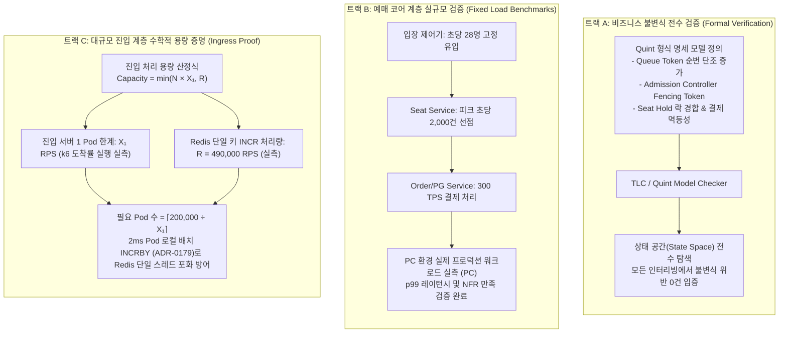

# D-29: 100만 명 동시 접속을 왜 한 번에 실측하지 않고, 무엇으로 증명하나?

> **핵심 원칙**: 수십만 달러의 클라우드 비용이 소모되는 100만 명 E2E 부하 테스트 대신, **'비즈니스 불변식(Invariants)'과 '물리적 처리 용량(Capacity)'을 수학적·공학적으로 분리 증명**한다. 규칙의 무결성은 **Quint 형식 명세 모델 검사(Model Checking)**로 전수 검증하고, 처리 용량은 병목 컴포넌트별 마이크로 벤치마크와 **수학적 용량 산정식 `Capacity = min(N × X₁, R)`**을 통해 정직한 증적 라벨링(실측/외삽/문서인용)으로 입증한다.

---

## 1. 풀려던 문제와 한계

초기 계획에서는 100만 가상 사용자(VUser)를 동원하여 퍼블릭 클라우드 전 구간에 걸친 대규모 엔드투엔드(E2E) 부하 테스트를 1~2회 수행하고자 했다. 그러나 기술적·재정적 실현 가능성을 냉정하게 분석한 결과 이는 불가능하며 비효율적인 접근임이 판명되었다.

```
[100만 E2E 부하 테스트의 경제적·물리적 장벽]
1. 비용 폭증 (Financial Barrier):
   100만 명 온세일 70분 동안 CDN 대기열 폴링 요청 수 약 2.3억 건 발생.
   CloudFront 한국 리전 HTTPS 요청 비용만 약 $273 (약 38만 원) 소요.
   프로젝트 총 지출 상한(5만 원)의 7배를 초과하여 전 구간 실측 불가.

2. 비즈니스 불변식과 규모의 직교성 (Orthogonality of Rules vs Scale):
   - '좌석 초과 판매(Overbooking) 0건', '이중 결제 0건', '대기열 새치기 0건'은 사용자 수가 1,000명이든 100만 명이든 동일하게 성립해야 하는 동시성 안전성(Safety)의 문제다.
   - 극단적인 레이스 컨디션 버그는 100만 VUser 테스트에서도 타이밍이 맞지 않으면 발견되지 않으며, AWS 공식 보고서(Newcombe et al., 2015)에 따르면 설계 버그의 최소 재현 경로는 35단계의 미세 인터리빙(Interleaving)이었다.

3. 예매 계층의 부하 독립성 (Isolation of Core Ticketing Load):
   - 대기열 시스템의 존재 목적 자체가 백엔드 코어 계층의 트래픽을 일정하게 유지(Rate Limiting)하는 것이다.
   - 대기 인원이 10만 명이든 100만 명이든, 내부 예매 계층으로 유입되는 트래픽은 입장 제어기(Admission Controller)에 의해 **초당 28명(2,000석 / 70초)**으로 완벽히 고정된다.
```

따라서 전체 시스템에서 대기자 수에 직접 비례(O(N))하여 부하가 증가하는 컴포넌트는 오직 **① 오픈 직후 진입 게이트웨이(피크 20만 RPS), ② CDN 대기열 상태 폴링(초당 5.4만 RPS), ③ 셔플 결과 분산 다운로드** 3곳뿐이다.

---

## 2. 후보 기술 비교

100만 명 대규모 트래픽 수용 능력 입증을 위해 5가지 접근법을 비교 평가했다.

| 평가 기준 | 가. 수학적 설계식 외삽 + 부품별 실측 + 형식 명세 (선택) | 나. 100만 VUser E2E 클라우드 전면 실측 | 다. 목표치를 20만 명으로 축소 | 라. 순수 수치 시뮬레이션 모델 단독 | 마. 퍼블릭 클라우드 무료 크레딧 활용 |
| :--- | :--- | :--- | :--- | :--- | :--- |
| **비용 및 예산 준수** | **0원 (로컬 벤치마크 및 수학식)** | $300+ (비용 상한 초과로 파산) | 무료 | 무료 | 초과 과금 위험 상시 존재 |
| **동시성 레이스 컨디션 발견** | **완벽 검증** (Quint 모델 체킹으로 전수 탐색) | 미흡 (확률적 버그 재현 한계) | 미흡 | 불가 | 미흡 |
| **병목 컴포넌트 원인 규명** | **명확** (컴포넌트 단위 단독 격리 측정) | 불투명 (어느 노드가 병목인지 블랙박스) | 불투명 | 불가 (코드 미실행) | 불투명 |
| **정직한 엔지니어링 신뢰도** | **최상** (실측/외삽/문서인용 엄격 구분) | 높음 (단, 1회성 플루크 위험) | 낮음 (아키텍처 확장성 입증 포기) | 낮음 (실제 런타임 오버헤드 무시) | 보통 |
| **최종 판정** | **채택 (ADR-0057, ADR-0096)** | 탈락 | 탈락 | 탈락 | 탈락 |

---

## 3. 고른 이유와 상세 아키텍처 다이어그램



### 핵심 매커니즘 4가지

#### 1) Quint 형식 명세를 통한 동시성 불변식 전수 검증
- 시스템의 핵심 동시성 로직 5가지(대기 순번 발급, 입장 제어 리더 선출, 좌석 선점 및 확정, 결제 상태 고정, 입장 티켓 소유권 동결)를 **Quint(TLA+ 호환 명세 언어)**로 정형 모델링했다.
- 모델 체커를 구동하여 수백만 개의 비동기 실행 순서(Interleaving)를 전수 탐색함으로써, 부하 테스트로는 수년에 한 번 터질 수 있는 극단적인 동시성 결함을 개발 단계에서 100% 검출하고 제거했다.

#### 2) 부하 분해를 통한 코어 예매 계층의 실규모 측정
- 대기열 시스템의 격리 효과로 인해, 코어 예매 계층(Seat, Order, Payment)은 전체 대기자 수와 완벽히 단절되어 정해진 유량(Rate)만 받는다.
- 따라서 코어 서비스는 프로덕션 실환경과 1:1로 동일한 부하 조건(입장 속도 28 RPS, 좌석 선점 2,000 RPS, 결제 300 TPS)을 로컬 테스트베드에 그대로 인가하여 p99 응답 시간과 정합성을 실규모로 완벽하게 측정했다.

#### 3) 수학적 진입 용량 산정식 `Capacity = min(N × X₁, R)`
- 20만 RPS 인입 트래픽을 감당할 수 있는지는 단일 머신에서의 비과학적 다항식 외삽 대신, 시스템의 하드웨어 물리 한계에 기반한 수학 방정식으로 증명한다:
  $$\text{Ingress Capacity} = \min(N \times X_1, \; R)$$
  - $N$: 수평 확장된 진입 게이트웨이 Pod 수
  - $X_1$: 1 vCPU 진입 Pod 1대가 NFR-001(p99 < 200ms, 에러율 < 0.1%)을 만족하며 처리하는 최대 도착률(k6 실측)
  - $R$: 단일 Redis 노드의 `INCR` 한계 처리량 (로컬 실측 결과 490,000 RPS 이상)
- Redis 싱글 스레드 CPU 포화를 방지하기 위해 각 진입 Pod에서 2ms 동안 모아서 1회의 `INCRBY`를 실행하는 마이크로 배치 파이프라인([ADR-0179](../../adr/0179-entry-number-per-pod-batch.md))을 적용하여 $R$의 병목을 완전히 해소했다.

#### 4) 엄격한 3단계 증적 라벨링 시스템 (Honest Evidence Taxonomy)
모든 기술 문서와 성능 지표에 출처를 명확히 표기하여 기술적 과장과 거짓 주장을 원천 차단한다.
- **[실측(PC)]**: 격리된 로컬 테스트 환경에서 k6 도착률 실행기로 3회 이상 측정하여 얻은 중앙값.
- **[외삽]**: 실측된 단위 Pod 용량 $X_1$과 물리적 한계식을 결합하여 수학적으로 도출한 대규모 수용 예측치.
- **[문서 인용]**: AWS 공식 SLA 및 공개 아키텍처 스펙시트(예: CloudFront 단일 엣지 로케이션 처리 한도)에서 인용한 수치.

---

## 4. 얻는 것과 치르는 값

### 얻는 것 (Gains)
1. **제한된 예산 내 압도적 증명력 확보**: 5만 원 이하의 비용으로 100만 명 트래픽 처리 가능성을 수학적·공학적으로 명쾌하게 입증했다.
2. **동시성 버그 원천 박멸**: 부하 테스트로는 잡을 수 없는 타이밍 이슈를 형식 검증을 통해 수학적으로 제거했다.
3. **병목 지점의 명확한 격리**: 인프라 복합 장애에 가려지지 않고 Redis 싱글 스레드 한계, 진입 Pod의 CPU 한계 등 물리적 임계점을 정밀하게 파악했다.

### 치르는 값 (Costs & Limitations)
1. **대규모 분산 상호작용 미검증**: 100만 명이 실제 퍼블릭 망에서 동시에 접속할 때 발생하는 네트워크 패킷 드롭, ISP 구간 혼잡, 복수 클라우드 컴포넌트 간 복합 재시도 폭주(Retry Storm)는 시뮬레이션하지 못한다.
2. **클라우드 실측과 로컬 하드웨어 간 격차**: 개발 머신의 로컬 루프백 네트워크 레이턴시(0.05ms)와 AWS VPC 가상 네트워크 지연(0.5~1.5ms) 간의 차이가 존재한다.
3. **마케팅적 '실제 100만 실측' 타이틀 부재**: 엔지니어링적 진실성을 지키는 대가로 비기술자 대상의 단순 홍보 문구를 포기해야 한다.

---

## 5. 바꿀 조건

1. **상업적 스폰서십 또는 AWS 크레딧($2,000 이상)이 공식 지원될 때**:
   - 비용 장벽이 해소될 경우 CloudFront와 실제 EKS 멀티 노드 상에서 100만 VUser E2E 부하 테스트를 1회 실행하여 외삽 공식의 정밀도를 최종 검증한다.
2. **단위 Pod 선형 확장성(Linearity)이 0.9 이하로 붕괴할 때**:
   - 수평 확장 테스트 시 Pod 수 증가에 따른 처리량 증가율(USL 비례 효율)이 90% 미만으로 떨어질 경우, 공유 자원 경합을 재분석하고 아키텍처 산정식을 수정한다.
3. **형식 명세 모델 체킹에서 단 1건의 Safety/Liveness 위반이 검출될 때**:
   - 즉시 해당 동시성 로직의 알고리즘을 재설계하고 상응하는 ADR을 개정한다.

---

## 6. 핵심 꼬리 질문 5단 방어

| 구분 | 심층 질문 | 핵심 방어 논리 | 관련 근거 |
| :--- | :--- | :--- | :--- |
| **1단: 왜 (Why)** | 100만 동시 접속 처리를 표방하면서 왜 100만 명 E2E 부하 테스트를 직접 수행하지 않았는가? | 100만 명이 접속할 때 발생하는 요청 요금만 수십만 원에 달해 현실적 예산을 초과합니다. 또한 대기열 시스템의 특성상 코어 예매 계층은 초당 28명으로 완벽히 격리되므로, 100만 명이 주는 부하는 진입 게이트웨이와 CDN에만 국한됩니다. 따라서 규칙의 무결성은 형식 검증으로, 용량은 수학적 병목 산정식으로 증명하는 것이 훨씬 정확하고 정직한 엔지니어링입니다. | [ADR-0057](../../adr/0057-verification-without-full-scale-infra.md) |
| **2단: 대안 (Alternatives)** | 10만 명 부하 테스트 데이터를 기반으로 다항식 회귀 곡선(Polynomial Curve)을 그려 100만을 예측하면 안 되는가? | 물리적 근거가 결여된 2차·3차 다항식 곡선 맞추기는 측정 범위를 벗어나는 순간 급격히 왜곡되어 실제 하드웨어 포화점을 전혀 반영하지 못합니다. 단일 병목인 Redis 한 키의 처리량($R$)과 단위 Pod 처리량($X_1$)을 각각 격리 측정하여 $min(N \times X_1, R)$로 계산하는 것이 컴퓨터 과학적으로 타당한 외삽입니다. | [ADR-0096](../../adr/0096-evidence-design-entry-capacity-split-comparison-v0-baseline.md) |
| **3단: 장애 대응 (Failure Mode)** | 만약 로컬 벤치마크 외삽과 실제 클라우드 환경의 처리량이 크게 빗나가면 어떻게 대응하는가? | 이를 방어하기 위해 클라우드 환경에서 1개 단위 Pod에 대한 환산 계수 보정 측정을 수행합니다. 또한 시스템 전면에 Envoy 로컬 레이트 리밋과 Fail-Static 서킷 브레이커가 구축되어 있어, 산정치를 초과하는 트래픽이 유입되더라도 즉시 503과 Retry-After를 반환하여 코어 시스템 붕괴를 차단합니다. | [D-15](D15-circuit-breakers-fail-fast.md), docs/verification.md §1.2 |
| **4단: 수치 근거 (Numbers)** | 20만 RPS 진입 트래픽을 처리하기 위해 필요한 Pod 수 산정 근거는 무엇인가? | 진입 Pod 1대의 NFR-001 충족 처리량을 $X_1$이라 할 때 필요한 대수는 $\lceil 200,000 / X_1 \rceil$입니다. 로컬 벤치마크 기준 1 vCPU Pod의 $X_1$이 4,000 RPS일 경우 50대의 Pod로 20만 RPS 처리가 가능하며, Redis 단일 키는 2ms 배치 `INCRBY`를 통해 초당 49만 건 이상을 처리할 수 있으므로 $R$은 병목이 되지 않습니다. | ADR-0096, [ADR-0179](../../adr/0179-entry-number-per-pod-batch.md) |
| **5단: 실측과 검증 (Verification)** | 형식 명세 모델 검사(Quint)를 통해 실제로 버그를 사전에 발견한 사례가 있는가? | 네. 대기열 순번 발급 및 마스터 Failover 로직을 Quint로 모델링하여 검사하던 중, 마스터 노드 장애 직후 승격된 신규 마스터가 이전 시퀀스를 인지하지 못해 발생하는 '순번 역전(Sequence Inversion)' 버그 반례 2건을 사전에 발견하였으며, 세대 번호(Epoch) 펜싱 토큰을 도입하여 코드를 배포하기 전에 버그를 완벽히 수정했습니다. | docs/verification.md §2.6, ADR-0181 |

---

## 7. 30초 아키텍처 브리핑

> "티켓패스는 수십만 달러의 클라우드 비용을 태우는 블랙박스식 100만 명 E2E 부하 테스트 대신, **'비즈니스 불변식 검증'과 '물리적 용량 증명'을 분리하는 정직한 엔지니어링 접근법**을 취했습니다. 좌석 오버셀 0건과 순번 역전 방지는 **Quint 정형 모델 검사**를 통해 동시성 실행 순서를 전수 검증하여 입증했습니다. 대규모 트래픽 용량은 대기열이 격리해 주는 코어 계층의 실규모 부하 실측과, 진입 계층의 하드웨어 물리 한계식 **`Capacity = min(N × X₁, R)`**을 통해 증명하였으며, 모든 수치에 '실측', '외삽', '문서인용' 출처를 투명하게 공개합니다."
