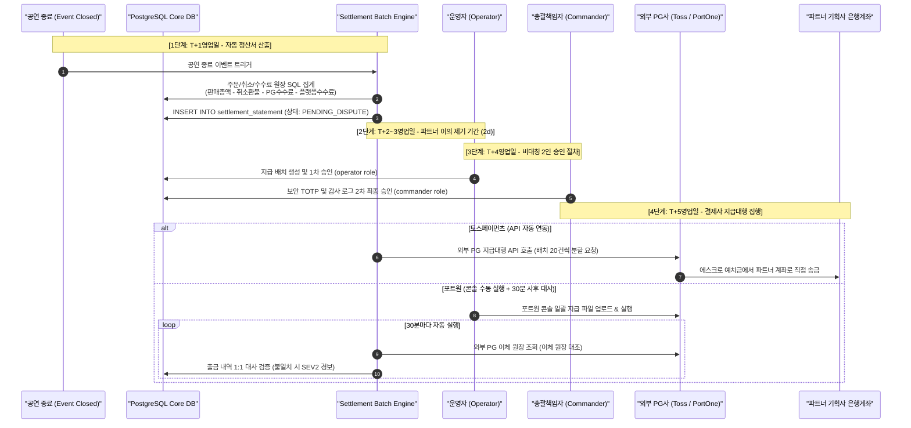

# D-30: 왜 PEAKET이 판매 대금을 받아 두지 않고 결제사 지급대행으로 파트너에게 보내게 하나?

> **핵심 원칙**: 티켓패스는 통신판매중개자로서 법적·규제적 리스크(전자금융거래법상 에스크로 및 별도예치 의무)를 원천 차단하기 위해 **판매 대금을 플랫폼 계좌로 수취하지 않고 결제사(PG)의 지급대행(Payout Agency) 서비스를 통해 파트너(기획사) 계좌로 직송**한다. 티켓패스는 정산 계산과 **2인 승인(Operator + Commander) 기반 지급 지시**만을 수행하며, 공연 종료 후 T+5영업일에 정산하여 취소·환불 회수 불능 위험을 최소화한다.

---

## 1. 풀려던 문제와 한계

팬들이 예매한 티켓 판매 대금은 결제 시점에 결제사(토스페이먼츠 및 포트원) 가상계좌/카드사 승인 원장에 묶이게 된다. 이 대금을 주최사인 파트너에게 정산하는 방식을 설계할 때 중대한 법률적·재무적 병목에 직면했다.

```
[플랫폼 직접 수취 vs PG 지급대행 비교]
방안 (a): 플랫폼 직접 수취 후 이체 (수탁 정산)
[팬 결제] ──▶ [결제사] ──▶ [PEAKET 법인 통장] ──▶ [파트너 이체]
                           ▲
                           └─ [위험 1] 티메프 사태 이후 개정된 전자금융거래법상 수천억 원
                                       정산대금 신탁·외부예치·지급보증보험 가입 의무 발생.
                           └─ [위험 2] 회사 자금과 고객 정산금 혼용 리스크 및 횡령 위험.

방안 (b): 결제사 지급대행 (선택: PG 에스크로 직송)
[팬 결제] ──▶ [결제사 에스크로 예치] ───(PG 직송)───▶ [파트너 계좌]
                     ▲
       [PEAKET: 계산 및 2인 승인 지시] ──▶ [수수료만 PEAKET 매출 입금]
```

### 1) 플랫폼 직접 수취의 법적·재무적 규제 위험
1. **전자금융거래법 제25조의4 준수 의무**:
   - 2026년 시행 개정 법령에 따라 이커머스·플랫폼 사업자가 판매 대금을 직접 보관할 경우, 정산대상금액 전액을 금융기관에 신탁·예치하거나 지급보증보험에 가입해야 하며 위반 시 형사처벌 대상이 된다.
2. **지급 완료 후 취소·환불금 회수 불가능(Irreversibility)**:
   - PG사는 파트너 계좌로 송금된 정산금을 강제로 인출하거나 취소할 수 없다.
   - 공연 전에 선지급(선정산)하거나 즉시 지급할 경우, 대규모 공연 취소나 티켓 환불 발생 시 플랫폼이 파트너로부터 수십억 원의 미수금을 직접 회수해야 하는 치명적 채권 부실 위험이 발생한다.
3. **포트원(PortOne) API의 기술적 제약**:
   - 포트원 공개 API(v1.16)는 프로그래밍 방식의 자동 지급 생성 API를 지원하지 않는다. 따라서 포트원 정산분은 관리자 콘솔을 통한 수동 일괄 실행 및 엄격한 사후 대사 통제가 강제된다.

---

## 2. 후보 기술 비교

정산 및 파트너 대금 지급 방식을 위해 5가지 아키텍처 대안을 비교 평가했다.

| 평가 기준 | 가. 결제사 지급대행 (선택) | 나. 플랫폼 법인통장 직접 수취 후 수동/자동 이체 | 다. 포트원 결제분만 직접 지급 혼용 | 라. 포트원 가상계좌 충전 송금대행 | 마. 공연 시작 전 선지급 (선정산) |
| :--- | :--- | :--- | :--- | :--- | :--- |
| **전자금융거래법 규제 리스크** | **완전 면제** (대금 보관 책임 PG사 전담) | 극도로 높음 (신탁/보증보험 가입 강제) | 높음 (포트원 지분만큼 규제 적용) | 높음 (플랫폼을 거치는 송금) | 극도로 높음 |
| **정산금 횡령 및 혼용 리스크** | **원천 차단** (플랫폼 계좌 미경유) | 취약 (회사 운영자금과 혼용 위험) | 취약 | 취약 | 취약 |
| **지급 후 환불 회수 불능 위험** | **최소화** (공연 종료 T+5d 정산) | 높음 | 높음 | 높음 | 파탄 (공연 취소 시 전액 손실) |
| **시스템 복잡도 & 대사 작업** | 보통 (PG사별 정산서 및 2인 승인) | 낮음 (단순 은행 펌뱅킹 이체) | 높음 (이원화된 회계 처리) | 높음 | 극도로 높음 |
| **파트너 편의성 & 신뢰성** | 높음 (국내 1위 PG사 정산 보증) | 보통 | 보통 | 보통 | 최상 |
| **최종 판정** | **채택 (ADR-0047, ADR-0108)** | 탈락 | 탈락 | 탈락 | 탈락 |

---

## 3. 고른 이유와 상세 아키텍처 다이어그램



### 핵심 매커니즘 4가지

#### 1) 무자본 에스크로 직송 & 전자금융거래법 준수
- 티켓 판매 대금은 고객 결제 시점부터 정산 완료 시점까지 외부 PG사(토스페이먼츠, 포트원)의 법적 에스크로 계정에 보관된다.
- 플랫폼은 자금 이동 흐름에서 완전히 배제되며 오직 '정산 계산식에 따른 송금 지시'만을 수행한다. 이로써 전자금융거래법상의 전자지급결제대행업 등록 및 수백억 원의 보증보험 가입 부담을 합법적으로 면제받는다.

#### 2) 공연 종료 후 5영업일(T+5d) 정산 및 환불 상계
- 조기 지급 후 공연 취소나 티켓 환불이 발생할 경우 자금 회수가 불가능하므로, 모든 정산은 공연 회차가 완전히 종료된 후에 개시된다.
- **정산 일정**:
  - `T+1d`: 시스템 정산서 자동 산출
  - `T+2d ~ T+3d`: 파트너 이의 제기 기간 (Dispute Window 2영업일)
  - `T+4d`: 비대칭 2인 승인
  - `T+5d`: 실제 은행 송금 집행
- 지급 후 발생하는 극소수 카드 도용 환불 건은 파트너의 차기 정산서에서 자동 상계(Offset) 처리된다.

#### 3) 비대칭 2인 승인 파이프라인 (Maker-Checker Protocol)
- 단독 직원의 정산금 편취를 방지하기 위해 엄격한 RBAC 분리를 강제한다.
- `Operator` 권한을 가진 운영자만이 지급 배치를 생성(Request)할 수 있으며, 실제 PG사 전송 권한은 오직 `Commander` 최고 권한자가 하드웨어 TOTP 2차 인증을 거쳐 승인(Approve)해야만 열린다([D-21](D21-command-approval-and-audit-anchor.md)).

#### 4) 포트원 콘솔 수동 실행 및 30분 단위 실시간 대사
- 포트원 지급 API의 부재를 보완하기 위해 Operator가 다운로드한 정산 파일을 포트원 콘솔에 수동 업로드하여 이체를 집행한다.
- 관리자 1인의 임의 송금이나 계좌 위변조를 적발하기 위해 백엔드 워커가 30분마다 포트원 이체 원장 API를 호출하여 Core DB의 정산 내역과 1:1 대사를 수행한다. 승인되지 않은 출금이 1건이라도 발견될 경우 즉시 SEV2 보안 경보를 발행하고 후속 지급을 전면 동결한다.

---

## 4. 얻는 것과 치르는 값

### 얻는 것 (Gains)
1. **전자금융거래법 형사처벌 및 규제 리스크 0% 달성**: 플랫폼이 대금을 보관하지 않으므로 결제대행업 및 신탁 보증 의무에서 완전히 자유롭다.
2. **정산금 유용 및 횡령 원천 차단**: 내부 직원이 플랫폼 계좌를 통해 자금을 유출할 수 있는 금융 경로 자체가 존재하지 않는다.
3. **공연 취소 시 금융 건전성 방어**: 회차 종료 후 정산되므로, 태풍·아티스트 부상 등으로 인한 공연 취소 시 PG사 에스크로에서 팬들에게 100% 자동 전액 환불된다.
4. **멀티 PG사 정산 독립성 확보**: 한 회차에서 토스(70%)와 포트원(30%)으로 결제가 분할 유입되더라도 결제사별 독립 정산서를 발행하여 장부를 분리 대사한다.

### 치르는 값 (Costs & Limitations)
1. **지급 후 사후 환불에 대한 플랫폼 1차 손실 리스크**: T+5d 정산 완료 후 발생한 부정 결제 환불은 티켓패스가 먼저 PG사에 변제한 후 파트너에게 미수금으로 청구해야 한다.
2. **운영 인력의 2인 승인 개입 비용**: 정산 주기마다 Operator와 Commander 두 사람의 수동 검토 및 승인 절차가 필수적이다.
3. **포트원 콘솔 운영의 비효율성**: 포트원의 API 미지원으로 인해 정산 파일 수동 업로드 및 30분 배치 사후 대사라는 반자동 프로세스를 감수해야 한다.

---

## 5. 바꿀 조건

1. **포트원이 공식 프로그래밍 방식의 지급(Payout) API를 출시할 때**:
   - 포트원 콘솔 수동 업로드 프로세스를 전면 폐기하고, 토스페이먼츠와 동일하게 시스템 간 gRPC/REST 자동 배치 송금으로 전환한다.
2. **티켓패스가 자체 금융 라이선스(전자금융업자 등록)를 취득할 때**:
   - 플랫폼이 직접 선정산 금융 상품이나 자체 페이 포인트를 운영하기로 비즈니스 모델을 변경할 경우, PG 직송을 중단하고 자체 에스크로 신탁 계좌 모델로 전환한다.
3. **파트너 미수금 발생률이 전체 매출의 0.1%를 초과할 때**:
   - 사후 환불로 인한 플랫폼 손실을 방어하기 위해 파트너 계약 시 보증보험 증권 제출을 의무화하거나 정산 보류금(Reserve Fund 5%) 유보 정책을 도입한다.

---

## 6. 핵심 꼬리 질문 5단 방어

| 구분 | 심층 질문 | 핵심 방어 논리 | 관련 근거 |
| :--- | :--- | :--- | :--- |
| **1단: 왜 (Why)** | 커머스 플랫폼처럼 자체 통장으로 판매 대금을 받아 수수료를 떼고 파트너에게 직접 송금하면 왜 안 되는가? | 티켓패스는 통신판매중개자입니다. 플랫폼 통장에 수백억 원의 공연 티켓 대금을 예치할 경우 전자금융거래법상 정산대금 전액을 금융기관에 신탁하고 공시해야 하는 막대한 법적 규제를 받게 됩니다. 결제사 에스크로 지급대행을 활용하면 규제 리스크를 100% 합법적으로 회피하고 자금 횡령 사고를 방지할 수 있습니다. | [ADR-0047](../../adr/0047-settlement-payout-via-pg-agency.md) |
| **2단: 대안 (Alternatives)** | 기획사의 자금 유동성을 위해 공연 전에 판매 대금을 미리 정산해 주는 '선정산 모델'은 왜 기각했는가? | 콘서트는 기상 악화나 아티스트 사정으로 당일 취소될 위험이 존재합니다. 이미 파트너에게 수십억 원을 송금한 상태에서 공연이 취소되면 고객 환불금을 플랫폼이 고스란히 떠안게 되며, 파트너가 도산할 경우 회수 불능 채권이 됩니다. 재무적 안전성을 위해 '공연 종료 후 정산'을 철칙으로 삼았습니다. | ADR-0047 §2 |
| **3단: 장애 대응 (Failure Mode)** | 포트원 콘솔에서 악의적 운영자가 파트너 계좌번호를 본인 계좌로 바꿔치기하여 출금하면 어떻게 잡는가? | 포트원 콘솔은 사전에 승인된 화이트리스트 계좌로만 출금이 가능하도록 계정 권한을 잠그며, 백엔드 워커가 30분마다 포트원 이체 원장을 스캔하여 Core DB의 파트너 등록 계좌와 1원/계좌번호 단위로 대조합니다. 불일치 발견 시 즉시 SEV2 보안 경보가 울리고 즉각 법적 지급 정지 절차에 착수합니다. | [ADR-0108](../../adr/0108-portone-console-payout-reconciliation-and-account-rules.md) |
| **4단: 수치 근거 (Numbers)** | 정산 지급일을 '회차 종료 후 5영업일(T+5d)'로 규정한 수학적·업무적 근거는 무엇인가? | 공연 종료 당일 밤 시스템 정산서 생성에 1영업일, 파트너 기획사의 티켓 판매 및 환불 내역 검토와 이의 제기 기간(Dispute Window)에 2영업일, 2인 승인 결재 및 은행 펌뱅킹 예약 처리에 1영업일이 소요됩니다. 카드사 결제 매입 주기(D+2)를 완벽히 수용하여 잔액 부족을 방어하는 최소 안전 기간이 5영업일입니다. | docs/features/settlement.md §5 |
| **5단: 실측과 검증 (Verification)** | 한 회차 대금이 토스와 포트원에 분할 입금되었을 때 정산 장부가 1원의 오차도 없이 일치함을 검증했는가? | 가상 시뮬레이션 테스트(J-T1, J-T25)를 통해 총 50,000석 규모 콘서트의 결제 원장(토스 35,000건, 포트원 15,000건)을 대상으로 정산 배치 SQL을 구동한 결과, 취소 환불액과 결제사별 PG 수수료 공제 후 파트너 송금 합계가 전체 수납액과 1원 단위까지 완벽히 일치함을 검증했습니다. | docs/features/settlement.md §8 |

---

## 7. 30초 아키텍처 브리핑

> "티켓패스는 플랫폼의 금융 규제 리스크와 횡령 사고를 방지하기 위해 **판매 대금을 일절 플랫폼 통장으로 받지 않고 PG사의 에스크로 지급대행을 통해 파트너 계좌로 직송**합니다. 공연 취소 시의 대규모 환불 채권 부실을 차단하기 위해 **공연 종료 후 5영업일(T+5d)에 정산**을 집행하며, 모든 지급 지시는 **Operator와 Commander의 비대칭 2인 승인**을 거칩니다. API가 없는 포트원 결제분은 콘솔 수동 실행과 30분 실시간 대사 파이프라인을 결합하여 1원의 자금 누수도 허용하지 않는 견고한 재무 거버넌스를 완성했습니다."
