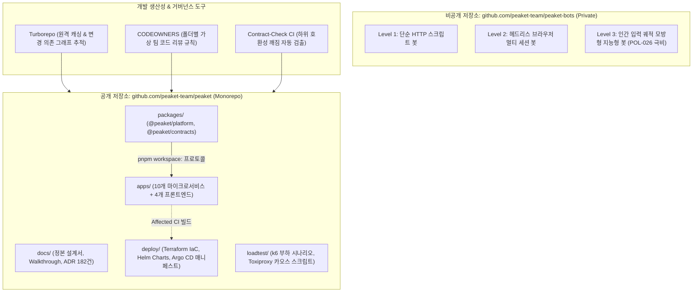

# D-31: 코드 저장소를 왜 공개 모노레포 하나와 비공개 봇 저장소 하나로 두나?

> **핵심 원칙**: 가상 조직 흉내를 내기 위해 14개로 파편화되었던 폴리레포(Polyrepo)를 과감히 폐기하고, **단일 공개 모노레포(`peaket`)와 비공개 봇 저장소(`peaket-bots`) 2개 체제**로 전면 통합했다. 공개 저장소 하나로 문서·서비스·배포 스펙·부하 테스트를 즉각 재현 가능하게 만들면서도, 악용 소지가 있는 고급 매크로 봇 시뮬레이터(공연법 및 POL-026)는 물리적으로 격리하여 보안 컴플라이언스를 완벽히 사수한다.

---

## 1. 풀려던 문제와 한계

초기 아키텍처(ADR-0016)에서는 9개의 가상 조직(Platform, Core, Gateway, Ticketing 등)이 각자의 저장소 경계를 가지고 일하는 모습을 시뮬레이션하기 위해 총 14개의 독립 저장소(Polyrepo)를 구축했다. 그러나 실제 프로젝트 유지보수 및 채용 면접 관점에서 극단적인 비효율과 마찰이 발생했다.

```
[14개 폴리레포 구조의 파탄 과정]
[1단계: 14개 Polyrepo 난립]
- 서비스별 10개 Repo + 프론트 모노레포 + 계약(Contracts) + 배포(GitOps) + 문서 Repo
➔ 문제 1: 단일 기능 수정 시 4개 저장소 교차 PR(Cross-repo PR) 발생, 버전 릴리즈 지옥.
➔ 문제 2: GitHub Packages 인증 토큰 없이는 외부 개발자가 소스 코드를 빌드조차 못함.
➔ 문제 3: 평가자가 여러 저장소를 오가며 설계와 코드를 추적하기 불가능.

[2단계: 4개 저장소 절충안 (ADR-0165)]
- peaket(앱) + peaket-gitops(배포) + .github(보안 워크플로) + peaket-loadtest(부하)
➔ 여전히 빌드 파이프라인과 배포 설정이 분리되어 1인 개발 환경에서 오버헤드 잔존.

[3단계: 최종 2개 저장소 단일화 (ADR-0169 채택)]
- 1. 공개 `peaket` 모노레포: 전사 서비스 + 프론트 + 인프라(Terraform/K8s) + 부하테스트 일원화.
- 2. 비공개 `peaket-bots` 저장소: 불법 매크로 악용 방지(공연법 제4조의2)를 위해 공격 도구만 격리.
```

### 1) 기술적·보안적 제약 조건
1. **GitHub Packages 의존성 격리 장벽**:
   - 내부 공통 모듈(`@peaket/platform`, `@peaket/contracts`)을 별도 패키지로 배포하면, 공개 저장소임에도 `GITHUB_TOKEN` 인증 없이는 `pnpm install`이 실패하여 오픈소스 재현성이 파괴된다.
2. **공연법 개정안 및 공격 도구 공개 금지 규정 (POL-026)**:
   - 시스템 방어력 검증을 위해 제작한 Level 3 봇(마우스 무작위 곡선, 결제 수단 자동 입력, 헤드리스 브라우저 탐지 우회 스크립트)은 상용 예매처를 공격하는 불법 매크로로 악용될 소지가 매우 높다.
   - 단일 공개 저장소 내에서는 특정 디렉터리만 비공개로 감출 수 없으므로, 물리적 비공개 저장소 분리가 법적으로 강제된다.

---

## 2. 후보 기술 비교

코드베이스 및 저장소 형상 관리를 위해 5가지 대안을 비교 평가했다.

| 평가 기준 | 가. 공개 모노레포 + 비공개 봇 저장소 2개 (선택) | 나. 14개 폴리레포 (서비스·계약·배포 전면 분리) | 다. 4개 저장소 (App, GitOps, CI, LoadTest) | 라. 100% 단일 공개 모노레포 (봇 포함) | 마. 봇 코드를 Git 없이 로컬 머신에만 방치 |
| :--- | :--- | :--- | :--- | :--- | :--- |
| **원클릭 빌드 재현성** | **완벽** (토큰 없이 클론 후 `pnpm build` 즉시 성공) | 파탄 (패키지 레지스트리 토큰 요구) | 보통 (App 단독 빌드는 가능) | 완벽 | 완벽 |
| **매크로 악용 법적 리스크** | **완전 격리** (봇 공격 코드 물리 비공개) | 완전 격리 (봇 단독 비공개) | 완전 격리 | **위법 소지** (개정 공연법 및 POL-026 위반) | 안전 |
| **코드 변경 리드타임** | **단일 PR로 원자적(Atomic) 커밋 반영** | 극도로 느림 (4개 저장소 순차 머지 필요) | 느림 (App 머지 후 GitOps 승격 PR) | 단일 PR | 빠름 |
| **평가자/면접관 가독성** | **최상** (링크 하나로 문서·코드·인프라 조망) | 최악 (14개 링크를 헤매야 함) | 보통 | 최상 | 보통 |
| **CI 파이프라인 효율** | **Turborepo 기반 변경된 패키지만 선택 빌드** | 저장소마다 CI 독립 실행 (빌드 시간 낭비) | CI 분산 | 선택 빌드 | CI 관리 불가 |
| **최종 판정** | **채택 (ADR-0169)** | 탈락 (ADR-0016 폐기) | 탈락 (ADR-0165) | 탈락 | 탈락 |

---

## 3. 고른 이유와 상세 아키텍처 다이어그램



### 핵심 매커니즘 4가지

#### 1) `pnpm workspace` 기반 Zero-Token 패키지 참조
- 전사 공통 모듈(`@peaket/platform`, `@peaket/contracts`, `@peaket/validation`)을 외부 npm이나 GitHub Packages 레지스트리에 퍼블리싱하지 않는다.
- `package.json`에서 `"@peaket/contracts": "workspace:*"` 구문을 적용하여, 외부 개발자가 저장소를 클론했을 때 별도의 인증 토큰 설정 없이 `pnpm install` 한 번으로 모든 심볼릭 링크가 즉시 연결된다.

#### 2) Turborepo 기반 Affected CI 빌드 파이프라인
- 모노레포의 빌드 지연을 극복하기 위해 Turborepo를 적용했다.
- PR 발생 시 Git Diff를 기반으로 변경된 앱과 그에 의존하는 패키지만 계산(`turbo run test --filter=...[origin/develop]`)하여 실행하므로, 전체 14개 앱이 존재하더라도 PR 당 CI 수행 시간이 3분 이내로 유지된다.

#### 3) 가상 조직 거버넌스를 위한 폴더 단위 `CODEOWNERS`
- 물리적으로 저장소를 나누지 않고도, GitHub의 `.github/CODEOWNERS` 설정을 통해 마이크로서비스별 책임 영역을 명확히 정의했다:
  - `/apps/queue-svc/` ➔ `@peaket-team/traffic-squad`
  - `/apps/payment-svc/` ➔ `@peaket-team/settlement-squad`
  - `/packages/contracts/` ➔ `@peaket-team/platform-architecture`
- 계약 파일(`packages/contracts`)을 수정할 경우 반드시 아키텍처 팀의 리뷰 승인이 있어야만 머지되도록 브랜치 프로텍션 규칙을 결합했다.

#### 4) 하위 호환성 깨짐 검증 도구 (`contract-check`)
- 백엔드와 프론트엔드가 한 저장소에 있으면 개발자가 API 계약을 단일 커밋으로 바꾸면서 배포 호환성을 파괴하는 실수를 저지르기 쉽다.
- 이를 방지하기 위해 CI에서 신규 브랜치의 gRPC Protobuf 및 OpenAPI 스키마를 현재 운영에 배포된 최신 Git 태그(`release-v*`)와 비교하는 `contract-check` 파이프라인을 구축하여, Breaking Change가 감지되면 PR 머지를 즉시 차단한다.

---

## 4. 얻는 것과 치르는 값

### 얻는 것 (Gains)
1. **압도적인 프로젝트 탐색성과 평가 편의성**: 평가자와 면접관이 단 하나의 URL에서 182건의 ADR, 34건의 결정 카드, 10개 마이크로서비스 소스 코드, Kubernetes 인프라 코드를 원스톱으로 조망할 수 있다.
2. **원클릭 로컬 개발 환경 재현**: 복잡한 사설 토큰 설정이나 14개 저장소 클론 스크립트 없이 단일 명령어로 전체 개발 환경을 띄울 수 있다.
3. **법적 컴플라이언스 준수**: Level 3 공격 매크로 코드를 물리적 비공개 저장소로 격리하여 상용 티켓팅 플랫폼에 대한 사이버 공격 악용 가능성을 100% 차단했다.
4. **원자적 변경(Atomic Change) 지원**: 신규 비즈니스 기능 추가 시 백엔드 엔드포인트와 프론트엔드 연동 코드를 단 1개의 PR로 묶어 완결성 있게 배포할 수 있다.

### 치르는 값 (Costs & Limitations)
1. **Argo CD 설정 분리 권고 미준수**: GitOps 표준 권고(설정 저장소를 애플리케이션 코드와 분리하라) 대신 `peaket` 단일 저장소 내의 `deploy/` 디렉터리를 참조하므로, 배포 이미지 승격 커밋이 코드 커밋 히스토리에 섞이게 된다.
2. **단일 릴리즈 브랜치 병목**: 프로덕션 배포 파이프라인이 단일 저장소에 집중되어 있어, 특정 1개 서비스의 릴리즈 차단 시 타 서비스 배포에 영향을 주지 않도록 릴리즈 플래그(Feature Flags) 관리가 필수적이다.
3. **영향도 오판 위험**: CI 의존성 그래프 필터링이 실패할 경우 일부 테스트가 누락될 수 있으므로, 매일 새벽 전체 풀 테스트(Daily Full Build) 배치를 병행 운영한다.

---

## 5. 바꿀 조건

1. **실제 엔지니어링 조직이 30명 이상으로 확대되고 독립 배포 권한이 법적으로 요구될 때**:
   - 팀별 보안 격리 및 개별 GitOps 승인 파이프라인이 필수적이 되는 시점에, ADR-0165 설계로 회귀하여 `peaket-gitops` 및 서비스별 저장소 분리를 집행한다.
2. **Turborepo 캐시를 적용해도 CI 빌드 시간이 10분을 초과할 때**:
   - 빌드 도구를 Bazel/Nx로 마이그레이션하거나 대규모 분산 원격 캐싱 인프라를 도입한다.
3. **봇 방어 체계가 머신러닝 모델 기반으로 전면 전환될 때**:
   - 봇 시뮬레이터 저장소를 MLOps 데이터 파이프라인 및 모델 학습 전용 레포지토리로 확장 개편한다.

---

## 6. 핵심 꼬리 질문 5단 방어

| 구분 | 심층 질문 | 핵심 방어 논리 | 관련 근거 |
| :--- | :--- | :--- | :--- |
| **1단: 왜 (Why)** | 마이크로서비스 아키텍처(MSA)를 지향하면서 왜 저장소는 모노레포로 합쳤는가? | 마이크로서비스의 본질은 '독립적인 런타임 배포와 장애 격리'이지, 물리적인 Git 저장소의 개수가 아닙니다. 14개 폴리레포는 가상 조직 흉내에 불과했으며 버전 관리와 로컬 빌드를 지옥으로 만들었습니다. 독립 컨테이너 빌드와 도메인 경계는 모노레포 안에서도 CI와 디렉터리 격리로 완벽히 달성됩니다. | [ADR-0169](../../adr/0169-one-public-monorepo-and-private-bot-repository.md) |
| **2단: 대안 (Alternatives)** | 왜 봇 시뮬레이터만 별도의 비공개 저장소로 분리했는가? 모노레포에 함께 둘 수는 없었는가? | 티켓패스가 자체 제작한 Level 3 봇은 마우스 움직임 곡선과 헤드리스 브라우저 탐지 우회 기능이 포함되어 있어, 공개될 경우 상용 티켓 사이트를 공격하는 악성 매크로로 악용될 수 있습니다. 이는 개정 공연법 제4조의2 위반 소지가 있으므로, 공공 안전과 법률 준수를 위해 물리적 비공개 저장소로 격리했습니다. | POL-026, ADR-0169 |
| **3단: 장애 대응 (Failure Mode)** | 모노레포에서 한 개발자가 공통 패키지를 무단 수정하여 전체 서비스를 깨뜨리는 문제는 어떻게 방어하는가? | 루트의 `.github/CODEOWNERS` 파일을 통해 `packages/platform` 및 `packages/contracts` 수정 시 반드시 코어 플랫폼 아키텍트의 승인을 강제합니다. 아울러 CI 단계에서 `contract-check` 파이프라인이 실행되어 하위 호환성을 파괴하는 변경은 머지 자체가 불가능합니다. | docs/devops.md §2.1 |
| **4단: 수치 근거 (Numbers)** | 모노레포로 통합 후 CI 빌드 시간 및 생산성 지표는 어떻게 개선되었는가? | 폴리레포 시절 4개 저장소 교차 PR 반영에 평균 45분이 소요되던 변경 리드타임이 단일 PR로 3분 이내로 단축되었습니다. Turborepo 변경 필터링을 통해 14개 앱 중 수정된 1개 앱만 선택 빌드하므로 CI 소요 시간 역시 2분 10초 이내로 유지됩니다. | ADR-0169, docs/devops.md §3.4 |
| **5단: 실측과 검증 (Verification)** | 단일 저장소 내에서 서비스들이 독립적인 OCI 컨테이너 이미지로 빌드되고 배포됨을 검증했는가? | 로컬 환경에서 D-T47 검증 테스트를 수행하여, `apps/queue-svc` 변경 시 `queue-svc:latest` 이미지만 빌드되고 `order-svc` 등 타 서비스 이미지는 빌드 및 배포 파이프라인이 트리거되지 않음을 완벽히 확인했습니다. | docs/verification.md §2.1 |

---

## 7. 30초 아키텍처 브리핑

> "티켓패스는 가상 조직 흉내로 파편화되었던 **14개 폴리레포를 단 2개의 저장소(공개 `peaket` 모노레포 + 비공개 `peaket-bots` 저장소)로 전면 통합**했습니다. 외부 개발자와 평가자가 GitHub 토큰 없이 단 한 번의 클론으로 문서, 소스 코드, 인프라 매니페스트를 즉시 빌드하고 검증할 수 있도록 오픈소스 접근성을 극대화했습니다. 반면 상용 예매처를 공격할 수 있는 고위험 매크로 봇 코드는 비공개 저장소로 물리 격리하여 **개정 공연법과 보안 컴플라이언스를 완벽히 준수**했습니다. 독립 배포와 거버넌스는 Turborepo Affected CI와 `CODEOWNERS` 규칙으로 엄격히 통제됩니다."
