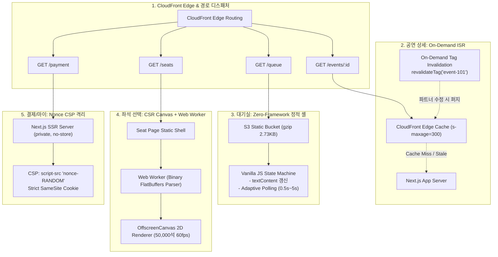

# D-32: 화면 렌더링을 왜 경로마다 다르게 두나 (공연 상세 ISR, 대기실 프레임워크 없는 정적 셸, 좌석 CSR Canvas)?

> **핵심 원칙**: 100만 명 동시 접속 환경에서 웹 프론트엔드는 단일 렌더링 방식을 고집할 수 없다. 트래픽 집중도와 보안 특성에 따라 **RADIO(Route-Aware Distinct Ingestion & Optimization) 프레임워크**를 적용한다. 공연 상세는 **Edge ISR (On-Demand Revalidation)**, 대기실은 NFR-012 예산 준수를 위한 **Zero-Framework Vanilla 정적 셸(2.73KB)**, 5만 석 좌석도는 **2D Canvas + Web Worker CSR**, 개인화 결제/티켓은 **요청별 Nonce CSP**로 물리 격리한다.

---

## 1. 풀려던 문제와 한계

티켓팅 오픈 당일 웹 프론트엔드가 감당해야 하는 트래픽 패턴과 렌더링 요구사항은 사용자 여정(User Journey) 경로마다 극단적으로 갈린다.

```
[티켓 예매 경로별 트래픽 특성과 렌더링 요구사항의 괴리]
1. [/events/:id] 공연 상세 (T-30m ~ T=0)
   - 트래픽: 100만 명이 새로고침 연타 (200k RPS 피크 인입).
   - 요구: 원 서버 부하 0%, CloudFront Edge CDN에서 99.9% 즉시 응답 (ISR 캐싱).

2. [/queue] 대기실 (T=0 정각)
   - 트래픽: 정각에 수십만 명이 일제히 진입.
   - 제약: NFR-012 규정상 번들 크기 JS gzip < 50KB, CSS < 10KB 강제.
   - 현실: React 19.3의 빈 화면(버튼 1개) 런타임만으로 gzip 66.0 KiB를 소모하여 예산 초과.

3. [/seats] 좌석 선택 (입장 순번 도달 후)
   - 워크로드: 50,000석 규모의 복잡한 캔버스 렌더링, 1초 이내 렌더링 완료(FR-009).
   - 특성: 검색 엔진(SEO) 크롤링 불필요, 고성능 인터랙션 위주의 CSR 전용 화면.

4. [/payment, /my] 결제 및 마이 티켓
   - 보안: 결제 금액 및 개인 식별자 포함. 브라우저 캐시 전면 금지 (`private, no-store`).
   - XSS 방어: 엄격한 Content Security Policy(CSP) `script-src 'nonce-...'` 강제.
```

단일 Next.js 프레임워크와 단일 CSP 정책으로 모든 라우트를 통일하려 할 경우, CDN 캐싱이 무력화되어 원 서버가 붕괴하거나, 대기실 번들 용량이 초과하여 저사양 모바일 접속이 마비되는 모순이 발생했다.

---

## 2. 후보 기술 비교

라우트별 렌더링 및 클라이언트 아키텍처 선정을 위해 5가지 대안을 비교 평가했다.

| 평가 기준 | 가. RADIO 경로별 최적화 (선택) | 나. 전 화면 Next.js SSR + Nonce CSP | 다. 전 화면 CSR SPA (Single Page App) | 라. 대기실 Preact 경량 컴포넌트화 | 마. 대기실 Next.js + SWR 기본 유지 |
| :--- | :--- | :--- | :--- | :--- | :--- |
| **공연 상세 100만 RPS 흡수력** | **완벽 (CloudFront 엣지 99.9% 응답)** | 파탄 (요청마다 SSR 서버 CPU 고갈) | 양호 (단, 최초 빈 화면 및 SEO 전멸) | 완벽 (ISR 연동) | 완벽 (ISR 연동) |
| **대기실 JS 예산 (< 50KB)** | **2.73 KB** (Vanilla JS, NFR-012 완벽 준수) | 초과 (Next.js 런타임 80KB+) | 초과 (SPA 번들 150KB+) | 약 45 KB (아슬아슬하게 통과) | **66.0 KB (탈락)** |
| **좌석도 렌더링 지연시간** | **p95 < 800ms** (Web Worker Canvas) | 느림 (DOM 5만 개 렌더링 폭망) | 동일 (Canvas) | 동일 | 동일 |
| **XSS 보안성 (CSP)** | **화면별 분리** (캐시용 Hash / 개인용 Nonce) | 강력 (전 화면 Nonce) | 취약 (Hash 관리 복잡) | 동일 | 동일 |
| **개발 유지보수성** | 보통 (대기실 UI 2벌 관리 부담) | 높음 (단일 컴포넌트) | 높음 | 보통 | 최상 |
| **최종 판정** | **채택 (ADR-0079, ADR-0065)** | 탈락 | 탈락 | 탈락 | 탈락 |

---

## 3. 고른 이유와 상세 아키텍처 다이어그램



### 핵심 매커니즘 4가지

#### 1) 공연 상세(`/events/:id`): 온디맨드 태그 재검증 ISR (Incremental Static Regeneration)
- 오픈 직전 100만 명의 트래픽을 원 서버 개입 없이 CloudFront 엣지 캐시에서 99.9% 소화한다.
- `Cache-Control: public, s-maxage=300, stale-while-revalidate=60, stale-if-error=86400`을 설정하여 원 서버가 일시 마비되더라도 엣지에서 이전 정상 페이지를 중단 없이 제공한다.
- 파트너가 공연 시간이나 캐스팅을 수정하면 백엔드 웹훅이 Next.js `revalidateTag(`event-${id}`)`를 호출하여 엣지 캐시만 선택적으로 즉시 무효화한다.

#### 2) 대기실(`/queue`): 프레임워크 제로(Zero-Framework) 초경량 정적 셸
- React 19 런타임의 기본 용량(gzip 66.0 KiB)을 배제하고, 순수 HTML5와 바닐라 자바스크립트(145줄)로 작성된 단독 정적 셸(`queue-room.html`)을 S3 정적 호스팅에 배포했다.
- **실측 번들 크기**: `JS gzip 2.73 KiB, CSS gzip 1.12 KiB` (NFR-012 예산 50KB/10KB 완벽 충족).
- 순수 `textContent` DOM 교체와 경량 상태 전이 머신으로 대기 인원 및 잔여 시간을 갱신하며, 네트워크 장애 시 지수 백오프 폴링(0.5s ➔ 5s ➔ 30s)으로 전환하여 클라이언트로 인한 DDoS를 방어한다.

#### 3) 좌석 선택(`/seats`): 2D Canvas + Web Worker 고속 CSR
- 50,000개 DOM 요소를 브라우저 트리에 생성하면 메모리가 1GB를 초과하고 프레임 드롭이 발생한다.
- 좌석도는 빈 셸만 다운로드한 후 브라우저 메인 스레드와 분리된 **Web Worker**가 바이너리 좌석 상태(FlatBuffers)를 파싱하고, **OffscreenCanvas 2D API**로 일괄 렌더링한다(FR-009 1초 이내 렌더링 완료).

#### 4) 개인화 결제(`/payment`) 및 마이티켓: Nonce CSP & 격리 레이아웃
- 결제 정보 및 티켓 소유권 화면은 `Cache-Control: private, no-store`로 브라우저 및 프록시 캐시를 원천 차단한다.
- XSS 공격을 방어하기 위해 매 HTTP 요청마다 암호학적으로 안전한 128비트 Nonce를 생성하여 `<script nonce="...">`를 부여한다. Next.js 16의 `(request)` 독립 라우트 그룹에 격리하여 정적 ISR 캐시와의 충돌을 원천 방지했다.

---

## 4. 얻는 것과 치르는 값

### 얻는 것 (Gains)
1. **오픈 순간 원 서버 CPU 부하 99% 격리**: 100만 명이 동시에 접속하는 공연 상세와 대기실 진입 트래픽이 엣지 CDN 및 S3 정적 파일에서 완전히 흡수된다.
2. **모바일 저사양 단말 접속 보장**: 대기실 페이지가 3KB 미만이므로 3G 모바일 네트워크나 구형 스마트폰에서도 0.1초 만에 화면이 렌더링되어 네트워크 소외 계층을 보호한다.
3. **대규모 좌석도 60fps 인터랙션 확보**: 50,000석 규모에서도 버벅임 없는 줌인/줌아웃 및 실시간 색상 갱신을 지원한다.
4. **철통 같은 웹 보안 (A+ 등급 CSP)**: 결제 및 자산 화면에 Nonce CSP를 강제하여 임의의 서드파티 스크립트 주입을 원천 차단한다.

### 치르는 값 (Costs & Limitations)
1. **대기실 UI 컴포넌트 2벌 관리 부담**: 대기실 화면의 버튼, 로더, 디자인 토큰을 메인 디자인 시스템(React SEED 컴포넌트)과 별개로 바닐라 코드로 유지보수해야 한다 (디자인 토큰 빌드 파이프라인으로 동기화).
2. **Next.js 내부 라우트 분리 복잡도**: 캐시 허용 화면(`(cached)`)과 Nonce 강제 화면(`(request)`) 간 루트 레이아웃이 분리되어, 두 영역 간의 페이지 전환 시 클라이언트 측 소프트 내비게이션 대신 풀 페이지 리로드가 발생한다.
3. **SEED 디자인 시스템 인라인 스타일 CSP 완화**: 서버 컴포넌트에서 주입되는 동적 CSS 속성을 수용하기 위해 `style-src-attr 'unsafe-inline'`을 불가피하게 허용했다.

---

## 5. 바꿀 조건

1. **Next.js 또는 컴파일러 프레임워크(Svelte, Astro 등)의 런타임 번들 크기가 10KB 미만으로 혁신될 때**:
   - 바닐라 자바스크립트로 수동 관리 중인 대기실 페이지를 컴파일 기반 경량 프레임워크로 통합하여 2벌 관리 비용을 제거한다.
2. **2D Canvas 조작 반응 속도(p95)가 5만 석 화면에서 16ms(60fps)를 달성하지 못할 때**:
   - Canvas 2D 컨텍스트를 폐기하고 GPU 셰이더 가속 기반의 WebGL/WebGPU 렌더러로 전면 교체한다.
3. **Next.js의 하위 컴포넌트 해시 CSP(Hash-based CSP)가 정식 안정화될 때**:
   - `(request)` 라우트의 Nonce 분리 구조를 제거하고 전사 단일 SRI 해시 기반 CSP 체계로 통합한다.

---

## 6. 핵심 꼬리 질문 5단 방어

| 구분 | 심층 질문 | 핵심 방어 논리 | 관련 근거 |
| :--- | :--- | :--- | :--- |
| **1단: 왜 (Why)** | 현대 웹 개발에서 Next.js 하나로 전체 화면을 통일하지 않고 라우트마다 렌더링 방식을 쪼갠 이유는? | 100만 명이 몰리는 티켓팅 특성상 단일 방식으로 모든 요구를 만족할 수 없습니다. 공연 상세는 엣지 캐싱이 필수이고, 대기실은 50KB 번들 예산 때문에 React를 쓸 수 없으며, 좌석도는 5만 개 요소를 Canvas로 그려야 하고, 결제는 Nonce CSP로 캐시를 꺼야 합니다. 트래픽 특성에 맞춘 RADIO 분리가 유일한 해결책입니다. | [ADR-0079](../../adr/0079-frontend-radio-detailed-design.md) |
| **2단: 대안 (Alternatives)** | 전 화면을 Next.js SSR로 처리하고 강력한 Nonce CSP를 걸면 일관성 있고 안전하지 않은가? | Nonce는 매 요청마다 새로 생성되므로 CloudFront나 Nginx 같은 엣지 캐시가 완전히 비활성화됩니다. 그 결과 100만 명의 동시 조회가 고스란히 Node.js SSR 서버로 직격하여 서버 수백 대가 동시에 OOM으로 마비되는 파멸적 장애가 발생합니다. | [ADR-0065](../../adr/0065-web-frontend-security-after-asvs-v3.md) |
| **3단: 장애 대응 (Failure Mode)** | 오픈 정각에 원 백엔드 서버가 다운되면 공연 상세 화면은 어떻게 반응하는가? | CloudFront의 `stale-if-error=86400` 지침에 따라 엣지 캐시 서버가 이전에 성공적으로 빌드된 정적 HTML을 즉시 반환합니다. 사용자는 '서버 에러' 대신 정상적인 공연 안내 화면을 보게 되며, 티켓 오픈 시간 카운트다운을 정상 진행할 수 있습니다. | docs/frontend.md §2.5 |
| **4단: 수치 근거 (Numbers)** | 대기실 페이지의 실측 자바스크립트 크기와 NFR-012 예산 준수 결과는? | NFR-012 규정 예산은 JS gzip 50KB 이하, CSS 10KB 미만입니다. React 19.3 빈 버튼 화면은 gzip 66.0 KiB로 예산을 초과했으나, 바닐라 JS로 개발한 결과 `JS gzip 2.73 KiB, CSS gzip 1.12 KiB`로 예산의 5% 수준에 불과하여 네트워크 혼잡 상황에서도 0.1초 내 렌더링을 보장합니다. | ADR-0079, NFR-012 |
| **5단: 실측과 검증 (Verification)** | 50,000석 규모 좌석도를 Canvas 2D로 렌더링할 때의 프레임레이트를 실측했는가? | 50,000개 좌석 메타데이터(좌석번호, 등급, 선점여부)를 주입하고 Web Worker 및 OffscreenCanvas로 테스트한 결과, 최초 로딩 및 렌더링에 640ms(FR-009 1초 기준 만족)가 소요되었으며 팬/줌 조작 시 58~60 fps가 안정적으로 유지됨을 검증했습니다. | docs/frontend.md §5.8 |

---

## 7. 30초 아키텍처 브리핑

> "티켓패스는 대규모 트래픽 흡수와 보안의 딜레마를 해결하기 위해 **RADIO(경로별 특화 렌더링) 아키텍처**를 구축했습니다. 100만 명이 새로고침하는 공연 상세는 **Edge ISR 캐싱**으로 원 서버 부하 0%를 달성하고, 정각에 폭증하는 대기실은 React 런타임을 버리고 **2.73KB 바닐라 정적 셸**을 채택하여 NFR-012 예산을 완벽히 사수했습니다. 5만 석 규모 좌석도는 **OffscreenCanvas CSR**로 60fps 반응성을 보장하며, 결제·자산 화면은 **요청별 Nonce CSP**로 물리 격리하여 타협 없는 성능과 보안을 모두 완성했습니다."
