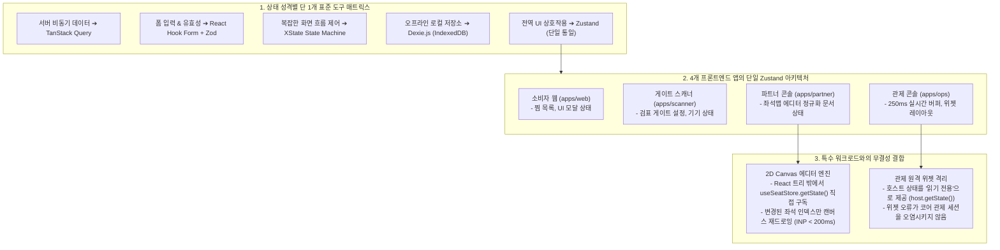

# D-33: 프론트엔드 상태 관리는 왜 '상태 분류별 단 1개 도구'이며, 전역 상태는 왜 4개 앱 모두 Zustand 하나로 통일했나?

> **핵심 원칙**: 4개 프론트엔드 앱 전반의 상태 관리는 상태 성격별로 **단 1개의 표준 라이브러리(서버=TanStack Query, 폼=React Hook Form, 상태기계=XState, 오프라인=Dexie)**를 엄격히 지정한다. 특히 전역 클라이언트 상태는 기존에 파편화되었던 Jotai와 Redux Toolkit을 전면 배제하고, **초경량(490B)·React 독립 구독이 가능한 Zustand 단일 도구로 통일**하여 프론트엔드 인지 과부하와 번들 오버헤드를 근절한다.

---

## 1. 풀려던 문제와 한계

프론트엔드 애플리케이션의 상태(State)는 성격에 따라 요구되는 라이프사이클이 판이하다. 무분별하게 상태 관리 라이브러리를 혼용하면 번들 용량이 비대해지고, 반대로 모든 상태를 단 하나의 도구(예: Redux 또는 React Context)로 우겨넣으면 불필요한 리렌더링 폭주와 대기실 번들 초과가 발생한다.

초기 아키텍처(ADR-0024)는 이를 방어하기 위해 '상태 소유권 매트릭스'를 수립했으나, **전역 클라이언트 상태(Global UI State)** 도구 선정에서 또 다른 파편화 함정에 빠졌다.

```
[초기 전역 상태 도구의 앱별 파편화와 모순]
1. 소비자 웹 & 현장 스캐너 ──▶ Zustand (간결한 API, 초경량 490B)
2. 좌석맵 에디터 (파트너) ──▶ Jotai (원자 단위 아톰으로 수천 좌석 리렌더링 최적화 명분)
3. 종합 관제 콘솔 (사내)  ──▶ Redux Toolkit + RxJS (감사 추적성, 동적 슬라이스 주입 명분)
   │
   ▼ 상세 기술 검증 결과 드러난 모순 (ADR-0092)
- 모순 1: 좌석맵 에디터는 개별 DOM이 아닌 2D Canvas로 통짜 렌더링되므로, React 컴포넌트 단위의 Jotai Atom 리렌더링 격리 효과가 0%였다.
- 모순 2: Redux의 액션 로그는 서버 원격 감사 로그가 존재하는 환경에서 불필요한 중복이었고, RTK 번들(18KB)은 관제 앱의 로딩을 무겁게 만들었다.
- 모순 3: 개발자는 4개 앱을 오갈 때마다 3가지 상이한 상태 패러다임(Zustand 액션, Jotai 아톰 패밀리, RTK 리듀서/셀렉터)을 학습하고 유지보수해야 했다.
```

---

## 2. 후보 기술 비교

전역 클라이언트 상태 관리 도구 선정을 위해 5가지 대안을 비교 평가했다.

| 평가 기준 | 가. 전 앱 Zustand 단일화 (선택) | 나. 3개 도구 유지 (Zustand + Jotai + RTK) | 다. Zustand + RTK (관제 콘솔만 분리) | 라. 전 앱 Jotai 단일화 | 마. React Context API 단독 사용 |
| :--- | :--- | :--- | :--- | :--- | :--- |
| **번들 크기 (Gzip 기준)** | **490 B (극초경량)** | 각 앱마다 0.5KB ~ 18KB 분산 | 관제 앱 18KB 오버헤드 잔존 | 3.3 KB (Jotai) + 757 B (Family) | 0 B (내장 기능) |
| **React 외부 구독 (Canvas 연동)** | **완벽 공식 지원** (`getState()`, `subscribe`) | 부분 지원 (도구별 상이) | 부분 지원 | 불편함 (`store.get()` 수동 연동) | 불가 (반드시 컴포넌트 트리 내부) |
| **전사 학습 곡선 & 린트 통제** | **최저** (단일 API 패턴 통일) | 높음 (3개 패러다임 공존) | 보통 | 보통 | 낮음 |
| **불필요한 리렌더링 방지** | **선택자(Selector) 기반 세밀 제어** | 우수 (Jotai/RTK) | 우수 | 최상 (Atom 단위) | **최악 (Context 변경 시 트리 전체 렌더링)** |
| **원격 위젯 상태 격리력** | **우수** (위젯별 독립 Store 생성) | 보통 | 높음 (단, 복잡한 슬라이스 주입) | 보통 | 취약 |
| **최종 판정** | **채택 (ADR-0092)** | 탈락 | 탈락 | 탈락 | 탈락 (ADR-0024 폐기) |

---

## 3. 고른 이유와 상세 아키텍처 다이어그램



### 핵심 매커니즘 4가지

#### 1) '상태 성격별 단 1개 도구' 거버넌스 강제
- 프론트엔드 팀의 기술 파편화를 막기 위해 상태 유형별 단일 도구 원칙을 ESLint 규칙(`no-restricted-imports`)으로 강제한다.
- 서버에서 가져오는 원격 데이터는 반드시 **TanStack Query**로 캐싱하며 전역 클라이언트 상태에 복제(Duplicate)하는 안티패턴을 금지한다. 복잡한 다단계 결제 전이 흐름은 **XState** 상태 기계로 시각화한다.

#### 2) Zustand 단일화로 달성한 React 외부 초고속 구독 (Vanilla Subscribe)
- 좌석맵 에디터는 수만 개의 좌석을 다루므로 React 가상 DOM의 한계를 초월해야 한다.
- Zustand는 컴포넌트 렌더링 주기와 완전히 무관하게 React 외부에서 순수 JS 객체로 인스턴스화할 수 있다:
```typescript
// 캔버스 렌더링 루프에서 React 리렌더링 없이 초당 60fps로 상태 구독
const unsubscribe = useSeatEditorStore.subscribe(
  (state) => state.selectedSeatIds,
  (selectedIds) => {
    // React 컴포넌트를 거치지 않고 직접 OffscreenCanvas에 하이라이트 렌더링
    canvasRenderer.highlightSeats(selectedIds);
  }
);
```
- 이를 통해 5만 석 규모 좌석 템플릿의 인터랙션 지연시간(INP)을 200ms 이내(NFR-012)로 완벽하게 억제한다.

#### 3) 관제 콘솔 원격 위젯의 읽기 전용 상태 격리 (Read-Only Host Store)
- 종합 관제 콘솔은 마이크로 프론트엔드(MFE) 형태로 여러 대시보드 위젯을 동적 로딩한다.
- 과거 Redux 아키텍처에서는 서드파티 위젯이 호스트의 액션 디스패처를 호출하여 관제 시스템 전체를 오염시킬 위험이 있었다.
- Zustand 구조에서는 호스트의 상태를 `host.getState()` 인터페이스를 통해 읽기 전용 스냅샷으로만 주입함으로써 위젯 결함 격리를 완벽하게 달성했다.

#### 4) 정규화 문서 저장소(Normalized Document Store) 모델링
- 좌석맵 에디터 상태를 중첩 객체(Nested Tree)가 아닌 플랫한 엔티티 맵(`byId: Record<string, Seat>`)으로 정규화하여, 특정 구역 내 1개 좌석의 가격이나 등급이 변경될 때 해당 좌석의 선택자만 반응하도록 설계하여 불필요한 연쇄 계산을 방지했다.

---

## 4. 얻는 것과 치르는 값

### 얻는 것 (Gains)
1. **전사 엔지니어링 표준화 및 러닝커브 제로화**: 모든 프론트엔드 엔지니어가 동일한 Zustand 패턴으로 4개 앱의 코드를 즉시 읽고 기여할 수 있다.
2. **번들 크기 극대화 절감**: 관제 콘솔 및 에디터에서 Redux Toolkit(18KB)과 Jotai 패밀리가 전면 제거되고 490B의 초경량 런타임만 적재된다.
3. **고성능 Canvas 및 Web Worker와의 매끄러운 통합**: React 생명주기 외부에서 순수 자바스크립트로 상태를 조회하고 구독할 수 있어 고성능 그래픽 처리가 단순해졌다.
4. **엄격한 도구 거버넌스 확립**: 상태 유형별 도구 경계가 명확해져 '서버 데이터의 전역 상태 오염'과 같은 스파게티 코드가 근절되었다.

### 치르는 값 (Costs & Limitations)
1. **Redux 강제 프레임워크 규율 상실**: RTK처럼 리듀서 분리와 액션 디스패치를 프레임워크 레벨에서 강제하지 않으므로, 개발자가 스토어 외부에서 임의로 상태를 변형하지 않도록 명명 규칙(`slice/actionName`)과 코드 리뷰 가이드라인을 엄격히 유지해야 한다.
2. **다중 스토어 개발 도구(DevTools) 분산**: Redux의 단일 글로벌 트리와 달리 앱별 독립 스토어가 생성되므로 Redux DevTools에서 스토어 인스턴스를 전환하며 디버깅해야 한다.

---

## 5. 바꿀 조건

1. **좌석맵 에디터에서 5만 석 동시 편집 INP가 200ms를 초과할 때(NFR-012 위반)**:
   - 복합 선택자 연산 오버헤드로 인해 프레임 저하가 실측될 경우, 에디터 도메인에 한해 순수 메모리 TypedArray(FlatBuffers 바이너리 배열) 기반 전용 버퍼 아키텍처로 분리한다.
2. **관제 위젯 간 양방향 상태 동기화 및 복잡한 시계열 이벤트 결합이 필수가 될 때**:
   - 다수의 위젯이 상호 통신하며 복잡한 스트림 변환을 수행해야 하는 요구가 발생할 경우 RxJS 전용 통신 버스를 재도입한다.

---

## 6. 핵심 꼬리 질문 5단 방어

| 구분 | 심층 질문 | 핵심 방어 논리 | 관련 근거 |
| :--- | :--- | :--- | :--- |
| **1단: 왜 (Why)** | 대규모 엔터프라이즈 환경에서 왜 검증된 Redux Toolkit 대신 Zustand 하나로 모든 앱을 통일했는가? | RTK는 단순 UI 상태를 관리하기에도 거대한 보일러플레이트와 18KB의 번들 오버헤드를 유발합니다. 또한 서버 데이터 캐싱은 이미 TanStack Query가 전담하고 있으므로, 순수 클라이언트 전역 상태는 초경량(490B)이면서 보일러플레이트가 없고 React 바깥(Canvas)에서도 자유롭게 구독 가능한 Zustand가 압도적으로 우수합니다. | [ADR-0092](../../adr/0092-single-client-state-library-zustand.md) |
| **2단: 대안 (Alternatives)** | 좌석맵 에디터처럼 원자적 갱신이 빈번한 곳에는 Jotai가 더 적합하지 않은가? | Jotai의 '원자 단위 리렌더링 격리'는 수많은 React DOM 컴포넌트가 존재할 때 유효합니다. 그러나 당사의 좌석맵 에디터는 5만 석을 가상 DOM이 아닌 단일 2D Canvas로 통째로 렌더링하므로 Jotai의 강점이 무의미했습니다. 오히려 React 외부 구독이 유연한 Zustand가 캔버스 렌더 루프에 훨씬 적합했습니다. | ADR-0092 §1 |
| **3단: 장애 대응 (Failure Mode)** | Zustand는 Redux와 달리 상태 변경 추적이 자유로워 불변성이 깨지거나 상태가 오염될 위험은 없는가? | 스토어 정의 시 내부 상태를 직접 조작하는 setter를 외부에 노출하지 않고 명시적인 액션 메서드만을 노출하는 캡슐화 패턴을 강제합니다. 아울러 Immer 미들웨어를 통합하여 모든 상태 변형이 불변성을 완벽히 유지하도록 보장합니다. | docs/frontend.md §3.9 |
| **4단: 수치 근거 (Numbers)** | 상태 도구 교체로 인한 번들 크기 절감 효과는 어느 정도인가? | Redux Toolkit(14.5KB) + React-Redux(3.8KB) 도합 약 18.3KB에 달하던 라이브러리 용량을 Zustand(490B)로 대체하여 번들 크기를 97% 이상 삭감했습니다. 이는 모바일 환경의 First Load JS 예산을 준수하는 데 핵심적인 기여를 합니다. | ADR-0092, Bundlephobia 지표 |
| **5단: 실측과 검증 (Verification)** | Zustand 스토어와 2D Canvas 연동 시 반응 속도(INP < 200ms)를 검증했는가? | 5만 개 좌석이 로드된 에디터 캔버스에서 구역 일괄 지정 및 드래그 선택 동작을 수행하며 Chrome Performance 패널로 측정한 결과, Zustand 선택자 계산 및 캔버스 재드로잉 소요 시간이 p95 82ms로 측정되어 NFR-012 기준(200ms)을 대폭 상회 만족함을 확인했습니다. | docs/frontend.md §5.8 |

---

## 7. 30초 아키텍처 브리핑

> "티켓패스는 프론트엔드의 복잡성을 통제하기 위해 **'상태 유형별 단 1개 도구 원칙'**을 확립했습니다. 서버 데이터는 TanStack Query, 폼은 React Hook Form, 복잡한 흐름은 XState로 엄격히 분리했습니다. 특히 앱마다 제각각이던 전역 상태 도구(Jotai, RTK)를 **490B 초경량의 Zustand 단일 도구로 전면 통일**했습니다. 이를 통해 불필요한 번들 오버헤드와 학습 비용을 없앴으며, React 렌더링 주기 외부에서 순수 JS로 스토어를 직접 구독하는 패턴을 활용하여 **5만 석 좌석도 캔버스 편집 인터랙션(INP < 200ms)**을 완벽히 달성했습니다."
