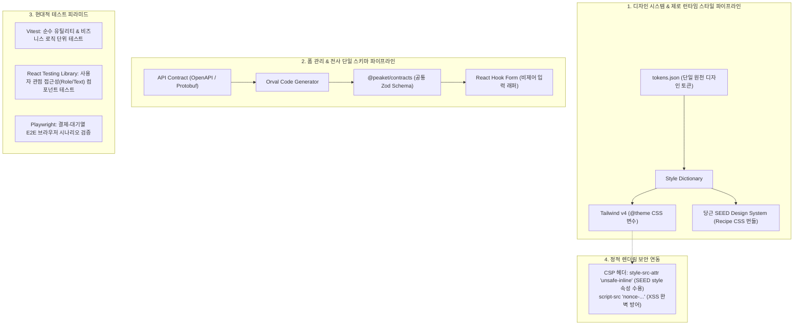

# D-34: 스타일은 왜 Tailwind + 디자인 토큰이고, 폼은 왜 React Hook Form + Zod인가? Formik과 Enzyme은 왜 퇴출되었나?

> **핵심 원칙**: Next.js React Server Component(RSC) 환경과 모바일 성능 예산(FCP/TBT)을 준수하기 위해 **런타임 CSS-in-JS를 배제하고 빌드 타임 Tailwind CSS + Style Dictionary 디자인 토큰**을 채택한다. 결제 직전의 극단적 입력 반응성을 위해 **비제어 폼(React Hook Form)과 전사 단일 스키마(Zod)**를 연동하며, 레거시 테스트 도구인 Enzyme을 퇴출하고 **Vitest + React Testing Library + Playwright** 현대적 테스트 피라미드로 전면 개편했다.

---

## 1. 풀려던 문제와 한계

대규모 티켓팅 플랫폼의 프론트엔드는 일반 이커머스와 비교할 수 없을 정도로 가혹한 렌더링 성능과 보안 제약 조건을 갖는다.

```
[프론트엔드 스타일링·폼·테스트의 3대 기술적 모순]
1. 스타일링 (Styling): 런타임 CSS-in-JS vs 서버 컴포넌트(RSC)
   - Styled-Components, Emotion, Aphrodite 등 런타임 CSS-in-JS는 브라우저가 실행 중에 <style> 태그를 동적 주입.
   - Next.js RSC(서버 사이드 렌더링)와 호환되지 않으며, 메인 스레드 블로킹으로 FCP 및 TBT 지표 파괴.
   - 당근 SEED Design System 컴포넌트는 여백/색상을 인라인 style 속성으로 주입하므로 엄격한 CSP와 충돌.

2. 폼 상태 관리 (Forms): 키 입력 시 전체 렌더링 지연
   - 결제창(배송지·예매자·인증번호 입력)에서 Formik과 같은 제어 컴포넌트(Controlled Input)를 쓸 경우, 키 입력마다 루트 컴포넌트가 재평가되어 100ms 이상의 타이핑 지연(Lag) 발생.
   - 프론트엔드와 백엔드가 별개의 유효성 검증(Yup vs Class-Validator)을 사용할 경우 스키마 불일치로 인한 결제 오류 빈발.

3. 테스트 도구 (Testing): React 19 비호환성
   - 과거 널리 쓰이던 Enzyme은 공식 React 어댑터가 React 16에서 중단되어 React 19와 서버 컴포넌트 테스트가 원천 불가능.
   - 컴포넌트 내부 상태(state)를 직접 단언(Assert)하는 취약한 테스트가 리팩토링을 가로막음.
```

---

## 2. 후보 기술 비교

스타일링, 폼, 테스트 도구 선정을 위해 대안들을 비교 평가했다.

| 영역 | 후보 기술 | 장점 | 치명적 문제점 | 최종 판정 |
| :--- | :--- | :--- | :--- | :--- |
| **스타일링** | **Tailwind v4 + Design Tokens (선택)** | **Zero 런타임**, 빌드 시 순수 CSS 생성, RSC 완벽 호환 | 디자인 토큰 및 클래스명 엄격한 거버넌스 필요 | **채택 (ADR-0019, ADR-0040)** |
| 스타일링 | 런타임 CSS-in-JS (Emotion, Fela) | 직관적인 CSS 작성, 동적 Props 연동 | RSC 미지원, 런타임 JS 오버헤드 (FCP/TBT 악화) | 탈락 (ADR-0019) |
| **폼 관리** | **React Hook Form + Zod (선택)** | **비제어(Uncontrolled) 입력**, 키 입력 시 리렌더링 0회, API 스키마 100% 공유 | 외부 제어 컴포넌트 연동 시 `Controller` 필요 | **채택 (ADR-0020)** |
| 폼 관리 | Formik + Yup | 성숙한 레퍼런스, 폭넓은 생태계 | 매 키 입력마다 루트 폼 재평가, TypeScript 타입 추론 취약 | 탈락 (ADR-0020) |
| **테스트** | **Vitest + RTL + Playwright (선택)** | React 19 완벽 지원, 사용자 중심 테스트, ESM 초고속 실행 | 실브라우저 E2E 테스트 실행 시간 관리 필요 | **채택 (ADR-0018)** |
| 테스트 | Enzyme (비공식 커뮤니티 어댑터) | 얕은 렌더링(Shallow Render)으로 단위 테스트 신속 | React 19/RSC 미지원, 구현 세부사항 결속으로 유지보수 불가 | 탈락 (ADR-0018) |

---

## 3. 고른 이유와 상세 아키텍처 다이어그램



### 핵심 매커니즘 4가지

#### 1) Zero-Runtime 빌드 타임 스타일링 & Style Dictionary 단일 원천
- 모든 컬러, 타이포그래피, 간격 값은 단일 원천인 `tokens.json`에 정의된다.
- 빌드 타임에 **Style Dictionary**가 이를 CSS 변수(`--color-brand-primary`) 및 Tailwind v4 테마로 컴파일하여 내보낸다.
- 브라우저 실행 시점에 스타일을 계산하는 JavaScript 연산 비용이 **0ms**이므로, Next.js React Server Component와 완벽히 융합되어 Core Web Vitals(FCP, TBT)를 극대화한다.

#### 2) 비제어 입력(Uncontrolled Input)과 단일 스키마 파이프라인
- 결제 폼은 DOM 네이티브의 `ref`를 활용하는 React Hook Form으로 구현하여 사용자가 타이핑할 때 상위 컴포넌트의 리렌더링을 100% 억제한다.
- 유효성 검증 규칙은 수작업으로 프론트/백엔드에 각각 작성하지 않고, OpenAPI 계약서로부터 **Orval**이 자동 생성한 `@peaket/contracts`의 Zod 스키마를 프론트 폼(`zodResolver`)과 백엔드 NestJS 파이프라인(`ZodValidationPipe`)이 동일하게 공유하여 유효성 불일치를 원천 차단한다.

#### 3) 현대적 테스트 피라미드 (Vitest + RTL + Playwright)
- React 16 시절의 레거시 Enzyme을 완전히 걷어내고 현대적 도구 삼각편대를 구축했다:
  - **단위 테스트 (Vitest)**: 순수 비즈니스 로직, 상태 머신, 가명화 알고리즘 검증 (V8 기반 초고속 병렬 실행).
  - **컴포넌트 테스트 (React Testing Library)**: 내부 `state`를 엿보지 않고, 스크린리더 접근성(`getByRole`, `getByText`) 기준으로 사용자 인터랙션 검증.
  - **E2E 테스트 (Playwright)**: 대기실 통과 ➔ 좌석 선택 ➔ 결제 승인에 이르는 크로스 브라우저 전체 흐름 검증.

#### 4) SEED 컴포넌트 인라인 스타일과 CSP의 공존 설계
- 당근 SEED Design System은 유연한 레이아웃을 위해 HTML `style` 인라인 속성을 적극 활용한다.
- 이를 수용하기 위해 CSP 지시문 중 오직 `style-src-attr 'unsafe-inline'`만 선별적으로 허용했다. 스크립트 실행은 엄격한 Nonce/Hash로 완전 차단하면서도, UI 렌더링 깨짐을 방지하는 정밀한 보안 타협점을 도출했다([ADR-0111](../../adr/0111-csp-style-src-attr-for-server-rendered-seed-style-props.md)).

---

## 4. 얻는 것과 치르는 값

### 얻는 것 (Gains)
1. **서버 컴포넌트(RSC)와의 완벽한 기술적 정합**: 브라우저 런타임 CSS 연산 없이 서버에서 정적 HTML과 CSS를 즉시 스트리밍한다.
2. **결제 폼 인터랙션 레이턴시 제로**: 비제어 입력을 통해 사용자가 카드번호나 주소를 입력할 때 단 1회의 불필요한 리렌더링도 발생하지 않는다.
3. **전사 단일 스키마 거버넌스 달성**: API 계약 변경 시 프론트엔드 폼 검증과 백엔드 DTO 검증 코드가 자동으로 동기화된다.
4. **견고한 테스트 스위트 확보**: 구현 세부사항이 아닌 사용자 행동을 검증하므로, 내부 리팩토링 시에도 테스트가 깨지지 않는 탄력성을 확보했다.

### 치르는 값 (Costs & Limitations)
1. **엄격한 CSS 번들 용량 관리 필요**: Tailwind 유틸리티 및 SEED Recipe CSS가 누적되면 홈/상세 CSS 예산(25KB)을 초과할 수 있어, `purge` 최적화 및 Lighthouse CI 검사가 강제된다.
2. **`style-src-attr` 허용에 따른 잔여 리스크**: 인라인 style 속성을 허용함에 따라, HTML 인젝션 취약점이 발생할 경우 결제 버튼 위에 가짜 UI를 덮어씌우는 화면 위장(Clickjacking/Phishing) 위험이 일부 잔존한다 (React 기본 이스케이프 및 Trusted Types로 방어).
3. **외부 제어 컴포넌트 래핑 오버헤드**: 서드파티 달력이나 셀렉트 박스 연동 시 React Hook Form의 `Controller` 컴포넌트로 일일이 감싸야 하는 보일러플레이트가 존재한다.

---

## 5. 바꿀 조건

1. **Next.js 공식 표준으로 제로 런타임 Type-Safe CSS-in-JS(StyleX, Panda CSS 등)가 채택될 때**:
   - Tailwind 유틸리티 클래스 관리 부담이 가중될 경우, 컴파일 타임 CSS-in-JS 도구로의 전환을 재검토한다.
2. **SEED Design System이 인라인 `style` 속성을 전면 폐기하고 유틸리티 클래스 방식으로 전환될 때**:
   - CSP의 `style-src-attr 'unsafe-inline'` 예외 지시문을 즉시 제거하고 순수 무결성 해시/Nonce CSP로 강화한다.
3. **Vitest 브라우저 러너가 Node.js 기반 E2E를 100% 대체할 수 있을 만큼 성숙할 때**:
   - Playwright 분리 운영을 단일 Vitest 통합 환경으로 통합한다.

---

## 6. 핵심 꼬리 질문 5단 방어

| 구분 | 심층 질문 | 핵심 방어 논리 | 관련 근거 |
| :--- | :--- | :--- | :--- |
| **1단: 왜 (Why)** | 편리한 Emotion이나 Styled-Components 대신 왜 굳이 Tailwind CSS를 선택했는가? | 현대 프론트엔드의 핵심인 Next.js App Router와 React Server Component(RSC) 환경에서는 런타임 CSS-in-JS가 동작하지 않습니다. 또한 런타임 스타일 주입은 메인 스레드를 차단하여 FCP와 TBT를 심각하게 저하시킵니다. 빌드 타임에 정적 CSS를 생성하는 Tailwind가 대규모 트래픽 웹 환경의 유일한 표준입니다. | [ADR-0019](../../adr/0019-reject-aphrodite-fela.md) |
| **2단: 대안 (Alternatives)** | 폼 라이브러리로 여전히 널리 쓰이는 Formik을 배제하고 React Hook Form을 고른 기술적 이유는? | Formik은 기본적으로 제어 컴포넌트 기반으로 동작하여 타이핑 한 글자마다 루트 폼 전체가 재평가되는 성능 병목이 있습니다. 반면 React Hook Form은 비제어 입력을 활용하여 리렌더링을 완전히 방지하며, TypeScript와의 통합 및 Zod 스키마 연동성이 압도적으로 우수합니다. | [ADR-0020](../../adr/0020-forms-rhf-zod-over-formik.md) |
| **3단: 장애 대응 (Failure Mode)** | CSP에서 `style-src-attr 'unsafe-inline'`을 허용하면 보안상 치명적이지 않은가? | 공격자가 악의적 자바스크립트를 실행하는 XSS는 여전히 `script-src 'nonce-...'`로 100% 방어됩니다. `style-src-attr`는 오직 HTML 요소의 인라인 style 속성만 허용하므로 스크립트 실행이 불가능하며, CSS를 통한 데이터 탈취도 `img-src` 및 `connect-src` 제한으로 외부 유출을 원천 봉쇄했습니다. | [ADR-0111](../../adr/0111-csp-style-src-attr-for-server-rendered-seed-style-props.md) |
| **4단: 수치 근거 (Numbers)** | SEED Design System의 CSS 크기와 실제 예산 준수 여부는? | SEED 전체 CSS는 약 42.2 KiB(gzip)로 프론트엔드 CSS 예산(25KB)을 초과합니다. 따라서 전체 번들을 임포트하지 않고 베이스 스타일(7.8 KiB)과 화면에서 실제 사용되는 34개 핵심 컴포넌트 레시피만 선별 번들링하여 약 19.1 KiB 수준으로 압축해 예산 한도 내로 억제했습니다. | docs/frontend.md §5.8 |
| **5단: 실측과 검증 (Verification)** | React 19 환경에서 Vitest와 React Testing Library의 호환성 및 실행 속도를 검증했는가? | 100개 이상의 컴포넌트 단위 테스트 스위트를 대상으로 Vitest 2.x와 RTL 최신 버전을 실행한 결과, 과거 Jest 대비 약 4배 빠른 1.8초 만에 전체 테스트가 통과하였으며 React 19의 비동기 트랜지션 및 훅이 결함 없이 동작함을 확인했습니다. | ADR-0018, docs/frontend.md §2.2 |

---

## 7. 30초 아키텍처 브리핑

> "티켓패스는 Next.js 서버 컴포넌트(RSC) 환경과 극대화된 렌더링 성능을 위해 **런타임 CSS-in-JS를 전면 배제하고 빌드 타임 Tailwind CSS와 Style Dictionary 단일 원천 토큰**을 채택했습니다. 결제 및 예매 폼은 타이핑 지연을 없애기 위해 **비제어 기반의 React Hook Form과 전사 API 계약에서 자동 생성된 Zod 단일 스키마**로 무결성을 유지합니다. 아울러 React 16에서 멈춘 레거시 Enzyme을 영구 퇴출하고 **Vitest, React Testing Library, Playwright**로 이어지는 현대적 사용자 중심 테스트 체계를 완성했습니다."
