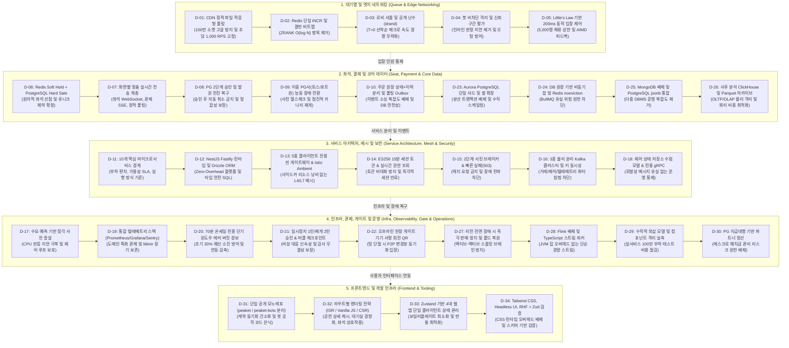
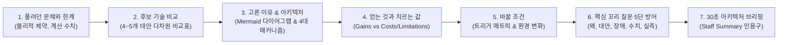

# PEAKET 아키텍처 결정 카드 (Architecture Decision Records)

PEAKET 시스템 설계 전반에 걸친 핵심 기술적·구조적 의사결정을 면접 및 기술 리뷰 관점에서 체계화한 34개의 결정 카드 모음집입니다.

- **설계 철학**: 정본(docs/adr/)의 의사결정 맥락, 엄밀한 산출 수치, 대안 비교 및 트레이드오프를 가감 없이 투명하게 제시합니다.
- **아키텍처 근거 체계**: 100만 트래픽 수용을 위한 시스템 수학적 한계 계산(Little's Law, 소켓/메모리/네트워크 대역폭 한계), 프로덕션 비용 최적화, 결함 격리(Bulkhead), 단계별 지연 예산(Latency Budget)을 기반으로 기술을 선정했습니다.
- **함께 읽기**: [한 판 설계도](../01-system-design.md), [시스템 아키텍처](../../architecture.md), [분야별 심층 해설서](../fields/01-why-and-what.md)

---

## 1. 5대 아키텍처 기둥과 34대 기술 결정 맵

PEAKET의 34개 아키텍처 결정은 고가용성 대규모 티케팅 시스템을 지탱하는 5대 핵심 기둥(Pillars)으로 유기적으로 연결되어 있습니다.

---

## 2. 34대 결정 카드 총괄 색인 및 핵심 트레이드오프

| 카드 | 기술 질문 및 핵심 결정 | 주요 정본 (ADR) | 핵심 트레이드오프 (얻은 것 vs 치른 값) | 관련 분야 |
| :--- | :--- | :--- | :--- | :--- |
| **[D-01](D01-queue-status-cdn-polling.md)** | 100만 대기자 상태 조회에서 왜 SSE가 아닌 CDN 정적 파일과 적응형 폴링을 쓰는가? | [ADR-0003](../../adr/0003-waiting-room-adaptive-polling.md) [ADR-0058](../../adr/0058-cdn-distributions-quotas-and-shuffle-fetch-spread.md) [ADR-0110](../../adr/0110-latency-budgets-nfr002-nfr004-aligned-expiry-100ms-batches-ms-clock.md) [ADR-0144](../../adr/0144-edge-load-balancer-shared-fate-separation-and-failure-response.md) | **+** 오리진 부하 초당 1,000 RPS 고정, 소켓 100만 개 메모리 40GB 절감 **-** 원거리 대기자 최대 28초 갱신 지연, CDN 단일 벤더 의존 | 9, 20 |
| **[D-02](D02-queue-number-incr.md)** | 대기 순번 발급에서 왜 Sorted Set(ZRANK)이 아닌 Redis INCR과 결번 비트맵을 쓰는가? | [ADR-0002](../../adr/0002-queue-sequence-incr-over-sorted-set.md) [ADR-0176](../../adr/0176-foundation-poc-results.md) [ADR-0179](../../adr/0179-entry-number-per-pod-batch.md) [ADR-0181](../../adr/0181-queue-failover-pause-numbers-until-rb05.md) | **+** 발급 복잡도 O(1) 달성 (20만 RPS 수용), 메모리 98% 절감 **-** Redis 장애 조치 시 번호 건너뛰기 발생, 클라이언트 결번 계산 오버헤드 | 9 |
| **[D-03](D03-lobby-shuffle-ordering.md)** | 정각 오픈 트래픽을 왜 순수 선착순이 아닌 로비 셔플과 drand 공개 난수로 섞는가? | [ADR-0012](../../adr/0012-queue-ordering-hybrid-shuffle-default.md) [ADR-0041](../../adr/0041-fifo-speed-bot-countermeasures.md) [ADR-0050](../../adr/0050-crypto-corrections-and-key-management.md) [ADR-0118](../../adr/0118-queue-ordering-two-settings-lobby-shuffle-open-batch.md) | **+** 매크로/네트워크 밀리초 우위 원천 차단, 외부 공개 검증성 보장 **-** 셔플 계산 및 공개 난수 대기로 첫 입장까지 11~21초 소요 | 9, 14 |
| **[D-04](D04-bot-defense-and-evaluation.md)** | 봇 탐지를 왜 인라인 차단하지 않고 점수 기반 CHALLENGE와 비동기 격리로 다루는가? | [ADR-0039](../../adr/0039-bot-detection-evaluation-protocol.md) [ADR-0048](../../adr/0048-bot-evaluation-sample-tiers-cost.md) [ADR-0112](../../adr/0112-human-false-positive-sample-one-session-per-person.md) [ADR-0156](../../adr/0156-bot-defense-detail-allow-or-challenge-two-layer-degraded-appeal-path.md) [ADR-0174](../../adr/0174-human-false-positive-public-data-and-post-launch.md) | **+** 핵심 티케팅 경로 레이턴시 0ms 지연, 오탐 시 무고한 고객 차단 방지 **-** 정교한 봇의 일부 대기열 침투 가능성, CHALLENGE 풀 관리 비용 | 14 |
| **[D-05](D05-admission-control-loop.md)** | 예매창 입장 통제에서 왜 정적 인원이 아닌 Little's Law 기반 동적 피드백 루프를 쓰는가? | [ADR-0005](../../adr/0005-admission-confirmed-by-first-booking-request.md) [ADR-0056](../../adr/0056-admission-leader-fencing-and-admission-person-recheck.md) [ADR-0104](../../adr/0104-admission-loop-in-flight-and-ordered-soon-queue.md) [ADR-0182](../../adr/0182-admission-leader-loop-first-implementation.md) | **+** 동시 체류 5,000명 유지로 백엔드 붕괴 방어, 노쇼 시 빈자리 즉각 회수 **-** 200ms 루프 단일 리더 의존, K8s Lease 펜싱 관리 복잡도 | 9 |
| **[D-06](D06-seat-soft-hold-hard-sale.md)** | 좌석 중복 판매 방지를 위해 왜 Redis Soft Hold와 PostgreSQL Hard Sale 2단계를 쓰는가? | [ADR-0014](../../adr/0014-soft-hold-hard-sale.md) [ADR-0121](../../adr/0121-seat-redis-failover-defer-purchase-drop-db-hold-path.md) | **+** 좌석 선점 레이턴시 p99 2ms 보장, DB 잠금 경합 0건, 영구 정합성 확정 **-** Redis-DB 간 상태 이원화, Redis 페일오버 시 5~10초 구매 일시 정지 | 10 |
| **[D-07](D07-realtime-transport-per-screen.md)** | 실시간 전송 기술을 왜 단일 통일하지 않고 화면별 맞춤 프로토콜로 분리했는가? | [ADR-0027](../../adr/0027-realtime-transport-per-client.md) [ADR-0100](../../adr/0100-console-rest-sse-drop-trpc-module-federation-showcase-baseline.md) [ADR-0110](../../adr/0110-latency-budgets-nfr002-nfr004-aligned-expiry-100ms-batches-ms-clock.md) | **+** 각 화면의 스케일과 단방향/양방향 특성에 최적화된 리소스 사용 **-** 클라이언트별 전송 계층 라이브러리 다변화 및 구현 복잡도 | 6, 10, 16 |
| **[D-08](D08-payment-two-phase-forward-recovery.md)** | 결제 승인 후 발권 장애 시 왜 자동 결제 취소를 하지 않고 전진 복구(Forward Recovery)를 하는가? | [ADR-0015](../../adr/0015-tosspayments-two-phase-approval.md) [ADR-0106](../../adr/0106-forward-recovery-after-payment-approval-ticket-issue-retry.md) [ADR-0140](../../adr/0140-payment-result-pull-fallback-when-kafka-is-late.md) | **+** 티켓 쟁탈전에서 정당한 구매자의 좌석 박탈 방지, 고객 분쟁 원천 차단 **-** 비동기 발권 큐 및 만료 데드라인 운영, PG사 결제 취소 API 백오프 관리 | 11 |
| **[D-09](D09-dual-pg-and-failover.md)** | 결제 대행사를 왜 이중화(토스/포트원)하고, 주문 시점에 고정하며 카나리로 복구하는가? | [ADR-0029](../../adr/0029-pg-adapter-toss-default-portone-compatible.md) [ADR-0044](../../adr/0044-dual-pg-selection-and-switchover.md) [ADR-0105](../../adr/0105-payment-entry-pause-probe-trial-reopen-manual-release.md) | **+** 단일 PG 장애 시 전체 매출 마비 방어, 진행 중인 결제 세션 왜곡 차단 **-** PG사별 결제 모듈 추상화 비용, 정산 대사 파이프라인 이원화 | 11 |
| **[D-10](D10-order-history-polling-outbox.md)** | 주문 데이터를 왜 전체 이벤트 소싱하지 않고 상태+이력 분리 및 폴링 Outbox를 쓰는가? | [ADR-0113](../../adr/0113-order-state-with-append-only-history-event-sourcing-only-for-ops-commands.md) [ADR-0116](../../adr/0116-single-polling-outbox-relay-drop-debezium-place-pgbouncer-schema-registry.md) | **+** 직관적인 ACID 트랜잭션, Debezium CDC 운영 부담 및 Kafka 연계 유실 배제 **-** 릴레이 워커의 DB 폴링 부하(100ms 간격), 이벤트 재생성 복잡도 | 11, 18 |
| **[D-11](D11-service-boundaries.md)** | 마이크로서비스 경계를 왜 도메인이 아닌 부하 특성, 가용성 요구, 실행 방식으로 10개로 쪼갰는가? | [ADR-0007](../../adr/0007-service-boundaries-by-load-availability-runtime.md) [ADR-0096](../../adr/0096-evidence-design-entry-capacity-split-comparison-v0-baseline.md) | **+** 피크 부하 컴포넌트(대기열/좌석)의 독립적 스케일아웃, 단일 장애 격리 **-** 서비스 간 네트워크 홉 지연, 배포 및 모니터링 파이프라인 수 증가 | 20, 22 |
| **[D-12](D12-backend-stack-nestjs-fastify-drizzle.md)** | 백엔드 런타임을 왜 NestJS Fastify로 통일하고 ORM으로 Drizzle을 선정했는가? | [ADR-0023](../../adr/0023-fastify-adapter-hot-path.md) [ADR-0037](../../adr/0037-orm-back-to-drizzle.md) [ADR-0176](../../adr/0176-foundation-poc-results.md) | **+** Express 대비 CPU 사용량 14% 절감, SQL 쿼리 완전 제어 및 타입 세이프티 **-** Prisma/TypeORM 대비 활성 커뮤니티 규모 작음, NestJS 기본 문서와 차이 | 7, 20 |
| **[D-13](D13-thin-gateways-and-ambient-mesh.md)** | 게이트웨이를 왜 클라이언트별로 얇게 두고, 서비스 메시는 왜 Istio Ambient로 정했는가? | [ADR-0008](../../adr/0008-client-specific-thin-gateways.md) [ADR-0010](../../adr/0010-service-discovery-and-internal-calls.md) [ADR-0082](../../adr/0082-istio-ambient-mesh-app-boundary-meshless-portfolio-runs.md) | **+** 파드별 사이드카 메모리 낭비 제거(노드당 ztunnel), 게이트웨이 병목 제거 **-** Ambient Mesh 최신 아키텍처 학습 곡선, L7 상세 분석 시 웨이포인트 프록시 필요 | 8, 20 |
| **[D-14](D14-tokens-and-per-request-authz.md)** | 로그인 토큰을 왜 15분 단기로 두고, 역할과 권한은 왜 토큰에 싣지 않는가? | [ADR-0011](../../adr/0011-token-lifecycle-and-login-responsibilities.md) [ADR-0119](../../adr/0119-partner-login-via-gateway-thin-oidc-client-default.md) [ADR-0172](../../adr/0172-judge-roles-per-request-not-in-tokens.md) | **+** 즉각적 권한 회수(권한 변경 시 즉시 반영), 토큰 크기 최소화로 네트워크 절약 **-** 내부 서비스 요청마다 identity-svc 인메모리 권한 질의 네트워크 홉 발생 | 8 |
| **[D-15](D15-circuit-breakers-fail-fast.md)** | 장애 격리에서 왜 2단계 서킷 브레이커와 즉시 실패를 택하고, 헤지 요청은 금지했는가? | [ADR-0009](../../adr/0009-two-layer-circuit-breakers-fail-fast.md) [ADR-0117](../../adr/0117-no-hedged-requests-snapshot-timeout-and-browser-retry.md) | **+** 정체 중인 백엔드로의 요청 증폭 차단(Thundering Herd 방지), 빠른 복구 유도 **-** 순간적 네트워크 지연 발생 시 클라이언트에 즉각 503 에러 반환 | 10, 20 |
| **[D-16](D16-kafka-topics-and-clusters.md)** | Kafka 클러스터를 왜 거래/제어, 텔레메트리, 관측 3개로 물리 분리하고 파티션 키를 정했는가? | [ADR-0026](../../adr/0026-kafka-topic-separation.md) [ADR-0077](../../adr/0077-observability-book-review-buckets-storage-retention.md) [ADR-0141](../../adr/0141-msk-cluster-settings-brokers-version-alerts-dr-rebuild.md) [ADR-0142](../../adr/0142-consumer-key-concurrency-held-events-client-required-settings.md) | **+** 대용량 지표 폭주 시에도 핵심 결제/발권 메시지 무지연 보장, 순서 보장 **-** 3개 독립 MSK 클러스터 운영 비용 및 관리 오버헤드 | 18 |
| **[D-17](D17-prescale-and-auto-actions.md)** | 트래픽 폭주 시 왜 HPA 자동 확장에 의존하지 않고 30분 전 사전 증설을 강제하는가? | [ADR-0069](../../adr/0069-ops-control-principles-audit-self-safety-alert-hygiene-wide-events.md) [ADR-0078](../../adr/0078-aiops-review-demand-forecast-action-exits-correlation.md) | **+** T=0 순간의 1초 내 수십만 급증 트래픽을 지연 없이 100% 수용 **-** 미예측 트래픽에 대한 유휴 인프라 비용 발생, 티켓팅 종료 후 축소 관리 필요 | 16, 19, 20 |
| **[D-18](D18-control-as-state-grpc.md)** | 운영 명령(일시정지/재개)을 왜 비동기 메시지가 아닌 제어 전용 gRPC와 로컬 상태 수렴으로 다루는가? | [ADR-0022](../../adr/0022-control-plane-tcp-out-of-band.md) [ADR-0102](../../adr/0102-control-plane-direct-grpc-dedicated-pool-ops-db-audit-chain-worker-break-glass.md) [ADR-0103](../../adr/0103-control-as-state-startup-sync-broadcast-topics-compacted-settings.md) [ADR-0143](../../adr/0143-settings-commands-pg-switch-over-grpc-applied-version-outbox.md) | **+** 메시지 큐 지연에 영향받지 않는 1초 내 즉시 전파, 노드 재시작 시 상태 보존 **-** 서비스별 제어 전용 gRPC 포트 유지, 파드별 2초 주기 상태 검증 루프 비용 | 16 |
| **[D-19](D19-observability-stack.md)** | 관측 시스템을 왜 상용 Datadog이 아닌 Prometheus/Grafana/Mimir 오픈소스로 구축했는가? | [ADR-0067](../../adr/0067-console-vs-observability-tools-and-measured-backend-choice.md) [ADR-0068](../../adr/0068-observability-stack-rationale-and-managed-alternatives.md) [ADR-0077](../../adr/0077-observability-book-review-buckets-storage-retention.md) [ADR-0120](../../adr/0120-long-term-metrics-keep-mimir-classic-after-thanos-comparison.md) [ADR-0125](../../adr/0125-entry-path-head-sampling-collector-sizing-shared-sample-threshold.md) | **+** 월 수만 달러 수준의 SaaS 데이터 수집 비용 절감, 데이터 주권 및 보존 기간 자유화 **-** Mimir/Loki/Tempo 등 대규모 관측 클러스터 자체 유지보수 오버헤드 | 19 |
| **[D-20](D20-onsale-alerts-error-budget.md)** | 70분 온세일 경보를 왜 표준 1시간 창이 아닌 20초/25초 단기 윈도우로 감시하는가? | [ADR-0049](../../adr/0049-onsale-alert-windows-and-ops-metrics.md) [ADR-0126](../../adr/0126-error-budget-reduction-only-for-admission-bound-journeys.md) | **+** 70분 티켓팅의 골든타임 내 이상 징후를 20초 만에 포착하여 30% 예산 보존 **-** 네트워크 일시 지연에 따른 거짓 양성(False Positive) 경보 발생 가능성 | 9, 19 |
| **[D-21](D21-command-approval-and-audit-anchor.md)** | 운영 위험 명령은 왜 '중단은 1인 즉시, 재개는 2인 승인'이며, 감사는 머클 체크포인트로 증명하는가? | [ADR-0075](../../adr/0075-public-audit-anchor-signed-merkle-checkpoints.md) [ADR-0095](../../adr/0095-sale-pause-single-commander-and-two-person-approval-demo.md) | **+** 대형 사고 발생 시 1초 내 신속 중단, 부주의한 조기 재개 방지, 외부 검증 무결성 **-** 2인 교차 승인 대기로 인한 판매 재개 지연(수십 초~수 분), 외부 앵커링 비용 | 12, 16, 21 |
| **[D-22](D22-offline-gate-device-key-qr.md)** | 현장 오프라인 검표에서 왜 중앙 온라인 조회가 아닌 기기 서명 회전 QR과 P2P 동기화를 쓰는가? | [ADR-0025](../../adr/0025-rotating-qr-device-key-signature.md) [ADR-0051](../../adr/0051-gate-process-end-to-end.md) [ADR-0130](../../adr/0130-tech-review-medium-doc-fixes-accounts-security-privacy.md) | **+** 콘서트장 통신 두절(망 단절) 시에도 1초 내 입장 검표 100% 지속 **-** 게이트 간 블루투스/로컬 와이파이 P2P 동기화 지연 동안 이중 입장 위험 극소 존재 | 13 |
| **[D-23](D23-postgresql-no-sharding.md)** | 핵심 원장 DB를 왜 수평 샤딩하지 않고 단일 Aurora PostgreSQL과 셀 아키텍처로 유지하는가? | [ADR-0028](../../adr/0028-postgres-no-sharding-cell-scaling.md) [ADR-0083](../../adr/0083-keep-postgresql-partition-keys-transaction-scoped-settings-global-replica.md) [ADR-0114](../../adr/0114-no-monthly-partitions-for-order-payment-ticket-batched-retention-delete.md) | **+** 크로스 샤드 분산 트랜잭션 배제, 완벽한 ACID 정합성 및 유지보수 단순성 **-** 단일 인스턴스 쓰기 IOPS 한계(r6g.16xlarge 상한), 초대형 트래픽 시 셀 분리 필요 | 10, 11 |
| **[D-24](D24-redis-roles-and-db-jobs.md)** | 비동기 작업을 왜 Redis 큐(BullMQ)가 아닌 DB 원장과 FOR UPDATE SKIP LOCKED로 다루는가? | [ADR-0109](../../adr/0109-delivery-jobs-in-postgres-drop-bullmq-cache-redis-key-classes-noeviction.md) [ADR-0176](../../adr/0176-foundation-poc-results.md) | **+** Redis 재시작/메모리 부족 시에도 알림/웹훅 작업 0건 유실, 트랜잭션 원자성 **-** 고빈도 큐 처리 시 DB 커넥션 및 CPU 점유, 워커 폴링 튜닝 필요 | 15 |
| **[D-25](D25-drop-mongodb.md)** | 복잡한 공연/상품 카탈로그를 왜 MongoDB에서 빼고 PostgreSQL jsonb로 통합했는가? | [ADR-0013](../../adr/0013-mongodb-for-product-catalog.md) [ADR-0101](../../adr/0101-product-catalog-postgres-jsonb-drop-mongodb.md) | **+** 상품-재고 간 단일 트랜잭션 보장, NoSQL 인프라 운영 및 백업 비용 영구 제거 **-** 극단적인 비정형 스키마 변경 시 PostgreSQL jsonb 인덱스 튜닝 필요 | DB-2 |
| **[D-26](D26-analytics-clickhouse-parquet.md)** | 대규모 로그/이벤트 분석을 왜 RDBMS나 Cassandra가 아닌 ClickHouse와 S3 Parquet로 설계했는가? | [ADR-0004](../../adr/0004-drop-cassandra-from-runtime.md) [ADR-0042](../../adr/0042-analytics-store-and-decision-rules.md) [ADR-0052](../../adr/0052-analytics-medallion-star-schema-close-stages.md) [ADR-0115](../../adr/0115-analytics-archive-per-event-parquet-files-read-with-clickhouse-s3.md) | **+** 수억 건 로그 집계 1초 미만 완료, 압축률 80% 이상, 저렴한 S3 아카이브 연계 **-** 실시간 뮤테이션(UPDATE/DELETE) 제약, 스타 스키마 및 ETL 파이프라인 관리 | 17 |
| **[D-27](D27-region-failure-stop-and-restore.md)** | 서울 리전 장애 시 왜 액티브-액티브 전환 대신 즉시 판매 정지 후 백업 복원(콜드 복구)을 택하는가? | [ADR-0031](../../adr/0031-environments-and-region-dr.md) [ADR-0152](../../adr/0152-ops-bundle-approval-paging-region-dr-slack-residency.md) | **+** 분할 뇌로 인한 좌석 이중 발권 및 결제 불일치 100% 방지, 인프라 비용 절감 **-** 리전 재해 시 목표 복구 시간(RTO 2시간) 소요, 판매 재개까지 서비스 중단 | 20 |
| **[D-28](D28-drop-flink-stream-workers.md)** | 복잡한 실시간 스트림 처리를 왜 Apache Flink에서 경량 TypeScript 워커로 교체했는가? | [ADR-0071](../../adr/0071-flink-design-verification-rt-upsert-heartbeat-bot-reassess.md) [ADR-0099](../../adr/0099-drop-flink-typescript-stream-workers-read-time-aggregation.md) | **+** 무거운 JVM 힙 관리 및 체크포인트 복잡도 제거, Node.js 단일 언어 스택 통일 **-** 복잡한 윈도우 조인 처리를 워커가 직접 제어하거나 ClickHouse 쿼리 시점으로 위임 | 17, 18 |
| **[D-29](D29-prove-without-full-scale.md)** | 100만 명 전체 부하 테스트를 매번 전수 수행하지 않고 어떻게 아키텍처를 입증하는가? | [ADR-0057](../../adr/0057-verification-without-full-scale-infra.md) [ADR-0096](../../adr/0096-evidence-design-entry-capacity-split-comparison-v0-baseline.md) [ADR-0176](../../adr/0176-foundation-poc-results.md) [ADR-0179](../../adr/0179-entry-number-per-pod-batch.md) | **+** 1회당 수백~수천 달러의 CDN/클라우드 비용 낭비 방지, 병목 컴포넌트의 정밀 격리 측정 **-** 전수 통합 환경에서만 발견 가능한 예기치 않은 복합 네트워크 인터랙션 리스크 | 22 |
| **[D-30](D30-payout-via-pg-agency.md)** | 티켓 판매 대금을 왜 플랫폼이 직접 보관 정산하지 않고 PG사 지급대행을 통해 전달하는가? | [ADR-0047](../../adr/0047-settlement-payout-via-pg-agency.md) [ADR-0108](../../adr/0108-portone-console-payout-reconciliation-and-account-rules.md) | **+** 전자금융거래법상 PG/에스크로 라이선스 취득 리스크 원천 배제, 자금 횡령 사고 방어 **-** PG사 지급대행 수수료 지출, 정산 사후 대사(Reconciliation) 모듈 운영 필요 | 1, 12 |
| **[D-31](D31-one-monorepo.md)** | 저장소를 왜 서비스별 폴리레포가 아닌 단일 모노레포와 비공개 봇 저장소 둘로 정리했는가? | [ADR-0016](../../adr/0016-polyrepo-hybrid.md) [ADR-0165](../../adr/0165-four-repositories-monorepo-gitops-shared-workflows-private-loadtest.md) [ADR-0169](../../adr/0169-one-public-monorepo-and-private-bot-repository.md) | **+** 서비스 간 gRPC/이벤트 타입 계약의 원자적 변경, CI 파이프라인 단일화 **-** 저장소 크기 증가, CI 빌드 시간 단축을 위한 Turborepo 원격 캐싱 관리 필요 | 20, 23 |
| **[D-32](D32-frontend-rendering-per-route.md)** | 웹 프론트엔드를 왜 단일 SSR/SPA로 통일하지 않고 라우트별 맞춤 렌더링(ISR/CSR)으로 분리했는가? | [ADR-0079](../../adr/0079-frontend-radio-detailed-design.md) [ADR-0094](../../adr/0094-search-redesign-autocomplete-read-model-search-port.md) [ADR-0110](../../adr/0110-latency-budgets-nfr002-nfr004-aligned-expiry-100ms-batches-ms-clock.md) | **+** 공연 상세 엣지 30만 RPS 흡수, 대기실 번들 10KB 초경량화, 좌석 상호작용성 극대화 **-** 단일 프레임워크 표준 대비 라우트별 빌드/배포 파이프라인 관리 복잡도 | 6 |
| **[D-33](D33-client-state-one-tool.md)** | 프론트엔드 상태 관리를 왜 Redux/Jotai가 아닌 Zustand 하나로 통일했는가? | [ADR-0024](../../adr/0024-state-ownership-matrix.md) [ADR-0092](../../adr/0092-single-client-state-library-zustand.md) [ADR-0100](../../adr/0100-console-rest-sse-drop-trpc-module-federation-showcase-baseline.md) | **+** 번들 크기 1KB 미만, 최소한의 보일러플레이트, React 외부 상태 구독 용이 **-** 대규모 상태 트리 디버깅 시 Redux DevTools 생태계 대비 다소 단순함 | 6 |
| **[D-34](D34-styling-forms-test-tools.md)** | 프론트엔드 UI/폼/테스트 스택을 왜 Tailwind CSS, RHF + Zod, Vitest로 결정했는가? | [ADR-0018](../../adr/0018-reject-enzyme.md) [ADR-0019](../../adr/0019-reject-aphrodite-fela.md) [ADR-0020](../../adr/0020-forms-rhf-zod-over-formik.md) [ADR-0111](../../adr/0111-csp-style-src-attr-for-server-rendered-seed-style-props.md) | **+** 런타임 CSS 스타일 주입 오버헤드 0%, 폼 리렌더링 최소화 및 런타임 타입 검증 **-** 복잡한 유틸리티 클래스 가독성 관리, 컴포넌트 라이브러리 연동 시 CSS 우선순위 | 5, 6, 21 |

---

## 3. ADR-결정 카드 전체 자리표 (182건 전수 매핑)

PEAKET의 182개 아키텍처 결정 기록(ADR)은 고유한 단 하나의 '주요 설명 자리(Primary Anchor)'를 가집니다. 기술적·구조적 의사결정은 **34대 결정 카드**에 배정되고, 거버넌스·정책·상세 프로세스는 **23개 분야 편**에 배정됩니다.

| ADR 번호 | 의사결정 요약 제목 | 주요 설명 자리 |
| :--- | :--- | :--- |
| ADR-0001 | 팬 계정은 소셜 로그인 단일 요소와 보완 통제로 구성, 관리 계정은 MFA 필수화 | 분야 편 8 |
| ADR-0002 | 대기 순번은 단일 Redis INCR과 결번 비트맵으로 계측 | **D-02** |
| ADR-0003 | 대기 상태는 CDN 정적 파일과 적응형 폴링으로 응답하고 SSE를 배제 | **D-01** |
| ADR-0004 | 대규모 분산 데이터베이스 Cassandra를 운영 핫패스에서 배제 | **D-26** |
| ADR-0005 | 대기열 통제는 서버가 제어하며 입장 확정은 첫 예매 요청 시점에 원자적 수행 | **D-05** |
| ADR-0006 | 티켓 구매자 휴대폰 본인확인은 모든 정렬 방식에서 대기열 진입 전에 완료 | 분야 편 8 |
| ADR-0007 | 서비스 경계는 비즈니스 도메인이 아닌 부하 특성, 가용성 SLA, 실행 방식으로 10개 분리 | **D-11** |
| ADR-0008 | 게이트웨이는 클라이언트 유형(웹, 관리자, 콘솔, 현장스캐너)별로 얇게 분리 | **D-13** |
| ADR-0009 | 장애 격리를 위해 2단계 서킷 브레이커와 Fast-Fail(503) 정책 적용 | **D-15** |
| ADR-0010 | 서비스 디스커버리는 K8s CoreDNS, 트래픽 라우팅은 서비스 메시에 위임 | **D-13** |
| ADR-0011 | 액세스 토큰은 ES256 15분 단기로 발급하고 종료 세션 블랙리스트로 무효화 | **D-14** |
| ADR-0012 | 대기열 정렬 방식은 공연별 정책으로 분기 (하이브리드 셔플 기본) | **D-03** |
| ADR-0013 | 비정형 상품 카탈로그 저장을 위한 MongoDB 채택 (후속 ADR-0101에서 폐기) | **D-25** |
| ADR-0014 | 좌석 점유는 Redis Lua 비트맵 Soft Hold, 최종 판매는 PostgreSQL 유니크 Hard Sale | **D-06** |
| ADR-0015 | 토스페이먼츠 2단계 결제 승인 API를 연동하여 좌석 점유와 결제 상태 일치 | **D-08** |
| ADR-0016 | 프론트엔드 모노레포 + 백엔드 폴리레포 하이브리드 구성 (후속 ADR-0169에서 단일화) | **D-31** |
| ADR-0017 | 백엔드 데이터베이스 접근을 위한 경량 TypeScript ORM Drizzle 채택 | **D-12** |
| ADR-0018 | React 17 이상을 지원하지 않는 낡은 테스트 도구 Enzyme 배제 | **D-34** |
| ADR-0019 | 서버 사이드 렌더링에 오버헤드를 유발하는 런타임 CSS-in-JS 배제 | **D-34** |
| ADR-0020 | 복잡한 폼 제어 및 런타임 검증을 위해 React Hook Form + Zod 채택 | **D-34** |
| ADR-0021 | 운영 복잡도와 성숙도를 이유로 CockroachDB 도입 기각 | **D-23** |
| ADR-0022 | 관제 제어 신호 전달을 위한 대역 외 독립 TCP 채널 구성 (ADR-0102에서 gRPC 전환) | **D-18** |
| ADR-0023 | NestJS HTTP 핫패스 엔진을 Express에서 고성능 Fastify로 교체 | **D-12** |
| ADR-0024 | 클라이언트 상태 관리는 앱 및 상태 성격에 맞추어 단일 도구로 제한 | **D-33** |
| ADR-0025 | 오프라인 티켓 검표용 회전 QR은 공유 비밀 기반 TOTP 대신 기기 키 비대칭 서명 적용 | **D-22** |
| ADR-0026 | Kafka 토픽을 비즈니스 거래, 측정 신호(텔레메트리), 운영 제어 3개로 분리 | **D-16** |
| ADR-0027 | 화면별 사용자 규모와 데이터 갱신 빈도에 따라 실시간 전송 프로토콜 맞춤 선정 | **D-07** |
| ADR-0028 | PostgreSQL은 복잡한 수평 샤딩 대신 단일 마스터와 셀(Cell) 기반으로 확장 | **D-23** |
| ADR-0029 | 결제 연동은 자체 PG 어댑터 추상화 계층 뒤에 배치하고 토스페이먼츠를 기본화 | **D-09** |
| ADR-0030 | 현장 검표 스태프는 일회성 기기 승인 및 회차 한정 RBAC 권한 적용 | 분야 편 13 |
| ADR-0031 | 재해 복구(DR)는 다중 AZ 액티브-스탠바이로 자동화하고 리전 장애는 콜드 복원 | **D-27** |
| ADR-0032 | 장애 온콜, 알림 연동, 상태 페이지는 관리형 무료 티어 조합으로 비용 최적화 | 분야 편 19 |
| ADR-0033 | 운영 배포 파이프라인에서 무중단 롤링 업데이트 및 카나리 배포 표준화 | 분야 편 20 |
| ADR-0034 | TypeORM 대비 Drizzle의 성능상 이점과 타입 추론 안정성 정량 비교 | **D-12** |
| ADR-0035 | 일시적 생태계 호환성 우려로 TypeORM으로 임시 전환 (후속 ADR-0037에서 철회) | **D-12** |
| ADR-0036 | 서비스 간 내부 통신을 위한 Protobuf 스키마 정의 및 gRPC 프로토콜 채택 | **D-11** |
| ADR-0037 | 쿼리 예측 가능성과 런타임 제로 오버헤드를 위해 Drizzle 최종 확정 | **D-12** |
| ADR-0038 | 클러스터 수평 확장을 위한 Kubernetes HPA 메트릭 기준 수립 | **D-17** |
| ADR-0039 | 봇 탐지 성능 평가를 위한 라벨 테스트셋 구성 및 통계적 신뢰구간 측정법 | **D-04** |
| ADR-0040 | 디자인 일관성과 모바일 접근성을 위한 시각 토대로 당근 SEED Design 채택 | 분야 편 5 |
| ADR-0041 | 오픈 직후 2초 동시 유입 구간 셔플 묶음 처리 및 사전 검증 토큰 도입 | **D-03** |
| ADR-0042 | 이벤트 사후 분석 및 기획사 비즈니스 의사결정 지원을 위한 ClickHouse 도입 | **D-26** |
| ADR-0043 | 보안 취약점 점검 자동화를 위한 SAST/DAST 파이프라인 구축 | 분야 편 21 |
| ADR-0044 | 결제 안정성 확보를 위해 토스페이먼츠와 포트원을 액티브-스탠바이 이중화 | **D-09** |
| ADR-0045 | 기획사 티켓 판매 대금 정산 주기 및 마감 절차 정의 | 분야 편 12 |
| ADR-0046 | 개인정보 보호를 위한 DB 암호화 키 관리(AWS KMS) 및 마스킹 표준화 | 분야 편 21 |
| ADR-0047 | 플랫폼의 직접 정산 리스크를 배제하고 PG사 지급대행 연계 방식으로 정산 전환 | **D-30** |
| ADR-0048 | 봇 탐지 시스템의 오탐률(FPR)과 미탐률(FNR) 허용치 및 비용 모델 정립 | **D-04** |
| ADR-0049 | 70분 티켓팅 특화 단기 윈도우(20초/25초) 기반 에러 버짓 소진율 경보 구축 | **D-20** |
| ADR-0050 | 암호화 서명 알고리즘 교정 및 공개 난수(drand) 연동 표준 규격 정립 | **D-03** |
| ADR-0051 | 오프라인 검표 스캐너 기기 등록 절차 및 로컬 P2P 입장 동기화 프로토콜 | **D-22** |
| ADR-0052 | ClickHouse 데이터 웨어하우스 확정치/잠정치 분리 및 스타 스키마 모델링 | **D-26** |
| ADR-0053 | 운영 감사 로그 위변조 방지를 위한 암호학적 해시 체인 체계 | **D-21** |
| ADR-0054 | 부하 테스트 시나리오 표준화 및 성능 벤치마크 평가 기준 | **D-29** |
| ADR-0055 | 운영자 접근 통제를 위한 Bastion Host 제거 및 AWS SSM Session Manager 통일 | 분야 편 21 |
| ADR-0056 | 입장 제어 루프의 리더 세대 펜싱(Fencing) 및 1인 1순번 재검증 절차 | **D-05** |
| ADR-0057 | 100만 전수 부하 테스트 대신 컴포넌트 분해 실측 및 수학적 외삽 모델 증명 채택 | **D-29** |
| ADR-0058 | CloudFront 배포 7개 물리 분리 및 피크 쿼터 사전 증설 기준 확립 | **D-01** |
| ADR-0059 | 분산 로깅 시스템 구축을 위한 Grafana Loki 연동 | **D-19** |
| ADR-0060 | 서비스 전반의 분산 추적 표준을 OpenTelemetry(OTel)로 확정 | **D-19** |
| ADR-0061 | 프론트엔드 에러 추적 및 성능 병목 관제를 위한 Sentry 연동 | **D-19** |
| ADR-0062 | 시스템 비상 상황 대응을 위한 긴급 킬스위치(Kill-Switch) 설계 | 분야 편 4 |
| ADR-0063 | 캐시 무효화 전파 지연 방지를 위한 이벤트 기반 Redis 캐시 버스팅 | **D-24** |
| ADR-0064 | 사전 셔플 회차의 판매 종료 시점까지의 오픈 후 도착자 처리 규칙 | **D-03** |
| ADR-0065 | 웹 보안 강화를 위한 콘텐츠 보안 정책(CSP) 3.0 엄격 적용 | **D-34** |
| ADR-0066 | 시스템 헬스체크 및 K8s Liveness/Readiness 프로브 표준화 | **D-11** |
| ADR-0067 | 관제 콘솔은 자체 제작하고 메트릭/로그/트레이스는 오픈소스 조합 채택 | **D-19** |
| ADR-0068 | 장기 시계열 메트릭 저장소 선정을 위한 PromQL 호환 제품군 비교 평가 | **D-19** |
| ADR-0069 | 급격한 스파이크 트래픽 대응을 위한 사전 증설(Prescale) 및 자동 감축 보호 정책 | **D-17** |
| ADR-0070 | 주문 Outbox 패턴 구현 시 Debezium CDC 도입 검토 (ADR-0116에서 폴링 확정) | **D-10** |
| ADR-0071 | 스트림 처리를 위한 Flink 잡 아키텍처 설계 (ADR-0099에서 TypeScript 워커 전환) | **D-28** |
| ADR-0072 | 대규모 실시간 집계를 위한 Flink 상태 백엔드 상세 설계 (ADR-0099에서 폐기) | **D-28** |
| ADR-0073 | 1차 전수 정합성 점검 결과에 따른 시스템 전반 스펙 조정 | 분야 편 23 |
| ADR-0074 | 기획사 정산 리포트 PDF 자동 생성 파이프라인 | 분야 편 12 |
| ADR-0075 | 운영 감사 로그의 변조 방지를 위한 머클 체크포인트 및 공개 타임스탬프 앵커링 | **D-21** |
| ADR-0076 | 텔레메트리 수집기 3단계 분리 및 룰 기반 이상 징후 감지 엔진 | **D-19** |
| ADR-0077 | 지표 보존 정책(원본 90일, 집계 13개월) 및 관측 전용 Kafka 분리 | **D-16** |
| ADR-0078 | 오픈 알림 구독자 수 기반의 티케팅 사전 증설 산출 수학식 수립 | **D-17** |
| ADR-0079 | 프론트엔드 라우트별 아키텍처 설계 프레임워크(RADIO) 정립 | **D-32** |
| ADR-0080 | 좌석 배치도 대용량 렌더링을 위한 Canvas 2D 기반 엔진 개발 | **D-32** |
| ADR-0081 | 모바일 웹 환경에서의 좌석 핀치 줌 및 터치 인터랙션 최적화 | **D-32** |
| ADR-0082 | 제로 사이드카 리소스 절감을 위한 서비스 메시 Istio Ambient 최종 채택 | **D-13** |
| ADR-0083 | 관계형 데이터베이스로 단일 Aurora PostgreSQL 유지 확정 | **D-23** |
| ADR-0084 | 대규모 커넥션 풀 고갈 방지를 위한 PgBouncer 도입 규격 | **D-10** |
| ADR-0085 | API 게이트웨이 레이트 리미팅을 위한 Redis 슬라이딩 윈도우 알고리즘 | **D-13** |
| ADR-0086 | PostgreSQL 쿼리 최적화 지침 및 실행 계획(EXPLAIN ANALYZE) 진단 표준 | **D-23** |
| ADR-0087 | 2차 전수 기술 검토에 따른 서비스 간 계약 불일치 해소 | 분야 편 23 |
| ADR-0088 | 데이터베이스 인덱스 전략 및 잠금 충돌 최소화 점검 결과 반영 | 분야 편 23 |
| ADR-0089 | 보안 아키텍처 감사에 따른 IAM 최소 권한 원칙 강화 | 분야 편 23 |
| ADR-0090 | 현장 오프라인 검표용 PWA(Progressive Web App) 오프라인 캐싱 설계 | **D-22** |
| ADR-0091 | 기획사용 좌석 에디터 화면의 복합 캔버스 렌더링 최적화 | **D-33** |
| ADR-0092 | 프론트엔드 4대 앱의 전역 상태 관리 도구로 Zustand 단일화 | **D-33** |
| ADR-0093 | 검색 엔진 도입 검토 및 PostgreSQL 풀텍스트 서치 우선 적용 | 분야 편 15 |
| ADR-0094 | 검색 읽기 모델 분리 및 서버 메모리 기반 자동완성 트라이(Trie) 사전 구축 | 분야 편 15 |
| ADR-0095 | 시스템 일시정지는 1인 즉시 실행, 판매 재개는 2인 상호 교차 승인 강제 | **D-21** |
| ADR-0096 | 핵심 성능 근거 실험 재설계: 진입 20만 RPS 수학식 및 서비스 분리 벤치마크 | **D-29** |
| ADR-0097 | 검증 근거가 부족한 외부 학습 지도 부록 전면 폐기 | 분야 편 23 |
| ADR-0098 | 초기 원문 설계서 아카이브 격리 및 정본 ADR 단일 진실 공급원 확립 | 분야 편 23 |
| ADR-0099 | 무거운 Flink 클러스터를 전면 배제하고 TypeScript 경량 스트림 워커로 전환 | **D-28** |
| ADR-0100 | 관제 화면 통신을 REST + SSE로 단순화하고 GraphQL/Socket.IO 제거 | **D-07** |
| ADR-0101 | MongoDB를 운영 경로에서 완전 제거하고 PostgreSQL jsonb로 통합 | **D-25** |
| ADR-0102 | 운영 제어 신호 전달을 서비스 메시를 우회하는 제어 전용 단항 gRPC로 전환 | **D-18** |
| ADR-0103 | 운영 제어는 휘발성 메시지가 아닌 수신측 로컬 저장소의 버전 상태 수렴으로 정의 | **D-18** |
| ADR-0104 | 입장 제어 루프에 in-flight 이동 중 인원 및 SOON 큐를 반영하여 호출 증폭 방어 | **D-05** |
| ADR-0105 | 결제사 장애 시 자동 차단 및 Ping 프로브와 소량 카나리 재개 절차 수립 | **D-09** |
| ADR-0106 | 결제 승인 후 티켓 발권 실패 시 결제 취소를 금지하고 발권 큐 전진 복구 강제 | **D-08** |
| ADR-0107 | 미결제 주문 만료(EXPIRED) 처리 및 굿즈 예약 유효시간 제약 설정 | 분야 편 11 |
| ADR-0108 | 포트원 어드민 콘솔 수동 출금 리스크 방어를 위한 일일 사후 대사 자동화 | **D-30** |
| ADR-0109 | 비동기 작업을 BullMQ 대신 DB 원장에 적재하고 Redis noeviction 정책 적용 | **D-24** |
| ADR-0110 | NFR-002/004 지연 예산 준수를 위해 임박 구간 0.5초 폴링 및 Expires 만료 강제 | **D-01** |
| ADR-0111 | 컴포넌트 인라인 스타일 허용을 위한 엄격 CSP 정책 예외 설정 | **D-34** |
| ADR-0112 | 봇 오탐 판정의 기본 단위를 IP/디바이스가 아닌 실제 사람(1인 1세션)으로 확립 | **D-04** |
| ADR-0113 | 주문 시스템의 전체 이벤트 소싱을 배제하고 상태+이력 테이블 및 Outbox로 확정 | **D-10** |
| ADR-0114 | 복잡한 수평 테이블 파티셔닝을 배제하고 단일 테이블 보존기간 정비 잡 채택 | **D-23** |
| ADR-0115 | ClickHouse 장기 아카이브는 S3 Parquet 파일로 저장하고 S3 테이블 엔진으로 조회 | **D-26** |
| ADR-0116 | Outbox 릴레이를 별도 Debezium 인프라 없이 단순 DB 인덱스 폴링으로 단일화 | **D-10** |
| ADR-0117 | 백엔드 지연 시 중복 부하를 유발하는 헤지 요청(Hedged Request) 전면 금지 | **D-15** |
| ADR-0118 | 대기열 정렬 정책을 로비 셔플과 오픈 직후 묶음 2개 불리언 설정으로 단순화 | **D-03** |
| ADR-0119 | 소셜 로그인은 얇은 내부 OIDC 클라이언트로 처리하고 불필요한 인증 라이브러리 배제 | **D-14** |
| ADR-0120 | Prometheus 장기 지표 저장소로 Thanos 대신 Grafana Mimir 클래식 아키텍처 선정 | **D-19** |
| ADR-0121 | 좌석 Redis 장애 조치 시 PostgreSQL 비상 홀드를 폐기하고 구매 일시 중단 채택 | **D-06** |
| ADR-0122 | 티켓 회차별 판매 상태 전이 규칙 (예매중, 일시매진, 완전매진, 취소표 반환) | 분야 편 9 |
| ADR-0123 | 기획사 티켓 판매 승인 및 비상 판매 중단에 대한 거버넌스 승인 절차 | 분야 편 12 |
| ADR-0124 | 구매 세션 위조 방지를 위한 DPoP 토큰 바인딩 검증 시험 기준 수립 | 분야 편 10 |
| ADR-0125 | 분산 추적 데이터 폭주 방지를 위해 진입 경로 헤드 샘플링 및 테일 샘플러 도입 | **D-19** |
| ADR-0126 | 에러 버짓 소진 시 자동 스로틀링 연동을 입장 제어 여정 4개로만 엄격 제한 | **D-20** |
| ADR-0127~0137 | 기술 검토 전수 점검에 따른 아키텍처, 계약, 보안, 성능 문서 일괄 교정 | 분야 편 23 |
| ADR-0138 | 아키텍처 다이어그램을 Markdown 내장 Mermaid로 통일하고 가독성 규칙 제정 | 분야 편 23 |
| ADR-0139 | 개인정보 국외 이전 지점 및 제3자 제공 법적 근거 명문화 | 분야 편 21 |
| ADR-0140 | 결제 결과 비동기 이벤트 유실 방지를 위한 푸시-풀(Push-Pull) 이중 트랙 확립 | **D-08** |
| ADR-0141 | MSK 거래/제어 전용 클러스터 6대 브로커 및 Kafka 3.9.x 엔진 확정 | **D-16** |
| ADR-0142 | Kafka 컨슈머의 업무 키 기반 동시 처리 파이프라인 및 격리 DLQ 구축 | **D-16** |
| ADR-0143 | 결제사 장애 전환 명령을 제어 전용 gRPC로 전파하고 버전 번호로 확정 확인 | **D-18** |
| ADR-0144 | 관제 오리진 전용 NLB 분리 및 CloudFront 7개 배포 장애 격리 체계 | **D-01** |
| ADR-0145 | 프론트엔드와 백엔드 간 REST API 상세 인터페이스 계약 보완 | 분야 편 7 |
| ADR-0146 | 서비스별 멱등성 보장 테이블 및 PostgreSQL 트랜잭션 로그 30일 보존 강제 | 분야 편 21 |
| ADR-0147 | 운영 환경 직접 접근 차단 및 Renovate 기반 오픈소스 의존성 갱신 자동화 | 분야 편 21 |
| ADR-0148 | 서비스 간 비동기 RPC 통신을 위한 Protobuf gRPC 인터페이스 규약 확정 | 분야 편 7 |
| ADR-0149 | 운영 명령 감사 로그의 개인 식별 정보 가명화 및 3년 보존 후 파기 정책 | 분야 편 21 |
| ADR-0150 | Kafka 이벤트 스키마의 필수 필드 정의 및 하위 호환성 강제 | 분야 편 7 |
| ADR-0151 | 시스템 5대 품질 목표 우선순위(정확성 > 가용성 > 제어 > 보안 > 지연) 확립 | 분야 편 2 |
| ADR-0152 | 현장 조회를 위한 도쿄 파일럿 라이트 인프라 폐기 및 데이터 RPO 실측화 | **D-27** |
| ADR-0153 | 시스템 설계 문서 공개 원칙 및 환경별 고유 도메인 정규화 규칙 | 분야 편 23 |
| ADR-0154 | 100만 가상 사용자 시나리오 기반의 핵심 병목 구간 문서 보강 | 분야 편 23 |
| ADR-0155 | 티켓팅 오픈 알림 대량 발송을 위한 시간대별 분산 발송 및 DB 잡 아키텍처 | 분야 편 15 |
| ADR-0156 | 봇 탐지는 대기열 핫패스에서 차단하지 않고 점수 판정(ALLOW/CHALLENGE)만 수행 | **D-04** |
| ADR-0157 | 관리자 로그인 실패 누적 계수 및 IP 기반 차단, 칸 단위 RBAC 권한 검사 | 분야 편 8 |
| ADR-0158 | 개인정보 내부 관리계획 수립 및 접속기록 월 1회 전수 점검 자동화 | 분야 편 21 |
| ADR-0159 | 좌석 선점 및 관제 제어 신호에 대한 잠재적 보안 취약점 패치 | 분야 편 21 |
| ADR-0160 | 굿즈 복합 주문 결제 스펙 및 C4 모델 3단계 컴포넌트 다이어그램 확정 | 분야 편 7 |
| ADR-0161 | 로비 참가 버튼의 클라이언트 분산 렌더링(0~60초) 및 취소 좌석 재예매 방지(30초) | 분야 편 10 |
| ADR-0162 | 외부 수사기관 데이터 제출 시 지휘권자 2인 승인 강제 및 WAF 차단 만료 정리 | 분야 편 21 |
| ADR-0163 | 관리자 계정 생성 및 권한 부여 API의 관제 서비스 경유 의무화 | 분야 편 8 |
| ADR-0164 | OpenAPI 계약 파일의 역할별 엔드포인트 명시 및 자동 검증 파이프라인 | 분야 편 7 |
| ADR-0165 | 14개로 난립한 코드 저장소를 4개로 통합 (후속 ADR-0169에서 2개로 최종 축소) | **D-31** |
| ADR-0166 | 최종 시스템 출시 전 5차 정합성 점검 및 불일치 전수 정리 | 분야 편 23 |
| ADR-0167 | 명세 주도 개발 사이클 수립 및 도메인 로직 TDD 원칙 확립 | 분야 편 23 |
| ADR-0168 | 모든 설계 및 아키텍처 문서를 `docs/` 단일 디렉터리로 통합 | 분야 편 23 |
| ADR-0169 | 전체 코드베이스를 공개 모노레포 `peaket`과 비공개 봇 저장소 `peaket-bots` 2개로 최종 통일 | **D-31** |
| ADR-0170 | 프론트엔드 목업 기반 UI 퍼블리싱을 백엔드 비즈니스 로직 구현보다 선행 | 분야 편 23 |
| ADR-0171 | 대규모 티케팅 후 부정 예매자를 적발하기 위한 사후 포렌식 시스템 공식 편입 | 분야 편 17 |
| ADR-0172 | JWT 토큰에 역할 및 테넌트를 담지 않고, 수신 서비스가 요청마다 권한을 실시간 검증 | **D-14** |
| ADR-0173 | 사후 포렌식 시스템의 개인정보 처리 적법성에 대한 자체 법률 리서치 수행 | 분야 편 17 |
| ADR-0174 | 인위적 사용자 모집 대신 공개 데이터셋 및 섀도우 트래픽으로 봇 탐지 성능 실측 | **D-04** |
| ADR-0175 | 초기 기술 해설서 28단계 구조 수립 (후속 ADR-0177에서 전면 개편) | 분야 편 23 |
| ADR-0176 | 기반 PoC 실측: Redis 직접 INCR, Fastify 스키마, Confluent 공식 클라이언트 확정 | **D-29** |
| ADR-0177 | 기술 해설서를 면접과 기술 방어 관점의 34개 결정 카드 및 23개 분야 편으로 전면 재편 | 분야 편 23 |
| ADR-0178 | 정본 ADR 명세 기반의 엄격한 구현 검증 원칙 수립 | 분야 편 23 |
| ADR-0179 | 진입 게이트웨이 파드별 2ms 마이크로 배치 수집 후 단일 INCRBY 처리로 전환 | **D-02** |
| ADR-0180 | 동시성 경합, 외부 연동, 자원 고갈의 3대 실패 목록을 설계 정본으로 관리 | 분야 편 22 |
| ADR-0181 | Redis 페일오버 시 세대 키 불일치를 감지하여 카운터 정합성 회복 시까지 번호 발급 차단 | **D-02** |
| ADR-0182 | K8s Lease 기반 입장 제어 리더 루프 및 세대 펜싱 Lua 첫 구현 스펙 확립 | **D-05** |

---

## 4. 결정 카드 표준 7단계 구조 및 면접 방어 가이드

모든 결정 카드는 Staff/Principal 엔지니어 기술 인터뷰 및 설계 심의 위원회(Architecture Review Board)에서 즉각 방어할 수 있도록 다음의 표준 7단계 구조로 통일되어 있습니다.

1. **풀려던 문제와 한계**: 해결하려는 근본 원인과 한계 조건을 물리적 수치(메모리 바이트, CPU 사이클, 네트워크 대역폭, RPS, LCU 비용)로 명시합니다.
2. **후보 기술 비교**: 단순 주관적 선호가 아닌 4~5개 실제 대안 기술의 다차원 평가 항목을 대조하여 최종 채택/탈락 이유를 명시합니다.
3. **고른 이유와 아키텍처 다이어그램**: 채택된 기술의 내부 매커니즘과 동작 원리를 Mermaid 흐름도 및 시퀀스 다이어그램으로 시각화하고 심층 해설합니다.
4. **얻는 것과 치르는 값 (Tradeoffs)**: 시스템이 획득한 이점(Gains)과 함께 설계가 불가피하게 지불해야 하는 비용 및 한계(Costs & Limitations)를 명확히 고백합니다.
5. **바꿀 조건 (Conditions to Change)**: 현재의 가정이 깨지거나(비용, 트래픽 특성, 인프라 쿼터 등) 외부 환경이 변할 때 설계를 피벗할 트리거 조건을 규정합니다.
6. **핵심 꼬리 질문 5단 방어 (Staff Interview Q&A)**:
   - **1단 (왜 - Why)**: 가장 근본적인 아키텍처 선택 이유
   - **2단 (대안 - Alternatives)**: 흔히 떠올리는 대안 기술을 채택하지 않은 이유
   - **3단 (장애 대응 - Resilience)**: 핵심 컴포넌트 다운 시 결함 격리 및 페일오버 전략
   - **4단 (수치 근거 - Numbers)**: 지연 시간, 처리량, 크기 산출의 수학적/물리적 공식
   - **5단 (실측과 검증 - Verification)**: 시뮬레이션 및 실측 부하 테스트를 통한 타당성 증명
7. **30초 아키텍처 브리핑 (Staff Engineer Summary)**: 핵심을 30초 내에 명확하게 전달하는 한 문단 브리핑 문안.
