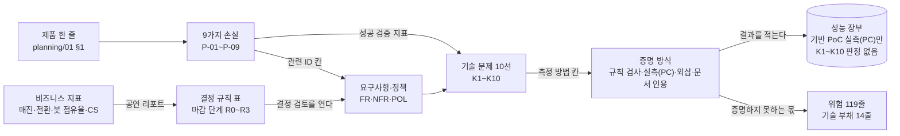

# 분야 편 1: 무엇을 왜 만드나

- **기준 시점**: ADR-0177까지, 2026-11-01
- **맡는 정본**: [docs/planning/00-executive-summary.md](../../planning/00-executive-summary.md) 전체, [docs/planning/01-overview.md](../../planning/01-overview.md) 전체
- **규범이 아니다**: 정본을 풀어 쓴 해설이다. 숫자와 규칙이 정본과 다르면 정본이 맞다([ADR-0177](../../adr/0177-walkthrough-explain-in-interview.md)).
- **한 판 문서와의 관계**: [한 판 문서](../01-system-design.md) 1단계(무엇을 만드나)가 판매 구조·화면 앱·하지 않는 것을, 2단계(규모 어림)가 표준 온세일(판매가 열리는 시각 앞뒤로 접속이 몰리는 기간) 시나리오와 매진 22분을, 18단계(어떻게 증명하나)가 100만 명을 실제로 돌리지 않는 이유와 증명 방식을 이야기 순서로 말한다. 4단계는 개요서 §3.1의 K1~K10을 '단순한 설계가 깨지는 열 곳'으로, 6단계는 §1.3의 정렬 방식 논쟁을 다룬다. 이 편은 두 정본을 절마다 정리하고, 한 판 문서가 건너뛴 것(9가지 손실, 사용자 일곱 유형, 비즈니스 지표와 결정 규칙 표, 산출물 목표, 위험 119줄과 기술 부채)을 더한다.
- **측정 전이다**: 서비스 수준 측정(NFR 목표를 운영 규모로 잰 것)은 아직 없어 성능 숫자는 설계 목표값이고 `[실측 전]`을 붙였다. K1~K10을 판정한 기록도 없다. 기반 PoC(wbs 0.5.1, 본 개발 전에 위험한 부분만 먼저 재 보는 시험)는 2026-11-01에 PC 한 대에서 쟀다([ADR-0176](../../adr/0176-foundation-poc-results.md), 성능 장부 docs/perf-ledger.md §5, [현황 한 장](../00-status.md)). 그 숫자는 '실측(PC)'이고 운영 규모 증거가 아니다. 정본의 `[가정]`·`[추정]`·`[보완]` 표시는 그대로 옮겼다.

## 1. 이 문서가 정하는 것

두 정본은 PEAKET(피켓)을 왜 만들고 무엇을 약속하는지 정한다. 경영진용 요약(docs/planning/00-executive-summary.md)은 의사결정자가 5분 안에 읽는 한 장이고, 새 결정 없이 개요서와 WBS(할 일을 잘게 나눈 작업 목록), 검증 문서의 숫자를 옮긴다. 서비스 개요서(docs/planning/01-overview.md)는 면접관이나 새 엔지니어가 10분 안에 읽는 기획의 뿌리다. 풀 문제(9가지 손실 P-01~P-09), 사용자 일곱 유형, 수치로 증명할 기술 문제 열 개(K1~K10)와 비즈니스 지표, 산출물, 범위와 하지 않기로 한 것(Non-goal), 제약, 위험과 기술 부채를 정한다. 핵심 주장은 넷이다. 100만 명이 몰려도 멈추지 않는다. 같은 좌석이 두 사람에게 팔리는 오버셀을 0건으로 막는다. 자동 예매 프로그램(봇)보다 사람에게 표가 가게 한다. 운영자가 실시간으로 개입한다. 두 정본은 이 주장을 어디까지 증명하고 무엇이 남는지도 함께 적는다.

> **30초 설명**: "PEAKET은 공연 티켓 예매와 관제를 하는 시스템입니다. 100만 명이 몰려도 멈추지 않고, 같은 좌석을 두 번 팔지 않고, 봇보다 사람에게 표가 가게 하는 것이 목표입니다. 티케팅을 고른 이유는 한정된 좌석을 두고 같은 순간 쓰기가 몰리는 문제와, 수십만 명이 같은 순간 자기 차례를 묻는 문제가 겹치기 때문입니다. 봇을 가려내는 일과 몰린 트래픽을 받아 내는 일은 다른 계층의 문제라 따로 풉니다. 100만 명을 실제로 돌리지는 않습니다. 대기 상태 조회 요금만 약 273달러라 지출 상한 5만 원을 넘기 때문입니다. 대신 규칙은 모델 검사로 보고, 대기 인원과 관계없는 예매 계층은 실제 크기로 재고, 비례하는 부분만 식으로 늘려 '외삽'이라고 표시합니다. 명의를 빌린 봇과 플랫폼 밖 암표처럼 막지 못하는 것은 처음부터 한계로 적어 둡니다."

## 2. 절마다 읽기

경영진용 요약은 `## ` 절 아홉 개, 서비스 개요서는 `## ` 절 여섯 개와 `### ` 절 열두 개다. 개요서의 `### ` 절은 모두 행을 나눴다.

| 정본 절 | 무엇을 정하나 | 왜 | 해설서에서 |
| --- | --- | --- | --- |
| docs/planning/00-executive-summary.md §1 한 문단 요약 | 무엇(공연 예매·관제), 목표 셋, 만드는 사람(1인과 AI 코딩 도구), 지금 단계 | 리드 엔지니어의 역량을 보이는 프로젝트라는 목적을 먼저 밝힌다(planning/01 §3.3) | 한 판 1단계 |
| docs/planning/00-executive-summary.md §2 왜 필요한가 | Eras Tour(2022년 Ticketmaster의 테일러 스위프트 공연 판매) 요청 35억 건과 상호작용 약 15% 실패, 개정 공연법, 국내 예매처 4곳의 순번 방식 비공개 | 몰림, 법, 신뢰가 각각 설계 요구가 된다. 50배 과징금은 부정판매한 사람에게 매긴다(기술 검토 중간-103) | 한 판 1단계 |
| docs/planning/00-executive-summary.md §3 무엇을 약속하나 | 약속 여섯과 증명 방식: 규칙 검사(작은 범위의 모든 순서를 기계로 따지기), 실측(PC)(PC에서 잰 값), 외삽(잰 범위를 식으로 늘린 값), 문서 인용(제공사 문서에만 기댄 값) | 같은 무게로 읽으면 외삽인 '100만'을 잰 값으로 오해한다(기술 검토 낮음-112) | 한 판 18단계 |
| docs/planning/00-executive-summary.md §4 어떻게 푸는가 | 다섯 갈래(접속 폭주, 좌석·결제, 봇, 운영·현장, 돈의 흐름)의 해법과 남는 한계 | 해법과 한계를 한 줄에 둬 과장을 막는다 | 한 판 1·5·6·8·10·13·14단계 |
| docs/planning/00-executive-summary.md §5 하지 않는 것 | 스포츠, 되팔기 중개, 여러 리전(클라우드 데이터센터 지역) 동시 운영, 네이티브 앱, 외화 결제 | planning/01 §4.2의 요약이다 | 한 판 1단계 |
| docs/planning/00-executive-summary.md §6 일정·인력·비용 | 1인 주 40시간, 작업 219개 564.25일, 마일스톤 어림, 지출 상한 5만 원 | ±20%는 실제 속도를 재기 전의 표시용 폭이다(기술 검토 중간-001) | 한 판 18단계(비용만) |
| docs/planning/00-executive-summary.md §7 어떻게 증명하나 | v0(처음 만들 법한 단순한 설계)와 v1(개선한 분산 설계) 비교, 1천~10만 명 실측과 100만 명 외삽, 규칙 모델 검사 | 100만 명이 동시에 돌 때만 생기는 일은 증명하지 못한다고 밝힌다(docs/verification.md §8) | 한 판 4·18단계 |
| docs/planning/00-executive-summary.md §8 주요 위험 | 넷(범위, 명의 빌린 봇, 법률 해석 변경, 결제사 의존)과 남는 것 | 개요서 §5.2에서 경영진이 판단에 쓸 것만 골랐다 | — |
| docs/planning/00-executive-summary.md §9 지금 상태와 정할 일 | ADR(결정 기록) 177건 정합, 경영진 안건 넷 가운데 남은 것은 결제사 계약 조건(3번)뿐 | 3번만 포트폴리오 일정에 영향이 있다(wbs 7.2.3 앞, 기술 검토 낮음-113) | 한 판 1단계, [분야 편 12](12-transfer-refund-settlement.md) |
| docs/planning/01-overview.md §1 해결할 문제와 근거 | 제품 정의, 문제를 고른 이유, 9가지 손실, 정렬 방식 논쟁, 참고 사례 | 문제 정의가 요구사항(FR·NFR)과 정책(POL)으로 바로 이어지게 한다 | 한 판 1단계 |
| docs/planning/01-overview.md §1.1 왜 대규모 티케팅인가 | 고른 기준 여섯과 국내 환경(소셜 로그인, 휴대폰 본인확인, 사람 확인 Turnstile, 원화 결제, 당근의 디자인 시스템 SEED Design) | 대기열이 쓰기 경합을 좌석 화면 5,000명·판매 확정 초당 약 28건으로 묶고, 몰림은 CDN(사용자 가까운 곳에서 파일을 대신 내주는 전송망)이 받는다(기술 검토 중간-007) | 한 판 1·2단계 |
| docs/planning/01-overview.md §1.2 오픈 전후에 생기는 9가지 손실 | P-01~P-09의 문제·손실·성공 지표·관련 ID, 봇 차단과 트래픽 흡수는 다른 계층이라는 결론 | 사전 검증(Verified Fan)으로 암표 유출을 낮춘 Ticketmaster도 판매 당일 트래픽으로 마비되었다 | — |
| docs/planning/01-overview.md §1.3 대기열 정렬 방식 논쟁과 엔지니어링 맥락 | 선착순(FIFO)과 사전 셔플(오픈 전 대기실인 로비의 인원을 오픈 순간 무작위로 섞기)의 10가지 관점 비교 | 공연법은 기술 방식이 아니라 '최초 판매자가 정한 공정한 구입 과정'을 기준으로 삼아, 핵심은 사전 고지와 검증할 수 있는 공개다 | 한 판 6단계, [분야 편 9](09-queue-admission.md) |
| docs/planning/01-overview.md §1.4 참고한 사례 | Ticketmaster 공개 자료와 AWS 가상 대기실을 비교 기준으로 썼다 | 견줄 자료가 많다. 코드·화면은 옮기지 않았다 | — |
| docs/planning/01-overview.md §2 사용자 유형별 상황과 목표 | 일곱 유형(팬, 파트너 구매 결정자·실사용자, 운영자, 현장 스태프, CS(고객 지원) 담당자 `[보완]`, 외부 이해관계자) | 팬 목표의 1초·0.05초는 K5·K2에서, 현장 스태프 목표의 0.15초는 K10에서 왔다 | 한 판 1단계 |
| docs/planning/01-overview.md §3 목표 지표(KPI)와 측정 방법 | 기술 문제 10선, 비즈니스 지표, 산출물 목표. KPI는 성과를 재는 핵심 지표다 | 숫자는 측정 전 가설이고 잰 결과를 그대로 적는다 | 한 판 4·18단계 |
| docs/planning/01-overview.md §3.1 수치로 증명할 기술 문제 10선 | K1~K10의 목표와 측정 방법, v0/v1 비교 규칙, 100만 검증의 네 갈래 | v0 대비 비율로 합격을 정하면 v0를 어떻게 만들었는지에 기댄다(ADR-0096) | 한 판 4~14·18단계 |
| docs/planning/01-overview.md §3.2 비즈니스 지표 | 표준 온세일 시나리오와 지표 여섯(매진 소요 시간, 전환율, 봇 점유율, 봇 트래픽 비율, 예상 CS, 오픈 뒤 본인확인 비율) | 원문에 목표치가 없어 표준 시나리오로 계산해 정했다(2026-10-09 확정) | 한 판 2단계(매진만), [분야 편 14](14-bot-defense.md)(봇 점유율) |
| docs/planning/01-overview.md §3.2 결정 규칙 표 | 조건에 걸리면 결정 검토를 여는 18줄, 마감 단계 R0~R3(숫자를 확정하는 네 단계), 95% 구간 판정 | 숫자가 정책 변경으로 이어지는 길을 정하되 조치를 강제하지 않는다(ADR-0042·0052) | — |
| docs/planning/01-overview.md §3.3 산출물 목표 (리드 역량 증명 장치) | 역량 11가지의 산출물과 면접 장면, 증거 수준 표시 넷, 증명 순서 | 리드 역량은 문제 정의, 데이터에 기댄 결정, 운영, 지식 전파로 보인다 | 한 판 17단계(더 깊이 안내만) |
| docs/planning/01-overview.md §4 범위와 Non-goals | 앱 넷의 기능, 판매 구조, 굿즈 정책, 부하 목표, 하지 않는 것 | 증명할 범위를 정하고 뺀 것에도 근거를 단다 | 한 판 1단계 |
| docs/planning/01-overview.md §4.1 범위 | 소비자 웹·파트너 콘솔·관제 콘솔·게이트 스캐너 PWA(설치형 앱처럼 쓰는 웹 앱), 통신판매중개자(직접 팔지 않고 거래를 알선하는 사업자) 구조, 굿즈와 연동 상품, 목표 100만 명 | 굿즈 자격까지 묶으면 티케팅에 실패한 다수 팬을 밀어낸다. 100만 명은 추석 KTX 최대 동시접속 약 78.3만 명을 웃돈다 | 한 판 1단계 |
| docs/planning/01-overview.md §4.2 Non-goals [보완] | 하지 않는 것 14줄과 근거 | 법적 의무, 가격을 강제할 수 없는 PEAKET 밖의 돈(리세일), 운영 범위(비밀번호 로그인), 지출 상한(100만 실측, 운영 환경) | 한 판 1·18단계 |
| docs/planning/01-overview.md §5 제약사항과 주요 리스크 | 제약 일곱, 위험 119줄, 기술 부채 14줄 | 무엇을 막고 무엇이 남는지 적는다(docs/planning/03-policies-glossary.md §5.1) | 한 판 18단계(지출 상한만) |
| docs/planning/01-overview.md §5.1 제약사항 | 1인 풀타임, 지출 상한, 법 시행일, 법률 미확정 표시, 외부 API 한도, 클라우드 정책, 기술 스택 고정 | 결제사 한도가 비공개라 300 TPS(초당 처리 건수)·초당 50건으로 추정한다(ADR-0036) | 한 판 2·18단계 |
| docs/planning/01-overview.md §5.2 주요 리스크 | 119줄(높음 12, 중간 78, 낮음 29), 종류 셋, 등급 계산 | 대응 전 등급은 지금 남은 것을 말하지 않는다(ADR-0151) | 한 판 17·18단계(100만 실측의 틈만) |
| docs/planning/01-overview.md §5.3 기술 부채(소유자 결정 2026-10-29, ADR-0151) | 알면서 받아들인 빚 14줄, 이자와 갚는 때 | 정할 일(open-items)과 섞으면 빚이 남는지 알기 어렵다 | — |
| docs/planning/01-overview.md §6 기획 근거 자료 | 기획과 요구사항에 직접 쓴 문헌 20개 | 전체 참고 문헌은 docs/architecture.md §12에 있다 | — |

## 3. 꼭 기억할 규칙과 숫자

| 항목 | 값 | 표시 | 정본 위치 |
| --- | --- | --- | --- |
| 목표 규모 | 동시 대기 100만 명. 200만 명은 재지 않고 다시 설계할 지점만 정리한다 | 설계 목표, `[실측 전]` | planning/01 §4.1, NFR-013·021 |
| 진입 | 피크 20만 RPS(초당 요청 수)에서 p99(요청 100건 중 99건이 끝나는 시간) 200ms 이하, 오류율 0.1% 미만. 원 서버 요청은 설계 식(활성 대기 상태 파일 수 ÷ 캐시 수명)의 ±10% `[가정]` 안 | 외삽, `[실측 전]` | planning/01 §3.1 K1 |
| 좌석 | 한 좌석 1,000명 경합에서 오버셀 0건, 홀드(결제하는 동안 좌석을 잠시 잡아 두기) p99 50ms·p99.9 150ms, 1인 한도 초과 0건, 데드락(서로의 잠금을 기다리다 멈춤) 0건 | 규칙 검사 + 실측(PC), `[실측 전]` | planning/01 §3.1 K2·K3 |
| 좌석 변경 전파 | 종단 p99 300ms, 만료 좌석 재노출 p99 3초, 연결 5,000개 전송량이 묶음 델타(바뀐 좌석만 담은 메시지) 초당 약 10MB + 구역 갱신 초당 최대 약 6MB 이하 | `[실측 전]` | planning/01 §3.1 K4 |
| 좌석맵 화면 | INP(조작에 화면이 반응하기까지 걸린 시간) 200ms 이하(정한 조건에서 재는 랩 측정의 p75, CPU 4배 감속, 20회 `[가정]`), 좌석맵 1초 미만 | `[실측 전]` | planning/01 §3.1 K5 |
| 봇 탐지 | 1·2단계 탐지율 95% 이상, 사람 오탐(사람을 봇으로 잘못 보기) 단측 95% 신뢰상한(관측한 오탐 수로 '실제 오탐률이 이보다 크지 않다'고 95% 확신하는 값) 0.5% 이하(공개 자료의 미리 등록한 947명에서 오탐 1건 이하) | 실측(PC, 공개 자료 기준), `[실측 전]` | planning/01 §3.1 K6 |
| 결제 | 장애를 넣은 1만 건에서 이중 결제 0건, 승인 뒤 60초 안에 발권도 재시도 큐 진입도 없는 결제 0건, ticket-svc(발권 서버) 5분 중단에도 환불 0건 | 규칙 검사 + 합성 실측(PC), `[실측 전]` | planning/01 §3.1 K7 |
| 관제 | 장애 10종 100% 탐지, 장애마다 60초 이내(최댓값), 명령 반영 3초 이하 | `[실측 전]` | planning/01 §3.1 K8 |
| 확장 | 노드가 있을 때 파드(쿠버네티스에서 앱이 도는 단위) 준비 60초 미만. 노드는 T-40분 프리워밍(미리 띄워 두기) | T-40분은 `[가정]`, `[실측 전]` | planning/01 §3.1 K9 |
| 현장 입장 | 오프라인 판정 p95 150ms, 두 기록이 모두 올라오면 중복 입장 100% 탐지, 오프라인 레인 통과가 온라인의 90% 이상 | 90%는 `[가정]`, `[실측 전]` | planning/01 §3.1 K10 |
| 표준 온세일 | 5만 석, 주문 2.5만 건(건당 2매 가정), 동시 입장 5,000명, 체류 3분 → 입장 초당 약 28명. 진입 시도 100만 건 중 절반이 봇 | 계산값(봇 절반은 가정) | planning/01 §3.2 |
| 매진 소요 시간 | 22분 이하. 3만 명 ÷ 초당 28명 ≈ 18분에 여유 20% | 자체 목표 | planning/01 §3.2 |
| 입장 → 구매 전환율 | 83% 이상(2.5만 ÷ 3만). 사용자 행동의 결과라 아키텍처가 보증하지 못한다 | 자체 목표 | planning/01 §3.2 |
| 봇 점유율 | 5% 이하. 탐지된 봇의 추가 검증 통과율 r이 약 0.25% 이하여야 한다(r = 0이면 약 4.8%, 1%면 약 5.6%, 10%면 약 12.7%) | r은 `[가정]`(3.7.1에서 확정) | planning/01 §3.2 |
| 예상 CS 건수 | 약 2,600건 이하 = 오탐 0.5% × 50만 명(2,500) + 결제 허용 실패 약 12 + 게이트 거부 0.1% × 5만 석(50) | 계산값 | planning/01 §3.2 |
| 오픈 순간의 목표 | 모든 사람을 성공시키는 것이 아니다. 좌석보다 사람이 훨씬 많아 대부분은 살 수 없어서다. ① 팔 수 있는 좌석은 막힘 없이 판다(오버셀 0건, 입장 → 구매 전환율, 매진 22분 이하) ② 사지 못하는 사람은 덜 기다리게 하고 빨리·정확하게 매진을 알린다(최대 약 28초, NFR-002) ③ 돈만 빠지고 좌석이 없는 손님을 남기지 않는다(결제 승인 뒤 60초 안에 발권도 재시도 큐 진입도 없는 결제 0건, NFR-006). 대부분이 실패를 받으므로 무엇이 실패했는지(방금 팔린 좌석, 전석 매진, 카드 승인 거절) 정확히 알리는 실패 응답도 기능으로 만든다 | 새 NFR 없이 지금 지표를 잇는다. 28초는 설계 식 | planning/01 §3.2(ADR-0180 결정 7) |
| 지출 상한 | 총 5만 원. 100만 명 70분 대기 조회 약 2.3억 건의 요청 요금만 약 273달러(HTTPS 1만 건당 0.012달러, 1,400원/달러 가정 시 약 38만 원) | 상한은 소유자 결정 | planning/01 §4.2·§5.1, docs/planning/00-executive-summary.md §6, docs/verification.md §1.2 |
| 일정 | 작업 219개, 564.25일(112.9주), ±20%(90.3~135.4주). M2a 30.0주, M2 50.3주, M4 80.1주, M7 112.9주 | 어림 | docs/planning/00-executive-summary.md §6 |
| 외부 한도 | 토스페이먼츠 샌드박스 엔드포인트마다 분당 100건(실측 확인), 운영 승인 가맹점당 피크 300 TPS, 포트원 채널당 초당 50건, CloudFront(AWS의 CDN) 배포당 초당 25만 건 | 300·50은 추정(ADR-0036) | planning/01 §5.1·§5.2 |
| 위험·법률·가정 | 위험 119줄(높음 12·중간 78·낮음 29), 법률 표시 간주 7·해석 39·확인 필요 26·추정 8건, `[가정]` 4,321곳 | 2026-10-30~11-01 셈 | planning/01 §5.2·§5.3, POL-027 |
| 산출물 | 핵심 결정 10건 목표(측정 뒤 상태 줄을 갱신한 것 0건), RFC(합의를 위한 설계 제안 문서) 3건, Game Day(일부러 장애를 내고 대응을 연습하는 날) 33종, 기술 블로그 10편 | 목표 | planning/01 §3.3 |

## 4. 이 문서가 다루는 ID

두 정본은 ID를 정의하지 않는다. 아래는 9가지 손실 표(planning/01 §1.2)와 K1~K10, 범위가 가운데에 두고 쓰는 ID이고, 뜻은 정의 문서(planning/02·03)에서 줄였다.

| ID | 한 줄 |
| --- | --- |
| NFR-001 | 대기열 진입. T=0 피크 20만 RPS에서 p99 200ms 이하 |
| NFR-003 | 좌석 홀드. p99 50ms·p99.9 150ms, 가용성 99.95%, 오버셀 0건 |
| NFR-006 | 결제 확정. p99 3초 이하. 예상 CS의 결제 허용 실패 약 12건이 여기서 나온다 |
| NFR-007 | 공연 페이지. 오픈 직전 피크 30만 RPS에서 TTFB(첫 바이트가 오기까지 걸린 시간) p99 150ms 이하 |
| NFR-008 | 관제 운영 명령. 명령 전파 p99 3초 이하·성공률 99.9% |
| NFR-009 | 관제 지표 반영. 실시간 표 반영 p95 5초 미만 |
| NFR-010 | 게이트 입장 판정. 단말 안 판정 p95 150ms 이하, 위조 통과 0건 |
| NFR-013 | 규모. 동시 대기 100만 명을 설계 목표로 두고 부하를 나눠 검증한다 |
| NFR-020 | 접근성. WCAG 2.2(웹 접근성 표준) AA 위반 0건, 화면 낭독기로 예매 완주 100% |
| NFR-021 | 확장성. 200만 명일 때 다시 설계할 병목을 문서로 정리한다 |
| NFR-022 | 봇 탐지 정확도. 탐지율 95% 이상, 사람 오탐 단측 95% 신뢰상한 0.5% 이하 |
| NFR-023 | 운영. 장애 10종 탐지 100%, 장애마다 60초 이내, 파드 확장 60초 미만 |
| NFR-024 | 국제화. ko·en·ja·zh 4개 국어 |
| NFR-025 | 정합성 불변식. 순번 보존 100%, 차례 전 입장 0건, 재노출 p99 3초, 1인 한도 초과 0건 |
| FR-004 | 티켓 오픈 사전 알림을 신청한다 |
| FR-005 | 오픈 전 로비에 들어가 순번 없는 참가 토큰을 받는다 |
| FR-006 | 오픈 뒤 정규 대기열에 들어가 순번이 적힌 대기표를 받는다 |
| FR-007 | 대기 상태(앞 인원, 진행 막대, 예상 대기, 대기 취소)를 본다 |
| FR-008 | 차례가 오면 입장을 확정받는다. 정원이 차면 '곧 입장'으로 기다린다 |
| FR-009 | 5만 석 좌석맵에서 전체 배치를 확대해 고른다 |
| FR-010 | 좌석을 홀드한다. 경합하면 처음 1인만 성공, 연장은 1회 |
| FR-011 | 결제창 인증 뒤 서버가 좌석 예약을 확정하고 승인을 부른다 |
| FR-012 | 월렛에 모바일 티켓이 발급되고 입장 QR은 15초마다 바뀐다 |
| FR-014 | 예매 뒤 티켓 연동 부가 상품(주차권, VIP 라운지, 패스트 트랙)을 산다 |
| FR-015 | 예매와 관계없이 공식 굿즈를 사고, 한정 수량은 오버셀 없이 줄어든다 |
| FR-020 | 격리된 이용자는 추가 검증 큐로 가고, 통과하면 원래 순번 차례에 입장한다 |
| FR-029 | 관제 대시보드에서 온세일 단계별 화면을 본다 |
| FR-030 | 표준 운영 명령 12개를 사유·사전 시뮬레이션·2인 승인과 함께 실행한다 |
| FR-031 | 운영 명령과 자동 제어를 감사 로그에 바꿀 수 없게 남긴다 |
| FR-032 | 감내 모드(Degraded Mode, 큰 장애 때 핵심만 지키고 부가 기능을 줄이는 모드)를 켠다 |
| FR-035 | 스캐너가 오프라인에서도 회전 QR을 기기 안에서 검증한다 |
| FR-036 | 스캔을 기기 안 영구 큐에 쌓아 올리고 60초마다 변경분을 받는다 |
| FR-037 | serving 번호(지금 입장 차례인 번호)를 상황에 맞춰 앞으로 옮긴다 |
| FR-039 | 사람 확인, 기기 신뢰도, 행동 신호, 허니팟(사람은 누르지 않는 숨긴 링크)으로 위험 점수를 매긴다 |
| FR-042 | 홀드 TTL(정해 둔 유효 시간)이 끝나면 원자적으로 거두고 3초 안에 다시 보인다 |
| FR-049 | 운영 환경의 봇 탐지 성능은 보수적인 하한만 추정한다 |
| POL-001 | 입장권 구매자 본인확인. 정렬 방식과 관계없이 순번 전에 휴대폰 본인확인 |
| POL-002 | 1인 1순번과 기기 바인딩. 중복은 실명 연계정보에서 만든 pid로 판정한다 |
| POL-003 | 정렬 방식. 회차마다 로비 셔플·오픈 직후 묶음 두 값(기본 둘 다 켬) |
| POL-004 | 정렬 방식 고지와 표현. 세 화면에 같은 표준 문구 |
| POL-005 | 검증 가능한 셔플(commit-reveal: 시드를 미리 봉인해 공시하고 나중에 공개). 누구나 결과를 다시 계산한다 |
| POL-006 | 추가 검증 큐(자동화된 결정). 위험 점수로 순번을 바꾸지 않는다 |
| POL-007 | 대기열 인원의 기준. 창을 닫거나 끊겨도 순번을 유지한다 |
| POL-008 | 차례와 유예. 차례가 온 때부터 15분 안에 오면 우선 입장 |
| POL-011 | 1인당 매수 제한. 확보한 수 + 요청 수 ≤ 한도 |
| POL-012 | 홀드 TTL과 재노출. 3초 안 재노출, 연장 1회 |
| POL-013 | 결제 규칙. 2단계 결제사만 쓰고 PENDING(사전 예약)을 잡은 뒤 승인을 부른다 |
| POL-014 | 가상계좌와 환불 계좌. 몰리는 온세일 공연은 가상계좌를 끈다 |
| POL-016 | 굿즈·부가 상품. 굿즈는 자유 구매, 연동 상품은 유효 티켓 보유자만 |
| POL-018 | 입장 판정과 중복 입장. 회전 QR은 비대칭 전자서명(ECDSA P-256) |
| POL-024 | 암표 방지 법정 조치. 공연법 §4의2②의 조치를 출시 전에 갖춘다 |
| POL-026 | 테스트·윤리 규칙. 합성 봇은 격리된 자체 환경에서만 돌린다 |
| POL-027 | 법률 항목 표기와 검토. 확인됨·확인 필요·해석·간주로 표시한다 |
| POL-030 | 온세일 단계 정의. T-40분 프리워밍 `[가정]`, T-30분 점검, 로비 기본 10분 전 |
| POL-035 | 좌석 배정 방식. 직접 선택(PICK, 기본)과 자동 배정(AUTO) |
| POL-037 | 판매 구조와 법적 지위. PEAKET은 통신판매중개자, 판매 당사자는 파트너 |
| POL-039 | 정산과 지급. 결제사 지급대행(결제사가 파트너 계좌로 대금을 대신 보내기), PEAKET은 대금을 받아 두지 않는다 |
| POL-040 | 분석 숫자와 결정 절차. 정책은 마감 단계 R0~R3의 확정 숫자로만 바꾼다 |
| POL-046 | 부정 예매 사후 조치. 사유 범주 다섯, 이의가 인정되면 우선 구매나 보상 |

## 5. 결정과 버린 길

[ADR 자리표](../decisions/README.md) §2는 분야 편 1에 자리로 준 ADR이 없다(1·14·16·18·22편은 자리인 ADR이 없다). 아래는 두 정본이 가장 기대는 ADR이고, 괄호 안이 그 ADR의 자리다. 버린 길은 각 ADR의 '검토한 대안'(ADR-0047·0052는 '대안') 절에서, '옛 판'은 상태 줄과 docs/architecture.md §11.1에서 옮겼다.

### [ADR-0057](../../adr/0057-verification-without-full-scale-infra.md) 100만은 실측하지 않는다(결정 카드 [D-29](../decisions/D29-prove-without-full-scale.md))

- **고른 것**: 증명을 '규칙이 맞는가'와 '양을 버티는가'로 나눈다. 규칙은 모델 검사, 모델 기반 시험(실제 코드에 무작위 순서를 넣는 시험), 장애 주입 뒤 기록 검사로 본다. 양은 예매 계층을 실제 크기로 재고 비례하는 부하만 설계 식으로 늘린다. 운영·스테이징은 띄우지 않는다.
- **버린 길**: 100만 실측 1~2회(요청 요금만 상한의 몇 배), 목표를 20만 명으로 낮추기('대기 인원이 늘어도 예매 계층 부하는 그대로'를 보일 기회가 사라진다), 수학 모델만(실제 코드를 재지 않는다), 무료 크레딧(초과 과금이 상한 밖이다).
- **옛 판**: 맥락의 '약 198달러'는 HTTP 단가(1만 건당 0.009달러)로 약 2.2억 건을 셈한 값이다. HTTPS 단가와 ADR-0110 뒤의 약 2.3억 건으로 지금은 약 273달러다. 비례하는 곳은 셔플 결과 조회를 더한 셋이다. 진입 판단은 USL(서버를 늘릴 때 처리량이 덜 느는 모양의 식)이 아니라 설계 식이다(ADR-0096).

### [ADR-0096](../../adr/0096-evidence-design-entry-capacity-split-comparison-v0-baseline.md) v1 합격은 목표 절대값으로(결정 카드 [D-29](../decisions/D29-prove-without-full-scale.md))

- **고른 것**: 진입 용량은 '진입 서버 1대 처리량 × 대수, 상한은 Redis(메모리에 데이터를 두는 빠른 저장소) 한 키'로 본다. 서비스를 나눈 효과는 같은 자원 합계의 세 구성(한 프로세스 합본, 역할별 배포, 10개 서비스)으로 견준다. v0 대비 비율은 보조 숫자다.
- **버린 길**: USL을 주 근거로(한 PC의 공유 자원이 곡선에 섞인다), 두 구성 비교(실행과 코드를 나눈 효과를 가를 수 없다), v0 없애기(단순한 설계가 어디서 무너지는지 보이는 데 쓸모 있다), 새 비율 목표(측정 전에 정할 근거가 없다).
- **옛 판**: K1 폴링 표 '1·5·20초'는 '0.5·5·20초'다(ADR-0110).

### [ADR-0045](../../adr/0045-intermediary-legal-status.md) PEAKET은 통신판매중개자다([분야 편 12](12-transfer-refund-settlement.md))

- **고른 것**: PEAKET은 직접 팔지 않고 거래를 알선하는 통신판매중개자이고, 판매 당사자는 파트너다. 공연은 판매 승인 뒤에 공개된다. 취소와 환불은 PEAKET이 집행하고 책임도 함께 진다.
- **버린 길**: PEAKET이 판매 당사자(모든 공연의 불이행 책임을 진다), 순수 중개(책임과 실행이 어긋나고 파트너가 부도나면 팬 환불이 막힐 수 있다), 승인 없이 공개(판매자를 확인할 곳이 없다).
- **옛 판**: 판매 승인 확인 항목은 넷이 아니라 여섯이다. 정산 지급은 ADR-0047이 정했다.

### [ADR-0047](../../adr/0047-settlement-payout-via-pg-agency.md) 정산은 결제사 지급대행으로(결정 카드 [D-30](../decisions/D30-payout-via-pg-agency.md))

- **고른 것**: PEAKET은 판매 대금을 받아 두지 않는다. 회차가 끝난 뒤 결제사가 파트너 정산 계좌로 직접 보낸다. PEAKET 몫을 받는 방식과 요율은 계약 때 정한다(경영진용 요약 §9의 3번).
- **버린 길**: PEAKET 직접 지급(파트너 대금이 PEAKET 계좌에 섞이고 2026-12-16까지의 지위가 확인 필요로 남는다), 공연 전 선지급(취소분을 돌려받을 길이 없다), 회차 종료 즉시 지급(결제사 정산 주기와 이의 기간이 없다).
- **옛 판**: 토스페이먼츠 지급대행 이용료는 공개 안내(월 30만 원, 부가세 별도)를 확인했고, 남는 것은 실제 계약 조건과 포트원 이용료다(ADR-0062).

### [ADR-0012](../../adr/0012-queue-ordering-hybrid-shuffle-default.md)·[ADR-0006](../../adr/0006-ticket-buyer-identity-verification-before-queue.md) 정렬 방식과 순번 전 본인확인(결정 카드 [D-03](../decisions/D03-lobby-shuffle-ordering.md), [분야 편 8](08-identity.md))

- **고른 것**: 정렬 방식은 공연마다 고르고 기본은 하이브리드(로비 셔플 + 오픈 직후 동시 도착 묶음, 그 뒤는 도착 순)다. 셔플은 commit-reveal로 누구나 검증한다. 모든 방식에서 순번 전에 휴대폰 본인확인을 마친다.
- **버린 길**: FIFO 하나(T=0 몰림이 가장 크고 속도형 매크로와 회선·기기 격차에 약하다), 사전 셔플 하나(오픈 뒤 도착자의 기회가 없고 조작 의혹 민원이 생기기 쉽다). 본인확인을 결제 단계에서 하면 인증 안 한 다계정이 순번과 입장 자리를 먼저 차지하고, 가입 때 전원에게 하면 최소 수집 원칙에 어긋난다.
- **옛 판**: 정렬 방식 셋은 지금 회차 설정 두 값의 조합이다([ADR-0118](../../adr/0118-queue-ordering-two-settings-lobby-shuffle-open-batch.md)). 사전 셔플도 오픈 뒤 새 진입을 받아 로비 참가자 전원 뒤에 세운다(ADR-0064).

### [ADR-0151](../../adr/0151-quality-goal-order-scenarios-risk-grades-tech-debt.md) 위험은 대응 뒤 등급, 기술 부채는 따로([분야 편 2](02-requirements.md))

- **고른 것**: 품질 목표 순서(정확성 > 가용성 > 운영 제어 > 봇 방어 > 반응 속도)를 정하고, 위험마다 종류와 대응 뒤 등급(가능성 × 영향 크기의 세 단계)을 매기고, 기술 부채를 따로 적는다.
- **버린 길**: 봇 방어를 가용성보다 앞에(진입을 멈추면 재시도가 몰리는데 막는 것은 일부 봇뿐이다), 5단계 × 5단계 점수(숫자로 잴 수 없는 판단이라 근거가 늘지 않는다), open-items에 부채 칸만(정할 일과 빚이 섞인다), 대응 전 위험(지금 남은 것을 말하지 않는다).
- **옛 판**: 상태 줄의 '114줄(높음 12, 중간 75, 낮음 27)'은 2026-10-29 셈이다. 상태 줄 끝(2026-11-01 정합 점검)이 지금 셈 119줄(높음 12, 중간 78, 낮음 29)을 적는다.

### [ADR-0042](../../adr/0042-analytics-store-and-decision-rules.md)·[ADR-0052](../../adr/0052-analytics-medallion-star-schema-close-stages.md) 결정 규칙 표와 마감 단계(결정 카드 [D-26](../decisions/D26-analytics-clickhouse-parquet.md))

- **고른 것**: 공연 리포트에서 조건에 걸린 지표가 있으면 결정 검토를 연다. 정책은 마감 단계(R0 잠정 ~ R3 회차 종료 다음 영업일)의 확정 숫자로만 바꾼다.
- **버린 길**: 비즈니스 결정도 실시간 숫자로(늦게 확정되는 숫자가 있고, 온세일 중에는 판매 조건을 바꾸지 않으며, 한 회차는 잡음이 크다). 결정 규칙 표 자체의 대안은 정본에 없다.
- **옛 판**: ADR-0042 결정 2의 '관제 읽기 모델을 마트에 흡수'는 ADR-0052가 대신해 실시간 표와 확정 표를 나눴다.

### [ADR-0174](../../adr/0174-human-false-positive-public-data-and-post-launch.md) 판정용 사람을 모으지 않는다(결정 카드 [D-04](../decisions/D04-bot-defense-and-evaluation.md))

- **고른 것**: 출시 전 사람 오탐은 공개된 실제 사람 기록으로 행동 신호만 잰다. 실제 사람 기준은 출시 뒤 그림자 실행(판정만 하고 집행하지 않기)과 R2 표본 검토로 확인한다. 개요서 K6이 이 판을 따른다.
- **버린 길**: 947명 모으기(여건이 없다), 모의 사람만(실제 오탐을 말하지 못한다), 첫 온세일부터 적용(확인하지 않은 규칙으로 사람을 추가 검증에 보낸다).
- **옛 판**: ADR-0048·0112의 '판정용 947명 모집'을 대신한다.

## 6. 읽는 요령

**읽는 순서**: 경영진용 요약 §1 → §3 → §4 → §8로 약속과 한계를 잡는다. 이어서 개요서 §1.1 → §1.2 → §3.1 → §3.2 → §4.2 → §5.2의 '높음' 12줄을 읽는다. 결정 규칙 표, §3.3, §5.3, §6은 찾아볼 때 읽는다.

**두 정본이 이어지는 사슬**: 개요서는 문제에서 숫자로, 숫자에서 증명 방식으로 이어진다.

**함정**:

- **'원문' 꼬리표**: '원문 K1~K10', '원문 B1~B9'는 2026-10-27에 지운 초기 설계서의 번호다. 원문은 판단 근거로 쓰지 않는다(ADR-0097·0098).
- **'탐지'의 뜻**: 차단하거나 추가 검증 큐로 보내는 것이다. 추가 검증은 빌린 명의로 통과할 수 있어, 탐지율 95%만으로 봇 점유율 5%가 지켜지지 않는다. 실서비스의 봇 점유율은 하한이고 플랫폼 밖 암표는 보이지 않는다.
- **매진·전환은 행동의 결과다**: 22분과 83%는 용량 어림이 가정한 값이라 아키텍처가 보증하지 않는다. 일정의 ±20%도 오차가 아니라 표시용 폭이다.
- **K8의 두 판정**: Game Day는 수십 번이라 3초를 최댓값으로 본다. p99 3초와 성공률 99.9%는 3,000번 이상 보내는 C-T2가 판정한다.
- **등급은 대응 뒤다**: §5.2의 '가능성'은 잰 빈도가 아니라 정성 기준이다.
- **진행 상태**: 경영진용 요약 §1·§9는 첫 개발 단계(Phase 0)의 구현을 하고 있다고 적고, 진행은 docs/BUILD_ORDER.md의 체크가 기준이다(2026-11-01 정합 점검, [현황 한 장](../00-status.md)).
- **§1.3의 두 방식**: 비교표는 선착순과 사전 셔플을 견준다. 지금 회차 설정은 두 스위치의 조합 셋이다(POL-003).

## 7. 경계

| 이 정본이 정하지 않는 것 | 정하는 곳 |
| --- | --- |
| FR·NFR의 본문, NFR 작성 원칙, 품질 목표 순서 | docs/planning/02-requirements.md, docs/quality/quality-requirements.md([분야 편 2](02-requirements.md)) |
| POL 본문과 용어, 문서 쓰기 규칙 | docs/planning/03-policies-glossary.md([분야 편 3](03-policies-glossary.md)) |
| 용량 어림 식과 v0의 구조 | docs/architecture.md §9.1·§9.3(한 판 2·4단계) |
| 모델 검사 범위, 외삽 판정, 선택 보정, 측정 기록 양식 | docs/verification.md, docs/perf-ledger.md(분야 편 22) |
| 작업 일수와 마일스톤, 남은 결정 거리 | docs/wbs/wbs.md, docs/review/open-items.md(분야 편 23) |
| 봇 등급표, 공개 자료 평가, 그림자 실행 | docs/features/bot-defense.md([분야 편 14](14-bot-defense.md)) |
| 판매 승인, 정산서, PEAKET 몫과 계약 조건 | docs/features/transfer-refund.md, docs/features/settlement.md §14([분야 편 12](12-transfer-refund-settlement.md)) |
| 결정 규칙의 계산과 공연 리포트 | docs/features/analytics.md([분야 편 17](17-analytics-forensics.md)) |
| 법률 판단 목록과 개인정보 보존 기한 | POL-027, docs/security/data-classification.md([분야 편 3](03-policies-glossary.md)·21) |
| 지금 만든 것과 잰 것 | docs/BUILD_ORDER.md, docs/PROGRESS.md([현황 한 장](../00-status.md)) |

## 8. 꼬리 질문

| 질문 | 답의 요지 | 근거 |
| --- | --- | --- |
| 왜 하필 티케팅인가요? | 한정 좌석의 쓰기 경합과 수십만 명의 진입·대기 조회가 겹친다. 대기열이 경합을 작은 범위로 묶어, 병목은 DB가 아니라 대기 상태 조회·정각 진입·좌석 변경 방송이다 | planning/01 §1.1 |
| 봇 막기와 트래픽 받기를 왜 나눠 푸나요? | 사전 검증으로 암표 유출을 5% 미만으로 낮춘 Ticketmaster도 판매 당일 트래픽으로 마비되었다. 신원·행동 분석과 인프라 유입 제어는 한쪽으로 대신할 수 없다 | planning/01 §1.2 |
| 매진 22분은 어디서 나왔나요? | 매진까지 입장 3만 명을 초당 약 28명으로 나누면 약 18분이고, 초기 증가 구간과 재노출 버퍼로 20%를 더했다. 전환율 83%를 가정한 값이다 | planning/01 §3.2 |
| 탐지율 95%면 봇 점유율 5%가 지켜지나요? | 아니다. 탐지된 봇이 추가 검증을 통과해 돌아오는 비율이 약 0.25%만 넘어도 5%를 넘는다. 그래서 K6에서 그 통과율과 끝에서 끝까지의 봇 성공률을 함께 잰다 | planning/01 §3.2 |
| 100만 명을 실제로 돌려 봤나요? | 아니다. 대기 조회 요청 요금만 약 273달러로 상한 5만 원을 넘는다. 규칙은 모델 검사로, 예매 계층은 실제 크기로, 비례하는 부분은 설계 식으로 늘려 '외삽'이라 붙인다. 100만 명이 함께 돌 때만 생기는 상호작용은 남는다 | planning/01 §4.2·§5.2, ADR-0057 |
| v0보다 몇 % 나아졌는지로 합격을 정하나요? | 아니다. 합격은 목표 절대값이고 비율은 보조 숫자다. v0는 유능한 팀이 처음 만들 법한 설계이고 일부러 망가뜨리지 않는다 | planning/01 §3.1, ADR-0096 |
| 1인 프로젝트에 과설계 아닌가요? | 기술마다 ADR에 이유·대안·바꿀 조건을 두고, 측정 근거가 있는 선택과 문서 근거뿐인 선택을 docs/architecture.md §6.1 표에 나눠 적었다. 상품 정의 하나 때문에 두던 MongoDB(문서 형태로 저장하는 DB)는 뺐다 | planning/01 §5.2 '오버엔지니어링(과설계) 비판' |
| 막지 못하는 것은 무엇인가요? | 대여 명의로 검증을 통과한 봇, 계정째 넘기기 같은 플랫폼 밖 거래, 오프라인 스캐너의 정보 틈, 100만 명 동시 상호작용이다. 한계로 기록하고 비용·제도·표시로 줄인다 | planning/01 §5.2 '높음' 줄 |

## 9. 확인 문제

1. 표준 온세일 시나리오에서 초당 입장 인원은 어떻게 나오는가? 대기자가 더 늘면 이 숫자는 어떻게 되는가?

답

동시 입장 5,000명을 평균 체류 180초로 나눠 초당 약 28명이다. 대기열이 좌석 화면에 들이는 인원을 묶으므로 대기 인원이 늘어도 이 숫자와 예매 계층의 부하는 같다. 그래서 예매 계층은 PC에서 실제 크기로 재 '실측(PC)'을 붙인다. 늘어나는 것은 진입과 대기 상태 조회처럼 대기 인원에 비례하는 부하다(planning/01 §3.1·§3.2).

2. 경영진용 요약 §3의 '몰려도 멈추지 않는다'는 어떤 증명 방식인가? '좌석을 두 번 팔지 않는다'와 무엇이 다른가?

답

외삽이다. 1천~10만 명을 실측해 설계 식으로 100만 명까지 늘리고, CDN이 받는 몫은 문서 인용이다. '좌석을 두 번 팔지 않는다'는 규칙 검사와 실제 크기 실측(PC)이다. 좌석 경합은 대기 인원과 관계없어 실제 크기로 잴 수 있고, 오버셀 0은 규모와 관계없는 규칙이다.

3. 위험 등급은 어떻게 계산하는가? '명의 대여 및 도용 봇 차단 한계'가 높음인 이유는?

답

대응 뒤 남는 위험의 가능성과 영향 크기를 세 단계로 보고, (높음, 높음)·(높음, 중간)·(중간, 높음)이면 높음, (높음, 낮음)·(중간, 중간)·(낮음, 높음)이면 중간, 나머지는 낮음이다. 대여 명의 봇은 설계가 받아들인 한계라 온세일마다 남아 가능성이 높음이고, 봇 방어 목표 미달이라 영향은 중간이다(planning/01 §5.2).

4. Non-goal 가운데 법 때문에 뺀 것 둘과 지출 상한 때문에 뺀 것 둘을 들어라.

답

법: 프로 스포츠 입장권(국민체육진흥법에 따른 별도 의무), 한국 휴대폰이 없는 해외 팬의 구매(구매자 본인확인을 한국 휴대폰 본인확인으로 지키고, 해외 신원 확인이 이 의무를 채우는지는 확인 필요). 지출 상한: 100만·200만 명 전체 실측 부하 시험(요청 요금만 약 273달러), 운영·스테이징 환경의 실제 구축과 상시 데모(ADR-0057)(planning/01 §4.2).

## 10. 정본에서 찾은 어긋남

2026-11-01에 읽은 판에서 찾았고, 2026-11-02에 정본을 다시 대조했다. 고친 것은 '고침(2026-11-01 정합 점검)'으로 적었다.

| 어디 | 어긋남 | 지금 읽는 법 |
| --- | --- | --- |
| docs/planning/01-overview.md §5.2 머리의 종류별 수 | 머리의 '제품 운영 91, 법률 10, 프로젝트 18'이 표를 센 수(92·10·17)와 달랐다. 고침(2026-11-01 정합 점검) | 머리가 92·10·17을 적는다 |
| docs/planning/01-overview.md §5.2 대응 칸 다섯 곳 | 다섯 줄이 지운 docs/guide/를 가리켰다. 고침(2026-11-01 정합 점검) | 해설서의 분야 편·결정 카드를 가리킨다(규범이 아니다) |
| docs/planning/00-executive-summary.md §1·§9와 docs/BUILD_ORDER.md | 요약이 '구현을 시작하기 전'이라 적어 BUILD_ORDER 진행과 달랐다. 고침(2026-11-01 정합 점검) | 요약은 Phase 0 구현 중이라 적고, 진행은 BUILD_ORDER 체크가 기준이다. K1~K10 판정은 아직 없다 |
| ADR-0151 상태 줄 | 위험 셈이 2026-10-29의 '114줄'에서 멈춰 있었다. 고침(2026-11-01 정합 점검) | 상태 줄 끝이 지금 셈 119줄을 적는다 |
