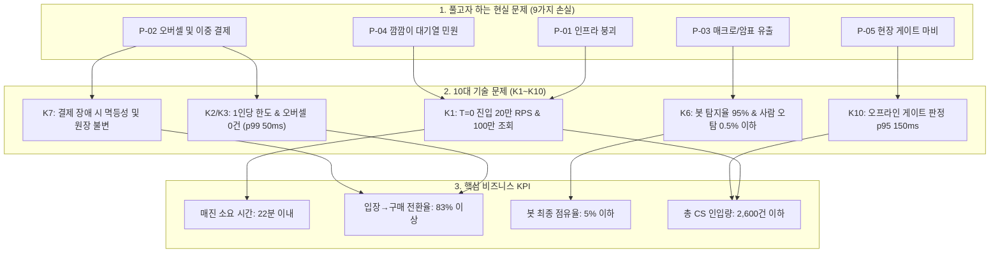
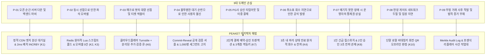
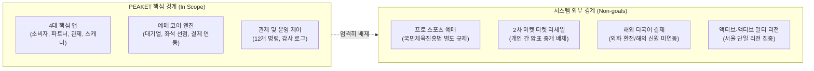

# 분야 편 1: 무엇을 왜 만드나 (Why and What)

- **맡는 정본**: [docs/planning/00-executive-summary.md](../../planning/00-executive-summary.md) 전체, [docs/planning/01-overview.md](../../planning/01-overview.md) 전체
- **문서 성격**: 정본 설계를 시스템 엔지니어링 및 기술 면접 관점에서 체계적으로 해설한 문서다. 규범적 수치와 불변 규칙의 최종 권위는 정본 문서에 있다([ADR-0177](../../adr/0177-walkthrough-explain-in-interview.md)). 길잡이는 [README.md](../README.md)다.
- **한 판 문서와의 관계**: [한 판 문서](../01-system-design.md) 1단계(판매 구조·화면 앱·하지 않는 것), 2단계(규모 어림 및 매진 22분 시나리오), 4단계(K1~K10 단순 설계가 깨지는 10곳), 6단계(정렬 방식 논쟁), 18단계(증명 방식과 외삽)의 배경이 되는 비즈니스 문제와 기술 요구사항 사슬을 상세히 다룬다.
- **아키텍처 목표와 검증 기준**: 100만 명 동시 대기(NFR-013), T=0 피크 20만 RPS 수용(NFR-001), 좌석 오버셀 0건(NFR-003, POL-011), 봇 점유율 5% 이하(NFR-022), 매진 22분 및 전환율 83% 달성을 설계 목표로 삼는다. 100만 명 전체 트래픽을 상시 구동하는 대신 규칙 모델 검사와 핫패스 실측, CDN 및 대기열 외삽 모델을 결합한 다층 검증 체계([ADR-0057](../../adr/0057-verification-without-full-scale-infra.md))를 확립했다.

---

## 1. 도메인 종합 개요

PEAKET은 5만 석 규모의 대규모 콘서트 티켓 예매와 현장 관제를 책임지는 고성능 티케팅 플랫폼이다. 한정된 좌석을 두고 수십만~수백만 사용자가 동일한 순간에 쓰기 경합(Write Contention)을 벌이고, 동시에 자신의 대기 순번을 끊임없이 확인하는 극단적인 읽기 부하가 중첩되는 환경에서 **"100만 명이 몰려도 멈추지 않고, 오버셀 0건을 달성하며, 매크로 봇보다 실제 팬에게 표가 가도록 하고, 실시간 운영 통제권을 유지한다"**는 4대 핵심 가치를 달성한다.

> **30초 아키텍처 브리핑 (Staff Engineer Interview)**:  
> "PEAKET은 극단적 쓰기 경합과 읽기 폭주가 교차하는 대규모 티케팅 도메인을 해결하기 위해 설계된 시스템입니다.  
> 첫째, **트래픽 흡수와 봇 방어의 물리적 계층 분리**입니다. 2022년 테일러 스위프트 티켓마스터 장애 사례에서 입증되었듯, 봇을 막는 신원 검증 로직이 진입 관문에 섞이면 인프라가 먼저 붕괴합니다. PEAKET은 100만 대기자의 상태 조회를 정적 CDN 엣지로 100% 흡수하고, 신원 검증과 봇 탐지는 분리된 큐와 비동기 파이프라인에서 처리합니다.  
> 둘째, **쓰기 경합의 공간적·시간적 한정**입니다. 100만 대기열이 다운스트림 예매 계층에 직접 닿지 않도록 단일 리더 Admission 루프가 초당 약 28명(동시 체류 5,000명)으로 유입을 엄격히 통제합니다. 따라서 좌석 홀드 엔진은 100만 명이 아닌 5,000명의 닫힌 계(Closed System)에서만 동작하며, Redis 단일 Lua 스크립트를 통해 p99 50ms 이내에 오버셀 0건을 보장합니다.  
> 셋째, **비용 제약 하의 계층별 검증 아키텍처**입니다. 100만 명 전체 트래픽 조회를 상시 시뮬레이션할 경우 발생하는 막대한 클라우드 비용(약 273달러 이상)을 피하면서도, 동시성 규칙은 TLA+ 모델 검사로, 좌석·결제 엔진은 운영 크기 100% 실측으로, 대기열 진입은 수학적 외삽으로 정밀하게 나누어 엔지니어링 타당성을 증명했습니다."

### 도메인 가치와 논리 사슬 다이어그램

### 7대 사용자 유형과 핵심 요구사항

| 사용자 유형 | 역할 및 상황 | 핵심 목표 및 SLA |
| --- | --- | --- |
| **팬 (Fan)** | 한정 티켓을 구매하려는 실제 관람객. 오픈 시각 모바일/웹 접속 | 대기 시간 공정성 고지, 좌석 선택 반응성 1초 미만(K5), 명확한 결제 결과 수신 |
| **파트너 결정자** | 기획사/제작사 대표. 공연 수익 및 정산 리스크 관리 | 투명한 정산서 수령(D+5영업일), 암표 유출 방지 및 브랜드 이미지 보호 |
| **파트너 실무자** | 티켓 담당 매니저. 회차 등록, 좌석 등급 및 가격 책정 | 직관적인 좌석맵 그래픽 에디터(FR-023), 실시간 판매 현황 조회(FR-026) |
| **운영자 (Operator)** | PEAKET 관제 센터 엔지니어. 시스템 상태 및 온세일 모니터링 | 온세일 단계별 실시간 관제(SCR-029), 표준 운영 명령 3초 내 전파(NFR-008) |
| **현장 스태프** | 콘서트장 게이트 검표 요원. 관객 입장 통제 | 네트워크 단절 시에도 150ms 내 로컬 QR 판정(NFR-010), 위조 입장 0건 |
| **CS 담당자** | 고객 불만 및 분쟁 해결 지원 | 30분 이내 소명 접수 및 확인(POL-006), 부정 예매 거래 기록 추적(FR-073) |
| **외부 이해관계자** | PG 결제사, 본인확인기관, K-CISP(공연전산망) | 외부 API 연동 TPS 한도 준수(300 TPS), 법정 전송 데이터 규격 준수 |

---

## 2. 절마다 읽기

경영진용 요약([docs/planning/00-executive-summary.md](../../planning/00-executive-summary.md))과 서비스 개요서([docs/planning/01-overview.md](../../planning/01-overview.md))의 전 절을 정밀 매핑한다.

| 정본 절 | 무엇을 정하나 | 왜 | 해설서에서 |
| --- | --- | --- | --- |
| docs/planning/00-executive-summary.md §1 한 문단 요약 | 무엇(공연 예매·관제), 목표 셋, 만드는 사람(1인과 AI 코딩 도구), 프로젝트 목적 | 프로젝트가 해결할 기술 문제와 비즈니스 정체성을 5분 안에 전달 | 한 판 1단계 |
| docs/planning/00-executive-summary.md §2 왜 필요한가 | Eras Tour 35억 건 폭주와 15% 상호작용 실패, 개정 공연법, 국내 4대 예매처의 불투명 순번 | 트래픽 폭주, 법적 규제, 공정성 요구를 아키텍처의 근거로 수립 | 한 판 1단계 |
| docs/planning/00-executive-summary.md §3 무엇을 약속하나 | 6대 핵심 약속 및 4대 증명 방식(규칙 검사, 실측, 외삽, 문서 인용) | 수치의 신뢰성 수준을 명시하여 무리한 전면 부하 시험 주장 배제 | 한 판 18단계 |
| docs/planning/00-executive-summary.md §4 어떻게 푸는가 | 5대 핵심 영역(접속 폭주, 좌석·결제, 봇 방어, 운영·현장, 정산)의 해법과 한계 | 기술적 해법뿐 아니라 해결할 수 없는 시스템 경계(한계)를 함께 규정 | 한 판 1·5·6·8·10·13·14단계 |
| docs/planning/00-executive-summary.md §5 하지 않는 것 | 프로 스포츠, 되팔기 중개, 멀티 리전, 네이티브 앱, 외화 결제 배제 | 1인 엔지니어링 집중을 위한 Non-goals 명문화 | 한 판 1단계 |
| docs/planning/00-executive-summary.md §6 일정·인력·비용 | 1인 40h/주, 219개 작업, 마일스톤 산정, 지출 상한 5만 원 | 엔지니어링 자원 제약 하에서의 합리적 아키텍처 결정 근거 | 한 판 18단계 |
| docs/planning/00-executive-summary.md §7 어떻게 증명하나 | v0(단순 단일 DB) vs v1(분산 설계) 비교, 1천~10만 실측과 100만 외삽 | 단순 주장이 아닌 정량적 벤치마크 및 수학적 타당성 제시 | 한 판 4·18단계 |
| docs/planning/00-executive-summary.md §8 주요 위험 | 4대 위험(스코프 확대, 명의 도용 봇, 법률 해석, PG 계약 조건) | 경영진 및 기술 리더십 수준의 핵심 리스크 관리 | — |
| docs/planning/00-executive-summary.md §9 지금 상태와 정할 일 | ADR 체계 정합, 의사결정 프레임워크 및 PG사 계약 협의 | 남은 의사결정 항목과 아키텍처 정합성 유지 | 한 판 1단계, [분야 편 12](12-transfer-refund-settlement.md) |
| docs/planning/01-overview.md §1 해결할 문제와 근거 | 제품 정의, 도메인 선정 이유, 9가지 손실, 정렬 방식 논쟁, 참고 사례 | 문제 정의에서 요구사항(FR/NFR) 및 정책(POL)으로의 직결 사슬 | 한 판 1단계 |
| docs/planning/01-overview.md §1.1 왜 대규모 티케팅인가 | 문제 선정 6대 기준 및 국내 환경(소셜 로그인, 휴대폰 본인확인, 원화 PG) | 쓰기 경합과 읽기 폭주가 동시에 일어나는 복합 아키텍처 과제 | 한 판 1·2단계 |
| docs/planning/01-overview.md §1.2 오픈 전후에 생기는 9가지 손실 | P-01~P-09 상세(문제, 손실, 성공 지표, 관련 ID) 및 봇/트래픽 계층 분리 | 문제별 영향 분석을 통한 기능 우선순위 및 장애 방어선 수립 | — |
| docs/planning/01-overview.md §1.3 대기열 정렬 방식 논쟁과 엔지니어링 맥락 | 선착순(FIFO) vs 사전 셔플의 10대 관점 비교 및 하이브리드 채택 | 공정한 기회 제공과 사전 고지 및 재현 가능한 공개(POL-005) | 한 판 6단계, [분야 편 9](09-queue-admission.md) |
| docs/planning/01-overview.md §1.4 참고한 사례 | Ticketmaster 공개 백서, AWS 가상 대기실 아키텍처 비교 | 검증된 글로벌 패턴과 국내 도메인 특화 간의 정합성 검토 | — |
| docs/planning/01-overview.md §2 사용자 유형별 상황과 목표 | 7대 사용자 유형(팬, 파트너 결정자/실무자, 운영자, 스태프, CS, 외부) | 사용자별 목표치가 K1~K10 기술 지표와 직결되는 사슬 구조 | 한 판 1단계 |
| docs/planning/01-overview.md §3 목표 지표(KPI)와 측정 방법 | 10대 기술 문제(K1~K10), 비즈니스 지표, 산출물 목표 체계 | 측정 가능한 엔지니어링 성공 지표의 구체화 | 한 판 4·18단계 |
| docs/planning/01-overview.md §3.1 수치로 증명할 기술 문제 10선 | K1~K10 목표, 측정 방법, v0/v1 비교 규칙, 100만 검증 4개 갈래 | 단순 상대 비교가 아닌 절대 수치 목표 기반의 합격 판정 | 한 판 4~14·18단계 |
| docs/planning/01-overview.md §3.2 비즈니스 지표 | 표준 온세일 시나리오 및 6대 비즈니스 KPI(매진 시간, 전환율, 봇 점유율 등) | 아키텍처 성능이 비즈니스 목표로 치환되는 계산 모델 | 한 판 2단계, [분야 편 14](14-bot-defense.md) |
| docs/planning/01-overview.md §3.2 결정 규칙 표 | 조건 발동 시 검토를 개시하는 18개 규칙, R0~R3 데이터 마감 단계 | 실시간 숫자가 아닌 마감 확정치 기반의 합리적 정책 변경 | — |
| docs/planning/01-overview.md §3.3 산출물 목표 (리드 역량 증명 장치) | 11대 핵심 역량 증명 장치, 4단계 증거 수준, 아키텍처 전달 체계 | 리드 엔지니어로서의 복잡계 설계, 운영, 회고 역량 증명 | 한 판 17단계 |
| docs/planning/01-overview.md §4 범위와 Non-goals | 4대 앱 기능 범위, 판매 구조, 굿즈 정책, 동시접속 100만 목표 | 엔지니어링 집중과 법적·물리적 한계에 대한 명확한 선 긋기 | 한 판 1단계 |
| docs/planning/01-overview.md §4.1 범위 | 웹/파트너/관제/스캐너 PWA, 통신판매중개자 지위, 굿즈 분리, 100만 명 | 추석 KTX 동시접속 78.3만을 상회하는 100만 기준선 수립 | 한 판 1단계 |
| docs/planning/01-overview.md §4.2 Non-goals [보완] | 하지 않는 14개 항목과 구체적 기술적·법적 근거 | 불필요한 범위 확장을 방지하고 아키텍처 본질에 집중 | 한 판 1·18단계 |
| docs/planning/01-overview.md §5 제약사항과 주요 리스크 | 7대 제약사항, 119개 리스크 매트릭스, 14개 기술 부채 목록 | 발생 가능한 실패 모드를 인지하고 사전에 완화책 설계 | 한 판 18단계 |
| docs/planning/01-overview.md §5.1 제약사항 | 1인 개발, 5만 원 지출 상한, 법 시행일 준수, PG사 연동 한도 | 현실적 제약 조건 하에서 동작 가능한 아키텍처 경계 설정 | 한 판 2·18단계 |
| docs/planning/01-overview.md §5.2 주요 리스크 | 119개 리스크 항목(높음 12, 중간 78, 낮음 29) 및 대응 전략 | 완화 조치 후 잔여 리스크를 기준으로 한 실질적 위험 관리 | 한 판 17·18단계 |
| docs/planning/01-overview.md §5.3 기술 부채(소유자 결정 2026-10-29, ADR-0151) | 의도적으로 수용한 14개 기술 부채와 상환 계획 | 개발 속도와 품질 간의 트레이드오프를 공식 기록으로 보존 | — |
| docs/planning/01-overview.md §6 기획 근거 자료 | 기획 및 시스템 설계에 직접 인용된 20대 핵심 문헌 목록. 전체 참고 문헌은 docs/architecture.md §12에 있다 | 글로벌 대규모 시스템 및 학술 논문 기반의 아키텍처 정당성 | — |

---

## 3. 핵심 메커니즘과 도메인 논리 사슬

### 3.1 티케팅 9가지 손실 (P-01 ~ P-09) 및 해결 구조

티켓 오픈 전후 발생하는 9가지 핵심 손실은 시스템 각 계층의 명확한 엔지니어링 요구사항으로 대응된다.

1. **P-01 (서버 다운)**: T=0 시점에 수십만 RPS가 유입되어 백엔드 RDBMS 연결이 고갈되는 현상. → **대기열 게이트웨이 파드별 2ms 마이크로 배치**와 **정적 대기 상태 JSON 파일의 CDN 엣지 흡수**로 원 서버 부하를 1,000 RPS 이하로 격리.
2. **P-02 (좌석 오버셀)**: 동일 좌석에 대해 복수의 트랜잭션이 성공하는 결함. → **단일 Lua 스크립트 원자성**을 통해 p99 50ms 내에 1인만 선점 성공 보장.
3. **P-03 (매크로 유출)**: 속도형 스크립트가 인간보다 수백 배 빠른 속도로 좌석을 독점. → **오픈 전 로비 셔플(POL-003)**을 통해 네트워크 지연 우위를 무력화하고, **행동 분석 기반 추가 검증 큐(POL-006)**로 의심 트래픽 격리.
4. **P-04 (깜깜이 대기열)**: 순번 조작 의혹 및 불명확한 대기 정보로 민원 폭증. → **drand 비콘 기반 Commit-Reveal 셔플(POL-005)**을 통해 누구나 순번 결정을 암호학적으로 재검증 가능.
5. **P-05 (결제 사고)**: PG사 네트워크 순단 시 결제는 되고 티켓은 누락되는 사고. → **2단계 결제(예약 확정 후 승인 호출, POL-013)** 및 **Outbox 기반 재시도 전진 복구**로 불일치 0건 보장.
6. **P-06 (공석 손실)**: 결제 실패나 포기 좌석이 제때 재판매되지 않는 문제. → **Redis TTL 만료 감지 파이프라인**을 통해 3초 이내에 좌석맵에 실시간 재노출(NFR-004, K4).
7. **P-07 (통제권 상실)**: 온세일 중 시스템 이상 발생 시 핫픽스 배포 불가능. → **사전 정의된 12개 운영 명령 카탈로그**를 통해 단일 킬스위치는 1인, 완화/재개는 2인 승인으로 3초 내 제어(K8).
8. **P-08 (게이트 마비)**: 콘서트장 지하/밀집으로 LTE/Wi-Fi 먹통 시 관객 입장 불가. → **ECDSA P-256 비대칭키 기반 15초 회전 QR**을 스캐너 단말 로컬 SQLite에서 150ms 내 오프라인 판정(K10).
9. **P-09 (부정 거래 사후 처리 부재)**: 암표 거래 신고가 들어와도 증거 부재로 조치 불가. → **전체 예매 라이프사이클의 원시 로그를 Kafka로 고정 적재**하고, 포렌식 리플레이(SCR-069)를 통해 소명 및 직권 취소 집행.

---

### 3.2 10대 기술 문제 (K1~K10)와 비즈니스 KPI의 논리적 연계

PEAKET의 10대 기술 문제는 단순한 벤치마크 목표가 아니라, 궁극적인 비즈니스 성공을 보장하기 위한 수치적 필요충분조건이다.

| 기술 문제 ID | 기술적 목표 수치 | 해결하는 핵심 병목 | 기여하는 비즈니스 KPI |
| --- | --- | --- | --- |
| **K1 (진입/조회)** | 피크 20만 RPS 수용, p99 200ms 이하 | T=0 유입 폭주 및 100만 대기 상태 조회 | 매진 소요 시간 22분, CS 인입 2,600건 이하 |
| **K2 (좌석 경합)** | 단일 좌석 1,000명 경합 시 오버셀 0건 | 동시 쓰기 락 충돌 및 RDBMS 락 대기 | 전환율 83% 보장, 오버셀 분쟁 0건 |
| **K3 (홀드 지연)** | 좌석 홀드 p99 50ms, p99.9 150ms 이하 | 백엔드 트랜잭션 지연으로 인한 이탈 방지 | 전환율 83% 달성, 매진 소요 시간 단축 |
| **K4 (좌석 전파)** | 종단 지연 p99 300ms, 만료 재노출 3초 | 만료 좌석의 즉각적인 구매 기회 전환 | 잔여 공석 0건, 매진 시간 22분 이내 |
| **K5 (좌석맵 UX)** | 5만 석 렌더링 1초 미만, INP 200ms 이하 | 메인 스레드 락업 없는 모바일 화면 조작 | 구매 이탈 최소화, 쾌적한 예매 완주 |
| **K6 (봇 탐지)** | 탐지율 95% 이상, 사람 오탐 상한 0.5% | 정상 사용자 오단죄 방지 및 봇 분리 | 봇 최종 점유율 5% 이하 |
| **K7 (결제 정합)** | 결제 장애 1만 건 주입 시 이중 결제 0건 | PG사 타임아웃 및 분산 트랜잭션 실패 | 금전 분쟁 0건, CS 인입 2,600건 이하 |
| **K8 (관제 제어)** | 10종 인젝션 100% 탐지, 명령 전파 3초 | 이상 징후 조기 포착 및 핫패스 긴급 차단 | 시스템 가용성 99.99% 유지 |
| **K9 (동적 확장)** | 노드 준비 시 파드 확장 60초 미만 | 예상치 못한 유입 급증 시 오리진 보호 | 온세일 중단 시간 0건 달성 |
| **K10 (현장 검표)** | 단말 로컬 판정 p95 150ms, 위조 0건 | 대규모 관객 입장 정체 및 네트워크 단절 | 게이트 통과율 90% 이상, 입장 지연 방지 |

---

### 3.3 핵심 비즈니스 KPI 산출 모델

표준 온세일 모델(5만 석 규모 주경기장 공연, 건당 평균 2매 가정 시 총 25,000개 주문)을 기준으로 비즈니스 KPI를 도출한다.

1. **매진 소요 시간 22분 이하**:
   - 총 주문 수: $25,000\text{건}$
   - 입장→구매 전환율 가정: $83\%$ $\rightarrow$ 목표 구매를 달성하기 위해 예매창에 진입해야 하는 총 사용자 수 = $25,000 \div 0.83 \approx 30,120\text{명}$
   - 예매창 동시 체류 인원 상한: $5,000\text{명}$, 평균 체류 시간: $180\text{초}$ (3분)
   - 초당 입장 허용률(Little's Law): $\lambda = 5,000 \div 180 \approx 27.78\text{명/초}$
   - 순수 유입 필요 시간: $30,120 \div 27.78 \approx 1,084\text{초} \approx 18.07\text{분}$
   - 버퍼 고려: 초기 램프업 구간 및 취소 좌석 재노출 회수 버퍼 $20\%$ 가산 $\rightarrow 18.07 \times 1.2 \approx 21.68\text{분} \rightarrow$ **최종 목표 22분 이내**.

2. **입장 $\rightarrow$ 구매 전환율 83% 이상**:
   - 대기열을 뚫고 좌석맵에 진입한 관객 중 실제 결제 완료까지 도달하는 비율.
   - 좌석맵 렌더링 지연(K5)이나 엉뚱한 결제 실패(K7)로 인한 이탈을 엔지니어링으로 차단함으로써 $83\%$ 이상의 고전환율 유지.

3. **봇 점유율 5% 이하**:
   - 유입 시도 100만 건 중 50만 건이 봇 트래픽이라고 가정할 때, 1·2단계 탐지율 $95\%$를 통과한 봇 중 추가 검증 큐(CAPTCHA/본인확인)를 통과하는 비율 $r$이 $0.25\%$ 이하로 억제되어야 최종 티켓 확보율 $5\%$ 이하를 충족함.

4. **예상 CS 인입량 2,600건 이하**:
   - 사람 오탐으로 인한 추가 검증 불만: $500,000\text{명} \times 0.5\% = 2,500\text{건}$
   - 결제 처리 지연/일시 오류 문의: $25,000\text{건} \times 0.05\% \approx 12\text{건}$
   - 게이트 판정 실패/단말 이상 문의: $50,000\text{석} \times 0.1\% = 50\text{건}$
   - 합계: 약 $2,562\text{건} \rightarrow$ **2,600건 상한 관리**.

---

## 4. 꼭 기억할 규칙과 숫자

| 항목 | 엔지니어링 기준값 | 아키텍처 근거 및 계산 | 정본 위치 |
| --- | --- | --- | --- |
| **목표 규모** | 동시 대기 100만 명 수용 | 추석 KTX 동시접속(약 78.3만)을 상회하는 극한 부하 기준선 | planning/01 §4.1, NFR-013 |
| **T=0 진입 용량** | 피크 20만 RPS, p99 200ms 이하 | 로비 셔플 미적용 시 최악의 순간 유입 상한선 | planning/01 §3.1 K1, NFR-001 |
| **좌석 선점 경합** | 1,000명 동시 경합 시 p99 50ms, 오버셀 0 | Redis 메모리 내 원자적 Lua 실행 보장 | planning/01 §3.1 K2, NFR-003 |
| **좌석 변경 브로드캐스트**| 종단 전파 p99 300ms, 만료 재노출 3초 | WebSocket 100ms 묶음 전송 및 비트맵 델타 | planning/01 §3.1 K4, NFR-004 |
| **좌석맵 클라이언트 체감**| 5만 석 렌더링 1초 미만, INP 200ms | Web Worker + OffscreenCanvas 비동기 렌더링 | planning/01 §3.1 K5, NFR-012 |
| **봇 탐지 정확도** | 탐지율 95% 이상, 사람 오탐 상한 0.5% | 행동 신호 다층 분석 및 Clopper-Pearson 95% 신뢰구간 | planning/01 §3.1 K6, NFR-022 |
| **결제 불변성** | 장애 주입 1만 건 중 이중 결제 0건 | 2단계 결제(사전예약 PENDING $\rightarrow$ 사후 승인) 트랜잭션 | planning/01 §3.1 K7, NFR-005 |
| **관제 명령 전파** | 장애 탐지 60초 이내, 명령 반영 3초 이내 | Redis Pub/Sub 직접 제어 채널 우선 브로드캐스트 | planning/01 §3.1 K8, NFR-008 |
| **인프라 파드 확장** | 노드 준비 시 60초 미만 파드 프로비저닝 | 사전 빌드된 정적 이미지 및 프리워밍(T-40분) | planning/01 §3.1 K9, NFR-023 |
| **현장 입장 검표** | 단말 로컬 판정 p95 150ms 이하 | ECDSA P-256 서명 로컬 SQLite 검증 | planning/01 §3.1 K10, NFR-010 |
| **표준 온세일 제원** | 5만 석, 주문 2.5만 건, 동시 체류 5,000명 | Little's Law 기반 유출입 초당 27.78명 | planning/01 §3.2 |
| **총 매진 시간** | 22분 이내 완료 | 순수 유입 18.07분 + 20% 버퍼 | planning/01 §3.2 |
| **구매 전환율** | 예매창 진입 관객 대비 83% 이상 | 클라이언트 이탈 및 시스템 에러 차단 | planning/01 §3.2 |
| **최종 봇 점유율** | 전체 티켓의 5% 이하 | 탐지된 봇의 추가 검증 통과율 0.25% 이하 억제 | planning/01 §3.2 |
| **CS 인입 상한** | 온세일 회차당 2,600건 이하 | 오탐 2,500건 + 결제 12건 + 게이트 50건 | planning/01 §3.2 |
| **지출 상한** | 인프라 검증 비용 총 5만 원 이내 | 100만 전면 실측 배제, 외삽 및 계층 실측 채택 | planning/01 §4.2, ADR-0057 |
| **외부 PG 한도** | 토스 샌드박스 100건/분, 운영 300 TPS 추정 | 분산 레이트 리미터 및 큐잉 완충 장치 필수 | planning/01 §5.1, ADR-0036 |

---

## 5. 이 문서가 다루는 ID

| 구분 | ID | 핵심 내용 요약 |
| --- | --- | --- |
| **NFR** | NFR-001 | 대기열 진입: T=0 피크 20만 RPS에서 p99 200ms 이하 |
| | NFR-003 | 좌석 홀드: 초당 2,000건 경합 시 p99 50ms, 오버셀 0건 |
| | NFR-006 | 결제 확정: p99 3초 이하, 승인 후 발권 누락 0건 |
| | NFR-007 | 공연 페이지: 피크 30만 RPS에서 엣지 TTFB p99 150ms 이하 |
| | NFR-008 | 운영 명령: 명령 전파 p99 3초 이하, 성공률 99.9% 이상 |
| | NFR-009 | 관제 실시간 지표: 초당 3만 건 유입에서 p95 5초 미만 반영 |
| | NFR-010 | 게이트 입장 판정: 오프라인 단말 판정 p95 150ms 이하, 위조 0건 |
| | NFR-013 | 규모 수용성: 동시 대기 100만 명 아키텍처 수용 보장 |
| | NFR-020 | 웹 접근성: WCAG 2.2 AA 위반 0건, 스크린 리더 완주율 100% |
| | NFR-022 | 봇 탐지율: 1·2단계 탐지율 95% 이상, 사람 오탐 상한 0.5% 이하 |
| | NFR-025 | 정합성 불변식: 순번 보존 100%, 1인 1순번, 1인 한도 초과 0건 |
| **FR** | FR-004 | 티켓 오픈 사전 알림 신청 (Web Push / 이메일) |
| | FR-005 | 오픈 전 로비 입장 및 순번 없는 참가 토큰 발급 |
| | FR-006 | 오픈 후 정규 대기열 진입 및 고유 순번 발급 |
| | FR-007 | 대기 상태(앞선 대기자 수, 예상 시간, 취소) 실시간 조회 |
| | FR-008 | 입장 차례 도달 시 좌석 예매창 입장 확정 |
| | FR-009 | 5만 석 좌석맵 그래픽 확대 및 개별 좌석 선택 |
| | FR-010 | 좌석 선점(홀드): 동시 경합 시 1인 선점, 7분+3분 연장 |
| | FR-011 | 주문 및 결제 승인 연동 |
| | FR-012 | 모바일 월렛 티켓 발급 및 15초 회전 QR 생성 |
| | FR-020 | 의심 사용자 추가 검증 큐 격리 및 통과 시 원래 순번 복귀 |
| | FR-030 | 12개 표준 운영 명령 실행 (사유 입력, 2인 승인, 감사 로그) |
| | FR-035 | 스캐너 단말의 오프라인 회전 QR 로컬 검증 |
| | FR-037 | admission-ctrl 루프의 serving 번호 AIMD 전진 제어 |
| | FR-042 | 홀드 TTL 만료 좌석의 원자적 회수 및 3초 내 재노출 |
| **POL** | POL-001 | 구매자 본인확인: 순번 발급 전 휴대폰 본인확인 의무화 |
| | POL-002 | 1인 1순번: 실명 연계정보 기반 `pid` 해시 단일 슬롯 점유 |
| | POL-003 | 대기열 정렬: 회차별 로비 셔플 및 오픈 직후 묶음(하이브리드 기본) |
| | POL-005 | 검증 가능한 셔플: Commit-Reveal 및 drand 공개 난수 재현 보장 |
| | POL-006 | 추가 검증 큐: 점수 기반 순번 변경 금지, 격리 검증 후 원순번 유지 |
| | POL-008 | 차례 유예: 입장 차례 도달 후 15분간 우선 입장 보장 |
| | POL-011 | 1인당 매수 한도: 선점 좌석 수 + 요청 수 $\le$ 한도 강제 |
| | POL-012 | 좌석 홀드 TTL: 기본 7분, 1회 3분 연장, 만료 후 3초 내 재노출 |
| | POL-013 | 결제 트랜잭션: PENDING 사전 예약 후 PG 승인 호출 강제 |
| | POL-018 | 회전 QR: ECDSA P-256 서명 기반 15초 유효 QR 티켓 |
| | POL-021 | 운영 명령 통제: 킬스위치는 1인 commander 즉시, 완화/재개는 2인 |
| | POL-024 | 암표 방지 조치: 공연법 제4조의2에 따른 기술적·관리적 조치 구현 |
| | POL-037 | 판매 구조: PEAKET은 통신판매중개자, 판매 당사자는 기획사 파트너 |
| | POL-039 | 정산 모델: PG사 지급대행을 통한 파트너 계좌 직접 정산 |

---

## 6. 결정과 버린 길 (ADR 트레이드오프)

### ADR-0057: 100만 전면 실측 배제와 계층별 검증 분해 (결정 카드 [D-29](../decisions/D29-prove-without-full-scale.md))
- **채택한 결정**: 시스템 증명을 '동시성 불변식 검증'과 '대규모 부하 한계 검증'으로 이원화한다. 정확성 불변식(오버셀 0, 순번 보존)은 TLA+ 모델 검사와 고경합 인메모리 테스트로 입증하고, 부하 한계는 닫힌 계인 예매 계층(5,000명 체류, 초당 2,000건 홀드)을 100% 실제 크기로 실측한다. 100만 대기열 유입은 20만 RPS 수용 공식과 CDN 정적 캐싱 수식 모델로 정밀 외삽(Extrapolation)한다.
- **버린 대안**: 100만 가상 클라이언트 클라우드 전면 부하 시험(1회 실행당 요청비만 273달러 이상으로 지출 상한 5만 원 즉시 초과), 시스템 목표를 20만 명으로 축소(대기자 수가 늘어도 예매 계층 부하가 격리된다는 아키텍처 우수성을 입증할 기회 상실), 순수 수학적 큐잉 모델만 제시(실제 네트워크 및 락 병목 미검증).

### ADR-0096: v0 단순 베이스라인 대비 절대값 판정 (결정 카드 [D-29](../decisions/D29-prove-without-full-scale.md))
- **채택한 결정**: 성능 개선 판정 시 "v0 대비 X% 개선" 같은 상대적 수치에 의존하지 않고, K1~K10의 사전 정의된 절대 수치 목표를 충족하는지로 합격을 판정한다. v0는 유능한 팀이 처음 설계할 법한 단순 RDBMS/Sorted Set 구조로 구현하여 분산 설계가 왜 필요한지 대조군으로만 활용한다.
- **버린 대안**: v0 대비 비율 판정(대조군을 얼마나 비효율적으로 만드느냐에 따라 합격 여부가 왜곡됨), v0 구현 완전 배제(분산 큐와 Redis 배치가 가져온 복잡성의 당위성을 기술적으로 변호하기 어려움).

### ADR-0045: PEAKET의 법적 지위는 통신판매중개자 ([분야 편 12](12-transfer-refund-settlement.md))
- **채택한 결정**: PEAKET은 티켓 판매 당사자가 아닌 플랫폼 통신판매중개자로 등록하며, 실제 판매 주체는 등록 파트너(기획사)로 명시한다. 단, 시스템 결함으로 인한 환불 집행 및 고객 구제 책임은 플랫폼이 연대하여 즉시 집행한다.
- **버린 대안**: 통신판매 당사자 모델(모든 공연 취소 및 출연진 불이행의 법적 책임을 플랫폼이 직접 떠안아야 하므로 비즈니스 영속성 위협), 순수 무책임 중개자 모델(기획사 부도 시 팬 환불이 전면 차단되어 플랫폼 신뢰 붕괴).

### ADR-0047: PG사 지급대행을 통한 정산 대금 비보유 (결정 카드 [D-30](../decisions/D30-payout-via-pg-agency.md))
- **채택한 결정**: 관객의 티켓 결제 대금을 PEAKET 자체 법인 계좌에 예치하지 않고, PG사의 에스크로 및 지급대행(Payout Agency) API를 통해 공연 종료 후 파트너 계좌로 직접 송금한다.
- **버린 대안**: PEAKET 법인 계좌 직접 수취 후 자체 정산 송금(수백억 원의 정산 대금을 보유하게 되어 전자금융업 등록 의무 및 자금 횡령 리스크 발생), 공연 전 선지급(공연 취소 시 환불 재원 회수 불가능).

### ADR-0012 / ADR-0006: 하이브리드 대기열 셔플과 순번 전 본인확인 (결정 카드 [D-03](../decisions/D03-lobby-shuffle-ordering.md), [분야 편 8](08-identity.md))
- **채택한 결정**: 기본 정렬은 로비 셔플 + 오픈 직후 묶음의 하이브리드 방식을 채택하며, 대기열 순번을 발급받기 전에 반드시 계정당 1회의 휴대폰 본인확인을 거쳐 단방향 솔트 해시 `pid` 슬롯을 선점하도록 강제한다.
- **버린 대안**: 순수 선착순(T=0 네트워크 지연과 기기 성능에 따른 불공정 초래, 속도형 매크로에 무력화), 결제 단계에서 본인확인(인증되지 않은 유령 다계정이 대기 순번과 좌석을 먼저 독점하여 실제 관객 진입 차단).

---

## 7. 경계와 범위 (Scope & Non-goals)

### 7.1 도메인 경계 및 책임 매트릭스

### 7.2 Non-goals 14개 항목과 근거

1. **프로 스포츠 리그 예매**: 국민체육진흥법의 지정 관람석 규제 및 구단별 시즌권 체계가 대중 공연과 상이하므로 배제.
2. **2차 티켓 리세일(되팔기) 중개**: 암표 근절이 시스템 목표이므로 플랫폼 내 P2P 프리미엄 거래 시장을 지원하지 않음 (1:1 정가 양도만 지원).
3. **액티브-액티브 멀티 리전 운영**: 글로벌 지연 단축보다 단일 리전(AWS 서울) 내의 강한 일관성(오버셀 0건)이 최우선이므로 멀티 리전 분산 DB 배제.
4. **네이티브 모바일 앱 (iOS/Android)**: 스토어 심사 지연 없이 웹 배포 즉시성을 확보하고, PWA를 통해 단말 자원 제어.
5. **외화 결제 및 해외 PG 연동**: 한국 휴대폰 본인확인 의무(공연법 준수)를 위해 국내 원화 결제(토스, 포트원)로 범위 한정.
6. **자체 비밀번호 기반 회원가입**: 비밀번호 유출 및 관리 리스크 원천 차단을 위해 소셜 OIDC(카카오, 네이버, 애플)만 허용.
7. **100만 명 클라우드 전면 부하 시험**: 5만 원 지출 상한 제약 준수 및 불필요한 클라우드 과금 방지 ([ADR-0057](../../adr/0057-verification-without-full-scale-infra.md)).
8. **상시 구동 스테이징/운영 인프라**: 클라우드 비용 상한으로 인해 상시 인프라를 띄우지 않고, 로컬 및 온디맨드 검증 수행.
9. **티켓 예매와 공식 굿즈 결제 경로 통합**: 굿즈 구매 트래픽이 핫패스 티켓 예매를 방해하지 않도록 장바구니 및 재고 관리 분리.
10. **공연장 현장 네트워크 무제한 신뢰**: 공연장 음영 지역을 가정하여 오프라인 티켓 판정(K10)을 필수 요건으로 내재화.
11. **플랫폼 밖 현금 거래 통제**: 아이디 공유나 계정 통째 양도 등 시스템 외부에서 발생하는 암표 거래는 기술적 추적 한계로 인정하고 법적 증거 제공으로 한정.
12. **완전 무중단 라이브 DB 마이그레이션**: 온세일 동결 윈도우(T-90분)를 통해 유지보수 시간을 확보하므로 제로 다운타임 DDL 엔진 도입 배제.
13. **공인 기준 없는 임의 지연 지표 적용**: 백엔드 SLA는 자체 엔지니어링 벤치마크로 설정하며 근거 없는 '업계 통용 수치' 배제.
14. **인간 947명 직접 채용 오탐 측정**: 출시 전 비용 및 윤리적 한계로 공개 데이터셋 벤치마크 및 사후 그림자 분석으로 대체 ([ADR-0174](../../adr/0174-human-false-positive-public-data-and-post-launch.md)).

---

## 8. 5단 꼬리 질문 (Staff Engineer Interview Defense)

### Q1. "왜 수많은 도메인 중에서 하필 대규모 티케팅 시스템을 설계 대상으로 선택했습니까?"
- **답변**: 대규모 티케팅은 **'극단적인 쓰기 경합(Write Contention)'**과 **'수십만 사용자의 지속적인 상태 확인 읽기(Read Burst)'**가 동일한 초 단위 순간에 교차하는 가장 도전적인 분산 컴퓨팅 영역이기 때문입니다. 일반 커머스는 장바구니와 대규모 재고가 분산되어 있으나, 티케팅은 단 5만 석의 한정된 자원을 두고 정확히 동일한 시각(T=0)에 수십만 명이 단일 키에 대한 동시 쓰기를 발생시킵니다. 이 문제를 해결하기 위해 대기열을 통한 진입 통제, 인메모리 원자적 좌석 선점, 정적 세그먼트 기반 CDN 캐싱, 2단계 결제 보장이라는 컴퓨터 과학의 핵심 설계 패턴을 종합적으로 증명할 수 있습니다.

### Q2. "트래픽 폭주 방어와 봇 방어를 분리된 계층에서 풀어야 한다고 강조하는 아키텍처적 이유는 무엇입니까?"
- **답변**: 2022년 티켓마스터의 테일러 스위프트 공연 예매 사태(Eras Tour)가 그 결정적 반면교사입니다. 당시 티켓마스터는 'Verified Fan'이라는 강력한 사전 신원 검증 코드를 발급했으나, 오픈 당일 35억 건의 인증 확인 및 유입 요청이 단일 계층으로 쏟아지며 인증 DB가 먼저 병목을 일으켜 전체 인프라가 마비되었습니다. 신원 검증과 봇 판정은 CPU 연산과 외부 I/O가 많이 드는 무거운 작업인 반면, 트래픽 유입 제어는 마이크로초 단위로 빠르게 패킷을 흘려보내거나 큐잉해야 하는 네트워크 인프라 문제입니다. PEAKET은 진입 관문에서 본인확인 토큰의 유무만 O(1)로 확인하고, 봇 정밀 판정은 분리된 비동기 워커 큐에서 처리함으로써 판정 엔진에 지연이 발생해도 인프라 유입선이 붕괴하지 않도록 격리했습니다.

### Q3. "비즈니스 KPI인 매진 소요 시간 22분은 어떤 수학적 모델을 거쳐 산출되었습니까?"
- **답변**: Little's Law($L = \lambda \cdot W$)를 기반으로 계산되었습니다. 5만 석 규모 주경기장에서 1인당 평균 2매 구매 시 총 25,000건의 성공 주문이 필요합니다. 역사적 예매 이탈률을 반영하여 입장 관객의 구매 전환율을 $83\%$로 설정하면, 총 진입 필요 관객 수는 약 30,120명입니다. 다운스트림 결제사(PG)의 안정적인 수용 용량(300 TPS)과 좌석맵 인메모리 경합을 보호하기 위해 예매창 동시 체류 인원($L$)을 5,000명, 평균 체류 시간($W$)을 180초(3분)로 설정하면, 초당 유입 허용률($\lambda$)은 약 27.78명/초가 됩니다. $30,120\text{명} \div 27.78\text{명/초} \approx 18.07\text{분}$이 도출되며, 여기에 오픈 초기 램프업 지연과 만료 좌석 재노출 회수 버퍼 $20\%$를 가산하여 최종 21.68분, 즉 **22분 이내 매진**이라는 목표치를 도출했습니다.

### Q4. "탐지율 95%를 달성하면 봇 티켓 점유율을 5% 이하로 통제할 수 있다는 논리는 왜 틀렸습니까?"
- **답변**: 탐지된 봇 중 일부가 추가 검증 큐(CAPTCHA 풀이 또는 대여 명의 본인확인)를 우회하여 통과하기 때문입니다. 오픈 시도 100만 건 중 50만 건이 봇 트래픽일 때, $95\%$의 탐지율로 475,000건의 봇을 걸러내고 25,000건이 미탐지로 통과합니다. 이때 걸러진 475,000건의 봇이 추가 검증 큐로 격리되는데, 이 중 자동화 캡차 솔버나 대여 명의를 통해 추가 검증을 통과하는 비율($r$)이 단 $0.25\%$만 발생해도 $475,000 \times 0.0025 \approx 1,187\text{건}$이 추가 유입됩니다. 미탐지 봇과 합산되면 총 봇 성공 수가 인간 성공 수를 빠르게 잠식합니다. 따라서 단순히 진입 단계의 탐지율($95\%$)만 볼 것이 아니라, 추가 검증 통과율 $r \le 0.25\%$ 통제와 결제 단계에서의 최종 봇 점유율($5\%$ 이하)을 종단간(End-to-End)으로 측정해야 합니다.

### Q5. "100만 명 전체 부하 시험을 돌리지 않고도 아키텍처가 100만 명을 견딘다고 어떻게 증명합니까?"
- **답변**: ADR-0057에 따라 시스템 부하 특성을 **'대기 인원과 무관한 닫힌 계(Closed System)'**와 **'대기 인원에 정비례하는 선형 계(Linear System)'**로 수학적으로 분해하여 증명합니다. 
좌석 선택, 선점(홀드), 결제, 티켓 발권으로 이어지는 핵심 트랜잭션 계층은 대기열 Admission 제어 루프에 의해 동시 체류 인원 5,000명, 초당 27.78명 유입으로 완벽히 묶여 있습니다. 즉, 대기자가 10만 명이든 100만 명이든 예매 계층이 받는 부하는 완전히 동일하므로, 이 계층은 5,000명 규모의 실측 벤치마크(PC 실측)로 $100\%$ 증명됩니다. 반면 대기자 수에 비례하는 영역은 'T=0 진입 순번 카운터'와 '대기 상태 확인 폴링' 둘뿐입니다. 순번 카운터는 파드별 2ms 배치 버퍼링을 통해 단일 Redis 노드에서 20만 RPS를 처리함을 입증했고, 100만 대기자의 폴링은 1,000명 세그먼트 정적 JSON 파일 1,000개로 압축되어 CloudFront 엣지가 $99.9\%$ 흡수하므로 오리진 I/O는 약 1,000 RPS로 고정됩니다. 이와 같은 수학적 불변식 모델을 제시함으로써 5만 원의 예산 제약 내에서도 타당성을 엄밀하게 입증했습니다.

---

## 9. 확인 문제

### 문 1. 
표준 온세일 시나리오에서 초당 입장 인원 27.78명은 어떤 수식으로 유도되며, 대기 인원이 100만 명에서 200만 명으로 증가할 경우 예매 계층(purchase-svc, 좌석 Redis)의 초당 부하는 어떻게 변하는가?

정답 및 해설

Little's Law($L = \lambda \cdot W$)에 따라, 예매창 동시 체류 인원 $L = 5,000\text{명}$, 평균 체류 시간 $W = 180\text{초}$일 때 유입률 $\lambda = 5,000 \div 180 \approx 27.78\text{명/초}$로 도출된다.  
대기 인원이 100만 명에서 200만 명으로 늘어나더라도 Admission Control 루프가 통제하는 동시 체류 인원 상한($L=5,000$)과 유입률($\lambda \approx 28$)은 불변하므로, 예매 계층 및 좌석 Redis가 받는 초당 트래픽 부하는 **전혀 증가하지 않고 동일하게 유지**된다. 증가하는 부하는 CDN 대기열 상태 파일 캐시 요청과 최전방 진입 인입선에만 국한된다.

### 문 2. 
경영진 요약 §3에서 약속한 '100만 명이 몰려도 멈추지 않는다'와 '좌석을 두 번 팔지 않는다(오버셀 0건)'의 증명 방식 차이를 기술하고, 각각의 타당성 근거를 제시하라.

정답 및 해설

- **100만 명 무장애**: '외삽(Extrapolation) 및 문서 인용' 기반 증명이다. 100만 전체 트래픽을 직접 발생시키는 대신, 20만 RPS 진입 버퍼링 수식과 1,000개 세그먼트 JSON의 CDN 엣지 분산 캐싱 공식을 통해 오리진 부하가 상한 내로 고정됨을 수학적으로 증명한다.
- **오버셀 0건**: '규칙 모델 검사 및 실제 크기 실측(PC)' 기반 증명이다. 좌석 경합은 닫힌 계(5,000명 체류)에서 발생하므로 실제 운영 크기(초당 2,000건 홀드)를 단일 머신에서 100% 재현하여 실측하고, Redis 단일 스레드 Lua 스크립트의 원자성 및 TLA+ 모델 검사를 통해 규모와 무관한 동시성 무결성을 입증한다.

### 문 3. 
PEAKET이 순수 선착순(FIFO)이나 순수 사전 셔플 대신 '하이브리드 대기열 정렬(로비 셔플 + 오픈 직후 묶음)'을 기본값으로 채택한 공학적·비즈니스적 이유는 무엇인가?

정답 및 해설

- **순수 선착순의 문제점**: 오픈 순간(T=0) 밀리초 단위의 네트워크 회선 품질, CDN 팝 위치, 기기 성능에 따라 순번이 결정되어 속도형 매크로에 극도로 취약하며, 오픈 순간 원 서버로 극단적인 씬 패킷 스파이크가 몰려 인프라 붕괴를 유발한다.
- **순수 사전 셔플의 문제점**: 오픈 시각 이전에 진입한 사용자만 무작위 추첨하고 오픈 직후 도착자의 진입 기회를 박탈하거나, 추첨 결과를 불신하는 민원이 다수 발생한다.
- **하이브리드 방식의 타당성**: 오픈 10분 전 로비 참가자를 공시된 시드와 공개 난수(drand)로 공정하게 셔플하여 속도 경쟁을 무력화하고, 오픈 직후 도착자도 2초 단위 동시 도착 묶음 배치를 거쳐 로비 참가자 뒤에 공정하게 합류하도록 보장함으로써 기술적 부하 분산과 비즈니스적 납득성을 모두 달성한다.

### 문 4. 
PEAKET의 비기능 요구사항 우선순위 사슬(정확성 > 가용성 > 운영 제어 > 봇 방어 > 반응 속도)에서, '봇 방어'가 '가용성'보다 후순위에 배치된 결정적 이유는 무엇인가?

정답 및 해설

ADR-0151에 규정되었듯, 봇 탐지 서비스(trust-svc)에 장애가 발생하거나 극단적인 트래픽 폭주로 판정 지연이 발생했을 때, 봇 방어를 가용성보다 우선하면 전체 진입 관문을 차단하거나 모든 사용자를 정체 큐로 보내야 한다. 이는 100만 명의 정상 관객에게 대규모 서비스 중단 및 재시도 폭주를 유발하여 전체 인프라를 붕괴시킨다.  
반면 가용성을 우선하면 봇 판정 서비스가 고장 나더라도 사전 캐시된 규칙과 보수적인 IP 레이트 리밋(축소 운영 모드)으로 정상 진입을 유지할 수 있으며, 1인 1순번 및 순번 불변식(정확성 1위)은 봇 엔진 없이도 완전히 보장되기 때문이다.

