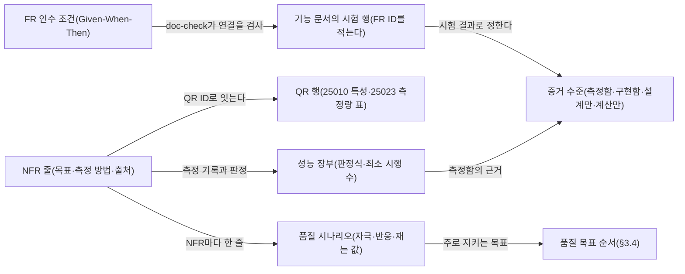

# 분야 편 2: 요구사항 FR·NFR

- **기준 시점**: ADR-0177까지, 2026-11-01
- **맡는 정본**: [docs/planning/02-requirements.md](../../planning/02-requirements.md) 전체, [docs/quality/quality-requirements.md](../../quality/quality-requirements.md) 전체, 자리가 이 편인 [ADR-0151](../../adr/0151-quality-goal-order-scenarios-risk-grades-tech-debt.md)
- **규범이 아니다**: 정본을 풀어 쓴 해설이다. 숫자와 규칙이 정본과 다르면 정본이 맞다([ADR-0177](../../adr/0177-walkthrough-explain-in-interview.md)).
- **한 판 문서와의 관계**: [한 판 문서](../01-system-design.md) 1단계가 액터(§1)를, 2단계가 규모 숫자(NFR-007·013)를, 8단계가 홀드(결제하는 동안 좌석을 잠시 잡아 두는 것) 목표의 근거(§3.3)를, 13단계가 온세일 에러 버짓과 경보(NFR-014)를, 18단계가 외삽과 최소 시행 수(§3.1 원칙 5·6)를 다룬다. 이 편은 두 정본을 절마다 정리하고 FR의 꼴과 우선순위, 증거 수준, 품질 목표 순서, QR, 품질 시나리오를 더한다.
- **측정 전이다**: 서비스 수준 측정(NFR 목표를 운영 규모로 잰 것)은 아직 없어 성능 숫자는 설계 목표값이고 `[실측 전]`을 붙였다. 기반 PoC(wbs 0.5.1, 본 개발 전에 위험한 부분만 먼저 재 보는 시험)는 2026-11-01에 PC 한 대에서 쟀다([ADR-0176](../../adr/0176-foundation-poc-results.md), 성능 장부 docs/perf-ledger.md §5). 그 숫자는 '실측(PC)'이고 운영 규모 증거가 아니다. 정본의 `[가정]`·`[보완]`은 그대로 옮겼다.

## 1. 이 문서가 정하는 것

docs/planning/02-requirements.md는 '이 기능이 다 됐나', '이 품질이 목표에 닿았나'를 판정하는 공식 요구사항 정의서다. §1은 시스템을 쓰는 사람과 바깥 시스템(액터) 일곱과 인증 방식을 정한다. §2는 기능 요구사항(FR: 시스템이 무엇을 해야 하나) 74개를 액터별로 묶고, FR마다 우선순위와 인수 조건(완료로 인정하는 조건)을 Given(상황)-When(행동)-Then(결과) 꼴로 둔다. §3은 비기능 요구사항(NFR: 얼마나 빠르고, 멈추지 않고, 안전해야 하나) 28개다. NFR마다 부하 조건, 숫자 목표, 재는 방법, 출처를 적고, 숫자를 정하는 원칙(§3.1), 재는 시간 폭과 지점(§3.2 머리), 목표의 근거(§3.3), 품질 목표 다섯의 순서(§3.4)를 함께 둔다. docs/quality/quality-requirements.md는 같은 NFR을 ISO/IEC 25010(소프트웨어 품질 특성을 아홉으로 나눈 표준)과 ISO/IEC 25023(특성마다 무엇을 잴지 정한 측정량 표준)의 틀로 다시 묶은 품질 요구 30행(QR)과, NFR마다 '이런 일이 생기면 이렇게 반응하고 이 값을 잰다'를 한 줄로 쓴 품질 시나리오 39줄을 둔다.

> **30초 설명**: "요구사항은 기능과 품질 둘로 나눴습니다. 기능 요구사항 74개는 팬, 파트너, 운영자, 현장 스태프, 시스템으로 묶었고, 하나마다 Given-When-Then 인수 조건을 두어 Then에는 숫자나 눈으로 확인할 결과만 씁니다. 시험 하나 이상이 그 ID를 가리켜야 하고, 문서 점검 도구가 이를 검사합니다. 비기능 요구사항 28개는 부하 조건, 지연, 가용성을 한 쌍으로 적습니다. 온세일은 오픈 10분 전부터 60분 뒤까지 70분을 공연마다 따로 재고, 평소에는 최근 28일로 잽니다. 백엔드 숫자는 공인 기준이 없어 자체 기준이라고 밝히고, 실측한 뒤 ADR로 확정합니다. '99.9%' 같은 비율 목표는 판정식과 최소 시행 수를 함께 정해, 실패가 0번이어도 2,995번은 시험해야 통과라고 씁니다. 목표가 부딪치면 정확성, 가용성, 운영 제어, 봇 방어, 반응 속도 순으로 지킵니다."

## 2. 절마다 읽기

02 문서는 `## ` 넷과 `### ` 아홉, 품질 명세는 번호 없는 `## ` 셋과 `### ` 둘이다. `### ` 절은 따로 행을 두었다.

| 정본 절 | 무엇을 정하나 | 왜 | 해설서에서 |
| --- | --- | --- | --- |
| docs/planning/02-requirements.md 머리말 | 독자, FR·NFR을 쓰는 꼴, 기획 버전 v1.0(2026-10-09), 표시 규칙 | 인수 조건은 기획을 다듬으며 새로 세운 것이라 모두 `[보완]`이다. 칸마다 되풀이하지 않고 새로 낸 수치에만 `[가정]`을 붙인다 | — |
| docs/planning/02-requirements.md §1 액터와 역할 | 액터 일곱(팬, 파트너, 운영자, 현장 스태프, CS 담당자 `[보완]`, 시스템, 외부), 역할 이름(`partner_admin`, `viewer`·`operator`·`commander`, `gate_lead`, `cs_lead` 등), 인증 방식 | 팬은 소셜 로그인 한 요소에 기기 신뢰도 보완 통제를 더하고, 파트너·운영자는 MFA(두 번째 인증 요소)가 의무다(NFR-016, ADR-0001) | 한 판 1단계 |
| docs/planning/02-requirements.md §2 기능 요구사항(머리) | 우선순위 Must·Should·Could, Given-When-Then 꼴, FR마다 시험 행 1개 이상, 증거 수준 넷 | '안정적으로'처럼 판정 기준이 없는 말로는 통과를 가를 수 없다(기술 검토 중간-005). '설계만'인 것을 잰 것처럼 쓰지 않는다(기술 검토 중간-111) | — |
| §2.1 팬 | FR 26개. 로그인·본인확인, 로비·대기열, 좌석·결제·티켓, 양도·굿즈, 후기·계정, 취소, 문의·신고 | Must는 빠지면 출시할 수 없거나 법정 의무를 어기는 것이고, 법정 의무에는 `Must(법정)`을 붙인다(FR-002·016·047·069·070) | 분야 편 4, 분야 편 8~15 |
| §2.2 파트너 | FR 9개. TOTP(인증 앱의 일회용 코드) 로그인, 공연 등록, 좌석맵 에디터, 상품, 웹훅(일이 생기면 상대 서버 주소로 바로 알리는 방식), 판매 현황, 정산·명단, 판매 승인, 회차 취소 | 판매 승인 요청에 판매자 신원정보와 정산 계좌가 들어간다(FR-052). 명단을 받으면 사유와 건수가 접속기록에 남는다(FR-027) | 분야 편 8, 분야 편 12, 분야 편 15, 분야 편 16 |
| §2.3 운영자 | FR 19개. 관리 로그인, 관제 화면, 운영 명령·감사·감내 모드(큰 장애 때 정한 범위만큼 줄여 버티는 운영 모드), 법정 대응, 결제사 지정, CS 처리, 스캐너 등록, 리포트, 사후 포렌식 | 위험한 명령은 사유, dry-run(실행 전 영향 모의), 2인 승인을 거친다(FR-030). 법정 기한(24시간·72시간)은 시스템이 센다(FR-033·063) | 분야 편 11~13, 분야 편 16, 분야 편 17 |
| §2.4 현장 스태프 | FR 4개. 오프라인 판정, 스캔 기록 올리기, 스태프 초대, 현장 운영 | 공연장 네트워크가 끊겨도 입장 판정이 멈추면 안 된다(FR-035, NFR-010) | 분야 편 13 |
| §2.5 시스템 | FR 16개. serving(지금 들여보내는 순번의 끝) 전진, 셔플, 위험 점수, 알림, 결제 웹훅, 홀드 만료, 매진, 파기, 접속기록, 법정 전송, 정산서 등 | 자동 루프가 하는 일도 인수 조건으로 판정한다. 예: AIMD(정상이면 조금씩 늘리고 나빠지면 크게 줄이는 조정)가 뒤쪽 지연이 나빠지면 목표를 바로 50% 줄인다(FR-037) | 분야 편 8~15 |
| docs/planning/02-requirements.md §3 비기능 요구사항 | 원칙, 표, 근거, 순서의 네 절 | 숫자는 원칙대로 세우고 실측 뒤 ADR로 확정한다. 그 전에는 이 문서의 초기 숫자가 공식 기준이다(§3.1 원칙 2) | 한 판 2단계 |
| §3.1 NFR 작성 원칙 | 원칙 여섯과 공인 기준 대응표 | 출처를 확인할 수 없는 '업계 통용 수치'는 쓰지 않는다(초안의 체크아웃 p99 200ms 등을 뺐다. p99는 요청 백 건 중 아흔아홉 건이 끝나는 시간). 느슨하게 시작해 조여 가는 편이 낫다(SRE Book 4장) | 한 판 18단계(원칙 5·6) |
| §3.2 NFR 표 | 측정 윈도우 둘, SLI(실제로 재는 서비스 품질 값)를 재는 곳, 에러 버짓(목표가 허용하는 실패의 양) 기준, NFR 28줄 | 70분 온세일에 표준 SRE 창을 쓰면 감지가 너무 늦다(§3.1 표). SLI를 게이트웨이에서 재면 CloudFront(AWS의 CDN: 사용자 가까이서 대신 응답하는 전송망)가 원본에 닿지 못한 실패가 빠져서 그 502·504를 더한다(ADR-0144 결정 7) | 한 판 2단계, 한 판 13단계(NFR-014) |
| §3.3 여정 SLO의 목표 근거 | 여정 11개의 목표 근거. SLO(팀이 정한 목표)는 '부하 조건 + 지연 + 가용성'과 감내 목표를 1:1 쌍으로 둔다 | 공연 상세는 CDN 엣지가 정적 캐시로 답해 한 단계 높은 99.99%를 잡는다. 결제 확정은 외부 PG(결제사) 승인이 시간 대부분이라 접수와 나눠 3초로 둔다 | 한 판 8단계(NFR-003만) |
| §3.4 품질 목표와 순서 | 품질 목표 다섯의 순서, 순위 밖 제약 둘, 공정성을 둘로 나누기 | 두 목표가 부딪치면 앞선 목표를 지킨다. 순서는 설계가 장애 때 이미 하던 선택을 말로 옮긴 것이라 바뀐 설계는 없다(ADR-0151) | — |
| docs/planning/02-requirements.md §4 기능 개발 절차와의 연결 | 구현 전에 `docs/security/asvs/<기능>.md`로 ASVS(웹 앱 보안 검증 항목 목록) L1·L2를 판정하고, 새 개인정보는 분류를 먼저 확정한다 | 이 절에 이유 문장은 없다. 절차의 정본은 docs/architecture.md §8이다 | — |
| docs/quality/quality-requirements.md 머리말 | 독자, 25030:2019·25010:2023·25023:2016, 개정 이력 | 25023 측정량은 공개되지 않아 공식 미리보기(ISO OBP)의 표 제목까지만 맞추고 측정량 ID는 붙이지 않는다 | — |
| docs/quality/quality-requirements.md 25010:2023과 25023:2016의 대응 | 2023판 특성 아홉을 2016판 측정량에 잇는 표 | 25023:2016은 25010 2011판(8대 특성) 기준이다. 2023판이 안전성을 넣고 사용성·이식성을 상호작용 능력·유연성으로 바꿔 대응이 필요하다. 안전성은 자체 측정량을 쓴다 | — |
| docs/quality/quality-requirements.md 요구사항 | QR 30행(기능 적합성 7, 성능 효율성 7, 호환성 1, 상호작용 능력 1, 신뢰성 5, 보안성 2, 유지보수성 2, 유연성 2, 안전성 3) | 25030 절차로 NFR을 특성에 분류하고 측정량에 잇는다(§3.1 원칙 3). 2026-10-29에 더한 행은 값을 새로 정하지 않고 NFR과 K(planning/01 §3.1의 기술 문제 10선)를 가리킨다 | — |
| docs/quality/quality-requirements.md 품질 시나리오(소유자 결정 2026-10-29, ADR-0151) | 꼴(자극 → 환경 → 대상 → 반응 → 재는 값)과 쓰는 규칙(새 숫자 금지, 반응은 architecture §7에서) | NFR이 목표 숫자를 정한다면, 시나리오는 그 숫자를 어떤 상황에서 재는지 정한다 | — |
| 품질 시나리오의 평상시 시나리오(NFR마다 하나) | 28줄 | 시나리오가 없는 NFR이 남으면 무엇을 자극으로 재는지 표마다 다르게 읽힌다(ADR-0151) | — |
| 품질 시나리오의 장애·변경 시나리오 | 11줄. Game Day(일부러 장애를 내고 대응을 연습하는 날)와 기능 문서 시험에서 옮겼다 | 평상시 목표를 장애나 변경 중에 어떻게 지키는지 본다. 봇 방어에는 시험이 없어 Q-T58을 더했다 | 한 판 16단계(장애 동작만) |

## 3. 꼭 기억할 규칙과 숫자

| 항목 | 값 | 표시 | 정본 위치 |
| --- | --- | --- | --- |
| FR 수 | 74개이고 빈 번호가 없다. Must 42, Must(법정) 13, Must(법정·간주) 1, Should 15, Could 3. 팬 26, 파트너 9, 운영자 19, 현장 스태프 4, 시스템 16 | 이 편이 정본 표를 센 값 | §2.1~§2.5 |
| NFR·QR·시나리오 | NFR 28개, QR 30행, 평상시 시나리오 28줄, 장애·변경 시나리오 11줄 | 확정 | §3.2, 품질 명세 '요구사항'·'품질 시나리오' |
| 측정 윈도우 | 온세일: 오픈 10분 전부터 오픈 뒤 60분까지 70분, 공연마다 따로. 상시: 최근 28일 롤링(늘 최근 28일을 보는 창), 99.9%면 허용 중단 약 40분 | 확정 | §3.2 머리, NFR-014 |
| SLI 재는 곳 | 최전방 API 게이트웨이의 서버 쪽 히스토그램(값을 구간별로 센 분포). 엣지에서 끝난 CloudFront 502·504도 오류 | 확정(추천 적용) | §3.2 머리 |
| 온세일 에러 버짓 | 70분 예상 트래픽 × (1 − 가용성). 공연 페이지 약 1,000만 건에 약 1,000건, 진입 약 200만 건에 약 2,000건, 홀드 약 15만 건에 약 75건, 결제 확정 약 2.5만 건에 약 12건 | 확정 목표, `[실측 전]` | NFR-001·003·006·007 |
| 온세일 경보 | 경보 때 이미 쓴 예산 30% 이하. 호출은 2분 창 10배(29%), 경고는 5분 창 3배(21%). 결제 확정 경고는 결제사 지연 같은 확실한 원인으로 | 확정(소유자 결정) | NFR-014 |
| 판정식 | 어긴 비율의 정확 이항 단측 95% 상한(Clopper-Pearson 상한: 참 비율이 이보다 클 가능성이 5% 이하인 값)이 1 − 목표 이하일 때만 통과. 백분위는 '기준 이하 비율 ≥ 99%'처럼 바꿔 본다 | 확정(추천 적용) | §3.1 원칙 6 |
| 최소 시행 수 | 어긴 것 0번일 때 약 3 ÷ 허용 비율. 99.9% 이상·0.1% 미만 2,995번, p99 299번, p95 59번. 모자라면 '관측값(최소 시행 수 미달)'. Game Day처럼 수십 번이면 '모든 시행이 기준 이하(최댓값 기준)' | 확정 | §3.1 원칙 6 |
| 숫자의 증명 수준 | 실측(PC)·실측(클라우드)·외삽·문서 인용·설계 목표. 외삽(잰 범위의 결과를 식으로 늘린 값)은 설계 식이나 USL(서버를 늘릴 때 처리량이 덜 느는 모양의 식)로만, 다항식 맞추기 금지 | 확정(소유자 결정) | §3.1 원칙 5 |
| FR의 증거 수준 | 측정함·구현함·설계만·계산만. 2026-10-28 기준 모든 FR이 '설계만' | 확정(추천 적용) | §2 머리 |
| 공인 기준을 직접 쓰는 곳 | 화면 체감(Core Web Vitals), 웹 접근성(WCAG), 세션 재인증(NIST SP 800-63B)뿐. 백엔드 지연·가용성은 모두 자체 기준 | 확정 | §3.1 원칙 4 |
| 화면 체감 판정 | 운영은 RUM(실제 사용자 브라우저에서 잰 값) p75(백 건 중 일흔다섯 건이 이 값 안). 포트폴리오는 랩 p75(중급 모바일 프로필 20회 `[가정]`)로 '랩 판정' | 확정, `[실측 전]` | §3.1 표, NFR-012 |
| 100만 명 판정 | NFR-001·002·013은 외삽으로 판정하고 100만 명 전체 실측은 하지 않는다 | 확정(소유자 결정 2026-10-13) | §3.1 원칙 5 |
| 진입 피크 | 20만 RPS(초당 요청 수)는 로비 셔플을 끈 공연의 상한. 기본(로비 셔플 켬)은 로비 참가 70% `[가정]`라 약 4.8만 RPS | `[가정]`, `[실측 전]` | NFR-001 |
| 사람 오탐 출시 전 기준 | 공개된 실제 사람 기록 947명에서 오탐 1건 이하, 또는 1,549명에서 3건 이하(단측 95% 상한 0.5% 이하) | 확정 목표, `[실측 전]` | NFR-022 |
| 품질 목표 순서 | 정확성 > 가용성 > 운영 제어 > 봇 방어 > 반응 속도. 보안·개인정보·법과 접근성·호환성은 순위 밖 제약 | 확정(소유자 결정 2026-10-29) | §3.4 |
| 감내 모드의 한도 | 감내 모드는 지연부터 늦춘다(진입 p99 1초, 결제 확정 p99 60초 등). 가용성은 지킨다 | 확정 | §3.4, POL-029 |

## 4. 이 문서가 다루는 ID

FR 74개, NFR 28개, QR 30개 전부다. 한 줄은 정의 칸의 뜻을 줄인 것이고, 인수 조건은 정본에서 읽는다. 우선순위는 Must가 아닐 때만 괄호에 적었다('법정'은 Must(법정)).

**FR(docs/planning/02-requirements.md §2)**

| ID | 한 줄 |
| --- | --- |
| FR-001 | 소셜 로그인(카카오·네이버·구글). 자체 비밀번호와 자동 병합은 두지 않는다 |
| FR-002 | (법정) 예매 전 계정당 1회 휴대폰 본인확인 |
| FR-003 | 공연 목록·검색·상세와 정렬 방식·판매 조건·법정 고지 |
| FR-004 | 티켓 오픈 사전 알림(Web Push·이메일) 신청 |
| FR-005 | 오픈 전 로비 입장과 참가 토큰 1장. 순번 숫자는 보이지 않는다 |
| FR-006 | 오픈 뒤 대기열 진입. 동시 도착 구간(기본 2초 `[가정]`)은 무작위 배치 |
| FR-007 | 내 대기 상태(앞 인원, 진행 막대, 예상 시간, 취소) |
| FR-008 | 차례에 입장 확정. 자리가 차면 '곧 입장'으로 재시도 |
| FR-009 | 5만 석 좌석맵에서 확대해 좌석 고르기 |
| FR-010 | 좌석 홀드. 경합하면 1인만 성공, 1인 한도 초과 거절 |
| FR-011 | 주문·결제. 좌석 예약을 확정한 뒤 PG 승인을 부른다 |
| FR-012 | 월렛 티켓 발급. 입장 QR은 15초마다 바뀐다 |
| FR-013 | (Should) 본인확인 회원에게 1:1 양도 요청 |
| FR-014 | (Should) 티켓 연동 부가 상품 구매 |
| FR-015 | (Should) 공식 굿즈 구매. 한정 재고는 오버셀(정한 수보다 많이 파는 사고) 없이 줄어든다 |
| FR-016 | (법정) 관람 후기 쓰기 |
| FR-017 | 계정 설정(기기 목록, 로그인 수단, 동의, 탈퇴) |
| FR-018 | (Should) 매진 화면과 취소표 알림 |
| FR-019 | (Could) 공연 단위 찜 목록 |
| FR-020 | 격리된 이용자의 추가 검증과 원래 순번 입장 |
| FR-021 | 파트너 로그인(이메일·비밀번호·TOTP) |
| FR-022 | 공연 등록 위저드 |
| FR-023 | 좌석맵 그래픽 에디터 |
| FR-024 | (Should) 상품 빌더 |
| FR-025 | (Could) 판매 이벤트 웹훅 등록 |
| FR-026 | (Should) 판매 현황 대시보드(최대 1분 지연) |
| FR-027 | (Should) 정산 리포트와 관람객 명단 내려받기 |
| FR-028 | 운영자 로그인(MFA, 허용 IP·VPN) |
| FR-029 | 온세일 단계별 관제 화면 |
| FR-030 | 표준 운영 명령 12개(사유, dry-run, 2인 승인) |
| FR-031 | 감사 로그 불변 기록과 인시던트 재생 |
| FR-032 | 감내 모드 전환과 긴급 자동화 정지(명령 11) |
| FR-033 | (법정) 통보받은 암표 게시물 차단(24시간 기한) |
| FR-034 | (법정) 신고기관·수사기관 자료 요청 처리 |
| FR-035 | 스캐너의 오프라인 회전 QR 판정 |
| FR-036 | 스캔 기록을 기기 안 영구 큐에 쌓아 올리기 |
| FR-037 | serving 전진과 동시 입장 목표의 AIMD 조절 |
| FR-038 | T=0 Commit-Reveal 셔플 1회와 결과 파일 배포 |
| FR-039 | 위험 점수와 추가 검증 큐, 봇 판정 장애 때 축소 운영 |
| FR-040 | 이메일·푸시·파트너 웹훅 발송 |
| FR-041 | 결제사 웹훅의 재검증과 멱등 처리(같은 알림이 여러 번 와도 한 번 처리한 것과 결과가 같게) |
| FR-042 | 홀드 만료 회수와 3초 안 재노출 |
| FR-043 | 매진 확정 뒤 정적 매진 응답 |
| FR-044 | (법정) 보존 기간이 지난 개인정보 파기 |
| FR-045 | (법정·간주) 접속기록 3개월 변조 탐지 보관 |
| FR-046 | 회차 단위 현장 스태프 초대·해임 |
| FR-047 | (법정) 티켓 단위 예매 취소와 환불액 안내 |
| FR-048 | (Should) 소셜 계정 연동과 계정 병합 |
| FR-049 | (Should) 운영 중 봇 탐지 하한 추정(허니팟) |
| FR-050 | (Should) 자동 배정의 희망 조건과 연속 요청 |
| FR-051 | 결제사 지정(명령 12)과 대체 결제사 전환(명령 6) |
| FR-052 | 판매 승인 요청과 승인 |
| FR-053 | (법정) 통신판매중개자 고지와 판매자 정보 |
| FR-054 | (법정) 공연예술통합전산망 전송 |
| FR-055 | 회차 취소·연기 요청과 귀책 판정 |
| FR-056 | (Should) 결제 금액 10% 배상금 지급 |
| FR-057 | (법정) CS 처리함 |
| FR-058 | (Should) 정책 밖 예외 환불 |
| FR-059 | (Should) 탈취된 티켓 회수 |
| FR-060 | (Should) 양도 수락·거절 |
| FR-061 | (Could) 취소·양도 남용 표시와 예매 제한 |
| FR-062 | 회차·상품 정산서 생성과 확정 |
| FR-063 | (법정) 침해사고·유출 신고 기한 추적 |
| FR-064 | (법정) 관리 계정 접속기록 점검 |
| FR-065 | 스캐너 기기 등록·폐기 |
| FR-066 | 현장 운영(배치, 이상 표시, 재발급, 예외 통과) |
| FR-067 | 스캔 기록 재판정과 이상 표시 |
| FR-068 | (Should) 마감 단계별 공연 리포트(R0~R3) |
| FR-069 | (법정) 고객센터 문의와 답변 |
| FR-070 | (법정) 후기 신고와 처리 |
| FR-071 | 지난 회차 리플레이(좌석맵·타임라인) |
| FR-072 | 온세일 뒤 조사 기록 고정과 부정 예매 후보 묶음 |
| FR-073 | 부정 예매 사건 처리(소명, 양도 잠금, 조치) |
| FR-074 | 증거 묶음 보존·내보내기 |

**NFR(docs/planning/02-requirements.md §3.2)**

| ID | 한 줄 |
| --- | --- |
| NFR-001 | 대기열 진입: 20만 RPS에서 p99 200ms, 99.9% |
| NFR-002 | 대기 상태 전파: 100만 명, 임박 대기자 차례 반영 p99 2초, 조회 99.95% |
| NFR-003 | 좌석 홀드: 초당 2,000건에서 p99 50ms·p99.9 150ms, 99.95%, 오버셀 0건 |
| NFR-004 | 좌석 상태 전파: 종단 p99 300ms, 30초 안 스스로 복구 99.9% |
| NFR-005 | 결제 접수: 300 TPS(초당 처리 건수)에서 202 p99 150ms 미만, 99.95%, 이중 결제 0건 |
| NFR-006 | 결제 확정: p99 3초, 완료율 99.95%, 승인 뒤 60초 안 발권·재시도 큐 아닌 결제 0건 |
| NFR-007 | 공연 페이지: 30만 RPS에서 TTFB(첫 바이트까지) p99 150ms, LCP(가장 큰 요소가 보이기까지) p75 2.5초, 99.99% |
| NFR-008 | 운영 명령: 접수 p95 500ms 미만·99.9%, 전파 p99 3초·성공률 99.9% |
| NFR-009 | 관제 실시간 표: 초당 3만 건에서 p95 5초 미만, 누락률 0.1% 미만 |
| NFR-010 | 게이트 판정: 단말 안 p95 150ms, 위조 통과 0건, 오거부 0.1% 미만 |
| NFR-011 | 기본 SLO: REST p95 500ms·99.9%, 내부 gRPC p95 100ms·99.95%, 핫패스 p99 20ms |
| NFR-012 | 사용자 체감: INP(조작에 반응하기까지) 200ms, LCP 2.5초, CLS(화면이 밀리는 정도) 0.1 |
| NFR-013 | 규모: 동시 대기 100만 명 설계 목표. 예매 계층은 실측, 진입은 외삽 |
| NFR-014 | 가용성 윈도우: 온세일 70분 공연별 버짓, 상시 28일 99.9%, 전면 중단 0건 |
| NFR-015 | 복구: AZ(독립 데이터센터 묶음) 장애에 PostgreSQL RPO(잃어도 되는 시간 폭) 0·RTO(복구 시간) 5분, 대기열 Redis RTO 30초 |
| NFR-016 | 보안: ASVS 5.0.0 L2 근거 없는 미적용 0건, 기한 넘긴 High 이상 0건 |
| NFR-017 | 감사 로그: 명령·자동 조치 100% 불변 기록, 접속기록 2년·권한 이력 3년 |
| NFR-018 | 개인정보: 정본은 data-classification, 법정 보존과 탈퇴 즉시 파기 |
| NFR-019 | 지원 플랫폼: Baseline 'Widely available', 주요 브라우저 최신 2개 판 |
| NFR-020 | 접근성: WCAG 2.2 AA 위반 0건, 화면 낭독기 완주 100% |
| NFR-021 | 확장성: 200만 명 병목 문서화, 합산 동시 입장 상한, 오픈 간격 |
| NFR-022 | 봇 탐지: 등급별 탐지율 95% 이상, 사람 오탐 상한 0.5% 이하 |
| NFR-023 | 운영: 주입 장애 탐지 100%·장애마다 60초 이내, 용량 확보 60초 미만 |
| NFR-024 | 국제화: 4개 국어, 누락 번역 키 0건 |
| NFR-025 | 정합성 불변식: 순번 보존 100%, 차례 전 입장 0건, 1인 한도 초과 0건 등 |
| NFR-026 | 분석 마감 품질: R0 30분 `[가정]`, 확정 숫자 차이 0, 정산서 0원 차이 |
| NFR-027 | 장시간 운영: 6시간 `[가정]` 동안 자원 시간당 증가 1% `[가정]` 이하 |
| NFR-028 | 검색: 자동완성 p95 50ms·검색 p95 300ms, 골든 세트 정답률(모두 `[가정]`) |

**QR(docs/quality/quality-requirements.md 요구사항)**: 이름은 QR-특성 약자-번호다. 괄호는 QR 행이 가리키는 NFR·K·FR이다. QR-FS-1·QR-MA-1·QR-SA-3의 짝 NFR(NFR-003·023·014)은 2026-11-01 정합 점검에서 QR 행에 적었다.

| ID | 한 줄 |
| --- | --- |
| QR-FS-1~7 | 기능 적합성. 오버셀 0(NFR-003), 결제·발권 어긋남 0(NFR-006), 리포트 정확성(NFR-026), 검색 정답률(NFR-028), 차례 전 입장 0(NFR-025), 이중 결제 0(NFR-005), 위조 통과 0·오거부 0.1% 미만(NFR-010) |
| QR-PE-1~7 | 성능 효율성. 화면 체감(NFR-012), 진입 100만·20만 RPS(NFR-001·013), 검색 지연(NFR-028), 게이트 판정(NFR-010), 좌석 전파(NFR-004), 관제 실시간 표(NFR-009), 여정별 지연(NFR-002·005·006·011) |
| QR-CO-1 | 호환성. API·이벤트 계약 시험 통과율 100%(대응하는 NFR이 없다) |
| QR-IC-1 | 상호작용 능력. WCAG 2.2 AA 위반 0건과 낭독기 완주(NFR-020) |
| QR-RE-1~5 | 신뢰성. 여정별 가용성(NFR-001~011·014), 장애마다 탐지 60초 이내(NFR-023), 장시간 운영(NFR-027), RPO·RTO(NFR-015), 명령 전파(NFR-008) |
| QR-SE-1~2 | 보안성. ASVS·취약점·DAST 0건(NFR-016), 봇 탐지와 사람 오탐(NFR-022) |
| QR-MA-1~2 | 유지보수성. DORA(배포 성과) 다섯 지표는 목표 없이 추세(NFR-023), 의존 규칙 위반 0건 `[가정]`과 계약 변경 영향 범위 |
| QR-FL-1~2 | 유연성. 급증 뒤 용량 확보 60초 미만(K9), 새 상품 유형 5영업일·스키마 변경 0건(NFR-025) |
| QR-SA-1~3 | 안전성. 오프라인 전환 중 판정 멈춤 0초·레인 처리량 90% `[가정]`(K10), 안전 한계 밖 명령 반영 0건(FR-037), SEV1(가장 심각한 장애 등급) 호출 시간(NFR-014) |

## 5. 결정과 버린 길

[결정 카드 목록](../decisions/README.md) §2 자리표에서 이 편을 자리로 둔 ADR은 ADR-0151 하나다. 그것을 먼저 풀고, 두 정본의 숫자 규칙을 정한 다른 ADR(자리는 결정 카드 등)을 짧게 든다. 버린 길은 각 ADR의 대안 표에서 옮겼다.

### [ADR-0151](../../adr/0151-quality-goal-order-scenarios-risk-grades-tech-debt.md) 품질 목표 순서, 품질 시나리오, 위험 등급, 기술 부채(자리: 이 편)

- **고른 것**: 품질 목표를 정확성 > 가용성 > 운영 제어 > 봇 방어 > 반응 속도로 두고, 보안·개인정보·법과 접근성·호환성은 순위 밖 제약으로 둔다. 거꾸로 하는 설계는 그 ADR에 이유와 되돌릴 조건을 적는다. NFR마다 평상시 시나리오 한 줄과 장애·변경 시나리오 11줄을 두고, 봇 판정 서비스 장애 시험 Q-T58을 더한다. 위험은 대응한 뒤 남는 위험으로 가능성·영향(높음·중간·낮음)을 매기고, 영향 기준을 품질 목표 순서에 묶는다. 기술 부채 표(docs/planning/01-overview.md §5.3)를 '정할 일'인 open-items와 나눈다.
- **버린 길**:
  - 봇 방어를 가용성 앞에: 봇 판정 서비스가 멈출 때 새 진입을 멈추거나 모두 추가 검증 큐로 보내야 한다. 100만 명이 몰린 순간 진입을 멈추면 재시도가 몰리는데, 막는 것은 축소 운영을 빠져나가는 일부 봇뿐이다. 도착 순서와 1인 1순번은 봇 판정 없이도 지켜진다.
  - 품질 목표마다 대표 시나리오 2~3개만: 시나리오가 없는 NFR이 남는다.
  - 5단계 × 5단계 점수: 위험 대부분이 숫자로 잴 수 없는 판단이라 점수가 세밀해 보일 뿐 근거가 늘지 않는다.
  - open-items에 '부채' 칸만 더하기: 정할 일과 이미 정한 빚이 섞인다. 대응 전 위험으로 매기기: 지금 무엇이 남았는지 말해 주지 않는다.
- **되돌릴 조건**: 봇 판정 장애 동안 통과한 봇이 판매에 의미 있는 몫을 차지한다는 측정(Q-T58, 첫 온세일 리포트)이 나오면 순서를 새 ADR로 다시 본다. 정확성을 지키느라 생기는 중단을 받아들일 수 없는 새 장애 유형은 그 유형에 한해 거꾸로 하는 이유를 ADR로 남긴다.
- **본문이 옛 판인 곳**: 결정 4의 셈(높음 12, 중간 76, 낮음 26)은 상태 줄이 ADR-0152 뒤 '114줄, 12·75·27'로 고쳤고, 상태 줄 끝(2026-11-01 정합 점검)이 지금 셈 '119줄, 12·78·29'를 적는다(docs/planning/01-overview.md §5.2 머리와 같다). 결정 2의 '품질 목표마다 하나나 둘'은 가용성만 넷이라고 함께 고쳤다.

### 숫자 규칙을 정한 다른 ADR

- [ADR-0057](../../adr/0057-verification-without-full-scale-infra.md)(자리 [D-29](../decisions/D29-prove-without-full-scale.md)): §3.1 원칙 5와 NFR-013의 뿌리다. 증명을 '규칙이 맞나'와 '양을 버티나'로 나누고, 예매 계층은 실제 크기로, 진입은 설계 식 외삽으로 재며, 숫자마다 표시를 붙인다. 버린 길: 100만 실측(요청 요금만 지출 상한의 몇 배), 목표를 20만 명으로 낮추기('대기 인원이 늘어도 예매 계층 부하는 그대로'를 보일 기회가 사라진다), 수학 모델만(실제 코드와 저장소를 재지 않는다). 옛 판: 진입 판단은 ADR-0096으로 '1대 처리량 × 대수' 설계 식이 주가 되고 USL은 보조로 내려갔다.
- [ADR-0049](../../adr/0049-onsale-alert-windows-and-ops-metrics.md)(자리 [D-20](../decisions/D20-onsale-alerts-error-budget.md)): §3.1 원칙 1의 SRE 인용을 원문대로 고치고, 온세일 경보를 예산 소모 30% 이하로 정했다(NFR-014). 버린 길: 5분 창 10배 유지(경보 때 예산 71%가 이미 없다), 1분 창 10배(결제 확정 헛경보 확률 80%), 외부 의존 서비스마다 SLO(우리가 통제하지 못하는 값). 옛 판: 상태 줄(2026-10-28)이 SEV1 짧은 창 10초를 20초로 바꿨다.
- [ADR-0147](../../adr/0147-security-quality-doc-gaps-human-access-boundary-quality-rows.md) 결정 6·7(자리 [분야 편 21](21-security.md)): 품질 명세에 빠진 목표 행을 더하되 값은 NFR과 K만 가리키고, 증거 수준은 열로 두지 않는다. 버린 길: 증거 수준 열 두기(정본이 두 곳이 된다).
- 그 밖에 NFR-022의 판정 방식은 ADR-0039·0112·0174(자리 [D-04](../decisions/D04-bot-defense-and-evaluation.md)), NFR-002·004의 지연 예산은 ADR-0110(자리 [D-01](../decisions/D01-queue-status-cdn-polling.md)), NFR-006의 발권 재시도와 30분 기한은 ADR-0106(자리 [D-08](../decisions/D08-payment-two-phase-forward-recovery.md))이 정한다.

## 6. 읽는 요령

**읽는 순서**: 02 문서 머리말 → §1 → §2 머리 → §3.1 → §3.2 머리 → §3.4 → §3.3으로 규칙을 먼저 잡는다. FR 74줄과 NFR 28줄은 처음부터 다 읽지 않고, 분야 편 8~14를 읽을 때 그 분야의 ID를 찾아 인수 조건과 측정 방법 칸을 본다. 품질 명세는 QR 행이 어느 NFR을 가리키는지와, 고른 NFR의 시나리오 줄만 함께 본다.

**요구사항에서 증거까지의 길**: 정본은 이 연결을 여러 절에 나눠 적는다.

FR→시험 추적표는 문서 점검 도구(doc-check)가 만든다. 증거 수준은 docs/features/README.md와 docs/perf-ledger.md §7, 지금 상태는 [현황 한 장](../00-status.md)에서 본다.

**함정**:

- **번호와 절이 맞지 않는다**: 팬 절은 FR-001~020 다음에 FR-047·048·050·060·069·070이 오고, 운영자 절 끝에 FR-071~074가 있다. ID로 찾는다.
- **액터 칸과 절이 다를 수 있다**: CS 담당자가 액터 칸에 든 FR은 운영자 절(FR-031·057~059), 팬 절(FR-069·070), 시스템 절(FR-061)에 있다. FR-052·055는 '파트너·운영자'다.
- **When이 없는 인수 조건**: §2 머리는 모든 인수 조건을 Given-When-Then으로 쓴다고 하지만, FR-032·040·042·043·063·064는 Given-Then만 있다. 시간이 지나거나 상태가 생긴 것 자체가 자극인 줄이다.
- **분류 칸은 25010 특성이 아니다**: NFR의 '분류'(성능·가용성 등)는 이 문서의 이름이다. 25010 특성은 QR 행에서 본다.
- **숫자의 정본은 NFR 줄이다**: QR 새 행과 시나리오는 값을 새로 정하지 않는다. NFR이 바뀌면 시나리오 줄도 함께 고친다.
- **옛 문장**: §3.1 원칙 1은 이전 판의 '표준 권고안을 기준으로 삼으라'가 원문에 없는 말이라 고쳤다고 적는다. 제목의 '원문 §0'·'원문 §9'는 지운 원문 설계서의 자리일 뿐 판단 근거가 아니다([ADR-0098](../../adr/0098-remove-archive-original-design-doc-keep-git-tag.md)).
- **'설계만'의 날짜**: '모든 FR이 설계만'은 2026-10-28 기준이다. 그 뒤 만든 공용 모듈은 FR 단위의 증거가 아니다.

## 7. 경계

| 이 정본이 정하지 않는 것 | 어디서 정하나 |
| --- | --- |
| 정책 값(1인 한도, 홀드 TTL, 감내 모드 한도 POL-029, 조치 기한 POL-041, 오픈 간격 POL-030) | docs/planning/03-policies-glossary.md(분야 편 3) |
| 화면 ID와 화면 흐름 | docs/planning/04-ia-flows-screens.md(분야 편 4) |
| FR마다의 동작 상세, 시험 행, 장애 때 동작 | docs/features/*.md(분야 편 8~17) |
| NFR별 정상 모드 대응 전략(시나리오의 '반응'이 오는 곳) | docs/architecture.md §7(한 판 문서) |
| 준수 기준 표, 기능 개발 절차, 보안 기본 규칙 | docs/architecture.md §8 |
| 용량 산정, T=0 도착 모델, 200만 명 확장 지점 | docs/architecture.md §9(한 판 2·17단계) |
| 경보 창과 번 레이트(에러 버짓을 쓰는 속도), Game Day 33종 | docs/observability.md §4·§12(분야 편 19) |
| 규칙 검사, 부하 분해, Game Day 실행 방식 | docs/verification.md §2·§3·§5(분야 편 22) |
| 측정 절차, 표시 규칙, KPI별 증거 수준, 봇 평가 절차 | docs/perf-ledger.md §3·§7·§10(분야 편 22) |
| 기술 문제 10선(K1~K10), 위험 등급표, 기술 부채 | docs/planning/01-overview.md §3·§5(분야 편 1) |
| 기능별 ASVS 점검표, 개인정보 항목과 보존 | docs/security/asvs/, docs/security/data-classification.md(분야 편 21) |

## 8. 꼬리 질문

| 질문 | 답의 요지 | 근거 |
| --- | --- | --- |
| p99 50ms는 업계 표준인가요? | 아니다. 백엔드 지연·가용성은 모두 자체 기준이라고 밝히고, 출처 없는 '업계 통용 수치'는 쓰지 않는다. 홀드 실패가 잦으면 판매 기회를 잃어 낮게 잡았고, 실측 뒤 ADR로 확정한다 | §3.1 원칙 1·2·4, §3.3 |
| 99.9%를 어떻게 통과라고 말하나요? | 어긴 비율의 Clopper-Pearson 단측 95% 상한이 0.1% 이하일 때만 통과다. 실패 0번이면 최소 2,995번 시행해야 하고, 모자라면 '관측값'으로 적는다 | §3.1 원칙 6 |
| 온세일을 왜 28일 SLO와 따로 재나요? | 70분짜리 온세일에 표준 SRE 창을 쓰면 감지가 너무 늦다. 공연마다 70분 버짓을 두고, 이미 쓴 예산이 30% 이하일 때 경보가 울린다(2분 창 10배면 29%) | §3.1 표, NFR-014, ADR-0049 |
| 100만 명을 실제로 돌려 봤나요? | 아니다. 서비스 수준 측정은 아직 없다. 2026-11-01에 기반 PoC만 PC 한 대에서 쟀다(실측(PC), ADR-0176). 예매 계층(입장 초당 약 28명, 홀드 초당 2,000건, 결제 300 TPS, 좌석 연결 5,000개)은 실제 크기로 재고, 진입 20만 RPS는 설계 식으로 외삽해 '외삽'으로 표시한다 | NFR-013, ADR-0057 |
| 정확성과 가용성이 부딪치면요? | 정확성을 지킨다. 좌석 Redis 장애 조치 동안은 그 회차 구매를 503으로 미루고, 리전 전체 장애면 판매를 멈춘다. 순서는 설계가 이미 하던 선택을 말로 옮긴 것이다 | §3.4, ADR-0151 |
| 공정성이 핵심인데 봇 방어가 왜 4위인가요? | 공정성을 둘로 나눴다. 도착 순서·1인 1순번·차례 전 입장 0건은 1위 정확성이고, 통계로 판정하는 봇 방어만 4위다. 봇을 앞에 두면 봇 판정 서비스가 멈출 때 진입을 멈춰야 하고 재시도가 몰린다 | §3.4, ADR-0151 |
| 기능이 '다 됐다'는 어떻게 판정하나요? | Then에 숫자나 관찰할 결과를 쓰고, 시험 행 하나 이상이 그 FR ID를 적어야 한다. 문서 점검 도구가 FR마다 검사한다. 지금 증거 수준은 모두 '설계만'이다 | §2 머리 |
| 25023 측정량 ID는 왜 없나요? | 측정량 본문이 공개되지 않는다. 공식 미리보기의 표 제목(표 1 기능 완전성 ~ 표 25 재사용성)까지만 대응시키고 ID를 지어내지 않는다 | §3.1 원칙 3, 품질 명세 머리말 |

## 9. 확인 문제

1. 좌석 전파의 '스스로 복구 99.9%'를 300번 시험해 실패가 0번이었다. 통과라고 적을 수 있는가? p99 목표를 300번 시행해 0번 어겼다면 어떤가?

답

99.9%는 실패 0번일 때 최소 2,995번이 필요하다. 300번이면 '관측값(시행 300번, 최소 시행 수 미달)'으로 적는다. NFR-004는 3,000번을 넣어 못 고친 것이 0번일 때 통과다(S-T13). p99는 최소 299번이라 300번에 0번이면 통과로 적을 수 있다(§3.1 원칙 6).

2. NFR-003의 허용 오류 버짓 약 75건은 어떻게 나왔나? 좌석 경합의 409와 판매 일시정지의 423은 버짓을 쓰는가?

답

70분 예상 요청 약 15만 건(2.5만 주문 × 평균 홀드 시도 6회)에 허용 실패 0.05%(가용성 99.95%)를 곱한 값이다. 409는 정상 비즈니스 응답이고 423은 가용성 계산에서 뺀다. 둘 다 버짓을 쓰지 않는다(NFR-003).

3. 봇 판정 서비스(trust-svc)가 오픈 직후 모두 멈췄다. 진입은 어떻게 되고, 품질 목표 순서로 어떻게 설명하는가?

답

진입은 막지 않는다. 캐시한 판정 규칙과 보수적인 레이트 리밋으로 축소 운영하고, 모두를 그대로 통과시키지는 않는다(FR-039). 진입 성공률이 NFR-001 목표를 지키는지 보고, 통과한 봇 수와 막힌 정상 사용자 수는 목표 없이 기록한다(Q-T58). 가용성(2위)이 봇 방어(4위)보다 앞서서다. 순번의 공정성은 1위 정확성이라 이 장애에서도 그대로다(§3.4).

4. 실측 결과 NFR 하나를 공인 권고보다 느슨하게 바꾸려 한다. 무엇을 남기고 어디를 고치는가?

답

비용과 비즈니스 가치를 견줘 ADR로 확정하고, 공인 권고보다 느슨하면 기술 사유와 재검토 조건을 꼭 적는다(§3.1 원칙 2). 숫자의 정본은 02 §3.2의 NFR 줄이고, 품질 명세의 그 시나리오 줄도 같은 숫자로 고친다. 원칙 자체를 바꿀 때는 02 §3.1과 docs/architecture.md §8을 고친다.

## 10. 정본에서 찾은 어긋남

| 어긋난 곳 | 내용 | 지금 읽는 법 |
| --- | --- | --- |
| ADR-0151 상태 줄과 docs/planning/01-overview.md §5.2 머리 | 상태 줄의 위험 셈이 '114줄, 12·75·27'에서 멈춰 있었다. 고침(2026-11-01 정합 점검) | 상태 줄 끝과 planning/01 §5.2 머리가 119줄(12·78·29, 종류 92·10·17)을 적는다 |
| 품질 명세 '장애·변경 시나리오' 머리와 ADR-0151 결정 2 | '품질 목표마다 하나나 둘'인데 가용성 줄은 넷(G-32, G-14, G-18, G-30)이었다. 고침(2026-11-01 정합 점검) | 머리와 상태 줄이 '가용성만 넷, 모두 11줄'로 적는다 |
| NFR-021의 목표 칸과 측정·검증 방법 칸 | 측정 칸에 'PostgreSQL 파티션 프루닝 쿼리 플랜 검증'이 남아 목표 칸(ADR-0114)과 달랐다. 고침(2026-11-01 정합 점검) | 측정 칸이 V-T29를 적고 프루닝 검증은 쓰지 않는다 |
| 02 §3.1 원칙 3과 NFR 줄의 출처 칸 | NFR 줄에 QR ID가 빠진 곳이 있었다. NFR-007·013·025·005·010 줄과 QR-FS-1·MA-1·SA-3의 짝은 고침(2026-11-01 정합 점검). 짝 QR 행이 아예 없는 NFR-017·018·019·021·024 다섯은 열린 일 100번이다 | NFR과 QR의 짝은 QR 행이 가리키는 NFR로 찾는다. 다섯 NFR은 QR 없이 읽는다 |
