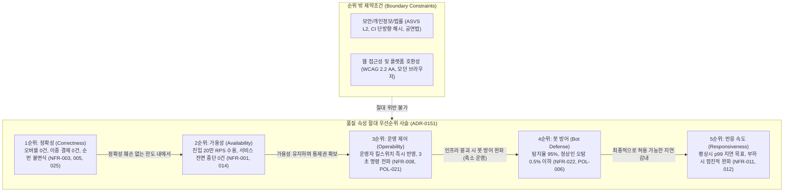
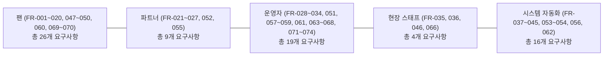

# 분야 편 2: 요구사항 FR·NFR (Functional & Non-Functional Requirements)

- **맡는 정본**: [docs/planning/02-requirements.md](../../planning/02-requirements.md) 전체, [docs/quality/quality-requirements.md](../../quality/quality-requirements.md) 전체, 자리가 이 편인 [ADR-0151](../../adr/0151-quality-goal-order-scenarios-risk-grades-tech-debt.md)
- **문서 성격**: 정본 설계를 시스템 엔지니어링 및 기술 면접 관점에서 체계적으로 해설한 문서다. 규범적 수치와 불변 규칙의 최종 권위는 정본 문서에 있다([ADR-0177](../../adr/0177-walkthrough-explain-in-interview.md)). 길잡이는 [README.md](../README.md)다.
- **한 판 문서와의 관계**: [한 판 문서](../01-system-design.md) 1단계(7대 액터 및 시스템 경계), 2단계(NFR-001/007/013 규모 수치), 8단계(NFR-003 홀드 지연 목표의 근거), 13단계(NFR-014 온세일 70분 에러 버짓과 다중 윈도우 경보), 18단계(외삽 및 통계적 최소 시행 수)와 직결되는 공식 요구사항의 모태다.
- **아키텍처 목표와 검증 기준**: 74개 기능 요구사항(FR) 전수에 대해 Given-When-Then 검증 가능한 인수 조건을 수립하고, 28개 비기능 요구사항(NFR) 및 ISO/IEC 25010/25023 기반 30개 품질 요구(QR)에 대해 통계적 판정식(Clopper-Pearson 단측 95% 신뢰상한 및 최소 시행 수 $n \ge 3/\epsilon$)을 엄격히 적용한다. 목표 상충 시 **정확성 > 가용성 > 운영 제어 > 봇 방어 > 반응 속도**의 5대 품질 목표 순서([ADR-0151](../../adr/0151-quality-goal-order-scenarios-risk-grades-tech-debt.md))를 절대적 기준으로 삼는다.

---

## 1. 요구사항 체계 종합 개요

PEAKET의 요구사항 체계는 "어떤 기능을 구현해야 하는가(FR)"와 "어떤 품질 속성을 어떤 한계까지 버텨야 하는가(NFR/QR)"를 명확히 분리하여, 시스템이 부하와 장애 상황에서도 타협할 수 없는 불변식을 지키도록 강제한다.

> **30초 아키텍처 브리핑 (Staff Engineer Interview)**:  
> "PEAKET의 요구사항은 **74개 기능 요구사항(FR)**과 **28개 비기능 요구사항(NFR)**, 그리고 이를 ISO/IEC 25010 국제 표준으로 재구조화한 **30개 품질 요구(QR)**로 구성됩니다.  
> 첫째, 모든 FR은 팬(26), 파트너(9), 운영자(19), 현장 스태프(4), 시스템(16)의 5대 액터별로 분류되며, 모호한 형용사 없이 정량적 수치나 관찰 가능한 출력만 담는 **Given-When-Then 인수 조건**을 갖춥니다. 공연법 개정에 따른 14개 법정 의무는 `Must(법정)`으로 분류되어 아키텍처 우선순위에서 타협되지 않습니다.  
> 둘째, NFR은 모호한 '업계 통용 수치'를 배제하고, 부하 조건·지연 시간·가용성을 1:1 쌍으로 정의했습니다. 온세일 기간(오픈 전 10분 ~ 오픈 후 60분, 총 70분)은 상시 운영(28일 롤링)과 완전히 분리된 전용 에러 버짓 윈도우(NFR-014)로 관리되며, 버짓 30% 소진 시점에 호출 경보가 울립니다.  
> 셋째, '99.9% 가용성'이나 '오버셀 0건' 같은 목표는 Clopper-Pearson 95% 신뢰구간 판정식과 **최소 시행 수($n \ge 3/\epsilon$, 99.9% 달성 시 실패 0건 기준 최소 2,995회)**를 충족해야 합격으로 인정됩니다.  
> 넷째, 트래픽 폭주나 외부 장애로 목표가 상충할 경우 **'정확성(오버셀 0/금전 무결성) > 가용성(진입 유지) > 운영 제어(수동 킬스위치) > 봇 방어(휴리스틱 격리) > 반응 속도(지연 완화)'**의 순서로 시스템 완화 한계(POL-029)를 가동합니다."

### 5대 품질 목표 우선순위 사슬 다이어그램

---

## 2. 절마다 읽기

요구사항 정의서([docs/planning/02-requirements.md](../../planning/02-requirements.md))와 품질 명세서([docs/quality/quality-requirements.md](../../quality/quality-requirements.md))의 전 절을 정밀 매핑한다.

| 정본 절 | 무엇을 정하나 | 왜 | 해설서에서 |
| --- | --- | --- | --- |
| docs/planning/02-requirements.md 머리말 | 독자, FR·NFR 작성 규칙, 기획 버전 v1.0, 수치 표시 규칙 | Given-When-Then 꼴의 인수 조건과 명확한 수치 목표 수립 원칙 제시 | — |
| docs/planning/02-requirements.md §1 액터와 역할 | 7대 액터(팬, 파트너, 운영자, 스태프, CS, 시스템, 외부) 및 인증 방식 | 팬은 소셜 OIDC 1단계, 관리자·파트너는 TOTP/패스키 필수 의무화(NFR-016) | 한 판 1단계 |
| docs/planning/02-requirements.md §2 기능 요구사항(머리) | 74개 FR의 우선순위(Must 42, 법정 14, Should 15, Could 3), Given-When-Then 검증 원칙 | '안정적으로' 같은 모호한 문구를 배제하고 관찰 가능한 출력으로 통과 판정 | — |
| §2.1 팬 | 팬 여정 FR 26개 (로그인, 본인확인, 로비/대기열, 좌석 선점, 결제, 월렛, 양도, 후기 등) | `Must(법정)`은 미구현 시 형사처벌 또는 과징금 대상(FR-002, 016, 047 등) | 분야 편 4, 분야 편 8~15 |
| §2.2 파트너 | 파트너 콘솔 FR 9개 (TOTP 로그인, 공연 등록, 좌석맵 에디터, 정산, 관람객 명단 등) | 판매 승인 시 정산 계좌 및 판매자 신원정보 검증 필수화(FR-052) | 분야 편 8, 12, 15, 16 |
| §2.3 운영자 | 운영 관제 FR 19개 (관제 화면, 12개 명령, 감사 로그, 법정 게시물 차단, CS 처리함 등) | 고위험 운영 명령은 사유 입력, dry-run, 2인 승인 강제(FR-030) | 분야 편 11~13, 16, 17 |
| §2.4 현장 스태프 | 게이트 검표 FR 4개 (단말 오프라인 판정, 로컬 영구 큐, 스태프 초대, 예외 입장) | 현장 네트워크 두절 시에도 게이트 입장 흐름이 멈추지 않아야 함(NFR-010) | 분야 편 13 |
| §2.5 시스템 | 자동화 루프 FR 16개 (AIMD serving 전진, 셔플, 봇 위험 점수, 홀드 만료 회수 등) | 자동화 루프도 명확한 정량적 임계값과 완화 조건으로 통제(FR-037) | 분야 편 8~15 |
| docs/planning/02-requirements.md §3 비기능 요구사항 | 작성 원칙, NFR 표 28개, 목표 수치 근거, 5대 품질 순서 | 벤치마크 및 수학적 타당성 기반의 정량적 엔지니어링 목표 수립 | 한 판 2단계 |
| §3.1 NFR 작성 원칙 | 6대 작성 원칙(부하 조건 명시, 공인 기준 표기, 통계적 검증식, 외삽 규칙 등) | 출처 불명의 '업계 통용 수치' 배제 및 측정 가능한 기준 수립 | 한 판 18단계 |
| §3.2 NFR 표 | 온세일 70분 vs 상시 28일 측정 윈도우, SLI 측정 지점, 에러 버짓, 28개 NFR 상세 | 게이트웨이 및 CloudFront 엣지 에러(502/504)를 합산하여 현실적인 품질 측정 | 한 판 2단계, 13단계 |
| §3.3 여정 SLO의 목표 근거 | 11대 핵심 사용자 여정의 SLO 목표 수치 및 감내 모드 완화 목표 근거 | 엣지 정적 캐싱(99.99%)과 외부 PG 승인(3초) 등 도메인 특성 반영 | 한 판 8단계 |
| §3.4 품질 목표와 순서 | 5대 품질 목표 순서(정확성 > 가용성 > 운영 제어 > 봇 방어 > 반응 속도)와 제약 | 장애 및 극단 부하 발생 시 시스템이 내려야 할 우선순위 명문화 | — |
| docs/planning/02-requirements.md §4 기능 개발 절차와의 연결 | ASVS L2 보안 검증 및 개인정보 영향 평가와의 개발 라이프사이클 통합 | 보안 및 컴플라이언스 요구를 기획 단계부터 아키텍처에 내재화 | — |
| docs/quality/quality-requirements.md 머리말 | ISO/IEC 25030, 25010:2023, 25023:2016 표준 기반 품질 명세 구조 | 소프트웨어 공학 국제 표준에 부합하는 정밀 품질 체계 구축 | — |
| docs/quality/quality-requirements.md 25010:2023과 25023:2016의 대응 | 9대 품질 특성과 측정량 간의 1:1 매핑 표 | 표준 개정에 따른 '안전성' 추가 및 상호작용 능력 재정의 | — |
| docs/quality/quality-requirements.md 요구사항 | QR 30행(기능 적합성 7, 성능 7, 호환성 1, 신뢰성 5, 보안 2, 안전성 3 등) | NFR 28개를 표준 특성별로 분류하고 기술 지표(K)와 연계 | — |
| docs/quality/quality-requirements.md 품질 시나리오(소유자 결정 2026-10-29, ADR-0151) | 자극 $\rightarrow$ 환경 $\rightarrow$ 대상 $\rightarrow$ 반응 $\rightarrow$ 측정값 구조의 시나리오 서식 규칙 | NFR 수치가 실제로 측정되는 구체적 런타임 맥락 정의 | — |
| 품질 시나리오의 평상시 시나리오(NFR마다 하나) | 28개 NFR 각각에 대한 28개 평상시 시나리오 | 평상시 온세일 부하 하에서의 정상 서비스 동작 검증 | — |
| 품질 시나리오의 장애·변경 시나리오 | 11개 복합 장애 시나리오 (네트워크 단절, DB 페일오버, 봇 판정 중단 등) | 장애 주입(Game Day) 시 품질 순서에 따른 시스템 복원력 검증 | 한 판 16단계 |

---

## 3. 핵심 메커니즘과 품질 속성 사슬

### 3.1 74개 FR 5대 기능 도메인 분류 체계

| 도메인 영역 | 담당 FR 목록 | 핵심 업무 규칙 및 인수 조건 요약 |
| --- | --- | --- |
| **대기열·진입 (Queue/Ingress)** | FR-004, 005, 006, 007, 008, 020, 037, 038, 039 | 오픈 전 로비 셔플(FR-005, 038), 피크 20만 RPS 배치 카운팅(FR-006), 1,000명 세그먼트 상태 조회(FR-007), Little's Law 기반 serving AIMD 제어(FR-037), 추가 검증 큐 격리 및 원순번 복귀(FR-020). |
| **좌석 선점 (Seat Hold)** | FR-009, 010, 023, 035, 042, 050 | 5만 석 그래픽 렌더링(FR-009), 1인 1좌석 원자적 선점(FR-010), 7분 홀드 TTL 만료 시 3초 내 재노출(FR-042), 자동 배정(FR-050), 파트너 좌석 에디터(FR-023). |
| **주문·결제 (Order/Payment)** | FR-011, 012, 014, 015, 041, 047, 051, 056, 062 | 2단계 결제(예약 PENDING $\rightarrow$ PG 승인, FR-011), 15초 회전 QR 월렛(FR-012), 결제 웹훅 멱등성(FR-041), PG사 긴급 전환(FR-051), 회차 정산서 생성(FR-062). |
| **현장 게이트 (Gate Ingress)** | FR-035, 036, 046, 065, 066, 067 | 스캐너 오프라인 회전 QR 검증(FR-035), 로컬 SQLite 영구 큐(FR-036), 스태프 회차 초대(FR-046), 스캐너 기기 등록/폐기(FR-065), 재판정 및 이상 표시(FR-067). |
| **관제·운영 (Ops/Governance)** | FR-028, 029, 030, 031, 032, 033, 034, 044, 045, 063, 064, 068, 071, 072, 073, 074 | 온세일 실시간 관제(FR-029), 12개 표준 명령(FR-030), 감사 로그 불변 기록(FR-031), 감내 모드(FR-032), 24시간 암표 차단(FR-033), 72시간 침해사고 신고(FR-063), 포렌식 리플레이(FR-071~074). |

---

### 3.2 28개 NFR과 ISO/IEC 25010/25023 QR 매핑

| 25010 품질 특성 | 관련 QR ID | 대응 NFR ID | 정량적 목표 수치 및 검증 기준 |
| --- | --- | --- | --- |
| **기능 적합성 (Functional Suitability)** | QR-FS-1 ~ 7 | NFR-003, 005, 006, 010, 025, 026, 028 | 좌석 오버셀 0건, 이중 결제 0건, 결제-발권 불일치 0건, 위조 입장 통과 0건, 순번 불변식 100% 준수. |
| **성능 효율성 (Performance Efficiency)** | QR-PE-1 ~ 7 | NFR-001, 002, 004, 007, 009, 011, 012, 013 | T=0 진입 p99 200ms, 대기 반영 p99 2초, 좌석 전파 p99 300ms, 공연 상세 TTFB p99 150ms, INP 200ms. |
| **호환성 (Compatibility)** | QR-CO-1 | NFR-019 (대응 연계) | gRPC 및 Avro 스키마 레지스트리 호환성 검사 100% 통과, REST 하위 호환성 준수. |
| **상호작용 능력 (Usability/Interaction)**| QR-IC-1 | NFR-020 | WCAG 2.2 AA 위반 0건, 스크린 리더 음성 지원으로 티켓 예매 완주율 100%. |
| **신뢰성 (Reliability)** | QR-RE-1 ~ 5 | NFR-008, 014, 015, 023, 027 | 온세일 70분 에러 버짓 준수, AZ 장애 시 PostgreSQL RPO 0 / RTO 5분, Redis RTO 30초. |
| **보안성 (Security)** | QR-SE-1 ~ 2 | NFR-016, 022 | OWASP ASVS 5.0.0 L2 전 항목 준수, 봇 탐지율 95% 이상, 사람 오탐 상한 0.5% 이하. |
| **유지보수성 (Maintainability)** | QR-MA-1 ~ 2 | NFR-023 | FSD 아키텍처 의존성 규칙 위반 0건, 배포 빈도 및 리드타임 DORA 메트릭 추적. |
| **유연성 (Flexibility)** | QR-FL-1 ~ 2 | NFR-021, 025 | 동시 접속 200만 확장 시 병목 제거 방안 수립, 신규 상품 유형 추가 시 기존 스키마 무변경. |
| **안전성 (Safety)** | QR-SA-1 ~ 3 | NFR-010, 014, FR-037 | 오프라인 게이트 전환 시 판정 중단 0초, 안전 한계(Safety Bounds) 벗어난 운영 명령 반영 0건. |

---

### 3.3 통계적 검증 모델: Clopper-Pearson 95% 신뢰구간 및 최소 시행 수

PEAKET의 고가용성 수치(99.9%, 99.95%, 99.99%)는 표본 수가 부족한 상태에서 "장애 0건 관측"만으로 합격을 주장하는 오류를 배제하기 위해 수학적 통계 모델을 강제한다.

1. **판정식**:
   이항분포 모비율 $p$(오류 발생률)의 **Clopper-Pearson 단측 95% 신뢰상한(Upper Confidence Bound)**이 허용 실패율 $\epsilon = 1 - \text{목표}$ 이하인 경우에만 최종 합격으로 판정한다:
   $$\text{Binom}(k; n, p) \le 0.05 \implies p_{\text{upper}} \le 1 - \text{목표}$$

2. **최소 시행 수 공식**:
   테스트 실행 중 관측된 실패 횟수가 $0$건($k=0$)일 때, 단측 95% 신뢰수준을 만족하기 위한 최소 시행 횟수 $n$은 Rule of Three에 의해 다음과 같이 정의된다:
   $$n \ge \frac{-\ln(0.05)}{\epsilon} \approx \frac{2.9957}{\epsilon} \approx \frac{3}{\epsilon}$$

| 목표 지표 | 허용 오류율 ($\epsilon$) | 실패 0건 시 최소 필요 시행 수 ($n$) | 대상 NFR |
| --- | --- | --- | --- |
| **99.99% 가용성** | $0.0001$ (0.01%) | **29,957회** | NFR-007 (공연 상세 엣지 응답) |
| **99.95% 가용성** | $0.0005$ (0.05%) | **5,992회** | NFR-003 (좌석 홀드), NFR-006 (결제 확정) |
| **99.9% 가용성** | $0.001$ (0.1%) | **2,995회** | NFR-001 (대기열 진입), NFR-014 (상시 운영) |
| **p99 지연 시간** | $0.01$ (1%) | **299회** | NFR-001, 003, 004, 007, 008 |
| **p95 지연 시간** | $0.05$ (5%) | **59회** | NFR-009 (관제 실시간 표), NFR-010 (게이트 판정) |

> 만약 테스트 실행 수가 최소 시행 수에 미달할 경우, 문서에 '합격'이라고 단정하지 않고 **'관측값 (최소 시행 수 $n$ 미달)'**로 명시하도록 강제한다([docs/planning/02-requirements.md §3.1](../../planning/02-requirements.md)).

---

## 4. 꼭 기억할 규칙과 숫자

| 항목 | 엔지니어링 기준값 | 아키텍처 근거 및 계산 | 정본 위치 |
| --- | --- | --- | --- |
| **온세일 측정 윈도우** | T-10분 ~ T+60분 (총 70분) | 티케팅 트래픽 폭주 전후를 독립된 에러 버짓으로 관리 | §3.2 머리, NFR-014 |
| **상시 측정 윈도우** | 최근 28일 롤링 윈도우 | 가용성 99.9% 기준 월간 허용 중단 시간 약 40.3분 | §3.2 머리, NFR-014 |
| **SLI 측정 지점** | 최전방 게이트웨이 + CloudFront 엣지 | 엣지에서 발생한 502/504 에러를 반드시 에러 버짓에 산입 | §3.2 머리, ADR-0144 |
| **온세일 70분 에러 버짓**| 공연 상세: 1,000건, 진입: 2,000건, 홀드: 75건, 결제: 12건 | 70분간 예상 총 트래픽에 $(1 - \text{가용성})$을 곱한 절대 수량 | NFR-001, 003, 006, 007 |
| **온세일 경보 임계값** | 에러 버짓 30% 소진 시점 경보 발령 | 2분 창 10배 번 레이트(29% 소진) $\rightarrow$ PagerDuty 호출 | NFR-014, ADR-0049 |
| **홀드 지연 목표** | 초당 2,000건 경합 시 p99 50ms, p99.9 150ms | Redis 단일 샤드 Lua 스크립트 실행 지연 상한 | NFR-003, K3 |
| **결제 접수/확정 지연** | 접수 p99 150ms 미만, 종단 확정 p99 3초 이내 | 2단계 결제 비동기 승인 파이프라인 | NFR-005, NFR-006 |
| **게이트 판정 지연** | 단말 로컬 판정 p95 150ms 이하 | 오프라인 SQLite 비대칭 서명 검증 | NFR-010, K10 |
| **웹 접근성 무결성** | WCAG 2.2 AA 위반 0건 | 명도 대비 4.5:1, 좌석 상태 색+무늬+텍스트 3중 표기 | NFR-020, d1 §5 |
| **감내 모드 완화 한도** | 가용성 유지 하에 지연 완화 허용 | 진입 p99 1초, 결제 확정 p99 60초까지 감내 허용 | §3.4, POL-029 |

---

## 5. 이 문서가 다루는 ID

### 5.1 기능 요구사항 (FR-001 ~ FR-074)

- **팬 (Fan, 26개)**: FR-001(소셜 로그인), FR-002(본인확인, 법정), FR-003(공연 상세), FR-004(알림 신청), FR-005(로비 입장), FR-006(대기열 진입), FR-007(대기 상태), FR-008(입장 확정), FR-009(좌석맵), FR-010(좌석 홀드), FR-011(결제), FR-012(월렛 티켓), FR-013(양도 요청), FR-014(연동 상품), FR-015(굿즈), FR-016(후기 작성, 법정), FR-017(계정 설정), FR-018(매진 안내), FR-019(찜), FR-020(추가 검증 큐), FR-047(취소/환불, 법정), FR-048(계정 병합), FR-050(자동 배정), FR-060(양도 수락), FR-069(문의 접수, 법정), FR-070(후기 신고, 법정).
- **파트너 (Partner, 9개)**: FR-021(TOTP 로그인), FR-022(공연 등록), FR-023(좌석맵 에디터), FR-024(상품 빌더), FR-025(웹훅 등록), FR-026(판매 현황), FR-027(정산 리포트), FR-052(판매 승인 요청), FR-055(회차 취소/연기 요청).
- **운영자 (Operator, 19개)**: FR-028(MFA 로그인), FR-029(관제 대시보드), FR-030(12개 운영 명령), FR-031(감사 로그), FR-032(감내 모드), FR-033(암표 차단, 법정), FR-034(수사기관 자료 요청, 법정), FR-051(결제사 지정/전환), FR-057(CS 처리함, 법정), FR-058(예외 환불), FR-059(티켓 회수), FR-061(남용 제재), FR-063(보안사고 신고, 법정), FR-064(관리 계정 접속 점검, 법정), FR-065(스캐너 관리), FR-067(스캔 재판정), FR-068(공연 리포트), FR-071(포렌식 리플레이), FR-072(조사 기록 고정), FR-073(부정 거래 사건 처리), FR-074(증거 묶음 내보내기).
- **현장 스태프 (Staff, 4개)**: FR-035(오프라인 QR 판정), FR-036(로컬 영구 큐), FR-046(회차 스태프 초대), FR-066(현장 운영/예외 입장).
- **시스템 자동화 (System, 16개)**: FR-037(serving AIMD 전진), FR-038(Commit-Reveal 셔플), FR-039(위험 점수 평가), FR-040(비동기 알림 발송), FR-041(결제 웹훅 멱등 처리), FR-042(홀드 만료 회수), FR-043(매진 응답 전파), FR-044(개인정보 파기, 법정), FR-045(접속기록 보관, 법정), FR-053(중개자 고지, 법정), FR-054(공연전산망 전송, 법정), FR-056(배상금 지급), FR-062(정산서 생성).

### 5.2 비기능 요구사항 (NFR-001 ~ NFR-028) 및 QR
- **NFR**: NFR-001(대기열 진입), NFR-002(대기 전파), NFR-003(좌석 홀드), NFR-004(좌석 전파), NFR-005(결제 접수), NFR-006(결제 확정), NFR-007(공연 상세), NFR-008(운영 명령), NFR-009(관제 지표), NFR-010(게이트 판정), NFR-011(기본 SLO), NFR-012(체감 CWV), NFR-013(100만 규모), NFR-014(에러 버짓 윈도우), NFR-015(재해 복구 RPO/RTO), NFR-016(보안 ASVS), NFR-017(감사 로그), NFR-018(개인정보), NFR-019(플랫폼 지원), NFR-020(접근성), NFR-021(확장성 200만), NFR-022(봇 탐지 정확도), NFR-023(운영 복원력), NFR-024(국제화), NFR-025(정합성 불변식), NFR-026(분석 마감 품질), NFR-027(장시간 안정성), NFR-028(검색 성능).
- **QR**: QR-FS-1~7(기능적합성), QR-PE-1~7(성능효율성), QR-CO-1(호환성), QR-IC-1(상호작용능력), QR-RE-1~5(신뢰성), QR-SE-1~2(보안성), QR-MA-1~2(유지보수성), QR-FL-1~2(유연성), QR-SA-1~3(안전성).

---

## 6. 결정과 버린 길 (ADR-0151 및 관련 ADR)

### ADR-0151: 품질 목표 우선순위, 품질 시나리오, 위험 등급 (자리: 이 편)
- **채택한 결정**: 품질 목표 상충 시 우선순위를 **정확성 > 가용성 > 운영 제어 > 봇 방어 > 반응 속도**로 공식 확정한다. 보안·개인정보·법률 및 접근성은 순위 밖의 필수 제약조건으로 둔다. NFR 28개 전부에 대해 1:1 평상시 시나리오 28줄과 복합 장애 시나리오 11줄을 매핑하고, 봇 탐지 장애 테스트 Q-T58을 신설한다.
- **버린 대안**:
  - *봇 방어를 가용성보다 상위에 배치*: 봇 판정 서비스(trust-svc) 장애 시 진입 관문을 전면 차단해야 하므로, 100만 명의 정상 관객이 서비스 중단을 겪고 재시도 폭주로 인프라가 붕괴됨.
  - *품질 목표별 대표 시나리오만 2~3개 작성*: 시나리오가 없는 NFR이 발생하여 검증 자극과 측정 조건이 모호해짐.
  - *5단계 $\times$ 5단계 정밀 리스크 점수화*: 대규모 티케팅의 질적 판단 요소를 숫자로 포장할 뿐 실질적 완화책 도출에 기여하지 못함.

### ADR-0049: 온세일 70분 에러 버짓 윈도우와 다중 창 경보 (결정 카드 [D-20](../decisions/D20-onsale-alerts-error-budget.md))
- **채택한 결정**: 70분 온세일 기간에는 표준 SRE 월간 창(30일)을 적용하지 않고, 공연별 전용 70분 버짓을 할당한다. 온세일 중 에러 버짓의 30%가 소진되는 시점에 온콜 호출(PagerDuty)이 발령되도록 2분 창 10배 번 레이트(29% 소진)를 설정한다.
- **버린 대안**: 표준 5분 창 10배 번 레이트 유지(경보가 울렸을 때는 이미 70분 버짓의 71%가 소진되어 장애 대응 골든타임 상실), 1분 창 적용(일시적인 네트워크 찰나 스파이크로 인한 헛경보 발생률 80% 이상).

### ADR-0147: 품질 명세 QR 체계 및 ASVS L2 보안 요구 연계
- **채택한 결정**: ISO/IEC 25010 9대 품질 특성에 기반한 QR 30행을 구축하고, 별도의 임의 지표를 신설하지 않고 정본 NFR 28개와 K1~K10 기술 문제를 1:1로 가리키도록 연결한다. OWASP ASVS v5.0.0 Level 2를 전 기능의 필수 보안 베이스라인으로 적용한다.
- **버린 대안**: 품질 명세서에 NFR과 독립된 별도의 성능 수치를 정의(두 문서 간 수치 불일치 및 단일 진실 공급원 SSOT 훼손).

---

## 7. 경계와 개발 절차 연결

1. **ASVS L2 보안 검증과의 연결**:
   모든 기능(FR) 구현 전, 엔지니어는 `docs/security/asvs/<기능>.md` 체크리스트를 기반으로 OWASP ASVS 5.0.0 Level 2 통제 항목을 평가한다. 소셜 OIDC 토큰 무상태 검증, CSRF 방어, Rate Limit 등이 설계 단계에서 사전 검증되지 않으면 구현으로 넘어갈 수 없다.
2. **개인정보 분류 체계 연동**:
   신규 데이터 필드가 추가될 경우, `docs/security/data-classification.md`에 따라 수집 목적, 암호화 방식, 보존 기한(법정 3개월~3년)을 먼저 확정해야 한다. CI는 민감 정보(CI, 계좌번호)가 마스킹 없이 로그로 출력되는 코드를 정적 분석으로 차단한다.

---

## 8. 5단 꼬리 질문 (Staff Engineer Interview Defense)

### Q1. "홀드 지연 p99 50ms라는 수치는 업계 공인 표준입니까? 자체 기준이라면 왜 이 수치를 잡았습니까?"
- **답변**: 업계 공인 표준이 아닌 PEAKET의 **자체 엔지니어링 설계 목표값**입니다. NFR 작성 원칙 4에 명시되었듯, 화면 Core Web Vitals(INP, LCP)나 웹 접근성(WCAG)을 제외한 백엔드 지연과 가용성은 공인 표준이 존재하지 않습니다. 50ms로 설정한 이유는 좌석 선점 실패 경험이 사용자 이탈과 직결되기 때문입니다. 5,000명의 동시 체류자가 초당 2,000건의 홀드를 시도할 때 단일 Redis 노드의 CPU 점유율을 20% 이내로 유지하고, 네트워크 RTT(약 10~20ms)를 포함하여 브라우저에서 사용자가 버튼을 클릭한 후 100ms 이내에 즉각적인 피드백을 받도록 보장하기 위해 p99 50ms를 엔지니어링 임계값으로 설정했습니다.

### Q2. "가용성 99.9%를 달성했다고 주장하려면 왜 최소 2,995번의 시험이 필요합니까?"
- **답변**: 통계학의 **Rule of Three 및 Clopper-Pearson 신뢰구간 공식** 때문입니다. 가용성 $99.9\%$는 허용 실패율 $\epsilon = 0.001(0.1\%)$을 의미합니다. 만약 100번 시험하여 실패가 0번 나왔다고 해서 99.9%를 달성했다고 말할 수 없습니다. 표본 수가 작을 때는 모비율의 신뢰구간 상한이 $3\%$에 달하기 때문입니다. 단측 $95\%$ 신뢰수준에서 실패 확률이 $0.1\%$ 이하임을 통계적으로 확증하려면, 실패가 0건일 때 $n \ge -\ln(0.05) / 0.001 \approx 2.9957 / 0.001 \approx 2,995\text{회}$의 독립 시행이 필수적입니다. 이 시행 수를 채우지 못한 결과는 '통과'가 아니라 '관측값 (시행 수 미달)'으로 기록합니다.

### Q3. "온세일 기간(70분)에 30일 기준 SRE 에러 버짓을 쓰지 않고 전용 윈도우를 두는 이유는 무엇입니까?"
- **답변**: **시간 스케일의 극단적 불일치** 때문입니다. 30일 기준 월간 에러 버짓 모델은 트래픽이 24시간 균등하게 분산되는 서비스에 적합합니다. 하지만 티케팅은 1년 치 매출의 $80\%$가 단 70분의 온세일 윈도우에 집중됩니다. 월간 에러 버짓을 70분 이벤트에 적용하면, 70분 동안 티켓 예매가 완전히 실패하고 있더라도 30일 전체 분모에 희석되어 모니터링 경보가 전혀 울리지 않는 심각한 지연 감지 현상이 발생합니다. 따라서 온세일 70분 동안 유입되는 트래픽만을 분모로 하는 독립된 에러 버짓을 설정하고, 2분간 버짓의 $29\%$가 소진되는 즉시 온콜을 호출하도록 설계했습니다.

### Q4. "공정성을 시스템의 핵심 가치로 내세우면서, 품질 순서에서 봇 방어가 4위로 밀린 이유는 무엇입니까?"
- **답변**: 공정성의 개념을 **'결정론적 공정성'**과 **'확률적 휴리스틱 방어'**로 분리했기 때문입니다. 도착 순서의 보존, 1인 1순번 보장, 차례 전 새치기 불가와 같은 절대적 규칙은 1순위인 **'정확성(Correctness)'**에 포함되어 어떤 부하에서도 타협 없이 지켜집니다. 반면 머신러닝이나 행동 패턴 기반의 봇 탐지는 확률적 판단입니다. 만약 봇 방어를 가용성(2위)보다 상위에 두면, 극단적 트래픽으로 봇 분석 서비스(trust-svc)가 지연될 때 전체 진입을 멈추거나 모든 정상 사용자를 추가 검증으로 밀어 넣어야 합니다. 이는 100만 명의 팬들에게 전면적인 서비스 불능을 초래하므로, 봇 분석 장애 시 캐시된 규칙 기반 축소 운영(Degraded Mode)으로 전환하고 가용성을 지키도록 결정했습니다.

### Q5. "좌석 경합 시 반환되는 HTTP 409 Conflict 응답은 NFR-003 에러 버짓을 소진합니까?"
- **답변**: **소진하지 않습니다.** 409 Conflict는 한정된 좌석을 두고 복수의 사용자가 경합했을 때 선점에 실패한 사용자에게 제공되는 정상적인 비즈니스 도메인 응답입니다. 시스템이 다운되거나 내부 버그가 발생한 것이 아니라, 비즈니스 규칙(1좌석 1인 선점)이 완벽하게 동작했음을 증명하는 응답이므로 SLI 가용성 계산에서 성공적인 비즈니스 트랜잭션으로 처리되며, 에러 버짓을 깎지 않습니다. 마찬가지로 관제 명령에 의한 판매 일시정지 응답인 HTTP 423 Locked 역시 에러 버짓 산정에서 제외됩니다.

---

## 9. 확인 문제

### 문 1. 
좌석 상태 전파(NFR-004)의 '30초 내 스스로 복구 99.9%' 목표를 검증하기 위해 300번의 장애 주입 시험을 수행하여 0건의 실패를 기록했다. 이를 'NFR-004 통과'로 공식 기록할 수 있는가?

정답 및 해설

**기록할 수 없다.**  
가용성 $99.9\%$ 목표를 실패 0건으로 통과 판정하기 위한 통계적 최소 시행 수는 $n \ge 3 / 0.001 = 2,995\text{회}$이다. 300회 시행은 표본 수가 현저히 부족하므로 '통과'가 아닌 **'관측값 (시행 300회, 최소 시행 수 2,995회 미달)'**로만 기록해야 한다. 반면 p99 지연 시간(허용 오류율 $1\%$)의 경우 최소 시행 수가 299회이므로, 300회 시행 중 위반 0건이면 통과로 기록할 수 있다.

### 문 2. 
온세일 70분 동안 예상되는 좌석 홀드 시도가 15만 건일 때, 가용성 99.95%를 충족하기 위해 허용되는 최대 에러 버짓(실패 건수)은 몇 건인가?

정답 및 해설

$$\text{허용 에러 버짓} = 150,000\text{건} \times (1 - 0.9995) = 150,000 \times 0.0005 = \mathbf{75\text{건}}$$  
70분 동안 시스템 내부 장애(500, 503, 타임아웃)로 실패할 수 있는 좌석 홀드 요청의 총합은 최대 75건이다. 75건을 초과하는 순간 NFR-003 SLO 위반이 확정된다.

### 문 3. 
온세일 시작 직후 봇 탐지 서비스(trust-svc) 클러스터가 과부하로 완전 다운되었다. PEAKET의 품질 목표 우선순위 사슬에 따를 때, 대기열 진입 시스템은 어떻게 동작해야 하는가?

정답 및 해설

품질 우선순위에서 **가용성(2위)이 봇 방어(4위)보다 앞서므로**, trust-svc 다운을 이유로 진입 관문을 차단하거나 모든 사용자를 정체시켜서는 안 된다.  
시스템은 즉시 **축소 운영 모드(Degraded Mode)**로 전환하여, 게이트웨이에 사전 캐시된 정적 IP 레이트 리밋과 User-Agent 휴리스틱 규칙만으로 1차 필터링을 유지하면서 정상 대기열 진입을 지속시킨다. 이 장애 상황에서도 1인 1순번 및 도착 순번 보존(정확성 1위)은 완벽히 유지된다.

### 문 4. 
Given-When-Then 인수 조건 작성 시, NFR-003(좌석 홀드)에 대한 올바른 'Then' 절의 작성 기준은 무엇인가?

정답 및 해설

'안정적으로 홀드된다'나 '빠르게 응답한다' 같은 주관적 형용사는 인수 조건으로 허용되지 않는다.  
반드시 **관찰 가능하고 측정 가능한 결과**를 명시해야 한다:  
`Then: Redis 좌석 상태가 HELD로 원자적 전이되고, TTL이 420초로 설정되며, HTTP 200 응답 본문에 holdToken이 반환되고, 요청 처리 지연 시간은 50ms 이내(p99)이어야 한다.`

