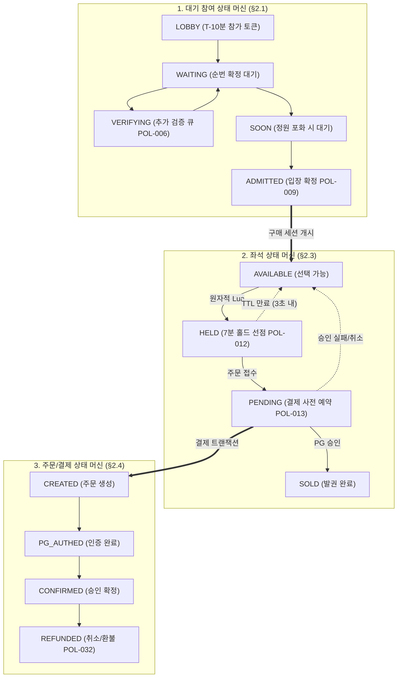
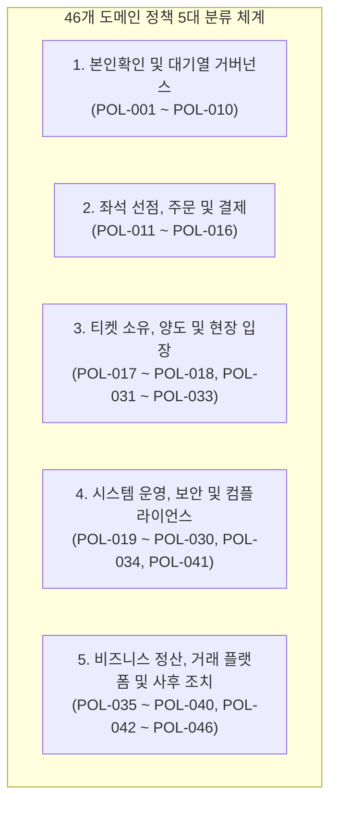

# 분야 편 3: 정책과 용어 (Policies, State Machines & Glossary)

- **맡는 정본**: [docs/planning/03-policies-glossary.md](../../planning/03-policies-glossary.md) 전체(정책 표 §1과 하위 표 §1.1~§1.5, 상태 정의 §2, 권한 매트릭스 §3, 용어 사전 §4, 문서 쓰기 규칙 §5), 자리가 이 편인 [ADR-0093](../../adr/0093-production-entity-place-artist-units.md)
- **문서 성격**: 정본 설계를 시스템 엔지니어링 및 기술 면접 관점에서 체계적으로 해설한 문서다. 규범적 수치와 불변 규칙의 최종 권위는 정본 문서에 있다([ADR-0177](../../adr/0177-walkthrough-explain-in-interview.md)). 길잡이는 [README.md](../README.md)다.
- **한 판 문서와의 관계**: [한 판 문서](../01-system-design.md) 2단계(운영 명령 1의 상한 8,000명), 6단계(POL-001~006 대기열 정책), 7단계(POL-008~010 입장 유예와 AIMD), 8단계(POL-012 홀드 TTL), 11단계(POL-029 감내 모드), 13단계(POL-021 '정지 1인, 재개 2인'), 17단계(POL-030 오픈 간격)의 기반이 되는 비즈니스 헌법을 제공한다.
- **아키텍처 목표와 검증 기준**: 46개 도메인 정책(POL-001~046) 전수에 대한 예외 처리 및 검증 경로를 확립하고, 19개 핵심 객체 상태 머신과 전이 표를 통해 유효하지 않은 상태 전이를 원천 차단한다. 12개 표준 운영 명령(POL-021)에 대해 1인 킬스위치(3초 내 전파) 및 2인 상호 승인 메커니즘을 적용하며, 장애 시 완화 한계(POL-029)를 통해 가용성과 일관성의 경계를 수치로 제어한다.

---

## 1. 도메인 종합 개요

PEAKET의 정책과 용어 도메인은 기획자, 백엔드/프론트엔드 엔지니어, SRE, 법률 및 보안 담당자가 동일한 비즈니스 헌법과 공통 언어(Ubiquitous Language) 위에서 시스템을 구축하도록 규정하는 단일 진실 공급원(SSOT)이다.

> **30초 아키텍처 브리핑 (Staff Engineer Interview)**:  
> "PEAKET의 비즈니스 헌법은 **46개 도메인 정책(POL-001~046)**과 **19개 핵심 객체 상태 머신**, **57개 기능 $\times$ 8개 역할의 권한 매트릭스**, 그리고 **248개 표준 용어 사전**으로 구성됩니다.  
> 첫째, 도메인 정책은 모호한 자연어가 아닌 '규칙 - 예외 처리 - 관련 FR/ADR'의 3요소로 정의됩니다. 1인 1순번(POL-002)은 계정 ID가 아닌 실명 연계정보의 단방향 솔트 해시 `pid`로 강제되며, 좌석 홀드(POL-012)는 7분 기본에 1회 3분 연장 후 3초 이내에 원자적으로 재노출됩니다.  
> 둘째, 운영 명령(POL-021)은 **'정지는 1인 긴급, 재개는 2인 상호 승인'**이라는 비대칭 통제 원칙을 적용합니다. 오버셀이나 이중 결제 의심 시 commander 1인이 즉시 킬스위치를 발동할 수 있어야 피해 확산을 막을 수 있으며, 사후 48시간 내 보고서 제출과 7일 이내 교차 감사가 강제됩니다.  
> 셋째, 19개 핵심 객체(대기열, 좌석, 주문, 티켓 등)는 상태 다이어그램과 전이 표로 엄격히 통제되며, 선이 많은 다이어그램의 모호성을 제거하기 위해 Mermaid ELK 레이아웃과 상태 전이 표([ADR-0138](../../adr/0138-mermaid-elk-layout-diagram-rules-transition-tables.md))가 정본의 지위를 가집니다.  
> 넷째, 법률 조항은 자체 확정이 아닌 5단계 확인 수준(확인됨, 확인 필요, 해석, 간주, 추정)으로 분류하여 출시 전 법률 자문 목록으로 관리됩니다."

### 핵심 객체 상태 전이와 정책 연계 종합 다이어그램

---

## 2. 절마다 읽기

정책과 용어 정의서([docs/planning/03-policies-glossary.md](../../planning/03-policies-glossary.md))의 전 절을 정밀 매핑한다.

| 정본 절 | 무엇을 정하나 | 왜 | 해설서에서 |
| --- | --- | --- | --- |
| docs/planning/03-policies-glossary.md §1 정책 표 | POL-001~046 전체 표(정책, 규칙, 예외 처리, 관련 FR/ADR) | 기획·설계·구현·테스트가 단일 비즈니스 헌법을 참조하도록 통일 | 한 판 6~8·11·13·17단계, 분야 편 8~14 |
| docs/planning/03-policies-glossary.md §1.1 POL-021 B. 운영 명령 카탈로그 | 12개 표준 운영 명령(효과, 권한, 1인/2인 요건, 안전 제약, 롤백) | 통제권 상실을 방지하고 위험 방향성에 맞춘 비대칭 승인 강제 | 한 판 2·13단계, 분야 편 16 |
| docs/planning/03-policies-glossary.md §1.2 POL-023 개인정보 처리 표 | 개인정보 수집 항목, 동의, CI 단방향 해시, 제3자 제공, 파기 주기 | 개인정보보호법 및 망법 법정 의무 준수(원본: data-classification) | 분야 편 8, 21 |
| docs/planning/03-policies-glossary.md §1.3 POL-029 완화 한계 표 | 9대 핵심 여정별 감내 모드 허용 한계(지연 완화 vs 포기 불가 불변식) | 장애 시 무엇을 포기하고 무엇을 지킬지 사전에 결정 | 한 판 11단계, 분야 편 9·16 |
| docs/planning/03-policies-glossary.md §1.4 POL-016 굿즈·부가 상품 취소·반품 표 | 굿즈 택배, 현장 수령, 연동 상품의 전자상거래법상 청약철회 기준 | 전자상거래법 제17조·제18조 법정 소비자 권리 보장 | 분야 편 12 |
| docs/planning/03-policies-glossary.md §1.5 POL-033 탈퇴 때 티켓·주문 처리 표 | 탈퇴 요청 시 보유 티켓, 진행 중 주문, 환불 계좌 처리 8단계 | 전자상거래법 제21조의2(가입보다 쉬운 탈퇴) 준수 및 미사용 티켓 정리 | 분야 편 8 (탈퇴 Saga) |
| docs/planning/03-policies-glossary.md §2 핵심 객체의 상태 정의 | 15개 도메인 객체, 19개 상태도 및 전이 조건 표 | 상태 전이의 모호성을 제거하고 유효하지 않은 전이 차단 | 아래 세부 행 |
| docs/planning/03-policies-glossary.md §2.1 대기 참여 | Lobby, Waiting, Verifying, Soon, Admitted 및 종료 상태 4개 | 대기 이탈 조건을 4가지로 한정하고 매진 시 전면 정리 | 분야 편 9 |
| docs/planning/03-policies-glossary.md §2.2 입장 자리와 구매 세션 | Reserved $\rightarrow$ Active $\rightarrow$ Paying $\rightarrow$ Released | 첫 사용 5분, 최대 체류 45분 안전장치로 자리 독점 방지 | 한 판 7단계, 분야 편 9 |
| docs/planning/03-policies-glossary.md §2.3 좌석 | Available, Held, Pending, Sold | 결제창 30분 열림을 고려한 HELD 만료 후 PENDING 전이 허용 | 한 판 8단계, 분야 편 10 |
| docs/planning/03-policies-glossary.md §2.4 주문·결제 | Created부터 Confirmed, Refunded까지 13개 상태 전이 | 결제 실패와 접수 전 만료를 분리하고 90분 안전망 가동 | 분야 편 11 |
| docs/planning/03-policies-glossary.md §2.5 티켓 | 영역 1(소유·결제)과 영역 2(현장 입장)의 2개 상태 머신 분리 | 소유권 이전(양도/환불)과 검표 입장을 독립된 라이프사이클로 격리 | 분야 편 12, 13 |
| docs/planning/03-policies-glossary.md §2.6 운영 명령 | Drafted $\rightarrow$ DryRun $\rightarrow$ PendingApproval $\rightarrow$ Dispatched $\rightarrow$ Acked | 사유 입력, 영향 시뮬레이션, 감사 로그, 3초 전파 확인 강제 | 한 판 13단계, 분야 편 16 |
| docs/planning/03-policies-glossary.md §2.7 게시물·관리 계정·현장 스태프 배정 | 후기 차단, 관리 계정 초대/잠금/삭제, 스태프 배정 상태도 3종 | 퇴직 당일 관리 계정 삭제 및 현장 스태프 24시간 1회용 초대 | 분야 편 8, 13 |
| docs/planning/03-policies-glossary.md §2.8 계정 연결 제안과 계정 병합 | 연결 제안(10분 1회용) 및 계정 병합(Confirm $\rightarrow$ Progress $\rightarrow$ Done) | 이메일 자동 병합을 금지하고 실제 OIDC 재인증으로만 병합 | 분야 편 8 |
| docs/planning/03-policies-glossary.md §2.9 양도 요청 | Offered $\rightarrow$ Accepted / Rejected / Withdrawn / Expired | 수락자 확인 전까지 소유권 보존 및 공연 2시간 전 마감 | 분야 편 12 |
| docs/planning/03-policies-glossary.md §2.10 승인 업무 | 요청 $\rightarrow$ 승인 대기 $\rightarrow$ 승인/반려/철회 $\rightarrow$ 실행 | 정책 밖 예외 환불 시 요청자와 승인자 분리(POL-038) | 분야 편 12 |
| docs/planning/03-policies-glossary.md §2.11 회차 취소 요청 | 요청 $\rightarrow$ 귀책 판정 $\rightarrow$ 2인 승인 $\rightarrow$ 일괄 환불 $\rightarrow$ 완료 | 파트너 귀책 시 10% 배상금 자동 산출 및 일괄 환불 집행 | 분야 편 12 |
| docs/planning/03-policies-glossary.md §2.12 정산서 | Draft $\rightarrow$ Notified $\rightarrow$ Confirmed $\rightarrow$ PayoutScheduled $\rightarrow$ Paid | 재정산 시 구버전 Superseded 처리 및 결제사 직접 송금 | 분야 편 12 |
| docs/planning/03-policies-glossary.md §2.13 굿즈·부가 상품 주문 | MerchOrder(결제)와 MerchOrderItem(배송/반품) 분리 상태도 | 티켓과 분리된 재고 선점 및 결제 타임아웃 15분 관리 | — |
| docs/planning/03-policies-glossary.md §2.14 판매 승인 | Draft $\rightarrow$ Submitted $\rightarrow$ Approved $\rightarrow$ Suspended(판매 중지) | 승인 후 수정 시 차분 보관 및 위급 시 Suspended 비공개 | 분야 편 12 |
| docs/planning/03-policies-glossary.md §2.15 회차 판매 상태 | Upcoming $\rightarrow$ OnSale $\rightarrow$ AllHeld(일시 매진) $\rightarrow$ SoldOut $\rightarrow$ Ended | 좌석 회수 가능성이 있는 동안은 대기열을 유지하는 일시 매진 분리 | 분야 편 9, 10 |
| docs/planning/03-policies-glossary.md §3 권한 매트릭스 | 57개 기능 $\times$ 8개 역할(팬, 파트너, viewer, op, commander, CS, 스태프, 시스템) | 기능 단위 인가 통제 및 세부 조건(authz-matrix) 연결 | 분야 편 8, 21 |
| docs/planning/03-policies-glossary.md §4 용어 사전 | 248개 표준 용어(정의, 코드 영문 표기, 금지 동의어) | 도메인 용어 혼선 방지 및 코드베이스 네이밍 통일 | — |
| docs/planning/03-policies-glossary.md §5 문서 쓰기 규칙 | 쉬운 말 원칙, 처음 나오는 용어 풀이, 표기 통일, 문장 끝 '~다' | 기술 문서의 가독성과 명확성을 위한 작성 가이드라인 | — |
| docs/planning/03-policies-glossary.md §5.1 원칙 | 사실 보존, 숫자/코드명 불변, 과장 금지 원칙 | 문서 개선이 아키텍처 수치를 왜곡하지 않도록 규정 | — |
| docs/planning/03-policies-glossary.md §5.2 처음 나올 때 풀어 쓰는 용어 | 197개 전문 용어의 최초 인라인 해설 규칙 | 진입 장벽 완화 및 기술 용어의 정확한 이해 도모 | — |
| docs/planning/03-policies-glossary.md §5.3 바꾸는 표현과 §5.4 표기 통일 | 번역투 57개 대체어, 10개 핵심 용어 표준 표기 확정 | '유휴 만료', '온세일 윈도우', '티케팅' 등 표준 표기 강제 | — |
| docs/planning/03-policies-glossary.md §5.5 그림 쓰기 규칙 | Mermaid 12.2.0, ELK 배치 엔진, 선 25개 이하, 라벨 따옴표 강제 | 다이어그램 가독성 보장 및 렌더링 파서 오류 방지 | — |

---

## 3. 핵심 메커니즘과 상태 머신 아키텍처

### 3.1 46개 도메인 정책 (POL-001 ~ POL-046) 5대 영역 분류

1. **본인확인 및 대기열 거버넌스 (POL-001 ~ 010)**:
   - `POL-001` (구매자 본인확인): 순번 발급 전 계정당 1회 휴대폰 본인확인 의무화. 굿즈는 제외.
   - `POL-002` (1인 1순번 및 기기 바인딩): 실명 연계정보의 단방향 솔트 해시 `pid`로 중복 순번 발급 원천 차단.
   - `POL-003` / `POL-004` (대기열 정렬 및 고지): 로비 셔플과 오픈 직후 묶음 설정. 셔플 공연에 '선착순' 표기 엄격 금지.
   - `POL-005` (검증 가능한 셔플): drand 공개 난수 비콘 및 머클 루트 기반 Commit-Reveal 셔플 재현 보장.
   - `POL-006` (추가 검증 큐): 위험 점수로 순번을 밀어내지 않고, 격리 큐 검증 통과 시 원래 순번 유지.
   - `POL-008` / `POL-009` (차례 유예 및 구매 세션): 차례 도달 후 15분 우선 입장 유예, 입장 토큰 첫 사용 5분, 최대 체류 45분.
   - `POL-010` (동시 체류 및 자동 제어): 예매창 동시 체류 5,000명 상한, Little's Law 기반 AIMD 조절.

2. **좌석 선점, 주문 및 결제 (POL-011 ~ 016)**:
   - `POL-011` (1인당 매수 제한): 선점 좌석 수 + 요청 좌석 수 $\le$ 회차 매수 한도 원자적 검증.
   - `POL-012` (좌석 홀드 TTL): 기본 7분, 1회 3분 연장 허용. 만료 시 3초 내 재노출 (WCAG 2.2.1 필수 예외).
   - `POL-013` (2단계 결제 트랜잭션): PENDING 좌석 선점 확정 후 PG사 승인 API 호출 강제.
   - `POL-014` (가상계좌 통제): 몰리는 온세일 공연에서는 입금 대기 공석을 방지하기 위해 가상계좌 옵션 강제 비활성화.
   - `POL-015` (매진 처리 순서): purchase-svc 매진 판정 $\rightarrow$ 엣지 정적 410 반환 $\rightarrow$ 대기 순번 파일 소진.
   - `POL-016` (굿즈 및 부가 상품): 굿즈는 자유 구매, 연동 부가 상품(주차/라운지)은 유효 티켓 보유자만 구매 가능.

3. **티켓 소유, 양도 및 현장 입장 (POL-017 ~ 018, 031 ~ 033)**:
   - `POL-017` (수락형 정가 양도): 1:1 양도 요청 후 수취인이 48시간(또는 공연 2시간 전) 내 수락해야 완료. 취소권은 결제자에게 보존.
   - `POL-018` (회전 QR 입장 판정): 기기 비대칭키로 서명된 15초 갱신 회전 QR을 스캐너가 로컬 검증.
   - `POL-031` (현장 스태프 권한): 24시간 1회용 모바일 초대 링크를 통해 권한 부여, 등록된 스캐너 기기 승인.
   - `POL-032` (취소 및 환불 수수료): 소비자분쟁해결기준 준수 (10일 전 0%, 7일 전 10%, 3일 전 20%, 1일 전 30%, 당일 90%).
   - `POL-033` (회원 탈퇴 처리): 탈퇴를 가입보다 어렵게 만들지 않음. 미사용 티켓 환불 또는 포기 동의 후 탈퇴 집행.

4. **시스템 운영, 보안 및 컴플라이언스 (POL-019 ~ 030, 034, 041)**:
   - `POL-019` / `POL-020` (세션 정책 및 관리자 보안): 팬 세션 절대 30일/유휴 14일, 관리자 절대 24시간/유휴 1시간. 관리자 TOTP 필수 및 패스키 단계적 인증.
   - `POL-021` (운영 명령 통제): 단일 킬스위치는 commander 1인 즉시 실행, 완화/재개는 2인 상호 승인 강제.
   - `POL-022` (인시던트 알림): 에러 버짓 소진율에 따른 SEV1~SEV3 선언 및 PagerDuty 호출.
   - `POL-023` (개인정보 처리): 연계정보(CI) 원문 파기 및 HMAC만 보존, 접속기록 3개월 변조 방지 보관.
   - `POL-024` (암표 방지 법정 조치): 공연법 제4조의2에 따른 매크로 부정구매 방지 조치 완비.
   - `POL-028` (온세일 윈도우 동결): T-10분 ~ T+60분 온세일 기간 신규 배포 전면 금지, 대형 공연 T-90분 사전 동결.
   - `POL-029` (감내 모드 완화 한계): 장애 시 지연을 완화하되 오버셀 0건과 금전 무결성은 끝까지 보존.
   - `POL-030` (온세일 단계 및 간격): 대형 공연 간 30분, 일반 공연 간 5분 오픈 간격 강제.

5. **비즈니스 정산, 거래 플랫폼 및 사후 조치 (POL-035 ~ 040, 042 ~ 046)**:
   - `POL-035` (좌석 배정): 직접 선택(PICK)과 자동 배정(AUTO) 회차별 선택.
   - `POL-036` (결제사 선택 및 장애 전환): 플랫폼 기본 $\rightarrow$ 회차별 지정 $\rightarrow$ 장애 시 대체 PG 전환.
   - `POL-037` (통신판매중개자 지위): PEAKET은 플랫폼 알선자이며 판매 당사자는 기획사 파트너임을 고지.
   - `POL-038` (정책 밖 예외 승인): 예외 환불 및 강제 취소 시 기안자와 승인자 분리.
   - `POL-039` (정산 및 지급대행): PG사 지급대행을 통해 공연 종료 후 D+5영업일에 파트너 계좌로 직접 송금.
   - `POL-040` (데이터 마감 단계): R0(잠정) ~ R3(최종 확정) 마감 단계를 거쳐 확정된 수치로만 정책 변경.
   - `POL-046` (부정 예매 사후 조치): 매크로 적발 시 3일간 소명 기회 부여, 불응 시 직권 취소 및 최대 1년 이용 제한.

---

### 3.2 12개 표준 운영 명령 카탈로그 (POL-021)

| 명령 번호 및 명칭 | 주요 효과 | 권한 요건 | 승인 방식 | 안전 한계 및 비고 |
| --- | --- | --- | --- | --- |
| **명령 1: 동시 체류 목표 변경** | `serving` 전진 속도 조절 | operator 이상 | 1인 즉시 | 상한 min(8,000, PG한도), 하한 1,000 |
| **명령 2: 대기열 강제 진입 차단** | 신규 대기열 진입 차단 | commander | 1인 즉시 | 429 Server Busy 반환 |
| **명령 3: 판매 긴급 일시정지** | 신규 홀드/결제 즉시 차단 (킬스위치) | commander | **1인 즉시** | 48h 내 사후 보고서, 7일 내 교차 감사 |
| **명령 4: 판매 재개** | 일시정지 해제 및 판매 재개 | commander | **2인 승인** | 일시정지 후 상태 복구 확인 필수 |
| **명령 5: 홀드 시간 변경** | 좌석 홀드 TTL 연장/단축 | operator 이상 | 2인 승인 | 허용 범위: 5분 ~ 15분 |
| **명령 6: 감내 모드 전환** | 비핵심 기능 비활성화, 지연 완화 | commander | 2인 승인 | POL-029 완화 한계 매트릭스 준수 |
| **명령 7: 결제사 수동 전환** | 주 PG사 장애 시 대체 PG로 라우팅 | commander | 2인 승인 | 대체 PG사 사전 헬스체크 통과 필수 |
| **명령 8: 특정 계정 세션 강제 종료** | 부정 봇 의심 계정 토큰 무효화 | operator 이상 | 1인 즉시 | Kafka 거부 목록 즉시 브로드캐스트 |
| **명령 9: 좌석맵 강제 재노출** | 좀비 홀드 좌석 원자적 반환 | operator 이상 | 1인 즉시 | Redis TTL 만료 파이프라인 트리거 |
| **명령 10: 봇 판정 규칙 긴급 갱신** | 신규 IP 대역/UA 룰 추가 | operator 이상 | 2인 승인 | 게이트웨이 파드별 3초 내 룰 반영 |
| **명령 11: 비상 자동 제어 중단** | AIMD 자동화 루프 긴급 정지 | commander | **1인 즉시** | 현재 설정값으로 고정, 수동 제어 |
| **명령 12: 회차 조기 마감** | 남은 티켓 전석 매진/취소 처리 | commander | 2인 승인 | 파트너 확인 공문 첨부 필수 |

---

### 3.3 장애 시 완화 한계 (POL-029 감내 모드)

장애 발생 시 무제한적인 시스템 다운을 방지하기 위해 감내 모드(Degraded Mode)에서 허용하는 완화 범위와 절대 포기할 수 없는 불변식을 사전에 규정한다.

| 핵심 사용자 여정 | 평상시 목표 | 감내 모드 완화 허용치 | 절대 포기할 수 없는 불변식 |
| --- | --- | --- | --- |
| **공연 상세 조회** | TTFB p99 150ms, 가용성 99.99% | CDN 캐시 만료 10분까지 허용 | 정적 페이지 엣지 응답 가용성 99.99% 유지 |
| **대기열 진입** | p99 200ms, 20만 RPS 수용 | p99 1.0초까지 지연 허용 | 순번 발급 무결성 100%, 1인 1순번 보장 |
| **대기 상태 조회** | 임박자 p99 2초, 99.95% | 폴링 간격 2배 확대 (최대 10초) | 앞선 대기자 수의 단조 감소성 유지 |
| **좌석맵 및 홀드** | 홀드 p99 50ms, 가용성 99.95% | Redis 장애 조치 중 503 재시도 안내 | **오버셀 0건, 1인 매수 한도 초과 0건** |
| **결제 접수/승인** | 확정 p99 3초 이내 | 롱폴링 대기 60초까지 연장 | **이중 과금 0건, 승인 후 발권 누락 0건** |
| **월렛 티켓 조회** | p95 300ms 이내 | 로컬 서비스 워커 캐시 티켓 표출 | 회전 QR 비대칭 전자서명 유효성 보장 |
| **현장 게이트 검표** | 로컬 판정 p95 150ms 이내 | 로컬 큐 지연 동기화 (최대 60초) | **중복/위조 입장 통과 0건** |

---

## 4. 꼭 기억할 규칙과 숫자

| 항목 | 엔지니어링 기준값 | 아키텍처 근거 및 계산 | 정본 위치 |
| --- | --- | --- | --- |
| **법률 확인 수준 5단계** | 확인됨, 확인 필요, 해석, 간주, 추정 | 컴플라이언스 위험도를 분류하여 출시 전 자문 목록 관리 | POL-027 |
| **순번 전 본인확인** | 계정당 1회, 단방향 솔트 해시 `pid` | 연계정보(CI) 원문 파기 및 HMAC 저장으로 1인 1순번 보장 | POL-001, POL-002 |
| **대기열 유예 시간** | 차례 도달 후 15분 보장 | 네트워크 일시 순단 관객 보호 및 SOON 대기열 버퍼 | POL-008, §2.1 |
| **구매 세션 타임아웃** | 첫 사용 5분, 무활동 5분, 최대 체류 45분 | 미사용 자리를 회수하고 좌석 독점을 방지하는 안전장치 | POL-009, §2.2 |
| **동시 체류 목표 제어** | 기본 5,000명, 상한 8,000명 | 30초마다 초기 목표의 2% 증액, 이상 감지 시 50% 즉시 감축 | POL-010, FR-037 |
| **좌석 홀드 TTL** | 7분 기본 + 1회 3분 연장, 3초 내 재노출 | 결제 입력 시간 보장 및 만료 좌석의 빠른 공석 회수 | POL-012, §2.3 |
| **결제 승인 타임아웃** | PG사 승인 호출 최대 10분 유효 | 타임아웃 발생 시 Outbox 기반 전진 복구 파이프라인 가동 | POL-013, K7 |
| **온세일 윈도우 동결** | T-10분 ~ T+60분 (총 70분) | 핫패스 안정성 확보를 위해 신규 배포 전면 차단 | POL-028 |
| **대형 공연 오픈 간격** | 대형 간 30분, 일반 간 5분 | 인프라 프리워밍 및 트래픽 스파이크 중첩 방지 | POL-030 |
| **운영 명령 전파 지연** | p99 3초 이내 전 시스템 반영 | Redis Pub/Sub 고속 제어 채널 전파 | POL-021, NFR-008 |
| **예매 취소 공제율** | 10일 전 0%, 7일 전 10%, 1일 전 30% | 공정거래위원회 소비자분쟁해결기준 법정 상한 | POL-032 |
| **정산서 지급 시점** | 공연 종료 후 D+5영업일 | 이의 제기 2영업일 보장 및 PG사 직접 정산 대행 | POL-039 |
| **부정 거래 소명 기한** | 최소 24시간 이상, 기본 3일 부여 | 행정절차법 준용 관객 방어권 보장 및 이의 신청 30일 | POL-046 |

---

## 5. 이 문서가 다루는 ID

| 구분 | ID | 핵심 정책 및 내용 요약 |
| --- | --- | --- |
| **POL** | POL-001 ~ 010 | 입장권 구매자 본인확인, 1인 1순번, 정렬 방식 고지, 검증 셔플, 추가 검증 큐, 15분 차례 유예, 구매 세션, 동시 체류 AIMD. |
| | POL-011 ~ 016 | 1인 매수 한도, 좌석 홀드 7분 TTL, 2단계 결제, 가상계좌 제한, 매진 순서, 굿즈 분리. |
| | POL-017 ~ 018 | 수락형 정가 양도, ECDSA P-256 비대칭 회전 QR 입장 판정. |
| | POL-019 ~ 025 | 세션 정책, 관리자 TOTP/패스키 보안, 운영 명령 카탈로그, 인시던트 선언, 개인정보 처리, 암표 방지, 수사기관 영장 대응. |
| | POL-026 ~ 030 | 테스트 윤리 규칙, 법률 5대 표시, 온세일 동결 윈도우, 감내 모드 완화 한계, 온세일 단계 정의. |
| | POL-031 ~ 034 | 현장 스태프 초대, 예매 취소 수수료, 회원 탈퇴 처리, 계정 연결/병합. |
| | POL-035 ~ 040 | 직접/자동 좌석 배정, 결제사 장애 전환, 통신판매중개자 고지, 예외 승인 업무, PG 지급대행 정산, R0~R3 마감. |
| | POL-041 ~ 046 | 긴급 변경 관리, 관람 후기 정책, 홈 배너 선정, 게시물 권리 침해 신고, 검색 노출 규칙, 부정 예매 소명 및 제재. |

---

## 6. 결정과 버린 길 (ADR 트레이드오프)

### ADR-0093: Production(공연 묶음)과 Event(회차), Place, Artist 분리 (자리: 이 편)
- **채택한 결정**: 시스템 데이터의 최상위 집합으로 `production`(공연 묶음)을 정의하고, 실제 예매·대기열·좌석·결제 트랜잭션은 하위의 `event`(개별 회차) 단위로 완전히 분리한다. `place`(공연장)와 `artist`(출연진)를 다대다 독립 엔티티로 분리하여 검색 및 필터링을 표준화한다.
- **버린 대안**: 회차 단일 엔티티 모델(장기 뮤지컬의 경우 수백 개 회차가 생성되어 목록이 마비되고 동일 공연 관리가 불가능), 회차 내 공연 정보 중복 저장(공연 정보 변경 시 모든 회차 데이터를 수정해야 하여 일관성 붕괴).

### ADR-0138: Mermaid ELK 레이아웃과 상태 전이 표 정본화
- **채택한 결정**: 19개 핵심 객체 상태 머신을 다룰 때 시각적 선 교차로 인한 모호성을 방지하기 위해 Mermaid ELK 레이아웃을 표준 렌더러로 채택하고, 시각적 그림보다 **'상태 전이 표(출발, 도착, 트리거, 조건)'를 불변의 정본**으로 규정한다.
- **버린 대안**: 외부 이미지 파일(PNG/SVG) 삽입(텍스트 기반 LLM 및 자동화 린트 도구가 상태 전이 규칙을 파싱할 수 없음), Graphviz/D2 전면 전환(문서 작성 도구 체인과의 호환성 결여).

### ADR-0095: 1인 긴급 정지(킬스위치) 및 2인 재개 승인 (결정 카드 [D-21](../decisions/D21-command-approval-and-audit-anchor.md))
- **채택한 결정**: 시스템 장애나 오버셀 의심 시 commander 1인이 즉시 판매를 일시정지(명령 3)할 수 있도록 허용한다. 단, 일시정지된 판매를 다시 재개(명령 4)할 때는 반드시 2인의 상호 승인을 요구한다.
- **버린 대안**: 판매 일시정지에도 2인 승인 강제(두 번째 승인자를 찾는 수 분 동안 수백 건의 오버셀 및 금전 사고가 추가 발생하여 피해 눈덩이), 재개도 1인 단독 허용(근본 원인이 해결되지 않은 상태에서 성급한 재개로 2차 장애 유발).

### ADR-0122: ALL_HELD(일시 매진)와 SOLD_OUT(완전 매진)의 분리
- **채택한 결정**: 잔여 좌석이 0이 되었을 때, 홀드 중이거나 결제 진행 중인 좌석이 남아있는 상태를 `ALL_HELD`(일시 매진)로 정의하여 대기열을 유지한다. 가용 좌석, 홀드 좌석, 결제 진행 좌석이 모두 0으로 2회 연속 감지될 때만 `SOLD_OUT`(완전 매진)으로 전이하여 대기열을 종료한다.
- **버린 대안**: 가용 좌석 0 즉시 매진 처리(결제 취소나 홀드 만료로 좌석이 반환되었을 때 이미 대기열이 해산되어 정상 관객이 구매 기회를 상실함).

---

## 7. 경계와 범위

| 이 정본이 정하지 않는 것 | 정하는 곳 |
| --- | --- |
| FR·NFR의 상세 인수 조건 및 품질 시나리오 | [docs/planning/02-requirements.md](../../planning/02-requirements.md)([분야 편 2](02-requirements.md)) |
| 화면별 UI 와이어프레임 및 SCR ID 명세 | [docs/planning/04-ia-flows-screens.md](../../planning/04-ia-flows-screens.md)([분야 편 4](04-screens-and-flows.md)) |
| 대기열 수식, Little's Law AIMD 알고리즘 구현 | [docs/features/queue-admission.md](../../features/queue-admission.md)([분야 편 9](09-queue-admission.md)) |
| 좌석 선점 Lua 스크립트 및 2단계 결제 트랜잭션 | [docs/features/seat-hold.md](../../features/seat-hold.md)([분야 편 10](10-seat-hold.md)), [features/payment.md](../../features/payment.md) |
| 운영 관제 제어 채널 및 Kafka 제어 토픽 구현 | [docs/features/control-tower.md](../../features/control-tower.md) §4·§5([분야 편 16](16-control-tower.md)) |
| 칸 단위 권한 세부 조건 및 검사 위치 | [docs/security/authz-matrix.md](../../security/authz-matrix.md) §3·§5([분야 편 21](21-security.md)) |
| 데이터 수집 항목, 보존 기한 및 법률 원문 매핑 | [docs/security/data-classification.md](../../security/data-classification.md), [security/internal-management-plan.md](../../security/internal-management-plan.md) §2 |
| 포렌식 리플레이 사건 상태 및 증거 묶음 구조 | [docs/features/forensic-replay.md](../../features/forensic-replay.md) §6([분야 편 17](17-analytics-forensics.md)) |
| PostgreSQL 테이블 및 Redis 키 물리 스키마 | [docs/data.md](../../data.md) §2, §3([DB 설계 편 3](../db/03-core-tables.md)) |

---

## 8. 5단 꼬리 질문 (Staff Engineer Interview Defense)

### Q1. "판매 긴급 일시정지(킬스위치)는 왜 1인 단독 실행을 허용하면서, 판매 재개는 2인 승인을 강제합니까?"
- **답변**: **'위험의 비대칭성'** 때문입니다. 오버셀 버그나 결제사 이중 과금 이상 징후가 포착되었을 때, 두 번째 승인자의 검토를 기다리는 1~2분의 지연 동안 수백~수천 건의 비가역적 금전 사고가 발생할 수 있습니다. 멈추는 것은 언제든 되돌릴 수 있지만, 잘못 팔린 티켓과 잘못 빠져나간 돈을 수습하는 비용은 기하급수적입니다. 따라서 즉각적인 1인 킬스위치를 허용하고, 대신 48시간 내 사후 보고서 제출과 7일 내 교차 감사를 의무화했습니다. 반대로 판매를 다시 여는 행위는 원인 분석과 데이터 롤백이 완벽히 끝났음을 검증해야 하므로, 반드시 2인의 상호 교차 검증을 거쳐야만 재개될 수 있도록 설계했습니다.

### Q2. "자동화 제어 루프(AIMD)와 사람 운영자의 명령이 충돌할 경우 시스템은 어떻게 중재합니까?"
- **답변**: POL-021 C에 정의된 **'안전 한계(Safety Bounds) > 사람의 명령 > 자동화 루프'**의 3단계 위계에 따라 중재됩니다. 운영자가 콘솔에서 특정 입장률을 수동 설정하면, 자동화 루프(AIMD)는 15분간 즉시 일시정지되어 사람의 통제권을 보장합니다. 단, 운영자가 실수로 시스템이 감당할 수 없는 위험한 값(예: 20,000명 동시 입장)을 입력하더라도, 코드와 인프라 설정에 불변으로 박혀 있는 '안전 한계(상한 8,000명)'를 초과하는 명령은 게이트웨이 검증 단계에서 즉시 거부(422 Unprocessable Entity)됩니다.

### Q3. "ALL_HELD(일시 매진)와 SOLD_OUT(매진)을 상태 머신에서 엄격히 분리한 실무적 이유는 무엇입니까?"
- **답변**: **'결제 실패 및 홀드 만료로 인한 좌석 반환'**을 수용하기 위함입니다. 5만 석이 모두 선점되었더라도 관객들이 결제창에서 카드 한도 초과나 단순 변심으로 이탈할 확률은 약 17%에 달합니다. 만약 가용 좌석이 0이 된 순간 매진(SOLD_OUT)을 선언하고 대기열을 해산하면, 7분 뒤 쏟아져 나오는 수천 석의 취소 좌석을 대기 중이던 진성 관객에게 전달하지 못하고 외부 매크로에 공석을 털리게 됩니다. 따라서 홀드 중인 좌석이 있는 동안은 `ALL_HELD`로 대기를 유지하고, 모든 좌석의 결제가 완료되어 돌아올 좌석이 0건임이 2회 연속 확인되었을 때만 `SOLD_OUT`으로 최종 전이합니다.

### Q4. "PEAKET은 왜 티켓 판매 대금을 자체 계좌로 받지 않고 PG사 지급대행(Payout Agency)을 씁니까?"
- **답변**: **전자금융업 규제 회피와 정산 자금 횡령 리스크를 원천 차단**하기 위함입니다. 티켓 판매 대금을 플랫폼 법인 통장에 직접 보관하면, 수백억 원의 정산 대금을 예치하게 되어 금융감독원의 엄격한 에스크로 및 전자지급결제대행업 라이선스를 취득해야 합니다. 또한 플랫폼 내부 자금과 기획사 정산 대금이 혼재되어 자금 유용이나 기획사 부도 분쟁에 휘말릴 위험이 큽니다. PG사의 공식 지급대행 API를 통해 관객의 결제 대금을 PG사 안전 계좌에 묶어두고, 공연 종료 후 D+5영업일에 기획사 파트너 계좌로 직접 송금되도록 함으로써 법적 리스크를 완전히 격리했습니다.

### Q5. "법률 해석 문장에 '간주', '해석', '확인 필요' 같은 꼬리표를 붙여 관리하는 목적은 무엇입니까?"
- **답변**: 엔지니어가 임의로 법률을 단정하여 시스템을 설계하는 오만을 방지하고, **'출시 전 법률 자문 목록(Legal Audit Backlog)'**을 체계적으로 식별하기 위함입니다. 예를 들어 "휴대폰 본인확인 1회로 공연법상 본인확인 의무를 다한 것으로 본다"는 명제는 법 조항에 구체적 시행령 규정이 없으므로 '간주(프로젝트 결정)'로 태깅됩니다. 이 태그가 붙은 항목들은 출시 전 고문 변호사 및 문화체육관광부의 공식 유권해석을 받아 '확인됨'으로 전환되어야 하며, 만약 법률 해석이 변경될 경우 해당 정책과 연동된 아키텍처 영향 범위를 즉시 추적할 수 있습니다.

---

## 9. 확인 문제

### 문 1. 
운영 관제에서 판매 일시정지(명령 3)를 발동했을 때와 파트너 콘솔에서 판매 중지(Suspended)를 요청했을 때의 시스템 동작 차이점과 권한 요건을 서술하라.

정답 및 해설

- **판매 일시정지 (명령 3, 킬스위치)**: 관제 콘솔에서 commander 1인이 즉시 실행하는 런타임 제어 명령이다. 3초 내에 전 시스템에 전파되어 신규 홀드 선점, 주문 생성, 결제 접수를 전면 차단하고 대기열 입장을 멈춘다. 단, 이미 접수되어 처리 중인 결제 트랜잭션은 정상 완료된다. 만료 시간이 없으며 재개에는 2인 승인이 필수적이다.
- **판매 중지 (Suspended 상태)**: 파트너 또는 운영자가 요청하고 상위 승인자가 결재하는 판매 승인(Production) 상태 변경이다. 해당 공연을 즉시 비공개로 전환하여 홈 및 검색 목록에서 제거하고 신규 판매를 중단하며 정산 지급을 보류한다. 이미 발권된 관객의 티켓 효력은 유지되며, 후속 절차로 판매 재승인 또는 공연 취소/일괄 환불(FR-055)이 이어진다.

### 문 2. 
회원 탈퇴(POL-033)를 요청한 사용자가 아직 사용하지 않은 예매 티켓을 보유하고 있을 때, 시스템의 올바른 처리 흐름은 무엇인가?

정답 및 해설

전자상거래법 제21조의2에 따라 미사용 티켓 보유를 이유로 회원 탈퇴 자체를 거부하거나 차단할 수 없다.  
시스템은 8단계 탈퇴 처리 표(POL-033 §1.5)에 따라, 관객에게 환불 수수료 규정을 고지하고 **'잔여 티켓 일괄 취소 및 환불'**을 즉시 집행하거나, 환불 불가 기간인 경우 관객의 명시적 권리 포기 동의를 받아 티켓을 폐기 처리한 후 최종 탈퇴(계정 및 개인정보 즉시 파기)를 완료해야 한다.

### 문 3. 
좌석 홀드(POL-012)의 '기본 7분 + 1회 3분 연장' 정책이 웹 접근성 지침 WCAG 2.2.1(시간 제한 조정)의 예외로 인정받는 근거는 무엇인가?

정답 및 해설

WCAG 2.2.1은 시간 제한이 있는 웹 콘텐츠에 대해 사용자가 시간을 최소 10배 이상 연장하거나 해제할 수 있어야 한다고 규정하지만, **'실시간 이벤트의 필수적 요소인 경우(Essential Exception)'**는 예외로 인정한다.  
한정된 좌석을 두고 수십만 명이 실시간 경합하는 티케팅 환경에서 특정 사용자에게 무제한적인 시간 연장을 허용하면 다른 관객의 구매 기회가 원천 차단되고 공석이 독점되므로, 좌석 홀드 시간 제한은 시스템의 공정성과 실시간성을 지키기 위한 '필수적 예외'에 해당한다. 단, 최소한의 접근성 보장을 위해 1회 3분의 추가 연장 기회를 제공한다.

### 문 4. 
부정 예매 의심 계정에 대한 사후 조치(POL-046) 시, 시스템이 즉시 티켓을 취소하지 않고 3일간의 소명 절차를 두는 법적·도메인적 이유는 무엇인가?

정답 및 해설

행정절차법상 당사자의 방어권 보장 원칙과 인간 오탐(False Positive)으로 인한 진성 팬의 피해를 방지하기 위함이다.  
통계적·휴리스틱 봇 탐지는 오탐 가능성($\le 0.5\%$)을 내포하고 있으므로, 일방적 직권 취소는 정당한 소비자의 권리를 침해하여 민사소송 및 브랜드 신뢰 추락을 초래한다. 따라서 의심 거래에 대해 3일(최소 24시간 이상)의 소명 기회를 제공하고, 소명 증빙이 타당할 경우 정상 티켓으로 원복하며, 기한 내 미소명 시에만 2인 결재를 거쳐 직권 취소 및 환불을 집행한다.

