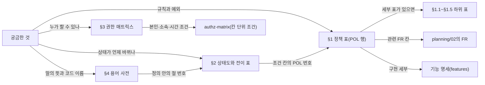

# 분야 편 3: 정책과 용어

- **기준 시점**: ADR-0177까지, 2026-11-01
- **맡는 정본**: [docs/planning/03-policies-glossary.md](../../planning/03-policies-glossary.md) 전체(정책 표 §1과 하위 표 §1.1~§1.5, 상태 정의 §2, 권한 매트릭스 §3, 용어 사전 §4, 문서 쓰기 규칙 §5)
- **규범이 아니다**: 정본을 풀어 쓴 해설이다. 숫자와 규칙이 정본과 다르면 정본이 맞다([ADR-0177](../../adr/0177-walkthrough-explain-in-interview.md)).
- **한 판 문서와의 관계**: [한 판 문서](../01-system-design.md)에 이 정본을 직접 다루는 단계는 없다. 2단계(명령 1의 상한 8,000명), 6단계(POL-001~006), 7단계(POL-008~010), 8단계(POL-012), 11단계(POL-029 감내 모드), 13단계(POL-021 '멈춤 1인, 재개 2인'), 17단계(POL-030 오픈 간격)가 정책을 끌어 쓴다. 이 편은 짜임과 찾는 법을 정리하고 정책 46개를 한 줄씩 모은다.
- **측정 전이다**: 정책 안의 성능 숫자(결제 접수 0.15초, 완화 한계 표의 p99: 요청 백 건 중 아흔아홉 건이 그 안에 끝나는 시간)는 설계 목표값이라 `[실측 전]`이다. `[가정]`은 그대로 옮겼다.

## 1. 이 문서가 정하는 것

docs/planning/03-policies-glossary.md는 PEAKET의 규칙 책이다. 화면 기획자, 설계자, 시험 담당자가 같은 규칙과 같은 낱말을 보게 한다. 다섯 덩어리다. §1 정책 표는 업무 규칙 46개(POL-001~046, POL은 정책 번호)를 '규칙 · 예외 처리 · 관련 FR(기능 요구사항 번호)'로 적고, 행 하나로 다 담지 못하는 다섯 정책은 하위 표(§1.1~§1.5)로 펼친다. §2는 대기 참여, 좌석, 주문, 티켓, 운영 명령 같은 핵심 객체가 어떤 상태를 거치는지 상태도(mermaid라는 글로 쓰는 그림 문법으로 그린 상태 그림) 19개와 전이 표(어느 상태에서 어느 상태로 어떤 조건에 바뀌는지 적은 표)로 정한다. §3 권한 매트릭스는 기능마다 8개 역할이 무엇을 보고 만들고 고치고 지우고 승인하는지 적는다. §4 용어 사전은 표준 용어 248개의 정의, 코드에서 쓰는 영문 이름, 쓰지 않을 다른 말을 정한다. §5는 모든 설계 문서의 쓰기 규칙(쉬운 말, 용어 풀이, 표기 통일, 그림 규칙)이다. 법 근거 문장에 붙이는 확인 수준 표시 다섯 가지(확인됨·확인 필요·해석·간주·추정)도 POL-027이 정한다.

> **30초 설명**: "PEAKET의 업무 규칙은 정책 표 한 곳에 모았습니다. 정책마다 규칙, 예외, 관련 기능 번호를 적어서 화면과 시험까지 따라갈 수 있습니다. 예를 들어 본인확인은 순번을 받기 전에 계정당 한 번, 홀드는 7분에 한 번 3분 연장, 판매 일시정지는 한 명이 바로 걸고 재개는 두 명이 승인합니다. 핵심 객체 열다섯 묶음은 상태도와 전이 표로 정했고, 그림이 아니라 표가 정본입니다. 권한은 권한 표로, 낱말과 코드 이름은 용어 사전으로 하나로 맞췄습니다. 법 해석이 든 문장에는 확인됨, 해석, 간주 같은 표시를 붙여 출시 전 법률 검토 목록으로 씁니다."

## 2. 절마다 읽기

정본의 `## ` 절은 다섯이다. 하위 표와 상태도 절은 따로 물을 일이 많아 행을 나눴다.

| 정본 절 | 무엇을 정하나 | 왜 | 해설서에서 |
| --- | --- | --- | --- |
| docs/planning/03-policies-glossary.md §1 정책 표 | POL-001~046을 '정책 · 규칙 · 예외 처리 · 관련 FR' 표로 둔다. 행 안에 법 근거, 결정 날짜, `[가정]`이 함께 있다 | 기획·설계·시험이 같은 규칙을 한 곳에서 보고, 관련 FR로 기능과 시험까지 따라가게 한다(문서 머리의 목적) | 한 판 6~8·11·13·17단계, 분야 편 8~14(정책별) |
| docs/planning/03-policies-glossary.md §1.1 POL-021 B. 운영 명령 카탈로그 | 운영 명령 12개마다 효과, 권한, 승인 요건, 허용 범위와 안전 제약, 되돌리기 | 승인 강도를 위험의 방향에 맞춘다. 멈춤을 두 번째 사람이 올 때까지 미루면 그동안 오버셀(같은 좌석이 두 사람에게 팔리는 사고)이 이어질 수 있다(ADR-0095) | 한 판 2·13단계, 분야 편 16 |
| docs/planning/03-policies-glossary.md §1.2 POL-023 개인정보 처리 표 | 수집 항목, 동의, 만 14세 미만, 연계정보, 제3자 제공, 위탁, 국외 이전, 접속기록 등 항목마다 설계와 법 근거를 짝짓는다 | 법정 의무를 항목마다 어디서 지키는지 보인다. 수집 항목과 보존 기한의 원본은 docs/security/data-classification.md다 | 분야 편 8(본인확인·탈퇴 쪽)·21 |
| docs/planning/03-policies-glossary.md §1.3 POL-029 완화 한계 표 | 핵심 여정 9개마다 감내 모드(장애 때 정한 범위에서 기능을 줄여 버티는 운영)에서 늦춰도 되는 것과 끝까지 지키는 것 | 무엇을 포기하고 지킬지 장애 전에 정한다. 명령 6(감내 모드 전환)은 이 표의 모드만 켠다 | 한 판 11단계, 분야 편 9·16 |
| docs/planning/03-policies-glossary.md §1.4 POL-016 굿즈·부가 상품 취소·반품 표 | 굿즈 택배, 현장 수령, 부가 상품마다 취소·반품 기한, 배송비 부담, 환급 시점 | PEAKET 사이버몰에서 청약을 받는 통신판매라 전자상거래법 §17·§18이 적용된다. 판매자가 좁힐 수 없다 | 분야 편 12(일부) |
| docs/planning/03-policies-glossary.md §1.5 POL-033 탈퇴 때 티켓·주문 처리 표 | 탈퇴 재인증 한 번으로 처리하는 ①~⑧(가진 티켓, 받은 티켓, 양도 요청, 가상계좌, 굿즈 등) | 탈퇴를 막지 않는다(전자상거래법 §21의2①4호). 미사용 티켓은 탈퇴를 막는 사유가 아니다(간주) | 분야 편 8(탈퇴 Saga: 여러 서비스의 단계를 차례로 하고 실패하면 되돌리는 방식) |
| docs/planning/03-policies-glossary.md §2 핵심 객체의 상태 정의 | 상태도 15절, 그림 19개. 그림마다 아래에 전이 표(번호 · 출발 · 도착 · 전이와 조건)가 있다 | 원문에 없던 것이라 전부 `[보완]`이다. 선이 겹쳐 읽기 어려워 그림은 줄이고 조건은 표로 옮겼다(ADR-0138) | 아래 절별 행 |
| docs/planning/03-policies-glossary.md §2.1 대기 참여 | Lobby·Waiting·Verifying·Called·Soon·Admitted와 끝 상태 넷(Cancelled·Invalid·Expired·SaleEnded), T1~T28 | 대기열에서 빠지는 경우를 정해진 몇 가지로만 두고(POL-007), 판매 종료나 매진(일시 매진은 빼고)이면 입장 확정 전의 어느 상태에서든 끝낸다 | 분야 편 9 |
| docs/planning/03-policies-glossary.md §2.2 입장 자리와 구매 세션 | Reserved → Active → Paying → Released, T1~T12 | 첫 사용 기한 5분과 최대 체류 시각으로 자리를 반드시 돌려받게 한다. 종료 이벤트가 빠져도 최대 체류가 안전장치다 | 한 판 7단계, 분야 편 9 |
| docs/planning/03-policies-glossary.md §2.3 좌석 | Available·Held·Pending·Sold, T1~T10 | 홀드가 만료돼도 좌석이 비었으면 결제 접수 때 사전 예약(PENDING)을 시도한다. 결제창이 30분까지 열려 있을 수 있어서다 | 한 판 8단계, 분야 편 10 |
| docs/planning/03-policies-glossary.md §2.4 주문·결제 | Created부터 Confirmed·Refunded까지 13상태, T1~T26 | 접수 없이 끝난 주문(Expired)과 접수 뒤 과금 없이 실패한 주문(Failed)을 가른다. 사건이 빠지면 90분 `[가정]` 지난 주문을 안전망이 끝낸다 | 분야 편 11 |
| docs/planning/03-policies-glossary.md §2.5 티켓 | 그림 둘. 영역 1 소유·결제(T 번호), 영역 2 입장(E 번호) | 소유·결제와 입장은 서로 따로 움직이는 두 영역이라, 그림 쓰기 규칙(§5.5)에 따라 두 그림으로 나눴다 | 분야 편 12·13 |
| docs/planning/03-policies-glossary.md §2.6 운영 명령 | Drafted → DryRun → PendingApproval → Approved → Dispatched → Acked와 되돌리기·자동 만료, T1~T17 | 사유, 사전 모의(dry-run), 감사 기록, 반영 확인(ack), 되돌리기를 모든 명령에 강제한다. 정본은 docs/features/control-tower.md §4다 | 한 판 13단계(일부), 분야 편 16 |
| docs/planning/03-policies-glossary.md §2.7 게시물·관리 계정·현장 스태프 배정 | 그림 셋. 후기의 노출 차단·임시조치, 관리 계정의 초대·잠금·삭제, 스태프의 초대·근무·해제 | 퇴직·업무 변경을 통보받은 그날 안에 관리 계정을 지워야 해서, 잠겼거나 초대 중이어도 삭제가 된다(내부 관리계획 §2 제5호) | 분야 편 8·13(일부) |
| docs/planning/03-policies-glossary.md §2.8 계정 연결 제안과 계정 병합 | 연결 제안(10분 1회용)과 병합(확인 → 진행 → 완료) | 이메일만으로 남의 계정에 붙지 못하게 기존 로그인 수단의 실제 로그인으로만 소유를 증명한다(POL-034) | 분야 편 8 |
| docs/planning/03-policies-glossary.md §2.9 양도 요청 | Offered → Accepted·Rejected·Withdrawn·Expired·Reclaimed | 받는 사람이 수락해야 넘어가는 방식이라 수락 기한과 철회가 상태로 필요하다(POL-017) | 분야 편 12 |
| docs/planning/03-policies-glossary.md §2.10 승인 업무 | 요청 → 승인 대기 → 승인·반려·상향·철회·만료 → 실행 → 완료·실패 | 정책 밖으로 돈이나 티켓이 움직일 때 요청자와 승인자를 나눈다(POL-038) | 분야 편 12(일부) |
| docs/planning/03-policies-glossary.md §2.11 회차 취소 요청 | 요청 → 귀책 판정 → 승인 → 일괄 환불 실행·환불 창 → 완료, 일시 정지 | 귀책 판정과 승인을 두 사람이 나눠 한다(POL-038 ④). 결제사 몫별 멈춤·재개는 docs/features/transfer-refund.md §5에 있다 | 분야 편 12 |
| docs/planning/03-policies-glossary.md §2.12 정산서 | 계산 → 통지 → 이의·확정 → 보류·이월 → 지급 예약 → 지급·실패 | 다시 계산하면 새 판이 생기고 옛 판은 Superseded로 끝난다. 지급이 시작된 정산서는 다시 계산하지 않고, 뒤 환불은 미수금으로 잡는다 | 분야 편 12 |
| docs/planning/03-policies-glossary.md §2.13 굿즈·부가 상품 주문 | 그림 둘. 주문(MerchOrder)은 결제까지, 항목(MerchOrderItem)은 결제 뒤의 발송·수령·반품·분쟁 | 한정 재고는 주문 때 먼저 깎아 묶고, 15분 `[가정]` 안에 결제가 없으면 돌려준다. 기한과 환급은 §1.4다 | — |
| docs/planning/03-policies-glossary.md §2.14 판매 승인 | Draft·Submitted·Approved·Rejected·Suspended, T1~T12. 공연마다 하나 | 승인 뒤 바꾼 항목은 변경분으로 두고 그동안 마지막 승인 내용으로 판다. 판매 중지는 승인한 공연을 운영자가 내리는 길이다(ADR-0123) | 분야 편 12 |
| docs/planning/03-policies-glossary.md §2.15 회차 판매 상태 | Upcoming·OnSale·AllHeld(일시 매진)·SoldOut(매진)·Ended, T1~T11 | 좌석이 돌아올 수 있는 동안은 대기를 끝내지 않는다. 좌석 수의 정본을 가진 purchase-svc(좌석과 주문을 맡는 서비스)가 판정한다(ADR-0122) | 분야 편 9·10 |
| docs/planning/03-policies-glossary.md §3 권한 매트릭스 | 기능 57행 × 역할 8열(팬, 파트너, viewer, operator, commander, CS 담당자, 현장 스태프, 시스템. viewer·operator·commander는 관제 운영자의 세 권한이다, §4 '운영자'). 칸은 R(조회)·C(생성)·U(수정)·D(삭제)·A(최종 승인) | 기능 단위 권한의 정본이다. 본인·소속·배정 회차·시간 같은 조건과 검사 위치는 docs/security/authz-matrix.md가 정한다 | 분야 편 8(경계 표)·21(칸 단위 조건) |
| docs/planning/03-policies-glossary.md §4 용어 사전 | 248개 용어마다 정의, 영문 표기(코드·API·DB에서 함께 쓰는 공식 이름), 쓰지 않을 동의어 | 같은 것을 여러 말로 부르는 혼란을 막는다. 원문의 핵심 용어 33개와 재구성 때 정한 표준어를 함께 실었다 | — |
| docs/planning/03-policies-glossary.md §5 문서 쓰기 규칙 | 적용 범위와 다듬는 정도('쉬운 말 + 용어 풀이') | 2026-10-22 소유자가 어려운 용어를 줄이고 문체를 다듬어 달라고 했다 | — |
| docs/planning/03-policies-glossary.md §5.1 원칙 | 쉬운 말, 용어 풀이, 한 문장에 한 가지, 문장 끝 '~다', 과장 금지, 바꾸지 않는 것(숫자·ID·코드 이름·법령 이름 등) | 바꾸지 않는 것을 정해, 다듬기가 사실을 건드리지 않게 한다 | — |
| docs/planning/03-policies-glossary.md §5.2 처음 나올 때 풀어 쓰는 용어 | 분야별 용어 197개와 짧은 풀이 | 전문 용어는 남기되 문서마다 처음 한 번 푼다. 정의의 정본은 §4다 | — |
| docs/planning/03-policies-glossary.md §5.3 바꾸는 표현과 §5.4 표기 통일 | 번역투·한자어 57개와 바꿔 쓸 말, 표기를 하나로 정한 말 10개(유휴 만료, 온세일 윈도우, 티케팅 등) | 뜻 없이 붙는 말을 걷어 내고, 표기가 갈린 말을 하나로 정했다(2026-10-22 소유자 결정) | — |
| docs/planning/03-policies-glossary.md §5.5 그림 쓰기 규칙 | mermaid 원문 유지, 선 25개 이하, 선 라벨 40자 이하와 번호, 상태도 아래 전이 표, 괄호 라벨은 따옴표 | 화살표가 겹친다는 2026-10-28 소유자 요청이다. 사람과 LLM이 같은 원문을 읽게 그림 파일로 바꾸지 않는다(ADR-0138) | — |

## 3. 꼭 기억할 규칙과 숫자

| 항목 | 값 | 표시 | 정본 위치 |
| --- | --- | --- | --- |
| 법률 표시 다섯 | 확인됨(원문 대조) · 확인 필요(출시 전 검토로 정할 것) · 해석(조문은 봤지만 해석·판례가 없어 유추) · 간주(기준이 없어 자체 확정) · 추정(외부 비공개 사양) | 현재 간주 7건, 해석 39건, 확인 필요 26건, 추정 8건 | POL-027 |
| 본인확인 | 순번을 받기 전에 계정당 1회 휴대폰 본인확인, 연계정보(CI, 사람마다 하나인 식별값)는 HMAC(비밀 키로 만든 위조 확인용 값)만 저장 | 의무 충족은 간주(프로젝트 결정 2026-10-08) | POL-001, §1.2 |
| 차례와 입장 | 차례가 온 뒤 15분 유예. 입장 토큰은 5분 안에 처음 써야 한다. 구매 세션 무활동 5분, 최대 체류 45분 | 15분은 확정, 5분·45분은 부하 시험 전 초기값 | POL-008, POL-009 |
| 동시 입장 목표 | 초기 5,000명. 상한 min(8,000명, 결제사 상한), 하한 min(1,000명, 상한의 절반). 30초마다 초기 목표의 2%씩 늘리고, 문제가 보이면 50% 줄인다 | 상하한·30초·2% `[가정]` | POL-010, §1.1 명령 1 |
| 홀드 | 7분, 1회 3분 연장, 만료 좌석은 3초 안에 다시 보인다. 같은 계정이 방금 놓은 좌석은 30초 동안 못 잡는다 | 7분·3분은 초기값, 30초 `[가정]` | POL-012 |
| 결제 | 인증 뒤 서버가 승인하는 2단계 결제사만. 토스페이먼츠 승인 기한 10분, 결제 접수 응답 0.15초 안 | 10분 확인됨, 0.15초 `[실측 전]` | POL-013 |
| 판매 종료 | 공연 시작 24시간 전(`event.starts_at` − 24시간, 따로 저장하지 않는다) | 소유자 결정 2026-10-14 | §4 '판매 종료', POL-030 |
| 온세일 윈도우 | T-10분~T+60분(70분)에는 규모별 동결 범위의 새 배포를 하지 않는다(소형은 핫패스 묶음만). 대형·중형(대기 10만 명 이상)은 T-90분부터 모든 운영 변경 동결, T-45분에 남은 롤아웃 자동 중단 | 동결 창은 추천 적용 2026-10-13(ADR-0054) | POL-028 |
| 오픈 간격 | 대형 공연끼리 30분, 모든 공연은 다른 공연과 5분 | 추천 적용 2026-10-09 | POL-030 |
| 셔플 | 공개 난수(drand) 대기가 60초를 넘으면 SEV1(가장 심각한 장애 등급)로 멈춘다. 시드는 오픈 60분 뒤 공개 | 60초 `[가정, Phase 2 2.4.1에서 확정]` | POL-005 |
| 추가 검증 | 설명·재검토는 법정 30일 안. PEAKET은 30분 안 판정, 10영업일 안 회신. 사람 오탐 상한 0.5% | 30분·10영업일 `[가정]` | POL-006 |
| 운영 명령 | 멈춤(명령 3·11)은 commander(관제 최고 역할) 1인이 재인증 뒤 바로 실행하고, 48시간 안 보고서·7일 안 다른 commander 검토. 재개는 2인. 2인 승인 대기 10분, 반영 확인 p99 3초 | 소유자 결정 2026-10-27(ADR-0095), 3초 `[실측 전]` | POL-021, §1.1, §2.6 |
| 예매 취소 공제 | 관람 10일 전까지 0%, 7일 전 10%, 3일 전 20%, 1일 전 30%, 당일 시작 전 90%. 원 미만은 버린다 | 공제율은 확인됨(소비자분쟁해결기준이 상한) | POL-032 |
| 양도 | 수락 기한은 요청 뒤 48시간과 양도 마감(공연 시작 2시간 전과 입장 시작 중 이른 때) 가운데 이른 때 | 48시간은 자체 기준(ADR-0046), 양도 마감은 ADR-0051 | POL-017 |
| 정산 | 회차가 끝난 다음 영업일 정산서, 이의 2영업일, 회차가 끝난 날부터 5영업일 뒤 지급. PEAKET은 대금을 받아 두지 않는다 | 2영업일·5영업일 `[가정]`, 지급대행은 소유자 결정 2026-10-13 | POL-039 |
| 부정 예매 조치 | 소명 기한 3일(줄여도 24시간 이상), 결정 뒤 3영업일 안 전액 환급, 이용 제한 최대 1년, 이의 30일 | 모두 `[가정]` | POL-046 |
| 끝까지 지키는 것 | 오버셀 0건, 이중 과금 0건, 공연 상세 첫 바이트 p99 150ms·가용성 99.99%, 게이트 판정 p95 150ms | 목표, `[실측 전]` | §1.3 |
| 회차 판매 상태 | 1초마다 센다. 가용 0이 5초면 일시 매진, 가용·홀드·결제 중이 모두 0이 두 번 이어지면 매진 | `[가정]` | §2.15 |
| 그림 규칙 | 선 25개 이하(넘으면 경고), 라벨 40자 이하, mermaid 12.2.0과 ELK 배치(상자와 선의 자리를 계산하는 엔진) | 방향은 소유자 결정, 수치는 추천 적용 2026-10-28 | §5.5 |

## 4. 이 문서가 다루는 ID

이 문서는 POL만 정의한다. 46개 모두를 정본 §1의 정책 이름과 규칙 첫머리에서 줄여 옮겼다. 관련 FR은 각 행의 마지막 칸에 있고, FR의 뜻은 docs/planning/02-requirements.md가 정한다.

| ID | 한 줄 |
| --- | --- |
| POL-001 | 입장권 구매자 본인확인. 순번 전에 계정당 1회 휴대폰 본인확인, 연계정보 HMAC으로 1인 1계정. 굿즈는 대상이 아니다 |
| POL-002 | 1인 1순번과 기기 바인딩. 중복 순번은 사람 식별값(pid)으로 가리고, 대기표는 처음 받은 브라우저에 묶는다 |
| POL-003 | 정렬 방식. 회차마다 로비 셔플·오픈 직후 묶음 두 값(하이브리드 기본, 사전 셔플, 선착순). 온세일 중 변경 금지 |
| POL-004 | 정렬 방식 고지와 표현. 조합마다 표준 문구로 알리고, 셔플·하이브리드 공연에 '선착순'이라는 말을 쓰지 않는다 |
| POL-005 | 검증 가능한 셔플(commit-reveal: 비밀 값의 해시를 먼저, 원래 값을 나중에 공개). 누구나 재현해 대조한다 |
| POL-006 | 추가 검증 큐(자동화된 결정). 위험 점수로 순번을 바꾸지 않고 따로 떼어 다시 확인한다. 설명·재검토는 사람이 한다 |
| POL-007 | 대기열 인원의 기준. 대기표 기준으로 세고, 빠지는 경우는 취소·격리·무효·재시도 공백 넷뿐이다 |
| POL-008 | 차례와 유예. serving 번호(지금 불러들이는 번호의 상한) ≥ 내 번호면 차례, 15분 유예, 자리가 차면 '곧 입장' |
| POL-009 | 입장 확정과 구매 세션. 입장 토큰 첫 사용 5분, 무활동 5분, 최대 체류 45분 |
| POL-010 | 동시 입장 목표와 자동 제어. 목표 하나를 AIMD(천천히 늘리고 크게 줄이는 방식)로 조절, 안전 한계는 배포로만 바꾼다 |
| POL-011 | 1인당 매수 제한. 확보 수 + 요청 수 ≤ 한도를 홀드 때와 판매 확정 때 원자적으로 본다 |
| POL-012 | 홀드 TTL(유효 시간)과 재노출. 7분·1회 3분 연장, 3초 안 재노출. WCAG 2.2.1(웹 접근성 시간 제한)의 필수 예외 |
| POL-013 | 결제 규칙. 인증 뒤 서버가 승인하는 2단계 결제사만, 좌석을 PENDING으로 잡은 뒤 승인한다 |
| POL-014 | 가상계좌와 환불 계좌. 온세일 공연은 가상계좌를 끄고, 환불 계좌는 저장하지 않고 결제사에 넘긴다 |
| POL-015 | 매진 처리 순서. 구매 어려움 경고 → 매진 판정 → 엣지(사용자 가까운 CDN 서버) '매진' 응답 → 대기 상태 파일 |
| POL-016 | 굿즈·부가 상품. 굿즈는 회원 누구나, 부가 상품은 티켓 보유자만. 티켓 결제 경로와 섞지 않는다 |
| POL-017 | 양도. 결제자인 보유자만 요청하고 받는 사람이 수락해야 넘어간다. 취소·환불은 결제자에게 남는다 |
| POL-018 | 입장 판정과 중복 입장. 기기 키로 서명한 회전 QR(15초 갱신, 시각 허용 ±30초)을 스캐너가 판정한다 |
| POL-019 | 계정·세션 정책. 팬 최대 30일·유휴 14일·기기 5대, 관리 계정 최대 24시간·유휴 1시간 |
| POL-020 | 관리 계정 인증과 접속 제한. 비밀번호와 TOTP(인증 앱 일회용 코드) 필수, 위험 작업은 패스키(기기 키 서명 인증)를 더한다 |
| POL-021 | 운영 명령 규칙. 사유·사전 모의·감사·반영 확인·되돌리기 강제, 안전 한계 > 사람 명령 > 자동 루프 |
| POL-022 | 알림 심각도와 인시던트 대응. SEV1~SEV3 기준, 에러 버짓(허용 실패 총량) 소진율별 조치, 인시던트 선언 기준 |
| POL-023 | 개인정보 처리. 세부는 §1.2 표, 수집 항목과 보존 기한의 원본은 data-classification |
| POL-024 | 암표 방지 법정 조치. 공연법 §4의2②·시행령 §3의3의 조치(본인확인, 신고 기능, 고지, 게시물 차단)를 출시 전에 갖춘다 |
| POL-025 | 신고기관·수사기관 요청 대응. 공문은 요청 범위만 내고 기록하며, 수사기관의 접속 로그(통신사실확인자료) 요청에는 영장·허가서가 있을 때만 낸다 |
| POL-026 | 테스트·윤리 규칙. 합성 봇은 격리 환경에서만, 사람 입력 재생형 봇 코드는 비공개, 실제 사람을 모으지 않는다 |
| POL-027 | 법률 항목 표기와 검토. 다섯 표시로 적고 출시 전 법률 자문 목록에 올린다 |
| POL-028 | 온세일 윈도우 운영 제약. T-10분~T+60분 규모별 새 배포 금지, 대형·중형은 T-90분부터 변경 동결 |
| POL-029 | 장애 때 끝까지 지키는 것(Degraded Mode의 완화 한계). 세부는 §1.3 표, 전환은 자동 또는 2인 승인 |
| POL-030 | 온세일 단계 정의. T-7일 준비부터 T-10분 로비, T=0 셔플, 판매 종료, 현장 입장까지. 오픈 간격 규칙 |
| POL-031 | 현장 스태프 계정. 스캐너는 등록·배정한 기기만, 스태프는 회차 단위 초대(24시간, 1회용)로 권한을 받는다 |
| POL-032 | 예매 취소·환불. 공연 시작 전까지 티켓 단위 직접 취소, 공제율은 소비자분쟁해결기준이 상한 |
| POL-033 | 회원 탈퇴와 재가입. 가입보다 어렵지 않게, 미사용 티켓은 취소·환불 뒤 탈퇴(§1.5 표) |
| POL-034 | 계정 연결·병합. 식별자는 (제공자, 사용자 ID)만, 이메일로 묶지 않고 기존 로그인으로만 소유를 증명한다 |
| POL-035 | 좌석 배정 방식. 직접 선택(PICK, 기본)과 자동 배정(AUTO) 가운데 공연마다 고른다 |
| POL-036 | 결제사 선택과 전환. 전환 → 회차 지정 → 플랫폼 기본 순으로 고르고, 접수 뒤 그 결제사에 고정한다 |
| POL-037 | 판매 구조와 법적 지위. PEAKET은 통신판매중개자, 판매 당사자는 파트너. 책임 나눔과 고지 |
| POL-038 | 승인 업무와 CS 처리함. 정책 밖이면 승인을 거친다(①~⑪), 요청자와 승인자는 서버가 나눈다 |
| POL-039 | 정산과 지급. 결제사 지급대행(결제사가 파트너 계좌로 직접 보냄), 회차·결제사 단위 정산서, 이의 2영업일 `[가정]` |
| POL-040 | 분석 숫자와 결정 절차. 실시간 숫자는 운영 명령과 '잠정' 표시에만, 판매 정책은 마감된 확정 숫자로만 바꾼다(마감 단계는 R0 잠정~R3와 동결) |
| POL-041 | 변경 관리와 배포. 표준·일반·긴급 변경, 같은 이미지만 승격, 정비 시간, 취약점 조치 기한, git flow |
| POL-042 | 관람 후기. 공연이 끝난 뒤 그 회차 결제자만 회차당 하나, 별점 1~5와 본문 |
| POL-043 | 홈 구성. 참고한 예매처 첫 화면의 구조만 따르고, 배너는 operator가 판매 승인된 공연에서 고른다. 돈을 받고 올리지 않는다 |
| POL-044 | 게시물 신고와 권리 침해 삭제 요청. 사유 8종, 계정당 하루 10건 `[가정]`, 임시조치·노출 차단 |
| POL-045 | 검색 노출 규칙. 판매 승인된 공연·아티스트·공연장과 다른 이름이 대상, 결과 한 줄은 공연이다. 개인화하지 않는다 |
| POL-046 | 부정 예매 사후 조치. 사유 범주 다섯, 찾기 → 소명 → 2인 결정 → 전액 환급·이용 제한 → 이의 |

## 5. 결정과 버린 길

[docs/walkthrough/decisions/README.md](../decisions/README.md) §2가 이 분야 편에 둔 ADR은 ADR-0093 하나다. 이 정본의 짜임을 정한 ADR-0138은 자리가 분야 편 23이지만, §2와 §5.5를 읽는 데 꼭 필요해 함께 든다. 버린 길은 각 ADR의 '검토한 대안' 표에서 옮겼다.

### [ADR-0093](../../adr/0093-production-entity-place-artist-units.md) 공연(회차 묶음)과 공연장·아티스트를 따로 둔다

- **고른 것**: 데이터의 `event`는 회차(공연의 한 번)다. 그 위에 공연 `production`(같은 파트너가 같은 공연장에서 같은 배치본으로 여는 회차의 묶음)을 둔다(소유자 결정 2026-10-27). 공연장 `place`, 아티스트 `artist`(공연과 여러 대 여러), 다른 이름 `search_alias`(검색 전용)를 따로 둔다. 판매 승인·카드·찜·후기 보기·랭킹은 공연 단위, 대기열·좌석·주문·결제·티켓·정산서는 회차 단위다. 카드는 대표 회차(판매 중 → 오픈 예정 → 매진 → 가장 최근)로 간다. 세부는 추천 적용이다.
- **버린 길**: 회차 단위로 두고 화면에서 공연명으로 묶으면 같은 이름의 다른 공연(재공연, 다른 파트너)을 가르지 못한다. 회차에 묶음 키만 두면 공연 정보가 회차마다 복제되어 어긋날 수 있다. 공연장을 배치본에 두면 배치본이 공연마다 하나라 같은 공연장의 공연을 묶지 못한다. 아티스트를 글자 칸으로 두면 표기가 조금만 달라도 다른 아티스트가 된다. API 경로를 그대로 두면 한 자원이 회차 수만큼 다른 주소를 갖는다. 공연 위의 시리즈(투어 묶음)는 지금 요구가 없어 두지 않는다.
- **본문이 옛 판인 곳**(상태 줄과 docs/architecture.md §11이 고친다): 결정 7의 판매 승인 상태에 판매 중지(`SUSPENDED`)가 더해졌다(ADR-0123, 2026-10-28). 결정 10의 반영 목록에 없던 proto·Avro·asyncapi에도 반영했다. proto의 판매 승인 대상은 공연(`production_id`)으로 바꾸고, 결제사·정산은 회차 단위라 asyncapi·Avro에서 '공연 ID'로 적은 회차 ID 설명을 '회차'로 고쳤다(ADR-0131 중간-086). '남는 한계'의 공연 단위 주소는 두지 않고 회차 상세마다 자기 주소를 정규 주소(검색 엔진에 알리는 기준 주소)로 둔다(ADR-0153, 2026-10-29). 지난 문서에서 회차 ID를 '공연 ID'라 적은 곳은 회차로 읽는다(용어 사전 '회차' 행).

### [ADR-0138](../../adr/0138-mermaid-elk-layout-diagram-rules-transition-tables.md) 그림은 mermaid로 두고 줄여 그린 뒤 조건은 전이 표로 옮긴다

- **고른 것**: mermaid를 그대로 쓰고, 리더기와 점검 도구를 같은 판(12.2.0)과 ELK 배치 엔진(상자와 선의 자리를 계산하는 부분)으로 맞춘다. 상태도는 줄여 그리고 전이와 조건은 아래 표에 적어, 선 라벨 앞 번호(T1, E2)로 표와 잇는다. 방향은 소유자 결정, 수치는 추천 적용이다.
- **버린 길**: 엔진만 바꾸면 선 교차가 329에서 318로 거의 그대로다. 적는 순서만 바꾸면 선이 많은 그림은 풀리지 않는다. D2·Graphviz는 그림 125개를 다시 써야 하고 원인(선 수·긴 라벨)이 그대로라 보류했다. 그림 파일은 LLM이 구조를 읽지 못한다.
- **치르는 값**: 그림만으로 조건이 안 보이고, 그림과 표를 함께 고쳐야 한다(번호 대조 검사로 막는다).

### 이 정본에 자주 나오는 다른 결정(자리는 다른 편)

| ADR | 이 정본에서 쓰는 곳 | 자리 |
| --- | --- | --- |
| [ADR-0036](../../adr/0036-external-limits-estimates.md) | POL-027의 '추정(날짜)' 표시. 확인할 수 없는 외부 한도는 추정치로 정하고 틀려도 금전 안전은 지킨다 | 분야 편 11 |
| [ADR-0095](../../adr/0095-sale-pause-single-commander-and-two-person-approval-demo.md) | POL-021 A와 §1.1 명령 3의 '멈춤은 1인, 재개는 2인' | [결정 카드 D-21](../decisions/D21-command-approval-and-audit-anchor.md) |
| [ADR-0118](../../adr/0118-queue-ordering-two-settings-lobby-shuffle-open-batch.md) | POL-003·004의 정렬 설정 두 값과 세 조합 이름 | [결정 카드 D-03](../decisions/D03-lobby-shuffle-ordering.md) |
| [ADR-0122](../../adr/0122-event-sale-status-all-held-sold-out-reopen.md) | §2.15 회차 판매 상태, §4 '매진'·'일시 매진' | 분야 편 9 |
| [ADR-0123](../../adr/0123-sale-review-suspended-takedown-resume-or-cancel.md) | §2.14의 판매 중지(Suspended)와 POL-038 ⑩ | 분야 편 12 |

## 6. 읽는 요령

**읽는 순서**: 머리(목적·범위·표시 규칙) → §1의 ID와 정책 이름 열만 훑기 → 궁금한 정책 행 → 그 행의 하위 표 → §2의 상태도와 전이 표 → §3 권한 행이다. §4·§5는 찾아본다. 정책 행은 아주 길다(POL-027은 한 행이 약 1만 1천 자다). 규칙 칸은 '①②'나 '**A.**' 표시로 끊어 읽는다.

**찾는 법**:

- 정책: `| POL-0NN |`로 찾는다. 이름 끝의 `[보완]`은 원문에 없던 것을 재구성 때 더했다는 표시다.
- 상태: `### 2.`로 절을 찾고, 선 번호(T7 같은 것)로 전이 표의 행을 찾는다. 조건은 표에만 있다.
- 권한: §3 첫 열의 기능 이름을 찾고 역할 열을 본다. '—'는 권한이 없다는 뜻이다.
- 낱말: §4 첫 열이 표준어다. 영문 표기 칸으로 코드 이름을, '쓰지 않을 동의어' 칸으로 옛 말을 찾는다.
- 결정의 무게: '소유자 결정 날짜'는 소유자가 고른 것, '추천 적용 날짜'는 방향만 정하고 맡긴 세부에 제안을 적용한 것이다(목록은 docs/00-summary.md §6). '기술 검토 중간-NNN'은 docs/review/의 검토 번호다.

**함정**:

- **두 '멈춤'을 섞지 않는다**: 판매 일시정지(명령 3, 킬스위치)는 관제 명령이고 commander 1인이 건다. 판매 중지(§2.14 Suspended)는 판매 승인 상태이고 2인 `[가정]`이 건다. 급하면 명령 3을 먼저 걸고 판매 중지를 요청한다.
- **두 '매진'을 섞지 않는다**: 일시 매진(ALL_HELD)은 대기를 이어 가고 입장만 멈춘다. 매진(SOLD_OUT)은 대기를 끝낸다. 판매 종료 전에 좌석이 돌아오면 매진이 풀린다(§2.15 T7).
- **감내 모드 ≠ 축소 운영**: 축소 운영은 봇 판정 서비스가 고장 났을 때 캐시한 규칙으로 판정을 이어 가는 것이다(§4).
- **두 '만료'를 섞지 않는다**: 로그인 세션은 '유휴 만료', 구매 세션은 '무활동 시간 초과'다(§5.4).
- **'공연 ID'는 회차**: 대기표 정의처럼 옛 문장의 '공연 ID'는 회차 ID다(ADR-0093). 결제사 지정·전환과 정산도 회차 단위다.
- **그림보다 표**: 정본은 전이 표다. §2.6은 docs/features/control-tower.md §4의 요약이라 다르면 control-tower가 맞는다. 전이 번호는 2026-11-01 정합 점검에서 control-tower와 같게 맞췄다(T1 명령 선택·사유 입력, T12 시스템 자동 조치). 상태 이름 `Drafted`는 이 문서의 표기이고 API 값은 `DRAFTED`처럼 쓴다.
- **법 표시는 건수보다 뜻**: POL-027의 건수는 결정이 나올 때마다 바뀐다. 다섯 표시의 뜻과 '출시 전 법률 자문 목록'이라는 쓰임을 말한다.
- **더 쉬운 해설의 자리**: §5 첫 문단과 §5.5는 더 쉬운 해설서를 docs/walkthrough/로 적는다(규범이 아니다, ADR-0177). 쉬운 설명서 docs/guide/는 2026-11-01 소유자가 지웠다.

## 7. 경계

| 이 정본이 정하지 않는 것 | 어디서 정하나 |
| --- | --- |
| FR·NFR(비기능 요구사항: 속도·가용성 같은 품질 목표)의 정의와 목표 수치 | docs/planning/02-requirements.md(분야 편 2) |
| 화면 번호(SCR)와 화면 문구 | docs/planning/04-ia-flows-screens.md, docs/design/d5-screen-blueprint.md(분야 편 4) |
| 대기열 수식, 입장 제어 루프, 셔플 재현 규격 | docs/features/queue-admission.md §2·§5(분야 편 9) |
| 좌석·결제·양도·환불·정산의 구현 | docs/features/ 아래 각 명세(분야 편 10~12) |
| 운영 명령의 전달 경로(직접 제어 채널, Kafka(메시지를 순서대로 쌓아 나눠 주는 시스템)의 제어 토픽)와 명령 수명주기의 정본 | docs/features/control-tower.md §4·§5(분야 편 16) |
| 감내 모드의 발동 조건과 서비스별 완화 동작 | docs/architecture.md §7, 각 기능 명세의 '장애 시 동작' 절 |
| 칸 단위 권한 조건과 검사 위치 | docs/security/authz-matrix.md §3·§5(분야 편 21) |
| 수집 항목, 보존 기한, 국외 이전 목록, 법률 확인 번호 | docs/security/data-classification.md(분야 편 21) |
| 내부 관리계획의 18개 호 | docs/security/internal-management-plan.md §2(분야 편 21) |
| 상태값을 담는 표와 칸 | docs/data.md §2([DB 설계 편 3](../db/03-core-tables.md)) |
| 부정 예매 후보를 찾는 규칙과 사건 상태 | docs/features/forensic-replay.md §6(분야 편 17) |

## 8. 꼬리 질문

| 질문 | 답의 요지 | 근거 |
| --- | --- | --- |
| 판매를 멈추는 데 왜 한 명이면 되나요? | 돈과 좌석에 의심이 1건이라도 있으면 일시정지부터 검토하는데, 두 번째 사람을 기다리면 그동안 오버셀이나 이중 결제가 이어진다. 대신 48시간 안 보고서, 7일 안 다른 commander 검토가 따른다. 다시 여는 쪽만 두 명이다 | POL-021 A, §1.1 명령 3, ADR-0095 |
| 자동 제어와 운영자가 다른 값을 원하면 누가 이기나요? | 안전 한계(불변 설정 파일) > 사람의 명령 > 자동 루프다. 사람이 목표를 정하면 자동 조절이 15분 멈춘다. 에러 버짓이 닳으면 자동화는 목표를 줄이고 감내 모드 후보를 내는 데까지만 스스로 움직이고, 다시 늘리거나 감내 모드로 바꾸는 결정은 사람이 한다. 평상시에는 AIMD가 목표를 일정한 폭씩 늘린다 | POL-021 C, POL-010 |
| 봇으로 의심되면 순번을 뒤로 미나요? | 아니다. 순번은 그대로 두고 추가 검증 큐로 떼어 낸다. 통과하면 원래 순번의 차례에 들어간다. '자동화된 결정'이라 설명과 재검토는 사람이 법정 30일 안에 한다 | POL-006 |
| 장애가 나면 무엇을 포기하나요? | §1.3 표대로다. 공연 상세는 신선도를 10분까지 늦추되 첫 바이트 p99 150ms를 지킨다. 좌석은 장애 조치 동안 503으로 미루되 오버셀 0건을 지킨다. 결제 확정은 p99 60초까지 늦추되 이중 과금 0건을 지킨다 | POL-029 §1.3 |
| 그림과 표가 다르면 어느 쪽이 맞나요? | 표다. 선이 겹쳐 그림은 줄이고 조건은 표로 옮겼다. 그림 파일로 바꾸지 않은 것은 LLM이 구조를 읽게 하려는 것이다. 대가는 그림만으로 조건이 안 보이는 것이고, 번호 대조 검사로 막는다 | §5.5, ADR-0138 |
| '공연'과 '회차'는 왜 나눴나요? | 오래 하는 뮤지컬은 회차가 수십~수백 개라 회차 단위 카드가 목록을 덮는다. 공연은 판매 승인·카드·후기 보기·랭킹의 단위, 회차는 대기열·좌석·주문·정산서의 단위다. 투어 묶음은 요구가 생기면 새 ADR로 더한다 | §4 '공연'·'회차', ADR-0093 |
| 법 해석은 변호사가 봤나요? | 아니다. 다섯 표시로 확인 수준을 나누고 출시 전 변호사 자문 목록에 올린다. ADR-0173은 원문을 읽은 자체 조사이고 법률 자문이 아니다 | POL-027 |
| 권한 표만 보면 누가 무엇을 볼 수 있는지 다 아나요? | 아니다. §3은 기능 단위다. 본인·소속 파트너사·배정 회차·상태·시간 조건, 가리는 칸, 검사 위치(게이트웨이·서비스·DB)는 authz-matrix가 정한다 | §3, docs/security/authz-matrix.md |

## 9. 확인 문제

1. 판매 일시정지(명령 3)와 판매 중지(Suspended)는 누가 걸고, 무엇이 달라지는가?

답

판매 일시정지는 관제 명령이다. commander 1인이 재인증하고 바로 건다. 범위 안 회차의 새 홀드·결제 시도·결제 접수를 막고 입장을 멈추며, 이미 접수된 결제는 끝까지 처리한다. 만료가 없고 재개는 2인이다(§1.1 명령 3). 판매 중지는 판매 승인 상태다. operator 이상이 요청하고 요청자가 아닌 commander가 승인한다. 공연을 비공개로 돌리고 검색·홈에서 빼며 새 판매를 막고 정산 지급을 보류한다. 판 티켓은 그대로이고, 다음은 판매 재개나 회차 취소다(§2.14 T8·T11·T12, ADR-0123).

2. 일시 매진과 매진은 어떻게 판정하고, 대기열에 무엇이 다른가?

답

purchase-svc가 1초 `[가정]`마다 가용·홀드·결제 중을 센다. 가용 0이 5초 `[가정]` 이어지면 일시 매진(ALL_HELD)이고, 대기는 이어지되 입장만 멈춘다. 셋이 모두 0이 두 번 이어지면 매진(SOLD_OUT)이고, 대기가 끝나며 새 진입은 410 `sold-out`이다. 입금 대기와 결과 모름의 PENDING은 팔린 쪽으로 센다. 판매 종료 전에 좌석이 돌아오면 매진이 풀린다(§2.15 T3·T5·T7).

3. '간주(프로젝트 결정)'와 '해석'은 무엇이 다른가? 예를 하나씩 든다.

답

간주는 법령에 구체적인 기준이 없어 프로젝트가 자체 기준으로 확정한 것이다. 예: 계정당 1회 휴대폰 본인확인으로 공연법의 본인확인 의무를 다한 것으로 본다(POL-001). 해석은 조문은 확인했지만 행정 해석이나 판례가 없어 합리적으로 유추해 적용한 것이다. 예: 사전 셔플 추첨은 참가비가 없으므로 사행행위에 해당하지 않는다. 둘 다 출시 전 법률 자문 대상이다(POL-027, §4 '간주(프로젝트 결정)').

4. 관제 콘솔에서 2인 승인 명령 하나가 반영되기까지 상태는 어떻게 바뀌고, 전달이 실패하면 어떻게 하는가?

답

Drafted(사유 입력) → 검증을 통과하면 DryRun(영향 미리보기), 실패하면 422·403으로 끝 → PendingApproval → 요청자가 아닌 사람이 승인하면 Approved(10분 넘으면 Rejected) → 감사 로그를 쓴 뒤 Dispatched → 반영 확인을 받으면 Acked(p99 3초)다. 10초 `[가정]` 안에 ack가 없으면 Failed이고, 같은 명령 ID로 다시 보낸다. 시스템 자동 조치는 승인 없이 Dispatched에서 시작한다(§2.6).

## 10. 정본에서 찾은 어긋남

| 어긋난 곳 | 내용 | 지금 읽는 법 |
| --- | --- | --- |
| docs/planning/03-policies-glossary.md §5 첫 문단과 §5.5 '적용 범위', ADR-0177 | §5·§5.5가 2026-11-01 지운 docs/guide/를 있는 해설서로 적었다. 고침(2026-11-01 정합 점검) | 더 쉬운 해설은 docs/walkthrough/다 |
| docs/planning/03-policies-glossary.md §2.6과 docs/features/control-tower.md §4 | 같은 명령 수명주기의 전이 번호가 달랐다(03의 T3~T12가 control-tower의 T2~T11). 고침(2026-11-01 정합 점검) | 번호가 같다. 상태 이름은 03이 `Drafted`, API 값이 `DRAFTED`다 |
