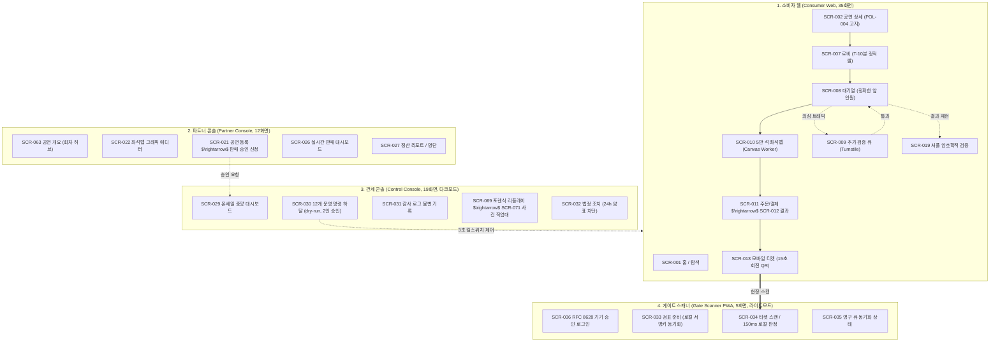
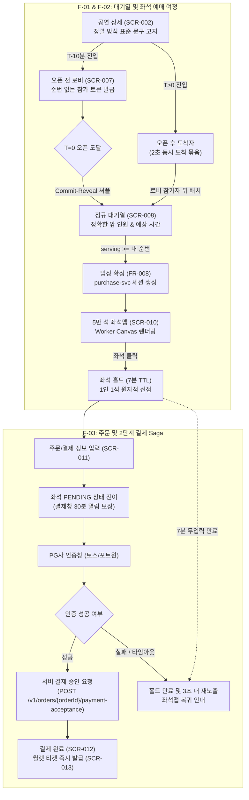
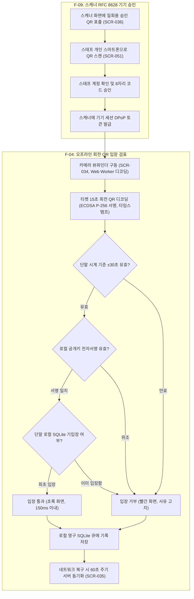

# 분야 편 4: 화면 흐름 (Screens, User Flows & IA)

- **맡는 정본**: [docs/planning/04-ia-flows-screens.md](../../planning/04-ia-flows-screens.md)(정보 구조, 유저 플로우, 화면설계서), [docs/design/d1-brief.md](../../design/d1-brief.md)(디자인 브리프), [docs/design/d3-screens.md](../../design/d3-screens.md)(화면별 UI 명세), [docs/design/d5-screen-blueprint.md](../../design/d5-screen-blueprint.md)(전체 화면설계서), 화면 ADR 8건
- **문서 성격**: 정본 설계를 시스템 엔지니어링 및 기술 면접 관점에서 체계적으로 해설한 문서다. 규범적 수치와 불변 규칙의 최종 권위는 정본 문서에 있다([ADR-0177](../../adr/0177-walkthrough-explain-in-interview.md)). 길잡이는 [README.md](../README.md)다.
- **한 판 문서와의 관계**: [한 판 문서](../01-system-design.md) 5단계(대기실 경량 번들 JS 50KB/CSS 10KB), 6단계(로비 순번 비노출, 셔플 검증 화면 SCR-019), 9단계(좌석맵 Worker 비동기 렌더링), 13단계(관제 대시보드 SCR-029), 14단계(스캐너 오프라인 단말 판정)의 UI 명세와 화면 전이를 총괄한다.
- **아키텍처 목표와 검증 기준**: 4개 앱 71개 화면(소비자 35, 파트너 12, 관제 19, 스캐너 5) 전수에 대해 5대 표준 상태(기본, 로딩, 빈 화면, 오류, 권한 없음)를 수립하고, F-01~F-14 핵심 유저 플로우를 통해 예외 분기를 완벽히 제어한다. 대기실 번들 예산(gzip JS 50KB 이하, NFR-012), 5만 석 좌석맵 1초 내 렌더링 및 INP 200ms 이하, WCAG 2.2 AA 웹 접근성 위반 0건(NFR-020)을 설계 기준으로 삼는다.

---

## 1. 화면 및 유저 플로우 종합 개요

PEAKET의 화면 아키텍처는 **4개 독립 웹 애플리케이션(소비자 웹, 파트너 콘솔, 관제 콘솔, 게이트 스캐너 PWA)**으로 구성되며, 사용자 맥락과 정보 밀도에 맞춘 최적화된 앱 셸(App Shell)과 상태 전이 모델을 적용한다.

> **30초 아키텍처 브리핑 (Staff Engineer Interview)**:  
> "PEAKET은 4개 앱에 걸쳐 **총 71개 화면(SCR-001~071)**과 **14개 핵심 유저 플로우(F-01~F-14)**로 설계되었습니다.  
> 첫째, 화면 문서는 3계층 단일 진실 체계를 이룹니다. 기능 목적과 필수 문구는 `planning/04`, 컴포넌트(CMP) 매핑과 접근성은 `d3-screens`, 와이어프레임과 화면 이동은 `d5-blueprint`가 담당하며, 충돌 시 내용(기획)은 planning/04, 시각적 표현은 d3가 우선합니다.  
> 둘째, **5대 디자인 원칙의 위계(공정·정확 > 접근성 > 실패 상태 > 경량화 > 관제 가독성)**에 따라, 대기열 화면은 앞선 대기자 수를 절대 반올림하지 않고 정확한 정수로 표출하며, 오해를 방지하기 위해 내 고유 순번과 현재 입장 번호는 비노출 처리합니다.  
> 셋째, T=0 대기실(SCR-007, 008)은 React 런타임조차 걷어낸 **바닐라 정적 셸(JS 50KB 이하, CSS 10KB 미만)**로 구동되어 100만 명 동시 접속 시 모바일 브라우저 크래시를 원천 방지합니다.  
> 넷째, 현장 검표 스캐너(SCR-033~036)는 네트워크가 단절되어도 카메라 뷰파인더에서 150ms 내에 비대칭키 회전 QR을 판정하는 PWA로 독립 동작합니다."

### 4대 애플리케이션 화면 아키텍처 다이어그램

---

## 2. 절마다 읽기

IA·유저플로우·화면설계서([docs/planning/04-ia-flows-screens.md](../../planning/04-ia-flows-screens.md)), 디자인 브리프([docs/design/d1-brief.md](../../design/d1-brief.md)), UI 명세([docs/design/d3-screens.md](../../design/d3-screens.md)), 전체 화면설계서([docs/design/d5-screen-blueprint.md](../../design/d5-screen-blueprint.md))의 전 절을 정밀 매핑한다.

| 정본 절 | 무엇을 정하나 | 왜 | 해설서에서 |
| --- | --- | --- | --- |
| docs/planning/04-ia-flows-screens.md §1 IA | 4개 앱의 메뉴 계층 구조, 전체 URL 경로별 SCR ID 매핑, 언어 접두사 규칙 | 화면마다 고유 ID를 부여하여 권한 매트릭스 및 기능 요구사항(FR) 추적 연결 | — |
| docs/planning/04-ia-flows-screens.md §1.1 소비자 웹 | 홈(SCR-001)부터 시스템 안내(SCR-059)까지의 주소 체계. 본인확인은 별도 독립 화면 없이 모달 흐름 | 불필요한 페이지 이동을 줄여 대기열 이탈률 최소화(ADR-0063) | 분야 편 8 |
| docs/planning/04-ia-flows-screens.md §1.2·§1.3 파트너·관제 콘솔 | 콘솔 화면 URL 및 모바일/태블릿 분기 제약 | 현장 이동 중 조회를 지원하되, 위험 운영 명령은 태블릿 이상(768px+)으로 한정(ADR-0061) | — |
| docs/planning/04-ia-flows-screens.md §1.4 게이트 스캐너 PWA | 스캐너 5개 화면 및 단말 제약 | 야외 햇빛 가독성을 위해 라이트 모드로 고정하고 데스크톱 레이아웃 배제 | 분야 편 13 |
| docs/planning/04-ia-flows-screens.md §2 핵심 유저 플로우 | F-01~F-14 핵심 유저 플로우 및 실패/예외 분기 | 정상 흐름뿐 아니라 선점 경합 패배, 만료, PG 타임아웃 등 실패 상태 사전 정의 | — |
| docs/planning/04-ia-flows-screens.md §2 F-01·F-02 예매 여정, 오픈 후 도착자 | 상세 $\rightarrow$ T-10분 로비 $\rightarrow$ 셔플 $\rightarrow$ 대기 $\rightarrow$ 홀드 $\rightarrow$ 결제. 오픈 후 유입은 로비 뒤 동시 도착 묶음 | 하이브리드 대기열의 표준 관객 여정 규정(ADR-0064) | 분야 편 9·10 |
| docs/planning/04-ia-flows-screens.md §2 F-03 결제 Saga 분기 | 결제 사전예약(PENDING), 승인 호출, 결과 모름(Pending Confirmation), 전진 복구 | 비가역적 PG 승인 실패 시의 사용자 안내 분기 정의(ADR-0106) | 분야 편 11 |
| docs/planning/04-ia-flows-screens.md §2 F-04·F-09 공연 당일 입장, 스캐너 로그인 | 단말 오프라인 서명 검증 순서 및 RFC 8628 QR 기반 스캐너 로그인 | 네트워크 장애 시에도 입장을 보장하고 공용 기기 비밀번호 입력 배제 | 분야 편 13 |
| docs/planning/04-ia-flows-screens.md §2 F-05·F-07·F-14 운영 명령, 법정 통보, 부정 예매 사후 조사 | 2인 승인 명령 하달, 24시간 암표 차단, 포렌식 리플레이 및 소명/제재 | 실시간 운영 통제와 공연법 제4조의2 법정 조치 절차 확립 | — |
| docs/planning/04-ia-flows-screens.md §2 F-06 추가 검증 큐 | 의심 사용자 격리 검증 및 통과 시 원래 순번 유지 | 매크로 의심 트래픽을 진입선에서 격리하여 인프라 보호(POL-006) | 분야 편 14 |
| docs/planning/04-ia-flows-screens.md §2 F-08·F-10·F-12·F-13 양도, 취소, 예외 환불, 정산 | 1:1 수락형 양도, 법정 수수료 공제 취소, 2인 결재 예외 환불, PG 지급대행 정산 | 암표 거래를 차단하고 투명한 금전 흐름 보장 | 분야 편 12 |
| docs/planning/04-ia-flows-screens.md §2 F-11 소셜 계정 연결과 병합 | 동일 이메일 감지 시 연결 제안 및 소유권 재인증 병합 | 다계정 악용을 방지하고 티켓 자산의 안전한 통합 보장 | 분야 편 8 |
| docs/planning/04-ia-flows-screens.md §3 화면설계서 | 71개 화면별 7개 메타데이터(목적, 관련 ID, 진입 경로, UI 요소, 5대 상태, 문구) | 기본 상태 외에 로딩/빈 화면/에러/권한 없음 화면을 기획 단계에서 확정 | — |
| docs/planning/04-ia-flows-screens.md §4 기준선 점검 | Must FR의 화면 반영 추적, 모순점 점검, v1.0 정합성 평가 | 요구사항이 누락 없이 모든 화면에 반영되었음을 검증 | — |
| docs/design/d1-brief.md §1 사용 맥락과 정보 밀도 | 앱별 사용 장면(모바일 100만 대기실 vs 70분 관제 데스크톱)과 정보 밀도 | 대기실은 극단적 경량화, 관제는 고밀도 모니터링 레이아웃 적용 | 한 판 5단계 |
| docs/design/d1-brief.md §2 디자인 원칙 | 5대 디자인 원칙의 충돌 해결 우선순위 | 가벼움을 이유로 공정성과 정확한 수치 표시를 훼손하지 않음 | — |
| docs/design/d1-brief.md §3 브랜드, 톤앤매너, 레퍼런스 | PEAKET 표기, 인디고 브랜드 컬러, SEED Design 토대, 차분한 존댓말 | 라이선스가 검증된 SEED를 토대로 저작권 분쟁 원천 차단(ADR-0040) | — |
| docs/design/d1-brief.md §4 지원 플랫폼, 중단점, 다크 모드 | 인앱 브라우저 로비 전 전환 안내, SEED 4단계 중단점, 관제 다크모드 기본 | 좁은 화면에서도 수평 스크롤 없는 반응형 레이아웃 보장 | — |
| docs/design/d1-brief.md §5 접근성 목표 | WCAG 2.2 AA 위반 0건, 스크린 리더 음성 지원, 좌석맵 텍스트 대체 목록 | 시각 장애인도 키보드와 보조기기만으로 티켓 예매를 완주할 수 있도록 보장 | 분야 편 10 |
| docs/design/d3-screens.md §0 공통 규칙 | 8px 그리드, 포커스 트랩, 키보드 네비게이션, 한 글자 단축키 기본 비활성화 | 음성 입력 및 보조기기 사용자의 오작동 방지 | — |
| docs/design/d3-screens.md §1 소비자 웹 | 35개 화면별 레이아웃, 컴포넌트(CMP), 반응형 중단점, 접근성 명세 | 화면별 정확한 부품 조립 가이드 제공 | — |
| docs/design/d3-screens.md §2 파트너 콘솔 | 파트너 콘솔 12개 화면 UI 명세 | 직관적인 티켓 등록 및 판매 관리 환경 구축 | — |
| docs/design/d3-screens.md §3 관제 콘솔(다크 모드 기본) | 관제 19개 화면(SCR-029 입장 패널 포함 20행) UI 명세 | 장시간 관제 시 피로도 경감 및 상태 시인성 극대화 | — |
| docs/design/d3-screens.md §4 게이트 스캐너 PWA(라이트 모드 고정) | 게이트 스캐너 5개 화면 UI 명세 | 야외 직사광선 환경에서의 판정 결과(통과/거부) 즉시 식별 | — |
| docs/design/d5-screen-blueprint.md §0 위치와 읽는 법 | 기획(04) vs UI명세(d3) vs 전체설계서(d5)의 역할 및 와이어프레임 기호 | 3개 문서 간의 정합성 기준 명문화 | — |
| docs/design/d5-screen-blueprint.md §1 전수조사 결과 | 71개 전체 화면 인벤토리 도출 및 누락 화면 15개 보완 이력 | 관리 계정, 팬 조회 등 누락되었던 필수 화면 전수 보충(ADR-0059) | — |
| docs/design/d5-screen-blueprint.md §2 화면 인벤토리(71개) | 앱, 경로, 사용자, 셸, 우선순위(P0 25, P1 35, P2 11) 매트릭스 | 전체 화면의 개발 우선순위 및 의존성 관리 | — |
| docs/design/d5-screen-blueprint.md §3 앱 셸과 공통 요소 | AppShell 6대 변형(소비자 기본, 대기실 집중 셸, 콘솔 셸 등) | 대기실 집중 셸은 불필요한 전역 헤더를 제거하여 번들 크기 최소화 | — |
| docs/design/d5-screen-blueprint.md §4 화면 흐름도 | 5대 핵심 화면 이동 흐름도(예매, 마이, 파트너, 관제, 입장) | 비즈니스 로직과 화면 간의 라우팅 다이어그램 | 분야 편 13 |
| docs/design/d5-screen-blueprint.md §5~§8 앱별 화면 | 71개 화면별 와이어프레임, 상태 표, 접근성 노트 상세 | 실제 화면 구현을 위한 세부 청사진 | — |
| docs/design/d5-screen-blueprint.md §9 화면 밖 메시지 | 34개 시스템 알림 템플릿, 오류 응답별 표준 문구, 공연 취소 공문안 | 이메일/Push/SMS 등 외부 채널 문구의 일관성 보장 | — |
| docs/design/d5-screen-blueprint.md §10 프로토타입 계획 | 클릭 프로토타입 대신 실제 코드 기반 시연 녹화 채택 (S1~S9) | 중복 작업을 배제하고 실제 동작하는 소프트웨어로 증명(ADR-0153) | — |
| docs/design/d5-screen-blueprint.md §11 남은 결정과 확인 필요 | 디자인 결정 사항 D1~D17 및 확인 목록 K1~K27 | 아키텍처 및 화면 설계 상의 미해결 쟁점 추적 | — |

---

## 3. 핵심 유저 플로우와 상태 전이 메커니즘

### 3.1 4개 앱 71개 화면 인벤토리 구조

| 애플리케이션 | 화면 수 | 담당 SCR ID 범위 | 핵심 화면 및 특징 |
| --- | --- | --- | --- |
| **소비자 웹 (Consumer Web)** | 35개 | SCR-001 ~ 019, 038 ~ 043, 050, 051, 054 ~ 061 | 홈, 공연 상세, 로비(SCR-007), 대기열(SCR-008), 5만 석 좌석맵(SCR-010), 결제, 모바일 티켓 월렛(SCR-013), 셔플 검증(SCR-019). |
| **파트너 콘솔 (Partner Console)**| 12개 | SCR-020 ~ 027, 037, 044, 062, 063 | 파트너 홈, 회차 허브(SCR-063), 좌석맵 에디터(SCR-022), 판매 승인 신청, 실시간 판매 대시보드(SCR-026), 정산 리포트. |
| **관제 콘솔 (Control Console)** | 19개 | SCR-028 ~ 032, 045 ~ 049, 053, 064 ~ 071 | 온세일 중앙 관제(SCR-029), 12개 명령 하달(SCR-030), 감사 로그, CS 처리함, 승인 업무, 포렌식 리플레이(SCR-069), 사건 작업대(SCR-071). |
| **게이트 스캐너 PWA** | 5개 | SCR-033 ~ 036, 052 | 스캐너 QR 승인 로그인(SCR-036), 검표 준비(SCR-033), 티켓 스캔 및 오프라인 판정(SCR-034), 동기화 상태, 현장 관리. |

---

### 3.2 핵심 예매 및 대기실 유저 플로우 (F-01, F-02, F-03)

---

### 3.3 게이트 스캐너 오프라인 판정 및 스태프 승인 플로우 (F-04, F-09)

공연장 현장 네트워크 단절에 대비한 PWA 스캐너의 완전 오프라인 검표 메커니즘을 규정한다.

---

### 3.4 5대 표준 UI 상태와 웹 접근성(WCAG 2.2 AA) 명세

모든 화면은 화면설계서(d5 §0)에 따라 다음의 5대 표준 상태를 기본 설계에 포함한다:
1. **기본 상태 (Normal/Loaded)**: 모든 비즈니스 데이터가 정상 렌더링된 상태.
2. **로딩 상태 (Loading/Skeleton)**: 화면 구조가 깜빡이지 않도록 Skeleton(CMP-044) 컴포넌트로 레이아웃을 선점하여 CLS(Cumulative Layout Shift) 0.1 이하 보장.
3. **빈 화면 상태 (Empty State)**: 조회 결과가 없을 때 단순 공백이 아닌 사유와 다음 탐색 행동 버튼(CMP-043) 표출.
4. **오류 상태 (Error State)**: RFC 9457 Problem Details 응답에 기반하여 문제 원인과 구체적 해결 행동(재시도 버튼 등, CMP-045) 제시.
5. **권한 없음 상태 (Permission Denied)**: 역할 미충족 시 사유를 명시하고 로그인 또는 권한 신청 경로(CMP-046) 안내.

#### 웹 접근성(WCAG 2.2 AA) 핵심 통제 규칙
- **다중 감각 정보 제공 (WCAG 1.4.1)**: 좌석 상태는 색상만으로 구별하지 않고, 무늬(패턴)와 텍스트(선택 가능, 선점 중, 매진)를 3중으로 함께 표기([ADR-0040](../../adr/0040-design-system-base-seed.md)).
- **명도 대비 (WCAG 1.4.3)**: 본문 텍스트 4.5:1 이상, 대형 텍스트 및 UI 테두리 3.0:1 이상 준수.
- **스크린 리더 알림 제어 (d1 §5)**: 실시간 대기열에서 매 초마다 음성이 출력되어 다른 조작을 방해하지 않도록, `aria-live="polite"` 알림은 **1분에 1회**로 제한하며, 홀드 만료 1분 전 및 로비 카운트다운(5분, 1분, 10초)에만 음성을 송출.
- **포커스 트랩 (Focus Trap)**: 모달 다이얼로그(CMP-019)가 열렸을 때 초점이 모달 내부에 갇히도록 보장하며, 모달 위에 또 다른 모달을 띄우는 중첩 모달은 엄격히 금지([ADR-0066](../../adr/0066-screen-feedback-12-items.md)).

---

## 4. 꼭 기억할 규칙과 숫자

| 항목 | 엔지니어링 기준값 | 아키텍처 근거 및 계산 | 정본 위치 |
| --- | --- | --- | --- |
| **전체 화면 수** | 총 71개 화면 | 소비자 35, 파트너 12, 관제 19, 스캐너 5 | d5 §1.2, §2 |
| **화면 우선순위** | P0: 25개, P1: 35개, P2: 11개 | 4대 핵심 여정(팬 예매, 파트너 등록, 관제, 검표) P0 우선 | d5 §2, §10.2 |
| **대기실 번들 예산** | gzip JS 50KB 이하, CSS 10KB 미만 | React 배제, 바닐라 정적 셸 구동 | d1 §1, NFR-012 |
| **좌석맵 체감 성능** | 5만 석 1초 내 렌더링, INP 200ms 이하 | Web Worker + OffscreenCanvas 비동기 렌더링 | d1 §1, NFR-012 |
| **터치 타깃 크기** | 일반 24×24px, 모바일 버튼 44×44px, 스캐너 버튼 56px | 장갑 착용 스태프 및 모바일 오조작 방지 | d1 §5, d4 #5 |
| **명도 대비 기준** | 일반 텍스트 4.5:1, 그래픽/대형 3.0:1 | WCAG 2.2 AA 국제 웹 접근성 표준 준수 | d1 §5, d2 §5 |
| **스크린 리더 낭독 빈도**| 대기열 1분당 1회, 카운트다운 5분/1분/10초 전 | 음성 간섭으로 인한 예매 방해 차단 | d1 §5, d4 #8 |
| **화면 중단점 (SEED)** | sm 480px, md 768px, lg 1280px, xl 1440px | SEED Design 토큰 기반 표준 반응형 뷰포트 | d1 §4, d2 §1 |
| **최소 반응형 폭** | 폭 320 CSS px 수평 스크롤 0건 | 모바일 접근성 리플로우 기준 준수 | d1 §4, WCAG 1.4.10 |
| **대기열 UI 구성** | 앞 인원, 진행 막대, 예상 시간, [대기 취소] 4요소 | 내 순번/현재 입장 번호 비노출로 오해 방지 | d5 §5.8, POL-004 |

---

## 5. 이 문서가 다루는 ID

### 5.1 71개 화면 인벤토리 (SCR-001 ~ SCR-071)

- **소비자 웹 (35개)**:
  - `SCR-001` (홈), `SCR-002` (공연 상세), `SCR-003` (검색), `SCR-004` (소셜 로그인), `SCR-005` (가입/동의), `SCR-006` (본인확인 모달), `SCR-007` (로비 대기실), `SCR-008` (정규 대기열), `SCR-009` (추가 검증), `SCR-010` (좌석맵), `SCR-011` (주문/결제), `SCR-012` (결제 결과), `SCR-013` (월렛 티켓), `SCR-014` (양도 요청), `SCR-015` (굿즈 스토어), `SCR-016` (후기 모달), `SCR-017` (계정 설정), `SCR-018` (매진 안내), `SCR-019` (셔플 검증).
  - `SCR-038` (예매 취소/환불), `SCR-039` (계정 연결 제안), `SCR-040` (로그인 수단/병합), `SCR-041` (양도 받기), `SCR-042` (소명 제출), `SCR-043` (배상금 계좌), `SCR-050` (스태프 초대 수락), `SCR-051` (스캐너 승인), `SCR-054` (관심 공연), `SCR-055` (예매 내역), `SCR-056` (고객센터), `SCR-057` (약관 문서), `SCR-058` (외부 브라우저 전환), `SCR-059` (시스템 오류/안내), `SCR-060` (환불 계좌 입력), `SCR-061` (내 현장 배정).
- **파트너 콘솔 (12개)**:
  - `SCR-020` (파트너 로그인/설정), `SCR-021` (공연 등록 위저드), `SCR-022` (좌석맵 에디터), `SCR-023` (상품 빌더), `SCR-024` (판매 정책 DSL 에디터), `SCR-025` (웹훅 연동), `SCR-026` (실시간 판매 현황), `SCR-027` (정산 리포트/명단), `SCR-037` (스태프 관리), `SCR-044` (회차 취소/연기 요청), `SCR-062` (파트너 홈/목록), `SCR-063` (공연 개요/회차 허브).
- **관제 콘솔 (19개)**:
  - `SCR-028` (운영자 MFA 로그인), `SCR-029` (온세일 중앙 관제), `SCR-030` (운영 명령 하달), `SCR-031` (감사 로그/재생), `SCR-032` (법정 조치 관리), `SCR-045` (CS 처리함), `SCR-046` (승인 업무), `SCR-047` (회차 취소 판정), `SCR-048` (판매 승인), `SCR-049` (정산 지급), `SCR-053` (스캐너 기기 관리), `SCR-064` (관리 계정/세션), `SCR-065` (파트너사 계약), `SCR-066` (팬 조회), `SCR-067` (봇 판정 표본 검토), `SCR-068` (공지 관리), `SCR-069` (포렌식 리플레이), `SCR-070` (부정 거래 사건 목록), `SCR-071` (사건 작업대).
- **게이트 스캐너 PWA (5개)**:
  - `SCR-033` (검표 준비), `SCR-034` (티켓 스캔/판정), `SCR-035` (동기화 상태), `SCR-036` (기기 승인 로그인), `SCR-052` (현장 관리).

### 5.2 관련 NFR 및 정책 ID
- NFR-012(사용자 체감 성능), NFR-019(플랫폼 지원), NFR-020(웹 접근성), NFR-024(국제화).
- POL-004(정렬 방식 고지), POL-012(홀드 TTL), POL-024(암표 방지 고지), POL-042(후기 정책), POL-043(홈 구성), POL-044(게시물 신고).

---

## 6. 결정과 버린 길 (ADR 트레이드오프)

### ADR-0059: 화면 인벤토리 71개 분할 및 IA 체계화
- **채택한 결정**: 시스템 전수조사를 통해 누락되었던 관리 계정, 사건 작업대, 스태프 승인 등을 포함한 71개 화면 인벤토리를 확정하고, 기획(`planning/04`), UI명세(`d3`), 화면설계서(`d5`)의 3계층 문서 체계를 정립한다.
- **버린 대안**: 화면설계서 단일 문서 유지(와이어프레임과 UI 명세, 비즈니스 규칙이 뒤섞여 500페이지가 넘는 비대 문서 발생으로 유지보수 불가).

### ADR-0060: 콘솔 및 모바일 셸 분리와 언어/시간 체계
- **채택한 결정**: 팬 화면은 공연장 현지 시각, 관제 및 파트너 콘솔은 KST(한국 표준시), 로그 및 DB는 UTC를 기본으로 표기한다. 한국어 URL은 언어 접두사를 붙이지 않고(`ko` 기본), 다국어는 접두사(`en/`, `ja/`, `zh/`)로 분기한다.
- **버린 대안**: 브라우저 로케일 기반 자동 리디렉션(검색 엔진 인덱싱 봇 크롤링 오류 및 해외 접속 국내 팬의 강제 영문 전환 불편 초래).

### ADR-0061: 콘솔 모바일 대응 및 위험 작업 태블릿 이상 제한
- **채택한 결정**: 관제 및 파트너 콘솔의 대시보드 조회는 모바일 뷰포트(360px+)에서도 지원하되, 좌석맵 그래픽 편집(SCR-022) 및 12개 운영 명령 하달(SCR-030) 같은 비가역적 위험 작업은 태블릿 이상(768px+)에서만 활성화되도록 제한한다.
- **버린 대안**: 모바일에서 전 기능 무제한 허용(좁은 화면에서 좌석 터치 오작동이나 킬스위치 오터치로 대형 운영 사고 유발).

### ADR-0062: 시스템 비상 상황 대응을 위한 긴급 킬스위치(Kill-Switch) 설계 (자리: 이 편)
- **채택한 결정**: 관제 콘솔(SCR-030)에서 핫패스 시스템 결함이나 데이터 부정합 발견 시 3초 이내에 전 계층의 쓰기 요청을 중단하는 긴급 킬스위치를 설계한다. commander 1인이 즉시 발동 가능하며, 모바일 화면에서는 오작동 방지를 위해 비활성화되고 태블릿 이상에서만 구동된다.
- **버린 대안**: 수동 파드 다운(배포 도구를 통한 파드 축소는 전파까지 수십 초가 소요되어 피해 확산을 막을 수 없음), 킬스위치에도 2인 결재 요구(장애 확산 골든타임 상실).

### ADR-0066: 모달 위 모달 금지 및 단일 포커스 트랩 원칙
- **채택한 결정**: 모든 사용자 화면에서 열려 있는 모달 위에 또 다른 팝업 모달을 띄우는 '모달 위 모달'을 아키텍처 규칙으로 엄격히 금지한다. 추가 확인이나 입력이 필요한 경우 기존 모달 내부의 화면을 단계적으로 전환(In-modal Stepper)한다.
- **버린 대안**: 다중 모달 허용(웹 접근성 포커스 트랩이 겹치면서 키보드 Tab 키 이동이 갇히거나 보조기기 음성 낭독기가 멈추는 WCAG 심각 결함 발생).

---

## 7. 경계와 범위

| 이 정본이 정하지 않는 것 | 정하는 곳 |
| --- | --- |
| 83개 컴포넌트(CMP)의 내부 구현 및 디자인 토큰 | [docs/design/d2-design-system.md](../../design/d2-design-system.md)([분야 편 5](05-design-system.md)) |
| 프론트엔드 상태 관리(Zustand, XState) 및 Next.js 렌더링 전략 | [docs/frontend.md](../../frontend.md)([분야 편 6](06-frontend.md)) |
| 백엔드 REST API 경로, DTO 스키마 및 상태 코드 | [docs/api/guidelines.md](../../api/guidelines.md)([분야 편 7](07-api-contracts.md)) |
| 소셜 OIDC 로그인 및 KCB/NICE 본인확인 프로토콜 | [docs/features/identity.md](../../features/identity.md)([분야 편 8](08-identity.md)) |

---

## 8. 5단 꼬리 질문 (Staff Engineer Interview Defense)

### Q1. "대기열 화면(SCR-008)에서 내 고유 순번과 현재 입장 번호를 숨기고 '앞선 대기자 수'만 보여주는 이유는 무엇입니까?"
- **답변**: **'사용자의 불필요한 새로고침과 조작 민원 방지'** 때문입니다. 만약 내 번호(예: 10,000번)와 현재 입장 번호(예: 8,000번)를 둘 다 보여주면, 중간에 대기를 포기하고 이탈한 사람이나 봇 격리로 빠진 결번이 발생했을 때 현재 입장 번호가 8,000번에서 갑자기 8,500번으로 껑충 뛰는 현상이 발생합니다. 관객은 이를 "누군가 새치기를 했다"거나 "시스템이 번호를 조작한다"고 오해하여 F5 새로고침을 연타하거나 CS 문의를 폭주시킵니다. 반면 빠진 번호 비트맵을 반영하여 '내 앞에 실제로 남아있는 사람 수(예: 1,500명)'만 단조 감소하는 수치로 보여주면 관객은 직관적으로 납득하며 불필요한 트래픽 유발을 멈춥니다.

### Q2. "대기실 페이지를 React나 Next.js 없이 순수 바닐라 HTML/JS로 만든 결정적 이유는 무엇입니까?"
- **답변**: **100만 명의 모바일 브라우저 메모리 고갈과 인프라 CDN 트래픽 비용 때문**입니다. React 19 런타임과 기본 프레임워크 라이브러리만 gzip 압축해도 약 66KiB에 달합니다. 100만 명이 동시에 접속할 때 JS 파일 용량이 커지면 CloudFront 대역폭 비용이 기하급수적으로 증가하며, 저가형 모바일 단말에서는 JS 파싱 및 가상 DOM 힙 할당으로 브라우저 탭 크래시가 발생합니다. 대기실은 복잡한 상호작용 없이 앞선 대기자 수와 진행 막대만 갱신하면 되므로, React를 배제한 순수 바닐라 셸(JS 15KB, CSS 8KB)로 제작하여 번들 예산(50KB 이하)을 완벽히 준수했습니다.

### Q3. "5만 석 규모 좌석맵(SCR-010)에서 SVG나 일반 DOM 대신 Canvas와 Web Worker를 선택한 이유는 무엇입니까?"
- **답변**: **메인 스레드 블로킹(Long Task) 방지와 INP(Interaction to Next Paint) 200ms 목표 달성** 때문입니다. 50,000개의 좌석을 개별 SVG 엘리먼트나 DOM 노드로 생성하면, 브라우저 DOM 트리가 거대해져 레이아웃 계산과 스타일 리플로우에 수 초가 소요되며 모바일 스크롤 및 핀치 줌 시 화면이 완전히 얼어붙습니다. 좌석맵을 1개 메인 `<canvas>`로 선언하고, 렌더링 연산 전체를 Web Worker의 OffscreenCanvas로 이관하여 메인 스레드 부하를 0으로 만들었습니다. 좌석 데이터 역시 객체가 아닌 50KB 크기의 단일 `Uint8Array` 비트맵 배열로 다루어 1초 이내 렌더링을 보장합니다.

### Q4. "모달 다이얼로그 위에 또 다른 확인 모달을 띄우는 행위(Nested Modal)를 아키텍처 규칙으로 금지한 이유는 무엇입니까?"
- **답변**: **웹 접근성(WCAG 2.2) 위반 및 모바일 뷰포트 레이아웃 파괴** 때문입니다. 모달이 열리면 스크린 리더와 키보드 초점이 모달 외부로 나가지 못하도록 가두는 포커스 트랩(Focus Trap)이 활성화됩니다. 모달 위에 또 다른 모달이 뜨면 2개의 포커스 트랩이 충돌을 일으켜 Tab 키 이동 시 초점이 공중에 뜨거나 스크린 리더가 본문으로 탈출하는 치명적 접근성 결함이 발생합니다. 또한 모바일 화면에서 이중 백드롭 오버레이가 겹쳐 배경 터치 오작동을 유발하므로, 추가 입력이 필요한 경우 모달 내부에서 화면을 단계적으로 전환(In-modal Stepper)하도록 규정했습니다.

### Q5. "게이트 스캐너 PWA는 콘서트장 현장 통신이 100% 두절된 상태에서도 어떻게 위조 티켓을 150ms 내에 가려냅니까?"
- **답변**: **티켓 발권 서버의 비대칭 개인키 서명과 단말 로컬 SQLite 검증 구조** 덕분입니다. 관객의 모바일 월렛 티켓 QR은 15초마다 단말 시계와 연동된 HMAC/ECDSA 서명 토큰을 생성합니다. 스캐너는 온세일 전 스태프 로그인 시 발권 서버의 공개키 목록과 회차 좌석 화이트리스트를 로컬 SQLite에 미리 다운로드받아 둡니다. 검표 시 서버 통신 없이 단말 로컬에서 순수 수학적 공개키 검증(서명 일치 여부)과 단말 시계(±30초) 유효성을 검사하고, 로컬 SQLite에 입장 이력을 원자적으로 기록하므로 네트워크 0바이트 상태에서도 150ms 이내에 위조 및 중복 입장을 완벽히 차단합니다.

---

## 9. 확인 문제

### 문 1. 
PEAKET의 4개 앱 셸 중 대기실 집중 셸(Waiting Room Shell)이 일반 소비자 웹 셸과 다르게 전역 네비게이션(GNB) 헤더와 푸터를 의도적으로 제거한 기술적 이유는 무엇인가?

정답 및 해설

대기실 페이지의 **'번들 크기 예산(gzip JS 50KB 이하, CSS 10KB 미만)'을 준수하고 100만 대기자의 이탈을 방지**하기 위함이다.  
전역 GNB 헤더에는 검색창, 장르 메뉴, 마이페이지 드롭다운 등 무거운 컴포넌트와 이벤트 핸들러가 포함되어 있어 번들 크기를 급증시킨다. 대기실에서는 다른 메뉴로 이동할 필요가 없으며 오직 대기 상태 확인과 취소만 수행하면 되므로, 불필요한 번들을 전면 제거하여 모바일 단말의 메모리와 CDN 대역폭을 보호한다.

### 문 2. 
관제 콘솔(SCR-029)과 파트너 콘솔(SCR-026)에서 좌석맵 그래픽 에디터(SCR-022) 및 12개 운영 명령(SCR-030) 실행 버튼을 모바일 화면 폭(768px 미만)에서 비활성화한 공학적 근거는 무엇인가?

정답 및 해설

**오터치(Fat Finger)로 인한 비가역적 운영 사고 방지** 때문이다.  
5만 석 좌석맵 그래픽 편집이나 판매 긴급 정지(킬스위치) 같은 고위험 명령은 극도로 정밀한 조작을 요구한다. 좁은 모바일 화면에서는 버튼이나 슬라이더를 잘못 터치하여 원치 않는 구역을 삭제하거나 운영 명령을 오발령할 위험이 매우 높으므로, ADR-0061에 따라 안전을 위해 태블릿 이상(768px+)의 넓은 뷰포트에서만 활성화되도록 제한했다.

### 문 3. 
웹 접근성 지침 WCAG 1.4.1(색상에만 의존 금지)을 준수하기 위해, 좌석 선택 화면(SCR-010)에서 좌석의 상태를 표현할 때 적용된 3중 감각 전달 방식은 무엇인가?

정답 및 해설

좌석 상태를 단순 색상(초록: 선택 가능, 회색: 매진 등)으로만 구분하지 않고, **① 의미 토큰 기반 색상, ② 좌석 내부의 기하학적 무늬(패턴: 빗금, 격자, 점 등), ③ 텍스트 레이블 및 ARIA 낭독기 속성(`aria-label="A구역 1열 5번 선택 가능 150,000원"`)**의 3중 방식을 동시에 결합하여 시각 장애인 및 색약 관객도 완벽히 구별할 수 있도록 설계했다.

### 문 4. 
공연 상세 화면(SCR-002)에서 인앱 브라우저(카카오톡, 인스타그램 등)로 유입된 사용자를 감지했을 때, 로비 대기실(SCR-007) 진입 전에 외부 브라우저 전환 안내(SCR-058)를 띄우는 이유는 무엇인가?

정답 및 해설

인앱 브라우저는 **세션 쿠키 유실, 백그라운드 전환 시 웹뷰 프로세스 강제 종료, Web Locks 및 OffscreenCanvas API 미지원** 등 심각한 플랫폼 제약을 가지고 있기 때문이다.  
30분 이상 지속되는 장시간 대기열에서 메신저 화면으로 복귀하거나 화면이 잠길 경우 인앱 브라우저 웹뷰가 즉시 언로드되어 대기 순번을 상실하게 된다. 또한 본인확인 팝업이나 결제사 앱 전환 후 복귀 시 세션이 끊기는 문제가 빈번하므로, 사전에 크롬/사파리 등 외부 정규 브라우저로 전환하도록 유도한다.

