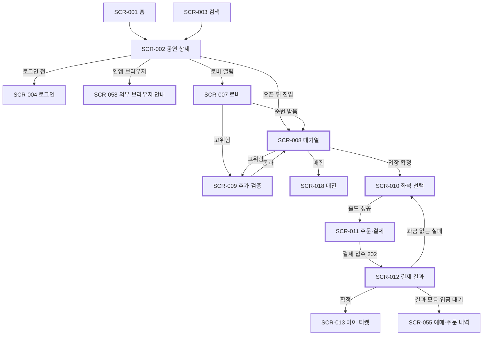

# 분야 편 4: 화면 흐름

- **기준 시점**: ADR-0177까지, 2026-11-01
- **맡는 정본**: [docs/planning/04-ia-flows-screens.md](../../planning/04-ia-flows-screens.md)(정보 구조, 유저 플로우, 화면설계서), [docs/design/d1-brief.md](../../design/d1-brief.md)(디자인 브리프), [docs/design/d3-screens.md](../../design/d3-screens.md)(화면별 UI 명세), [docs/design/d5-screen-blueprint.md](../../design/d5-screen-blueprint.md)(전체 화면설계서). 화면 ADR(결정과 그 이유를 남긴 기록) 여섯은 §5에 모았다.
- **규범이 아니다**: 정본을 풀어 쓴 해설이다. 숫자와 규칙이 정본과 다르면 정본이 맞다([ADR-0177](../../adr/0177-walkthrough-explain-in-interview.md)). 길잡이는 [README.md](../README.md)다.
- **한 판 문서와의 관계**: [한 판 문서](../01-system-design.md)에는 화면 흐름을 직접 다루는 단계가 없다. 5단계(대기실 페이지를 가볍게 만든다), 6단계(로비(오픈 전 대기실) 화면에 순번 숫자를 보이지 않는다, 셔플(순번을 무작위로 섞기) 검증 화면 SCR-019), 9단계(좌석맵을 화면 밖 스레드에서 그린다)가 화면 동작을 짧게 든다.
- **측정 전이다**: 서비스 수준 측정(NFR 목표를 운영 규모로 잰 것)은 아직 없고, 화면 성능(번들·좌석맵·낭독기 완주)을 잰 기록도 없어 화면 성능 숫자는 설계 목표값이고 `[실측 전]`을 붙였다. 기반 PoC(wbs 0.5.1, 본 개발 전에 위험한 부분만 먼저 재 보는 시험)는 2026-11-01에 PC 한 대에서 서버 쪽만 쟀다([ADR-0176](../../adr/0176-foundation-poc-results.md), 성능 장부 docs/perf-ledger.md §5). 그 숫자는 '실측(PC)'이고 운영 규모 증거가 아니다. 정본의 `[가정]`은 그대로 옮겼다.

## 1. 이 문서가 정하는 것

네 문서는 PEAKET 화면 71개(소비자 웹 35, 파트너 콘솔 12, 관제 콘솔 19, 게이트 스캐너 5)를 무엇을, 어떻게, 어디에 그릴지 정한다. 일은 셋으로 나눈다(ADR-0059 결정 1). docs/planning/04는 정보 구조(IA: 메뉴와 주소를 나무 모양으로 늘어놓은 것), 유저 플로우 F-01~F-14(업무 규칙의 예외 갈래를 그린 흐름도), 화면마다의 목적·요소·상태·문구를 정한다. 화면에는 SCR-NNN이라는 ID를 붙인다. docs/design/d3는 그 화면을 어떤 컴포넌트(CMP-NNN: 버튼·대화상자 같은 공용 화면 부품)와 상태 표현, 접근성 규칙으로 그릴지 정한다. docs/design/d5는 배치도(와이어프레임: 색과 그림 없이 자리만 그린 설계도), 앱마다 화면을 감싸는 틀(셸: 머리·메뉴·바닥글처럼 되풀이되는 부분), 화면 사이 이동, 알림·오류 문구, 시연 계획을 묶는다. docs/design/d1은 그 밑바탕인 사용 맥락, 디자인 원칙 다섯, 브랜드, 지원 크기와 중단점(배치가 바뀌는 화면 폭), 접근성 목표(WCAG 2.2 AA: 웹 접근성 국제 기준의 AA 등급)를 정한다. 문서끼리 어긋나면 내용(요소·문구)은 planning/04, 표현(컴포넌트·상태·접근성)은 d3를 따르고 d5를 고친다.

> **30초 설명**: "화면은 71개이고 앱 넷에 나뉩니다. 화면 문서는 셋으로 나눴습니다. 기획 문서는 화면이 왜 있고 무엇을 보이며 어떤 문구를 쓰는지, UI 명세는 어떤 부품과 상태 표현·접근성으로 그리는지, 전체 화면설계서는 어디에 놓고 어디서 와서 어디로 가는지를 맡습니다. 어긋나면 내용은 기획 문서가, 표현은 UI 명세가 이깁니다. 디자인 원칙은 다섯인데 부딪치면 공정함과 정확한 숫자가 먼저이고, 그다음이 접근성, 실패 상태 설계, 가벼움 순입니다. 그래서 대기열 화면은 앞 인원을 반올림하지 않고, 오해를 부르는 내 번호와 현재 입장 번호는 보이지 않습니다. 콘솔은 휴대폰에서도 열리지만 위험한 일은 태블릿 이상에서만 합니다. 이것은 화면 장치이고, 권한은 서버가 막습니다."

## 2. 절마다 읽기

d1에는 `### ` 제목이 없다. planning/04의 유저 플로우는 비슷한 것끼리 묶었고, d5 §5~§8은 화면 하나에 절 하나라 한 행으로 줄였다.

| 정본 절 | 무엇을 정하나 | 왜 | 해설서에서 |
| --- | --- | --- | --- |
| docs/planning/04-ia-flows-screens.md §1 IA | 앱 넷의 메뉴 나무, 주소마다 SCR ID, 전역 머리, 언어 주소 접두 | 경로·권한이 따로 있는 화면은 ID가 있어야 권한 매트릭스·요구사항 추적과 이어진다(ADR-0059) | — |
| docs/planning/04-ia-flows-screens.md §1.1 소비자 웹 | 홈부터 시스템 안내까지 주소. 본인확인은 따로 된 화면 없이 기관 창과 결과 대화상자로 한다 | 기관 창이 열리므로 중간 화면은 단계만 늘린다(ADR-0063 결정 5와 검토한 대안) | 분야 편 8(본인확인만) |
| docs/planning/04-ia-flows-screens.md §1.2·§1.3 파트너·관제 콘솔 | 콘솔 화면과 주소, 휴대폰에서 하는 일의 범위 | 현장의 파트너와 자리를 비운 승인자는 휴대폰을 쓴다. 좌석맵 편집·위험 명령은 작은 화면에서 잘못 누르기 쉽다(ADR-0061) | — |
| docs/planning/04-ia-flows-screens.md §1.4 게이트 스캐너 PWA | 스캐너 화면 다섯. PWA는 설치형 앱처럼 쓰는 웹 앱이다 | 카메라를 든 검표 단말이라 데스크톱 배치가 없다 | 분야 편 13 |
| docs/planning/04-ia-flows-screens.md §2 핵심 유저 플로우 | F-01~F-14. 경합 패배·만료·결과 모름·장애 같은 예외 갈래 | 실패를 정상 업무 흐름으로 미리 정한다(d1 원칙 3). 화면 이동만은 d5 §4에 있다 | — |
| docs/planning/04-ia-flows-screens.md §2 F-01·F-02 예매 여정, 오픈 후 도착자 | 상세 → T-10분(오픈 10분 전) 로비 → 셔플 → 대기 → 입장 확정 → 홀드(결제 동안 좌석을 잡아 두기) → 결제. 오픈 뒤 도착자는 로비 참가자 뒤에 도착 순 | 하이브리드 공연의 표준 여정이다. 판매 종료(공연 시작 24시간 전) 뒤에는 진입이 없다(ADR-0064) | 분야 편 9·10 |
| docs/planning/04-ia-flows-screens.md §2 F-03 결제 Saga 분기 | 승인 전 좌석 예약(PENDING), 승인, 결과 모름, 승인 뒤 발권 다시 시도. Saga는 단계별로 하고 실패하면 앞 단계를 되돌리는 방식이다 | 승인은 되돌리기 어려워 승인 뒤 발권 실패는 앞으로 다시 한다(ADR-0106) | 분야 편 11 |
| docs/planning/04-ia-flows-screens.md §2 F-04·F-09 공연 당일 입장, 스캐너 로그인 | 기기 안 서명·검증과 판정 순서, 스태프 휴대폰으로 스캐너 QR을 승인하는 로그인(RFC 8628: 다른 기기로 로그인을 승인하는 표준 방식) | 인터넷이 끊겨도 입장이 이어진다. 공용 기기라 비밀번호를 넣지 않는다 | 분야 편 13 |
| docs/planning/04-ia-flows-screens.md §2 F-05·F-07·F-14 운영 명령, 법정 통보, 부정 예매 사후 조사 | 2인 승인(두 사람이 각각 승인) 운영 명령, 통보 뒤 24시간 안 법정 조치, 판매 뒤 후보 묶음과 사람의 조치 | 서비스를 멈추지 않고 대응한다. F-07은 공연법 제4조의2, F-14는 사람이 소명(당사자가 사정을 설명하는 일)·승인으로 정한다(ADR-0171) | — |
| docs/planning/04-ia-flows-screens.md §2 F-06 추가 검증 큐 | 고위험 트래픽을 일반 대기열과 떼어 더 깊이 본다 | 매크로(자동으로 예매하는 프로그램) 의심을 격리한다 | 분야 편 14 |
| docs/planning/04-ia-flows-screens.md §2 F-08·F-10·F-12·F-13 양도, 취소, 예외 환불, 정산 | 수락형 양도, 분쟁해결기준 공제, 정책 밖 환불의 다른 승인자, 결제사 지급대행 | 암표는 막고 실수요 양도는 돕는다. PEAKET은 판매 대금을 받아 두지 않는다 | 분야 편 12 |
| docs/planning/04-ia-flows-screens.md §2 F-11 소셜 계정 연결과 병합 | 같은 이메일 계정의 연결 제안과 병합 | 티켓이 흩어지는 것과 계정 탈취를 막는다 | 분야 편 8 |
| docs/planning/04-ia-flows-screens.md §3 화면설계서 | 화면마다 7열(ID, 목적, 관련 ID, 진입 경로, 구성 요소 ①②③, 상태, 문구 초안)과 5대 표준 상태. §3.1~§3.4는 앱별 표다 | 기본 상태만이 아니라 로딩·빈 화면·에러·권한 없음을 미리 정한다(d1 원칙 3) | — |
| docs/planning/04-ia-flows-screens.md §4 기준선 점검 | Must FR이 화면에 이어지는지, 상태·권한·화면이 모순 없는지. 기획 v1.0 판정 | 판정 근거를 남긴다. 2026-10-19(ADR-0066)까지만 사람이 대조했다 | — |
| docs/design/d1-brief.md §1 사용 맥락과 정보 밀도 | 화면마다 쓰는 장면과 정보 밀도 | 100만 명이 휴대폰으로 30분 넘게 기다리는 화면과 운영자가 70분 지켜보는 화면은 요구가 다르다 | 한 판 5단계(대기실 경량만) |
| docs/design/d1-brief.md §2 디자인 원칙 | 원칙 다섯과 충돌 때 순서 | 가볍게 하려고 정확성을 깎지 않는다 | — |
| docs/design/d1-brief.md §3 브랜드, 톤앤매너, 레퍼런스 | 'PEAKET(피켓)' 표기, 인디고 한 색, SEED Design(당근이 공개한 오픈소스 디자인 시스템) 토대, '~합니다'체, 도용 금지와 NOL(인터파크·야놀자 예매) 홈 구조 예외, 다크 패턴(속이는 화면 설계) 금지 | SEED는 라이선스가 분명하고 라이트·다크 토큰(색·간격 같은 디자인 값에 붙인 이름)을 갖췄다(ADR-0040). NOL 구조는 약관 위험을 알린 뒤 소유자가 골랐다 | — |
| docs/design/d1-brief.md §4 지원 플랫폼, 중단점, 다크 모드 | 인앱 브라우저(메신저 앱 안의 브라우저)는 상세까지, SEED 중단점, 재배치 하한, 테마, 언어 넷, 콘텐츠 폭 | 피켓 값을 따로 두면 Tailwind(유틸리티 CSS 도구)와 SEED 부품이 360~479px·1024~1279px에서 다르게 바뀐다(기술 검토 중간-096) | — |
| docs/design/d1-brief.md §5 접근성 목표 | WCAG 2.2 AA 0건, 좌석맵 대안 목록, 낭독 횟수, 시간 제한, 색과 무늬, 터치 크기 | 캔버스(픽셀로 그리는 화면 요소) 그림은 화면 낭독기(글자를 소리로 읽는 프로그램)가 읽지 못한다. 카운트다운을 30초마다 읽으면 로비에서 약 20번 끼어든다 | 분야 편 10(좌석맵 대안·시간 제한만) |
| docs/design/d3-screens.md §0 공통 규칙 | 그리드(열 격자), 포커스 순서, 키보드, 한 글자 단축키 기본 꺼짐, 모션 토큰, '시안' 열(d5의 해당 절을 가리키는 칸) | 음성 입력 사용자의 잘못 누름을 막는다 | — |
| docs/design/d3-screens.md §1 소비자 웹 | 35행 × 8열(레이아웃, 컴포넌트·변형, 상태별 표현, 중단점별 차이, 모션, 접근성, 시안) | 찾아보기다 | — |
| docs/design/d3-screens.md §2 파트너 콘솔 | 12행 | 찾아보기다 | — |
| docs/design/d3-screens.md §3 관제 콘솔(다크 모드 기본) | 19화면 20행(SCR-029 입장 탭이 한 행 더) | 찾아보기다 | — |
| docs/design/d3-screens.md §4 게이트 스캐너 PWA(라이트 모드 고정) | 5행 | 야외 햇빛 아래에서 읽혀야 한다(d1 §4) | — |
| docs/design/d5-screen-blueprint.md §0 위치와 읽는 법 | 세 문서의 역할, 어긋날 때 따를 쪽, 와이어프레임 기호, 그린 크기 | d3 표 한 칸에는 배치도를 넣을 수 없었다(ADR-0059 대안) | — |
| docs/design/d5-screen-blueprint.md §1 전수조사 결과 | 2026-10-13 조사와 그 뒤 더한 것: 새 화면 15개, 문서 불일치 52건, API 보완 39건(2026-10-31까지), 컴포넌트 변경 | 기능은 있는데 화면이 없는 곳(관리 계정, 팬 조회, 고객센터 등)을 찾았다 | — |
| docs/design/d5-screen-blueprint.md §2 화면 인벤토리(71개) | 화면마다 앱·경로·쓰는 사람·셸·우선순위·절 | 화면을 찾는 색인이다 | — |
| docs/design/d5-screen-blueprint.md §3 앱 셸과 공통 요소 | AppShell 변형 여섯, 관제 메뉴 권한 표, 공통 대화상자, 세션 종료 문구, 가림, 보안 요구의 화면 영향 | 집중 셸은 전역 메뉴를 빼 대기실 번들(브라우저가 내려받는 코드 묶음) 예산을 지킨다(ADR-0059 결정 3) | — |
| docs/design/d5-screen-blueprint.md §4 화면 흐름도 | 화면 이동 흐름도 다섯(예매, 마이·계정, 파트너, 관제, 공연 당일 입장) | planning/04 §2는 업무 갈래, 여기는 이동을 그린다 | 분야 편 13(스태프 로그인만) |
| docs/design/d5-screen-blueprint.md §5~§8 앱별 화면 | 화면 71절. 절마다 첫 표, 와이어프레임, 상태 표를 두고, 근거와 시연 흉내 방법은 붙은 절에만 있다 | 찾아보기다 | — |
| docs/design/d5-screen-blueprint.md §9 화면 밖 메시지 | 알림 34묶음, 오류 응답별 문구, 회차 취소·연기 문안 | 알림도 사용자가 보는 화면이다 | — |
| docs/design/d5-screen-blueprint.md §10 프로토타입 계획 | 지운 P0 프로토타입(클릭해 보며 설계를 검토하던 시험용 화면 앱) 기록, P0·P1·P2(먼저 만들 순서) 범위, 목업(화면을 그리려고 지은 데이터), 시연 시나리오 S1~S9 | 클릭 시연은 만들지 않는다. 실제 앱 녹화가 더 강한 증거이고 같은 일을 두 번 한다(ADR-0153) | — |
| docs/design/d5-screen-blueprint.md §11 남은 결정과 확인 필요 | 소유자 결정 D1~D17, 확인 목록 K1~K27 | 문서만으로 정할 수 없는 것을 모아 물었다(질문 26) | — |

## 3. 꼭 기억할 규칙과 숫자

| 항목 | 값 | 표시 | 정본 위치 |
| --- | --- | --- | --- |
| 화면 수 | 71개(소비자 35, 파트너 12, 관제 19, 스캐너 5). 53개에 15개(ADR-0059), SCR-069(ADR-0080), SCR-070·071(ADR-0171)을 더했다 | 확정 | d5 §1.2·§2 |
| 우선순위 | P0 25, P1 35, P2 11. P0는 네 시연 흐름(팬 예매, 등록과 판매 승인, T=0 관제, 당일 입장)의 화면 | 확정 | d5 §2·§10.2 |
| 원칙 순서 | 1 공정·정확 > 4 접근성 > 3 실패 상태 > 2 경량 > 5 관제 가독성 > 심미성 | 확정 | d1 §2 |
| 중단점 | `sm` 480, `md` 768, `lg` 1280, `xl` 1440(SEED 값). 휴대폰 768 미만, 태블릿 768~1279, 데스크톱 1280부터. 360은 시안 폭이지 중단점이 아니다 | 확정 | d1 §4 |
| 재배치 하한 | 폭 320 CSS px에서 두 방향 스크롤이 없고, 글자 200%·간격 조정에서 잘리지 않는다(표·좌석맵·에디터·그래프는 예외) | 확정 | d1 §4·§5 |
| 대기실 번들 | gzip(압축) 기준 JS 50KB 이하, CSS 10KB 미만 | 목표, `[실측 전]` | d1 §1 |
| 좌석맵 | 5만 석 1초 안에 그리기, INP(조작에 화면이 반응하기까지 걸린 시간) 200ms 이하, 50ms 넘는 긴 작업 0건 | 목표, `[실측 전]` | d1 §1, NFR-012 |
| 터치 크기 | 최소 24×24px, 모바일 주요 버튼 44×44px, 스캐너 주요 버튼 높이 56px·사이 16px | 56·16은 `[가정]` | d1 §5 |
| 명도 대비 | 본문 4.5:1, 큰 글자 3:1, 핵심 그래픽 3:1 | 확정 | d1 §5 |
| 낭독 횟수 | 대기열은 1분에 한 번, 홀드는 만료 1분 전 한 번, 로비 카운트다운은 남은 5분·1분·10초 | 확정 | d1 §5 |
| 시간 제한 경고 | 관리 계정 유휴 1시간의 만료 2분 전 [계속 사용], 좌석 선택 중 무활동 4분에 [계속하기] | 2분·4분 `[가정]` | ADR-0060 결정 7 |
| 홀드와 WCAG 2.2.1 | 홀드 7분 + 1회 3분 연장, 최대 체류 45분은 시간 제한 기준의 필수 예외로 본다 | 확정(판단) | d1 §5, POL-012, docs/features/seat-hold.md §5 |
| 대기열 기본 화면 | 앞 인원, 진행 막대, 예상 시간, [대기 취소] 넷 + [차례 알림 받기]·'순번 안내 ›' | 확정 | d5 §5.8 |
| 진행 막대 | (처음 앞 인원 − 지금 앞 인원) ÷ 처음 앞 인원, 0~100%, 처음이 0이면 100% | 확정 | d5 §5.8 |
| 좌석이 나타나는 배율 | 구역이 화면 폭 1/3 이상이면 좌석이 보이고 그 구역만 구독한다 | `[가정]` | ADR-0063 결정 8 |
| 후기 | 별점 1~5, 본문 10~1,000자, 사진 3장, 신고 사유 8종·자세한 내용 500자 | 글자·장 수 `[가정]` | d5 §5.16 |
| 언어와 시각 | ko·en·ja·zh. 한국어는 접두를 붙이지 않고 자동 이동·언어 쿠키가 없다. 팬은 공연장 현지 시각, 콘솔은 KST(한국 표준시), 로그는 UTC(세계 표준시) | 확정 | ADR-0060 결정 3·4 |

## 4. 이 문서가 다루는 ID

SCR의 한 줄 뜻은 planning/04 §3 '화면명·목적' 열에서 옮겼고 앞에 앱을 적었다. CMP는 docs/design/d2-design-system.md가 정의해 분야 편 5가 맡는다(d5 §1.7은 CMP-064~083을 더한 기록이다).

| ID | 한 줄 |
| --- | --- |
| SCR-001 | 소비자: 홈. 오픈 예정·판매 중 공연, 장르별 랭킹·테마 |
| SCR-002 | 소비자: 공연 상세. 판매 조건을 알리고 대기열로 이끈다 |
| SCR-003 | 소비자: 검색. 공연명·아티스트·공연장으로 찾는다 |
| SCR-004 | 소비자: 로그인. 소셜 계정 전용 |
| SCR-005 | 소비자: 가입 완료·동의. 법정 동의를 받고 본인확인을 권한다 |
| SCR-006 | 소비자: 본인확인 흐름. 기관 창, 결과 대화상자, 복귀 화면 |
| SCR-007 | 소비자: 로비(오픈 전 대기실). 참가 토큰(순번 없이 로비 참가를 증명하는 값)을 받고 셔플을 기다린다 |
| SCR-008 | 소비자: 대기열(오픈 후). 앞 인원과 예상 시간을 보며 기다린다 |
| SCR-009 | 소비자: 추가 검증. 사람인지 깊이 확인하고 이의를 받는다 |
| SCR-010 | 소비자: 좌석 선택. 5만 석 캔버스 좌석맵과 접근성 대안 |
| SCR-011 | 소비자: 주문·결제 |
| SCR-012 | 소비자: 결제 결과. 비동기 확정을 기다린다 |
| SCR-013 | 소비자: 마이 티켓(월렛). 회전 QR(15초마다 새로 서명해 바뀌는 입장 QR) 티켓 |
| SCR-014 | 소비자: 티켓 양도 요청 |
| SCR-015 | 소비자: 굿즈 스토어·티켓 연동 부가 상품 |
| SCR-016 | 소비자: 후기. 공연 상세 위 전체·쓰기·신고 모달 |
| SCR-017 | 소비자: 계정 설정. 본인확인 정보, 로그인 수단, 세션 |
| SCR-018 | 소비자: 매진. 취소표 알림으로 잇는다 |
| SCR-019 | 소비자: 셔플 검증. 추첨이 공정했다는 증거를 공개한다 |
| SCR-020 | 파트너: 로그인과 설정(내 계정·판매자 정보·정산 계좌·팀) |
| SCR-021 | 파트너: 공연 등록 위저드 |
| SCR-022 | 파트너: 좌석맵 에디터 |
| SCR-023 | 파트너: 상품 빌더 |
| SCR-024 | 파트너: 판매 정책 규칙(DSL: 규칙을 적는 작은 전용 언어) 에디터 |
| SCR-025 | 파트너: 웹훅 연동. 판매·취소·정산 사건을 파트너 서버로 알린다 |
| SCR-026 | 파트너: 실시간 판매 현황 |
| SCR-027 | 파트너: 정산 리포트와 예매자 명단 |
| SCR-028 | 관제: 운영자 통합 로그인 |
| SCR-029 | 관제: 중앙 관제 대시보드(온세일 단계별 패널, 입장 패널). 온세일은 판매가 열리는 시각 앞뒤로 접속이 몰리는 기간이다 |
| SCR-030 | 관제: 운영 명령 하달과 제어 |
| SCR-031 | 관제: 감사 로그와 인시던트 리플레이(장애 때의 기록을 다시 재생해 보기) |
| SCR-032 | 관제: 법정 조치(게시물 차단, 자료 요청, 보안 사고, 접속기록 점검) |
| SCR-033 | 스캐너: 근무 준비(목록 받기·시계 보정) |
| SCR-034 | 스캐너: 티켓 스캔과 입장 판정 |
| SCR-035 | 스캐너: 동기화 상태와 이상 표시 |
| SCR-036 | 스캐너: 현장 스태프 로그인(기기 승인, 비밀번호를 넣지 않는다) |
| SCR-037 | 파트너: 현장 스태프 관리와 현장 운영 |
| SCR-038 | 소비자: 예매 취소·환불 |
| SCR-039 | 소비자: 계정 연결 제안. 같은 이메일 계정이 여럿 생기는 것을 막는다 |
| SCR-040 | 소비자: 로그인 수단 관리와 계정 병합 |
| SCR-041 | 소비자: 양도 받기(수락·거절) |
| SCR-042 | 소비자: 소명 제출 |
| SCR-043 | 소비자: 배상금 계좌 입력 |
| SCR-044 | 파트너: 회차 취소·연기 요청 |
| SCR-045 | 관제: CS(고객 지원) 처리함. 사람이 판단할 건을 기한과 함께 처리한다 |
| SCR-046 | 관제: 승인 업무(예외 환불, 양도 회수, 예매 제한, 지급 묶음 등) |
| SCR-047 | 관제: 회차 취소 판정·일괄 환불 |
| SCR-048 | 관제: 판매 승인. 공연의 공개를 허락한다 |
| SCR-049 | 관제: 정산 지급 |
| SCR-050 | 소비자(스태프): 현장 스태프 초대 수락 |
| SCR-051 | 소비자(스태프): 스캐너 승인. 스캐너 QR을 내 휴대폰으로 찍어 로그인시킨다 |
| SCR-052 | 스캐너: 현장 관리(현장 책임자) |
| SCR-053 | 관제: 스캐너 기기 관리(등록·배정·폐기) |
| SCR-054 | 소비자: 관심 공연·알림 신청 |
| SCR-055 | 소비자: 예매·주문 내역 |
| SCR-056 | 소비자: 고객센터·문의 |
| SCR-057 | 소비자: 약관·정책 문서 |
| SCR-058 | 소비자: 외부 브라우저 전환 안내 |
| SCR-059 | 네 앱: 시스템 안내(404·500·429·판매 일시 중단·오프라인·미지원) |
| SCR-060 | 소비자: 환불 계좌 입력(지연 환급) |
| SCR-061 | 소비자(스태프): 내 현장 배정 |
| SCR-062 | 파트너: 파트너 홈·공연 목록 |
| SCR-063 | 파트너: 공연 개요(회차 허브) |
| SCR-064 | 관제: 관리 계정·세션 관리 |
| SCR-065 | 관제: 파트너사·계약 관리 |
| SCR-066 | 관제: 팬 조회 |
| SCR-067 | 관제: 봇 판정 표본 검토(온세일이 끝난 뒤) |
| SCR-068 | 관제: 공지 관리(대기실 공지, 파트너 긴급 공지, 홈 구성) |
| SCR-069 | 관제: 포렌식 리플레이(지난 회차 다시 보기, 시연은 데모 앱) |
| SCR-070 | 관제: 부정 거래 조사 사건 목록 |
| SCR-071 | 관제: 사건 작업대. 후보 묶음 하나를 조사하고 소명 요청·조치 요청·증거 묶음을 다룬다 |
| FR-007 | 대기 상태 확인. 기본 화면은 정확한 앞 인원, 진행 막대, 예상 시간, 대기 취소 |
| FR-016 | 관람 후기를 쓴다(기대평은 두지 않는다) |
| FR-053 | 통신판매중개자(직접 팔지 않고 거래를 알선하는 사업자) 고지와 판매자 정보 표시 |
| FR-069 | 고객 문의 접수와 답변 |
| FR-070 | 후기 신고 |
| NFR-012 | 사용자 체감. INP 200ms, LCP(가장 큰 요소가 보이기까지) 2.5초, CLS(화면이 밀리는 정도) 0.1 이하 |
| NFR-019 | 지원 플랫폼·브라우저. 인앱 브라우저는 로비 전 외부 브라우저로 |
| NFR-020 | 접근성. WCAG 2.2 AA 위반 0건, 화면 낭독기 예매 완주 27회 `[가정]` |
| NFR-024 | 국제화. 4개 언어, 현지 시각과 단말 시각 |
| POL-004 | 정렬 방식 고지. 상세·대기실·결제 직전에 같은 표준 문구 |
| POL-012 | 홀드 TTL과 재노출. 연장 1회, WCAG 2.2.1 필수 예외 |
| POL-024 | 암표 방지 법정 조치. 신고 기능, 노출 제한 고지, 처벌 고지 |
| POL-042 | 관람 후기. 결제자만 공연 종료 뒤에 쓴다 |
| POL-043 | 홈 구성. NOL 메인의 구조만 따른다 |
| POL-044 | 게시물 신고와 권리 침해 삭제 요청 |

## 5. 결정과 버린 길

버린 길은 각 ADR의 '검토한 대안'에서, '본문이 옛 판인 곳'은 상태 줄과 docs/architecture.md §11·§11.1에서 옮겼다. [결정 카드 목록](../decisions/README.md) §2 자리표가 이 편에 둔 ADR은 아래 여섯이다.

### [ADR-0059](../../adr/0059-screen-blueprint-app-shells-and-prototype-scope.md) 전체 화면설계 기준

- **고른 것**: 문서 역할 셋(planning/04 내용, d3 표현, d5 배치·흐름·셸·알림·시연 범위), 새 화면 15개(SCR-054~068), 셸은 CMP-065 AppShell 한 부품의 변형, 공통 컴포넌트 일곱(CMP-064~070)이다. 소비자 웹 셸은 일반·집중·스태프 셋이고, 집중 셸은 로비부터 결제 결과까지 전역 메뉴를 빼 대기실 번들 예산을 지킨다. 소셜 버튼은 제공자 가이드를 따른다.
- **버린 길**: 그림 도구 시안만 두면 저장소 안에 글 기준이 없어 점검 도구로 대조할 수 없다. 새 SCR 없이 상태로만 넣으면 권한 매트릭스·요구사항 추적과 이어지지 않는다. 모바일 아래 탭 바는 대기실·좌석맵의 전체 화면, 하단 고정 바와 겹친다.
- **본문이 옛 판인 곳**: 화면 68개·컴포넌트 70개는 지금 71개·83개다. P1 29개·P2 14개는 상태 줄대로 32개·11개다. 네이버 버튼은 흰 바탕 세트로 정했다(권장 녹색 세트는 글자 대비 3.09:1, ADR-0062 결정 1).

### [ADR-0060](../../adr/0060-screen-blueprint-open-decisions.md) 화면설계의 남은 결정 D1~D15

- **고른 것**: D1 다른 기기에서 대기 중이면 처음 기기에서 계속하라고 안내하고, 쓸 수 없으면 기존 참가를 취소하고 다시 참가한다(로비는 셔플 전이라 불리하지 않고, 오픈 뒤는 맨 뒤). D2 내 번호와 현재 입장 번호(serving)를 보이지 않는다. D3 언어는 주소 접두다. D7 관리 계정 유휴 만료와 구매 세션 무활동에 경고를 둔다. D9 수수료율 변경은 2인 승인, D11 쿠키 동의 배너는 두지 않는다.
- **버린 길**: D1 '처음 기기에서만'은 기기를 잃은 사람이 온세일 끝까지 못 들어온다. D2 두 번호를 보이면 빠진 번호 때문에 차가 앞 인원과 달라 보인다. D3 쿠키로 언어를 고르면 공연 페이지 캐시가 쿠키에 따라 갈린다. D11 배너는 고를 쿠키가 없는데 첫 화면만 무겁게 한다.
- **본문이 옛 판인 곳**: D7의 '실시간 예외'는 '필수 예외'다(기술 검토 낮음-154). D2의 화면은 ADR-0063 결정 7의 기본 넷이다. 만료 뒤 재진입은 맨 뒤로 다시 줄 서기다(ADR-0062 결정 30). 시연 수단은 ADR-0153이 정했다(클릭 시연은 만들지 않는다, 상태 줄 2026-11-01 정합 점검).

### [ADR-0061](../../adr/0061-console-mobile-tablet-and-scanner-tablet.md) 콘솔의 휴대폰·태블릿과 스캐너 태블릿

- **고른 것**: 콘솔은 세 크기를 지원한다. 태블릿은 데스크톱과 기능이 같고 배치만 바뀐다. 휴대폰은 일의 종류로 범위를 정하고(관제는 보기, 이미 요청된 일의 승인·반려, 안전 쪽 조치), 범위 밖은 버튼을 숨기지 않고 안내 카드와 [링크 복사]로 대신한다. 이 제한은 화면 장치이고 접속 통제(허용 IP·VPN, 인증 앱(로그인 두 번째 단계의 코드를 만드는 앱), 기기 2대)는 그대로다. 스캐너는 관리형 Android 태블릿을 더한다.
- **버린 길**: 휴대폰도 같은 기능이면 위험 명령·개인정보 열람에서 잘못 누름과 노출이 는다. 서버가 User-Agent·화면 폭으로 강제하면 클라이언트가 바꿀 수 있는 값이라 통제가 못 되고 태블릿 사용자를 잘못 막는다.
- **본문이 옛 판인 곳**: 결정 1의 크기(태블릿 768~1023)는 SEED 중단점(768~1279)으로 바꿨다(중간-096). 휴대폰 안전 쪽 조치에 명령 11(입장 제어 자동화 긴급 정지)을 더했다(낮음-155).
- **남는 위험**: 같은 휴대폰에 인증 앱을 두면 두 인증 요소가 한 기기에 모인다. 화면 잠금, 관리 계정 유휴 1시간, 원격 강제 종료로 줄일 뿐 없애지 못하고, 인증 앱은 다른 기기에 두라고 안내한다.

### [ADR-0062](../../adr/0062-open-items-delegated-decisions.md) 미정 항목 추천 적용, 결정 52개

- **고른 것**: 시안의 자리 표시 문구와 d5 §11.2의 열린 확인 항목을 정본과 모순 없이, 법적 위험이 낮고 개인정보가 적고 구현 비용이 작은 쪽으로 정했다. 화면에 크게 남은 것은 네이버 버튼(결정 1), 결제 버튼 위 미성년자 계약 취소 고지(결정 39), 화면 용어 '인증 앱'(결정 49), 팬 이메일의 발신 이름 '피켓'과 제목 머리 '[피켓]'(결정 52)이다.
- **버린 길**: 만 14세를 제공자 연령대로 확인하면 경계를 가르지 못하고 동의항목만 는다. 미성년자에게만 고지하면 생년월일을 저장하지 않아 누가 미성년자인지 모른다.
- **본문이 옛 판인 곳**: 결정 7의 암표 신고 바로가기는 일반 [신고] 모달로 옮겼다(ADR-0066). 결정 29의 303은 200 `VERIFYING`·201 `verification: REQUIRED`다(ADR-0079). 결정 30의 사전 셔플 예외는 없앴다(ADR-0064). 현재 판은 docs/architecture.md §11.1의 ADR-0062 표다.

### [ADR-0063](../../adr/0063-screen-redesign-owner-feedback.md) 화면 개편

- **고른 것**: 홈은 NOL 메인의 섹션 순서·배치·비율만 따른다. 공연 상세에 상세정보·안내 모달을 두되 법정 고지는 본문에 늘 둔다. 기대평 없이 결제자의 후기만 둔다. 검색 입력은 머리 하나다. 본인확인 별도 화면을 없앤다. 대기열은 기본 넷이고 고지는 '순번 안내 ›' 시트로 옮긴다. 좌석은 전체 배치에서 확대해 고르고, 데이터에 구역 도형과 좌석 좌표를 둔다.
- **버린 길**: 홈을 일반 패턴으로만 짜면 약관 위험이 가장 낮지만 소유자가 위험을 알고 NOL 구성을 골랐다. 기대평은 관람 전 글이라 확인할 근거가 없다. 후기 자격을 입장 기록 기준으로 하면 기기 동기화 뒤에야 확정되고 범위가 커진다. 좌석맵을 배경 이미지와 클릭 영역으로 만들면 좌표가 없어 확대·구역 구독·연석 찾기를 못 한다.
- **본문이 옛 판인 곳**: 결정 11의 판매 종료는 '공연 시작 24시간 전'이다(ADR-0064). '연관 검색어' 창은 '자동완성'이다(ADR-0094). `EventCard`는 공연 단위 `ProductionCard`다(ADR-0093). 에디터 두 층은 네 단계와 템플릿으로 구체화했다(ADR-0066).
- **남는 위험**: NOL 약관 제23조④ 제20호(페이지 레이아웃)에 걸릴 수 있어 공개 포트폴리오 때 다시 본다. 양도받아 관람한 사람은 후기를 쓰지 못한다.

### [ADR-0066](../../adr/0066-screen-feedback-12-items.md) 화면 피드백 12건

- **고른 것**: 한 페이지에 원본 보드(디자인 캔버스의 화면 한 장) 하나를 두고 탭·모달 상태는 스크립트로 만든 보기용 보드로 둔다. 그 밖에 후기 사진, 일반 [신고](사유 8종, 암표 사유에 신고기관 바로가기), 문의 세 페이지, 현장 스태프 로그인 과정, 좌석맵 에디터 네 단계와 템플릿 10종을 정했다.
- **버린 길**: 페이지마다 독립 보드를 그리면 같은 화면이 두 곳에 생겨 어긋난다. 피켓 신고로만 받으면 시행령 §3의3 나목의 신고기관 신고 기능이 빠진다. 실제 공연장 배치도를 템플릿으로 쓰면 허락과 저작권 문제가 생긴다.
- **본문이 옛 판인 곳**: 결정 3의 'QR·바코드가 보이는 사진은 받지 않는다'는 뺐다. 피켓 입장 QR은 15초마다 새로 서명해 사진 속 QR로 입장할 수 없다(낮음-158). 결정 10의 '접속기록 2년'은 '최소 2년 이상'이다.

### 함께 보는 ADR(자리는 다른 편)

[ADR-0040](../../adr/0040-design-system-base-seed.md) SEED 토대(분야 편 5), [ADR-0064](../../adr/0064-sales-end-24h-before-start.md) 판매 종료 24시간 전(분야 편 9), [ADR-0080](../../adr/0080-forensic-replay-synthetic-demo-first.md)·[ADR-0171](../../adr/0171-post-sale-forensics-in-launch-scope.md) SCR-069~071(분야 편 17), [ADR-0153](../../adr/0153-public-docs-scope-no-click-demo-session-canonical-browse-pages.md) 클릭 시연을 만들지 않는 결정과 [ADR-0170](../../adr/0170-publish-screens-before-functional-build.md) 화면 퍼블리싱(디자인을 실제 HTML·CSS·컴포넌트로 옮기는 일) 먼저(분야 편 23).

## 6. 읽는 요령

**읽는 순서**: d1 §2·§4 → planning/04 §1 → d5 §0·§2·§3 → d5 §4 → planning/04 §2로 큰 그림을 잡고, 화면 하나를 세 문서에서 따라 읽는다.

**화면 하나를 찾는 법**(SCR-008 예):

1. planning/04 §3.1의 SCR-008 행: 목적, 관련 ID, 구성 요소 ①~⑩, 5대 상태, 문구 초안. 내용의 정본이다.
2. d3 §1의 SCR-008 행: CMP-015 QueuePanel, CMP-016 ProgressBar(queue) 같은 부품, 상태별 표현, 접근성(`role="progressbar"`, 1분에 한 번 낭독). '시안' 열이 "d5 §5.8"을 가리킨다.
3. d5 §5.8: 첫 표(경로·셸·들어옴·나감), 와이어프레임(①②③은 planning/04 번호와 같다), 상태 표(batching·paused·ended 등), 시연 흉내 방법.

**예매 여정의 화면 이동**(d5 §4.1을 줄였다). 굵은 테두리는 집중 셸 화면이다.

- 본인확인(SCR-006)은 상세 위의 기관 창이라 그림에 두지 않았다. 집중 셸의 '닫기'는 대기를 취소하지 않는다.

**함정**:

- **옛 숫자와 옛 값**: ADR-0059의 '68개', ADR-0170 제목의 '69개'는 결정 때의 수이고 지금은 71개다. 2026-10-28 전 기록의 중단점 360·768·1024·1440과 '실시간 예외'는 옛 판이다.
- **지운 프로토타입**: `prototype/` 폴더는 지웠다. d5 §10.5·§10.7은 기록이고 나머지는 앞으로의 시연 규칙이다.
- **세 기준의 순서**: 문서끼리는 내용 planning/04, 표현 d3다. 퍼블리싱한 화면은 캔버스 보드를 따르고 다른 곳은 목록으로 남겨 맞췄다(ADR-0170 결정 4). 법정 고지 문안은 어디서나 POL 원문을 한 글자도 바꾸지 않는다.
- **가상 값**: '앞에 3,214명' 같은 공연명·금액·인원은 그림을 위한 가상 값이다.

## 7. 경계

| 이 정본이 정하지 않는 것 | 어디서 정하나 |
| --- | --- |
| 디자인 토큰, 컴포넌트 정의(CMP), UX 라이팅, 넘기기 점검 | docs/design/d2-design-system.md, docs/design/d4-handoff-checklist.md(분야 편 5) |
| 경로별 렌더링, 상태 관리, 번들 예산의 측정 | docs/frontend.md(분야 편 6, 결정 카드 [D-32](../decisions/D32-frontend-rendering-per-route.md)·[D-33](../decisions/D33-client-state-one-tool.md)) |
| 화면이 부르는 API 경로와 오류 `type` | docs/api/openapi.yaml, docs/api/guidelines.md(분야 편 7) |
| 정책 원문(POL), 권한 매트릭스, FR·NFR의 목표 | docs/planning/03-policies-glossary.md(분야 편 3), docs/planning/02-requirements.md(분야 편 2) |
| 대기열·좌석·결제·양도·현장 입장·봇 판정의 규칙 | docs/features/ 아래 기능 설계(분야 편 8~14) |
| 알림 발송, 운영 명령, 포렌식의 동작 | docs/features/notify.md, docs/features/control-tower.md, docs/features/forensic-replay.md(분야 편 15~17) |
| 화면 보안 통제와 ASVS(웹 보안 검증 기준) 점검 | docs/security/ 아래 문서(분야 편 21) |
| 시연 영상과 성능 측정, 퍼블리싱 진행 | docs/verification.md(분야 편 22), docs/BUILD_ORDER.md(분야 편 23) |

## 8. 꼬리 질문

| 질문 | 답의 요지 | 근거 |
| --- | --- | --- |
| 화면 문서를 왜 셋으로 나눴나요? | 표 한 칸에 배치도를 넣을 수 없고 흐름·셸·알림을 둘 곳이 없었다. 대가로 화면 하나를 고칠 때 세 문서를 봐야 해서, d3 '시안' 열의 d5 절 참조를 점검 도구가 대조한다 | ADR-0059 검토한 대안·결과 |
| 대기열에 내 번호는 왜 안 보이나요? | 빠진 번호(취소·만료된 번호) 때문에 '내 번호 − 현재 입장 번호'가 앞 인원과 달라 혼란을 준다. 앞 인원은 반올림하지 않는다. 정확성이 경량보다 앞선다 | ADR-0060 D2, d1 §2 |
| 본인확인 화면을 없앴는데 팝업이 막히면요? | 버튼이 사용자 동작 안에서 기관 창을 연다. 페이지 이동이거나 팝업이 막히면 복귀 화면 `/verify/return`이 결과를 받아 원래 화면으로 돌아간다. 복귀 주소는 같은 출처의 상대 경로만 받는다 | ADR-0063 결정 5, d5 §3.8 |
| 관제 콘솔을 휴대폰에서 열면 위험하지 않나요? | 휴대폰은 보기, 이미 요청된 일의 승인·반려(재인증: 위험한 일 직전에 다시 확인하는 로그인), 안전 쪽 조치(멈추거나 끊는 쪽이고 되돌리는 길이 있는 일)만 한다. 권한은 서버의 역할·재인증·2인 승인이 막는다. 화면 폭 판별은 바꿀 수 있어 통제가 아니다 | ADR-0061, d5 §3.9 |
| 홀드 7분은 시간 제한 접근성 기준에 어긋나지 않나요? | WCAG 2.2.1의 필수 예외로 본다. W3C 해설이 온라인 티켓 좌석을 예로 든다. 남은 시간 표시, 1분 전 낭독, 1회 연장을 두고, 희망 조건·본인확인은 시간 제한 앞으로 옮겼다. 관리 계정 유휴 만료는 예외가 아니라 경고를 준다 | d1 §5, ADR-0060 결정 7 |
| 5만 석 캔버스는 화면 낭독기로 어떻게 쓰나요? | 캔버스는 `aria-hidden`(화면 낭독기에서 숨기는 속성)으로 숨기고 같은 탭 자리에 '구역 → 열 → 좌석' 목록(SeatList)과 '자동 좌석 배정' 버튼을 둔다. 낭독기 셋 × 시나리오 셋 × 3회 `[가정]` = 27회 완주로 판정한다 | d1 §5, d3 §0, NFR-020 |
| 홈을 다른 예매처 구조로 따라 한 위험은요? | 섹션 순서·배치·비율만 따르고 로고·문구·색·기능은 피켓 것이다. 자동 수집은 하지 않았다. NOL이 이의를 내면 배치만 되돌린다 | d1 §3, ADR-0063 |
| 실제로 만들어 봤나요? | P0 프로토타입(화면 25개)으로 설계 문제 13건을 찾고 지웠다. 2026-10-31부터 71개 화면을 목업 데이터로 퍼블리싱했다. 번들·좌석맵·낭독기 완주는 재지 않았다(`[실측 전]`) | d5 §10.7, docs/BUILD_ORDER.md PUB-010·FRN-050 |

## 9. 확인 문제

1. SCR-010의 홀드 남은 시간 타이머를 어떤 부품으로 그리는지, 어디에 놓는지, 어떤 문구를 쓰는지를 각각 어느 문서에서 찾는가? 문서가 다르면?

답

부품·상태 표현·접근성은 d3 §1의 SCR-010 행, 자리와 상태 전환은 그 행 '시안' 열이 가리키는 d5 §5.10, 목적과 문구는 planning/04 §3.1의 SCR-010 행이다. 어긋나면 내용은 planning/04, 표현은 d3를 따르고 d5를 고친다(d5 §0.1).

2. 카카오톡 안의 브라우저로 공연 상세를 연 팬이 로비에 들어가려 하면 무엇을 보는가?

답

SCR-058 외부 브라우저 전환 안내다. 기기별 기본 브라우저(Windows는 Edge 포함)로 여는 방법과 [주소 복사]가 있다. 인앱 브라우저는 탐색과 상세까지만 지원한다(NFR-019, ADR-0063 결정 6).

3. 휴대폰으로 관제 콘솔에 들어온 commander(관제의 최상위 권한 역할)가 할 수 있는 일과 할 수 없는 일을 둘씩 들라. 데스크톱 모드로 화면 제한을 피하면?

답

할 수 있다: 이미 요청된 일의 승인·반려(재인증), 안전 쪽 조치(세션 강제 종료, 스캐너 즉시 폐기, 일괄 환불 일시정지, 명령 11). 할 수 없다: 운영 명령의 요청·실행(판매 일시정지인 명령 3 포함), 판매 승인, 개인정보 가림 해제. 그 자리에는 안내 카드가 뜬다. 우회해도 서버의 역할·재인증·2인 승인을 그대로 거친다(ADR-0061, d5 §3.9).

4. 저전력 휴대폰에서 숫자가 굴러가는 효과를 끄면서 앞 인원을 '약 3천 명'으로 뭉뚱그려도 되는가?

답

안 된다. 원칙 1(정확성)이 원칙 2(경량화)보다 앞선다. 효과만 끄고 받은 정확한 값을 그대로 보인다(d1 §2). 오래된 대기 상태 파일을 받으면 그 파일을 버려 앞 인원이 늘어 보이지 않게 한다(d5 §5.8).

## 10. 정본에서 찾은 어긋남

| 어긋난 곳 | 내용 | 지금 읽는 법 |
| --- | --- | --- |
| docs/design/d3-screens.md §0 '프로토타입 시안 참조', docs/design/d5-screen-blueprint.md §11.1 D10, ADR-0060 상태 줄, docs/architecture.md §11.1 ADR-0060 표 10행 | d3 §0과 d5 D10이 '시연 수단은 00-summary §7 질문 44에서 정한다'고 적고, ADR-0060 상태 줄과 §11.1 표에 ADR-0153이 없었다. 고침(2026-11-01 정합 점검) | 모두 ADR-0153(클릭 시연은 만들지 않고, 시연 영상은 실제 앱의 로컬 녹화)으로 적는다. 그림 시안을 새 디자인 도구로 옮기는 일은 진행 중이다 |
| docs/architecture.md §11 ADR 목록의 0060 행 | 한 줄 요약이 'WCAG 2.2.1 실시간 예외'로 남아 있었다. 고침(2026-11-01 정합 점검) | '필수 예외'로 적는다 |
