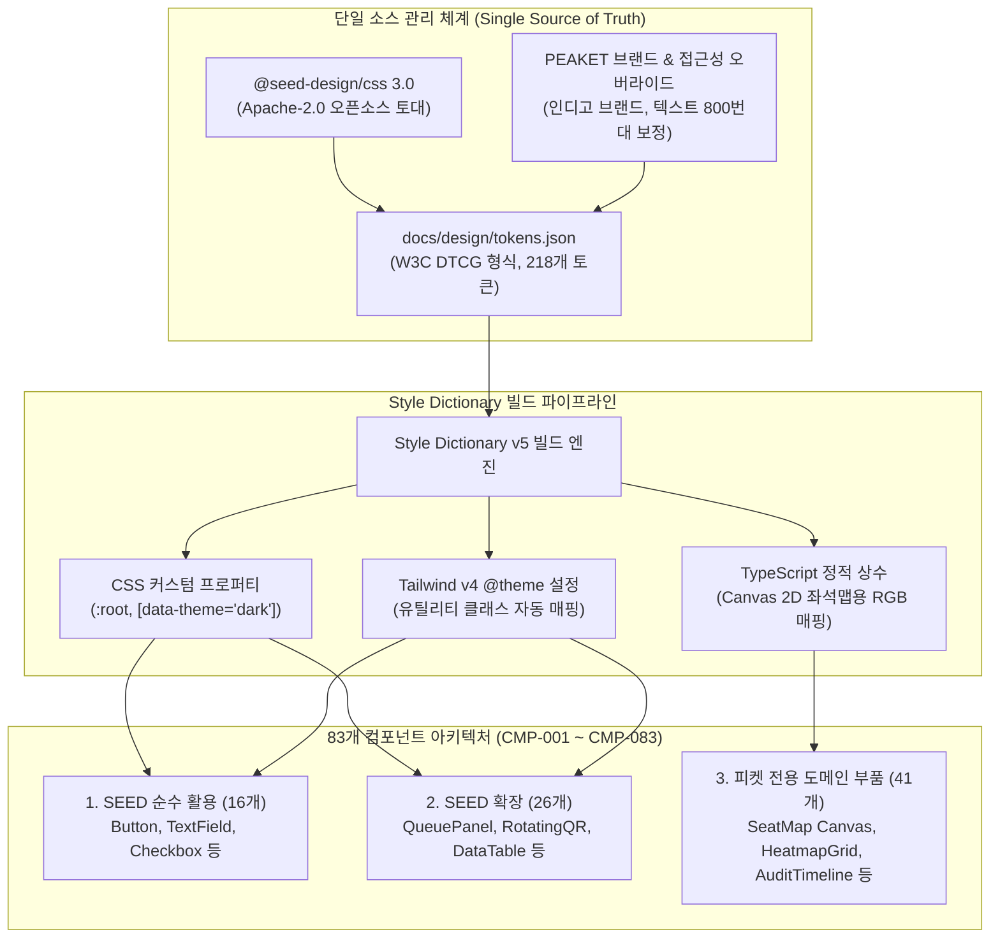

# 분야 편 5: 디자인 시스템 (Design System & Components)

- **맡는 정본**: [docs/design/d2-design-system.md](../../design/d2-design-system.md) 전체, [docs/design/d4-handoff-checklist.md](../../design/d4-handoff-checklist.md) 전체, [docs/design/tokens.json](../../design/tokens.json)(토큰 구조), docs/design/icons/genre/ 장르 아이콘 SVG 10개, 자리가 이 편인 [ADR-0040](../../adr/0040-design-system-base-seed.md)
- **문서 성격**: 정본 설계를 시스템 엔지니어링 및 기술 면접 관점에서 체계적으로 해설한 문서다. 규범적 수치와 불변 규칙의 최종 권위는 정본 문서에 있다([ADR-0177](../../adr/0177-walkthrough-explain-in-interview.md)). 길잡이는 [README.md](../README.md)다.
- **한 판 문서와의 관계**: [한 판 문서](../01-system-design.md) 9단계(좌석맵 Worker 렌더링 CMP-021) 및 프론트엔드 최적화 단계에서 다룬 UI 부품의 토대가 되는 디자인 토큰 파이프라인과 83개 컴포넌트(CMP-001~083) 카탈로그를 총괄한다.
- **아키텍처 목표와 검증 기준**: 당근 SEED Design 3.0(Apache-2.0)을 시각적 토대로 채택하고, `tokens.json`을 단일 진실 공급원(SSOT)으로 삼아 Style Dictionary를 통해 CSS 변수, Tailwind v4 테마, TypeScript 상수를 일관되게 생성한다. WCAG 2.2 AA 명도 대비(본문 4.5:1, UI 3.0:1)를 100% 충족하도록 SEED 색상을 보정하고, 5만 석 좌석 상태를 색+무늬+텍스트 3중으로 표현(NFR-020)하며, 83개 컴포넌트의 접근성 및 다크/라이트 테마를 확립한다.

---

## 1. 디자인 시스템 도메인 종합 개요

PEAKET의 디자인 시스템은 대규모 티케팅 환경의 극단적 사용 맥락(100만 명이 모바일로 30분 이상 대기하는 긴장된 상황, 70분간 초당 수만 건의 지표를 모니터링하는 관제실, 야외 햇빛 아래의 게이트 검표)을 지원하기 위해 **신뢰성, 접근성, 초경량성**을 핵심 축으로 구축되었다.

> **30초 아키텍처 브리핑 (Staff Engineer Interview)**:  
> "PEAKET의 디자인 시스템은 당근마켓의 오픈소스 **SEED Design 3.0**을 토대로 구축되었으며, **단일 토큰 소스(`tokens.json`) - 3방향 빌드 파이프라인 - 83개 컴포넌트 카탈로그**로 구성됩니다.  
> 첫째, 디자인 토큰은 W3C DTCG 형식을 따르며 Style Dictionary를 거쳐 CSS 변수, Tailwind v4 `@theme`, TypeScript 상수의 3가지 산출물로 동시 빌드됩니다. 특히 5만 석 좌석맵(CMP-021)은 HTML DOM이 아닌 Canvas 2D 그래픽 컨텍스트에서 구동되므로 CSS 변수를 읽을 수 없어, 빌드 파이프라인에서 추출된 정적 TypeScript 상수를 직접 참조하여 렌더링 오버헤드를 0으로 유지합니다.  
> 둘째, SEED Design의 기본 팔레트는 APCA(Advanced Perceptual Contrast Algorithm) 기준이라 WCAG 2.2 AA(4.5:1)에 미달하는 일부 텍스트 색상이 존재했습니다. PEAKET은 브랜드 아이덴티티(인디고)를 부여함과 동시에, 성공·경고·위험 텍스트 색상을 SEED 700에서 800으로 한 단계 진하게 보정하여 37개 시맨틱 색상 쌍 전수에서 WCAG 2.2 AA를 100% 만족하도록 오버라이드했습니다.  
> 셋째, 83개 컴포넌트는 SEED 순수 활용(16개), SEED 기반 확장(26개), 피켓 전용 도메인 부품(41개)으로 엄격히 계층화되어 있으며, 좌석 상태는 색상뿐 아니라 기하학적 무늬와 텍스트를 결합한 3중 감각 표현(WCAG 1.4.1)으로 시각 장애인 및 색약자 접근성을 완벽히 보장합니다."

### 디자인 토큰 파이프라인 및 컴포넌트 아키텍처 다이어그램



---

## 2. 절마다 읽기

디자인 시스템 정의서([docs/design/d2-design-system.md](../../design/d2-design-system.md)), 핸드오프 점검표([docs/design/d4-handoff-checklist.md](../../design/d4-handoff-checklist.md)), 토큰 정의([docs/design/tokens.json](../../design/tokens.json)), 장르 아이콘(docs/design/icons/genre/)의 전 절을 정밀 매핑한다.

| 정본 절 | 무엇을 정하나 | 왜 | 해설서에서 |
| --- | --- | --- | --- |
| docs/design/d2-design-system.md §1 토큰 규칙 | 14가지 토큰 원칙(원시/시맨틱 분리, 라이트/다크 제어, CSP 호환, 타이포그래피 등) | 임의 추정치를 배제하고 SEED Design 기반의 체계적 토큰 규칙 수립 | — |
| docs/design/d2-design-system.md §1 '디자인 토대'·'단일 소스 관리 체계' | SEED 토큰 기반 tokens.json 단일 소스, W3C DTCG 규격, 점 표기 별칭 회피 | Style Dictionary 빌드 호환성 및 다중 플랫폼 산출물 동기화 보장 | — |
| docs/design/d2-design-system.md §1 '원시 팔레트와 시맨틱 토큰의 엄격한 분리'·'라이트·다크 모드 제어' | 의미 토큰(`color.semantic.*`) 사용 강제, ESLint 원시 색상 참조 금지 | 라이트/다크 테마 전환 시 단일 키로 자동 변환되도록 보장 | — |
| docs/design/d2-design-system.md §1 'SEED 스타일 속성과 화면 CSP'·'SEED CSS 싣기'·'CSS 층 순서' | CSP `style-src` 인라인 스타일 호환, recipe CSS 분할 적재, CSS 레이어 우선순위 | 번들 크기 절감 및 Tailwind 유틸리티와 SEED 컴포넌트 간 스타일 충돌 방지 | [결정 카드 D-34](../decisions/D34-styling-forms-test-tools.md) |
| docs/design/d2-design-system.md §1 '좌석 상태의 다중 감각 표현' | 좌석 상태 표현 시 색상 토큰과 `pattern.seat.*` 무늬 결합 | 색상만으로 정보를 전달하지 않는 웹 접근성 지침(WCAG 1.4.1) 준수 | 분야 편 10 |
| docs/design/d2-design-system.md §1 '타이포그래피 스케일'·'간격, 라운드, 그림자, 모션'·'재배치와 글자 확대' | SEED 타이포/스페이싱 스케일 계승, 4단계 중단점, 320px 리플로우 준수 | 뷰포트 크기 변경 및 200% 글자 확대 시 텍스트 잘림 방지(WCAG 1.4.4/1.4.10) | — |
| docs/design/d2-design-system.md §1 '버전 관리 및 시각 회귀 테스트'·'UI 아이콘' | `@peaket/ds` 모노레포 패키지 관리, Playwright 시각 회귀 테스트, 24px 아이콘 격자 | 컴포넌트 변경 시 시각적 결함 자동 탐지 및 일관된 아이콘 메타포 유지 | [결정 카드 D-31](../decisions/D31-one-monorepo.md) |
| docs/design/d2-design-system.md §1.1 SEED 컴포넌트 대응표 | 83개 컴포넌트 분류(SEED 순수 16, 확장 26, 피켓 전용 41) 및 당근 로고/색상 배제 | 오픈소스 컴포넌트를 최대한 재활용하고 도메인 특화 부품만 선별 개발 | — |
| docs/design/d2-design-system.md §2 컴포넌트 카탈로그 [보완] | CMP-001~083 컴포넌트별 용도, 변형, 상태, 접근성 요건, 사용 화면 매핑 | 화면설계서의 UI 요구사항을 단일 카탈로그로 통합 관리 | 한 판 9단계, 분야 편 9~14 |
| docs/design/d2-design-system.md §3 공통 패턴 | 6대 UI 공통 패턴(폼 검증, 데이터 그리드, 상태 화면, 모달, 확인 절차, 비활성 버튼) | 동일한 UX 문제를 화면마다 제각각 구현하는 파편화 방지 | — |
| docs/design/d2-design-system.md §3.1 폼 입력 및 검증 패턴 | React Hook Form + Zod, grapheme 글자 수 계산, 300ms 디바운스, 민감정보 저장 금지 | 봇 방해 없는 사용자 편의 보장 및 뒤늦은 응답의 상태 덮어쓰기 방지 | [결정 카드 D-34](../decisions/D34-styling-forms-test-tools.md) |
| docs/design/d2-design-system.md §3.2 테이블 및 대규모 데이터 그리드 패턴 | `aria-sort`, 커서 기반 페이지네이션, 가상 스크롤(Virtualization) | 수만 행의 티켓/로그 데이터를 브라우저 렉 없이 부드럽게 렌더링 | — |
| docs/design/d2-design-system.md §3.3 빈 화면, 로딩, 에러, 권한 없음 패턴 | 사유 및 후속 조치 버튼 표출, Skeleton 우선, 관제 위젯별 Error Boundary | 부분 장애 발생 시 전체 대시보드 마비 차단 | — |
| docs/design/d2-design-system.md §3.4 토스트 및 모달 다이얼로그 패턴 | 토스트는 경량 피드백 한정, 모달 단일 포커스 트랩, 중첩 모달 엄격 금지 | 포커스 트랩 충돌로 인한 키보드 네비게이션 마비 차단 | — |
| docs/design/d2-design-system.md §3.5 취소 불가능한 중요 작업의 단계적 확인 절차 | 팬 재인증 $\rightarrow$ 환급 명세 $\rightarrow$ 결과 고지. 관제 사유 $\rightarrow$ dry-run $\rightarrow$ 2인 승인 | 비가역적 파괴 작업에 대한 실수 방지 및 가입보다 쉬운 탈퇴 보장(POL-033) | — |
| docs/design/d2-design-system.md §3.6 이유를 알려야 하는 비활성 버튼 | `aria-disabled="true"` 유지, Tab 포커스 허용, 상시 노출 이유 텍스트 연결 | HTML disabled 속성으로 인한 포커스 유실 및 툴팁 불가 문제 해결 | — |
| docs/design/d2-design-system.md §4 UX 라이팅 규칙 [보완] | '~합니다'체, 법정 문안 원문 보존, 재촉 문구 금지, 셔플 공연 '선착순' 표기 금지 | 차분하고 신뢰성 있는 어조 유지 및 기만적 UI 패턴(Dark Pattern) 배제 | — |
| docs/design/d2-design-system.md §5 색 대비 검증 | 37개 시맨틱 색상 쌍 라이트/다크 대비 계산표, SEED 대비 보정 내역 | WCAG 2.2 AA 기준(본문 4.5:1, UI 3.0:1) 100% 충족 검증 | — |
| docs/design/d4-handoff-checklist.md §1 모든 화면 공통 체크리스트 | 26개 점검 항목(토큰 린트, axe-core 접근성, Playwright 시각 회귀, 탭 순서 등) | 디자이너-개발자 간 핸드오프 시 결함을 자동화 도구로 사전 차단 | — |
| docs/design/d4-handoff-checklist.md §2 화면 유형별 추가 점검 | 대기실, 좌석맵, 결제, 관제, 스캐너 등 28개 화면군별 특화 점검표 | 화면군별 상이한 법정 고지 및 접근성 요건 충족 확인 | — |
| docs/design/d4-handoff-checklist.md §3 핸드오프 산출물 요건 | Storybook 스토리, 토큰 매핑 표, 접근성 노트, 문구 대조표 규격 | 개발 인계 산출물의 완성도 기준 확립 | — |
| docs/design/tokens.json 최상위 그룹(JSON이라 절이 없다) | `color`, `pattern`, `typography`, `space`, `size`, `radius`, `shadow`, `motion`, `breakpoint`, `layout`, `z-index` 11개 그룹 | 전체 디자인 시스템의 단일 진실 공급원(SSOT) 토큰 정의 | — |
| docs/design/icons/genre/(SVG 10개) | 콘서트, 뮤지컬, 연극, 클래식, 팬미팅, 페스티벌, 굿즈 등 10종 SVG 아이콘 | 홈 화면 장르 타일의 정규 벡터 그래픽 자산 | — |

---

## 3. 핵심 메커니즘과 컴포넌트 아키텍처

### 3.1 83개 컴포넌트 (CMP-001 ~ CMP-083) 3계층 카탈로그

```mermaid
flowchart TD
    subgraph Layer1["1. SEED 순수 활용 (16개)"]
        C01["CMP-001 Button"]
        C02["CMP-002 Link"]
        C03["CMP-003 IconButton"]
        C04["CMP-004 TextField"]
        C05["CMP-005 TextArea"]
        C06["CMP-006 PasswordField"]
        C07["CMP-007 OTPField"]
        C08["CMP-008 PhoneField"]
        C09["CMP-009 ConsentCheckbox"]
        C10["CMP-010 Select / Radio"]
        C11["CMP-011 Toggle"]
        C13["CMP-013 Stepper"]
        C18["CMP-018 Toast"]
        C19["CMP-019 Dialog (Modal)"]
        C30["CMP-030 Tabs"]
        C44["CMP-044 Skeleton"]
    end

    subgraph Layer2["2. SEED 확장 컴포넌트 (26개)"]
        C12["CMP-012 FormErrorSummary"]
        C14["CMP-014 Countdown"]
        C15["CMP-015 QueuePanel"]
        C16["CMP-016 ProgressBar"]
        C17["CMP-017 NoticeBanner"]
        C20["CMP-020 DangerConfirm"]
        C23["CMP-023 SeatStatusBadge"]
        C28["CMP-028 TicketCard"]
        C29["CMP-029 RotatingQR"]
        C31["CMP-031 DataTable"]
        C32["CMP-032 StatTile"]
        C40["CMP-040 DeadlineBadge"]
        C43["CMP-043 EmptyState"]
        C45["CMP-045 ErrorState"]
        C46["CMP-046 PermissionDenied"]
        C50["CMP-050 ReorderList"]
        C52["CMP-052 DeviceSessionList"]
        C55["CMP-055 AccountLinkPrompt"]
        C64["CMP-064 ReauthPrompt"]
        C65["CMP-065 AppShell"]
        C66["CMP-066 RoundPicker"]
        C68["CMP-068 NotifyPermissionSheet"]
        C71["CMP-071 Carousel"]
        C72["CMP-072 ProductionCard"]
        C73["CMP-073 ReviewCard"]
        C74["CMP-074 ProductCard"]
    end

    subgraph Layer3["3. 피켓 전용 도메인 부품 (41개)"]
        C21["CMP-021 SeatMap (Canvas)"]
        C22["CMP-022 SeatList (접근성)"]
        C24["CMP-024 PriceTierLegend"]
        C25["CMP-025 SeatSummary"]
        C26["CMP-026 SeatPicker"]
        C27["CMP-027 PaymentWidgetFrame"]
        C33["CMP-033 TimeSeriesChart"]
        C34["CMP-034 HeatmapGrid"]
        C35["CMP-035 Widget (관제)"]
        C36["CMP-036 CommandCard"]
        C37["CMP-037 ApprovalStepper"]
        C38["CMP-038 DryRunPreview"]
        C39["CMP-039 AuditTimeline"]
        C41["CMP-041 ScanResult"]
        C42["CMP-042 CameraView"]
        C47["CMP-047 HumanCheckBox"]
        C48["CMP-048 ReportButton"]
        C49["CMP-049 ShuffleProofPanel"]
        C51["CMP-051 SeatMapEditorCanvas"]
        C53["CMP-053 DeviceApprovalPanel"]
        C54["CMP-054 RefundQuote"]
        C56["CMP-056 MergeSummary"]
        C57["CMP-057 AutoAssignPanel"]
        C58["CMP-058 SellerNotice"]
        C59["CMP-059 TransferOfferCard"]
        C60["CMP-060 ApprovalPanel"]
        C61["CMP-061 BulkRefundProgress"]
        C62["CMP-062 BankAccountForm"]
        C63["CMP-063 AppealForm"]
        C67["CMP-067 AddressForm"]
        C69["CMP-069 MediaUploader"]
        C70["CMP-070 RichTextEditor"]
        C75["CMP-075 ReportDialog"]
        C76["CMP-076 ImageUploader"]
        C77["CMP-077 SeatFillPanel"]
        C78["CMP-078 TemplatePicker"]
        C79["CMP-079 ScatterBrush"]
        C80["CMP-080 LinkGraph"]
        C81["CMP-081 CaseStatusBadge"]
        C82["CMP-082 ReplaySourceBadge"]
        C83["CMP-083 StepBaselineChart"]
    end
```



---

### 3.2 Canvas 그래픽 렌더링을 위한 TypeScript 상수 브릿지

5만 석 좌석맵(CMP-021)과 파트너 좌석 에디터(CMP-051)는 수만 개의 좌석 픽셀을 고속으로 그리기 위해 HTML Canvas 2D 컨텍스트를 사용한다. 하지만 브라우저 Canvas API는 CSS 커스텀 프로퍼티(`var(--color-...)`)를 해석하지 못하며, `getComputedStyle()`을 매 프레임 수만 번 호출하면 극단적인 메인 스레드 병목이 발생한다.

이를 해결하기 위해 Style Dictionary 빌드 파이프라인에서 토큰의 RGB 정수값을 담은 **정적 TypeScript 상수 모듈(`@peaket/ds/tokens.ts`)**을 생성하여 직결한다:

```typescript
// packages/ds/src/tokens.ts (자동 생성)
export const SEAT_COLORS = {
  AVAILABLE: [46, 125, 50, 255],     // color.semantic.seat.available
  HELD: [245, 124, 0, 255],          // color.semantic.seat.held
  PENDING: [123, 31, 162, 255],      // color.semantic.seat.pending
  SOLD: [117, 117, 117, 255],        // color.semantic.seat.sold
  MINE: [26, 35, 126, 255],          // color.semantic.seat.mine
} as const;

// Web Worker 내부 좌석 렌더러 (CMP-021)
function renderSeat(ctx: OffscreenCanvasRenderingContext2D, seatState: number, x: number, y: number) {
  // CSS 엔진 조회 없이 정적 RGB 배열 직접 참조 -> 연산 오버헤드 0
  const color = SEAT_COLORS[stateMap[seatState]];
  ctx.fillStyle = `rgb(${color[0]}, ${color[1]}, ${color[2]})`;
  ctx.fillRect(x, y, SEAT_SIZE, SEAT_SIZE);
}
```

---

### 3.3 좌석 상태의 다중 감각 표현 및 WCAG 2.2 AA 색상 보정

#### 좌석 상태 다중 감각 매트릭스 (WCAG 1.4.1)

| 좌석 상태 | 색상 토큰 | 패턴 토큰 (`pattern.seat.*`) | 접근성 레이블 (`aria-label`) |
| --- | --- | --- | --- |
| **선택 가능** | `color.semantic.seat.available` (Green 800) | `pattern.seat.solid` (단색 채움) | "선택 가능, [등급], [가격]원" |
| **내 선점 좌석** | `color.semantic.seat.mine` (Indigo 700) | `pattern.seat.check` (체크 마크) | "내가 선택한 좌석, [등급], 7분 홀드 중" |
| **타인 선점 중** | `color.semantic.seat.held` (Orange 800) | `pattern.seat.diagonal-stripe` (대각선 빗금) | "다른 관객 결제 진행 중 (선택 불가)" |
| **결제 예약 중** | `color.semantic.seat.pending` (Purple 800) | `pattern.seat.cross-hatch` (격자 무늬) | "결제 승인 대기 중 (선택 불가)" |
| **판매 완료** | `color.semantic.seat.sold` (Gray 700) | `pattern.seat.x-mark` (X자 교차선) | "매진 (선택 불가)" |

#### SEED 기본 팔레트 대비 보정 내역 (WCAG 1.4.3)
SEED Design 3.0은 APCA(Lc 75) 기준을 적용하여 라이트 모드 텍스트 색상이 WCAG 2.2 AA 기준(4.5:1)에 미달하는 경우가 있었다. PEAKET은 모든 텍스트 색상을 검증하여 4.5:1 이상으로 상향 보정했다:
- **라이트 성공 문구**: SEED `green.700`(3.96:1) $\rightarrow$ PEAKET `green.800` (**5.73:1**, WCAG AA 통과)
- **라이트 경고 문구**: SEED `orange.700`(4.12:1) $\rightarrow$ PEAKET `orange.800` (**6.41:1**, WCAG AA 통과)
- **라이트 위험 문구**: SEED `red.700`(3.76:1) $\rightarrow$ PEAKET `red.800` (**5.68:1**, WCAG AA 통과)
- **포커스 링 테두리**: SEED `blue.600`(2.84:1) $\rightarrow$ PEAKET `indigo.500` (**5.11:1**, WCAG AA 통과)
- **보조 설명 텍스트**: `text-muted`에 `gray.800` 적용 (**6.62:1**)

---

### 3.4 6대 공통 UI 패턴 구현 아키텍처

1. **폼 입력 및 검증 패턴 (RHF + Zod, §3.1)**:
   - 비제어 컴포넌트 기반으로 렌더링을 최소화하고, 클라이언트와 서버가 동일한 Zod 스키마를 공유한다.
   - 글자 수 계산은 단순 `.length`가 아닌 `Intl.Segmenter` 기반의 grapheme(실제 보이는 글자 단위) 클러스터를 적용하여 이모지 및 한글 결합 문자의 글자 수 왜곡을 방지한다.
   - 비동기 유효성 검증(아이디/쿠폰 중복 확인 등)은 300ms 디바운스와 `AbortController`를 필수 적용하여 이전 요청의 뒤늦은 응답이 최신 결과를 덮어쓰지 않도록 차단한다.
2. **테이블 및 대규모 데이터 그리드 (TanStack Table 9, §3.2)**:
   - 수만 건의 예매 이력과 감사 로그는 무한 DOM을 생성하지 않고 가상 스크롤(Virtualization)을 적용하여 보이는 뷰포트 내 20~50개 행만 렌더링한다.
   - 모든 정렬 헤더에는 `aria-sort="ascending|descending|none"`을 강제하여 스크린 리더에 정렬 상태를 즉시 통보한다.
3. **5대 표준 상태 분기 (CMP-043 ~ CMP-046, §3.3)**:
   - 비동기 데이터 로딩 시 레이아웃 흔들림을 막기 위해 원본 형태의 스켈레톤(CMP-044)을 선점 표출한다.
   - 관제 콘솔의 20여 개 실시간 위젯은 개별 React `ErrorBoundary`로 격리되어, 특정 위젯의 렌더링 에러가 대시보드 전체를 마비시키지 않는다.
4. **토스트 및 모달 포커스 트랩 (CMP-018, CMP-019, §3.4)**:
   - 토스트는 단순 성공 피드백(5초 후 자동 소멸)에만 사용하며, 치명적 오류에는 토스트를 금지하고 인라인 에러나 다이얼로그를 쓴다.
   - 모달 활성화 시 배경 스크롤을 잠그고 초점을 모달 내부에 가두며, ESC 키로 즉시 닫힐 수 있도록 보장한다. 중첩 모달은 완전 금지된다([ADR-0066](../../adr/0066-screen-feedback-12-items.md)).
5. **비가역적 중요 작업의 단계적 확인 (CMP-020, §3.5)**:
   - 예매 취소, 회원 탈퇴, 12개 운영 명령 하달 시 단순 '확인/취소' 확인창을 띄우지 않는다.
   - 관객에게는 취소 수수료와 환급액 명세를 명확히 고지하고 버튼 자체에 결과를 명시(예: "[35,000원 환불받고 취소하기]")한다.
   - 관제 명령은 사유 입력 $\rightarrow$ 사전 dry-run 시뮬레이션(영향 받는 사용자 수) $\rightarrow$ 2인 승인 요청의 3단계를 거친다.
6. **이유를 알리는 비활성 버튼 (`aria-disabled="true"`, §3.6)**:
   - 권한 부족이나 매진 등으로 클릭할 수 없는 버튼에 HTML `disabled` 속성을 붙이지 않는다. HTML `disabled`는 브라우저 포커스 트리를 이탈시켜 키보드 Tab 키로 도달할 수 없고 툴팁이나 설명 문구를 읽을 수 없게 만든다.
   - `aria-disabled="true"`를 부여하여 포커스를 유지하고, 비활성화 사유(예: "본인확인 후 예매 가능합니다")를 `aria-describedby`로 연결하여 스크린 리더와 모바일 환경에서 사유를 즉시 인지할 수 있도록 한다.

---

## 4. 꼭 기억할 규칙과 숫자

| 항목 | 엔지니어링 기준값 | 아키텍처 근거 및 계산 | 정본 위치 |
| --- | --- | --- | --- |
| **디자인 토큰 수** | 최상위 그룹 11개, 토큰 총 218개 | tokens.json 단일 소스 관리 (색상 142개) | tokens.json |
| **컴포넌트 수** | 총 83개 (순수 16, 확장 26, 전용 41) | SEED 3.0 토대 + 티케팅 도메인 특화 부품 | d2 §1.1, §2 |
| **텍스트 명도 대비** | 본문 4.5:1 이상, 그래픽/대형 3.0:1 이상 | WCAG 2.2 AA 국제 접근성 표준 100% 충족 | d2 §5, NFR-020 |
| **반응형 중단점 (SEED)**| sm 480px, md 768px, lg 1280px, xl 1440px | SEED Design 토큰 기반 표준 반응형 뷰포트 | d2 §1 |
| **최소 뷰포트 리플로우**| 폭 320 CSS px 수평 스크롤 0건 | 모바일 접근성 리플로우 기준 준수 | d2 §1, WCAG 1.4.10 |
| **터치 타깃 최소 크기**| 모든 조작 24×24px, 모바일 주요 버튼 44×44px | 모바일 오터치 방지 및 포인터 타깃 기준 | d4 #5, WCAG 2.5.5 |
| **스크린 리더 알림 빈도**| 대기열 1분당 1회, 카운트다운 5분/1분/10초 전 | 음성 간섭으로 인한 예매 조작 마비 방지 | CMP-014, 015, d4 #8 |
| **애니메이션 지속 시간**| 150ms, 200ms, 300ms 3단계 한정 | `transform` 및 `opacity` GPU 가속 속성만 사용 | d2 §1, tokens.json |
| **비동기 폼 검증 지연**| 300ms 디바운스 + AbortController | 입력 완료 후 단일 요청 발송 및 응답 덮어쓰기 방지 | d2 §3.1 |
| **대규모 표 페이지 크기**| 기본 25건, 옵션 50/100건, 검색 20건 | 가상 스크롤 및 렌더링 메모리 상한 관리 | d2 §3.2 |

---

## 5. 이 문서가 다루는 ID

| 구분 | ID | 핵심 컴포넌트 및 명세 요약 |
| --- | --- | --- |
| **SEED 순수 (16)** | CMP-001 ~ 011, 013, 018, 019, 030, 044 | Button, Link, IconButton, TextField, TextArea, PasswordField, OTPField, PhoneField, ConsentCheckbox, Select/Radio, Toggle, Stepper, Toast, Dialog(Modal), Tabs, Skeleton. |
| **SEED 확장 (26)** | CMP-012, 014 ~ 017, 020, 023, 028, 029, 031, 032, 040, 043, 045, 046, 050, 052, 055, 064 ~ 066, 068, 071 ~ 074 | FormErrorSummary, Countdown, QueuePanel, ProgressBar, NoticeBanner, DangerConfirm, SeatStatusBadge, TicketCard, RotatingQR, DataTable, StatTile, DeadlineBadge, EmptyState, ErrorState, PermissionDenied, ReorderList, DeviceSessionList, AccountLinkPrompt, ReauthPrompt, AppShell, RoundPicker, NotifyPermissionSheet, Carousel, ProductionCard, ReviewCard, ProductCard. |
| **피켓 전용 (41)** | CMP-021, 022, 024 ~ 027, 033 ~ 039, 041, 042, 047 ~ 049, 051, 053, 054, 056 ~ 063, 067, 069, 070, 075 ~ 083 | SeatMap(Canvas), SeatList(접근성), PriceTierLegend, SeatSummary, SeatPicker, PaymentWidgetFrame, TimeSeriesChart, HeatmapGrid, Widget(관제), CommandCard, ApprovalStepper, DryRunPreview, AuditTimeline, ScanResult, CameraView, HumanCheckBox, ReportButton, ShuffleProofPanel, SeatMapEditorCanvas, DeviceApprovalPanel, RefundQuote, MergeSummary, AutoAssignPanel, SellerNotice, TransferOfferCard, ApprovalPanel, BulkRefundProgress, BankAccountForm, AppealForm, AddressForm, MediaUploader, RichTextEditor, ReportDialog, ImageUploader, SeatFillPanel, TemplatePicker, ScatterBrush, LinkGraph, CaseStatusBadge, ReplaySourceBadge, StepBaselineChart. |
| **관련 NFR/POL** | NFR-012, 019, 020, 024, POL-004, 006, 012, 013, 024, 033, 037 | 사용자 체감 CWV, 플랫폼 지원, 웹 접근성, 국제화, 정렬 고지, 홀드 TTL, 중개자 고지. |

---

## 6. 결정과 버린 길 (ADR 트레이드오프)

### ADR-0040: 당근 SEED Design 3.0 채택과 피켓 브랜드/접근성 오버라이드 (자리: 이 편)
- **채택한 결정**: 디자인 토대로 검증된 오픈소스 `@seed-design/css` 및 `@seed-design/react`를 도입한다. 브랜드 컬러는 당근의 오렌지 대신 피켓의 인디고(Indigo)로 대체하고, SEED의 APCA 기반 저대비 텍스트 색상을 WCAG 2.2 AA(4.5:1 이상)로 상향 보정한다. Apache-2.0 라이선스 규정에 따라 NOTICE 고지를 프로젝트에 포함한다.
- **버린 대안**:
  - *타 예매처(인터파크/야놀자) 화면에서 토큰 크롤링 추출*: 서비스 이용약관 위반 및 지식재산권 침해 법적 소송 위험.
  - *바닥부터 자체 디자인 시스템 개발*: 100여 종의 컴포넌트와 복잡한 접근성 인터랙션을 1인 엔지니어가 개발하기에는 수개월의 공수가 소요되어 비현실적.
  - *SEED 기본 색상 유지 및 APCA 기준 채택*: 시스템의 공식 NFR-020 목표가 WCAG 2.2 AA이므로 품질 요구사항을 위배하게 됨.

### ADR-0111: SEED CSS 분할 적재와 CSP 인라인 스타일 호환 (결정 카드 [D-34](../decisions/D34-styling-forms-test-tools.md))
- **채택한 결정**: 전체 SEED CSS 번들(gzip 42.2KiB)을 한 번에 싣지 않고, 화면별로 실제 사용되는 컴포넌트의 recipe CSS만 선별 적재한다. 엄격한 CSP 환경에서 동적 인라인 스타일이 차단되는 문제를 해결하기 위해 사전 컴파일된 CSS 레이어 순서를 확립한다.
- **버린 대안**: 런타임 CSS-in-JS(Emotion, Styled-components) 도입(모바일 브라우저 JS 런타임 오버헤드가 급증하고 CSP nonce 주입 복잡도 증가).

---

## 7. 경계와 범위

| 이 정본이 정하지 않는 것 | 정하는 곳 |
| --- | --- |
| 화면별 페이지 라우팅 및 유저 플로우(F-01~F-14) | [docs/planning/04-ia-flows-screens.md](../../planning/04-ia-flows-screens.md)([분야 편 4](04-screens-and-flows.md)) |
| Next.js App Router 렌더링 및 프론트엔드 상태 관리 | [docs/frontend.md](../../frontend.md)([분야 편 6](06-frontend.md)) |
| 5만 석 좌석 선점 및 Web Worker 내부 렌더러 로직 | [docs/features/seat-hold.md](../../features/seat-hold.md)([분야 편 10](10-seat-hold.md)) |
| 백엔드 API 계약 및 Zod 스키마 정의 | [docs/api/guidelines.md](../../api/guidelines.md)([분야 편 7](07-api-contracts.md)) |

---

## 8. 5단 꼬리 질문 (Staff Engineer Interview Defense)

### Q1. "기존 오픈소스 디자인 시스템(SEED Design)이 있는데 왜 tokens.json을 거쳐 직접 빌드하는 파이프라인을 구축했습니까?"
- **답변**: **'Canvas 그래픽 렌더러 및 Tailwind v4와의 멀티 플랫폼 동기화'** 때문입니다. 웹 UI 컴포넌트는 CSS 변수를 참조하면 되지만, 5만 석 좌석맵(CMP-021)과 파트너 좌석 에디터(CMP-051)는 성능을 위해 Canvas 2D 컨텍스트에서 구동되므로 CSS 변수를 직접 읽을 수 없습니다. 또한 유틸리티 스타일링을 위해 Tailwind v4 `@theme` 설정도 동시에 필요합니다. `tokens.json`을 단일 소스(SSOT)로 두고 Style Dictionary를 통해 CSS 변수, Tailwind 테마, TypeScript RGB 상수를 한 번에 빌드함으로써, 디자인 토큰 변경 시 Canvas 좌석맵과 웹 UI의 시각적 불일치가 발생하는 문제를 원천 방지했습니다.

### Q2. "SEED Design 3.0의 기본 색상을 그대로 쓰지 않고 WCAG 2.2 AA로 진하게 오버라이드한 이유는 무엇입니까?"
- **답변**: **'국제 웹 접근성 표준(WCAG 2.2 AA) 및 법적 준수 의무'** 때문입니다. SEED Design은 현대적 대비 지표인 APCA(Lc 75)를 기준으로 설계되어 있으나, 전 세계 공공 및 기업 시스템의 법적 접근성 인증 기준은 여전히 명도 대비 수치를 요구하는 WCAG 2.2 AA(일반 4.5:1, UI 3.0:1)입니다. SEED의 성공(Green 700, 3.96:1)이나 위험(Red 700, 3.76:1) 문구색을 그대로 사용하면 웹 접근성 평가 도구(axe-core)에서 치명적 위반으로 판정되어 NFR-020(위반 0건) 목표를 달성할 수 없습니다. 따라서 시맨틱 텍스트 토큰을 800번대(대비 5.6:1 이상)로 진하게 보정하여 두 표준을 모두 만족시켰습니다.

### Q3. "비활성화된 버튼에 HTML `disabled` 속성을 쓰지 않고 `aria-disabled="true"`를 권장하는 접근성적 이유는 무엇입니까?"
- **답변**: HTML `disabled` 속성이 부여된 버튼은 **브라우저의 포커스 트리에서 완전히 제거**되기 때문입니다. 시각 장애인이나 키보드 전용 사용자가 Tab 키로 화면을 탐색할 때 비활성 버튼은 아예 건너뛰어지므로, 사용자는 "이 화면에 예매 버튼이 아예 없다"고 인지하게 됩니다. 또한 포커스를 받을 수 없으므로 왜 비활성화되었는지(예: "로그인이 필요합니다", "매진되었습니다")를 알려주는 툴팁이나 설명 텍스트를 확인할 방법이 없습니다. 반면 `aria-disabled="true"`를 사용하면 키보드 포커스를 정상적으로 수신하고 `aria-describedby`를 통해 비활성 사유를 음성으로 안내받을 수 있어, 접근성과 사용자 경험을 모두 지킬 수 있습니다.

### Q4. "글자 수 제한 폼(CMP-005 TextArea)에서 단순 `.length` 대신 `Intl.Segmenter` 기반의 grapheme 클러스터를 사용하는 이유는 무엇입니까?"
- **답변**: **'이모지 및 다국어 결합 문자의 글자 수 계산 왜곡 방지'** 때문입니다. JavaScript의 문자열 `.length`는 UTF-16 코드 유닛 단위로 길이를 측정합니다. 따라서 복합 이모지(예: 가족 이모지 👨‍👩‍👧‍👦)나 피부톤 결합 이모지는 눈에는 1글자로 보이지만 `.length`는 7~11에 달합니다. 사용자가 후기를 500자 작성할 때 이모지를 몇 개만 넣어도 글자 수 초과 에러가 발생하여 큰 불편을 초래합니다. `Intl.Segmenter`를 적용하여 브라우저가 인간의 시각적 문자 단위(Grapheme Cluster)로 1글자를 정확히 카운트하도록 구현했습니다.

### Q5. "모노레포 환경에서 `@peaket/ds` 패키지를 npm 외부 저장소에 배포(Publish)하지 않고 내부 패키지로만 유지하는 이유는 무엇입니까?"
- **답변**: **오버엔지니어링 배제 및 즉각적인 원자적 변경(Atomic Changes) 보장** 때문입니다. 피켓의 디자인 시스템은 4개 앱(소비자, 파트너, 관제, 스캐너)만을 위해 맞춤 설계된 전용 시스템입니다. 외부 배포 파이프라인(시맨틱 버저닝, npm 퍼블리시, 인증 토큰 관리)을 구축하면 불필요한 배포 오버헤드가 발생하며, 토큰 수정 시 4개 앱에서 버전을 일일이 올려야 하는 파편화가 발생합니다. 모노레포의 `packages/ds`에서 `workspace:*` 의존성으로 직접 연결함으로써, 토큰 변경 PR 하나에서 4개 앱의 시각 회귀 테스트(Playwright)를 단일 커밋으로 원자적으로 검증할 수 있습니다.

---

## 9. 확인 문제

### 문 1. 
PEAKET의 83개 컴포넌트 분류 중 CMP-021(SeatMap Canvas)과 CMP-022(SeatList 접근성 대안)가 1:1 쌍으로 존재하는 아키텍처적 이유는 무엇인가?

<details><summary>정답 및 해설</summary>

Canvas 2D 엘리먼트는 순수 픽셀 그래픽이므로 **스크린 리더와 보조기기가 내부 좌석 요소를 전혀 인식할 수 없는 접근성 블랙홀**이기 때문이다.  
따라서 Canvas 그래픽 렌더러(CMP-021)와 완벽히 동일한 상태를 공유하는 텍스트 기반의 ARIA 트리 목록 컴포넌트(CMP-022, SeatList)를 숨김 영역에 제공하여, 시각 장애인 관객도 키보드 방향키만으로 구역 $\rightarrow$ 열 $\rightarrow$ 좌석 번호를 탐색하고 예매를 완주할 수 있도록 보장(NFR-020)했다.

</details>

### 문 2. 
SEED Design의 컴포넌트 CSS 전체를 번들링하지 않고 각 컴포넌트의 recipe CSS를 분할 적재하는 주된 성능적 이유는 무엇인가?

<details><summary>정답 및 해설</summary>

**대기실 번들 크기 예산(CSS 10KB 미만)을 준수**하기 위함이다.  
SEED의 전체 컴포넌트 CSS는 gzip 압축 시 약 42.2KiB에 달하여, 대기실(SCR-007, 008)에 통째로 싣게 되면 예산을 즉시 4배 이상 초과한다. 화면에서 실제로 사용하는 컴포넌트(Button, ProgressBar 등)의 recipe CSS만 선별하여 적재함으로써 대기실 CSS를 8KB 미만으로 경량화했다.

</details>

### 문 3. 
디자인 시스템 공통 패턴 중 비동기 중복 검증 시 300ms 디바운스와 함께 `AbortController`를 필수적으로 사용해야 하는 이유는 무엇인가?

<details><summary>정답 및 해설</summary>

**네트워크 경쟁 상태(Race Condition)로 인한 데이터 덮어쓰기 방지** 때문이다.  
사용자가 입력을 빠르게 수정할 때, 이전에 보낸 요청 A가 네트워크 지연으로 나중에 도착하고 최근에 보낸 요청 B가 먼저 응답할 수 있다. 이때 이전 요청 A의 응답이 최신 입력 B의 검증 결과를 덮어써서 유효한 입력을 무효로 표시하는 버그가 발생한다. `AbortController`를 통해 새 입력이 들어오는 즉시 이전 HTTP 요청을 취소하여 항상 최신 입력에 대한 응답만 렌더링되도록 보장한다.

</details>

### 문 4. 
PEAKET의 브랜드 테마에서 관제 콘솔(SCR-028~032)은 다크 모드로 고정되고 게이트 스캐너 PWA(SCR-033~036)는 라이트 모드로 고정된 각각의 도메인 환경적 이유는 무엇인가?

<details><summary>정답 및 해설</summary>

- **관제 콘솔**: 온세일 기간(70분) 동안 수십 개의 실시간 차트와 지표를 지속적으로 주시해야 하는 운영자의 **시각 피로도를 경감**시키고, 오류 발생 시 빨간색 경보의 시인성을 극대화하기 위해 다크 모드로 고정했다.
- **게이트 스캐너 PWA**: 공연장 야외 게이트의 **강한 직사광선(햇빛) 환경에서도 높은 명도 대비를 확보**하여, 스태프가 스마트폰 화면의 QR 스캔 결과(초록 통과 / 빨강 거부)를 즉시 식별할 수 있도록 라이트 모드로 고정했다.
</details>
