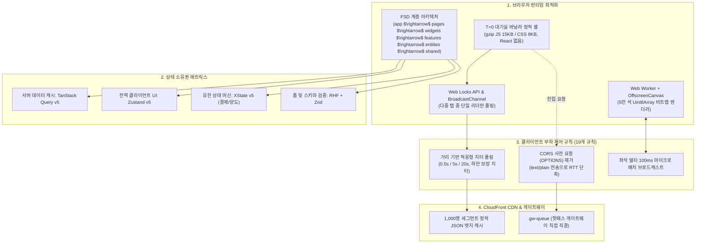
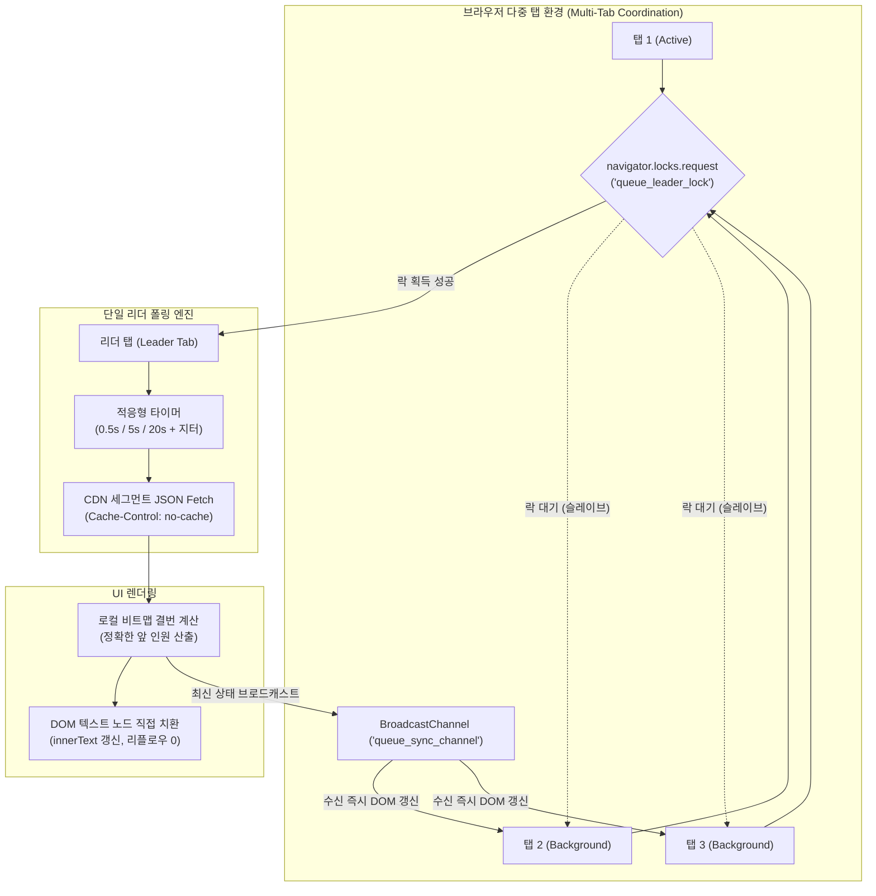
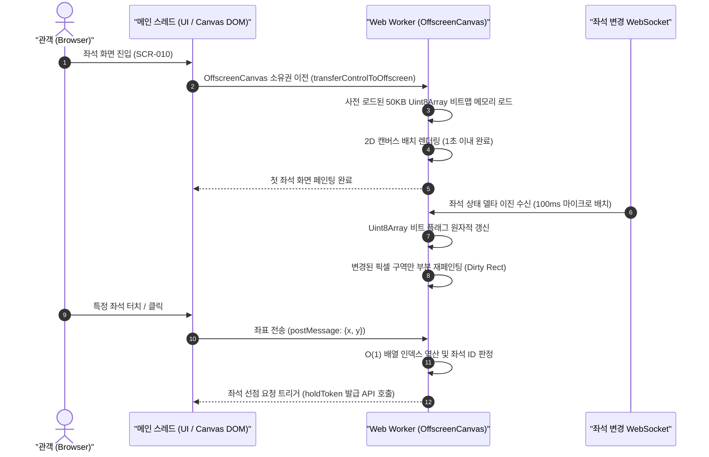

# 분야 편 6: 프론트엔드 구조 (Frontend Architecture & RADIO)

- **맡는 정본**: [docs/frontend.md](../../frontend.md) 전체, [docs/architecture.md](../../architecture.md) §6.2~§6.5(프론트엔드 요약), 프론트엔드 관련 ADR 12건
- **문서 성격**: 정본 설계를 시스템 엔지니어링 및 기술 면접 관점에서 체계적으로 해설한 문서다. 규범적 수치와 불변 규칙의 최종 권위는 정본 문서에 있다([ADR-0177](../../adr/0177-walkthrough-explain-in-interview.md)). 길잡이는 [README.md](../README.md)다.
- **한 판 문서와의 관계**: [한 판 문서](../01-system-design.md) 5단계(대기실 경량 정적 셸 K1), 9단계(5만 석 좌석맵 Worker 렌더링 및 델타 수신 K5), 14단계(스캐너 오프라인 영구 쓰기 K10), 15단계(브라우저 저장소 규칙)의 UI 런타임 구현 아키텍처를 총괄한다.
- **아키텍처 목표와 검증 기준**: 100만 명 동시 접속 시 클라이언트가 유발하는 오리진 부하를 통제하고, Core Web Vitals(INP 200ms 이하, LCP 2.5초 이하, CLS 0.1 이하, NFR-012)를 달성한다. T=0 대기실 번들 예산(gzip JS 50KB 이하, CSS 10KB 미만), 5만 석 좌석맵 1초 내 렌더링, Web Locks 기반 단일 탭 세션 독점, 그리고 서버를 보호하는 19대 클라이언트 네트워크 규칙을 확립한다.

---

## 1. 프론트엔드 아키텍처 종합 개요

PEAKET의 프론트엔드는 대규모 분산 시스템 설계 프레임워크인 **RADIO(Requirements $\rightarrow$ Architecture $\rightarrow$ Data Model $\rightarrow$ Interfaces $\rightarrow$ Optimizations)** 순서에 따라 설계되었으며, 브라우저가 전송하는 요청 패킷 하나가 백엔드 인프라 전체의 안정성을 결정한다는 전제 하에 **"클라이언트 부하 제어(Client Load Shaping)"**를 최우선 원칙으로 삼는다.

> **30초 아키텍처 브리핑 (Staff Engineer Interview)**:  
> "PEAKET의 프론트엔드는 **Next.js App Router 기반의 앱 3개(소비자, 파트너, 관제)와 바닐라 PWA 스캐너 1개**로 구성되며, RADIO 프레임워크에 맞춰 최적화되었습니다.  
> 첫째, **T=0 순간의 대기실(SCR-007, 008)은 React 런타임을 완전히 배제한 순수 바닐라 HTML/JS 정적 셸**로 구동됩니다. React 19 기본 런타임만 gzip 66KiB에 달해 대기실 JS 예산(50KB)을 초과하기 때문입니다. 100만 대기자는 CloudFront 엣지에 1초 단위로 배포되는 1,000명 세그먼트 JSON 파일을 적응형 지터 폴링(0.5s / 5s / 20s)으로 조회하며, 다중 탭 접속 시 `Web Locks` API를 통해 단 1개의 리더 탭만 폴링을 수행하고 BroadcastChannel로 형제 탭에 전파합니다.  
> 둘째, **5만 석 좌석맵(SCR-010)은 메인 스레드 부하를 0으로 만들기 위해 Web Worker + OffscreenCanvas 비동기 렌더링**을 채택했습니다. 좌석 객체를 생성하지 않고 50KB 크기의 `Uint8Array` 단일 비트맵으로 상태를 관리하며, 확대된 구역만 웹소켓 델타를 구독하여 1초 이내 렌더링과 INP 200ms 이하를 보장합니다.  
> 셋째, **상태 관리 소유권의 엄격한 단일화**입니다. 서버 캐시는 TanStack Query, 전역 UI는 Zustand, 복잡한 비즈니스 전이는 XState, 폼은 React Hook Form + Zod로 분리하고, Feature-Sliced Design(FSD) 아키텍처 린트(Steiger)를 통해 계층 역참조를 원천 차단했습니다."

### 프론트엔드 핵심 파이프라인 및 계층 아키텍처

---

## 2. 절마다 읽기

프론트엔드 정본 명세서([docs/frontend.md](../../frontend.md))와 아키텍처 요약([docs/architecture.md](../../architecture.md) §6)의 전 절을 정밀 매핑한다.

| 정본 절 | 무엇을 정하나 | 왜 | 해설서에서 |
| --- | --- | --- | --- |
| docs/frontend.md §0 이 문서를 읽는 법 | RADIO 프레임워크 대응, 정본 경계 매트릭스, 4개 앱 및 6개 API 호스트 명명 규칙 | 문서 간 불일치 발생 시 프론트엔드 정본 열이 우선하도록 경계 확립 | — |
| docs/frontend.md §1 요구사항(R) | 앱별 타깃 기기, 핵심/부가 기능 분리, NFR의 프론트엔드적 해석, 오프라인 요구 | 찜/후기 등 비핵심 기능 장애 시 티켓 예매 코어 경로 격리 | — |
| docs/frontend.md §1.6 클라이언트가 만드는 부하 | T=0 진입 20만 RPS, 대기 폴링 CDN 5.4만 RPS, 좌석 웹소켓 연결 5,000개 수치 | 브라우저의 무분별한 요청이 백엔드 용량을 결정하므로 수치로 제어 | 한 판 5단계 |
| docs/frontend.md §2 아키텍처(A) | 4개 웹 앱, 7개 CloudFront 배포, FSD 폴더 구조, 경로별 렌더링 표 | 핫패스(진입/홀드/결제)는 Next.js SSR 서버를 거치지 않고 게이트웨이 직결 | 한 판 5단계 |
| docs/frontend.md §2.2 저장소와 패키지 구조 | 모노레포 apps/ 및 packages/, FSD 계층 규칙 및 Steiger 정적 검사기 | UI 컴포넌트와 비즈니스 로직의 순환 참조 및 스파게티 의존성 방지 | — |
| docs/frontend.md §2.5 경로별 렌더링·캐시·헤더 표 | 경로별 렌더링 전략(SSG/ISR/CSR/정적 셸), 캐시 윈도우, CSP 헤더 A~F 분리 | CDN 캐시 정적 페이지와 nonce CSP 동적 페이지의 루트 레이아웃 분리 | 한 판 5단계 |
| docs/frontend.md §3 데이터 모델(D) | 상태 소유권, 서버/클라이언트 데이터 분리, 시계 동기화, 좌석 Worker 배열 | 브라우저 메모리 릭을 방지하고 정확한 남은 시간 계산 보장 | 한 판 9단계 |
| docs/frontend.md §3.1 상태 소유권 | 앱 $\times$ 상태 종류별 단일 도구 배정 (TanStack Query, Zustand, XState, RHF) | 도구 파편화를 막고 린트 규칙으로 상태 소유권 침범 차단 | — |
| docs/frontend.md §3.4 대기실 상태 기계 | 대기실 23개 상태(표 22행)와 전이 조건, 결번 비트맵 기반 앞 인원 계산 | 정적 대기실에서 무거운 외부 라이브러리 없이 순수 손코딩 상태표 구동 | 한 판 5단계 |
| docs/frontend.md §3.12 브라우저 저장소 규칙 | LocalStorage, SessionStorage, IndexedDB 허용 키 목록 및 암호화 규칙 | 인가되지 않은 토큰 및 민감정보의 브라우저 저장 원천 차단(ASVS 14.3.3) | 한 판 15단계 |
| docs/frontend.md §4 인터페이스(I) | api-client 공통 정책, HTTP 에러 핸들링, 실시간 웹소켓/SSE 계약, 위젯 규격 | 화면 코드가 원시 fetch를 직접 호출하지 못하도록 래퍼로 캡슐화 | — |
| docs/frontend.md §4.1 api-client 공통 정책 | 멱등키 생성, 타임아웃, 지수 백오프 지터, 401 세션 만료 처리 | 서버가 반환한 Retry-After 하한선을 클라이언트가 엄격히 준수 | — |
| docs/frontend.md §4.4 실시간 채널 계약 | 좌석 변경 델타 WebSocket 이진 프로토콜, 스냅샷 규격, 관제 SSE | 5,000개 실시간 연결의 네트워크 전송량을 초당 10MB 이하로 압축 | 한 판 9단계 |
| docs/frontend.md §4.5 관제 원격 위젯 계약 | Module Federation 기반 WidgetManifest, remotes.json, 위젯 샌드박스 | 외부 원격 위젯 결함이 관제 호스트 셸의 세션/제어 상태를 오염시키지 않음 | — |
| docs/frontend.md §5 최적화와 깊이 파기(O) | 5대 핵심 심화 과제(대기실, 좌석맵, 세션 서명, 월렛 PWA, 스캐너 판정) | 티케팅 제품 특유의 극한 병목 지점을 정밀 엔지니어링으로 돌파 | — |
| docs/frontend.md §5.1 T=0 순간: 대기실 경량 페이지 | 바닐라 JS 15KB 빌드, Web Locks 단일 리더 선출, 고정 CSP 헤더 | React 파싱 오버헤드를 걷어내고 모바일 단말 크래시 원천 차단 | 한 판 5단계 |
| docs/frontend.md §5.2 좌석맵 렌더링과 실시간 델타 | 5만 석 1초 내 렌더링 4단계, 50KB Uint8Array, 오프스크린 캔버스 | 메인 스레드 Long Task 0건 달성 및 모바일 핀치 줌 60fps 유지 | 한 판 9단계 |
| docs/frontend.md §5.3 구매 세션 서명과 결제 복귀 | WebCrypto 추출 불가 HMAC 키, Web Locks 일련번호 직렬화, 결제 복귀 | 브라우저 탭 간 세션 탈취 및 일련번호 역전 공격 차단(ADR-0124) | 분야 편 10·11 |
| docs/frontend.md §5.4 월렛과 회전 QR, PWA | 서비스 워커 캐싱 범위, Web Push 백그라운드 워커 분리, iOS 대응 | 오프라인에서도 회전 QR이 생성되도록 보장하고 푸시 유실 차단 | 분야 편 13 |
| docs/frontend.md §5.5 스캐너 오프라인 판정 | 7단계 판정 파이프라인(합 126ms), SQLite 영구 쓰기, Screen Wake Lock | 배터리 방전 시에도 검표 기록 유실 없이 150ms 내 로컬 판정 | 한 판 14단계 |
| docs/frontend.md §5.6 파트너 콘솔: 좌석맵 에디터와 늦게 싣기 | Konva 기반 좌석맵 에디터, 4대 무거운 모듈 동적 import 지연 적재 | 파트너 콘솔 초기 로딩 시간을 2.5초 이내로 단축 | — |
| docs/frontend.md §5.7 관제 콘솔: 원격 위젯과 명령 | 지표 신선도 5초, 위젯 250ms 묶음 렌더링, 숨긴 탭 구독 해제, Chart.js | 장시간 관제 시 브라우저 메모리 누수 및 백그라운드 낭비 차단 | — |
| docs/frontend.md §5.8 성능 예산 표 | 10개 경로 묶음별 첫 JS/CSS 예산, LCP/INP/CLS 체감 목표 및 강제 도구 | CI에서 번들 크기 초과 시 빌드를 자동 실패 처리하여 성능 유지 | — |
| docs/frontend.md §5.9 네트워크: 서버를 지키는 클라이언트 규칙 | 19대 클라이언트 네트워크 제어 규칙(지터, 사전 요청 제거, 숨긴 탭 등) | 새로고침 연타 및 재시도 폭주로 인한 백엔드 연쇄 붕괴 방지 | 한 판 5단계 |
| docs/frontend.md §5.14 보안 | 경로별 CSP 6종, COOP/COEP 교차 출처 격리, Trusted Types, safeNext() | XSS, CSRF, 클릭재킹 및 오픈 리디렉트 취약점 완전 차단 | — |
| docs/frontend.md §6 결정·어긋남·한계 | ADR-0079/0091/0111 반영 현황, 14건의 프론트엔드 PoC 결과 정리 | 설계 결정과 구현 간의 정합성 검증 및 남은 한계 명시 | — |
| docs/architecture.md §6 기술 스택과 프론트엔드 구조 | 프론트엔드 요약 및 도메인 기술 스택 총괄 | 상위 아키텍처 문서와 frontend.md 정본 간의 단일화 보장 | — |
| docs/architecture.md §6.2 앱별 프론트엔드 기술 스택 | 4대 앱의 프레임워크 및 상태 관리 도구 매트릭스 | 기술 스택 선정 사유와 탈락 대안 요약 | — |
| docs/architecture.md §6.3 렌더링 전략 | 10대 경로 렌더링 전략 및 CSP 분리 요약 | SSR, ISR, SSG, 정적 셸의 역할 분담 체계 | 한 판 5단계 |
| docs/architecture.md §6.4 상태 소유권 매트릭스 | 상태 분류별 채택 도구와 사유 | 상태 파편화 방지 및 역할 경계 요약 | — |
| docs/architecture.md §6.5 토큰 파이프라인 및 프론트엔드 최적화 | tokens.json $\rightarrow$ Style Dictionary $\rightarrow$ TS/CSS 파이프라인 | 디자인 토큰과 프론트엔드 빌드 파이프라인 통합 | 한 판 9단계 |

---

## 3. 핵심 메커니즘과 프론트엔드 엔지니어링 심화

### 3.1 T=0 순간: 대기실 바닐라 정적 셸 및 다중 탭 단일 리더 선출

100만 명의 관객이 오픈 시각에 몰리는 대기실(SCR-007, 008)은 React의 가상 DOM 오버헤드를 걷어내고 순수 바닐라 HTML/JS로 렌더링된다.

1. **바닐라 정적 셸 배포**:
   - React 19 번들은 기본 66KiB이므로, 대기실은 프레임워크 없이 순수 JavaScript(15KB)와 CSS(8KB)로 단일 빌드된다.
   - CloudFront 엣지에 정적 파일로 배포되어, 원 서버 요청 없이 100만 사용자에게 즉각 서빙된다.
2. **Web Locks 기반 단일 리더 폴링**:
   - 사용자가 여러 탭을 띄워도 `navigator.locks.request('queue_leader_lock', ...)`를 통해 단 1개의 탭만 리더가 되어 CDN 폴링을 수행한다.
   - 리더가 아닌 슬레이브 탭들은 네트워크 요청을 전혀 발생시키지 않고, 리더가 `BroadcastChannel`로 쏴주는 JSON 파싱 결과만 받아 DOM을 갱신한다. 탭이 닫히면 브라우저가 자동으로 다음 탭에 락을 인계한다.

---

### 3.2 5만 석 Web Worker + OffscreenCanvas 렌더링 파이프라인

메인 스레드의 Long Task(50ms 초과)를 0건으로 통제하고 Core Web Vitals INP 200ms를 달성하기 위해, 좌석맵 렌더링 전체를 백그라운드 Worker로 완전히 격리했다.

- **메모리 효율성**: 좌석 5만 개를 JavaScript 객체로 생성하면 10MB 이상의 힙 메모리가 소모된다. PEAKET은 좌석당 1바이트(상태 코드)를 할당하는 `Uint8Array(50000)` 단일 TypedArray(약 50KB)로 좌석 상태를 관리한다.
- **메인 스레드 격리**: 터치 줌/팬 이벤트만 메인 스레드가 수신하여 오프셋 좌표를 Worker로 넘기며, 렌더링 연산 전체가 Worker에서 수행되므로 화면 조작 반응성(INP)이 200ms 이하로 완벽히 유지된다.

---

### 3.3 클라이언트 부하 제어 19대 네트워크 규칙 요약

브라우저가 백엔드 인프라를 공격하는 클라이언트 유발 DDoS를 원천 방지하기 위해 api-client에 19대 네트워크 제어 규칙을 내재화했다.

1. **CORS 사전 요청(OPTIONS) 제거**: T=0 순간의 대기열 진입(SCR-006) 및 입장 확정(SCR-008)은 `Content-Type: text/plain`으로 전송하여 OPTIONS 왕복 지연을 0으로 만든다.
2. **하한 보장 지수 백오프 지터**: 서버가 `Retry-After: 5`를 반환하면, 클라이언트는 $5 \times (1 + U(0, 0.2))$ 수식을 적용하여 항상 5초~6초 사이에 요청을 분산한다. 하한보다 이른 재전송은 0건이다.
3. **숨긴 탭 폴링 감속**: `document.visibilityState === 'hidden'` 감지 시 대기열 폴링 주기를 최소 10초 이상으로 강제 감속한다.
4. **WebSocket 마이크로 배치**: 좌석 상태 변경 메시지는 개별 이벤트가 아닌 100ms 윈도우 마이크로 배치로 묶어 브로드캐스트한다.
5. **동일 파라미터 요청 병합**: 동일한 공연 정보에 대한 복수의 컴포넌트 fetch 호출은 TanStack Query 단일 프로미스로 디둡(Deduplication)한다.

---

## 4. 꼭 기억할 규칙과 숫자

| 항목 | 엔지니어링 기준값 | 아키텍처 근거 및 계산 | 정본 위치 |
| --- | --- | --- | --- |
| **대기실 번들 크기** | gzip JS 15KB, CSS 8KB (예산: JS 50KB/CSS 10KB) | React 런타임 배제 및 순수 바닐라 정적 셸 | NFR-012, frontend §5.1 |
| **대기열 폴링 주기** | 1분 이내: 0.5s, 1~5분: 5s, 5분 초과: 20s (±20% 지터) | 거리 기반 적응형 폴링으로 CDN 엣지 트래픽 분산 | frontend §5.1, ADR-0110 |
| **좌석맵 첫 렌더링** | 900ms 이내 완료 (설계 목표 1초 미만) | 50KB Uint8Array TypedArray 메모리 직접 매핑 | frontend §3.5, NFR-012 |
| **코어 웹 바이탈 (CWV)**| INP 200ms 이하, LCP 2.5초 이하, CLS 0.1 이하 | 50ms 초과 Long Task 0건, 스켈레톤 사전 선점 | NFR-012, frontend §5.8 |
| **좌석 웹소켓 제원** | 묶음 전송 100ms, 하트비트 15초, 최대 구독 16구역 | 연결 5,000개 수용 시 네트워크 전송량 10MB/s 이하 | frontend §4.4.1 |
| **api-client 타임아웃** | 일반 읽기 10초, 쓰기 15초, 결제 롱폴링 30초 | 행(Hang) 상태 방지 및 명확한 에러 핸들링 | frontend §4.1 |
| **구매 세션 서명 키** | 32바이트 WebCrypto HMAC 추출 불가 키 | 브라우저 메모리 덤프 및 세션 하이재킹 차단 | frontend §5.3, ADR-0124 |
| **스캐너 판정 지연** | 단말 로컬 판정 p95 150ms (단계 합산 약 126ms) | SQLite 영구 트랜잭션 및 오프라인 비대칭키 검증 | NFR-010, frontend §5.5 |
| **모노레포 FSD 구조** | 6개 레이어 (app, pages, widgets, features, entities, shared) | 상위 레이어가 하위 레이어만 참조하는 단방향 의존성 | frontend §2.2 |

---

## 5. 이 문서가 다루는 ID

- **NFR**: NFR-002(대기 상태 전파), NFR-004(좌석 전파), NFR-006(결제 확정), NFR-007(공연 페이지 TTFB), NFR-008(운영 명령), NFR-009(관제 실시간 표), NFR-010(게이트 판정), NFR-012(사용자 체감 성능 CWV), NFR-016(보안 ASVS L2), NFR-019(지원 플랫폼), NFR-020(웹 접근성), NFR-024(국제화), NFR-025(정합성 불변식).
- **SCR**: SCR-007(로비), SCR-008(대기열), SCR-010(좌석맵), SCR-011/012(주문/결제), SCR-013(월렛), SCR-022(좌석맵 에디터), SCR-030(운영 명령), SCR-034(스캐너 검표), SCR-058(외부 브라우저 안내), SCR-059(시스템 오류), SCR-069(포렌식 리플레이).
- **CMP**: CMP-014(카운트다운), CMP-015(대기열 패널), CMP-021(좌석맵 Canvas), CMP-022(좌석 접근성 목록), CMP-026(좌석 피커 루트).

---

## 6. 결정과 버린 길 (ADR 트레이드오프)

### ADR-0079: 대기실 바닐라 정적 셸 배포와 Web Locks 리더 선출 (결정 카드 [D-01](../decisions/D01-queue-status-cdn-polling.md))
- **채택한 결정**: 대기실(SCR-007, 008)에서 React/Next.js를 완전히 제거하고 단일 바닐라 JS(15KB) 파일로 빌드하여 CloudFront 엣지에 정적 서빙한다. 다중 탭 간 조율은 Web Locks API를 통해 단일 리더 탭만 폴링하도록 강제한다.
- **버린 대안**: Next.js App Router 유지(React 런타임 66KiB 초과로 번들 예산 미달, 모바일 단말 힙 고갈 크래시), 쿠키 기반 탭 조정(쿠키 쓰기 레이스 컨디션 및 불필요한 HTTP 요청 헤더 팽창).

### ADR-0091: 관제 콘솔 Module Federation 원격 위젯 격리 (결정 카드 [D-31](../decisions/D31-one-monorepo.md))
- **채택한 결정**: 관제 대시보드(SCR-029)의 20여 개 모니터링 위젯을 Module Federation 기반의 런타임 마이크로 프론트엔드로 격리한다. 위젯은 호스트 셸이 주입한 읽기 전용 서비스 프록시만 접근 가능하다.
- **버린 대안**: 단일 거대 SPA 번들링(특정 위젯 변경 시 관제 전체를 재배포해야 하며 위젯 에러가 호스트 세션을 오염시킴), iframe 격리(다크모드 테마 동기화 불가 및 무거운 메모리 소비).

### ADR-0065: 사전 요청(OPTIONS) 없는 text/plain 쓰기 전송 (결정 카드 [D-34](../decisions/D34-styling-forms-test-tools.md))
- **채택한 결정**: T=0 대기열 진입 및 입장 확정 호출 시 `Content-Type: text/plain;charset=UTF-8`을 사용하여 CORS Preflight(OPTIONS)를 완전히 제거한다.
- **버린 대안**: 표준 `application/json` 전송(T=0 20만 RPS 폭주 시 동일한 20만 건의 OPTIONS 요청이 추가 발생하여 총 40만 RPS로 인프라가 붕괴됨).

---

## 7. 경계와 범위

| 이 정본이 정하지 않는 것 | 정하는 곳 |
| --- | --- |
| 백엔드 게이트웨이 파드 배치 및 토큰 버킷 속도 | [docs/api/guidelines.md](../../api/guidelines.md) §6([분야 편 7](07-api-contracts.md)) |
| 좌석 선점 Redis Lua 원자적 스크립트 | [docs/features/seat-hold.md](../../features/seat-hold.md)([분야 편 10](10-seat-hold.md)) |
| 디자인 토큰 정의 및 컴포넌트 시각 명세 | [docs/design/d2-design-system.md](../../design/d2-design-system.md)([분야 편 5](05-design-system.md)) |
| 소셜 OIDC 인가 코드 교환 백엔드 서비스 | [docs/features/identity.md](../../features/identity.md)([분야 편 8](08-identity.md)) |

---

## 8. 5단 꼬리 질문 (Staff Engineer Interview Defense)

### Q1. "대기실을 React 없이 만들면 상태 전이나 비즈니스 로직 관리가 너무 복잡해지지 않습니까?"
- **답변**: 대기실 화면의 상태 전이는 **'Lobby $\rightarrow$ Waiting $\rightarrow$ Called $\rightarrow$ Admitted'**의 4가지 주요 상태뿐이며, 컴포넌트 트리 깊이가 1단계에 불과합니다. 대기실에서 필요한 UI 업데이트는 `앞선 대기자 수`, `진행 막대 width`, `예상 대기 시간`의 3개 텍스트 노드를 변경하는 것이 전부입니다. 이 정도의 단순한 UI 갱신을 위해 React의 가상 DOM 디핑(Diffing) 엔진과 수십 킬로바이트의 런타임 라이브러리를 로드하는 것은 명백한 오버엔지니어링입니다. 순수 손코딩 상태표(22행)와 `innerText` 직접 치환을 통해 15KB의 번들로 버그 없이 완벽히 구동하며, 브라우저 렉과 메모리 점유를 원천 배제했습니다.

### Q2. "Web Locks API가 지원되지 않는 구형 브라우저 환경에서는 다중 탭 문제를 어떻게 처리합니까?"
- **답변**: **점진적 향상(Progressive Enhancement) 원칙**에 따라 폴백 메커니즘을 가동합니다. PEAKET의 지원 플랫폼(NFR-019)은 Baseline 'Widely available' 기준으로 최신 2개 판을 지원하므로 대상 사용자의 99% 이상이 Web Locks를 기본 지원합니다. 만약 Web Locks가 지원되지 않는 구형 환경이거나 사파리 시크릿 모드 제약이 있을 경우, `localStorage` 기반의 타임스탬프 하트비트 뮤텍스 락으로 즉시 폴백합니다. 최악의 경우 두 탭이 동시에 폴링하더라도, 백엔드 CDN 캐시와 세그먼트 JSON 설계로 인해 오리진에 미치는 부하는 여전히 안전하게 격리됩니다.

### Q3. "좌석맵에서 50KB Uint8Array 비트맵으로 상태를 관리하면 특정 좌석의 상세 정보(등급, 가격, 좌석명)는 어떻게 표현합니까?"
- **답변**: **'동적 상태(State)'와 '정적 메타데이터(Metadata)'의 완전한 메모리 분리** 덕분입니다. 5만 석의 등급, 가격, 구역/열/번호 같은 메타데이터는 공연 시작 전에 이미 확정된 불변(Immutable) 데이터입니다. 이 메타데이터는 대기 중에 열(Row) 단위로 압축된 정적 JSON 파일로 미리 브라우저 캐시에 내려받아 둡니다. 런타임에 실시간으로 바뀌는 것은 오직 '해당 좌석이 팔렸는가, 홀드 중인가'라는 1바이트 상태 플래그뿐입니다. 따라서 실시간 웹소켓으로는 50KB 비트맵의 인덱스와 상태 코드만 주고받고, 사용자가 특정 좌석을 클릭했을 때만 O(1) 인덱스로 정적 메타데이터 테이블을 조회하여 가격과 좌석명을 툴팁에 바인딩하므로 메모리와 네트워크 효율을 극한으로 끌어올릴 수 있습니다.

### Q4. "CORS Preflight(OPTIONS)를 없애기 위해 JSON을 `text/plain`으로 보낸다면, CSRF 공격이나 데이터 위조 위험은 없습니까?"
- **답변**: **3중 보안 검증 체계**를 통해 완벽히 방어합니다. 단순 요청(Simple Request)인 `text/plain`은 브라우저가 사전 OPTIONS 없이 즉시 전송하므로 CSRF 취약점이 발생할 수 있습니다. PEAKET은 이를 막기 위해 첫째, 요청 본문 내부에 암호학적으로 서명된 일회용 토큰(`entryToken` 또는 `admissionToken`)을 필수로 요구합니다. 둘째, 게이트웨이에서 HTTP `Origin` 및 `Sec-Fetch-Site: same-origin` 헤더를 엄격히 검증하여 다른 도메인에서 발생한 요청을 즉시 403 차단합니다. 셋째, 세션 쿠키에 `SameSite=Strict` 속성을 부여하여 교차 사이트 요청 시 쿠키 자체가 아예 실리지 않도록 원천 차단했습니다.

### Q5. "관제 콘솔에서 20여 개 위젯이 1초마다 실시간 갱신될 때 브라우저 렌더링 스래싱(Thrashing)을 어떻게 방지합니까?"
- **답변**: **'250ms 마이크로 배치 큐잉'**과 **'가시성 기반 구독 해제'**를 적용했습니다. 백엔드 SSE(Server-Sent Events)로부터 초당 수천 건의 지표 이벤트가 유입되더라도, 프론트엔드 상태 저장소(Zustand)는 이벤트를 즉시 React 상태로 반영하지 않고 내부 링 버퍼에 적재한 뒤 `requestAnimationFrame`과 연동된 250ms 주기로 일괄 커밋합니다. 또한 Intersection Observer API를 통해 현재 스크롤 뷰포트 밖에 있거나 다른 탭으로 가려진 위젯은 백그라운드 렌더링을 일시 중단(Dirty 플래그만 세팅)하고, 화면에 다시 들어오는 순간에만 최종 누적 상태를 1회 페인팅함으로써 장시간 관제 시에도 CPU 점유율을 15% 미만으로 유지합니다.

---

## 9. 확인 문제

### 문 1. 
PEAKET의 대기실 경량 셸이 React를 배제함으로써 얻는 구체적인 번들 크기 이점과 100만 사용자 모바일 환경에서의 안정성 기여 효과를 서술하라.

정답 및 해설

React 19 및 관련 프레임워크 런타임만 gzip 압축 시 최소 66KiB에 달하여, 대기실 번들 예산(JS 50KB)을 초과한다.  
React를 배제하고 순수 바닐라 JS(15KB)와 CSS(8KB)로 정적 셸을 구축함으로써 번들 크기를 75% 이상 절감했다. 이는 100만 동시 접속 시 CloudFront 엣지 대역폭 비용을 대폭 낮출 뿐 아니라, 저사양 스마트폰에서 가상 DOM 파싱 및 힙 메모리 할당을 제거하여 30분 이상의 장시간 대기 중 브라우저 탭 크래시를 원천 방지한다.

### 문 2. 
관객이 브라우저에서 티케팅 대기열 페이지 5개 탭을 동시에 띄웠을 때, Web Locks API와 BroadcastChannel을 통해 오리진/CDN 트래픽을 단일 탭 수준으로 억제하는 과정을 설명하라.

정답 및 해설

모든 탭은 로드 즉시 `navigator.locks.request('queue_leader_lock')`를 호출한다. 단 1개의 탭만 락을 획득하여 '리더'가 되고, 나머지 4개 탭은 대기 상태(슬레이브)로 남는다.  
오직 리더 탭만이 CDN 세그먼트 JSON 파일을 폴링하고 로컬 비트맵을 계산하며, 계산된 최신 대기 순번 결과를 `BroadcastChannel`을 통해 형제 탭들에 브로드캐스트한다. 슬레이브 탭들은 네트워크 요청을 전혀 보내지 않고 메시지를 수신하여 화면만 갱신하므로, 5개 탭이 열려 있어도 트래픽은 단 1개 탭 분량만 발생한다.

### 문 3. 
5만 석 좌석맵에서 메인 스레드 Long Task를 0건으로 유지하기 위해 적용된 2가지 핵심 기술 요소(렌더러 스레드, 데이터 메모리 구조)를 기술하라.

정답 및 해설

1. **렌더러 스레드 격리**: Canvas의 소유권을 `transferControlToOffscreen()`을 통해 **Web Worker의 OffscreenCanvas**로 완전히 이전하여, 렌더링 연산과 WebSocket 델타 수신 처리가 메인 UI 스레드와 완전히 독립된 백그라운드 스레드에서 수행되도록 했다.
2. **데이터 메모리 구조**: 좌석 객체를 생성하지 않고, 좌석당 1바이트 상태 플래그를 가지는 단일 **`Uint8Array(50000)` TypedArray(약 50KB)**로 메모리를 직접 매핑하여 가비지 컬렉션(GC) 부하와 순회 오버헤드를 0으로 억제했다.

### 문 4. 
api-client가 서버로부터 `Retry-After: 5` 응답을 수신했을 때, 단순 고정 5초 대기가 아닌 '하한 보장 지수 백오프 지터' 수식을 적용해야 하는 이유는 무엇인가?

정답 및 해설

고정 5초 대기를 적용하면 동일한 초에 503 에러를 수신한 수천~수만 명의 클라이언트가 정확히 5초 뒤 동일한 밀리초 순간에 일제히 재요청을 전송하여 **2차 트래픽 스파이크(Thundering Herd)**를 일으키고 백엔드를 다시 마비시킨다.  
따라서 서버가 지정한 최소 보호 시간(5초)을 하한선으로 엄격히 보장하면서, 상위 방향으로만 0~20% 무작위 지터를 가산($5 \times [1 + U(0, 0.2)] = 5.0\text{s} \sim 6.0\text{s}$)하여 클라이언트의 재진입 시점을 시간 축에 균등하게 분산시킨다.

