# 분야 편 6: 프론트엔드 구조

- **기준 시점**: ADR-0177까지, 2026-11-01
- **맡는 정본**: [docs/frontend.md](../../frontend.md) 전체, [docs/architecture.md](../../architecture.md) §6.2~§6.5(프론트엔드 요약), 프론트엔드 ADR(§5에 모았다)
- **규범이 아니다**: 정본을 풀어 쓴 해설이다. 숫자와 규칙이 정본과 다르면 정본이 맞다([ADR-0177](../../adr/0177-walkthrough-explain-in-interview.md)).
- **한 판 문서와의 관계**: [한 판 문서](../01-system-design.md) 5단계(대기 상태 조회 폭주 막기)가 대기실 경량 페이지를, 9단계(좌석 변경을 실시간으로 알리기)가 K5 좌석맵(Worker 안에서 그리기, 바뀐 좌석만 받기)을 짧게 설명한다. 14단계(스캐너가 기록을 기기에 먼저 쓰기)와 15단계(브라우저 저장소 행)도 이 정본의 일부를 쓴다. 이 편은 한 판 문서가 건너뛴 것(경로별 렌더링·헤더 표, 상태 관리 도구, 저장소 규칙, api-client 정책, 구매 세션 서명, 관제 원격 위젯, 성능 예산, 시험)을 더한다.
- **측정 전이다**: 서비스 수준 측정(NFR 목표를 운영 규모로 잰 것)은 아직 없다. 성능 장부(docs/perf-ledger.md §5)의 기록은 2026-11-01에 PC 한 대에서 잰 서버 쪽 기반 PoC(wbs 0.5.1, [ADR-0176](../../adr/0176-foundation-poc-results.md))뿐이고 프론트엔드 기록은 없다. 이 편의 실측(PC)은 §5.1과 §5.8 CSS 열의 번들·CSS 크기 몇 개뿐이고, 나머지 성능 숫자는 설계 목표라 `[실측 전]`이다. 정본의 `[가정]`은 그대로 옮겼다.

## 1. 이 문서가 정하는 것

docs/frontend.md는 화면 쪽의 정본이다. 대상은 모노레포(코드 전부를 저장소 하나에 폴더로 나눠 담는 방식) `peaket`의 앱 넷(소비자 웹, 파트너 콘솔, 관제 콘솔, 게이트 스캐너), 소비자 웹 안의 대기실 경량 페이지, 포렌식 리플레이 데모, 관제 원격 위젯, 화면용 공용 패키지다. 틀은 RADIO다. 요구사항(R) → 아키텍처(A) → 데이터 모델(D) → 인터페이스(I) → 최적화와 깊이 파기(O)를 빠짐없이 짚는 목록이다. 경로마다 화면을 어디서 그리고 어디에 캐시(가까운 곳에 복사해 둔 것)하는지, 상태를 어느 도구에 두는지, 브라우저에 무엇을 저장하는지, 서버·실시간 채널·다른 앱 조각과 어떤 계약으로 말하는지를 정한다. 성능 예산, 화면 묶음별 보안 헤더, 시험 FE-T1~FE-T43, 빌드와 배포도 정한다. 서버는 검은 상자로 둔다. 다만 100만 명이 한꺼번에 들어오는 제품이라 브라우저가 요청을 보내는 방식이 서버 용량을 정해서, '클라이언트가 만드는 부하'를 숫자로 다룬다. docs/architecture.md §6.2~§6.5는 이 문서의 요약이다.

> **30초 설명**: "화면 쪽은 RADIO 순서로 설계했습니다. 큰 결정은 둘입니다. 첫째, 오픈 순간 100만 명이 여는 대기실은 React 없이 만든 정적 페이지입니다. React 런타임만 압축해 66KiB라 대기실 JS 예산 50KB를 넘기 때문입니다. 대기실은 CDN에 둔 파일을 차례가 가까울수록 자주 읽고, 앞 인원은 브라우저가 셉니다. 진입 요청은 사전 요청이 생기지 않는 모양으로 보냅니다. 둘째, 5만 석 좌석맵은 Web Worker 안의 OffscreenCanvas로 그립니다. 좌석마다 객체를 만들지 않고 숫자 배열로 두고, 확대해서 보는 구역만 구독해 바뀐 좌석만 받습니다. 좌석맵 파일은 대기 중에 미리 받아, 통과하고 1초 안에 첫 그림을 그리는 것이 목표입니다. 상태 관리는 앱과 상태 종류마다 도구 하나이고, 전역 상태는 네 앱 모두 Zustand 하나입니다. 성능 숫자는 아직 재지 않은 설계 목표입니다."

| 이 편에서 처음 나오는 말 | 뜻 |
| --- | --- |
| React·Next.js | React는 화면을 부품으로 나눠 그리는 라이브러리다. Next.js는 그 위에서 경로·서버 렌더링·캐시를 맡는 프레임워크다 |
| CSR·ISR·정적 셸 | CSR은 브라우저가 화면을 그리는 방식이다. ISR은 서버가 그린 화면을 캐시해 두고 주기나 무효화 때 다시 그리는 방식이다. 정적 셸은 미리 만들어 둔 화면 틀이다 |
| CDN·엣지 | 사용자 가까운 곳에 파일을 복사해 두고 대신 응답하는 전송망과, 그 전송망이 사용자 가까이에 둔 서버다. AWS의 CDN은 CloudFront다 |
| 교차 출처·사전 요청 | 페이지와 요청 주소의 출처(스킴·호스트·포트)가 다르면 교차 출처다. 브라우저는 일부 교차 출처 요청 앞에 허용 여부를 묻는 OPTIONS 요청(사전 요청)을 더 보낸다 |
| Web Worker·OffscreenCanvas | 화면과 따로 도는 작업 스레드와, 그 안에서 그릴 수 있는 캔버스 |
| IndexedDB·추출 불가 키 | 브라우저 안의 데이터 저장소와, 브라우저 암호 기능(WebCrypto)이 만든 키 가운데 바이트로 꺼낼 수 없게 만든 키 |
| CSP·nonce | CSP는 페이지가 실행할 수 있는 스크립트·스타일의 출처를 정하는 브라우저 규칙이다. nonce는 응답마다 새로 만드는 일회용 값으로, 그 값을 붙인 스크립트만 돌게 한다 |
| INP·LCP·CLS·p75 | 조작에 화면이 반응하기까지 걸린 시간, 가장 큰 요소가 보이기까지 걸린 시간, 화면이 갑자기 밀리는 정도. p75는 백 건 중 일흔다섯 건이 이 값 안이라는 뜻이다 |
| RUM·랩 판정 | 실제 사용자 브라우저에서 잰 값과, 실험실 기기에서 자동 조작으로 잰 값 |
| TanStack Query·Zustand·XState·React Hook Form + Zod | 서버에서 받은 데이터를 캐시하는 도구, 작은 전역 상태 도구, 상태와 전이를 미리 정해 두는 상태 기계 도구, 폼 입력을 다루는 도구와 값의 모양 규칙(스키마)을 검사하는 도구 |
| Module Federation | 따로 배포한 화면 조각을 실행 중에 불러와 끼우는 방식 |
| Web Locks·BroadcastChannel | 같은 출처의 탭 가운데 한 탭만 잠금을 쥐게 하는 브라우저 기능과, 탭 사이에 메시지를 나누는 통로 |
| COOP·COEP | 다른 출처의 창과 문서를 떼어 놓는 헤더와, 허락받은 교차 출처 자원만 싣게 하는 헤더. 둘을 함께 두면 교차 출처 격리가 켜진다 |

## 2. 절마다 읽기

docs/frontend.md는 `## ` 절 일곱(§0~§6) 아래 `### ` 절이 61개다. 따로 물을 만한 `### ` 절은 행을 나눴다. docs/architecture.md는 이 편이 맡는 §6의 네 절만 적었다. §6.1 기술 스택 표와 나머지 절은 한 판 문서와 결정 카드가 맡는다.

| 정본 절 | 무엇을 정하나 | 왜 | 해설서에서 |
| --- | --- | --- | --- |
| docs/frontend.md §0 이 문서를 읽는 법 | RADIO와 절의 대응, 정본 경계 표, 앱·API 호스트·원격 위젯·흐름 표시값(브라우저가 재서 보내는 업무 지연)의 이름 | 두 문서가 다르면 경계 표의 '정본' 열이 이긴다 | — |
| docs/frontend.md §1 요구사항(R) | 앱별 사용자·기기·규모, 핵심과 있으면 좋은 것, NFR의 브라우저 쪽 의미, 기능별 대체 동작, 오프라인 요구 | 후기·찜 같은 비핵심 기능은 꺼져도 핵심 흐름을 막지 않고 그 자리만 비운다 | — |
| docs/frontend.md §1.6 클라이언트가 만드는 부하 | T=0 진입 초당 20만, 대기 폴링 CDN 초당 약 5.4만·원본 약 1,000, 좌석 연결 5,000 | 브라우저의 간격·지터(일부러 섞는 무작위 지연)·캐시·사전 요청이 그대로 서버 요청 수가 된다 | 한 판 5단계(폴링 간격만) |
| docs/frontend.md §2 아키텍처(A) | 화면 호스트 넷·API 호스트 여섯·CloudFront 배포 일곱, 폴더·패키지, 앱별 프레임워크, 층 나눔, 경로별 표, 계산 위치 | 핫패스(대기열 진입, 좌석 홀드, 결제 접수)는 Next.js 앱 서버를 거치지 않고 게이트웨이(클라이언트 종류별 입구 서버)로 바로 간다. 금액은 서버가 계산한다 | 한 판 5단계(앞 인원 계산만) |
| docs/frontend.md §2.2 저장소와 패키지 구조 | `apps/`·`packages/`, FSD 층(위에서 아래로만 가져오는 폴더 규칙)과 그 규칙을 검사하는 도구 Steiger, 생성물, `workspace:`, 지금 있는 것 | 같은 규칙을 두 도구로 막지 않는다. 계약에서 만든 Zod는 `packages/contracts` 한 곳에만 둔다(2026-11-01) | — |
| docs/frontend.md §2.5 경로별 렌더링·캐시·헤더 표 | 경로마다 그리는 방식·캐시·헤더 묶음(A·A′·B·C·D·E·F), Cache Components와 nonce 화면 묶음 | nonce CSP는 CDN 캐시·PPR(빌드 때 만든 정적 셸에 바뀌는 부분만 채우는 방식)과 같이 못 써, 캐시 화면과 요청마다 그리는 화면의 루트 레이아웃을 나눈다(기술 검토 중간-094) | 한 판 5단계(대기실 행만) |
| docs/frontend.md §3 데이터 모델(D) | 상태 소유권, 서버 출처 데이터, 시계 보정, 대기실 상태표, 좌석 Worker 배열, 결과 기계, 로컬 DB, 에디터 문서, 관제 슬라이스 | 서버 데이터와 브라우저가 만든 데이터를 나눈다. 캐시 응답의 `Date`는 원본 시각이라 시계 표본에서 뺀다(ADR-0110) | 한 판 9단계(좌석 배열만) |
| docs/frontend.md §3.1 상태 소유권 | 앱 × 상태 종류마다 도구 하나(서버 캐시 TanStack Query, 전역 UI Zustand, 흐름 XState, 폼 React Hook Form + Zod), RxJS 대신 작은 유틸 둘 | 도구가 흩어지지 않게 린트로 표를 지킨다. RxJS는 흐름 여럿을 시간 창으로 합치는 곳이 생길 때만 둔다(기술 검토 낮음-097) | — |
| docs/frontend.md §3.4 대기실 상태 기계 | 상태 23개(표 22행)와 전이, 앞 인원·진행 막대·예상 대기, 오래된 파일 버리기 | 경량 페이지라 XState 없이 손 상태표로 만들고 FE-T2가 모든 전이를 돈다 | 한 판 5단계(앞 인원만) |
| docs/frontend.md §3.12 브라우저 저장소 규칙 | 저장소·키·값·수명·지우는 때·등급 표, 저장하지 않는 것 | 표에 없는 값은 저장하지 않는다(ADR-0079 결정 5, ASVS 14.3.3) | 한 판 15단계(IndexedDB 행만) |
| docs/frontend.md §4 인터페이스(I) | api-client 정책, 흐름별 호출 순서, 상태 코드 처리, 실시간 채널, 원격 위젯 계약, 관제·파트너 REST, Worker 메시지와 탭 채널, 컴포넌트 API | 계약이 비어 있던 곳은 이 문서가 초안을 내고 wbs 0.2.3에서 계약으로 옮긴다 | — |
| docs/frontend.md §4.1 api-client 공통 정책 | 호스트, 자격 증명, T=0 두 호출의 `text/plain`, 멱등키(여러 번 와도 한 번 처리한 것과 같게 하는 키), 시간 초과, 재시도, 기다림 식, 401 | 실행 정책을 한 곳에 모으고 화면 코드는 `fetch`를 직접 부르지 않는다. 서버가 준 하한보다 이르게 보내지 않는다(기술 검토 중간-038) | — |
| docs/frontend.md §4.4 실시간 채널 계약 | 좌석 델타 WebSocket(연결을 열어 둔 채 주고받는 통신)의 이진 형식·닫힘 코드·구독 상한, 스냅샷 형식, 파트너 1분 조회, 관제 SSE(서버가 한 방향으로 계속 보내는 통신) 두 흐름 | 바뀐 좌석만 작게 보내고, 회차 세대와 구역별 일련번호로 놓친 것을 다시 맞춘다. 숫자는 모두 [가정]이다 | 한 판 9단계(좌석만) |
| docs/frontend.md §4.5 관제 원격 위젯 계약 | `WidgetManifest`·`WidgetProps`·`ConsoleServices`, `remotes.json`, 대체 위젯, 공유 싱글턴, 금지 사항 | 원격은 호스트가 넘긴 통로만 쓰고 호스트 상태는 읽기만 해, 위젯 결함이 세션·제어 상태를 건드리지 못한다(ADR-0092) | — |
| docs/frontend.md §5 최적화와 깊이 파기(O) | 제품에만 있는 다섯 곳(§5.1~§5.7)과 예산·네트워크·UX·접근성·다국어·보안·SEO·관측·시험·배포 | RADIO는 이 단계에 시간의 40%를 쓰고 그 제품에 고유한 곳을 파라고 한다 | — |
| docs/frontend.md §5.1 T=0 순간: 대기실 경량 페이지 | 실측 표, 빌드 산출물, 고정 CSP, 폴링 함수 `nextDelayMs`, `cache: "no-store"`, 여러 탭의 리더, 차례와 입장 | React 19.3 최소 화면만 gzip 66.0 KiB라 예산 50KB를 넘는다. 화면 요소가 넷뿐이다(ADR-0079 결정 2) | 한 판 5단계 |
| docs/frontend.md §5.2 좌석맵 렌더링과 실시간 델타 | 통과 뒤 1초 안에 그리는 단계, 열 단위 좌석맵 파일, 구역별 비트맵 캐시, 접근성 목록, 공유 메모리를 쓰지 않는 이유 | 메인 스레드에서 5만 석을 그리면 확대·이동 때 긴 작업이 조작을 막는다(K5) | 한 판 9단계 |
| docs/frontend.md §5.3 구매 세션 서명과 결제 복귀 | 키 수명, MAC 형식, Web Locks로 일련번호 직렬화, 결제사 SDK 싣기, 복귀 화면 | 결제창으로 페이지를 떠났다 돌아와도 키를 잃지 않아야 한다. 남길지는 탈취 재현 시험 S-T16이 정한다(ADR-0124) | 분야 편 10(소지 증명), 분야 편 11(복귀 화면) |
| docs/frontend.md §5.4 월렛과 회전 QR, PWA | 월렛 서비스 워커(오프라인에서 응답을 대신하는 브라우저 스크립트) 범위, 웹 푸시 워커 분리, iOS 7일 삭제 대비 | 푸시 구독은 만든 워커 등록에 묶여, 월렛 워커를 풀면 함께 사라진다 | 분야 편 13(QR 형식) |
| docs/frontend.md §5.5 스캐너 오프라인 판정 | 판정 일곱 단계(합 약 126ms), strict 쓰기, 변경분 60초, 화면 꺼짐 방지 | 배터리가 꺼져도 통과 기록이 남도록 디스크에 쓴 뒤 결과를 보인다(기술 검토 중간-059) | 한 판 14단계(기록 먼저 쓰기만) |
| docs/frontend.md §5.6 파트너 콘솔: 좌석맵 에디터와 늦게 싣기 | Konva 편집 캔버스, 좌석은 노드로 만들지 않기, 늦게 싣는 덩어리 넷 | 손잡이·끌기 같은 흔한 편집기 일은 다듬어진 라이브러리에 맡긴다(기술 검토 중간-016) | — |
| docs/frontend.md §5.7 관제 콘솔: 원격 위젯과 명령 | 신선도, 명령 수명주기, 화면 16개 따로 싣기, 안 보이는 위젯, Module Federation 쇼케이스, Chart.js 그래프 | 하루 종일 켜 두는 화면이라 다시 그리기와 쌓이는 메모리를 줄인다(ADR-0091) | — |
| docs/frontend.md §5.8 성능 예산 표 | 경로 묶음 열 개의 첫 JS·CSS·체감 목표·강제 도구, 운영 판정과 포트폴리오 판정 | 실제 사용자가 없는 포트폴리오는 랩 판정으로 표시하고 RUM이라 부르지 않는다(기술 검토 중간-003) | — |
| docs/frontend.md §5.9 네트워크: 서버를 지키는 클라이언트 규칙 | 지터, 서버 하한, 실패 뒤 두 배 대기, 보이는 탭 하나만 폴링, 사전 요청 0 등 19가지 | 재시도 몰림과 새로고침·여러 탭으로 요청이 불어나는 것을 막는다 | 한 판 5단계(지터만) |
| docs/frontend.md §5.14 보안 | 화면 묶음별 CSP와 COOP·COEP, Trusted Types 보고 모드, 외부 스크립트, `safeNext()`, 로그아웃 정리, 공급망 | 그리는 방식마다 nonce를 쓸 수 있는지가 달라 묶음을 나눈다. 판정의 정본은 docs/security/asvs/frontend.md다 | — |
| docs/frontend.md §6 결정·어긋남·한계 | ADR-0079·0091·0111 결정이 반영된 절, 정본과 어긋난 곳 52곳, PoC 14건, 남는 한계, 외부 출처 | 결정마다 반영 위치를 추적하고, 계약 빈칸은 wbs 0.2.3으로 넘긴다 | — |
| docs/architecture.md §6 기술 스택과 프론트엔드 구조 | 기술 스택 표와 프론트엔드 요약 | 세부는 frontend.md를 따르라고 못 박아 요약과 정본이 갈라지지 않게 한다 | — |
| docs/architecture.md §6.2 앱별 프론트엔드 기술 스택 | 앱 다섯의 라이브러리와 상태 도구 | frontend §2.3의 요약이다. Dexie(IndexedDB 감싸개)는 스캐너만 쓴다(기술 검토 낮음-006) | — |
| docs/architecture.md §6.3 렌더링 전략 | 경로 열 개 요약, SEO, COOP·COEP, 화면별 CSP, 위반 보고 | 공연 상세를 엣지가 흡수하려면 캐시가 되어야 해서 소비자 웹 전체에 nonce를 쓰지 않는다(ADR-0065 결정 4) | 한 판 5단계(대기실 행만) |
| docs/architecture.md §6.4 상태 소유권 매트릭스 | 상태 분류마다 채택 도구, 선정 사유, 탈락 대안 | 앱 × 상태 종류마다 도구 하나(ADR-0024·0092·0100) | — |
| docs/architecture.md §6.5 토큰 파이프라인 및 프론트엔드 최적화 | 디자인 토큰 → CSS 변수·Tailwind `@theme`·TS 상수, FSD, 성능 예산, 텔레메트리 | 디자인 값의 원본을 하나로 둔다(ADR-0040) | 한 판 9단계(Worker 그리기만) |

## 3. 꼭 기억할 규칙과 숫자

| 항목 | 값 | 표시 | 정본 위치 |
| --- | --- | --- | --- |
| 대기실 번들 예산 | gzip JS 50KB 이하·CSS 10KB 미만. 목표 JS 15KB·CSS 8KB | 예산은 확정 목표, 목표는 `[가정]` | NFR-012, frontend §5.1, FE-T1 |
| 따로 만든 근거 | React 19.3 최소 화면 66.0 KiB, 프레임워크 없는 모형 2.73 KiB, SEED CSS 전체 42.2 KiB·base 7.8 KiB | 실측(PC) | frontend §5.1 |
| 대기 폴링 | 1분 안 0.5초, 1~5분 5초, 그 밖 20초, ±20% 지터. 실패하면 두 배(상한 60초), 숨긴 탭 최소 5초 | 상한·숨긴 탭은 `[가정]` | frontend §5.1, ADR-0110 |
| 서버가 준 하한 | 기다림 = 하한 × (1 + U(0, 0.2)). `NOT_YET`의 `retryAfterMs`만 지터 없이 | 확정 | frontend §4.1·§5.9 |
| T=0 두 호출 | 진입·입장 확정은 `text/plain;charset=UTF-8`, 사용자 헤더 금지, 사전 요청 0. 다시 보내기 식별은 본문 `entryRequestId` | 확정, FE-T3 | frontend §4.1·§4.2.1 |
| 셔플 결과 파일 | 1,024개(파일마다 약 1,000건·약 33KB), 토큰 해시로 정한 0~8초 고정 지연 | 초안 `[가정]` | frontend §1.6·§4.2.1 |
| 좌석맵 첫 그림 | 300 + 250 + 250 + 100 = 900ms(목표 1초 미만). Worker 안 `state` 배열 50KB, 스냅샷 비트맵 6,250바이트 | 단계 `[가정]`, 목표 `[실측 전]` | frontend §3.5·§4.4.2·§5.2, NFR-012 |
| 좌석 WebSocket | 묶음 100ms, 하트비트 15초, 35초 무프레임이면 재연결, 구독 16구역, 닫힘 코드 4401이면 다시 붙지 않고, 1012면 0~5초 뒤 다시 붙는다 | `[가정]`(초안) | frontend §4.4.1 |
| 구매 세션 서명 | 여섯 작업(홀드·해제·연장·주문·결제 시도·결제 접수), HMAC-SHA256, 키 32바이트, Web Locks `ps:{jti}` | 남길지는 S-T16 | frontend §4.1·§5.3 |
| 시간 초과·재시도 | 읽기 10초, 쓰기 15초, 결제 롱 폴링 30초(서버 25초 + 5초). 자동 재시도 최대 2회 | 2회 `[가정]` | frontend §4.1 |
| 스캐너 판정 | p95 150ms, 단계 합 약 126ms | 목표 `[실측 전]`, 분해 `[가정]` | NFR-010, frontend §5.5 |
| 경로별 첫 JS | ISR 170KB, 좌석 200KB + Worker 60KB, 결제 180KB, 월렛 120KB, 파트너 경로 250KB(에디터 300KB), 관제 호스트 250KB·원격 80KB | `[가정]` | frontend §5.8 |
| 체감 목표 | INP 200ms, LCP 2.5초, CLS 0.1(p75), 50ms 넘는 긴 작업 0. 랩 판정은 20회 반복 p75, CPU 4배 감속 | 목표 `[실측 전]`, 20회 `[가정]` | NFR-012, frontend §1.4·§5.8 |
| 관제 콘솔 | 신선도 5초 넘으면 경고, 위젯 갱신 250ms 묶음, 고르지 않은 탭 10초·숨긴 탭 30초 뒤 구독 닫음, 경보 500건·그래프 15분 상한, ack 3초 넘으면 '전파 지연'·10초면 실패 | 5초·3초 말고는 `[가정]` | frontend §3.10·§5.7 |
| 브라우저 지표 | 표본 대기·로비 1%, 좌석·결제 100%, 그 밖 10%, 60초 묶음, 64KiB 이하 | 표본·60초는 `[가정]` | frontend §1.6·§5.16 |

## 4. 이 문서가 다루는 ID

frontend.md §1.3은 FR을 묶음으로만 가리킨다(FR 정의는 분야 편 2와 기능 편이 맡는다). 아래는 이 정본이 브라우저 쪽 의미를 정하는 NFR과, 구조를 정하는 화면·컴포넌트 ID다.

| ID | 한 줄 |
| --- | --- |
| NFR-002 | 대기 상태 전파. 입장 임박 대기자에게 차례 반영 p99 2초 |
| NFR-004 | 좌석 상태 전파. 동시 5,000명·초당 변경 500건에서 종단 p99 300ms |
| NFR-006 | 결제 확정. 요청부터 확정 화면까지 p99 3초 |
| NFR-007 | 공연 페이지. 엣지 TTFB(첫 바이트까지 시간) p99 150ms, LCP p75 2.5초 |
| NFR-008 | 관제 운영 명령. 접수 p95 500ms 미만, 운영자 10명 동시(설계 50명) |
| NFR-009 | 관제 지표 반영. 초당 3만 건 환경에서 p95 5초 미만 |
| NFR-010 | 게이트 입장 판정. 단말 판정 p95 150ms(오프라인 포함) |
| NFR-012 | 사용자 체감. INP·LCP·CLS, 긴 작업 0, 좌석맵 1초 미만, 대기실 JS 50KB·CSS 10KB |
| NFR-016 | 보안. ASVS(웹 앱 보안 검증 항목 목록) 5.0.0 L2 전 항목 판정 |
| NFR-019 | 지원 플랫폼. Baseline 'Widely available'은 모두 쓰고 새 기술은 점진적 향상으로, iOS·iPadOS 16.4 이상 |
| NFR-020 | 접근성. WCAG 2.2 AA 위반 0, 화면 낭독기 완주 100% |
| NFR-024 | 국제화. ko·en·ja·zh, 로케일이 늘어도 초기 번들 그대로 |
| NFR-025 | 정합성. 재접속 순번 보존 100%, 다중 탭·다기기 한도 초과 0 |
| SCR-007·008 | 로비(오픈 전 대기실)와 대기열(오픈 후). 대기실 경량 페이지가 그린다 |
| SCR-010 | 좌석 선택. 5만 석 캔버스 좌석맵과 접근성 대안 |
| SCR-011·012 | 주문 및 결제, 결제 결과(비동기 확정을 기다린다) |
| SCR-013 | 마이 티켓(월렛). 오프라인 회전 QR |
| SCR-022·024 | 좌석맵 에디터, 판매 정책 DSL 에디터(파트너) |
| SCR-030 | 운영 명령 하달 및 제어(관제) |
| SCR-058 | 외부 브라우저 전환 안내(인앱 브라우저) |
| SCR-059 | 시스템 안내 화면(오류·요청 과다·판매 중단·오프라인·미지원) |
| SCR-069 | 포렌식 리플레이 |
| CMP-014 | Countdown. 다음 초 경계까지 기다렸다 보정 시계로 다시 계산한다 |
| CMP-015 | QueuePanel. 앞 인원·예상 시간·판매 상태 |
| CMP-021·022 | SeatMap(Canvas, Worker로 그림)과 SeatList(접근성 대안, 구역 → 열 → 좌석) |
| CMP-026 | SeatPicker. `.Legend`·`.Map`·`.Summary`를 묶는 루트 |
| CMP-027 | PaymentWidgetFrame. 결제사 결제 UI를 감싸는 프레임 |
| CMP-029 | RotatingQR. 15초마다 바뀌는 회전 QR |
| CMP-031·033 | DataTable(가상 스크롤 표)과 TimeSeriesChart(Chart.js 그래프) |
| CMP-035·036 | Widget(위젯마다 오류 경계)과 CommandCard(운영 명령 카드) |
| CMP-041·042 | ScanResult(판정 결과)와 CameraView(뷰파인더, 디코딩은 Worker) |
| CMP-050·051 | ReorderList(위로·아래로 버튼)와 SeatMapEditorCanvas(Konva) |
| CMP-064·065 | ReauthPrompt(재인증)와 AppShell(앱 셸) |
| CMP-070 | RichTextEditor. 서식 글 편집기(늦게 싣는다) |

## 5. 결정과 버린 길

버린 길은 각 ADR의 '검토한 대안'에서, '본문이 옛 판인 곳'은 상태 줄과 docs/architecture.md §11·§11.1에서 옮겼다. [결정 카드 목록](../decisions/README.md) §2가 이 분야 편에 둔 ADR은 [ADR-0091](../../adr/0091-console-runtime-performance-lazy-loading-subscriptions-charts.md) 하나다. ADR-0079는 결정 카드 [D-32](../decisions/D32-frontend-rendering-per-route.md)(화면 그리기 방식)가, ADR-0092·0024는 [D-33](../decisions/D33-client-state-one-tool.md)(상태 관리 도구)이, ADR-0018·0019·0020·0111은 [D-34](../decisions/D34-styling-forms-test-tools.md)(스타일·폼·시험 도구)가 자리로 맡고, 여기서는 정본을 읽는 데 필요한 만큼만 적는다.

### [ADR-0079](../../adr/0079-frontend-radio-detailed-design.md) 프론트엔드를 RADIO 틀로 상세 설계한다(결정 32개)

- **고른 것**: 대기실 경량 페이지(결정 2), 303 대신 2xx 본문(4), 저장소 규칙(5), 구매 세션 키를 IndexedDB 추출 불가 키로(6), 결제창 페이지 이동 통일(7), 좌석맵 Worker(9), 좌석 델타 계약(10), 화면 묶음별 헤더(14), 원격 위젯 계약(16), 경로별 예산(24). 모두 추천 적용(2026-10-21)이다.
- **버린 길**: 대기실 Next.js + SWR는 React 런타임만 66.0 KiB라 예산을 넘는다. Preact도 React 컴포넌트를 그대로 못 써 두 벌은 같다. 키를 sessionStorage 문자열로 두면 같은 출처 스크립트가 통째로 가져간다. 팝업 결제창은 결제사·기기마다 기본값이 다르고 모바일은 결국 이동이다.
- **본문이 옛 판인 곳**: 결정 3은 ADR-0110과 중간-037·038이, 결정 9의 공유 메모리 길은 중간-015가, 결정 11·12·16은 ADR-0100이, 결정 31은 ADR-0092가 고쳤다. 지금 판은 docs/architecture.md §11.1의 ADR-0079 표다.
- **되돌릴 조건**: 두 벌 관리 비용이 크고 다른 방식으로도 예산을 지키는 실측이 나오면 결정 2를, 게이트웨이가 WebSocket 하위 프로토콜의 토큰을 못 읽으면 결정 10을 다시 본다.

### [ADR-0091](../../adr/0091-console-runtime-performance-lazy-loading-subscriptions-charts.md) 콘솔이 켜져 있는 동안의 성능(자리: 분야 편 6)

- **고른 것**: 부담을 '처음 열 때의 무게'와 '켜 둔 동안의 무게'로 나눈다. 앞의 것은 관제 화면 16개를 경로 `lazy`로, 파트너의 무거운 부분을 `next/dynamic`으로 쓸 때 실어 줄인다. 뒤의 것은 안 보이는 위젯 구독을 호스트가 멈추고, 같은 구독을 묶고, 숨긴 탭은 30초 [가정] 뒤 닫고, Chart.js로 Canvas에 그리며 들고 있는 양에 상한을 두어 줄인다. 시험은 FE-T25~FE-T27이다(추천 적용 2026-10-27).
- **버린 길**: 관제 화면도 원격으로 쪼개면 무결성 확인과 판 관리만 는다. 위젯이 스스로 멈추게 하면 팀마다 지키는지 확인하기 어렵다. 숨긴 탭에서 모두 유지하면 배터리를 쓰고 Chrome 에너지 절약 모드가 탭을 얼릴 조건에 가까워진다. ECharts 6은 `simple` 판만 164.9 KiB라 원격 예산 80KB와 맞지 않는다.
- **본문이 옛 판인 곳**: 맥락의 GraphQL 구독·RxJS `auditTime`·Socket.IO 방은 지금 SSE 위젯 흐름·`latestEvery`·늘 여는 SSE 흐름이다. 결정 3의 멈춤 규칙은 그대로이고 수단만 ADR-0100이 바꿨다. '2인 승인 요청은 푸시 팝업으로만'은 ADR-0152가 온콜 앱 푸시로 메웠다.
- **되돌릴 조건**: 숨겼다 돌아온 뒤 첫 값까지 2초 [가정]를 넘는 일이 잦으면 유예를 늘린다. Canvas 그리기가 긴 작업을 만들면 Worker 그리기를 새 ADR로 정한다.

### [ADR-0092](../../adr/0092-single-client-state-library-zustand.md)와 [ADR-0024](../../adr/0024-state-ownership-matrix.md) 상태 관리 도구

- **고른 것**: ADR-0024는 '앱 × 상태 종류'마다 도구 하나를 정하고 린트로 지킨다. ADR-0092는 전역 UI 상태를 네 앱 모두 Zustand(작은 전역 상태 도구, 압축 490B) 하나로 줄인다(소유자 결정 2026-10-27). 에디터는 정규화한 문서 저장소(같은 값을 한 곳에만 두고 ID로 찾게 나눈 것)와 바뀐 ID 묶음을 두고, 관제는 호스트 저장소 하나와 원격 자리마다 저장소를 두며 원격에는 읽기 전용 `host`만 준다.
- **버린 길**: 셋(Zustand·Jotai·Redux Toolkit) 그대로는 익힐 도구가 셋이고, Jotai와 RTK를 고른 이유 둘이 지금 설계와 맞지 않는다. Zustand + RTK는 도구가 둘이고 리듀서 끼워 넣기는 원격마다 저장소를 두면 필요 없다. RTK 하나는 상용구 코드가 많고 좌석·결제 예산에 약 18KB를 더한다. React Context는 값이 바뀔 때마다 아래가 모두 다시 그려진다.
- **본문이 옛 판인 곳**: ADR-0024 결정 2의 칸(대기실 SWR, 에디터 Jotai, 관제 RTK·GraphQL, 파트너 tRPC)은 상태 줄대로 읽는다. Redux 통일을 기각한 '대기실 큰 번들' 이유는 더는 맞지 않는다. ADR-0092의 'RxJS 어댑터'는 작은 함수 둘로 읽는다(낮음-097).

### [ADR-0100](../../adr/0100-console-rest-sse-drop-trpc-module-federation-showcase-baseline.md) 관제는 REST와 SSE 둘, 파트너 tRPC를 빼고, Module Federation은 쇼케이스

- **고른 것**: 관제 통신은 REST와 SSE 흐름 둘(늘 여는 흐름 `/v1/ops/live`, 위젯 흐름)이고, 다시 붙으면 `Last-Event-ID`로 빠진 사건을 받는다. 파트너 콘솔은 orval이 만든 TanStack Query 훅으로 `partner-api`를 직접 부른다. Module Federation(따로 배포한 화면 조각을 실행 중에 불러와 끼우는 방식)은 가상 팀의 따로 배포를 보이는 쇼케이스로 남기고, 같은 위젯으로 만든 한 앱 빌드와 FE-T29로 견준다. 방향은 소유자 결정(2026-10-28)이다.
- **버린 길**: GraphQL 하나는 영속 쿼리만 써서 필드 고르기 이득이 작고 서버·스키마 표면이 남는다. REST + Socket.IO는 기본 보장이 '많아야 한 번'이라 결국 REST로 다시 읽는다. 파트너 tRPC는 REST와 1:1 껍질이라 계약이 둘이다. 관제를 한 앱으로 줄이면 따로 배포 구조를 보이지 못한다(바꿀 조건의 목적지로 둔다).
- **바꿀 조건**: FE-T29에서 한 앱보다 느리거나 크고 따로 배포 이득을 쓰는 원격이 하나뿐이면 한 앱으로 바꾼다. 브라우저에서 서버로 자주 보내는 실시간 입력이 생기면 WebSocket을 다시 비교한다.

### [ADR-0111](../../adr/0111-csp-style-src-attr-for-server-rendered-seed-style-props.md) 서버가 그린 SEED 스타일 속성을 CSP에서 받는다

- **고른 것**: SEED Design(당근이 공개한 디자인 시스템) 부품과 `next/image`는 값을 HTML `style` 속성으로 내는데 nonce는 속성에 걸리지 않는다. 그래서 묶음 A·B(E·F 포함)에 `style-src-attr 'unsafe-inline'`만 더하고 `<style>` 요소와 스크립트 규칙은 그대로 둔다. PoC FE-T30으로 확정한다(결과는 아직 없다).
- **버린 길**: 클래스만 쓰게 하면 거의 모든 화면에서 SEED 속성을 못 쓴다(바꿀 조건이 오면 간다). 해시 허용은 조합을 셀 수 없고 1,783자에 걸린다. `style-src 'unsafe-inline'`은 `<style>` 주입까지 열고 nonce 묶음에서는 무시된다. 서버에서 그리지 않으면 LCP와 검색 노출이 나빠진다.
- **남는 한계**: 스크립트 없는 HTML 주입이 생기면 결제 버튼 위에 가짜 버튼을 겹치는 식의 위장이 가능하다(frontend §6.3).

### 그 밖에 이 분야에 걸린 ADR

- [ADR-0018](../../adr/0018-reject-enzyme.md): Enzyme(옛 React 시험 도구)을 쓰지 않는다. 공식 어댑터가 React 16까지만 있다. [ADR-0019](../../adr/0019-reject-aphrodite-fela.md): 실행 중에 스타일을 만드는 CSS-in-JS는 서버 컴포넌트와 맞지 않고 Tailwind와 역할이 겹쳐 쓰지 않는다(문서 분석으로 기각). [ADR-0020](../../adr/0020-forms-rhf-zod-over-formik.md): 폼은 Formik + Yup 대신 React Hook Form + Zod다. 생성 Zod는 `packages/contracts`에 한 곳만 두고 `@peaket/validation`은 다시 내보낸다(상태 줄 2026-11-01, ADR-0165).
- [ADR-0065](../../adr/0065-web-frontend-security-after-asvs-v3.md)(자리: 분야 편 21)가 화면 호스트·화면별 CSP·사전 요청 없는 T=0 진입을, [ADR-0110](../../adr/0110-latency-budgets-nfr002-nfr004-aligned-expiry-100ms-batches-ms-clock.md)(자리: 결정 카드 [D-01](../decisions/D01-queue-status-cdn-polling.md))이 0.5초 폴링·100ms 묶음·밀리초 시각을, [ADR-0094](../../adr/0094-search-redesign-autocomplete-read-model-search-port.md)(자리: 분야 편 15)가 `/search` 정적 셸 + CSR을, [ADR-0080](../../adr/0080-forensic-replay-synthetic-demo-first.md)(자리: 분야 편 17)이 `apps/forensics`와 `packages/seatmap`을, [ADR-0170](../../adr/0170-publish-screens-before-functional-build.md)(자리: 분야 편 23)이 퍼블리싱 먼저를 정한다.

## 6. 읽는 요령

**읽는 순서**: 머리 → §0.2(경계) → §1.4·§1.6(NFR의 브라우저 쪽 의미와 부하) → §2.1·§2.5 → §3.1 → §5.1·§5.2(두 깊이 파기) → §4.1·§4.4 → §3.12·§5.3·§5.14 → §5.8·§5.17 → §6.2·§6.3. architecture §6.2~§6.5는 마지막에 대조만 한다.

**구매 여정이 페이지를 넘는 모습을 먼저 그려 둔다.** 정본은 이 흐름을 §2.5·§2.7·§3.12·§5.3에 나눠 적는다. 묶음은 헤더 묶음 이름이다(§5.14.1).

```mermaid
flowchart LR
    detail["공연 상세(ISR, 묶음 A)"]
    room["대기실 경량 페이지(S3 정적, 묶음 A′)"]
    seats["좌석 화면(요청마다 셸 + Worker, 묶음 F)"]
    checkout["결제 화면(요청마다 셸, 묶음 E)"]
    pg["결제사 결제창"]
    ret["복귀 화면(정적 셸, 묶음 A)"]
    result["결과 화면(요청마다 셸, 묶음 B)"]
    detail -->|"로비 참가·진입, 전체 이동"| room
    room -->|"입장 토큰은 sessionStorage에"| seats
    seats -->|"구매 세션 키는 IndexedDB에"| checkout
    checkout -->|"결제창으로 페이지 이동"| pg
    pg -->|"쿠키 없는 첫 이동"| ret
    ret -->|"서명한 결제 접수 202"| result
```

- 대기실 → 좌석 → 결제 → 결과는 페이지 전체를 다시 불러오는 이동이다. 새 배포로 새로고침이 생겨도 입장 토큰·구매 세션 키·홀드는 저장소와 서버에 있어 잃지 않는다(ADR-0079 결정 26).
- 복귀 화면은 다른 사이트에서 오는 첫 이동이라 `SameSite=Strict` 팬 쿠키가 실리지 않는다. 그래서 서버는 정적 셸만 내고, 스크립트가 주소의 결제 값을 읽자마자 지운 뒤 같은 사이트 요청으로 결제 접수를 보낸다.

**'설명할 수 있게'와 '찾을 수 있게'를 나눈다.** 설명할 것은 §5.1, §5.2, §5.3, §3.1, §2.5의 캐시 화면과 nonce 화면 나눔, §4.1의 T=0 두 호출과 기다림 식, §5.7이다. 찾아보기는 §2.5 경로 표 32행, §3.2 서버 출처 데이터, §3.4 상태 23개, §4.2 호출 순서, §4.8 컴포넌트 API, §5.12 오류 `type` → 문구 키, §5.14.1 CSP 문자열, §5.17 FE-T 43개, §6.2 어긋남 52곳, §6.4 외부 출처다.

**함정**:

- **지금 있는 것**: frontend §2.2 끝의 '지금 있는 것'이 만든 범위다. 화면 69개(지금 목록은 71개)를 목업 데이터로 그린 퍼블리싱 단계이고, `api-client`·`telemetry`·`seatmap` 같은 패키지와 Steiger·size-limit은 아직 없다. 2026-11-01에 `packages/contracts`가 더해졌다.
- **옛 이름**: §6.2 표와 ADR-0079·0091 본문의 Socket.IO·GraphQL·urql·RTK·RxJS·tRPC는 지난 판이다. 지금 판은 같은 행 끝의 ADR-0100·0092·낮음-097 문장이다.
- **캐시 화면 CSP는 확정 전이다**: 묶음 A는 nonce 대신 해시 방식(SRI)을 쓰고, App Router 인라인 스크립트까지 덮는지는 PoC 전이다(frontend §6.3).
- **COEP와 SSE의 범위**: 좌석 라우트는 COOP만 두고 COEP는 포렌식 리플레이 페이지(2단계 `/forensics`와 1단계 데모 묶음 G)에만 있다(중간-015). 파트너 판매 현황은 SSE가 아니라 1분 조회다(§4.4.3).
- **구매 세션 서명기는 빠질 수 있다**: S-T16에서 막는 피해가 '방해'뿐이면 `__Host-` 쿠키로 바꾼다(ADR-0124).
- **먼 구간의 매진 감지는 20초가 아니다**: 폴링 간격은 20초지만 매진을 아는 데는 최대 약 28초 걸린다(폴링 24초 + 생성 1초 + 캐시 1초 + 낡은 값 허용 2초, frontend §5.1, docs/features/queue-admission.md §8). 한 판 문서 5단계도 같은 값을 쓴다.

## 7. 경계

| 이 정본이 정하지 않는 것 | 어디서 정하나 |
| --- | --- |
| 화면 목록·배치·흐름·오류 문구 | docs/design/d5-screen-blueprint.md, docs/planning/04 §3(분야 편 4) |
| 디자인 토큰·시각 규칙 | docs/design/d2-design-system.md(분야 편 5) |
| REST·실시간 계약의 경로·필드·코드 | docs/api/openapi.yaml, docs/api/asyncapi.yaml, docs/api/guidelines.md(분야 편 7) |
| 쿠키 이름과 속성 | docs/features/identity.md §3(분야 편 8) |
| 대기열·좌석·결제의 서버 쪽 | docs/features/queue-admission.md, seat-hold.md, payment.md(분야 편 9·10·11) |
| 회전 QR 형식과 판정 순서 | docs/features/offline-gate.md(분야 편 13) |
| 봇 판정과 허니팟 기록 처리 | docs/features/bot-defense.md(분야 편 14) |
| 검색 서버, 관제 명령·위젯 데이터, 포렌식 동작 | docs/features/search.md, control-tower.md, forensic-replay.md(분야 편 15·16·17) |
| 브라우저 지표의 표본·보호·전송 | docs/observability.md §11(분야 편 19) |
| 빌드 서명·동결 창, CDN 배포와 헤더를 붙이는 곳 | docs/devops.md, docs/infra.md(분야 편 20) |
| 보안 판정(ASVS 항목별) | docs/security/asvs/frontend.md와 기능별 표(분야 편 21) |
| 측정 방법과 측정 기록 | docs/verification.md, docs/perf-ledger.md(분야 편 22) |
| 기술 스택 전체 표와 용량 어림 | docs/architecture.md §6.1·§9(한 판 2·11·15·17단계) |

## 8. 꼬리 질문

| 질문 | 답의 요지 | 근거 |
| --- | --- | --- |
| 대기실을 React로 만들지 않으면 화면을 두 벌 관리하지 않나요? | 맞다. 그래도 React 런타임만 66.0 KiB(실측)라 예산 50KB를 넘고, Preact도 두 벌은 같다. 화면 요소가 넷이라 손 상태표로 충분하다. 토큰·문구 키를 같이 쓰고 시각 회귀 시험 FE-T40으로 맞춘다 | frontend §5.1·§6.3, ADR-0079 |
| 진입 요청을 왜 `text/plain`으로 보내나요? | JSON 본문 형식이나 `Idempotency-Key` 같은 사용자 헤더를 붙이면 사전 요청이 같은 수만큼 붙어 T=0 초당 20만이 두 배가 된다. 같은 요청인지는 본문 `entryRequestId`로 가린다 | frontend §1.6·§4.1, ADR-0065 결정 6 |
| 5만 석을 어떻게 1초 안에 그리나요? | 판 이름이 붙은 좌석맵 파일을 대기 중에 미리 받는다. 통과 뒤 화면 300ms, Worker 준비 250ms, 스냅샷 250ms, 첫 그림 100ms로 900ms다 [가정]. 숫자 배열로 두고 전체 배치도는 구역 도형만 그린다. 아직 재지 않았다 | frontend §5.2 |
| 좌석 상태를 왜 공유 메모리로 나누지 않나요? | SharedArrayBuffer를 쓰려면 좌석 라우트에 COEP를 두고 모든 교차 출처 자원이 CORP·CORS 헤더를 보내야 한다. 메시지 길은 격리 없는 브라우저 때문에 어차피 있어야 하고, 이득은 잰 적이 없다. 메시지 처리가 p95 2ms [가정]를 넘고 원인이 복사·해독이면 새 ADR로 본다 | frontend §5.2, 기술 검토 중간-015 |
| 구매 세션 키를 왜 IndexedDB에 두나요? | 결제창으로 떠났다 돌아오거나 새로고침하면 메모리 키는 사라지고, sessionStorage 문자열은 통째로 가져갈 수 있다. IndexedDB는 추출 불가 키를 담는다. 같은 출처 XSS가 서명을 부르는 것은 CSP·Trusted Types로 줄일 뿐이다 | frontend §5.3·§6.3, ADR-0079 |
| 관제 콘솔에는 Redux가 낫지 않나요? | RTK를 고른 이유 가운데 '액션 기록이 감사 기록'은 틀렸고(정본은 서버 감사 로그), 스트림 결합은 어댑터가 하며, 리듀서 끼워 넣기는 원격마다 저장소를 두면 필요 없다. 그래서 Zustand 하나로 줄였다(소유자 결정) | ADR-0092 |
| Module Federation은 과하지 않나요? | 쇼케이스라고 정본이 인정한다. 같은 위젯으로 한 앱도 빌드해 첫 그림 시간, JS 크기, 실패 격리, 배포 비용을 FE-T29로 견주고, 한 앱보다 느리거나 크고 이득을 쓰는 원격이 하나뿐이면 한 앱으로 바꾼다 | frontend §2.3·§5.7, ADR-0100 |
| 실제로 재 봤나요? | 번들·CSS 크기 몇 개(§5.1의 넷과 §5.8 CSS 열의 부품 recipe 합)만 PC에서 쟀다. 서비스 수준 측정은 아직 없고, 성능 장부에는 서버 쪽 기반 PoC 기록(실측(PC), ADR-0176)만 있다. 지금은 퍼블리싱 단계다. wbs 7.5.2에서 랩 판정(Playwright + web-vitals, CPU 4배 감속)으로 재고 운영 판정(RUM)과 나눠 적는다 | frontend §2.2·§5.8, docs/perf-ledger.md |

## 9. 확인 문제

1. 같은 회차 대기실 탭이 셋 열려 있고 폴링 리더 탭을 숨겼다. 무슨 일이 생기고, 차례가 오면 입장 확정은 누가 보내는가?

답

리더 탭은 숨겨지는 순간 Web Locks `queue-poll:{eventId}`를 놓고, 보이는 탭이 이어받는다. 숨긴 리더를 두면 Chrome이 오래 숨긴 탭의 타이머를 1분에 한 번만 깨워 보는 탭까지 늦게 받는다. 리더는 값을 `BroadcastChannel`로 나누고 입장 확정도 혼자 보낸다. 다른 탭은 입장 결과 방송을 받고 `duplicate`로 끝난다. 보이는 탭이 없으면 숨긴 탭은 알림만 하고, 15분 유예가 받는다(frontend §5.1, POL-008, FE-T6).

2. 대기 상태 파일 요청이 503과 `Retry-After: 3`을 받았다. 다음 요청은 언제 가는가? 왜 `Math.max(지터 값, 하한)`으로 자르지 않는가?

답

실패 뒤 늘린 기본 간격이 3초보다 짧으면 3초에서 3.6초 사이 고르게 고른 때에 간다(하한 × (1 + U(0, 0.2))). 기본 간격이 더 길면 그 간격의 1~1.2배 사이다(`nextDelayMs`의 `Math.max(base, floor)`). 자르기만 하면 하한이 기본 간격보다 클 때 지터가 사라져, 같은 1초에 503을 받은 사람들이 정확히 3초 뒤 한꺼번에 온다. 200 응답에서는 헤더가 아니라 본문 `pollHintMs`가 하한이다(frontend §4.1·§5.1, 기술 검토 중간-032·038).

3. 소비자 웹은 왜 `app/(cached)/`와 `app/(request)/` 두 경로 묶음으로 나뉘는가? 대가와 PoC가 실패할 때의 길은?

답

Cache Components를 켜면 PPR이 기본이 되어 빌드 때 정적 셸이 생기고, 그 안의 스크립트는 요청마다 바뀌는 nonce를 받지 못한다. 그래서 nonce 화면(B·E·F)을 `(request)`에 모아 루트 레이아웃이 요청 nonce를 먼저 읽고 정적 셸 없이 그리게 한다. 대가는 두 묶음 사이를 오갈 때의 전체 다시 불러오기다(홈에서 로그인·마이로). FE-T35에서 정적 셸이 남으면 B·E·F 화면을 Cache Components를 끈 별도 Next.js 앱으로 나눈다(frontend §2.5).

4. 좌석 델타 묶음의 `seatEpoch`가 지금보다 크면, 작으면, 같으면 각각 어떻게 하는가? 같은 세대에서 `sectionVersion`이 마지막 번호 + 2로 오면?

답

크면 구독한 구역을 모두 스냅샷으로 다시 받고(0~1초 [가정] 늦춰) 새 세대로 바꾼다. 작으면 버린다. 같으면 마지막 번호 + 1일 때만 반영하고, 같거나 작으면 버린다. + 2처럼 건너뛰면 그 구역만 스냅샷으로 다시 받는다. 세대는 좌석 Redis 장애 조치 뒤 올라, 새 주 노드가 번호를 작은 수부터 세어도 새 델타를 버리지 않게 한다(frontend §3.5·§4.4.1, 기술 검토 중간-040).

## 10. 정본에서 찾은 어긋남

| 어긋난 곳 | 내용 | 지금 읽는 법 |
| --- | --- | --- |
| docs/frontend.md §6.3 '남는 한계' 머리 | 2026-11-01에 지운 docs/guide/17을 가리켰다. 고침(2026-11-01 정합 점검). ADR-0079 결과 절과 ADR-0111 관련 줄의 'guide/17'은 지난 기록이라 그대로다 | 다른 정본은 docs/planning/01 §5.2다 |
| ADR-0020 상태 줄과 docs/frontend.md §2.2 '생성물'·'게시' 행 | 상태 줄이 생성 Zod를 `@peaket/validation`에 두고 GitHub Packages에 게시한다고 적어 frontend.md §2.2(`packages/contracts`, 게시 안 함, ADR-0165)와 달랐다. 고침(2026-11-01 정합 점검) | 상태 줄과 frontend.md §2.2가 같다 |
| docs/architecture.md §6.3 표의 '파트너 콘솔, 관제 콘솔' 행 | 렌더링을 '완전 CSR'이라 적어 frontend.md §2.5와 달랐다. 고침(2026-11-01 정합 점검) | 파트너 콘솔은 요청마다 셸(nonce) + CSR(묶는 화면만 서버 컴포넌트), 관제 콘솔은 정적 SPA + CSR이다 |
| docs/architecture.md §11.1 ADR-0079 표 32행 | 결정 32의 정본 위치를 'docs/frontend.md §6.1'로 적었다. 고침(2026-11-01 정합 점검) | §6.2로 적는다 |
