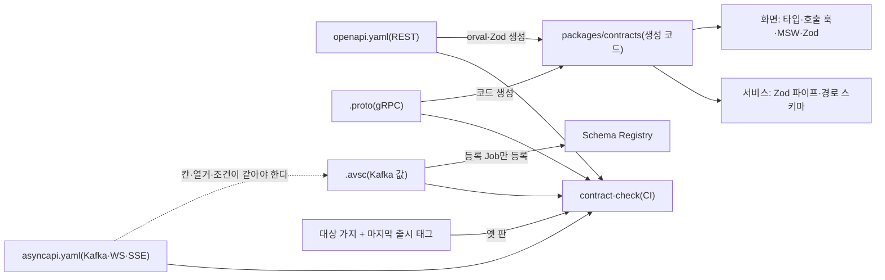

# 분야 편 7: API 규칙과 계약

- **기준 시점**: ADR-0177까지, 2026-11-01
- **맡는 정본**: [docs/api/guidelines.md](../../api/guidelines.md)(API 규칙), [docs/api/proto/README.md](../../api/proto/README.md)(서비스 사이 gRPC 계약), [docs/api/avro/README.md](../../api/avro/README.md)(Kafka 사건 스키마), [docs/api/breaking/README.md](../../api/breaking/README.md)(깨짐 검사 설정), [docs/api/openapi.yaml](../../api/openapi.yaml)·[docs/api/asyncapi.yaml](../../api/asyncapi.yaml)의 구조. 두 YAML의 경로와 칸 하나하나는 '무엇이 있고 어디서 찾는지' 수준으로 읽는다.
- **규범이 아니다**: 정본을 풀어 쓴 해설이다. 숫자와 규칙이 정본과 다르면 정본이 맞다([ADR-0177](../../adr/0177-walkthrough-explain-in-interview.md)).
- **한 판 문서와의 관계**: [한 판 문서](../01-system-design.md) 3단계(구매 길 API, 멱등 키, 진입의 `text/plain`), 10단계(멱등 세 겹), 11단계(바깥은 REST·안은 gRPC와 Kafka, 재시도는 한 층, 헤지 요청을 쓰지 않음, Fastify)가 일부를 이야기 순서로 쓴다. 이 편은 규칙 전체와 계약 파일의 구조, 깨짐 검사, Avro 필수 칸을 정리한다.
- **측정 전이다**: 서비스 수준 측정(NFR 목표를 운영 규모로 잰 것)은 아직 없어 성능 숫자는 설계 목표값이고 `[실측 전]`을 붙였다. 기반 PoC(wbs 0.5.1, 본 개발 전에 위험한 부분만 먼저 재 보는 시험)는 2026-11-01에 PC 한 대에서 쟀다([ADR-0176](../../adr/0176-foundation-poc-results.md), 성능 장부 docs/perf-ledger.md §5). 그 숫자는 '실측(PC)'이고 운영 규모 증거가 아니다. 정본의 `[가정]`은 그대로 옮겼다. 만든 것은 [현황 한 장](../00-status.md)이 센다.

## 1. 이 문서가 정하는 것

이 정본 묶음은 PEAKET의 통신 계약을 어디에 두고, 어떤 규칙으로 쓰고, 어떻게 깨지 않게 지키는지를 정한다. API(프로그램끼리 요청과 응답을 주고받는 창구)의 계약은 네 형식의 파일이다. 브라우저·스캐너·콘솔과 입구 서버(게이트웨이) 사이의 REST(주소와 HTTP 메서드로 자원을 다루는 방식)는 OpenAPI 파일, Kafka(사건을 쌓아 여러 곳에 나눠 주는 메시지 시스템)와 WebSocket(연결을 열어 둔 채 주고받는 통신)·SSE(서버가 한 방향으로 계속 보내는 통신)는 AsyncAPI 파일이다. 서비스끼리 함수를 부르듯 묻는 gRPC는 `.proto` 파일(protobuf 정의), Kafka 메시지의 실제 바이트 모양은 Avro 스키마(메시지 구조를 기계가 읽게 적은 파일)다. 이 파일들이 원본이고 코드에서 만든 문서는 견주는 데만 쓴다. guidelines.md는 그 위의 규칙 열두 가지를 정한다: 판과 깨짐, 오류 형식, 페이지, 멱등 키(같은 요청이 여러 번 와도 한 번 처리한 것과 같게 하는 키), 데드라인과 재시도, 요청 수 제한, 인증 흐름, 외부 연동, 공통 헤더, 경로 이름, 검색, 메서드와 상태 코드. proto·avro README는 형식별 규칙과 호출·토픽 목록이고, breaking/README는 CI(코드를 올릴 때마다 도는 자동 검사)가 PR(코드 변경 요청)마다 '깨짐'을 잡는 설정이다.

> **30초 설명**: "계약은 파일이 원본입니다. 바깥 REST는 OpenAPI, Kafka와 실시간 채널은 AsyncAPI, 서비스끼리는 protobuf, Kafka 메시지는 Avro로 docs/api/ 한 곳에 둡니다. 화면의 타입·호출 코드·입력 검사와 서버의 요청 검사를 모두 이 파일에서 만들어서 둘이 다른 규칙을 갖지 못합니다. 오류는 서비스든 게이트웨이든 RFC 9457 Problem(오류를 알리는 표준 본문 형식) 한 형식이고, 다시 보내면 두 번 처리될 수 있는 쓰기는 멱등 키가 필수입니다. 경로는 명사이고 깊이는 2단계까지입니다. PR마다 CI가 계약을 대상 가지뿐 아니라 운영에 나간 마지막 판과도 견줘, 지금 클라이언트가 고치지 않으면 실패하는 변경을 막습니다. Avro는 첫 등록 전에 '늘 있는 칸은 필수'로 정했습니다. 등록한 뒤에는 빈 값을 허용한 칸을 다시 조일 수 없기 때문입니다."

## 2. 절마다 읽기

guidelines는 `## ` 절이 12개, proto README는 4개, avro README는 6개이고 breaking README는 절이 없다. 두 YAML은 맨 위 칸을 묶어 행을 두었다. 따로 물을 만한 굵은 글씨 항목은 행을 나눴다.

| 정본 절 | 무엇을 정하나 | 왜 | 해설서에서 |
| --- | --- | --- | --- |
| docs/api/guidelines.md §1 버전 정책과 하위 호환·폐기 절차 | 경로의 `/v1`, 깨지는 변경은 새 메이저 판과 `Deprecation`·`Sunset`(폐기 예정과 멈출 날을 알리는 헤더). 형식마다 깨짐 검사 도구 하나, 계약 파일이 원본(화면은 orval 생성기로 타입·호출·MSW(가짜 API 응답)·Zod(입력 검사 스키마)를 만든다), 웹훅(일이 생기면 PEAKET이 파트너 서버를 불러 알리는 방식) 폐기 90일, 스캐너 최근 판 2개, 모은 금액 `int64` | 한 PR이 계약과 양쪽 코드를 함께 바꾸면 같은 커밋끼리는 통과해도 배포 사이에 운영의 옛 판과 함께 돈다(ADR-0165). 같은 생성 스키마를 써서 화면과 서버의 검사가 갈라지지 않는다 | — |
| docs/api/guidelines.md §1 핫패스 경로의 서버 검사 | 핫패스(요청이 가장 많은 경로)는 Zod 파이프 대신 같은 생성 스키마에서 바꾼 Fastify(HTTP를 받는 부품) 경로 스키마로 검사할 수 있다. 2026-11-01 V-T41 실측(PC)으로 좌석 홀드는 경로 스키마, 대기열 진입은 Zod 파이프로 정했다(ADR-0176 결정 4). 익명 요청은 본문이 틀려도 먼저 401이다 | 원본은 계약 하나 그대로다. 경로 스키마가 요청당 CPU를 5% `[가정]` 넘게 줄이지 못하면 Zod 파이프로 되돌린다. 좌석 홀드는 7.4% 줄였고 대기열 진입은 줄이지 못했다. 401이 먼저인 것은 검사 규칙을 떠보지 못하게 하려는 것이다 | 한 판 11단계(Fastify만) |
| docs/api/guidelines.md §2 에러 응답 형식 | 모든 오류는 RFC 9457 Problem(`type`·`title`·`status`·`detail`·`instance`)이고 게이트웨이·엣지 오류도 같다(예외는 기기 승인 토큰의 OAuth 오류와 정적 파일 404 둘). 한 `type`은 늘 같은 상태 코드다. 경합 409는 정상 분기로 세고, 자기 과부하는 429 `server-busy`, 차단기(실패가 잇따르는 상대를 잠시 부르지 않는 장치) 열림은 503이다 | 화면이 `type` 하나로 문구를 고른다. 스택·SQL은 내지 않는다(웹 앱 보안 검증 기준 ASVS v5.0.0-16.5.1). 바쁜 파드(쿠버네티스에서 앱이 도는 단위)가 503을 내면 이상 파드로 빠져 남은 파드에 부하가 몰린다(낮음-140) | 분야 편 10(409·410만) |
| docs/api/guidelines.md §3 페이지네이션 | 커서(다음 위치를 가리키는 불투명한 값) `cursor`·`limit`·`nextCursor`가 기본이다. 예외는 스캐너 변경분(`after`)과 검색·내 문의(`page`)다. 0건은 200과 빈 `items` | 오프셋(건너뛸 앞 행 수)은 뒤 페이지로 갈수록 앞 행을 모두 건너뛰고, 그사이 행이 들면 중복·누락이 난다 | — |
| docs/api/guidelines.md §4 멱등성 키 | `Idempotency-Key`가 필수인 쓰기, 범위 '계정 × 작업', 요청 지문, 422·409·400, 보관 기간, 저장 자리(홀드는 좌석 Redis(메모리 저장소)에서 좌석을 잡는 Lua 스크립트 안, 주문·결제는 PostgreSQL 원장과 같은 트랜잭션(모두 하거나 모두 안 하는 쓰기 단위)), 결제사로 보내는 키 | IETF(인터넷 표준을 만드는 단체) 초안의 처리 규칙을 따른다. 지문에 헤더를 넣지 않는 것은 서명·일련번호를 보낼 때마다 새로 만들기 때문이다 | 한 판 3·10단계, 분야 편 10·11 |
| docs/api/guidelines.md §5 재시도와 데드라인 전파 | `x-peaket-deadline-ms`로 남은 시간(데드라인)을 줄여 넘기고 모자라면 504다. 네트워크 재시도는 메시(서비스 사이 통신을 맡는 층)만, 헤지 요청(같은 요청 겹쳐 보내기)은 없다. gRPC 채널은 `createGrpcClient` 하나로 만든다. 브라우저는 `Retry-After` 하한에 위쪽 0~20% 지터(일부러 섞는 지연)를 더한다 | 재시도가 층마다 곱해지지 않게 한다. 지터를 아래로도 주면 하한이 깨지고, 하한으로 자르면 같은 1초에 503을 받은 사람이 같은 때 다시 온다(중간-038) | 한 판 11단계, 분야 편 11·14 |
| docs/api/guidelines.md §6 분산 레이트 리밋 | 요청 수 상한은 두 층이다. 핫패스는 게이트웨이 파드별 토큰 버킷(일정 속도로 채워지는 표만큼 받기), 일반 경로는 전역 레이트 리밋(판정 20ms, 못 받으면 통과), gw-ops는 로컬만이다 | 핫패스에서 바깥 저장소 조회를 피한다. 로컬 상한은 '파드 수 × 한도'라 사람당 정확한 한도는 1인 1순번·입장 토큰이 맡는다(낮음-022) | 분야 편 9 |
| docs/api/guidelines.md §7 인증 및 인가 아키텍처 흐름 | 팬 토큰(ES256 타원곡선 서명의 JWT(서명된 정보 묶음 토큰), 15분)과 쿠키, 게이트웨이의 무상태 검증, 역할은 서비스가 요청마다 판정, 입장 토큰 묶기, 관리 계정 MFA(다중 인증), 재인증 토큰은 `X-Reauth-Token` 헤더만, 스캐너는 기기 키 DPoP(요청마다 기기 키로 서명한 증명) | 서비스는 내부 헤더와 메모리의 세션 무효화 목록만 봐서 실행 중 DB 부하가 0이다. 역할을 토큰에 싣지 않아 거두면 몇 초 안에 반영된다(ADR-0172) | 분야 편 8·13 |
| docs/api/guidelines.md §8 외부 시스템 연동과 결함 격리 대책 | 연동 13곳(결제사 둘, 사람 확인, 본인확인, 소셜 로그인, 공개 난수, 파트너 웹훅, 알림, 수사기관, 공연예술통합전산망, 송금, 지급대행 둘)의 통신 방식과 장애 때 동작 | 외부가 아프면 그 기능만 줄인다. 웹훅의 SSRF(남이 준 주소로 요청해 내부망에 닿게 하는 공격)는 NetworkPolicy(파드의 통신을 막는 쿠버네티스 규칙), 연결할 때의 IP 검사, 등록·수정 때의 주소 검사 세 겹으로 막는다(중간-061) | 분야 편 9·11·12·14 |
| docs/api/guidelines.md §8.1 외부 호출의 실패 모양과 무게 | 외부 시스템 12줄마다 실패 모양(무응답·지연·성공 뒤 응답 유실·거절·한도 초과), 무게(멈추면 무엇이 멈추나. 1등급 판매 경로, 2등급 판단·보조, 3등급 사후·분석·관측), 동작이 적힌 정본 자리. 동작은 옮겨 적지 않고 §8 표를 가리킨다 | 무게가 다르면 동작도 다르다. 결제 실패는 좌석을 묶은 채 결과를 확정하고, 알림 실패는 예매를 건드리지 않는다. 같은 내용이 두 곳에 생기면 어긋나서 동작은 §8에만 둔다(ADR-0180) | 분야 편 22(ADR-0180) |
| docs/api/guidelines.md §9 공통 헤더 및 캐싱 규약 | `X-Trace-Id`, 들어온 추적 헤더 지우기, 비밀값은 URL 밖, 캐시 헤더와 수명, 텔레메트리(브라우저가 보내는 성능·오류 신호) 입구 `/_t/*`, CSV 칸의 수식 막기 | 캐시된 응답에 남의 추적 값이 실리지 않게 하고, 바깥 호출자가 PEAKET의 추적을 정하지 못하게 한다(낮음-023, 중간-066) | 분야 편 9·14 |
| docs/api/guidelines.md §9 CSRF·사전 요청 없는 쓰기·CORS | 쿠키로 인증하는 쓰기는 `Origin`을 대조한다(CSRF: 다른 사이트가 몰래 보내는 요청). 대기열 진입·입장 확정만 `text/plain`이라 사전 요청(브라우저가 먼저 묻는 OPTIONS)이 없다. CORS 허용 출처는 화면 호스트 하나다 | 오픈 순간 왕복 하나를 없애고, 위조는 본문 토큰·`Origin`·`SameSite=Strict`(다른 사이트발 요청에 쿠키를 싣지 않는 설정)가 맡는다(ADR-0065) | 한 판 3단계, 분야 편 9 |
| docs/api/guidelines.md §10 URI 설계 규칙 | 호스트는 `x-peaket-gateways`, 명사 경로와 동작 기록 하위 자원(`…/approvals`), 복수·단수, `me`, 깊이 2단계, 끝 슬래시 404, 예외 다섯 | 경로만 보고 하는 일을 알게 하고 예외는 목록으로 고정한다. 주소가 둘이면 CDN(사용자 가까이에 응답을 복사해 두는 전송망) 캐시가 갈린다(ADR-0081) | 한 판 3단계(경로 표만) |
| docs/api/guidelines.md §11 검색·부분 응답·하이퍼미디어 | `q`와 예약 이름, 같은 쿼리 이름 두 번은 400이다. `q`에 조건을 이어 붙이지 않고, `fields`는 문법만 두며, HATEOAS(응답 속 링크로 다음 행동 알리기)는 넣지 않는다 | 이어 붙이면 캐시 키가 갈리고 필터별 검사를 못 한다. 두 번 온 이름은 파라미터 오염(ASVS 15.3.7)을 막는다 | — |
| docs/api/guidelines.md §12 메서드와 상태 코드 | 메서드의 뜻, 비밀값 조회만 POST, 성공·오류 코드의 뜻, 남의 기록은 404, 동시 수정(자원의 판 `ETag`와 `If-Match`, 412·428), `operationId`·`x-peaket-roles`·`x-peaket-trace-rare` | 상태 코드를 오용하지 않고 존재를 숨길 곳은 숨긴다. 역할 칸은 권한 빈틈을 문서 단계에서 기계로 잡는다(ADR-0164) | — |
| docs/api/proto/README.md §1 파일 | 폴더 `peaket/<받는 서비스>/v1/`, 파일 12개, 컴파일·검사 이력. 마지막 셈은 서비스 42개·호출 82개 | 서비스 사이 계약이 글과 표로만 있었다(ADR-0084) | — |
| docs/api/proto/README.md §2 규칙 | 패키지와 `v2`·`reserved`, 업무 결과는 결과 값(enum), 상태 코드 10개(표 9행)와 할 일, 호출별 데드라인, 재시도, 부르는 쪽 신원, 개인정보 | 거절·입금 대기는 오류가 아니라 결과다. `DEADLINE_EXCEEDED`·`UNAVAILABLE`은 차단기와 대체 응답으로 간다 | 분야 편 11·14(데드라인 값) |
| docs/api/proto/README.md §3 호출 목록 | 부르는 쪽 → 받는 쪽, 호출, 멱등 키, 정본 흐름, 통신 표에 있는지 | 흐름도에만 있던 호출을 이 초안에서 처음 계약으로 적고 통신 표에도 더했다(ADR-0084) | 한 판 10·11단계(결제·발권·제어만) |
| docs/api/proto/README.md §4 이 초안에 넣지 않은 것 | gRPC가 아닌 통신과 아직 길이 없는 호출 | ops-svc를 업무 gRPC 받는 쪽으로 만들지 않는다(ADR-0145 상태 줄) | — |
| docs/api/avro/README.md §1 파일과 검사 | Avro 메시지 19종, 이름 붙은 타입 68개, 경로 `peaket/<묶음>/<레코드>.avsc`, 검사 이력. JSON 메시지 둘은 뺐다 | 조사용 요청 기록은 OTel 수집기(관측 데이터 수집 프로그램)가 레지스트리 형식 Avro를 만들지 못해 JSON이다(ADR-0171) | — |
| docs/api/avro/README.md §2 옮긴 규칙 | 형 대응, 열거(정해진 값 목록) 맨 앞 `UNRECOGNIZED`와 기본값, null 규칙, Kafka 키는 UTF-8 문자열, 파티셔너(키로 파티션을 고르는 규칙) `murmur2_random` | 기본값 없는 열거는 모르는 기호에서 읽기 오류가 난다. 파티셔너가 섞이면 한 회차가 여러 파티션으로 간다(ADR-0142) | — |
| docs/api/avro/README.md §3 등록과 호환 | Schema Registry(스키마를 판마다 등록하는 서버), BACKWARD_TRANSITIVE(새 스키마가 지난 모든 판의 데이터를 읽어야 하는 호환 모드), 소비자 먼저, 바꾸면 안 되는 것, 주제 이름(레지스트리에서 스키마를 묶는 이름), 등록 Job, 생산자 스키마 ID, Outbox(보낼 사건을 DB 변경과 함께 적어 두는 표) | 7일 안의 옛 메시지를 다시 읽는 소비자가 있다. 레지스트리가 멈춰도 새로 뜬 파드가 주문을 만든다(중간-088) | — |
| docs/api/avro/README.md §4 토픽과 레코드 | 토픽 15개의 레코드·키·내는 곳·받는 곳 | 레코드가 여러 종류 실리는 토픽이 다섯이라 주제 이름 방식을 정한다 | 한 판 11단계(토픽 묶음만) |
| docs/api/avro/README.md §5 asyncapi와 다른 점과 정할 일 | `features`, 필수 필드, payload 형식, 압축 토픽(키마다 마지막 값만 남기는 토픽) 키, 열거 기호, 쓰기 권한의 처리 기록 | 커뮤니티판은 쓰기 권한을 나누지 못해 '등록 Job만'은 설정 규칙이다 | — |
| docs/api/avro/README.md §6 칸마다의 필수 판정 | 원칙, `x-present-when` 읽는 법, 191칸 셈, 메시지별 표, 구현 때 확인할 판정 | 첫 등록 뒤에는 null 허용 칸을 조일 수 없다(ADR-0150) | — |
| docs/api/breaking/README.md 계약 깨짐 검사의 수준·예외 파일 | `tools/ci/contract-breaking.mjs`가 읽는 수준·예외·덮어쓰기 파일과 `breaking-approved` 라벨 | 도구 기본 수준을 정본의 '깨짐'에 맞추고, 예외가 이유와 라벨 없이 늘지 못하게 한다 | — |
| docs/api/openapi.yaml `servers`·`security`·`x-peaket-gateways`·`tags` | 호스트 6개와 호스트별 CORS 값, 전역 팬 쿠키, 접두사 → 호스트 규칙 6줄, 화면 묶음 태그 14개 | 태그는 화면 묶음이라 게이트웨이와 일대일이 아니어서 접두사 표 하나로 둔다(낮음-031) | 한 판 11단계(입구) |
| docs/api/openapi.yaml `components`·`paths`·`webhooks` | 인증 방식 11개, 공용 파라미터·응답·헤더, 작업마다 역할·근거 FR, 파트너 웹훅 `partnerEvent` 하나 | 4xx·5xx는 모두 Problem 본문이고 401은 `WWW-Authenticate`, 429·503은 `Retry-After`를 싣는다(info 설명). 수는 doc-check가 센다 | 한 판 3단계(구매 길 경로) |
| docs/api/asyncapi.yaml `info`·`servers`·`channels`·`operations`·`components` | 공통 필드와 키·순서 규칙, 서버 넷, 채널 20개, 작업 40개, 메시지 34개 | 판은 레지스트리 ID가 말한다. 소비자는 도착 순서 대신 펜싱 토큰(계속 커지는 번호)·판 번호로 늦은 사건을 거른다(낮음-025·026) | 한 판 11단계, 분야 편 10 |

## 3. 꼭 기억할 규칙과 숫자

| 항목 | 값 | 표시 | 정본 위치 |
| --- | --- | --- | --- |
| 계약 원본 | `peaket` docs/api/. 생성 코드 `packages/contracts`는 게시하지 않고 `workspace:`로만 쓴다. 판은 출시 태그가 말한다 | 확정(소유자 결정, ADR-0165) | guidelines §1 |
| 깨짐 검사 | oasdiff(OpenAPI 차이 비교 도구) 1.34.1 `--fail-on ERR`, AsyncAPI CLI 6.2.2, `buf breaking`(protobuf 검사, FILE 규칙), 로컬 레지스트리, Pact(소비자가 기대하는 요청·응답을 적은 계약 시험). 대상 가지와 마지막 출시 태그 둘과 견준다 | 확정(추천 적용) | guidelines §1 |
| 웹훅 판 바꾸기 | 새 `type`(예 `order.confirmed.v2`)을 함께 보내고 옛 `type`은 알린 날부터 최소 90일 | 확정 | guidelines §1 |
| 페이지 | `limit` 최대 100, 스캐너 변경분 5,000. 검색은 `limit` 20만, `page × 20` 1,000 상한, CDN 30초 | 검색 셋은 `[가정]` | guidelines §3 |
| 멱등 키 | 따옴표 없는 UUID(무작위 식별자) v4. 다른 본문 422, 처리 중이면 1초 기다린 뒤 409 + `Retry-After: 1`, 형식 틀림 400 | 1초·1은 `[가정]` | guidelines §4 |
| 멱등 보관 | 홀드 7분(홀드 유효 시간 TTL과 같다), 그 밖 24시간. 결제사 키 `confirm-{orderId}`·`cancel-{cancellationId}`, 재시도 창 3시간 | 24시간 `[가정]` | guidelines §4 |
| 데드라인 | 서비스 상한 기본 15,000ms. 홀드 40ms, 승인 명령 접수 200ms, 종단 확정 3초, `ApplyControl` 1초, `BatchGetPayments` 500ms, `ScoreRisk` 800ms | 200ms·1초·500ms·800ms `[가정]`, 모두 `[실측 전]` | guidelines §5, proto §2 |
| 결제사 승인 호출 | 끊지 않고 읽기 60초까지 기다린다. 2초는 경보 기준 | 60초 `[가정]` | guidelines §5 |
| 재시도 | 브라우저 기다림 = 하한 × (1 + U(0, 0.2)), 한 페이지 분당 60회 이하. 메시 재시도 예산은 진행 중 요청의 10% | 10%는 `[가정, wbs 4.6.1에서 확정]` | guidelines §5 |
| 레이트 리밋 | 진입 기기당 10회/10초, 일반 사용자당 60회/분, 파트너 테넌트(파트너 회사 단위)당 600회/분, 리포트 30회/분, 결정 기록 10회/분. 전역 판정 20ms, 못 받으면 통과 | 앞의 셋은 `[가정, Phase 2 부하 시험에서 확정]`, 리포트·결정 기록은 `[가정, Phase 4 4.3.6에서 확정]` | guidelines §6 |
| 토큰 | 팬 액세스 ES256 15분, 무효화 목록 15분 보존, 재인증 토큰 5분 1회용, 관리자 유휴 1시간 | 확정 | guidelines §7 |
| 파트너 웹훅 | 다시 보내기 1분·5분·30분·2시간·6시간·12시간 뒤 DEAD(실패로 따로 모아 두는 상태). 응답 64KiB, 연결 3초·전체 10초. 온세일 창(T-10분~T+60분) 새 묶음은 미루고 최대 70분 | 간격·크기·시간 `[가정]` | guidelines §8 |
| 캐시 | 대기 순번 파일 `max-age=1`, 셔플·묶음 결과 60초, 공개 읽기 홈·검색 30초·자동완성·후기 요약 60초·회차 공개 요약 300초. 사전 요청 캐시 7200초 | 1초·7200초 말고는 `[가정]` | guidelines §9 |
| 동시 수정 | 강한 `ETag: "7"` 꼴, 판이 다르면 412, `If-Match`가 없으면 428 | 확정 | guidelines §12 |
| 허용 역할 | 12종(`public`, `fan`, `partner_admin`, `partner_member`, `viewer`, `operator`, `commander`, `cs_agent`, `cs_lead`, `scanner_device`, `gate_staff`, `gate_lead`), 정본은 docs/security/authz-matrix.md §5.5 | 확정(모든 작업에 다는 것은 소유자 결정, 값의 표기는 추천 적용) | guidelines §12 |
| openapi 셈 | 경로 244, 작업 271, `security: []` 22, 드문 쓰기 표시 24, `operationId` 0 | 2026-11-01 파일로 셈. 정본 수는 doc-check 보고 | guidelines §12 |
| gRPC 셈 | 파일 12개, 서비스 42개, 호출 82개 | protoc 컴파일 오류 0, `buf` 검사는 아직(wbs 0.2.2) | proto §1 |
| Avro 셈 | 19종, 타입 68개(레코드 28, 열거 40), 191칸 = 필수 129·기본값 false 9·조건부 53(`x-present-when` 34) | 레지스트리 검사는 아직(wbs 0.2.2) | avro §1·§6 |

## 4. 이 문서가 다루는 ID

이 정본은 FR·POL을 새로 정하지 않는다. 아래는 규칙의 근거로 쓰는 ID다. 경로마다의 FR은 openapi.yaml 작업 설명에 있다.

| ID | 한 줄 |
| --- | --- |
| FR-025 | 파트너가 판매 이벤트 웹훅 받을 URL을 등록한다. HTTPS만, HMAC(키가 있어야 만드는 서명값) 서명 비밀을 발급한다 |
| FR-054 | 공연예술통합전산망에 공연정보 10개 항목을 하루 단위로 보낸다 |
| NFR-003 | 좌석 홀드 p99 50ms `[실측 전]`, 가용성 99.95%, 오버셀 0건. 경합 409는 정상 응답으로 센다 |
| POL-005 | 검증 가능한 셔플. drand(공개 난수 비콘) 라운드를 미리 공개하고 직전 라운드로 대체하지 않는다 |
| POL-012 | 홀드 TTL과 재노출. 홀드 멱등 키 보관 기간이 이 TTL과 같다 |
| POL-014 | 가상계좌와 환불 계좌. 송금 계좌는 저장하지 않는다 |
| POL-019 | 계정·세션 정책. 토큰 15분, 기기 최대 5대, 재인증이 필요한 팬 작업 |
| POL-021 | 운영 명령 규칙. 명령 6(대체 결제사 전환)의 2인 승인 |
| POL-028 | 온세일 윈도우(70분) 운영 제약. 웹훅 다시 보내기를 미루는 근거 |
| POL-033 | 회원 탈퇴와 재가입. 부정 예매 계정의 연계정보 HMAC 보관은 그 예외다 |
| POL-034 | 계정 연결·병합. 병합 차단 사유를 데이터 주인 서비스마다 묻는다 |
| POL-044 | 게시물 신고와 권리 침해 삭제 요청 |
| POL-046 | 부정 예매 사후 조치. ⑦ 우선 구매, ⑥ 재가입 제한 |
| SCR-025 | 웹훅 연동 설정. 전송 실패 알림을 띄운다 |
| SCR-032 | 법정 조치 관리. 수사기관 대응을 손으로 기록한다 |
| SCR-045 | CS 처리함. 이의 심사가 판정 근거를 읽는다 |
| SCR-051 | 스캐너 승인. 기기를 키 지문으로 찾는다 |
| SCR-053 | 스캐너 기기 관리. 목록에 지금 세션 별명을 합친다 |
| SCR-064 | 관리 계정·세션 관리 |
| SCR-065 | 파트너사·계약 관리. API가 아직 없다 |

## 5. 결정과 버린 길

버린 길은 각 ADR의 '검토한 대안'에서, '본문이 옛 판인 곳'은 상태 줄과 docs/architecture.md §11, 지금 정본에서 옮겼다. [결정 카드 목록](../decisions/README.md) §2가 이 편에 둔 ADR은 0081·0145·0148·0150·0160·0164 여섯이다.

### [ADR-0081](../../adr/0081-rest-api-design-criteria-audit.md) REST 설계 기준을 API 규칙으로 들인다

- **고른 것**: 소유자의 REST 기준을 guidelines §10~§12로 들이고 64개 작업 경로를 바꿨다. 동작은 '그 동작이 남기는 기록'의 하위 자원이고, 쌓이면 복수(`approvals`), 한 번뿐이면 단수(`acceptance`)다. 오류 본문은 어디서 나든 Problem이다. 배포된 클라이언트가 없어 `v1` 안에서 제자리로 바꿨다. 기준과 다르게 정한 것은 셋이다. 커서가 기본이고, `q`에 조건을 이어 붙이지 않으며, 디버그 정보는 로컬·CI에서만 낸다.
- **버린 길**: 동사 경로는 기준이 막는다. Google API 설계 지침 AIP-136의 `:approve`는 동사가 남는다. 상태 칸 PATCH는 전이마다 권한·재인증·멱등·감사가 달라 권한 표가 흐려진다. 옛 경로 별칭은 경로와 시험만 는다. QUERY 메서드는 CloudFront(AWS의 CDN)가 받지 않는다. 쿠키 경로 401에 Bearer를 쓰면 RFC 6750 전달 방법에 쿠키가 없어 뜻이 틀린다. 끝 슬래시를 같게 받으면 CDN 캐시가 갈린다.
- **본문이 옛 판인 곳**: 결정 14의 스캐너 `Bearer realm=`은 지금 mTLS(양쪽이 인증서를 확인하는 암호화 통신) 선택지의 값이고, 기본안은 `DPoP realm="peaket-scanner"`다(낮음-074). '반영 수치'는 그날 값이다. 바뀌기 전 경로는 끝의 대응표로 읽는다.

### [ADR-0150](../../adr/0150-event-schema-required-fields-always-present.md) 늘 값이 있는 칸은 필수로 한다

- **고른 것**: 늘 있는 칸은 필수, 사건 종류에 따라 없을 수 있는 칸만 `["null", 타입]`과 기본값 null, 참·거짓은 기본값 false다(소유자 결정). 조건은 `x-present-when`으로 적는다. 필수 칸이 비면 거래 사건은 업무 트랜잭션이 실패하고, 텔레메트리는 버리고 센다.
- **버린 길**: 공통 셋만 필수(A안)는 소비자가 꼭 쓰는 칸이 null로 남고 뒤에 조일 수 없다. 종류별 하위 레코드(C안)는 메시지 모양이 크게 바뀌고 그래도 생산자 시험이 필요하다. 조건을 글로만 적으면 스키마와 시험의 어긋남을 못 잡는다.
- **본문이 옛 판인 곳**: 셈 172칸은 2026-10-31에 191칸이 됐다(avro §6).

### [ADR-0148](../../adr/0148-deferred-internal-grpc-contract-drafts.md) 미뤄 둔 내부 gRPC 계약 초안

- **고른 것**: 스캐너 기기 관리는 원장 주인 ticket-svc다. 병합 사전 확인은 데이터 주인 셋이 같은 모양 `CheckAccountMerge`로 답하고 하나라도 답이 없으면 503이다(모르면 막는 쪽). ops-svc 데이터는 ops-svc가 `SetAccountHold`로 먼저 알린다.
- **버린 길**: identity가 남의 DB를 직접 읽으면 논리 DB를 넘는다. 이벤트로 모으면 몇 분짜리 홀드까지 흘려야 한다. ops-svc에 호출을 두면 업무 gRPC를 받게 되어 웨이포인트(gRPC 서비스 앞 메시 프록시)와 공유 노드 풀에 묶인다.
- **본문이 옛 판인 곳**: 결정 10의 `peaket-contracts`는 옮길 저장소 없이 읽는다. 초안은 모노레포 `peaket`의 docs/api/proto/에 그대로 있다(ADR-0165, 상태 줄 2026-11-01).

### [ADR-0164](../../adr/0164-allowed-roles-on-every-operation-link-and-blocker-checks-canvas-direct-edit.md) 결정 1·2 작업마다 허용 역할을 적고 검사한다

- **고른 것**: 모든 작업에 `x-peaket-roles`를 달고, 공개 작업도 `[public]`이다. 값의 정본은 authz-matrix §5.5이고 doc-check `roles`가 어긋남을 오류로 잡는다.
- **버린 길**: 정본을 planning/03 §3에 두면 열이 묶음이라 기계로 못 읽는다. 공개 작업 칸을 생략하면 빠뜨린 작업과 구분되지 않는다.
- **본문이 옛 판인 곳**: '관련' 줄의 '게이트웨이가 경로별 역할을 본다'는 ADR-0172로 바뀌었다. 이 칸은 서비스 가드의 거친 검사다.

### [ADR-0145](../../adr/0145-api-contract-gaps-logout-scanner-version-telemetry-labels.md) API 계약 보완

- **고른 것**: gw-ops 로컬 한도, 로그아웃 `DELETE /v1/partner/auth/sessions/me`·`DELETE /v1/ops/auth/sessions/me`(204), `operationId` 이름 규칙, 응답 칸 `minAppVersion`, `/_t/*`는 guidelines §9가 정본, `x-peaket-trace-rare`.
- **버린 길**: gw-ops를 전역 한도에 붙이면 관제 입구가 공유 Redis에 다시 묶인다. 최소 판을 헤더로 알리면 모든 응답에 붙고 노출 헤더가 는다. `/_t/*`를 openapi에 넣으면 검사 예외가 늘고 외부 API로 오해된다.
- **본문이 옛 판인 곳**: 결정 5의 `ListUpcomingOnsales`는 두지 않고 S3 일정 파일을 읽는다(상태 줄). 결정 7의 대상 다섯 가지는 지금 표시를 단 작업 24개로 늘었다(guidelines §12).

### [ADR-0160](../../adr/0160-shop-order-request-body-consent-version-and-c4-component-names.md) 굿즈 주문 본문과 동의의 고지 문안 판

- **고른 것**: `POST /v1/shop/orders` 본문은 수령 방식 `fulfillment`로 갈리고(oneOf, 갈래 밖 칸은 400), 동의는 `consentVersion`과 함께 받아 판이 다르면 422 `consent-version-outdated`다. 금액은 서버가 계산한다.
- **버린 길**: 서버가 지금 문안 판을 채우면 이용자가 본 판과 기록이 어긋난다. 동의 누락을 `enum: [true]`로 막으면 '누락은 422' 규칙과 다르다.

### 이 분야에 걸린 다른 ADR

- [ADR-0084](../../adr/0084-docs-per-receiver-git-handover-contract-drafts-arc42.md)(자리는 분야 편 23): proto·Avro 초안을 docs/api/에 두고 주제 이름 `TopicRecordNameStrategy`를 골랐다. 버린 길은 `TopicNameStrategy`와 토픽별 유니온(여러 레코드가 실리는 토픽에서 생산자가 유니온의 최신 판으로 직렬화하게 설정해야 한다), `RecordNameStrategy`(어느 토픽에 어떤 레코드를 실을지 등록으로 정하지 못한다), Outbox를 jsonb로 두고 변환하는 안(커넥터가 추론한 스키마가 계약과 달라진다)이다. 대안 판단에 나오는 Flink(스트림 처리 엔진)·Debezium(DB 변경 기록을 Kafka로 보내는 도구)은 뒤에 빠졌다([결정 카드 D-28](../decisions/D28-drop-flink-stream-workers.md)·[D-10](../decisions/D10-order-history-polling-outbox.md)).
- [ADR-0165](../../adr/0165-four-repositories-monorepo-gitops-shared-workflows-private-loadtest.md) 결정 4: 계약을 운영에 나간 판과도 견준다. 계약 쪽만의 대안 비교는 정본에 없다([결정 카드 D-31](../decisions/D31-one-monorepo.md)).
- [ADR-0023](../../adr/0023-fastify-adapter-hot-path.md): 모든 HTTP 서비스가 Fastify다. 끝 슬래시 기본값과 경로 스키마가 기댄다([D-12](../decisions/D12-backend-stack-nestjs-fastify-drizzle.md)).
- [ADR-0082](../../adr/0082-istio-ambient-mesh-app-boundary-meshless-portfolio-runs.md): 메시는 연결·전송을, 앱은 데드라인·차단기·추적 헤더를 맡는다([D-13](../decisions/D13-thin-gateways-and-ambient-mesh.md)). [ADR-0117](../../adr/0117-no-hedged-requests-snapshot-timeout-and-browser-retry.md): 헤지 요청을 쓰지 않는다([D-15](../decisions/D15-circuit-breakers-fail-fast.md)).
- [ADR-0100](../../adr/0100-console-rest-sse-drop-trpc-module-federation-showcase-baseline.md): 관제는 REST와 SSE만 쓰고 GraphQL·Socket.IO를 뺐으며, 파트너는 tRPC를 뺐다([D-07](../decisions/D07-realtime-transport-per-screen.md)). [ADR-0172](../../adr/0172-judge-roles-per-request-not-in-tokens.md): 역할은 서비스가 요청마다 판정한다([D-14](../decisions/D14-tokens-and-per-request-authz.md)).
- [ADR-0054](../../adr/0054-delivery-pipeline-change-freeze-and-safe-deploys.md): 소비자를 먼저 배포한다(분야 편 20). [ADR-0065](../../adr/0065-web-frontend-security-after-asvs-v3.md): `Origin`·`text/plain`·CORS(분야 편 21). [ADR-0116](../../adr/0116-single-polling-outbox-relay-drop-debezium-place-pgbouncer-schema-registry.md): Outbox 폴링 릴레이([D-10](../decisions/D10-order-history-polling-outbox.md)). [ADR-0142](../../adr/0142-consumer-key-concurrency-held-events-client-required-settings.md): 파티셔너와 키 단위 처리([D-16](../decisions/D16-kafka-topics-and-clusters.md)).

## 6. 읽는 요령

**읽는 순서**: guidelines §1 → §10~§12 → §2 → §4 → §5·§6 → §7·§9 → §8 → §3·§11. 이어서 proto §2 → §3, avro §2 → §3 → §6. 두 YAML은 처음부터 읽지 않고 아래 '찾는 법'으로 연다.

**계약 파일에서 코드와 검사까지**(정본이 여러 절에 나눠 적은 흐름)

**찾는 법**

- 경로: openapi.yaml에서 경로를 찾는다. 호스트는 `x-peaket-gateways` 접두사 규칙(`/v1/ops/`, `/v1/partner/`·`/v1/webhooks/`, `/v1/scanner/`, `/v1/queues/`, 나머지)으로 읽고, 경로의 `servers`가 이긴다. 누가 부르는지는 `x-peaket-roles`, 값의 뜻은 authz-matrix §5.5다.
- 오류: 응답 설명의 대문자 별칭(`DUPLICATE_ADMISSION`)은 `type` 끝 케밥 표기(`duplicate-admission`)와 같다. 전체 목록은 wbs 0.2.3에서 만든다.
- 서비스 사이 호출: proto §3에서 이름을 찾고 필드는 `.proto`에서 읽는다. 사건: avro §4에서 토픽, §6에서 칸의 필수 여부를 찾는다.

**함정**

- guidelines §1·§2·§4·§5의 '서비스 템플릿' 문단은 `packages/platform` 구현 메모라 규칙을 잡은 뒤 읽는다.
- proto §1·avro §1은 날짜별 이력이다. 지금 셈은 마지막 문장이고 중간의 '18개'·'서비스 8개'는 그날 값이다.
- 지금은 asyncapi를 고치면 avsc도 고친다. wbs 0.2.2 뒤에는 avro·proto 폴더가 원본이다.
- 정해 두고 아직 안 한 것: `operationId`(0개), `fields`, 게이트웨이 Problem의 `traceId`(미리 재 보는 시험 PoC D-T43 전), `buf`·레지스트리 검사.
- 400은 형식, 422는 업무 규칙이다. 남의 개인·거래 기록은 404, 공개 회차의 하위 자원은 403이다.
- 경로 스키마는 좌석 홀드 같은 핫패스에만 쓰고, 대기열 진입은 Zod 파이프로 되돌렸다(ADR-0176 결정 4). guidelines §1도 2026-11-02에 그렇게 고쳤다(§10). 닫지 않은 객체의 정의 밖 칸을 Zod는 버리고 경로 스키마는 넘긴다(본문 닫기는 BUILD_ORDER BAS-040).

## 7. 경계

| 이 정본이 정하지 않는 것 | 어디서 정하나 |
| --- | --- |
| 경로마다의 업무 규칙과 오류가 나는 조건 | docs/features/*.md(분야 편 8~17) |
| 역할의 뜻, 대상 조건, 재인증 작업 묶음 | docs/security/authz-matrix.md §5.5·§6(분야 편 21) |
| `contract-check` 잡, 확장·축소 배포 순서 | docs/devops.md §3.1·§6.5(분야 편 20) |
| 게이트웨이·CDN 설정 값을 붙이는 곳 | docs/infra.md §4.1·§9(분야 편 20) |
| 통신 표, 포트별 허용 표, 저장소 시간 초과 | docs/architecture.md §3.2·§5(한 판 11단계) |
| 토픽 소비 방식과 키 규칙 | docs/streaming.md §2.6·§7(분야 편 18) |
| Outbox·멱등 기록 표, Redis 멱등 키 | docs/data.md §2·§3·§4([DB 설계 편 5](../db/05-consistency-transactions.md)·[6](../db/06-concurrency.md)) |
| 추적 신뢰 경계, 정규 로그 줄, 꼬리 표본 | docs/observability.md §6·§7(분야 편 19) |
| 화면의 재시도·오류 처리와 문구 | docs/frontend.md §4.1·§4.3(분야 편 6), docs/design/d2-design-system.md §4(분야 편 5) |
| 오류 `type` 전체 목록, `operationId` 붙이기 | wbs 0.2.3(분야 편 23) |

## 8. 꼬리 질문

| 질문 | 답의 요지 | 근거 |
| --- | --- | --- |
| 실패를 200 본문 `{"success": false}`로 감싸면 편하지 않나요? | 감싸지 않는다. 상태 코드마다 뜻을 정하고 본문은 Problem 하나다. 한 `type`은 늘 같은 상태 코드라 화면은 `type`으로 문구를 고른다 | guidelines §2·§12 |
| 멱등 키 지문에 헤더는 왜 안 넣나요? | 구매 세션 일련번호·서명·재인증 토큰·추적 헤더는 다시 보낼 때마다 새로 만든다. 그래서 클라이언트는 처음 본문 문자열을 그대로 다시 보낸다 | guidelines §4 |
| 같은 커밋끼리 검사가 통과하면 충분하지 않나요? | 배포는 단위마다 따로 나가 운영의 옛 판과 함께 돈다. 그래서 마지막 출시 태그와도 견준다 | guidelines §1, ADR-0165 |
| Avro 필수 칸을 나중에 정하면 안 되나요? | 필수를 null 허용으로 푸는 것은 통과하지만, 반대와 기본값 없는 새 칸은 거절된다. 지난 모든 판과 견주므로 첫 등록 전이 유일한 때다 | avro §3, ADR-0150 |
| 새 열거 값을 내면 옛 소비자가 깨지나요? | 맨 앞 `UNRECOGNIZED`가 기본값이라 그 값으로 읽고 세며 SEV3(장애 심각도 3등급) 경보를 낸다. 레지스트리는 기호 지우기도 받아 '지우지 않기'는 `contract-check`가 지킨다. JSON 메시지는 기호 더하기도 깨짐이다 | avro §2·§3, guidelines §1 |
| 오프셋 페이지가 더 익숙한데요? | 뒤 페이지가 느리고 중복·누락이 난다. 화면이 번호를 쓰는 검색·내 문의만 예외이고 검색은 1,000 `[가정]` 상한과 CDN 캐시로 묶는다 | guidelines §3 |
| 게이트웨이가 역할까지 보면 빠르지 않나요? | 토큰에 실으면 거둔 뒤에도 토큰 수명 동안 남고, 게이트웨이가 identity를 부르면 바깥 저장소를 보지 않는 원칙이 깨진다. 서비스 가드가 5초 `[가정]` 캐시로 묻고 답이 없으면 503이다 | guidelines §7, ADR-0172 |
| 실제로 돌려 봤나요? | `packages/contracts`, 깨짐 검사, 공용 멱등 모듈은 만들었다. proto는 protoc 컴파일만 했고 `buf` 검사는 아직이다. Avro 레지스트리 검사도 아직이다. V-T41(어댑터·검사 방식 비교)은 2026-11-01에 PC에서 쟀다(실측(PC), 고정 응답만 돌려주는 대역 앱). 서비스 수준 측정은 아직 없다 | 00-status, proto §1, avro §1, ADR-0176 결정 4 |

## 9. 확인 문제

1. 같은 `Idempotency-Key`로 첫 요청이 처리 중일 때 같은 본문이 오면? 본문이 다르면?

답

같은 본문이면 1초 `[가정]` 기다려 첫 응답을 주고, 그래도 안 끝나면 409 `idempotency-request-in-progress`와 `Retry-After: 1` `[가정]`이다. 본문이 다르면 처리하지 않고 422 `idempotency-key-reused`이고, 클라이언트 버그라 자동으로 다시 보내지 않는다. gRPC에서는 `ALREADY_EXISTS`다(guidelines §4, proto §2).

2. `GET /v1/scanner/shift`와 `PUT /v1/scanner/shift/readiness`를 왜 나눴나? 비밀값 조회는 왜 GET이 아닌가?

답

읽기와 쓰기를 한 POST에 섞지 않는다는 규칙으로 근무 정보 읽기(GET, `no-store`)와 준비 보고(PUT, 204)를 나눴다. 비밀값(초대 토큰·확인 코드·휴대폰 번호)은 URL에 넣지 않으므로 본문에 담아 POST `…-lookups`로 받고 상태를 바꾸지 않는다. QUERY 메서드는 CloudFront가 받지 않는다(guidelines §9·§12, ADR-0081 결정 7).

3. `contactRef`의 `x-present-when: type CREATED 이고 refMissing false`는 무슨 뜻인가? 조건이 맞지 않으면 비워야 하나?

답

`OrderEvent`가 CREATED이고 가명 계산 실패 표시가 false면 값이 있어야 한다. 조건 하나 안의 칸은 모두 맞아야 하고, 목록 가운데 하나만 맞으면 된다. 맞지 않을 때 비워야 한다는 뜻은 아니다. 스키마는 이 조건을 막지 않아 생산자 단위 시험이 확인한다(avro §6, ADR-0150).

4. 게이트웨이가 낸 429 Problem에는 왜 `traceId`가 없나? 화면은 어떻게 추적하나?

답

응답 덮어쓰기는 상태 코드마다 고정 본문이고, 요청별 값이 채워지는지는 PoC(D-T43) 전이다. 그래서 `type`·`status`·`title`만 싣고 추적 값은 `X-Trace-Id` 헤더로 잇는다. 교차 출처 API는 이 헤더를 노출하고, 화면은 `type`으로만 가른다(guidelines §2·§9).

## 10. 정본에서 찾은 어긋남

| 어긋난 곳 | 내용 | 지금 읽는 법 |
| --- | --- | --- |
| docs/api/guidelines.md §8 파트너 웹훅 행과 ADR-0145 상태 줄 | guidelines가 온세일 창을 gRPC `ListUpcomingOnsales`로 계산한다고 적었다. 고침(2026-11-01 정합 점검): 지금은 S3 일정 파일 `ops-calendar/upcoming-onsales.json`을 읽는다고 적는다 | 일정 파일을 읽는다 |
| docs/api/proto/README.md §1·§2·§3 | `AdminAuthzService.GetAdminAuthz`(ADR-0172)가 §1 설명·§2 허용 신원·§3 표에 없었다. 고침(2026-11-01 정합 점검). 이 호출을 부르는 서비스 목록은 정본에 없어 열린 일 91번이다 | §3 표와 identity.proto 주석으로 읽는다 |
| ADR-0081 결정 14와 docs/api/guidelines.md §12 | 스캐너 401의 `Bearer`가 guidelines §12의 `DPoP`(낮음-074)와 달랐다. 고침(2026-11-01 정합 점검): 상태 줄이 `DPoP`로 읽게 한다 | guidelines §12를 따른다 |
| ADR-0081 상태 줄과 docs/api/guidelines.md §12 | 'Problem 선언 수는 guidelines §12에 적는다'가 doc-check 보고(낮음-032)와 달랐다. 고침(2026-11-01 정합 점검) | doc-check 보고로 읽는다 |
| ADR-0148 결정 10과 ADR-0165 | '`peaket-contracts`로 옮길 때'가 모노레포 결정과 달랐다. 고침(2026-11-01 정합 점검): 상태 줄이 옮길 저장소 없이 읽게 한다 | 계약은 `peaket` docs/api/에 둔다 |
| docs/api/avro/README.md §3 '열거 기호 더하기' 행과 §1 | §3의 '38개'가 §1의 40개와 달랐다. 고침(2026-11-01 정합 점검) | 40개로 읽는다 |
| docs/api/guidelines.md §1 핫패스 검사와 docs/architecture.md §6.1 Fastify 행 뒷부분 ↔ ADR-0176 결정 4 | 고침(2026-11-02 정합 점검): 두 곳은 대기열 진입·입장 확정도 경로 스키마로 검사한다고 적었다. ADR-0176(채택 2026-11-01)은 대기열 진입을 Zod 파이프로 되돌렸다. 지금은 두 곳 모두 대기열 진입을 뺐다. 입장 확정·좌석 해제·연장·결제 접수는 ADR-0176이 재지 않아 경로 스키마 그대로다 | 좌석 홀드는 경로 스키마, 대기열 진입은 Zod 파이프로 읽는다 |
