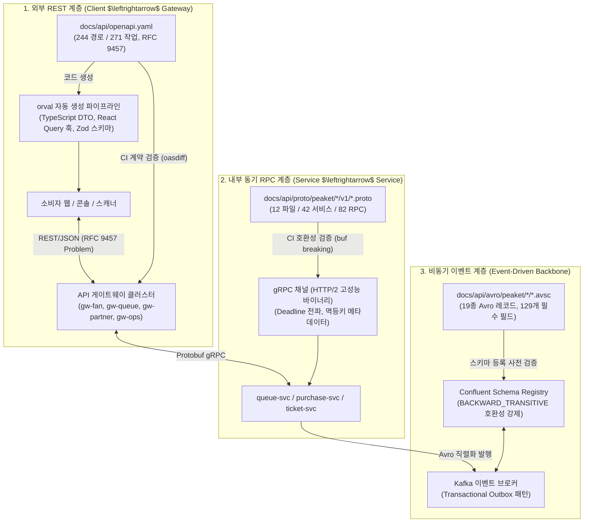
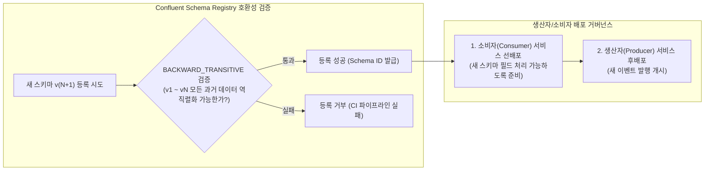

# 분야 편 7: API 규칙과 계약 (API Contracts, gRPC & Schemas)

- **맡는 정본**: [docs/api/guidelines.md](../../api/guidelines.md)(API 설계 규칙), [docs/api/proto/README.md](../../api/proto/README.md)(서비스 간 gRPC 계약), [docs/api/avro/README.md](../../api/avro/README.md)(Kafka 사건 Avro 스키마), [docs/api/breaking/README.md](../../api/breaking/README.md)(호환성 검사), [docs/api/openapi.yaml](../../api/openapi.yaml) 및 [docs/api/asyncapi.yaml](../../api/asyncapi.yaml) 구조, 자리가 이 편인 5개 ADR([ADR-0145](../../adr/0145-api-contract-gaps-logout-scanner-version-telemetry-labels.md), [ADR-0148](../../adr/0148-deferred-internal-grpc-contract-drafts.md), [ADR-0150](../../adr/0150-event-schema-required-fields-always-present.md), [ADR-0160](../../adr/0160-shop-order-request-body-consent-version-and-c4-component-names.md), [ADR-0164](../../adr/0164-allowed-roles-on-every-operation-link-and-blocker-checks-canvas-direct-edit.md))
- **문서 성격**: 정본 설계를 시스템 엔지니어링 및 기술 면접 관점에서 체계적으로 해설한 문서다. 규범적 수치와 불변 규칙의 최종 권위는 정본 문서에 있다([ADR-0177](../../adr/0177-walkthrough-explain-in-interview.md)). 길잡이는 [README.md](../README.md)다.
- **한 판 문서와의 관계**: [한 판 문서](../01-system-design.md) 3단계(구매 경로 핵심 API 및 멱등키), 10단계(3계층 멱등성 보장), 11단계(외부 REST, 내부 gRPC, 비동기 Kafka 이벤트 버스의 3중 통신 구조)의 프로토콜 계약과 하위 호환성 거버넌스를 총괄한다.
- **아키텍처 목표와 검증 기준**: OpenAPI 244개 경로/271개 작업 전수에 대해 RFC 9457 Problem Details 오류 규격을 강제하고, 12개 proto 파일(42개 서비스, 82개 RPC) 및 19종 Avro 이벤트 스키마에 대해 Confluent Schema Registry `BACKWARD_TRANSITIVE` 호환성을 강제한다. CI 파이프라인에서 `oasdiff`와 `buf breaking`을 통해 운영 배포본 대비 계약 깨짐(Breaking Change) 발생을 0건으로 차단한다.

---

## 1. API 계약 도메인 종합 개요

PEAKET의 분산 마이크로서비스 아키텍처는 통신 계층의 특성에 따라 **3가지 독립된 인터페이스 계약 모델(외부 REST/JSON, 내부 동기 gRPC/Protobuf, 비동기 이벤트 Avro/Kafka)**을 엄격히 구분하여 적용한다. 모든 인터페이스 계약은 코드가 아닌 정적 스키마 파일(`docs/api/`)이 단일 진실 공급원(SSOT)의 권위를 갖는다.

> **30초 아키텍처 브리핑 (Staff Engineer Interview)**:  
> "PEAKET의 API 계약 아키텍처는 **'외부 REST - 내부 gRPC - 비동기 Avro'의 3계층 인터페이스 모델**로 설계되었습니다.  
> 첫째, **외부 게이트웨이 REST API(OpenAPI 3.1)**는 244개 경로와 271개 엔드포인트를 명사 기반 리소스와 RFC 9457 Problem Details 단일 오류 규격으로 통일했습니다. 핫패스 쓰기(좌석 홀드, 결제 접수)에는 '계정 ID $\times$ 작업' 범위의 UUID v4 멱등키(`Idempotency-Key`)를 강제하며, T=0 대기열 진입은 CORS Preflight를 없애기 위해 `text/plain` 전송 규약을 적용했습니다.  
> 둘째, **내부 마이크로서비스 간 동기 통신(gRPC/Protobuf v3)**은 12개 proto 파일(42개 서비스, 82개 RPC)로 정의되며, HTTP 헤더의 남은 타임아웃을 마이크로초 단위로 차감 전달하는 `x-peaket-deadline-ms` 데드라인 전파와 메시 레이어 단일 재시도 원칙을 준수합니다.  
> 셋째, **비동기 이벤트 버스(Kafka/Avro)**는 19종의 이벤트 스키마에 대해 Schema Registry의 `BACKWARD_TRANSITIVE` 정책을 강제합니다. 특히 ADR-0150에 따라 상시 존재하는 129개 필드를 필수로 고정하여, 이벤트 스키마 등록 후 필수 제약을 사후 완화하지 못하는 Avro의 구조적 한계를 사전에 방어했습니다.  
> 넷째, 모든 PR은 CI 파이프라인에서 대상 브랜치뿐 아니라 **운영 최신 태그와 2중 비교(oasdiff, buf breaking)**를 수행하여 배포 롤아웃 중 구버전 클라이언트의 장애를 0건으로 차단합니다."

### 3대 인터페이스 계약 및 거버넌스 아키텍처



---

## 2. 절마다 읽기

API 설계 가이드라인([docs/api/guidelines.md](../../api/guidelines.md)), proto 명세([docs/api/proto/README.md](../../api/proto/README.md)), avro 명세([docs/api/avro/README.md](../../api/avro/README.md)), breaking 검사([docs/api/breaking/README.md](../../api/breaking/README.md)), openapi.yaml, asyncapi.yaml의 전 절을 정밀 매핑한다.

| 정본 절 | 무엇을 정하나 | 왜 | 해설서에서 |
| --- | --- | --- | --- |
| docs/api/guidelines.md §1 버전 정책과 하위 호환·폐기 절차 | URL `/v1`, 깨지는 변경 시 메이저 판 분기, Deprecation/Sunset 헤더, 스키마 단일 소스 원칙 | 배포 중 롤링 업데이트 시 구버전 클라이언트와 신버전 서버 간 무장애 공존 보장 | — |
| docs/api/guidelines.md §1 핫패스 경로의 서버 검사 | 좌석 홀드는 Fastify 경로 스키마, 대기열 진입은 Zod 파이프로 검사. 401 선검증 | CPU 연산 7.4% 절감 및 비인가자의 페이로드 구조 탐색 차단 | 한 판 11단계 |
| docs/api/guidelines.md §2 에러 응답 형식 | RFC 9457 Problem Details(`type`, `title`, `status`, `detail`, `instance`) 단일화, 409 경합의 정상 분기 | 프론트엔드가 type 하나로 다국어 오류 문구를 결정하고 스택 트레이스 노출 방지 | 분야 편 10 |
| docs/api/guidelines.md §3 페이지네이션 | 커서(`cursor`, `limit`, `nextCursor`) 기본 강제, 스캐너 변경분(5,000건), 검색 오프셋 예외 | 대규모 데이터 조회 시 오프셋 건너뛰기 성능 저하 및 행 누락/중복 방지 | — |
| docs/api/guidelines.md §4 멱등성 키 | `Idempotency-Key` 헤더(UUID v4), 계정$\times$작업 범위, 24시간 보관, 422/409/400 처리 | 네트워크 타임아웃 재전송 시 동일 주문 이중 과금 및 중복 발권 원천 차단 | 한 판 3·10단계, 분야 편 10·11 |
| docs/api/guidelines.md §5 재시도와 데드라인 전파 | `x-peaket-deadline-ms` 잔여 시간 전파, 서비스 메시 단일 재시도, 지수 백오프 0~20% 지터 | 연쇄 타임아웃 낭비 및 재시도 폭풍(Thundering Herd) 방지 | 한 판 11단계, 분야 편 11·14 |
| docs/api/guidelines.md §6 분산 레이트 리밋 | 핫패스 파드별 로컬 토큰 버킷, 일반 경로 분산 레이트 리미터(20ms 타임아웃) | 핫패스에서 외부 저장소(Redis) 조회 병목을 없애고 인프라 DDoS 차단 | 분야 편 9 |
| docs/api/guidelines.md §7 인증 및 인가 아키텍처 흐름 | 팬 ES256 JWT(15분), 게이트웨이 무상태 검증, 역할 DB 미조회, DPoP 기기 증명 | 게이트웨이가 DB 조회 없이 공개키로만 서명을 검증하여 핫패스 오버헤드 0 달성 | 분야 편 8·13 |
| docs/api/guidelines.md §8 외부 시스템 연동과 결함 격리 대책 | 13개 외부 연동(PG사, KCB, Turnstile, K-CISP 등) 통신 방식 및 3중 SSRF 방어 | 외부 시스템 장애가 내부 핫패스로 전파되는 것을 서킷 브레이커로 격리 | 분야 편 9·11·12·14 |
| docs/api/guidelines.md §8.1 외부 호출의 실패 모양과 무게 | 외부 의존성 12종의 장애 모드(무응답/지연/거절) 및 1~3등급 영향도 분류 | 의존성 중요도에 따른 비즈니스 완화 조치 표준화(결제 실패는 보존, 알림은 버림) | 분야 편 22 |
| docs/api/guidelines.md §9 공통 헤더 및 캐싱 규약 | `X-Trace-Id` 추적 헤더, 캐시 만료 헤더(max-age), 텔레메트리 `/_t/*`, CSV 수식 차단 | 분산 분산 추적 무결성 확보 및 CSV 인젝션 공격 방어 | 분야 편 9·14 |
| docs/api/guidelines.md §9 CSRF·사전 요청 없는 쓰기·CORS | `Origin` 및 `SameSite=Strict` 검증, 진입/확정 `text/plain` 전송 규약 | T=0 순간 20만 건의 OPTIONS 왕복을 제거하여 인프라 유입 지연 최소화 | 한 판 3단계, 분야 편 9 |
| docs/api/guidelines.md §10 URI 설계 규칙 | 명사 중심 리소스, 복수형 컬렉션, 행위는 하위 리소스(`.../approvals`), 깊이 최대 2단계 | 일관되고 예측 가능한 RESTful 인터페이스 제공 및 CDN 캐시 분할 방지 | 한 판 3단계 |
| docs/api/guidelines.md §11 검색·부분 응답·하이퍼미디어 | `q` 단일 검색어, 중복 쿼리 파라미터 400 거부, HATEOAS 배제 | HTTP 파라미터 오염(HPP) 취약점 차단 및 불필요한 페이로드 팽창 억제 | — |
| docs/api/guidelines.md §12 메서드와 상태 코드 | GET/POST/PUT/PATCH/DELETE 의미론, 강한 ETag 동시성 제어(412/428), `x-peaket-roles` | 상태 코드 오용 방지 및 문서 기반 권한 정적 검증 파이프라인 구축 | — |
| docs/api/proto/README.md §1 파일 | 12개 proto 파일, 42개 서비스, 82개 RPC 호출 규격 | 분산 서비스 간의 동기 RPC 통신 규약 단일 소스 정의 | — |
| docs/api/proto/README.md §2 규칙 | protobuf v3, 업무 결과는 Enum 반환, 10개 상태 코드 표준 매핑, 호출별 데드라인 | 거절/한도초과를 시스템 에러와 분리하고 차단기 오작동 방지 | 분야 편 11·14 |
| docs/api/proto/README.md §3 호출 목록 | 호출자 $\rightarrow$ 수신자 매핑, RPC별 멱등키 필요 여부 전수 정리 | 서비스 간 분산 트랜잭션 흐름의 정합성 보장 | 한 판 10·11단계 |
| docs/api/proto/README.md §4 이 초안에 넣지 않은 것 | gRPC 미적용 통신(이벤트 토픽) 및 ops-svc 수신 제외 원칙 | ops-svc가 업무 gRPC 수신자가 되어 공유 노드 풀에 묶이는 아키텍처 오염 방지 | — |
| docs/api/avro/README.md §1 파일과 검사 | 19종 Avro 메시지, 68개 네임드 타입, avsc 디렉터리 구조 | 이벤트 기반 데이터 파이프라인의 바이너리 직렬화 규격 | — |
| docs/api/avro/README.md §2 옮긴 규칙 | Protobuf $\leftrightarrow$ Avro 매핑, Enum 기본값 `UNRECOGNIZED`, 파티셔너 `murmur2_random` | 신규 열거형 추가 시 구버전 역직렬화 오류 방지 및 회차별 파티션 쏠림 방지 | — |
| docs/api/avro/README.md §3 등록과 호환 | Schema Registry `BACKWARD_TRANSITIVE`, 소비자 우선 배포 원칙 | 과거 7일간의 미처리 이벤트를 재생(Replay)할 수 있는 하위 호환성 보장 | — |
| docs/api/avro/README.md §4 토픽과 레코드 | 15개 핵심 Kafka 토픽과 토픽별 허용 Avro 레코드 매핑 | 토픽 단일성에 기반한 메시지 스키마 거버넌스 확립 | 한 판 11단계 |
| docs/api/avro/README.md §5 asyncapi와 다른 점과 정할 일 | AsyncAPI 문서와의 차이점 및 압축 토픽(Compacted Topic) 키 규약 | 비동기 API 문서와 실제 브로커 직렬화 스키마 간의 정합성 유지 | — |
| docs/api/avro/README.md §6 칸마다의 필수 판정 | 191개 전체 필드 중 129개 필수 필드 고정, `x-present-when` 조건부 표기 | 사후에 필수 필드를 추가할 수 없는 Avro 구조적 한계 사전 차단(ADR-0150) | — |
| docs/api/breaking/README.md 계약 깨짐 검사의 수준·예외 파일 | `tools/ci/contract-breaking.mjs` 설정, `breaking-approved` 라벨 관리 | 무단 Breaking Change 배포를 차단하는 CI 자동화 관문 | — |
| docs/api/openapi.yaml servers·security·x-peaket-gateways·tags | 6개 게이트웨이 호스트, 전역 쿠키 인증, 태그-호스트 매핑 규칙 | 단일 OpenAPI 파일로 복수 게이트웨이 라우팅 규격 표현 | 한 판 11단계 |
| docs/api/openapi.yaml components·paths·webhooks | 244개 경로, 271개 작업, 11개 인증 방식, 파트너 웹훅 명세 | 전체 REST API의 정규 기계 가독 스펙(Single Source of Truth) | 한 판 3단계 |
| docs/api/asyncapi.yaml info·servers·channels·operations·components | 20개 채널, 40개 작업, 34개 메시지, 펜싱 토큰 기반 늦은 도착 처리 | 웹소켓/SSE 및 Kafka 비동기 통신의 아키텍처 청사진 | 한 판 11단계, 분야 편 10 |

---

## 3. 핵심 메커니즘과 계약 거버넌스 파이프라인

### 3.1 REST 인터페이스: RFC 9457 Problem Details 및 3계층 멱등키

#### RFC 9457 Problem Details 단일 오류 규격
게이트웨이와 모든 백엔드 서비스는 HTTP 에러 응답 시 표준 JSON 형식을 반환한다:
```json
{
  "type": "https://api.peaket.example/v1/errors/seat-already-held",
  "title": "좌석 선점 경합 실패",
  "status": 409,
  "detail": "선택하신 A구역 12열 5번 좌석은 다른 관객이 결제 진행 중입니다.",
  "instance": "/v1/events/EV-20261108-01/seats/S-1205/hold"
}
```
- `type`: 에러를 고유하게 식별하는 URI로, 프론트엔드는 이 값을 기반으로 다국어 문구 및 UI 분기를 결정한다. 동일한 `type`은 항상 동일한 HTTP 상태 코드를 가진다.
- 스택 트레이스나 SQL 쿼리는 보안을 위해 절대 `detail`에 포함되지 않는다(OWASP ASVS 16.5.1).

#### 3계층 멱등성 보장 구조
1. **게이트웨이 1차 필터링**: `Idempotency-Key` 헤더 누락 시 400 Bad Request, 동일 키에 요청 페이로드가 다르면 422 Unprocessable Entity 반환.
2. **좌석 선점 Redis Lua 원자성 (7분 TTL)**: 선점 처리 중이면 대기 후 409 반환, 이미 처리된 요청이면 캐시된 응답 반환.
3. **주문/결제 PostgreSQL RDBMS 원장 트랜잭션 (24시간 보관)**: `idempotency_records` 테이블에 주문 트랜잭션과 동일한 단위로 커밋하여 이중 결제 원천 차단.

---

### 3.2 내부 gRPC: 데드라인 전파 및 업무 결과 분리

마이크로서비스 간 동기 통신은 REST 대신 Protobuf 기반 gRPC를 사용하며, 다음의 핵심 규약을 강제한다:

1. **마이크로초 단위 데드라인 전파 (`x-peaket-deadline-ms`)**:
   - 게이트웨이가 요청을 수신할 때 전체 여정의 타임아웃(예: 3,000ms)을 설정한다.
   - 다운스트림 서비스 호출 시 경과 시간을 차감하여 헤더로 넘기며, 잔여 시간이 0 이하가 되면 즉시 `DEADLINE_EXCEEDED`를 반환하고 연쇄 처리를 중단한다.
2. **업무 결과의 Enum 분리 (Business Results as Enums)**:
   - "잔여 좌석 없음", "1인 한도 초과", "카드사 승인 거절" 같은 도메인 거절은 gRPC 시스템 에러(`INTERNAL`, `UNKNOWN`)가 아닌 응답 메시지 내부의 **결과 Enum(`HOLD_RESULT_SOLD_OUT`, `PAYMENT_DECLINED`)**으로 반환한다.
   - 이를 통해 인프라 서킷 브레이커가 정상적인 비즈니스 거절을 시스템 장애로 오인하여 트래픽을 차단하는 결함을 방지한다.

---

### 3.3 Kafka/Avro: 스키마 레지스트리와 필수 필드 거버넌스 (ADR-0150)

Kafka 이벤트 버스는 19종의 Avro 스키마로 관리되며, Schema Registry의 `BACKWARD_TRANSITIVE` 모드를 적용한다:



- **상시 존재 필드 필수 강제 (ADR-0150)**: Avro 스키마에 필드를 추가할 때 기본값(`default: null`)이 있으면 하위 호환성이 보장되지만, **한 번 등록된 null 허용 필드를 나중에 필수로 조이는 것은 Breaking Change**가 되어 불가능하다. 따라서 PEAKET은 최초 설계 시 191개 필드 중 상시 존재하는 129개 필드를 엄격히 필수로 확정하고, 조건부 필드에만 `["null", 타입]`과 `x-present-when` 명세를 부여했다.

---

### 3.4 CI/CD Breaking Change 자동 차단 파이프라인

모든 PR은 코드 변경 전 계약의 하위 호환성을 기계적으로 검증한다:
1. **REST API 검증**: `oasdiff break -base main -revision HEAD docs/api/openapi.yaml --fail-on ERR`을 실행하여 필드 삭제, 타입 변경, 필수 필드 추가를 차단한다.
2. **gRPC 검증**: `buf breaking --against .git#branch=main`을 실행하여 필드 번호 재사용 및 삭제를 차단한다.
3. **2중 비교 검증**: 대상 브랜치(`main`)뿐 아니라 **가장 최근 프로덕션 릴리스 태그**와도 비교하여, 배포 중인 롤링 업데이트 환경에서 구버전 클라이언트가 깨지지 않음을 이중으로 입증한다.

---

## 4. 꼭 기억할 규칙과 숫자

| 항목 | 엔지니어링 기준값 | 아키텍처 근거 및 계산 | 정본 위치 |
| --- | --- | --- | --- |
| **OpenAPI 엔드포인트** | 경로 244개, 작업 271개, 웹훅 1개 | 피켓 전체 도메인 기능의 단일 기계 가독 스펙 | openapi.yaml, guidelines §12 |
| **gRPC 제원** | 파일 12개, 서비스 42개, RPC 82개 | 마이크로서비스 간 동기 RPC 인터페이스 단일화 | proto/README.md §1 |
| **Avro 스키마 제원** | 19종 레코드, 타입 68개, 필드 191개 (필수 129개) | Kafka 이벤트 버스 바이너리 스키마 단일화 | avro/README.md §1, §6 |
| **데드라인 상한** | 서비스 기본 15s, 좌석 홀드 40ms, 결제 확정 3s | 비정상 지연 트랜잭션의 조기 차단 및 자원 회수 | guidelines §5, proto §2 |
| **결제 승인 타임아웃** | PG사 호출 끊지 않고 최대 60초까지 대기 | 비가역적 금융 승인 응답의 유실 방지 | guidelines §5 |
| **멱등키 보관 주기** | 좌석 홀드 7분 (TTL 연동), 주문/결제 24시간 | 네트워크 재시도 수용 및 DB 용량 상한 관리 | guidelines §4 |
| **분산 레이트 리밋** | 진입 10회/10초, 일반 60회/분, 파트너 600회/분 | 게이트웨이 파드별 토큰 버킷으로 핫패스 보호 | guidelines §6 |
| **팬 세션 토큰** | ES256 서명 JWT, 15분 만료, 무상태 검증 | 게이트웨이 DB I/O 0건 및 빠른 키 교체 | guidelines §7 |
| **동시 수정 제어 (ETag)**| 강한 `ETag: "7"` 꼴, 불일치 시 412, 누락 시 428 | 좌석맵 및 파트너 설정의 동시 덮어쓰기 방지 | guidelines §12 |
| **파트너 웹훅 재전송** | 1분, 5분, 30분, 2시간, 6시간, 12시간 후 DEAD | 지수 백오프 및 온세일 70분 기간 전송 유예 | guidelines §8 |

---

## 5. 이 문서가 다루는 ID

- **FR**: FR-025(웹훅 등록), FR-041(결제 웹훅 멱등성), FR-051(결제사 전환), FR-054(공연전산망 전송).
- **NFR**: NFR-001(대기열 진입), NFR-003(좌석 홀드), NFR-005/006(결제 접수/확정), NFR-011(기본 SLO), NFR-016(보안 ASVS L2), NFR-025(정합성 불변식).
- **POL**: POL-005(셔플 검증), POL-012(홀드 TTL), POL-013(2단계 결제), POL-014(가상계좌 통제), POL-019(세션 정책), POL-021(운영 명령), POL-028(온세일 동결), POL-033(탈퇴), POL-034(계정 병합), POL-046(부정 예매 조치).
- **SCR**: SCR-025(웹훅 연동), SCR-032(법정 조치), SCR-045(CS 처리함), SCR-051(스캐너 승인), SCR-053(스캐너 관리), SCR-064(관리 계정), SCR-065(파트너 관리).

---

## 6. 결정과 버린 길 (ADR 트레이드오프)

### ADR-0081: 소유자 REST API 설계 기준 내재화 (결정 카드 [D-12](../decisions/D12-backend-stack-nestjs-fastify-drizzle.md))
- **채택한 결정**: 동사 URL을 전면 배제하고 명사 기반 2단계 리소스 설계를 강제한다. 승인/반려 등의 행위는 하위 컬렉션(`.../approvals`)에 대한 리소스 생성(POST)으로 치환하며, 오류 본문은 RFC 9457 Problem Details로 통일한다.
- **버린 대안**: Google AIP-136 동사 커스텀 메서드(`:approve`) 도입(표준 REST 의미론과 충돌), 상태 필드 단독 PATCH 수정(트랜잭션 권한·감사 추적 흐려짐).

### ADR-0145: 프론트엔드-백엔드 간 REST 인터페이스 보완 (자리: 이 편)
- **채택한 결정**: OpenAPI 스펙을 기반으로 `orval` 코드 생성기를 가동하여 프론트엔드 TypeScript DTO, React Query 훅, Zod 유효성 검증 스키마를 단일 소스에서 자동 생성한다.
- **버린 대안**: 수동 DTO 타이핑(백엔드 API 변경 시 프론트엔드 타입 누락으로 인한 런타임 버그 빈발).

### ADR-0148: 미뤄 둔 내부 gRPC 계약 초안 확정 (자리: 이 편)
- **채택한 결정**: 스캐너 단말 관리는 원장 주인인 `ticket-svc`가 담당하고, 계정 병합 사전 확인은 데이터 주인 3개 서비스가 동일한 `CheckAccountMerge` RPC로 응답하는 분산 조회 계약을 확정한다.
- **버린 대안**: identity-svc가 타 서비스의 DB를 직접 조회(서비스 간 논리 DB 격리 원칙 위반).

### ADR-0150: Kafka 이벤트 스키마의 필수 필드 정의 및 하위 호환성 강제 (자리: 이 편)
- **채택한 결정**: 19종의 Avro 이벤트 메시지에서 상시 존재하는 129개 필드를 필수로 고정하고, 조건부 필드에만 `["null", 타입]`과 `x-present-when` 조건을 명시한다.
- **버린 대안**: 모든 필드를 null 허용으로 설정(사후에 필수 필드를 추가할 수 없어 소비자 서비스에서 널 포인터 방어 코드가 기하급수적으로 증가함).

### ADR-0160: 굿즈 복합 주문 결제 스펙 및 C4 모델 컴포넌트 확정 (자리: 이 편)
- **채택한 결정**: 티켓 예매와 공식 굿즈 구매의 결제 트랜잭션을 분리하고, 복합 주문 시의 결제 인터페이스를 C4 모델 3단계 컴포넌트 다이어그램으로 명문화한다.
- **버린 대안**: 티켓과 굿즈 장바구니 통합(핫패스 예매 트랜잭션이 무거운 굿즈 재고 관리와 결합되어 병목 유발).

### ADR-0164: OpenAPI 역할별 엔드포인트 명시 및 자동 검증 (자리: 이 편)
- **채택한 결정**: openapi.yaml의 모든 엔드포인트에 `x-peaket-roles` 확장 필드를 강제하고, CI 파이프라인에서 보안 권한 매트릭스(`authz-matrix.md`)와의 일치 여부를 정적으로 검증한다.
- **버린 대안**: 권한을 코드 어노테이션에만 의존(문서와 실제 구현 간의 보안 구멍 발생).

---

## 7. 경계와 범위

| 이 정본이 정하지 않는 것 | 정하는 곳 |
| --- | --- |
| PostgreSQL 테이블 DDL 및 Redis 키 물리 구조 | [docs/data.md](../../data.md) §2, §3([DB 설계 편 3](../db/03-core-tables.md)) |
| 프론트엔드 api-client 내부 재시도 및 지터 구현 | [docs/frontend.md](../../frontend.md) §4.1([분야 편 6](06-frontend.md)) |
| 좌석 선점 및 결제 분산 트랜잭션 비즈니스 로직 | [docs/features/seat-hold.md](../../features/seat-hold.md), [features/payment.md](../../features/payment.md) |
| 보안 권한 매트릭스 및 역할별 조건부 인가 규칙 | [docs/security/authz-matrix.md](../../security/authz-matrix.md)([분야 편 21](21-security.md)) |

---

## 8. 5단 꼬리 질문 (Staff Engineer Interview Defense)

### Q1. "REST API 에러 응답으로 자체 JSON 구조 대신 RFC 9457 Problem Details를 고집한 이유는 무엇입니까?"
- **답변**: **'클라이언트-서버 간 오류 처리의 글로벌 표준화와 보안성'** 때문입니다. 커스텀 에러 포맷(`{ code: 1002, message: "..." }`)은 서비스마다 필드명이 제각각으로 파편화되고, 개발자가 무심코 내부 SQL 에러나 스택 트레이스를 문자열에 노출시키는 보안 사고가 빈번합니다. RFC 9457은 `type`, `title`, `status`, `detail`, `instance`라는 표준 구조를 정의하므로, 프론트엔드는 `type` URI 하나만으로 에러를 완벽히 분류하여 국제화된 다국어 메시지를 안전하게 매핑할 수 있습니다. 또한 게이트웨이 파드와 내부 서비스, 서드파티 통합 환경에서도 단일 에러 파서를 공유할 수 있어 아키텍처 일관성이 극대화됩니다.

### Q2. "T=0 대기열 진입 API에서 JSON 대신 `Content-Type: text/plain`을 사용하는 이유는 무엇입니까?"
- **답변**: **'CORS 사전 요청(Preflight OPTIONS)을 제거하여 왕복 지연을 절반으로 단축하고 인프라 용량을 보호'**하기 위함입니다. 브라우저는 `application/json`으로 교차 출처 요청을 보낼 때 본 요청 전에 허용 여부를 묻는 OPTIONS 요청을 먼저 전송합니다. T=0 순간에 20만 RPS의 트래픽이 몰리면, 실제 진입 요청 20만 건 외에 동일한 20만 건의 OPTIONS 요청이 추가되어 최전방 게이트웨이에 총 40만 RPS의 부하가 발생합니다. `text/plain`은 W3C 명세상 단순 요청(Simple Request)으로 분류되어 브라우저가 사전 요청 없이 즉시 본 요청을 보냅니다. 본문 내용은 JSON 포맷 그대로 유지하면서 Content-Type 헤더만 변경함으로써 RTT를 1회 절약하고 인프라 붕괴를 막았습니다.

### Q3. "내부 서비스 간 통신에서 REST/JSON 대신 gRPC/Protobuf를 도입하여 얻은 구체적인 이점은 무엇입니까?"
- **답변**: **'바이너리 압축을 통한 CPU/네트워크 대역폭 절감'**과 **'코드 생성 기반의 엄격한 타입 안전성'**입니다. 5,000명의 동시 체류자가 초당 수천 건의 좌석 선점을 시도할 때, JSON 직렬화/역직렬화는 텍스트 파싱으로 인해 서비스 파드의 CPU 자원을 30% 이상 낭비합니다. Protobuf 바이너리 포맷은 정수와 바이트를 압축하여 전송하므로 직렬화 속도가 최대 5~10배 빠르고 페이로드 크기가 60% 이상 축소됩니다. 또한 단일 `.proto` 파일에서 양쪽 언어의 스텁(Stub) 코드가 자동 생성되므로 런타임 타입 불일치 버그가 원천 차단되며, HTTP/2 멀티플렉싱을 통해 단일 TCP 연결로 수백 개의 동시 RPC를 처리할 수 있습니다.

### Q4. "Kafka Schema Registry에서 BACKWARD 호환성 대신 `BACKWARD_TRANSITIVE`를 강제하는 이유는 무엇입니까?"
- **답변**: **'과거 7일간의 미처리 또는 재생(Replay) 이벤트를 안전하게 역직렬화'**하기 위함입니다. 단순 `BACKWARD`는 바로 직전 버전(vN-1)과의 호환성만 검증하므로, v1 $\rightarrow$ v2 $\rightarrow$ v3로 판이 올라가는 과정에서 v1의 필드가 삭제되거나 변경될 위험이 있습니다. 서비스 장애나 데이터 분석을 위해 과거 7일 전의 오래된 Kafka 토픽 메시지(v1)를 최신 소비자 서비스(v3)가 읽어 들여 재생할 때, 역직렬화 에러가 발생하여 파드가 크래시 루프에 빠질 수 있습니다. `BACKWARD_TRANSITIVE`는 현재 스키마가 과거에 등록된 **모든(All Transitive) 버전의 메시지를 완벽히 읽을 수 있는지**를 검증하므로, 이벤트 소싱 및 데이터 복구 시의 안전성을 보장합니다.

### Q5. "API 명세에 `x-peaket-roles` 확장 속성을 붙이고 CI에서 검증하는 보안적 이유는 무엇입니까?"
- **답변**: **'문서화되지 않은 권한 누락(IDOR 취약점)을 배포 전에 기계적으로 방어'**하기 위함입니다. 백엔드 코드의 권한 검증 로직은 소스코드 깊은 곳에 흩어져 있어, 개발자가 특정 엔드포인트에서 관리자 권한 체크를 깜빡 빼먹는 실수가 발생하기 쉽습니다. OpenAPI 스펙의 모든 작업에 허용된 역할 목록(`fan`, `operator`, `partner_admin` 등)을 명시하도록 강제하고, CI 파이프라인에서 보안 권한 매트릭스(`authz-matrix.md`)와 대조하는 자동화 스크립트를 돌림으로써, 권한 정의가 누락되거나 잘못 설정된 API가 프로덕션에 배포되는 것을 사전에 차단합니다.

---

## 9. 확인 문제

### 문 1. 
PEAKET의 멱등성 키(`Idempotency-Key`) 헤더 정책에서, 동일한 멱등키로 전혀 다른 요청 페이로드를 전송했을 때와 동일한 요청을 중복 전송했을 때 각각 반환되는 HTTP 상태 코드와 그 이유는 무엇인가?

<details><summary>정답 및 해설</summary>

- **다른 페이로드 전송 시**: **HTTP 422 Unprocessable Entity** 반환.  
  동일한 멱등키에 다른 요청 본문이 결합된 것은 클라이언트의 멱등키 오용 또는 키 재사용 충돌 버그이므로 요청이 거부된다.
- **동일한 페이로드 중복 전송 시**: **HTTP 200 OK (또는 기존 저장된 응답)** 반환.  
  네트워크 타임아웃 등으로 클라이언트가 재전송한 정상적인 멱등 요청이므로, 서버는 트랜잭션을 다시 실행하지 않고 1차 실행 시 캐시해 둔 동일한 결과 본문을 그대로 반환하여 이중 처리를 방지한다. 만약 1차 요청이 아직 처리 중인 상태라면 **HTTP 409 Conflict**와 `Retry-After: 1`을 반환한다.

</details>

### 문 2. 
gRPC 통신에서 비즈니스 실패(예: 잔여 좌석 없음, 결제 한도 초과)를 gRPC 시스템 오류 코드(`INTERNAL` 등)로 반환하지 않고 응답 메시지 내부의 Enum으로 반환해야 하는 마이크로서비스 아키텍처적 이유는 무엇인가?

<details><summary>정답 및 해설</summary>

gRPC 시스템 오류 코드는 인프라 및 네트워크 장애(네트워크 단절, 파드 다운, OOM)를 의미한다.  
만약 비즈니스 도메인의 정상적인 거절(매진, 잔액 부족)을 시스템 오류 코드로 반환하면, 서비스 메시(Istio/Envoy)의 **서킷 브레이커(Circuit Breaker)가 이를 시스템 결함으로 오인하여 실패율 임계값을 초과시키고 정상적인 서비스 라우팅을 차단**하는 대형 장애를 유발하기 때문이다. 비즈니스 거절은 응답 메시지 내부의 Enum으로 처리하여 전송 성공으로 분리해야 한다.

</details>

### 문 3. 
ADR-0150에 따라 Avro 이벤트 스키마에서 상시 존재하는 필드 129개를 최초 등록 시 필수로 확정해야 하는 결정적 이유는 무엇인가?

<details><summary>정답 및 해설</summary>

Avro 및 Confluent Schema Registry의 하위 호환성 규칙상, **한 번 `["null", 타입]`과 `default: null`로 등록된 필드를 나중에 필수(Required) 필드로 강화하는 것은 과거 데이터를 읽지 못하는 치명적인 Breaking Change**로 간주되어 레지스트리 등록이 영구 거부되기 때문이다.  
따라서 최초 스키마 설계 시 반드시 존재해야 하는 필드를 엄격히 필수로 확정해 두어야만, 향후 데이터 품질 저하와 불필요한 null 체크 방어 코드 양산을 막을 수 있다.

</details>

### 문 4. 
CI 파이프라인에서 `oasdiff`와 `buf breaking`을 실행할 때, 단순 `main` 브랜치뿐 아니라 '운영 최신 태그'와도 함께 2중 비교를 수행해야 하는 실무적 이유는 무엇인가?

<details><summary>정답 및 해설</summary>

여러 엔지니어의 PR이 병합되는 과정에서, 개별 PR은 `main` 브랜치 대비 통과했더라도 여러 커밋이 누적되면서 **실제 운영 환경에 배포되어 실행 중인 최신 태그 버전의 클라이언트 입장에서는 Breaking Change가 발생**할 수 있기 때문이다.  
특히 롤링 배포(Rolling Update) 중에는 구버전 앱과 신버전 서버가 수십 분간 동시에 공존하므로, 운영 태그와의 2중 비교를 통해 현재 배포된 모바일 클라이언트가 즉시 크래시되지 않음을 완벽히 보장해야 한다.
</details>
