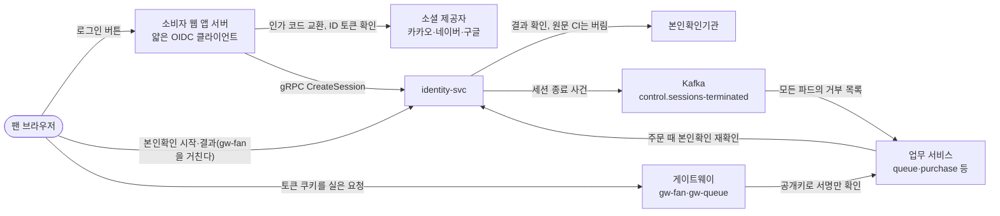

# 분야 편 8: 로그인·본인확인·계정

- **기준 시점**: ADR-0177까지, 2026-11-01. 2026-11-03에 ADR-0180과 새 계정 표 셋을 더했다
- **맡는 정본**: [docs/features/identity.md](../../features/identity.md). 함께 읽는 정본은 관리 계정 잠금·금칙어의 정본인 [docs/security/auth-controls.md](../../security/auth-controls.md)와, 두 문서가 가리키는 ADR이다.
- **규범이 아니다**: 정본을 풀어 쓴 해설이다. 숫자와 규칙이 정본과 다르면 정본이 맞다([ADR-0177](../../adr/0177-walkthrough-explain-in-interview.md)). 길잡이는 [README.md](../README.md)다.
- **측정 전이다**: 서비스 수준 측정(NFR 목표를 운영 규모로 잰 것)은 아직 없어 성능 숫자는 설계 목표값이고 `[실측 전]`을 붙였다. 기반 PoC(wbs 0.5.1, 본 개발 전에 위험한 부분만 먼저 재 보는 시험)는 2026-11-01에 PC 한 대에서 쟀다([ADR-0176](../../adr/0176-foundation-poc-results.md), 성능 장부 docs/perf-ledger.md §5). 그 숫자는 '실측(PC)'이고 운영 규모 증거가 아니다. 로그인·세션은 그 PoC의 대상이 아니었다.
- **한 판 문서와의 관계**: [한 판 문서](../01-system-design.md) 3단계(진입과 좌석 잡기는 identity-svc를 거치지 않는다), 6단계(순번 전 본인확인과 사람 식별값), 11단계(identity-svc를 따로 둔 이유, 주문 때 본인확인을 묻는 gRPC: 서비스끼리 정해진 계약으로 묻고 답하는 통신)에서 짧게 나온 것을 이 편이 자세히 푼다. 현장 스태프 로그인은 14단계도 다룬다.

## 1. 이 문서가 정하는 것

docs/features/identity.md는 identity-svc(계정·로그인·세션·본인확인을 맡는 서비스)가 하는 일을 정한다. 누가 무엇으로 로그인하는지, 로그인 상태를 담는 토큰(권한이나 상태를 증명하려고 주고받는 서명된 문자열)과 쿠키(브라우저가 저장했다가 요청마다 보내는 작은 값)의 규격, 세션 수명, 휴대폰 본인확인, 같은 이메일 계정의 연결과 병합, 관리 계정 보안, 스캐너 기기 승인 로그인, 탈퇴와 개인정보, 장애 때 동작, 시험 목록이 들어 있다. 뼈대는 두 생각이다. 하나는 매번 계정 주인을 확인하는 '로그인'과 법적 신원을 한 번 증명하는 '본인확인'을 나눈 것이다. 다른 하나는 진입·좌석 잡기 같은 핫패스(가장 많이 몰리는 요청 길)가 identity-svc를 부르지 않도록, 필요한 값을 서명된 토큰에 실어 게이트웨이(클라이언트 종류마다 둔 입구 서버)가 혼자 확인하게 한 것이다.

> **30초 설명**: "팬은 카카오·네이버·구글 소셜 로그인만 씁니다. 팬 비밀번호를 저장하지 않으니 비밀번호가 샐 일이 없고, 대신 양도 같은 민감한 작업 앞에서 제공자 재인증을 받습니다. 로그인과 본인확인은 나눴습니다. 휴대폰 본인확인은 계정당 한 번, 대기 순번을 받기 전에 하고, 기관이 주는 사람 고유 값을 키를 건 해시로 바꿔 한 사람이 계정을 여럿 만들지 못하게 합니다. 그 값에서 만든 사람 식별값을 토큰에 실어 두니, 대기열은 identity-svc를 부르지 않고 토큰만 보고 1인 1순번을 지킵니다. 토큰은 15분짜리 서명 토큰이라 게이트웨이가 공개키로만 확인하고, 로그아웃은 이벤트로 모든 서버의 거부 목록에 올립니다. 관리 계정은 비밀번호와 인증 앱의 일회용 코드(TOTP)가 필수이고, 위험한 작업은 기기 안의 키로 서명하는 패스키까지 다시 받습니다."

아래 그림의 OIDC는 OAuth(다른 서비스 계정으로 로그인하게 하는 표준) 위에 신원 정보를 더한 로그인 표준이고, CI(연계정보)는 본인확인기관이 주는 사람마다 하나인 값이다. Kafka는 이벤트를 쌓아 두고 나눠 주는 메시지 시스템, 파드는 쿠버네티스에서 앱이 도는 가장 작은 단위다.

## 2. 절마다 읽기

| 정본 절 | 무엇을 정하나 | 왜 | 해설서에서 |
| --- | --- | --- | --- |
| §1 개요와 계정 유형 | 계정 종류마다 인증 방식·세션 수명·권한 범위, 설계 철학 셋 | 팬 비밀번호를 두지 않으면 유출 위협과 보관에 따르는 규제 범위가 준다. 강한 인증(MFA: 다중 요소 인증)은 수가 적은 관리 계정에 모은다 | — |
| §2 소셜 로그인 흐름 | 앱 서버가 OIDC로 코드를 바꾸고 gRPC `CreateSession`으로 identity 세션을 받는다. 멱등 키(같은 요청이 두 번 와도 한 번만 처리하게 하는 키), 허용 목록, 리디렉션 방식, 자동 병합 금지. 멱등 키는 identity가 `session_create_key` 표에 요청 지문(제공자와 제공자 쪽 사용자 ID)·세션 ID와 함께 10분 `[가정]` 둔다(2026-11-03 더함) | 세션을 identity 한 층에만 두려는 것이다. 제공자 토큰은 identity로 보내지 않고 로그인 뒤 버려 새는 곳을 줄인다 | — |
| §2.1 같은 이메일 계정의 연결과 병합 | 같은 검증 이메일의 활성 계정이 하나일 때만 연결을 제안하고, 기존 제공자 로그인으로만 잇는다. 병합 차단 사유를 두고, 병합은 되돌리지 않는다 | 이메일은 바뀌거나 다른 사람에게 다시 쓰일 수 있어 식별자가 아니다(OIDC Core §5.7). 계정을 여럿 만든 뒤 합쳐 1인 한도를 넘기는 길도 막는다 | — |
| §3 토큰과 쿠키 | 쿠키 이름·속성, 액세스 토큰 클레임, 게이트웨이의 무상태 검증(저장소를 보지 않는 검증), 서명 키 셋과 90일 교체 | 게이트웨이가 서명만 보게 하려는 것이다. 대상마다 키를 나눠 팬 쪽 키가 새도 운영자·스태프 토큰은 위조되지 않게 한다 | 한 판 3단계 |
| §3 세션 즉시 무효화·리프레시 회전 | 세션 종료 사건을 모든 파드가 받아 거부 목록에 15분 둔다. 새 파드는 15분을 다시 읽는다. 리프레시 토큰(액세스 토큰을 새로 받을 때 쓰는 토큰)은 쓸 때마다 바꾸고 재사용을 탐지한다. 예전 토큰을 알아보려고 발급한 리프레시 토큰의 해시를 `refresh_token_hash` 표에 그 세션이 끝날 때까지 둔다(로그아웃·만료·재사용 탐지 때 바로 지운다, data §6)(2026-11-03 더함) | 서명만으로 확인되는 토큰은 끝난 세션도 수명 동안 통한다. 재시도 유예는 응답을 잃은 정상 사용자가 구매 직전에 로그아웃되지 않게 한다 | — |
| §4 세션 정책 | 팬·관리 계정의 수명·유휴 만료·세션 수, 종료 조건, 원격 로그아웃 | 수명은 NIST AAL1·AAL2(미국 표준 기관의 인증 보증 수준) 권고를, 관리 계정 1시간 유휴 만료는 「개인정보의 안전성 확보조치 기준」 제6조 제4항을 따른다 | — |
| §5 휴대폰 본인확인 | 순번 전 계정당 1회, 연계정보의 HMAC(비밀 키로 만든 위조 확인용 값) `ci_hmac`에 중복 금지, 사람 식별값 pid 저장, 만 14세 확인, 주문 때 재확인, 키 교체. 시작부터 결과 확정까지는 본인확인 건 `verification_attempt`(계정·목적·돌아갈 주소·상태)로 묶고, 결과는 시작 뒤 10분 안에만 받고 확정 결과는 1일 조회한다(둘 다 `[가정]`, 2026-11-03 더함) | 공연법 시행령 제3조의3 제1호 가목이 구매자 본인확인을 요구한다. 다계정이 순번을 늘리는 것을 사람 수로 막고, pid를 토큰에 실어 핫패스의 외부 호출과 DB 조회를 없앤다 | 한 판 6·11단계 |
| §6 관리 계정 | 초대 가입, 비밀번호 규칙과 해시, TOTP 필수, 패스키 단계 인증, 위험 명령 재인증, 관제 허용 IP, 관리 계정 관리 API, 지정 | 고시가 관리 계정에 안전한 인증수단을 요구한다. 가짜 페이지가 코드를 바로 넘기는 실시간 중계 피싱에는 TOTP보다 패스키가 강하고, NIST SP 800-63B-4 §2.2.2는 AAL2에서 피싱에 강한 선택지를 하나 이상 주라고 한다 | — |
| §6.1 현장 스태프 계정과 스캐너 로그인 | 회차 초대, RFC 8628 기기 승인 로그인(기기 화면의 코드를 휴대폰에서 승인하는 표준), 확인 코드 대조, 요청마다 세션 확인, 대리 승인, 부스 대조 | 단기 인력에게 관리 계정을 줄 수 없고 공용 기기에 비밀번호를 넣을 수 없다. 스태프 토큰은 오프라인 때문에 역할 유효 끝까지 살아 있어, 해제는 서버가 요청마다 본다 | 한 판 14단계 |
| §7 팬 단일 요소 인증의 보완 통제 | 기기 식별값 기록, 위험 점수, 민감 작업 재인증, 새 기기 알림, 1인 1계정. 로그인 판정은 막지 않고 기록만 한다 | 제공자의 2단계 인증은 사용자 선택이라 PEAKET이 강제할 수 없다. 그래서 ASVS(OWASP의 웹 앱 보안 검증 항목 목록) 6.3.3을 위험 수용으로 적고 이 통제를 근거로 둔다 | — |
| §7.1 제공자 재인증의 강도 | 제공자별 다시 로그인 강제와 `auth_time` 확인, 강도 '확인됨'·'요청만 함', 양도·계좌 입력 규칙 | 같은 브라우저에 제공자 로그인이 살아 있으면 입력 없이 통과할 수 있다. 제공자가 준 정보로 최근 인증을 확인하고, 없으면 대체 방식을 문서로 남기라는 ASVS 6.8.4를 따른다 | — |
| §8 계정 설정·탈퇴 | 탈퇴 Saga(여러 서비스의 취소·환불을 단계별로 하고 실패하면 되돌리는 방식)와 `WITHDRAWAL_PENDING`, 파기 순서, 이용 제한 받은 사람의 연계정보 보관 예외 | 탈퇴는 가입보다 어렵지 않아야 한다(POL-033). 다만 제한을 피하려는 탈퇴·재가입은 따로 막는다(ADR-0171) | — |
| §9 개인정보·접속기록 | 최소 수집, 법정 접속기록 3개월과 일련번호 대조, 내부 관리계획 | 법정 보존 의무를 지키고, 기록을 잃거나 고친 것이 드러나게 한다 | — |
| §9.1 부정 예매 조사용 값 | 기기·연락처 가명, 다른 계정의 같은 본인확인 시도 기록, 조사 적재 호출 | 판매 뒤 부정 예매를 묶어 찾으려면 계정 사이의 연결을 원문 없이 알아야 한다 | — |
| §10 장애 시 동작 | 제공자·본인확인 업체·identity·Kafka·Redis(메모리에 데이터를 두는 빠른 저장소)·KMS(암호 키를 보관하고 대신 써 주는 클라우드 서비스) 장애와 오픈 직전 로그인 몰림 | 이미 로그인하고 본인확인한 사람의 예매는 이어 가고, 새 로그인과 새 본인확인만 멈추게 한다 | 한 판 11·12단계 |
| §11 데이터·API 참조 | 표, Redis 키, 외부 API와 gRPC, 사건, 키, 화면 목록 | 구현할 때 찾는 색인이다 | 한 판 15단계 |
| §12 테스트 포인트 | 시험 I-T1~I-T70과 장애 연습 G-27·G-29 | ASVS 추적 표의 항목과 짝지은 자동 시험으로 설계를 확인한다 | — |
| §13 미결정·[가정] | 잠금 기준값, 확인 코드 한도, 탈퇴 재가입, 실제 본인확인기관 연동 | 측정·계약 전이라 못 정한 값과 정할 때를 모은다 | — |

## 3. 꼭 기억할 규칙과 숫자

SEV2·SEV3는 장애 심각도 등급이고 숫자가 작을수록 심각하다. Outbox는 보낼 사건을 DB 표에 먼저 적어 두었다가 보내는 방식이다.

| 항목 | 값 | 표시 | 정본 위치 |
| --- | --- | --- | --- |
| 팬 세션 | 절대 만료 30일, 유휴 만료 14일, 기기 5대(넘으면 가장 오래 쓰지 않은 세션을 끝낸다) | 확정 | docs/features/identity.md §4, POL-019 |
| 관리 계정 세션 | 절대 24시간, 유휴 1시간, 세션 2개 | 확정 | identity §4 |
| 액세스 토큰 | ES256(타원 곡선 서명)으로 서명한 JWT(서명된 정보 묶음 형식의 토큰), 15분 | 확정 | identity §3 |
| 재인증 토큰 | 5분, 1회, 세션과 작업 묶음 `act`에 묶인다 | 확정 | identity §3·§13 |
| 로그인 진행 쿠키 `__Host-peaket_oidc`, `CreateSession` 멱등 키 기억 | 둘 다 10분 | `[가정]` | identity §2·§3 |
| 리프레시 재시도 유예 | 바로 앞 토큰, 회전 뒤 30초 안, 새 토큰 미사용 | `[가정]`(30초) | identity §3 |
| 세션 종료 전파 | Outbox 릴레이 100ms마다, 거부 목록 15분, 새 파드 15분 되감기(Kafka에 30초 못 닿으면 빈 목록으로 준비), 소비 지연 10초 SEV3·60초 SEV2 | 15분 말고는 `[가정]`, `[실측 전]` | identity §3 |
| 서명 키 | 셋(팬, 관리, 현장 스태프), 90일 교체 | 확정 | identity §3 |
| 연결·병합 제안 | 10분, 다른 계정 시도 3회면 만료 | 확정 | identity §2.1·§13 |
| 본인확인 | 계정당 1회, 영구 유효로 간주, 연계정보 처리 기록 1년 이상. 토큰 발급은 KMS를 부르지 않는다(서울 리전 한도 초당 10,000건을 계정 전체가 나눠 쓴다) | 확정 | identity §5 |
| pid 키 전환 기간 | 교체 시작 때 열린 회차의 가장 늦은 판매 종료 + 1일 | 확정 | identity §5 |
| 관리 비밀번호 | 15자 이상, 64자 이상 허용. PBKDF2-HMAC-SHA256(일부러 느리게 만든 해시) 600,000회 이상, 솔트 16바이트, KMS 페퍼(DB 밖 키를 한 번 더 거는 것) | 확정 | identity §6 |
| 관리 로그인 실패 | 3회 뒤 사람 확인, 5회 시간 잠금 15분(24시간 안 다시 1시간), 2단계 5회 보호 잠금, 누계 100 보호 잠금 | 5회는 내부 관리계획 값, 나머지 `[가정]` | docs/security/auth-controls.md §3·§5 |
| 전체 실패 경보 | 5분에 100건이면 SEV3, 모든 관리 로그인에 1시간 사람 확인 | `[가정]` | auth-controls §2.1 |
| 확인 코드 | 8자(약 34.5비트), 5분, 승인 실패 계정당 10분 5회, 발급 기기당 시간당 10회, 폴링 5초 | 8자 말고는 `[가정]`(wbs 5.5.2) | identity §6.1·§13 |
| 현장 스태프 | 초대 링크 24시간 1회용, 역할 유효시간 입장 시작 3시간 전 ~ 공연 종료 2시간 후, 세션 확인 캐시 5초 | 캐시 `[가정]`, 나머지 확정 | identity §1·§6.1 |
| 보존 | 접속기록 3개월, 관리자 개인정보 열람 기록 2년, 권한 변경 3년, 탈퇴 파기 5일 안. 이용 제한 보관은 `CASE_OPEN` 공연일 + 30일, `RESTRICTED` 1년 상한 | 이용 제한 보관 `[가정]`, 나머지 확정 | identity §6·§8·§9 |
| 오픈 직전 로그인 몰림 | 고르게 온다고 본 평균 초당 약 1,700건(첫 1분 몰림이면 약 3,500건), 웹 앱 서버 약 15개(1건 5ms. 몰림 값으로 잡으면 약 30개) | 피크는 정본 어림, 3,500건 `[추정]`, 15개·5ms `[가정]`, 어느 값으로 띄울지 `[미정]`, `[실측 전]` | identity §10 |
| 소셜 로그인 공급자(제공자) 호출 | 토큰 교환·사용자 정보 조회는 연결 2초·읽기 5초. 웹 앱 서버 파드마다 공급자별 동시 호출 상한은 '그 공급자의 초당 로그인 피크 × 호출 한 건의 평소 p99 0.5초 × 여유 2배 ÷ 파드 수'라, 로비 개방 첫 1분 몰림 약 3,500건이 한 공급자에 다 오고 파드가 15개면 약 233건이다. 넘으면 기다리지 않고 429 `server-busy`, 시간 초과 뒤에는 같은 인가 코드(로그인을 마친 사용자를 공급자가 돌려보낼 때 주는 한 번 쓰는 코드)로 다시 보내지 않고 로그인을 처음부터 다시 하게 한다 | 2초·5초·0.5초 `[가정]`, 233건 `[가정, wbs 2.12.1에서 확정]`, 3,500건 `[추정]` | docs/architecture.md §5(ADR-0180) |

## 4. 이 문서가 다루는 ID

| ID | 한 줄 |
| --- | --- |
| FR-001 | 소셜 로그인만 쓰고 자체 비밀번호를 두지 않는다. (제공자, 제공자 사용자 ID)로 식별하고 자동 병합하지 않는다 |
| FR-002 | 입장권 예매를 위한 계정당 1회 휴대폰 본인확인(별도 화면 없는 흐름) |
| FR-017 | 계정 설정: 본인확인, 기기 목록과 원격 로그아웃, 로그인 수단·병합, 동의, 탈퇴 |
| FR-021 | 파트너: 초대 가입, 업무 이메일·비밀번호·TOTP, 위험 작업의 패스키 |
| FR-028 | 운영자: 이메일·비밀번호·MFA, 허용 IP·VPN, 고위험 명령 직전 재인증 |
| FR-045 | 로그인·진입·주문·결제 접속기록을 변조 탐지 저장소에 3개월 이상 |
| FR-046 | 회차 단위 현장 스태프 초대·임명·해임, 개인 PEAKET 계정으로 수락 |
| FR-048 | 소셜 계정 연동과 병합, 기존 IdP(로그인 제공자) 인증으로 소유 증명 |
| FR-072 | 온세일 윈도우 뒤 조사용 기록 고정과 부정 예매 후보 묶음 |
| NFR-016 | 보안: ASVS 5.0.0 L2 판정, 팬은 소셜 한 요소 + 보완 통제, 관리 계정은 MFA |
| NFR-017 | 감사 로그: 운영 명령 불변 기록, 개인정보 열람 2년, 권한 이력 3년 |
| NFR-018 | 개인정보: data-classification 기준, 법정 보존 기간, 연계정보는 HMAC 값만 |
| POL-001 | 순번 전 계정당 1회 본인확인, 연계정보 HMAC으로 1인 1계정, 주문 때 재확인 |
| POL-002 | 1인 1순번은 계정 ID가 아니라 pid로 판정, 대기열 세션은 계정당 1개 |
| POL-006 | 추가 검증 큐: 위험 점수로 순번을 바꾸지 않고 의심 계정만 추가 검증 |
| POL-019 | 계정·세션 정책: 수명·유휴·기기 수, 종료 전파, 민감 작업 재인증 목록 |
| POL-020 | 관리 계정 인증과 접속 제한: 비밀번호·TOTP 필수, 패스키 단계 인증, 실패 제한 |
| POL-023 | 개인정보 처리(수집 항목과 보존은 data-classification 기준) |
| POL-025 | 신고기관·수사기관 요청 대응 |
| POL-027 | 법률 항목 표기와 검토('확인됨'·'확인 필요') |
| POL-028 | 온세일 윈도우(T-10분~T+60분) 운영 제약(키 교체도 피한다) |
| POL-031 | 현장 스태프 계정: 운영자 등록 기기, 기기 키 증명, 스태프 휴대폰 승인 |
| POL-033 | 회원 탈퇴와 재가입: 가입보다 어렵지 않게, 소셜 재인증 1회 |
| POL-034 | 계정 연결·병합: (제공자, 사용자 ID) 복합키만 식별자 |
| POL-046 | 부정 예매 사후 조치(대상 범주, 조치, 보관) |
| SCR-004 | 로그인 |
| SCR-005 | 가입 완료 및 동의(만 14세 확인) |
| SCR-006 | 본인확인 흐름(기관 창·결과 대화상자·복귀 화면) |
| SCR-017 | 계정 설정(본인확인 정보, 로그인 수단, 세션) |
| SCR-020 | 파트너 로그인과 설정 |
| SCR-028 | 운영자 통합 로그인 |
| SCR-036 | 현장 스태프 로그인(기기 승인) |
| SCR-037 | 현장 스태프 관리와 현장 운영 |
| SCR-039 | 계정 연결 제안 |
| SCR-040 | 로그인 수단 관리 및 계정 병합 |
| SCR-050 | 현장 스태프 초대 수락 |
| SCR-051 | 스캐너 승인 |
| SCR-064 | 관리 계정·세션 관리 |
| CMP-046 | PermissionDenied: 권한이 부족한 상태와 사유를 밝힌다(만 14세 미만 결과에 쓴다) |

## 5. 결정과 버린 길

'버린 길'은 ADR의 '검토한 대안' 표에서, '옛 판인 곳'은 상태 줄과 docs/architecture.md §11·§11.1에서 옮겼다.

| ADR | 고른 것 | 버린 길과 이유 | 본문이 옛 판인 곳 |
| --- | --- | --- | --- |
| [ADR-0001](../../adr/0001-fan-social-login-single-factor.md) | 팬은 소셜 로그인 한 요소로 보고, MFA 대신 보완 통제를 둔다. 관리 계정은 MFA 필수 | ADR에 '검토한 대안' 표가 없다. 정본이 비교한 팬 패스키 단계 인증은 수백만 명의 등록·분실 복구 흐름이 생기고, 등록 안 한 팬은 어차피 제공자 재인증이 필요해 쓰지 않는다(identity §7.1) | '기기 바인딩'은 '기기 식별값 기록'으로 읽는다(키 소지 증명이 아니다). 재인증 대상은 POL-019 목록이고, 제공자별 강도는 identity §7.1에 있다 |
| [ADR-0006](../../adr/0006-ticket-buyer-identity-verification-before-queue.md) | 모든 정렬 방식에서 순번 전 계정당 1회 + 주문 때 재확인 | 셔플 공연만(법정 의무 위반 소지가 있다), 결제 단계에서(미인증 다계정이 순번과 입장 자리를 먼저 차지하고 외부 호출이 결제 때 몰린다), 가입 때 전원(탐색만 하는 사람의 연계정보까지 모은다), 공연마다(오픈 직전 부하가 몰리고 법적 근거가 없다) | 결정 4의 'KMS 비대칭 키'는 KMS HMAC 키다(ADR-0050). 결정 6의 시점은 주문 생성 때 한 번이다(ADR-0055). SCR-006은 흐름이다(ADR-0063). '물리 차단'이어도 명의 대여는 남는다 |
| [ADR-0011](../../adr/0011-token-lifecycle-and-login-responsibilities.md) | 액세스 토큰은 ES256 15분, 세션 종료는 사건 + 서비스의 종료 세션 목록, 입장 토큰은 한 구매 세션 전용 | 참조 토큰(게이트웨이가 Redis를 봐야 해 오픈 순간의 진입 경로에 조회가 붙는다), 수명 1~2분(오픈 직전에 갱신이 몰리고 지연은 남는다), 사용자별 서명 키(키 관리가 복잡하고 공개키 목록이 커진다) | 결정 1의 서명 키는 셋으로 나뉘었다(ADR-0050). 결정 4·5의 Auth.js(웹 앱 서버용 로그인 라이브러리)는 얇은 OIDC 클라이언트(저수준 라이브러리로 직접 하는 로그인 처리)로 바뀌고, 파트너의 Auth.js 비밀번호 로그인(Credentials)은 빠졌다(ADR-0119). 결정 2의 목록은 파드마다 받는다(ADR-0103) |
| [ADR-0119](../../adr/0119-partner-login-via-gateway-thin-oidc-client-default.md) | 소셜 로그인은 앱 서버의 얇은 OIDC 클라이언트(`oauth4webapi`)가 기본안, 파트너 로그인은 gw-partner → identity | Auth.js v5 고정 판(세션이 두 층이고 베타다. 실패 때 돌아갈 자리로 남긴다), Better Auth(다른 로그인 라이브러리. 자기 세션 쿠키를 둔다), identity가 콜백까지(게이트웨이에 인증 없는 리디렉션 경로가 생기고 로그인 쿠키가 두 호스트로 나뉜다), 파트너만 Credentials(방식이 둘로 남는다) | 본문이 지금 판이다. 다만 PoC(본 개발 전에 미리 견주는 시험) I-T51을 아직 하지 않았다(docs/BUILD_ORDER.md PRF-010) |
| [ADR-0103](../../adr/0103-control-as-state-startup-sync-broadcast-topics-compacted-settings.md) | 종료 세션 목록을 모든 파드가 따로 읽고, 새 파드는 15분을 다시 읽어야 준비 상태 | 목록을 공유 Redis에(모든 요청이 Redis를 한 번 더 부르고 모든 서비스가 세션 Redis에 묶인다) | 종료 세션 부분은 본문이 지금 판이다. 다만 결정 3의 소비자 그룹(Kafka 사건을 나눠 읽는 소비자 묶음) 이름 `<서비스>-<파드 이름>`은 토픽마다 `<서비스>-<파드 이름>.<토픽>`으로 읽는다(상태 줄 2026-11-01, 서비스 템플릿과 같다) |
| [ADR-0038](../../adr/0038-account-linking-and-merge.md) | (제공자, sub)만 식별자이고 이메일은 힌트다. 기존 제공자 로그인으로만 소유를 증명하고, 병합은 되돌리지 않는다 | 자동 병합(OIDC §5.7·ASVS 6.8.1에 어긋나고 남의 티켓을 가로챌 수 있다), 이메일 인증 코드(메일함 소유만 증명한다), 연결 없음(티켓·주문이 나뉜다), 되돌리기(역이동 절차를 정할 수 없다) | 결정 5의 티켓·후기 옮기기는 쓰지 않는다(흡수 계정은 본인확인 전이라 티켓이 없고, 있으면 409·SEV3). 결정 6은 소유·상태 값만 고치고 사건·원장은 `merged_account`로 묶어 본다(중간-054) |
| [ADR-0050](../../adr/0050-crypto-corrections-and-key-management.md) 결정 5·9 | pid = HMAC(pid 키, `ci_hmac`)를 한 번 계산해 저장, 연계정보 키는 버전마다 조회, 토큰 서명 키 셋, 관리자 비밀번호 페퍼 | pid를 CI 원문에서(키를 바꿀 때 모든 회원이 다시 본인확인해야 한다), 한 키로 모든 대상(팬 키가 새면 운영자 토큰도 위조된다), 페퍼 없이 PBKDF2만(DB만 새도 오프라인 대입을 막지 못한다) | 결정 5의 '온세일 밖에서 바꾸고 다음 토큰부터'와 '연계정보 키 새 버전도 pid를 바꾼다'는 바뀌었다. pid 키는 의심 때만 바꾸고 전환 기간에 옛·새 pid를 함께 싣는다. pid는 첫 본인확인 때만 계산한다(높음-18) |
| [ADR-0055](../../adr/0055-identity-recheck-fallback-to-token-claims.md) | 주문 때 identity가 답하지 못하면 토큰의 `ticket:buy`·pid로 판정, '무효' 답은 그대로 거부 | 막기(입장한 사람의 결제가 멈추고 identity 장애가 구매 장애로 번진다), 확인 없이 통과(ASVS 16.5.3이 막으라는 fail-open이다), 재확인 결과 캐시(첫 주문에는 효과가 작고 같은 정보가 토큰에 있다) | 대체 판정 사유에 `RESOURCE_EXHAUSTED`·`INTERNAL`·`UNKNOWN`을 더했고, `PERMISSION_DENIED`·`INVALID_ARGUMENT`는 거부하고 SEV2로 알린다(낮음-153) |
| [ADR-0030](../../adr/0030-gate-staff-event-scoped-role-device-approval.md)·[ADR-0051](../../adr/0051-gate-process-end-to-end.md) | 회차 한정 역할 + RFC 8628 기기 승인 로그인, 해제는 서버가 요청마다 확인 | 기기 인증서만(누가 입장시켰는지 추적 못 하고 권한을 못 나눈다), 전원에 관리 계정(단기 인력의 TOTP 설정 비용과 공용 기기의 비밀번호 탈취 위험), 공용 PIN(책임 추적이 없고 새면 모든 단말을 다시 설정한다) | 4자리 코드는 8자로, 인증서 기본은 기기 키 DPoP(요청마다 기기 키로 서명한 증명) 기본으로, 인증서 지문은 `cnf.jkt`(기기 키 지문)로, 해제의 종료 세션 목록은 요청마다 확인으로 바뀌었다. ADR-0030 결정 3의 토큰 역할은 ADR-0172가 뺐고, ADR-0051 결정 3 대리 승인의 `gate_staff`는 스캐너 세션의 역할이다(두 상태 줄 2026-11-01) |
| [ADR-0172](../../adr/0172-judge-roles-per-request-not-in-tokens.md) | 관리·스태프 토큰에 역할·테넌트를 싣지 않고 서비스가 요청마다 판정(관리 계정은 `GetAdminAuthz`, 현장 스태프는 `CheckScannerSession`) | 토큰에 역할(거둔 뒤에도 옛 역할이 수명 동안 남는다), 게이트웨이가 묻기(바깥 저장소를 보지 않는 원칙이 깨지고 모든 요청에 호출이 붙는다), 캐시 없이(관리 화면의 동시 조회가 몰린다) | 본문이 지금 판이다. ADR-0157 결정 8을 대신한다 |
| [ADR-0163](../../adr/0163-admin-account-management-api-and-public-event-summary-seller-name.md) | 관리 계정 관리 API(`/v1/ops/admin-accounts` 아래 작업 12개: 목록·초대·역할 변경·재초대·삭제·지정·세션 강제 종료·권한 내역)는 gw-ops(관제 콘솔의 입구 게이트웨이) → ops-svc(운영 서비스) → identity-svc로 처리한다. ops-svc가 역할·재인증을 보고 감사 기록을 남기고, identity-svc는 요청자의 지금 역할을 DB로 다시 본다. commander(관제의 최상위 역할)는 초대로 주지 않고 역할 변경의 2인 승인으로만 준다. 스캐너 승인 화면(SCR-051)의 파트너 이름은 새 공개 경로 `GET /v1/events/{eventId}`(회차 공개 요약)의 상호 칸 `sellerName`에서 읽는다(소유자 결정 2026-10-30) | gw-ops가 identity로 바로 넘기기(감사 기록과 2인 승인이 ops-svc에 있어 같은 일을 두 곳에서 한다), 계정 PATCH·DELETE로 모두 처리(사유·재인증·승인이 동작마다 달라 한 경로에 섞인다), 보호 잠금 재초대에서 패스키 남기기(잠금 원인이 인증 수단 탈취일 수 있다), 기기 조회 응답에 파트너 이름 싣기(identity가 core의 상호를 읽는 새 내부 호출이 필요하다), 공개 요약에 판매자 신원정보 7항목 모두(스캐너 화면에는 상호만 필요하다) | 본문이 지금 판이다(상태 줄과 architecture §11에 고침이 없다). 초대 수락 때 인증 수단을 등록하는 경로는 wbs 0.2.3에서 정한다. 현장 스태프 초대 화면의 파트너·회차 이름은 열린 일 80번이다 |
| [ADR-0033](../../adr/0033-admin-password-hash-pbkdf2.md) | 관리 비밀번호는 PBKDF2-HMAC-SHA256 | argon2id(국내 검증 목록 KCMVP에 근거가 없어 감사 지적 위험), SHA-256 + 솔트(너무 빨라 GPU 대입에 약하다), bcrypt(72바이트 입력 길이 제한) | 600,000회의 근거는 OWASP·ASVS 부록 C로 바로잡았고, KMS 페퍼를 더했다(ADR-0050) |

## 6. 읽는 요령

1. **읽는 순서**: §1 → §3(토큰과 무효화) → §5(본인확인과 pid) → §2·§2.1 → §6·§6.1 → §7·§7.1 → §10이다. §11·§12는 필요할 때 찾는다.
2. **옛 판을 걸러 낸다**: ADR-0011의 Auth.js, ADR-0006 결정 4의 비대칭 키, ADR-0050 결정 5의 pid 교체, ADR-0030 결정 2·3의 4자리 코드와 인증서 지문은 지금 판이 아니다. 상태 줄과 docs/architecture.md §11·§11.1을 먼저 본다. 정본 §3의 "2026-10-30에는 `role`·`tid`를 실었다" 같은 괄호도 바뀌기 전 모습이고, 지금 판은 그 앞 문장이다(ADR-0172).
3. **조건이 걸린 결정이 있다**: 얇은 OIDC 클라이언트는 PoC I-T51을 통과해야 확정이다. 떨어지면 Auth.js v5 고정 판으로 가고 `__Host-authjs.*` 규칙을 되살린다(정본 §3의 "PoC가 Auth.js 고정 판으로 돌아가면" 문장들).
4. **정본이 옮겨 간 곳**: 관리 계정 잠금·크리덴셜 스터핑(다른 곳에서 샌 계정 목록을 그대로 넣어 보는 공격)·금칙어는 2026-10-30에 docs/security/auth-controls.md로 옮겼다. identity §6 '인증 실패 임계치 제한' 칸과 §10 마지막 행은 요약이다.
5. **겉보기와 다른 문장**: §8의 '탈퇴 뒤 바로 재가입하는 것을 제한 없이 허용한다'는 바로 위의 이용 제한 예외(ADR-0171)와 함께 읽는다. 다시 가입은 되지만 `RESTRICTED` 동안 새 계정 토큰에 `ticket:buy`가 없다.
6. **`[가정]`과 '남는 한계'를 같이 외운다**: 확인 코드 한도(wbs 5.5.2), 잠금 시간(wbs 3.5.1), 로그인 1건의 CPU 시간(wbs 2.12.1)은 `[가정]`이고 괄호 안 작업에서 확정한다(CPU 시간은 재서 정한다). 15분 틈, 하위 호스트 모두로 가는 `Domain` 쿠키, 쿠키 탈취 뒤 판정 물려받기, '요청만 함' 재인증, 탈퇴 5일 뒤 중복 확인 키 삭제는 정본이 적은 남는 한계다.
7. **실제 연동은 계약 전이다**: 본인확인기관 실제 연동은 계약이 될 때 하는 조건부 작업이다. 포트폴리오의 완료 기준은 모의 기관으로 기관 창 흐름을 끝까지 시험하는 I-T45다(§13).

## 7. 경계

| 이 문서가 정하지 않는 것 | 어디서 |
| --- | --- |
| 관리 계정 잠금 규칙, 크리덴셜 스터핑 방어, 비밀번호 금칙어, 설정값 | docs/security/auth-controls.md §2~§5 |
| 역할별 기능 권한 표, 테넌트 격리, 재인증 작업 묶음, 지정의 권한 | docs/planning/03-policies-glossary.md §3(기능 권한 표), docs/security/authz-matrix.md §3·§5·§6 |
| 키 목록, 교체 주기, 키 사용 범위 | docs/security/secrets-and-keys.md |
| 개인정보 등급·보존 기간, 내부 관리계획, ASVS 항목 판정 | docs/security/data-classification.md, docs/security/internal-management-plan.md, docs/security/asvs/auth.md |
| pid로 중복 확인하는 대기열 키와 입장 토큰 | docs/features/queue-admission.md §3·§6 |
| 로그인 판정의 점수기와 판정 맥락, 사람 확인 토큰 | docs/features/bot-defense.md §3.1·§4.2·§6 |
| 주문 때 재확인 호출의 자리, 시험 P-T35 | docs/features/payment.md §2·§9·§11 |
| 스캐너 기기 등록, DPoP 증명, 오프라인 판정 | docs/features/offline-gate.md §6 |
| 부정 예매 조치의 실행과 조사 갈래 | docs/features/transfer-refund.md §7.4, docs/features/forensic-replay.md §6 |
| 본인확인 결과 대화상자 문구 | docs/design/d5-screen-blueprint.md §5.6 |

## 8. 꼬리 질문

| 질문 | 답의 요지 | 근거 |
| --- | --- | --- |
| 왜 팬에게 MFA를 강제하지 않나요? | 제공자의 2단계 인증은 사용자 선택이라 PEAKET이 강제할 수 없다. 그래서 ASVS 6.3.3을 위험 수용으로 적고 재인증·위험 점수·새 기기 알림·1인 1계정으로 피해를 줄인다. 양도 사기나 탈취 신고가 판매 1만 장당 1건을 넘으면 다시 본다 | ADR-0001, identity §7 |
| JWT면 로그아웃이 바로 안 되지 않나요? | 세션 종료 사건을 모든 파드가 받아 15분 거부 목록에 올린다. 참조 토큰은 게이트웨이가 Redis를 봐야 하고, 수명을 1~2분으로 줄이면 갱신이 몰린다. 남는 한계는 전파가 늦으면 최대 15분 통한다는 것이다 | ADR-0011, ADR-0103, identity §3·§10 |
| identity-svc가 죽으면 예매가 멈추나요? | 게이트웨이는 캐시한 공개키로 확인해 유효 토큰은 최대 15분 통한다. 주문 때 재확인은 토큰의 `ticket:buy`·pid로 대신한다. 15분 넘게 멈추면 갱신을 못 해 사용자마다 토큰이 끝날 때부터 구매도 막힌다 | ADR-0055, identity §10 |
| 1인 1순번 때문에 대기열이 identity를 부르나요? | 부르지 않는다. `ci_hmac` 중복 금지가 1인 1계정을 지키고, 토큰의 pid를 게이트웨이가 헤더로 넘겨 queue-svc가 중복 확인 키로 쓴다. 명의를 빌린 계정은 남는다 | ADR-0006, identity §5 |
| 같은 이메일이면 합쳐 주면 되지 않나요? | 이메일은 바뀌고 다른 사람에게 다시 쓰일 수 있어, 이메일만 믿으면 검증하지 않는 제공자나 재사용 이메일로 남의 계정에 들어간다. 기존 제공자 로그인으로 소유를 증명할 때만 잇는다 | ADR-0038, POL-034 |
| 관리 계정 역할은 토큰에 넣으면 빠르지 않나요? | 넣으면 역할을 거둔 뒤에도 옛 역할이 15분 남는다. 서비스가 요청마다 묻고 5초 `[가정]` 캐시하며, 위험 작업은 캐시 없이 다시 본다. 비용은 캐시가 빈 요청마다 gRPC 한 번(2ms `[가정]`)이다 | ADR-0172 |
| 오픈 직전 로그인은 얼마나 몰리나요? | 로비 참가가 고르게 온다고 보면 평균 초당 약 1,700건이고, 개방 순간에 함께 누르면 첫 1분은 약 3,500건 `[추정]`이다. 웹 앱 서버를 '피크 × 1건 CPU 시간 ÷ (vCPU × 0.6)'으로 평균이면 약 15개, 몰림이면 약 30개 `[가정]` 미리 띄우고, 어느 값으로 띄울지는 아직 정하지 않았다 `[미정]`. 5ms는 wbs 2.12.1에서 잰다 `[실측 전]` | identity §10, docs/architecture.md §9.1 |
| 소셜 로그인 공급자가 한도를 걸어 로그인을 막으면요? | 인가 코드 교환은 웹 앱 서버가 해서, 로비 개방 때 평균 초당 약 1,700건(첫 1분 몰림이면 약 3,500건 `[추정]`)이 바깥으로 나가는 고정 IP 셋(AZ(같은 리전 안에서 전기·네트워크가 따로인 데이터센터 묶음)마다 하나) `[가정]`에서 공급자로 나간다. 세 공급자 모두 앱 단위 초당 한도가 공개 문서에 없어 대형 온세일 전에 공급자에게 묻는다(wbs 0.5.5). 그전에는 공급자별 동시 호출 상한을 두고, 429·403을 몰아 받으면 그 공급자를 차단기(실패가 이어지는 상대를 잠시 부르지 않는 장치)로 잠시 끊어 그 공급자의 새 로그인만 막는다. 이미 로그인한 사람의 예매는 이어지고, 두 응답은 제공자 오류 비율 경보(SEV2)에도 센다 | identity §10, ADR-0180 결정 5 |
| 세션 행에는 지금 토큰과 바로 앞 토큰의 해시뿐인데, 더 오래된 리프레시 토큰이 다시 오면 어떻게 알아보나요? | 발급한 리프레시 토큰의 SHA-256(되돌릴 수 없는 해시)을 모두 `refresh_token_hash` 표에 그 세션이 끝날 때까지 둔다(로그아웃·만료·재사용 탐지 때 바로 지운다, data §6). 다시 온 토큰의 해시가 거기 있으면 그 세션 패밀리가 예전에 받은 토큰이라 탈취로 보고, 패밀리의 활성 세션을 모두 끝낸 뒤(사유 `REFRESH_REUSE`) 401로 답한다. 거기에도 없으면 모르는 토큰이라 401만 준다. 원문은 쿠키에만 있고 DB에는 해시만 있다 | identity §3 '토큰 수명주기 구현', docs/data.md §2 ① |
| 실제로 해 봤나요? | 기능은 일부 만들었고 성능은 재지 않았다. 로그인 비교 PoC(I-T51)로 얇은 OIDC 클라이언트(`openid-client` 6)를 골랐고, 2026-11-03에 로컬 모의 OIDC로 소셜 로그인과 세션 생성, 토큰 회전과 재사용 탐지, 본인확인 시험 어댑터와 토큰에 `ticket:buy`·pid 싣기를 만들었다(PRF-010~040). 서비스 수준 측정은 아직 없고, 2026-11-01 기반 PoC(ADR-0176)도 로그인을 재지 않았다. 본인확인기관은 계약 전이라 시험 어댑터뿐이다. 모의 기관 창 흐름은 BOT-010, 연계정보 키 버전과 만 14세 재확인은 BOT-020에서 붙인다 | docs/BUILD_ORDER.md PRF-010~040·BOT-010·BOT-020, identity §5·§13 |

## 9. 확인 문제

1. 리프레시 토큰 갱신 응답을 잃은 브라우저가 옛 토큰으로 다시 오면, 어떤 조건에서 탈취가 아닌 재시도로 보나?

답

세 조건을 모두 채울 때다. ① 다시 온 토큰이 지금 쓰는 토큰의 바로 앞 토큰이다. ② 그 토큰을 회전한 지 30초 `[가정]` 안이다. ③ 그때 준 새 리프레시 토큰이 아직 한 번도 쓰이지 않았다. 그러면 패밀리를 끝내지 않고 새 쌍을 한 번 더 준다. 하나라도 벗어나면 탈취로 보고 패밀리의 모든 세션을 끝낸다. 대기 화면이 차례 1분 전에 미리 갱신해서, 유예가 없으면 구매 직전에 로그아웃될 수 있다(identity §3).

2. 주문을 만들 때 identity-svc가 데드라인을 넘겨 답하지 못하면 어떻게 하나? '탈퇴한 계정'이라고 답하면?

답

답하지 못하면 게이트웨이가 넘긴 `ticket:buy`와 pid가 모두 있을 때만 주문을 만든다. 하나라도 없으면 거부하고, 대체 판정 건수는 지표로 남긴다. identity-svc가 '무효'(계정 없음·탈퇴·병합·본인확인 없음)로 답하면 토큰과 상관없이 거부한다. 대체 판정이 보는 것은 토큰을 받은 때의 상태(최대 15분 전)다(ADR-0055).

3. pid 키를 바꿀 때 왜 전환 기간을 두며, 그 길이는?

답

판매는 온세일 윈도우보다 길게 이어지고, 이미 줄을 선 사람의 중복 확인 키가 판매 종료까지 옛 pid로 남는다. 한 번에 바꾸면 1인 1순번이 깨진다. 그래서 전환 기간 동안 토큰에 `pid`(새 값)와 `pid_prev`(옛 값)를 함께 싣고, 대기열은 두 키를 옛 pid부터 확인한다. 길이는 교체를 시작할 때 로비나 대기열이 열린 회차 가운데 가장 늦은 판매 종료 + 1일이다. 그동안 사람 키 호출이 두 배가 되는 것이 남는 한계다(identity §5).

4. 현장 스태프 배정을 해제하면, 왜 팬처럼 종료 세션 목록으로 막지 않나?

답

스태프 토큰은 오프라인 검증 때문에 배정 회차의 역할 유효 끝까지 살아 있다. 목록은 15분만 두므로 해제 15분 뒤에 토큰이 다시 통한다. 그래서 스캐너 경로는 요청마다 identity의 `CheckScannerSession`으로 `scanner_session`과 배정 상태를 보고, 결과를 5초 `[가정]` 캐시한다. 해제하면 다음 요청부터 거부된다(identity §3·§6.1, ADR-0051 결정 4).

## 10. 정본에서 찾은 어긋남

1. **identity-svc gRPC 포트를 여는 범위**: 고침(2026-11-01 정합 점검, 세 번째 묶음). docs/features/identity.md §2 '메시 신원 허용 목록'과 I-T15 ②는 메시(서비스 사이 통신을 대신 맡는 층) 없는 실행에서 NetworkPolicy(파드 사이 연결을 거르는 쿠버네티스 규칙)로 포트를 "소비자 웹 앱 서버와 purchase-svc 파드에만" 연다고 적었다. 지금은 docs/architecture.md §3.2 gRPC 행에서 identity-svc를 부르는 파드 모두로 고쳤다.
2. **현장 스태프 토큰의 역할**: 고침(2026-11-01 정합 점검, 세 번째 묶음). ADR-0030 결정 3과 ADR-0051 결정 3의 토큰 역할에 ADR-0172 기록이 없었다. 두 ADR의 상태 줄, docs/architecture.md §11의 두 행, §11.1의 ADR-0051 결정 3 행에 ADR-0172를 더했다.
3. **종료 세션 소비자 그룹 이름**: 고침(2026-11-01 정합 점검, 세 번째 묶음). identity §3과 ADR-0103 본문은 `<서비스>-<파드 이름>`, ADR-0103 상태 줄과 서비스 템플릿은 `<서비스>-<파드 이름>.<토픽>`이었다. identity §3을 템플릿 쪽으로 맞추고 ADR-0103 상태 줄에 읽는 법을 더했다.
