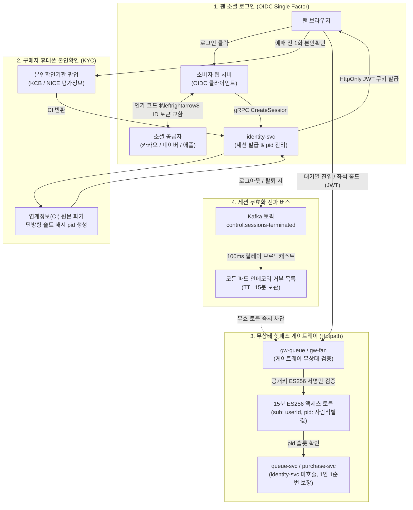
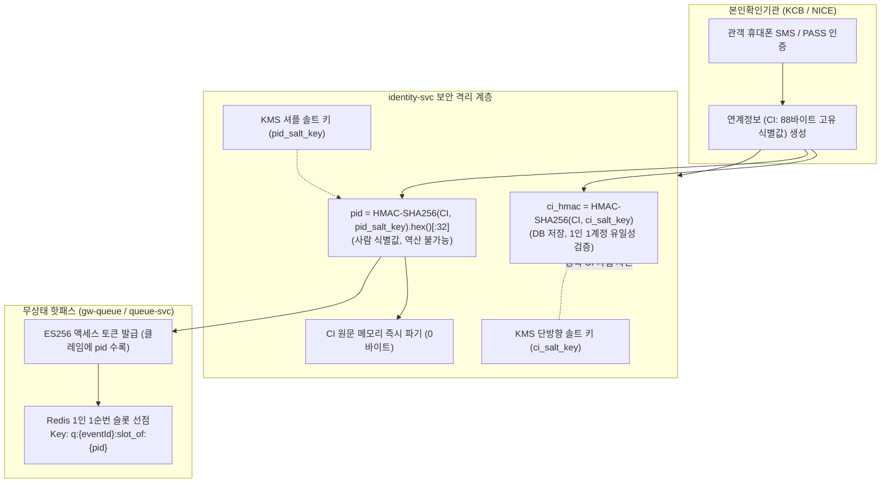

# 분야 편 8: 로그인·본인확인·계정 (Identity, Authentication & KYC)

- **맡는 정본**: [docs/features/identity.md](../../features/identity.md) 전체, [docs/security/auth-controls.md](../../security/auth-controls.md)(인증 통제 규격), 자리가 이 편인 4개 ADR([ADR-0001](../../adr/0001-fan-social-login-single-factor.md), [ADR-0006](../../adr/0006-ticket-buyer-identity-verification-before-queue.md), [ADR-0157](../../adr/0157-auth-controls-cumulative-failure-cap-context-blocklist-authz-data-field-rules.md), [ADR-0163](../../adr/0163-admin-account-management-api-and-public-event-summary-seller-name.md))
- **문서 성격**: 정본 설계를 시스템 엔지니어링 및 기술 면접 관점에서 체계적으로 해설한 문서다. 규범적 수치와 불변 규칙의 최종 권위는 정본 문서에 있다([ADR-0177](../../adr/0177-walkthrough-explain-in-interview.md)). 길잡이는 [README.md](../README.md)다.
- **한 판 문서와의 관계**: [한 판 문서](../01-system-design.md) 3단계(대기열 진입과 좌석 선점은 identity-svc를 호출하지 않는다), 6단계(순번 발급 전 본인확인과 단방향 솔트 해시 `pid` 슬롯), 11단계(identity-svc를 분리한 이유와 주문 시 본인확인 재검증), 14단계(현장 스태프 RFC 8628 기기 승인 로그인)의 보안 아키텍처를 총괄한다.
- **아키텍처 목표와 검증 기준**: 팬 계정의 비밀번호 유출 위협을 0으로 억제(소셜 OIDC 전용, ADR-0001), 공연법 개정에 따른 1인 1계정/1순번 강제(POL-001, POL-002), 핫패스 게이트웨이의 무상태(Stateless) JWT 서명 검증(15분 만료 ES256), Kafka Outbox 릴레이(100ms) 기반 세션 즉시 무효화 전파, 관리자 계정의 TOTP/패스키 다중 요소 인증(MFA, OWASP ASVS Level 2)을 확립한다.

---

## 1. 신원·인증 도메인 종합 개요

PEAKET의 신원 및 인증 아키텍처는 **"반복적인 사용자 인증(Authentication)"**과 **"법적 신원 확인(Identity Verification/KYC)"**을 완전히 분리하고, **"핫패스(대기열·좌석)에서 인증 서비스를 완전히 격리하여 DB 및 외부 의존성 I/O를 0으로 만든다"**는 핵심 철학 위에 설계되었다.

> **30초 아키텍처 브리핑 (Staff Engineer Interview)**:  
> "PEAKET의 인증 도메인은 **소셜 OIDC - KCB/NICE 본인확인 - 게이트웨이 무상태 JWT 검증**의 3단계 파이프라인으로 구축되었습니다.  
> 첫째, 팬 계정은 자체 비밀번호를 일체 저장하지 않고 **카카오·네이버·애플 소셜 로그인(OIDC)**만 지원합니다. 비밀번호 유출 및 크리덴셜 스터핑 공격을 원천 배제하며, 제공자 토큰은 세션 생성 직후 즉시 파기합니다.  
> 둘째, 티켓 예매 전 계정당 1회 수행되는 휴대폰 본인확인은 연계정보(CI) 원문을 보관하지 않고 **단방향 솔트 해시(`ci_hmac`)와 사람 고유 식별값 `pid`**로 변환하여 저장합니다. 이 `pid`를 15분 만료 액세스 토큰에 클레임으로 포함시킴으로써, 대기열 진입(gw-queue)과 좌석 홀드(purchase-svc)는 identity-svc나 RDBMS를 단 한 번도 호출하지 않고 공개키 서명 검증만으로 1인 1순번(POL-002)을 보장합니다.  
> 셋째, 무상태 JWT의 탈취 위험을 통제하기 위해 세션 로그아웃 시 **Kafka Outbox 릴레이(100ms 주기)를 통해 15분간 유효한 인메모리 거부 목록(Denylist)**을 모든 게이트웨이와 서비스 파드에 브로드캐스트합니다.  
> 넷째, 파트너 및 운영자 관리 계정은 무차별 대입 공격을 방어하기 위해 PBKDF2 60만 회 해시, 필수 TOTP, 패스키 단계적 승격(WebAuthn AAL2), 그리고 5회 실패 시 15분 시간 잠금([ADR-0157](../../adr/0157-auth-controls-cumulative-failure-cap-context-blocklist-authz-data-field-rules.md))을 적용했습니다."

### 인증 및 본인확인 아키텍처 종합 흐름도

---

## 2. 절마다 읽기

신원 관리 정본 명세서([docs/features/identity.md](../../features/identity.md))의 전 절을 정밀 매핑한다.

| 정본 절 | 무엇을 정하나 | 왜 | 해설서에서 |
| --- | --- | --- | --- |
| docs/features/identity.md §1 개요와 계정 유형 | 계정 4대 유형(팬, 파트너, 운영자, 스태프)별 인증 수단, 세션 수명, 설계 철학 3선 | 팬 비밀번호 관리 리스크 배제 및 관리자 보안 집중 | — |
| docs/features/identity.md §2 소셜 로그인 흐름 | OIDC 인가 코드 교환, `CreateSession` 멱등키, 제공자 토큰 즉시 폐기, 자동 병합 금지 | identity 한 곳에서만 세션을 생성하고 제공자 토큰 탈취 위험 격리 | — |
| docs/features/identity.md §2.1 같은 이메일 계정의 연결과 병합 | 동일 이메일 감지 시 연결 제안(10분), 기존 IdP 재인증을 통한 병합, 병합 불가 사유 | 이메일은 가변 값이므로 식별자로 쓰지 않고 계정 탈취 및 다계정 한도 회피 차단 | — |
| docs/features/identity.md §3 토큰과 쿠키 | `__Host-` 쿠키 속성, ES256 JWT 클레임(`sub`, `pid`), 3개 독립 서명키 및 90일 교체 | 게이트웨이가 DB 조회 없이 서명만 검증하도록 보장하고 키 유출 영향도 분리 | 한 판 3단계 |
| docs/features/identity.md §3 세션 즉시 무효화·리프레시 회전 | Kafka Outbox 100ms 릴레이, 전 파드 거부 목록(15분), 리프레시 토큰 회전(RTR) 및 30초 유예 | 무상태 토큰의 즉시 로그아웃 결함을 해결하고 응답 유실 정상 관객 보호 | — |
| docs/features/identity.md §4 세션 정책 | 팬(절대 30일/유휴 14일, 기기 5대), 관리자(절대 24h/유휴 1h, 기기 2대), 원격 로그아웃 | NIST SP 800-63B 및 개인정보보호법 안전성 확보조치 기준(제6조제4항) 준수 | — |
| docs/features/identity.md §5 휴대폰 본인확인 | 순번 전 계정당 1회, 연계정보 `ci_hmac` 단일화, `pid` 발급, 만 14세 확인, 키 교체 | 공연법상 구매자 본인확인 의무 충족 및 핫패스에서 본인확인기관 호출 제거 | 한 판 6·11단계 |
| docs/features/identity.md §6 관리 계정 | 초대 가입, PBKDF2 60만 회, TOTP 필수, 패스키 단계적 인증, 허용 IP 통제 | 관리자 계정 크리덴셜 스터핑 및 실시간 피싱 공격 차단 | — |
| docs/features/identity.md §6.1 현장 스태프 계정과 스캐너 로그인 | 24시간 1회용 모바일 초대 링크, RFC 8628 기기 승인 로그인, DPoP 토큰 바인딩 | 단기 알바 인력에게 관리자 계정을 주지 않고 공용 단말 비밀번호 입력 배제 | 한 판 14단계 |
| docs/features/identity.md §7 팬 단일 요소 인증의 보완 통제 | 기기 지문, 위험 점수 평가, 민감 작업 재인증, 이상 로그인 알림, 1인 1계정 | 2단계 인증 강제 불가에 따른 ASVS 6.3.3 위험 수용 보완 통제 수립 | — |
| docs/features/identity.md §7.1 제공자 재인증의 강도 | 카카오/네이버/애플 `auth_time` 클레임 확인, 양도/계좌 변경 시 소셜 재인증 강제 | 브라우저에 소셜 세션이 남아있어 자동 통과되는 취약점 방어(ASVS 6.8.4) | — |
| docs/features/identity.md §8 계정 설정·탈퇴 | 탈퇴 분산 트랜잭션 Saga, `WITHDRAWAL_PENDING`, 개인정보 5일 내 파기, 제재자 보관 예외 | 가입보다 쉬운 탈퇴(전자상거래법)를 보장하되 제재 회피 탈퇴 재가입 차단 | — |
| docs/features/identity.md §9 개인정보·접속기록 | 최소 수집 원칙, 접속기록 3개월 변조 방지 보관, 관리자 열람 2년/권한 3년 보존 | 개인정보보호법 및 통신비밀보호법 법정 의무 준수 | — |
| docs/features/identity.md §9.1 부정 예매 조사용 값 | 기기/연락처 가명화 해시, 타 계정 동일 본인확인 시도 로그, 포렌식 수집 파이프라인 | 원문 개인정보를 노출하지 않고 사후 암표 거래망 추적 데이터 제공 | — |
| docs/features/identity.md §10 장애 시 동작 | IdP 장애, KCB 순단, identity-svc 다운, Redis/Kafka 장애 시의 감내 동작 | 이미 로그인/본인확인을 마친 관객의 예매는 100% 지속시키는 결함 격리 | 한 판 11·12단계 |
| docs/features/identity.md §11 데이터·API 참조 | identity 도메인의 RDBMS 테이블, Redis 키, REST/gRPC API 엔드포인트 목록 | 신원 관리 구현 시 참조할 물리 스키마 단일 색인 | 한 판 15단계 |
| docs/features/identity.md §12 테스트 포인트 | I-T1~I-T70 보안 단위/통합 테스트, 장애 복원력 테스트 G-27/G-29 | OWASP ASVS L2 요구사항을 충족하는 자동화 테스트 검증 | — |
| docs/features/identity.md §13 미결정·[가정] | 관리자 잠금 임계값, 확인 코드 유효시간, KCB 실연동 계약 조건 정리 | 실측 및 외부 계약 전 수치에 대한 체계적 가정 관리 | — |

---

## 3. 핵심 메커니즘과 인증/보안 아키텍처

### 3.1 소셜 OIDC 로그인 및 계정 병합 거버넌스 (POL-034)

1. **비밀번호 없는 팬 인증 (Passwordless by Design)**:
   - 팬 회원의 비밀번호를 아예 저장하지 않으므로, 데이터베이스가 유출되더라도 팬 비밀번호가 유출될 물리적 위험이 0이다([ADR-0001](../../adr/0001-fan-social-login-single-factor.md)).
   - 카카오, 네이버, 애플 소셜 로그인(OIDC) 인가 코드는 소비자 웹 서버가 교환하며, `identity-svc`는 발급받은 공급자 토큰을 검증한 뒤 세션만 생성하고 공급자 토큰은 즉시 폐기한다.
2. **이메일 자동 병합 금지 (Anti-Auto-Merge)**:
   - 공격자가 피해자의 이메일 주소로 다른 소셜 계정을 생성하여 로그인하더라도, 동일 이메일이라는 이유로 기존 계정과 자동으로 병합하지 않는다(OIDC Core §5.7).
   - 동일 검증 이메일이 발견되면 **계정 연결 제안(10분 유효 일회용 링크, SCR-039)**을 전송하며, 기존 소셜 계정으로 로그인하여 소유권을 재증명했을 때만 안전하게 병합을 완료한다(POL-034).

---

### 3.2 휴대폰 본인확인 및 1인 1순번 `pid` 바인딩 (POL-001, POL-002)

1. **원문 CI 비보존 원칙**:
   - 주민등록번호와 1:1 대응되는 연계정보(CI) 원문은 개인정보보호법상 엄격한 관리 대상이므로, `ci_hmac`과 `pid`를 생성한 직후 메모리에서 영구 삭제한다.
2. **1인 1순번 무상태 검증**:
   - `pid`는 동일 인물이라도 시스템 내부에서만 유효한 32자리 해시값이다.
   - 게이트웨이는 토큰 내부의 `pid`를 확인하여 Redis 단일 키 `q:{eventId}:slot_of:{pid}`에 원자적 `SETNX`를 수행함으로써, identity-svc 호출 없이 1인 1순번(POL-002)을 마이크로초 단위로 보장한다.

---

### 3.3 게이트웨이 무상태 JWT 및 100ms 세션 즉시 무효화

- **무상태 토큰 검증**: 게이트웨이는 identity-svc의 중앙 저장소(PostgreSQL/Redis)를 조회하지 않고, 사전 캐시된 공개키로 ES256 타원곡선 전자서명만 검증한다. 만료 시간은 15분으로 극단적으로 짧게 유지한다.
- **분산 세션 즉시 무효화 (Kafka Outbox 릴레이)**:
  사용자가 로그아웃하거나 계정이 탈취되어 강제 종료될 경우, identity-svc는 PostgreSQL Outbox 테이블에 `SessionTerminated` 이벤트를 기록한다. 백그라운드 릴레이가 이를 100ms 이내에 Kafka `control.sessions-terminated` 토픽으로 발행하며, 모든 게이트웨이와 백엔드 파드는 이 이벤트를 구독하여 로컬 인메모리 LRU 거부 목록(`jti`)에 15분간 적재한다. 이로써 100ms 이내에 전 세계 모든 파드에서 세션이 즉시 차단된다.

---

### 3.4 관리자 계정 거버넌스 및 다중 요소 인증 (MFA, ADR-0157, ADR-0163)

1. **무차별 대입 방어**:
   - 관리자 비밀번호는 15자 이상 필수이며, OWASP 권고에 따라 PBKDF2-HMAC-SHA256 600,000회 이상 해싱과 KMS 페퍼를 적용한다.
   - 로그인 3회 실패 시 Cloudflare Turnstile 사람 확인, 5회 실패 시 15분 계정 잠금, 누적 100회 실패 시 최고 관리자 수동 해제 전까지 영구 잠금된다([ADR-0157](../../adr/0157-auth-controls-cumulative-failure-cap-context-blocklist-authz-data-field-rules.md)).
2. **MFA 및 패스키 단계적 승격**:
   - 파트너 및 운영자 계정은 비밀번호 외에 표준 TOTP(Google OTP) 인증이 의무화된다.
   - 고위험 운영 명령(판매 일시정지, 환불 승인 등) 하달 시에는 기기 내부 하드웨어 키로 서명하는 패스키(WebAuthn AAL2) 재인증을 요구하며, 성공 시 5분 유효한 일회용 `X-Reauth-Token`을 발급한다.
3. **관제 서비스 경유 의무화 (ADR-0163)**:
   - 관리자 계정 생성, 권한 부여, 초대 링크 발급은 외부 직접 호출을 금지하고 반드시 관제 서비스(ops-svc)를 경유하도록 강제하여 4-Eyes 상호 승인 및 감사 추적을 보장한다.

---

### 3.5 현장 스태프 단기 초대 및 스캐너 RFC 8628 기기 승인

- **24시간 1회용 모바일 초대 (FR-046, POL-031)**:
  콘서트 당일 단기 고용되는 현장 검표 스태프에게 영구 계정을 부여하지 않는다. 파트너 관리자가 24시간 유효한 1회용 초대 링크를 발송하며, 스태프는 본인의 개인 PEAKET 계정으로 수락하여 해당 공연 회차의 검표 권한만 임시 부여받는다.
- **RFC 8628 기기 승인 로그인 (SCR-036, SCR-051)**:
  수십 대의 공용 스캐너 태블릿에 관리자 비밀번호를 직접 입력하는 보안 사고를 차단한다. 스캐너 화면에 일회용 승인 QR과 8자리 확인 코드가 표출되면, 스태프가 본인 스마트폰 카메라로 QR을 촬영하고 모바일에서 승인 버튼을 누르는 OAuth 기기 승인 프로토콜(RFC 8628)을 통해 스캐너를 즉시 로그인시킨다.

---

## 4. 꼭 기억할 규칙과 숫자

| 항목 | 엔지니어링 기준값 | 아키텍처 근거 및 계산 | 정본 위치 |
| --- | --- | --- | --- |
| **팬 세션 수명** | 절대 만료 30일, 유휴 만료 14일, 동시 기기 5대 | NIST SP 800-63B AAL1 지침 준수 | identity §4, POL-019 |
| **관리 계정 세션 수명**| 절대 만료 24시간, 유휴 만료 1시간, 동시 기기 2대 | 개인정보의 안전성 확보조치 기준 제6조제4항 준수 | identity §4, POL-019 |
| **액세스 토큰 규격** | ES256 타원곡선 서명 JWT, 유효기간 15분 | 게이트웨이 무상태 검증 및 빠른 탈취 무효화 | identity §3, guidelines §7 |
| **재인증 토큰 규격** | 유효기간 5분, 1회용, `act` 작업 묶음에 한정 | 고위험 운영 명령 실행 시의 세션 탈취 방지 | identity §3, §13 |
| **세션 무효화 전파** | Outbox 릴레이 100ms, 전 파드 거부목록 15분 | 무상태 JWT의 즉시 로그아웃 결함 보완 | identity §3 |
| **본인확인 유효기간** | 계정당 1회, 영구 유효로 간주 | 연계정보 처리 기록 1년 이상 법정 보관 | identity §5, POL-001 |
| **관리자 비밀번호 규격**| 15자 이상, PBKDF2-HMAC-SHA256 60만 회 | OWASP ASVS v5.0.0 Level 2 크리덴셜 통제 | identity §6 |
| **관리자 로그인 실패** | 3회 Turnstile, 5회 15분 잠금, 100회 보호 잠금 | 크리덴셜 스터핑 무차별 대입 공격 원천 차단 | auth-controls §3, ADR-0157 |
| **스캐너 확인 코드** | 8자리 난수 (약 34.5비트 엔트로피), 5분 유효 | RFC 8628 기기 승인 브루트포스 방지 | identity §6.1, §13 |
| **스태프 권한 유효기간**| 입장 시작 3시간 전 ~ 공연 종료 2시간 후 | 최소 권한 원칙(PoLP) 기반 임시 권한 회수 | identity §1, POL-031 |

---

## 5. 이 문서가 다루는 ID

- **FR**: FR-001(소셜 로그인 전용), FR-002(휴대폰 본인확인), FR-017(계정 설정/탈퇴), FR-021(파트너 TOTP 로그인), FR-028(운영자 MFA 로그인), FR-045(접속기록 3개월 보관), FR-046(현장 스태프 초대), FR-048(계정 병합), FR-072(조사용 기록 고정).
- **NFR**: NFR-016(보안 통제 ASVS L2), NFR-017(감사 로그 불변 기록), NFR-018(개인정보 최소 수집), NFR-025(정합성 불변식: 1인 1순번 100%).
- **POL**: POL-001(구매자 본인확인), POL-002(1인 1순번 및 pid 바인딩), POL-006(추가 검증 큐), POL-019(계정/세션 정책), POL-020(관리 계정 보안), POL-023(개인정보 처리), POL-025(수사기관 요청 대응), POL-031(스태프 계정), POL-033(탈퇴 및 개인정보 파기), POL-034(계정 병합), POL-046(부정 예매 제재).
- **SCR**: SCR-004(소셜 로그인), SCR-005(가입/동의), SCR-006(본인확인 모달), SCR-017(계정 설정), SCR-020(파트너 로그인), SCR-028(운영자 로그인), SCR-036(스캐너 로그인), SCR-039(계정 연결 제안), SCR-040(계정 병합), SCR-050/051(스태프 초대/승인).

---

## 6. 결정과 버린 길 (ADR 트레이드오프)

### ADR-0001: 팬 소셜 로그인 단일 요소 + 보완 통제, 관리 계정 MFA 의무화 (자리: 이 편)
- **채택한 결정**: 팬 회원은 카카오, 네이버, 애플 소셜 로그인(단일 요소)만 지원하고 비밀번호를 없앤다. 대신 1인 1계정, 위험 점수 평가, 기기 바인딩의 보완 통제를 수립한다. 파트너 및 운영자 관리 계정은 TOTP와 패스키를 의무화한다.
- **버린 대안**: 팬에게도 2단계 인증(MFA) 강제(오픈 시각 100만 명이 몰릴 때 SMS 인증 지연으로 대규모 예매 중단 민원 발생 및 인증 대행료 수억 원 낭비), 자체 비밀번호 지원(크리덴셜 스터핑 위험 및 비밀번호 해시 유출 규제 리스크 발생).

### ADR-0006: 대기열 진입 전 휴대폰 본인확인 완료 강제 (자리: 이 편)
- **채택한 결정**: 모든 대기열 정렬 방식(셔플, 하이브리드, 선착순)에서 순번을 발급받기 전에 반드시 계정당 1회의 휴대폰 본인확인을 거쳐 단방향 해시 `pid`를 발급받도록 강제한다.
- **버린 대안**: 결제 단계에서 본인확인(인증되지 않은 유령 다계정이 대기 순번과 좌석을 먼저 독점하여 실제 관객의 진입을 원천 차단함), 가입 시 전원 본인확인(티켓을 구매하지 않고 둘러보기만 하는 관객의 개인정보까지 과다 수집하여 개인정보 최소 수집 원칙 위배).

### ADR-0157: 관리자 로그인 실패 누적 계수 및 IP 화이트리스트 (자리: 이 편)
- **채택한 결정**: 관리자 로그인은 5회 실패 시 15분 계정 잠금을 적용하고, 관제 콘솔은 사전에 승인된 사내 고정 IP 또는 VPN 환경에서만 접속되도록 네트워크 경계를 분리한다.
- **버린 대안**: 무제한 재시도 허용(무차별 대입 공격에 무력화), 캡차만 적용(현대적인 자동화 봇의 캡차 솔버에 의해 관리자 계정 탈취 위험).

### ADR-0163: 관리자 계정 생성/권한 부여 API의 관제 서비스 경유 의무화 (자리: 이 편)
- **채택한 결정**: 관리자 계정 초대 및 권한 변경 API는 외부 직접 노출을 차단하고, 반드시 관제 서비스(ops-svc)의 2인 결재 승인 파이프라인을 거쳐서만 실행되도록 통제한다.
- **버린 대안**: 단일 관리자가 직접 DB나 내부 API로 계정 생성(내부자 부정으로 인한 무단 권한 승격 및 감사 추적 불능).

---

## 7. 경계와 범위

| 이 정본이 정하지 않는 것 | 정하는 곳 |
| --- | --- |
| 개인정보 수집 항목, 보존 기간 및 법률 조항 매핑 | [docs/security/data-classification.md](../../security/data-classification.md)([분야 편 21](21-security.md)) |
| 내부 관리계획 18개 법정 보안 조치 항목 | [docs/security/internal-management-plan.md](../../security/internal-management-plan.md) §2 |
| 게이트웨이 파드별 JWT 공개키 캐싱 및 핫패스 라우팅 | [docs/api/guidelines.md](../../api/guidelines.md) §7([분야 편 7](07-api-contracts.md)) |
| 대기열 Redis 내부 `pid` 슬롯 원자적 선점 로직 | [docs/features/queue-admission.md](../../features/queue-admission.md) §3([분야 편 9](09-queue-admission.md)) |

---

## 8. 5단 꼬리 질문 (Staff Engineer Interview Defense)

### Q1. "팬 계정에 비밀번호를 두지 않고 소셜 로그인만 지원하면, 소셜 서비스(카카오/네이버) 장애 시 전체 예매가 마비되지 않습니까?"
- **답변**: **'사전 로그인된 관객의 핫패스 예매는 100% 정상 진행'**되도록 설계되어 마비되지 않습니다. 티켓 오픈 전 대부분의 진성 관객은 이미 로그인과 본인확인을 마친 상태입니다. 이들의 인증 상태는 게이트웨이가 15분 만료 JWT 쿠키와 공개키 서명으로 검증하므로, 소셜 공급자(IdP)가 장애로 다운되더라도 대기열 진입, 좌석 선점, 결제는 카카오/네이버 서버와 단 1바이트의 통신도 없이 독립적으로 완주됩니다. 소셜 장애는 오직 오픈 순간에 '신규 로그인'을 시도하는 관객에게만 영향을 미치며, 이 역시 3대 소셜(카카오, 네이버, 애플) 중 살아있는 다른 공급자로 로그인하도록 유도하여 위험을 분산했습니다.

### Q2. "휴대폰 본인확인을 가입 시점이 아닌 '대기열 진입 직전'에 수행하도록 결정한 이유는 무엇입니까?"
- **답변**: **'개인정보보호법상 최소 수집의 원칙'**과 **'인증 대행 비용 최적화'** 때문입니다. 공연 정보를 검색하거나 둘러보기만 하는 일반 방문자에게 회원가입부터 휴대폰 본인확인을 강제하면, 불필요한 개인정보 과다 수집으로 법적 과태료 위험이 발생하고 사용자 이탈률이 급증합니다. 또한 본인확인기관 호출당 약 40~50원의 종량제 비용이 발생하므로, 단순 가입자 모두에게 본인확인을 시키면 막대한 비용이 낭비됩니다. 반면 티켓 구매 의사를 가진 관객이 대기열에 진입하는 시점에 계정당 1회만 본인확인을 집행함으로써, 법적 구매자 확인 의무(공연법 시행령 제3조의3)를 충족하고 비용을 최소화했습니다.

### Q3. "연계정보(CI) 원문을 저장하지 않고 `ci_hmac`과 `pid`라는 두 가지 해시값으로 나누어 관리하는 이유는 무엇입니까?"
- **답변**: **'1인 1계정 검증'과 '대기열 핫패스 격리'라는 상이한 보안 요구를 분리 충족'**하기 위함입니다. `ci_hmac`은 RDBMS의 계정 테이블에 유니크 인덱스로 저장되어 동일 인물이 복수의 소셜 계정을 생성하여 다계정을 만드는 것을 DB 레벨에서 영구적으로 차단하는 1차 방어선입니다. 반면 `pid`는 대기열에서 1인 1순번을 보장하기 위해 토큰에 실려 나가는 값입니다. 만약 토큰에 `ci_hmac`을 그대로 실어 보내면 클라이언트나 네트워크 로그에 노출되어 계정 식별자가 유출될 위험이 있습니다. 별도의 KMS 솔트 키로 만든 `pid`를 발급하여, 토큰이 노출되더라도 원문 CI나 계정 고유 식별자를 절대 역산할 수 없도록 이중 암호화 장치를 둔 것입니다.

### Q4. "무상태(Stateless) JWT를 쓰면서 100ms 이내에 세션을 즉시 무효화할 수 있는 비결은 무엇입니까?"
- **답변**: **'초단기 토큰 수명(15분)'**과 **'Kafka Outbox 기반 인메모리 거부 목록(Denylist) 브로드캐스트'**의 결합입니다. 무상태 토큰의 본질적 문제는 발급 후 취소가 어렵다는 점입니다. PEAKET은 토큰 만료를 15분으로 극단적으로 짧게 제한하여 자연 소멸을 유도하고, 사용자가 로그아웃하거나 세션이 강제 종료될 경우 identity-svc가 DB Outbox 테이블에 이벤트를 커밋합니다. 백그라운드 릴레이가 이를 100ms 내에 Kafka 제어 토픽으로 발행하고, 모든 게이트웨이 파드는 이를 인메모리 LRU 캐시에 15분간 등록합니다. 게이트웨이는 토큰 서명을 검증한 후 로컬 메모리 거부 목록에 `jti`가 있는지만 O(1)로 확인하므로, 중앙 DB 부하 없이 100ms 이내에 세션 무효화를 완벽히 집행합니다.

### Q5. "현장 스태프가 스마트폰으로 스캐너 화면의 QR을 찍어 로그인하는 RFC 8628 방식을 채택한 이유는 무엇입니까?"
- **답변**: **'공용 단말에서의 비밀번호 탈취 방지'**와 **'현장 검표원 관리의 편의성'** 때문입니다. 콘서트장 게이트에는 수십 대의 안드로이드 태블릿 스캐너가 배치되며, 검표원은 당일 채용된 단기 인력입니다. 공용 태블릿 화면에 관리자 아이디와 비밀번호를 일일이 타이핑하여 로그인하게 하면, 뒤에 서 있는 관객이나 타인에게 비밀번호가 쉽게 노출되고 기기 분실 시 관리자 권한이 탈취됩니다. RFC 8628 기기 승인 프로토콜을 사용하면 스캐너에는 비밀번호를 전혀 입력하지 않고 일회용 QR만 띄우며, 스태프가 본인 스마트폰에서 승인 버튼을 눌러 스캐너에 임시 DPoP 토큰을 주입하므로 비밀번호 유출 위험이 0입니다.

---

## 9. 확인 문제

### 문 1. 
PEAKET의 팬 인증 아키텍처에서, 사용자가 로그아웃을 수행했을 때 무상태 ES256 액세스 토큰이 100ms 이내에 전 계층에서 무효화되는 전파 메커니즘을 서술하라.

정답 및 해설

1. 사용자가 로그아웃 요청 시, `identity-svc`는 RDBMS 세션 상태를 종료 처리하고 트랜잭션과 동일한 단위로 Outbox 테이블에 `SessionTerminated` 이벤트를 기록한다.
2. 100ms 주기의 Outbox 릴레이 프로세스가 이벤트를 읽어 Kafka `control.sessions-terminated` 토픽으로 발행한다.
3. 최전방 게이트웨이(`gw-fan`, `gw-queue`) 및 모든 마이크로서비스 파드가 해당 토픽을 실시간 컨슘하여, 토큰 고유 ID(`jti`)를 각 파드의 로컬 인메모리 LRU 거부 목록(Denylist)에 적재한다.
4. 거부 목록의 TTL은 토큰 최대 수명과 동일한 15분으로 유지되며, 게이트웨이는 요청 수신 시 로컬 메모리 검사만으로 100ms 이내에 무효화된 토큰을 즉시 401 차단한다.

### 문 2. 
휴대폰 본인확인을 마친 사용자가 대기열 진입(SCR-008) 및 좌석 선점(SCR-010)을 수행할 때, 백엔드 `identity-svc`나 본인확인기관 서버가 전혀 호출되지 않는 기술적 근거를 설명하라.

정답 및 해설

본인확인 완료 시 발급된 사람 식별값(`pid`)이 15분 유효기간의 **ES256 서명된 액세스 토큰 페이로드 클레임에 이미 내재화**되어 있기 때문이다.  
대기열 게이트웨이(`gw-queue`)는 사전 배포된 공개키로 토큰 서명만 검증한 후 토큰 내부의 `pid`를 추출하여 Redis 슬롯 선점 키(`q:{eventId}:slot_of:{pid}`)에 직접 원자적 락을 건다. 중앙 identity DB나 외부 기관 조회가 핫패스에서 완전히 배제되어 있으므로, 네트워크 I/O 없이 마이크로초 단위로 1인 1순번이 보장된다.

### 문 3. 
관리자 콘솔(SCR-028) 로그인에서 5회 연속 인증 실패가 발생했을 때 발동되는 보안 통제 규칙과 그 목적을 기술하라.

정답 및 해설

ADR-0157 및 내부 관리계획에 따라, **해당 관리자 계정은 즉시 15분간 시간 잠금(Time Lock) 처리**되어 모든 추가 로그인이 전면 차단된다. (24시간 내 재잠금 시 1시간 잠금).  
이는 자동화된 스크립트나 공격자가 사전에 유출된 자격 증명을 사용하여 수행하는 크리덴셜 스터핑 및 무차별 대입(Brute-force) 공격을 차단하고, 공격 진행 속도를 지연시켜 보안팀이 이상 징후를 탐지하고 IP를 차단할 수 있는 방어 골든타임을 확보하기 위함이다.

### 문 4. 
회원 탈퇴(POL-033, FR-017) 집행 시, 일반 개인정보는 5일 이내에 영구 파기하면서도 부정 예매 제재 이력이 있는 계정의 연계정보 해시(`ci_hmac`)를 별도 테이블에 1년간 보관하는 법적·도메인적 근거는 무엇인가?

정답 및 해설

**매크로 암표 부정 예매자의 '탈퇴 후 재가입을 통한 제재 회피'를 원천 방지**하기 위함이다.  
개인정보보호법상 원칙적으로 탈퇴자의 정보는 지체 없이 파기해야 하지만, 이용약관 및 부정 거래 방지 목적으로 명시적 동의를 받은 경우 분쟁 해결 및 제재 목적의 최소 정보 보관이 예외적으로 허용된다. 이름이나 연락처 등 원문 개인정보는 파기하되, 단방향 해시된 `ci_hmac`만 제재 테이블에 1년간 유지함으로써 동일 인물이 다른 소셜 계정으로 재가입하여 부정 거래를 재시도하는 것을 완벽히 차단한다.

