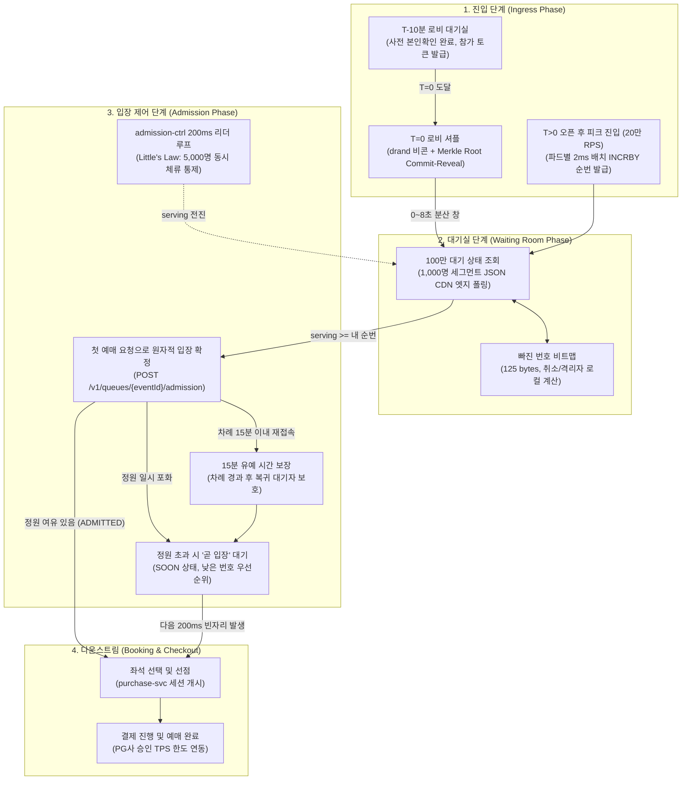
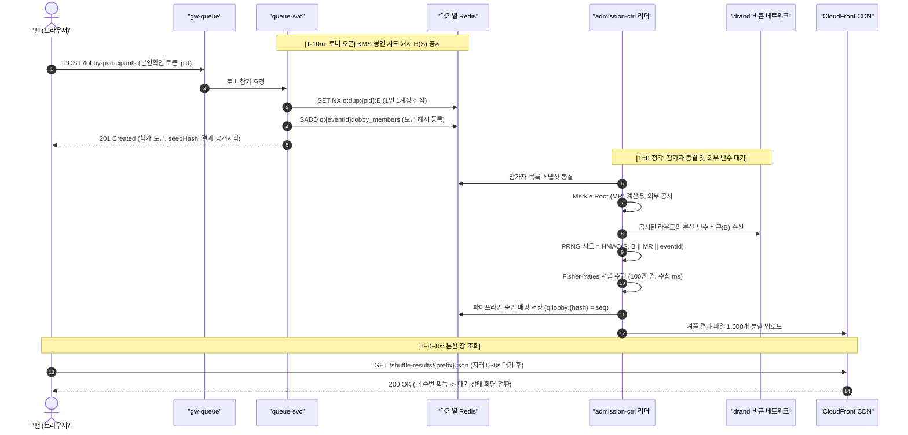
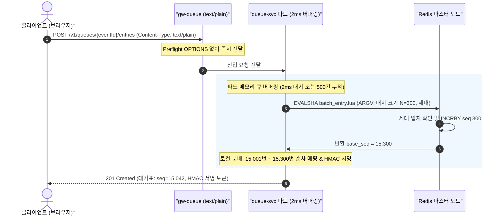
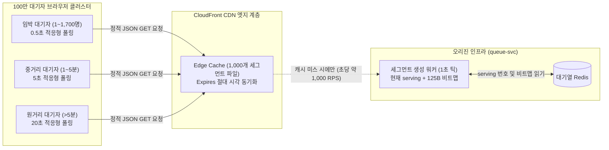
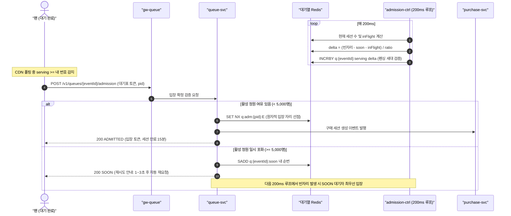

# 분야 편 9: 대기열·입장 제어 (Queue & Admission Control)

- **맡는 정본**: [docs/features/queue-admission.md](../../features/queue-admission.md). 함께 읽는 정본은 [docs/planning/03-policies-glossary.md](../../planning/03-policies-glossary.md) §1의 POL-001~010·015와, 이 문서가 가리키는 ADR(아키텍처 결정 기록)이다.
- **문서 성격**: 정본 설계를 시스템 엔지니어링 및 기술 면접 관점에서 체계적으로 해설한 문서다. 규범적 수치와 불변 규칙의 최종 권위는 정본 문서([docs/features/queue-admission.md](../../features/queue-admission.md))에 있다([ADR-0177](../../adr/0177-walkthrough-explain-in-interview.md)). 길잡이는 [README.md](../README.md)다.
- **한 판 문서와의 관계**: [한 판 문서](../01-system-design.md) 5단계(대기 상태 조회 폭주 막기 K1), 6단계(정각 진입 몰림, 공정성, 봇), 7단계(몇 명씩 들여보낼까)에서 다룬 대기열 생애주기를 4대 핵심 모듈로 심화 분해하고, 시스템 경계 규칙과 수학적 모델을 정밀하게 보강한다.
- **아키텍처 목표와 검증 기준**: 피크 20만 RPS(NFR-001), 100만 동시 대기(NFR-013), 차례 반영 지연 p99 2초 이내(NFR-002), 5만 석 티켓 오버셀 0건(NFR-025), 좌석 예매창 동시 체류 5,000명 상한 유지(POL-010)를 설계 목표로 삼는다. 단일 노드 Redis 벤치마크(카운터 직접 `INCR` 20만 RPS 시 p99 42.9ms, 단일 Lua 실행 시 8만~9만 RPS 포화)를 바탕으로 파드별 2ms 마이크로 배치 버퍼링(`INCRBY`)을 도입하여 타당성을 입증했다.

---

## 1. 대기열·입장 도메인 종합 개요

대기열·입장 제어 도메인은 수십만~수백만 팬이 단 5만 석의 한정된 티켓을 두고 오픈 시각에 폭발적으로 몰려드는 극단적 트래픽 환경에서, **인프라 붕괴를 원천 차단하고 완전한 공정성(Fairness)과 순번 불변성(FIFO Consistency)을 보장**하는 PEAKET의 최전방 방어선이다.

> **30초 아키텍처 브리핑 (Staff Engineer Interview)**:  
> "PEAKET의 대기열은 **'진입(Ingress) - 대기(Waiting) - 입장(Admission)'의 3단계 파이프라인**으로 설계되었습니다.  
> 첫째, 오픈 10분 전 로비에 진입한 사용자는 순번 없는 참가 토큰만 받으며, 오픈 시각(T=0)에 사전 봉인된 시드와 drand 공개 난수 비콘을 결합한 **Commit-Reveal Fisher-Yates 셔플**로 순번을 일괄 확정합니다. 오픈 후 유입되는 피크 20만 RPS는 게이트웨이 파드별 **2ms 마이크로 배치 버퍼링(`INCRBY`)**을 통해 Redis 엔진 CPU를 10% 미만으로 보호하며 고유 순번을 원자적으로 발급합니다.  
> 둘째, 100만 대기자의 상태 확인은 개별 API 조회가 아닌 **1,000명 단위의 정적 JSON 세그먼트 파일(125바이트 압축 비트맵 포함)**로 변환되어 CloudFront CDN 엣지에서 100% 흡수됩니다. 이로써 오리진 부하는 대기자 수와 완전히 무관하게 초당 약 1,000 RPS로 고정됩니다.  
> 셋째, 다운스트림 좌석 및 결제 시스템을 보호하기 위해 Little's Law($L = \lambda \cdot W$)를 적용한 **단일 리더 admission-ctrl 루프가 200ms 주기**로 동시 체류 인원 5,000명(초당 약 28명 유입) 상한을 엄격히 통제합니다. 좌석 점유는 호출 시점이 아닌 첫 예매 요청에서만 원자적으로 발생하므로 노쇼로 인한 좌석 낭비가 0건입니다."

### 대기열 전체 생애주기 종합 상태도



### 3개 서브시스템의 책임 분리

1. **Ingress Layer (`gw-queue`, `queue-svc` 진입 파드)**:  
   순번 발급 전 본인확인(`pid`) 검증, 1인 1순번 선점 슬롯(`PENDING`), 2ms/500건 마이크로 배치 버퍼링을 통한 Redis `INCRBY` 호출, 서명된 HMAC 대기표 발급.
2. **Waiting Room Layer (CloudFront CDN, `queue-svc` 상태 배치 파드, S3 원본 저장소)**:  
   1초 주기의 1,000명 세그먼트 JSON 파일 생성, 125바이트 압축 결번 비트맵 계산, 거리 기반 적응형 폴링(0.5s / 5s / 20s) 응답, `Expires` 절대 시각 캐시 만료 동기화.
3. **Admission Control Layer (`admission-ctrl` 단일 리더 파드)**:  
   Redis 분산 Lease 기반 단일 리더 선출, Little's Law 기반 유출입 제어, 200ms 틱 `serving` 번호 증가, AIMD 혼잡 제어 및 결제사 TPS 상한 보호, 15분 유예 사용자 수용.

---

## 2. 절마다 읽기

정본의 `## ` 절마다 한 줄을 두고, 따로 물을 만한 굵은 글씨 주제는 줄을 나눴다. '해설서에서' 칸의 '—'는 한 판 문서가 다루지 않은 규칙이다.

| 정본 절 | 무엇을 정하나 | 왜 | 해설서에서 |
| --- | --- | --- | --- |
| §1 개요 | 정렬 이름 셋(선착순·사전 셔플·하이브리드)과 회차 설정 두 값 `lobbyShuffle`(로비 셔플)·`openBatch`(오픈 직후 묶음) | 이름 셋의 차이는 '로비를 여나, 오픈 직후를 묶나' 둘뿐이다. 둘 다 끄면 밀리초 경쟁이 대기열 전체에 남아 받지 않는다(ADR-0118) | 한 판 6단계 |
| §1 핵심 설계 원칙 5선 | 서버만 serving을 올린다, 자리는 첫 예매 요청에서, 순번 전 본인확인, 사람 식별값 `pid`로 1인 1순번, 판매 종료 | 쓰기를 서버 한 곳에 모으고, 안 오는 사람이 자리를 차지하지 않게 한다 | 한 판 5·6·7단계(판매 종료는 —) |
| §2 로비와 셔플 | T=0(오픈 시각) 목록 고정과 머클 루트(토큰 해시 목록을 대표하는 값. 해시는 되돌릴 수 없게 바꾼 고정 길이 값), 공시한 drand(여러 기관이 함께 만드는 공개 난수) 라운드, Fisher–Yates(목록을 고르게 섞는 표준 방법), 오픈 60분 뒤 시드(섞는 데 쓴 비밀 값) 공개 | 운영자도 결과를 미리 알거나 바꾸지 못하게 한다. 결과 파일이 순번을 전하므로 T=0에 원 서버로 개별 조회가 오지 않는다 | 한 판 6단계 |
| §2 셔플 결과 받기 | 결과 파일 약 1,000개를 공개 예정 시각 뒤 0~8초(분산 창)에 나눠 받는다 | 100만 건(약 36 GB)을 한꺼번에 받으면 CDN 배포 한도를 넘는다 | 한 판 6단계(한 줄) |
| §2 여정 ID와 조사용 요청 기록 | 여정 ID `jny`(만든 시각이 앞에 드는 무작위 ID)를 토큰마다 옮기고, gw-queue(대기열 입구 서버) 다섯 경로의 접근 기록을 조사용 통로로 보낸다 | 판매 뒤 부정 예매를 찾으려면 한 사람의 로비 → 입장 → 주문을 이어야 한다(POL-046) | — |
| §3 오픈 후 진입과 순번 발급 | 진입 세 단계(① 사람 슬롯 선점 `PENDING` ② 회차 카운터 `INCRBY`: 진입 서버 파드마다 2ms 묶음, ADR-0179 ③ 번호 기록), 동시 도착 묶음, 사전 검증 토큰(공연 상세에서 사람 확인을 미리 마치고 받는 토큰)의 최초 발급 시각 | 선점 키와 카운터는 해시 슬롯(Redis 클러스터가 키를 나눠 두는 칸)이 달라 한 Lua(Redis 안에서 한 번에 도는 짧은 스크립트)로 못 묶는다. 그래서 같은 요청 ID의 재시도를 이어 받는다 | 한 판 5·6단계(세 단계 틈은 —) |
| §3 요청 형식 | 진입과 입장 확정은 JSON 본문을 `text/plain`으로 보내 CORS 사전 요청(다른 주소로 보내기 전에 브라우저가 미리 묻는 요청)을 없앤다 | JSON이면 T=0의 20만 RPS(초당 요청 수)에 같은 수의 사전 요청이 붙는다. 위조는 본문 토큰, `Origin` 확인, `SameSite=Strict` 쿠키가 막는다 | 한 판 3단계 |
| §3 페일오버·pid 키 전환·판매 종료 | 장애 전환을 세대 키로 알아채 카운터 건너뛰기(RB-05)가 끝날 때까지 번호를 내지 않기(ADR-0181), 카운터 건너뛰기와 `skipped` 기록, pid 키 교체 때 옛 pid부터 두 번 확인, 공연 24시간 전 뒤 410(다시 시도해도 소용없다는 HTTP 응답 코드) `sale-ended` | 복제 전에 사라진 번호가 다시 나가지 않게 한다. 교체 직전 토큰과 새 토큰이 같은 키에서 만나야 하나만 통과한다 | 한 판 5단계(페일오버만) |
| §4 대기 상태 파일과 폴링 | 구간 파일의 칸, 앞 인원 식, 0.5·5·20초 폴링(정해진 간격으로 다시 묻기), 임박 구간의 `Expires`(절대 시각으로 정하는 캐시 만료), 지연 예산, 폴링 힌트 `pollHintMs` | 같은 구간 1,000명이 같은 파일을 읽어 원 서버 요청이 파일 수에 묶인다. 임박 구간만 만료를 맞춰 NFR-002의 p99 2초를 지킨다 | 한 판 5단계 |
| §4 단조 읽기·진행 막대·차례 직전 확인 | 앞 인원이 늘어난 파일은 버린다, 진행 막대 식, 자동 배정 공연은 예상 대기 10초 안에서 입장 확정을 직접 보낸다 | 낡은 숫자는 새로 고침을 부른다. 자동 배정 공연은 입장 확정 API를 바로 부르는 봇과 출발선을 맞춘다(ADR-0043) | — |
| §5 입장 제어 루프 | 200ms 루프의 빈자리에서 오는 중(불렀지만 아직 입장 확정을 보내지 않은 몫)과 곧 입장 대기(자리가 없어 잠시 기다리는 번호)를 뺀다, AIMD(조금씩 늘리고 크게 줄이는 조절), 결제사 상한, 리더 세대(리더가 바뀔 때마다 오르는 번호), 첫 구현의 값(Lease 15초, 진행 중인 회차 목록 `q:{admission}:events`, 펜싱 Lua, 리더의 묶음 닫기, 복제 확인 뒤 게시, ADR-0182) | 좌석·결제 부하를 동시 입장 목표 하나로 묶고, 부른 사람이 1~3초 뒤에 오는 동안 같은 자리를 또 부르지 않게 한다(ADR-0104) | 한 판 7단계 |
| §5 첫 전진 시각·입력 주기·감축 확인 | 결과 게시와 분산 창 전에는 serving을 올리지 않는다, 증액은 30초 창마다 한 번, 감축 뒤 기다림, 입력이 없으면 목표 유지 | 늦게 순번을 안 사람도 첫 입장 전에 알게 한다. 같은 신호로 거듭 늘리거나 줄이지 않게 한다 | 한 판 7단계(첫 전진 시각은 6단계 한 줄, 입력 없음은 13단계에도) |
| §6 입장 확정과 구매 세션 | 검사 순서와 응답(`ADMITTED`·`SOON`·`NOT_YET`·`VERIFYING`·409·410), 곧 입장 대기열, 15분과 `serving_log`, 입장 토큰, 구매 세션(좌석을 고르고 결제하는 동안의 묶음) 사건 | 실제로 온 사람에게만 자리와 쓰기가 생긴다. purchase-svc(구매 세션 서비스)는 대기열 Redis를 고치지 않고 사건으로만 맞춘다(ADR-0007) | 한 판 7단계 |
| §6 예매 제한·우선 구매·점검용 회차 | 제한 계정은 입장 확정에서 403, 이의가 인정된 팬의 우선 구매 입장, 밖에서 도는 결제 흐름 점검은 숨긴 회차에서만 | 바쁜 로비·진입에 조회를 더하지 않고, 점검이 진짜 회차를 건드리지 않게 한다 | — |
| §7 추가 검증 큐 | 위험 점수 신호, 격리 기록(`VERIFYING`·`PASSED`·`BLOCKED`), 재통과 뒤 원래 순번, 이의 글 보관, 재평가 상한, trust-svc(봇 판정 서비스) 장애 때 축소 운영 | 점수로 순번을 바꾸지 않고 사람임을 다시 확인한다(POL-006). 빠진 번호 비트(번호마다 빠졌는지 적는 1비트)를 끄지 않아 남의 앞 인원이 그대로다 | 한 판 6단계 |
| §8 매진 처리 | 뒷순번 경고, purchase-svc 판정, 공연 상세 무효화와 엣지(CDN이 사용자 가까이에 둔 서버)·원본 410, 매진 풀림 | 약 97만 명에게 원 서버 부하 없이 알리고, 엣지 설정이 퍼지기 전 요청은 원본 410이 막는다(ADR-0122) | 한 판 5·7단계(매진 풀림은 —) |
| §9 장애 시 동작 | 상황 아홉 가지의 감내 모드(정한 조건에서 기능을 줄여 핵심을 지키는 운영)와 완화 SLO(서비스 품질 목표), 진입의 도착 시각 칸, 그림자 배포(새 판을 결과만 기록하며 나란히 돌림) | 무엇을 낮추고 무엇을 지킬지 미리 정한다(POL-029). 가용성을 봇 방어보다 앞에 둔다 | 한 판 5·16단계(그림자 배포는 —) |
| §10 데이터·API·이벤트 참조 | Redis 키, REST 경로 11개, 사건, 토큰 서명, 화면 다섯 | 계약을 한곳에 모은다. 키의 정본은 docs/data.md §3이다 | 한 판 3단계(API 일부) |
| §11 테스트 포인트 | 규칙 모델 검사와 시험 Q-T1~Q-T62 | 규칙은 모델 검사로 먼저 보고, 시간·처리량은 절대값과 외삽(잰 범위의 결과를 식으로 늘려 큰 규모를 구하는 것)으로 판정한다(ADR-0057) | 한 판 18단계 |
| §12 미결정·[가정] 목록 | 확정 전 값과 확정할 WBS(작업 목록) 작업 | 측정 전 값을 드러낸다 | — |
| §13 v0 베이스라인 | K1 비교용 v0 대기열: 앞 인원을 조회마다 Sorted Set `ZRANK`로 세어 사람마다 JSON으로 답하고(구간 파일·CDN 캐시 없음), 빠진 번호 비트맵이 없다. 폴링 주기는 v1과 같다. 로비·셔플·묶음·사전 검증 토큰·서명한 대기표·장애 전환 세대·입장 자리 상한·추가 검증이 없고, 입장 루프는 0.25초마다 돌며 1초 칸마다 정한 수(`admitPerSecond`)만큼만 부른다. 키는 `q0:` 열 개, v1과 같은 진입·입장 확정 경로 | v0는 '유능한 팀이 처음 만들 법한 단순한 설계'다(ADR-0096 결정 6). v1과 다른 점은 앞 인원을 세는 법 둘뿐이라 K1의 차이가 그 둘에서 나온다. 운영에 배포하지 않는다 | 분야 편 22(§1.4·§3.10), [결정 카드 D-02](../decisions/D02-queue-number-incr.md)(Sorted Set 후보) |

---

## 3. 대기열 4대 핵심 메커니즘 심화

```
                                [PEAKET 대기열 4대 코어 모듈]
  ┌───────────────────────────┬───────────────────────────┬───────────────────────────┬───────────────────────────┐
  │     모듈 1: 로비 셔플     │     모듈 2: 피크 진입     │    모듈 3: CDN 폴링       │    모듈 4: 입장 제어      │
  ├───────────────────────────┼───────────────────────────┼───────────────────────────┼───────────────────────────┤
  │ • 암호학적 Commit-Reveal  │ • 피크 20만 RPS 소화      │ • 100만 명 CDN 엣지 흡수  │ • Little's Law 유출입 제어│
  │ • drand 공개 난수 비콘    │ • 파드별 2ms 마이크로 배치│ • 1,000명 세그먼트 JSON   │ • 5,000명 체류 상한 통제  │
  │ • Merkle Root 무결성 검증 │ • text/plain CORS 제거    │ • 125B 압축 결번 비트맵   │ • 200ms admission-ctrl 루프│
  │ • 0~8초 CDN 분산 창 조회  │ • Redis 세대 검증 K-skip  │ • Expires 절대 시각 동기화│ • 첫 예매 요청 원자적 확정│
  └───────────────────────────┴───────────────────────────┴───────────────────────────┴───────────────────────────┘
```

---

### 모듈 1: 오픈 전 로비 셔플 (Lobby Shuffle & Cryptographic Commit-Reveal)

#### 1. 문제 정의 및 배경
전통적인 티켓팅 시스템의 '밀리초 선착순' 방식은 IDC와 가까운 네트워크 인프라나 속도형 매크로 프로그램을 갖춘 특정 집단에 비정상적으로 유리하다. 또한 티켓 오픈 정각(T=0)에 수십만 명이 일시에 데이터베이스와 캐시에 쓰기 쿼리를 던져 전체 인프라가 다운되는 병목을 초래한다.

#### 2. Commit-Reveal 프로토콜 및 무작위성 보장
PEAKET은 오픈 10분 전(T-10m)부터 오픈 정각(T=0)까지 로비를 개방하며, **암호학적 Commit-Reveal 방식과 글로벌 분산 난수 비콘(drand)**을 결합하여 완전한 무작위성과 공정성을 달성한다.

1. **Commitment 단계 (T-10m)**:
   - 시스템은 AWS KMS에서 생성된 256비트 암호학적 난수 시드($S$)를 봉인하고, 그 해시값 $H(S) = \text{SHA-256}(S)$를 티켓 오픈 안내 페이지 및 감사 로그에 공시한다.
   - 사전에 본인확인(`pid`)을 마친 사용자는 로비에 입장하여 참가 토큰을 발급받는다. 참가 토큰 해시들은 순번 없이 Redis Set(`q:{eventId}:lobby_members`)에만 저장된다.
2. **Snapshot & Merkle Root 공시 (T=0)**:
   - 오픈 시각 정각(T=0), 로비 입장 등록을 마감하고 참가자 토큰 해시 목록을 동결한다.
   - 전체 참가자 해시로 머클 트리(Merkle Tree)를 빌드하여 머클 루트 해시($MR$)를 대외에 즉시 공개한다. 이는 운영진조차 특정 참가자를 누락하거나 몰래 끼워 넣을 수 없음을 수학적으로 보장한다.
3. **drand 외부 무작위 비콘 연동**:
   - 운영 주체가 임의로 난수를 조작할 수 없도록, 전 세계 독립 기관들이 연합 운영하는 League of Entropy의 공개 분산 비콘 서비스(drand)를 활용한다.
   - 사전 공시된 라운드 번호의 비콘 값($B$)이 네트워크에 브로드캐스트될 때까지 대기한다(타임아웃 상한 60초).
4. **결정론적 Fisher-Yates 셔플 실행**:
   - 최종 난수 시드 = $\text{HMAC-SHA256}(S, B \parallel MR \parallel \text{eventId})$.
   - `admission-ctrl` 리더는 의사 난수 생성기(PRNG)를 초기화하고 Fisher-Yates 알고리즘을 수행하여 100만 명의 순번을 단 수십 밀리초 만에 결정론적으로 확정한다.
5. **분산 창(Spread Window) 및 CDN 분산 조회**:
   - 100만 명(약 36MB 분량)이 T=0 직후 서버로 한꺼번에 몰리는 사태를 방지하기 위해, 토큰 해시 프리픽스 기반으로 약 1,000개 세그먼트 파일(각 약 36KB)로 분할 게시한다.
   - 각 클라이언트는 자신의 토큰 해시 기반으로 0~8초 사이의 의도적 지터(Jitter) 창을 두고 정적 결과를 다운로드하여 자신의 순번을 확인한다.
6. **사후 검증(Auditing, POL-005, CMP-049)**:
   - 온세일 종료(T+60m) 후 KMS에 봉인되었던 원본 시드 $S$를 대외에 공개한다.
   - 일반 팬은 오픈 소스 검증기([CMP-049](../../design/d5-screen-blueprint.md))에 자신의 토큰, $S$, $B$, $MR$을 입력하여 순번 추첨의 위변조 여부를 100% 독립적으로 검증할 수 있다.



---

### 모듈 2: 오픈 정각 대규모 진입 (Peak Entry 20만 RPS & 파드별 2ms 마이크로 배치)

#### 1. 단일 스레드 Redis 병목과 20만 RPS의 한계
하이브리드 모드의 오픈 후 진입자 또는 로비 셔플을 사용하지 않는 선착순 공연의 경우, 오픈 정각에 **초당 20만 RPS**의 극단적 트래픽이 `POST /v1/queues/{eventId}/entries`로 쏟아진다.  
단순한 아키텍처에서는 진입 시마다 Redis에서 Lua 스크립트를 호출하여 ① 1인 1순번 중복 체크, ② 순번 카운터 증가(`INCR`), ③ 대기표 저장을 원자적으로 실행하려 한다. 그러나 실제 벤치마크 결과:
- 순수 Redis `INCR` 단일 연산은 20만 RPS를 p99 42.9ms로 소화할 수 있으나,
- 복잡한 비즈니스 로직(세대 검증, 상태 확인, 중복 키 갱신)을 포함한 실제 진입 Lua 스크립트를 매 요청마다 호출하면 **Redis 엔진의 단일 실행 스레드 CPU 사용률이 95~99%에 육박**하며 초당 8만~9만 건에서 명령 큐가 밀려버린다(Single-thread Event Loop Bottleneck).

#### 2. 파드별 2ms 마이크로 배치 버퍼링 (`INCRBY`) 아키텍처 (ADR-0179)
PEAKET은 회차 카운터 키를 무리하게 여러 샤드로 쪼개어 정렬 일관성을 해치는 대신, **진입 게이트웨이 파드 로컬 메모리에서 극소 시간(2ms) 동안 요청을 버퍼링하는 마이크로 배치 아키텍처**를 적용했다.

1. **파드 메모리 큐 버퍼링**:
   - `queue-svc` 진입 파드(약 50~100개 파드)는 유입되는 진입 요청을 로컬 큐에 담고, **최대 2ms 대기 또는 최대 500건 누적** 중 먼저 도달하는 조건에서 즉시 일괄 실행(Flush)한다.
2. **원자적 배치 Lua 스크립트 실행**:
   - 파드는 누적된 건수 $N$(예: 300건)을 인자로 넘겨 단 1회의 원자적 Lua 스크립트를 호출한다:
     ```lua
     -- Redis Batch Entry Lua (의사 코드)
     local current_epoch = redis.call('GET', KEYS[1]) -- 세대 키 검증
     if current_epoch ~= ARGV[1] then return redis.error_reply("EPOCH_MISMATCH") end
     local base_seq = redis.call('INCRBY', KEYS[2], tonumber(ARGV[2])) -- 一括 증가
     return base_seq
     ```
   - 20만 RPS의 Redis 쓰기 호출 횟수는 초당 수백~수천 회(약 400~1,000 TPS)로 압축되며, Redis 엔진 CPU 사용률은 10% 미만으로 극적으로 안정화된다.
3. **파드 로컬 순번 분배 및 서명**:
   - 반환받은 마지막 번호 `base_seq`를 기준으로 파드는 로컬 큐에 대기 중이던 각 요청에 `(base_seq - N + 1)`부터 `base_seq`까지 순번을 1:1로 매핑하여 HMAC-SHA256 서명 대기표를 즉시 응답한다.
4. **CORS Preflight 20만 RPS 폭주 제거 (`text/plain`)**:
   - 브라우저가 교차 출처(Cross-Origin) 환경에서 `application/json`으로 POST 요청을 보내면 브라우저 엔진이 사전에 HTTP OPTIONS(Preflight) 요청을 강제 발생시킨다. 이는 20만 RPS의 트래픽을 순식간에 40만 RPS로 2배 증폭시킨다.
   - PEAKET은 진입 및 입장 확정 API의 요청 본문을 `text/plain` Content-Type으로 전송하는 기법을 채택하여 CORS Preflight 발생 조건을 원천 무력화했다. 위조 방지는 본문 서명 토큰, `Origin` 화이트리스트 검증, `SameSite=Strict` 쿠키로 다중 방어한다.
5. **Redis 페일오버 세대 검증 및 K-skip 복구 (ADR-0181)**:
   - Redis 마스터 노드가 예기치 않게 다운되어 슬레이브 노드가 마스터로 승격될 때, 비동기 복제 특성상 마지막 수백 ms 분량의 `INCRBY` 내역이 유실될 수 있다. 카운터가 과거 번호로 되돌아가면 이미 발급된 순번이 중복 재발급되는 대형 참사가 발생한다.
   - PEAKET은 회차별 세대 키(`q:{eventId}:epoch`)에 Redis 클러스터 설정 세대(`cluster_my_epoch`)를 기록한다.
   - 페일오버 발생 시 진입 Lua는 세대 불일치를 감지하고 즉시 503(`queue-recovering`, Retry-After 1s)을 응답하며, 첫 파드가 **RB-05 카운터 건너뛰기 루틴**을 실행한다.
   - 건너뛰기 폭 $K$:
     $$K = (\text{진입 상한 20만 RPS} + \text{칸 떼기 상한 50만 RPS}) \times \text{복제 지연 p99.9 (0.3초)} \times \text{안전 계수 (2)} = 420,000$$
   - 카운터를 즉시 42만 번호 앞으로 전진시켜 중복 발급 가능성을 0건으로 차단하고, 건너뛴 구간은 `q:{eventId}:skipped`에 기록하여 대기 상태 계산 시 빠진 번호로 일괄 처리한다.



---

### 모듈 3: 100만 대기 상태 조회 (CDN Adaptive Polling & Zero-Origin Offloading)

#### 1. 100만 명의 상태 조회와 $O(\log N)$ 붕괴 방지
100만 명의 대기자가 1초마다 자신의 남은 대기 순번을 확인하려 할 때, 개별 동적 API 엔드포인트(`GET /v1/queues/{eventId}/entries/me`)를 제공하거나 Redis Sorted Set의 `ZRANK` 연산에 의존하면 오리진 서버에 초당 100만 RPS의 요청이 쏟아져 시스템이 즉시 붕괴한다(v0 베이스라인의 한계).

#### 2. 1,000명 세그먼트 정적 JSON 파일 아키텍처
PEAKET은 대기열 상태 확인을 완전한 **정적 콘텐츠 캐싱 아키텍처**로 전환했다.

1. **구간 파일 분할**:
   - 전체 대기자를 1,000명 단위의 세그먼트로 분할한다(예: 1~1,000번은 `seg-0.json`, 1,001~2,000번은 `seg-1.json`). 100만 명 기준 전체 파일 수는 **단 1,000개**에 불과하다.
2. **1초 주기 백그라운드 생성**:
   - `queue-svc` 백그라운드 워커는 1초마다 현재 `serving` 번호와 해당 1,000명 구간의 **125바이트 압축 결번 비트맵**을 조합하여 정적 JSON 파일을 생성하고 CloudFront CDN 및 S3 원본 저장소에 업로드한다.
3. **오리진 부하 고정 (초당 약 1,000 RPS)**:
   - 동일 구간에 속한 1,000명의 클라이언트는 100% 동일한 CDN 캐시 파일을 읽는다. 100만 명이 동시 폴링하더라도 CDN 엣지 히트율은 99.9%에 달하며, 오리진 서버로 전달되는 요청은 파일 개수에 비례하는 **초당 1,000 RPS 이하로 완벽히 격리**된다.

```json
// 대기 상태 구간 파일 (segment-005.json: 5,001 ~ 6,000번 대기자용)
{
  "eventId": "evt-2026-seoul",
  "segment": 5,
  "generatedAt": 1731110401000,
  "currentServingSeq": 3200,
  "admissionRatePerSec": 28,
  "cumulativeRemovedCount": 114,
  "segmentRemovedBitmap": "a8f012...", // 125바이트 Base64 (구간 내 취소/무효 비트)
  "pollHintMs": 5000,
  "saleStatus": "ON_SALE"
}
```

#### 3. 거리 기반 적응형 폴링 (Adaptive Polling)
대기자의 순번과 현재 `serving` 번호 사이의 물리적 거리에 따라 브라우저의 폴링 주기를 동적으로 조절하여 불필요한 네트워크 대역폭 낭비를 막는다.

- **임박 구간 (예상 대기 1분 이내, 거리 약 1,700명 이내)**:  
  **0.5초 주기 (±20% 지터)**로 폴링하여 차례 도달 즉시 2초 이내(NFR-002)에 예매창으로 진입하도록 유도한다.
- **중거리 구간 (예상 대기 1~5분 이내)**:  
  **5초 주기 (±20% 지터)**로 폴링한다.
- **원거리 구간 (예상 대기 5분 초과)**:  
  **20초 주기 (±20% 지터)**로 폴링하여 트래픽을 최소화한다.

#### 4. `Expires` 절대 시각 동기화와 p99 2초 차례 반영 (ADR-0110)
HTTP 응답 헤더의 `Cache-Control: max-age=1`은 클라이언트나 CDN 엣지가 응답을 수신한 시점부터 1초를 계산하는 '상대 시간'이다. 다단계 캐시 계층을 거치면서 만료 시점이 뒤로 밀려 대기자의 차례 반영 지연 p99가 2.2초로 치솟아 NFR-002 목표(p99 2초)를 위반한다.  
PEAKET은 임박 구간 세그먼트 파일에 **`Expires: {생성 시각 + 1,000ms}` 절대 시각 헤더**를 명시하여, 전 세계 모든 CDN 엣지 노드와 브라우저에서 동일한 절대 밀리초 시점에 캐시가 칼같이 만료되도록 강제했다.

#### 5. 브라우저 로컬 제로-오리진 계산과 단조 증가(Monotonic) 보호
브라우저는 서버에 묻지 않고 다운로드한 세그먼트 파일로부터 내 앞 대기 인원을 로컬에서 즉시 계산한다:
$$\text{내 앞 인원} = \text{내 순번} - 1 - \text{누적 결번 수} - \text{구간 비트맵 팝카운트}(\text{내 번호 이전}) - \text{현재 serving 번호}$$
네트워크 라우팅 지연 등으로 인해 순간적으로 과거 세그먼트 파일이 도착하여 앞 대기 인원이 이전 화면보다 늘어나는 역전 현상이 감지되면, 브라우저는 해당 응답을 즉시 폐기하고 기존 값을 유지(단조 감소 강제)하여 사용자의 불필요한 새로고침을 방지한다.



---

### 모듈 4: 입장 제어 루프 (Admission Control Loop & 15분 유예)

#### 1. 다운스트림 보호와 Little's Law 기반 유출입 제어
대기열을 통과한 사용자는 좌석 선택, 좌석 락 선점, 결제사 연동 등 리소스 집약적인 트랜잭션을 발생시킨다. 다운스트림 인프라가 감당할 수 있는 동시 체류 인원 한계는 **최대 5,000명**이다(POL-010).  
PEAKET은 큐잉 이론의 기초 법칙인 **Little's Law($L = \lambda \cdot W$)**를 적용하여 유입 속도를 수학적으로 도출했다:
- 시스템 내 평균 체류 인원 $L = 5,000$명
- 사용자 평균 예매 소요 시간 $W = 180$초 (3분)
- 시스템 목표 처리율 $\lambda = \frac{L}{W} = \frac{5,000}{180} \approx 27.78$명/초

#### 2. admission-ctrl 200ms 리더 단일 루프 (ADR-0104, FR-037)
분산 리더 선출(Redis Lease 15초)로 지정된 유일한 `admission-ctrl` 파드는 200ms 주기마다 다음 공식을 평가하여 `serving` 번호를 얼마만큼 전진시킬지 결정한다:
$$\Delta \text{serving} = \frac{\text{빈자리}(\text{slots}) - \text{곧 입장 대기}(\text{soon}) - \text{오는 중}(\text{inFlight})}{\max(\text{입장 비율}(\text{ratio}), 0.2)}$$

- **빈자리 (`slots`)**: $5,000 - \text{현재 활성 구매 세션 수}$
- **곧 입장 대기 (`soon`)**: 정원이 일시적으로 차서 '곧 입장' 상태로 대기 중인 사용자 수
- **오는 중 (`inFlight`)**: 서버가 번호를 호출했으나 클라이언트가 폴링 주기로 인해 아직 입장 확정 API를 호출하지 않은 이동 중 대기자 수(평균 5초 윈도우)
- **입장 비율 (`ratio`)**: 호출된 대기자 중 실제 입장 요청을 보낸 비율(노쇼 보정 계수, 하한 0.2)

#### 3. 혼잡 제어 (AIMD) 및 결제사 상한 연동
- **AIMD (Additive Increase Multiplicative Decrease)**:  
  30초 윈도우 동안 에러나 응답 지연이 없으면 2%씩 가산 증액(Additive Increase, 회복에 약 12.5분)하고, 결제 지연이나 시스템 장애 징후 포착 시 즉시 50%를 삭감(Multiplicative Decrease)하여 다운스트림을 보호한다.
- **결제사 TPS 상한 연동**:  
  토스페이먼츠 등 외부 PG사의 초당 승인 한도(추정 300 TPS)를 초과하지 않도록 200ms당 전진 번호 폭을 엄격히 클램핑(Clamping)한다.

#### 4. 첫 예매 요청 원자적 입장 확정 (ADR-0005)
`serving` 번호가 자신의 대기 순번을 넘었다고 해서 좌석 정원을 미리 배정해 두지 않는다. 사용자가 실제로 예매창 진입 버튼을 누르거나 첫 예매 API(`POST /v1/queues/{eventId}/admission`)를 호출하는 순간:
1. `admission-ctrl`이 발급한 `serving` 범위 내인지 검증한다.
2. Redis `SET NX q:adm:{pid}:E`를 호출하여 1인 1입장 자리를 원자적으로 확보한다.
3. 구매 세션 토큰(HMAC/JWS 서명, 수명 5분)을 발급하고 `purchase-svc`에 세션 개시 이벤트를 발행한다.  
이로 인해 탭을 닫고 이탈한 사용자(No-show)가 소중한 입장 자리를 낭비하는 현상을 100% 방지한다.

#### 5. 15분 유예 시간 (Grace Period, POL-008) 및 SOON 큐
차례가 호출되었음에도 네트워크 순단, 전화 통화 등으로 늦게 진입한 사용자를 매정하게 퇴출시키지 않는다.
- **15분 이내 재접속**:  
  호출 시점부터 15분 이내라면 해당 사용자를 거절하지 않는다. 현재 5,000명 정원이 꽉 차 있다면 즉시 200 `SOON` 응답을 주고 **곧 입장 대기열**에 등록한다.
- **최우선 입장 보장**:  
  다음 200ms 루프에서 빈자리가 발생하면, 일반 대기자보다 `SOON` 상태에 머무는 유예 사용자를 번호 순서대로 최우선 입장시킨다.
- **15분 초과 시**:  
  410 Gone(`admission-expired`)을 응답하여 재진입을 차단한다.



---

## 4. 꼭 기억할 핵심 수치와 아키텍처 불변식

### 핵심 수치 요약

| 항목 | 수치 / 규격 | 아키텍처적 의미 및 근거 | 정본 위치 |
| --- | --- | --- | --- |
| **피크 진입 처리량** | 20만 RPS, p99 200ms 이하 | 로비 미운영 선착순 공연 시 T=0 유입 상한. 파드별 2ms 마이크로 배치 버퍼링으로 소화 | §3, NFR-001 |
| **동시 대기 수용량** | 100만 명 | 대기자 수와 무관하게 CDN 세그먼트 캐싱으로 오리진 부하 초당 약 1,000 RPS 고정 | §4, NFR-013 |
| **차례 반영 지연** | p99 2.0초 이내 (계산 1.5~1.6초) | 임박 구간 `Expires` 절대 시각 캐시 만료 동기화 및 0.5초 적응형 폴링 | §4, NFR-002 |
| **좌석 오버셀** | **0건 (Strict Zero)** | 원자적 좌석 락 선점 및 단일 DB 원장 검증으로 이중 배정 원천 차단 | §6, NFR-025 |
| **동시 예매 체류 상한** | 5,000명 | Little's Law($L=\lambda \cdot W$) 기반 다운스트림(DB, PG사) 최대 안정 한계 | §5, POL-010 |
| **시스템 유입 속도** | 초당 약 27.78명 | 동시 체류 5,000명 ÷ 평균 체류 시간 180초 (3분) | §5, POL-010 |
| **입장 유예 시간** | 15분 (900초) | 차례 호출 후 지연 진입 대기자 보호 (`SOON` 큐 우선 진입) | §6, POL-008 |
| **파드 마이크로 배치** | 2ms 대기 또는 500건 누적 | Redis 단일 스레드 CPU 포화 방지용 `INCRBY` 압축 배치 윈도우 | §3, ADR-0179 |
| **페일오버 건너뛰기 $K$** | 420,000 번호 `[가정]` | (진입 상한 20만 RPS + 칸 떼기 상한 50만 RPS) × 복제 지연 p99.9(0.3초) × 안전 계수 2. 중복 순번 발급 0건 보장 | §3, ADR-0181, ADR-0243 |
| **리더 루프 주기 / Lease** | 200ms 루프 / Lease 15초 | 단일 리더 기반 전진 제어 및 분산 락 Split-brain 방지 펜싱 | §5, ADR-0182 |
| **세그먼트 파일 크기** | 1,000명당 1파일, 비트맵 125B | 100만 번호 전체 결번 맵 125KB, 구간 파일당 비트맵 125바이트 압축 | §4 |
| **적응형 폴링 주기** | 0.5초 / 5초 / 20초 (±20% 지터) | 예상 대기 시간(<1분, 1~5분, >5분)에 따른 대역폭 절감 및 신선도 보장 | §4 |
| **판매 공식 종료 시점** | 공연 시작 시각 − 24시간 | 판매 마감 410 Gone 반환, 미사용 티켓 정산 준비 | §3, ADR-0064 |

### 아키텍처 불변식 5선
1. **순번 단조 증가 불변식**: 어떤 정렬 방식에서도 발급된 순번 카운터는 절대 뒤로 되돌아가지 않으며 중복 발급되지 않는다.
2. **서버 독점 전진 불변식**: `serving` 번호를 증가시키는 쓰기 권한은 오직 분산 Lease를 획득한 단 1개의 `admission-ctrl` 리더에게만 있다.
3. **노쇼 무부하 불변식**: 차례가 도래했더라도 사용자가 첫 예매 요청을 보내기 전까지는 좌석 및 결제 다운스트림에 어떠한 쓰기 락도 걸리지 않는다.
4. **1인 1순번 실명 불변식**: 통신사 본인확인 연계정보(`pid`) 1개당 활성 순번은 오직 1개만 유효하다(`q:dup:{pid}:E`).
5. **무손실 결번 보존 불변식**: 자발적 취소나 봇 격리로 이탈한 순번은 결번 비트맵에 마킹되며, 후순위 대기자의 앞 순번 계산은 이를 정확히 차감하여 일치시킨다.

---

## 5. 핵심 정책 및 시스템 식별자 (ID 매핑)

| ID | 범주 | 핵심 요구사항 및 아키텍처 구현 내용 |
| --- | --- | --- |
| **FR-005** | 기능 | 오픈 전 로비 개방 및 순번 없는 참가 토큰 발급 (`pid`당 1장 선점) |
| **FR-006** | 기능 | 오픈 후 대기표 발급, 파드별 2ms 마이크로 배치 `INCRBY`, 판매 종료 후 차단 |
| **FR-007** | 기능 | 대기 상태 확인 화면 제공. 정적 세그먼트 파일 폴링을 통한 앞 대기자 로컬 계산 |
| **FR-008** | 기능 | 차례 도달 시 입장 확정. 정원 초과 시 `SOON` 큐 관리, 15분 유예 보장 |
| **FR-018** | 기능 | 매진 안내 화면 및 취소표 발생 시 대기열 자동 재개 |
| **FR-020** | 기능 | 봇 의심 추가 검증 큐 격리자가 사람 인증 통과 시 원래 순번 유지 입장 |
| **FR-037** | 기능 | 200ms 전진 공식: $(\text{빈자리} - \text{곧 입장} - \text{오는 중}) \div \max(\text{비율}, 0.2)$ |
| **FR-038** | 기능 | T=0 Commit-Reveal 머클 루트 및 drand 기반 검증 가능한 셔플 |
| **FR-039** | 기능 | (연결) 로비 및 사전 검증 시 봇 위험 점수 평가 및 격리 연동 |
| **FR-043** | 기능 | 매진 확정 시 공연 상세 정적 페이지 매진 전환 및 CDN 엣지 차단 |
| **FR-049** | 기능 | (연결) 운영 환경 봇 탐지율 하한 추정 및 허니팟 신호 수집 |
| **FR-072** | 기능 | (연결) 조사 기록 고정(`jny` 여정 ID) 및 부정 예매자 사후 적발 |
| **NFR-001** | 성능 | 대기열 진입: 피크 20만 RPS 환경에서 p99 200ms 이하, 가용성 99.9% 이상 |
| **NFR-002** | 성능 | 대기 상태 전파: 입장 임박 대기자의 차례 반영 지연 p99 2초 이하 달성 |
| **NFR-013** | 규모 | 동시 대기 100만 명 환경에서 오리진 서버 부하 초당 1,000 RPS 고정 |
| **NFR-022** | 보안 | 봇 탐지율 95% 이상, 정상 팬 오탐율(False Positive) 0.5% 이하 |
| **NFR-025** | 정합성 | 불변식: 재접속 시 순번 보존 100%, 차례 전 부정 입장 0건, 오버셀 0건 |
| **POL-001** | 정책 | 순번 발급 전 통신사 휴대폰 본인확인 필수 (계정당 최초 1회) |
| **POL-002** | 정책 | 1인 1순번은 `pid`로 엄격 강제하며 최초 기기 식별자에 토큰 바인딩 |
| **POL-003** | 정책 | 정렬 설정 두 값(`lobbyShuffle`, `openBatch`), 온세일 진행 중 변경 금지 |
| **POL-004** | 정책 | 정렬 방식 표준 고지 의무화. 오픈 전 순번 오인 숫자 노출 절대 금지 |
| **POL-005** | 정책 | 검증 가능한 셔플: drand 지연 시 공시 라운드 대기, 온세일 종료 후 시드 공개 |
| **POL-006** | 정책 | 추가 검증 큐: 봇 의심자 순번을 임의 박탈하지 않고 원래 순번 차례 유지 |
| **POL-007** | 정책 | 대기열 인원은 발급 대기표 기준이며 결번 비트맵으로 정확한 잔여 인원 보정 |
| **POL-008** | 정책 | 차례 도달 후 15분 유예 시간 보장 및 `SOON` 대기열 순번 우선순위 |
| **POL-009** | 정책 | 원자적 입장 확정 및 구매 세션 토큰 유효시간(기본 15분, 최대 45분) 관리 |
| **POL-010** | 정책 | 동시 입장 목표(5,000명) 및 AIMD 자동 혼잡 제어 안전 한계 준수 |
| **POL-015** | 정책 | 매진 처리 3단계: 일시 매진(`ALL_HELD`) -> 확정 매진(`SOLD_OUT`) -> 재개 |
| **POL-021** | 정책 | 운영 명령 우선순위: 안전 한계 > 운영자 수동 명령 > 자동 제어 루프 |
| **POL-029** | 정책 | 장애 격리 우선순위: 핵심 티켓팅 가용성을 봇 탐지보다 상위에 둠 |
| **POL-030** | 정책 | 온세일 단계 정의: T-10m 로비 -> T=0 셔플 -> 온세일 -> T-24h 판매 종료 |
| **POL-046** | 정책 | 부정 예매 사후 조치 및 억울한 피해자 대상 우선 구매권 부여 |
| **SCR-007** | 화면 | 대기실 로비 화면 (오픈 카운트다운, 참가 확인 안내) |
| **SCR-008** | 화면 | 대기열 대기 화면 (내 순번, 앞 대기자 수, 예상 시간, 진행 막대) |
| **SCR-009** | 화면 | 심층 사람 확인 추가 검증 화면 (CAPTCHA, 이의 제기) |
| **SCR-018** | 화면 | 매진 안내 화면 (취소표 대기 신청 안내) |
| **SCR-019** | 화면 | 셔플 사후 검증 화면 (시드, 비콘, 머클 루트 입력 독립 검증기) |
| **CMP-015** | 컴포넌트 | QueuePanel: 실시간 앞 인원, 예상 대기 시간, 판매 상태 표시 바 |
| **CMP-049** | 컴포넌트 | ShuffleProofPanel: 셔플 증명서 확인 및 클라이언트 측 해시 검증 모듈 |

---

## 6. 아키텍처 결정과 버린 대안 (Trade-offs & Rejected Alternatives)

### [ADR-0002](../../adr/0002-queue-sequence-incr-over-sorted-set.md) 순번 발급: Redis 카운터(`INCR`) + 비트맵 vs Sorted Set (`ZRANK`)
- **채택안**: 회차별 원자적 단일 카운터 `INCRBY`로 순번을 1회 발급하고, 이탈/취소자는 125KB 크기의 결번 비트맵(`removed`)에 1비트로 마킹한다.
- **버린 대안**:
  1. *Redis Sorted Set + ZRANK*: 대기자마다 순위가 달라 CDN 캐싱이 100% 불가능하며, 10만 명만 폴링해도 $O(\log N)$ 정렬 탐색 연산으로 Redis 엔진 CPU가 포화된다. 100만 명 단일 키 샤딩도 불가능하다.
  2. *RDBMS Auto-Increment / Sequence*: 초당 20만 RPS 쓰기 트랜잭션을 RDBMS에서 감당하려면 쓰기 잠금(Lock) 경합으로 DB 연결 풀이 고갈된다.
  3. *하트비트 핑 기반 접속자 순번*: 대기자가 매초 생존 신호를 보내지 않으면 순번을 박탈하는 구조는 초당 수십만 건의 쓰기를 유발하며, 모바일 터널 진입 등 일시적 순단 시 억울한 순번 유실을 초래한다.

### [ADR-0003](../../adr/0003-waiting-room-adaptive-polling.md) 상태 확인: CDN 정적 구간 파일 적응형 폴링 vs WebSocket / SSE
- **채택안**: 1,000명 단위 정적 세그먼트 JSON 파일을 1초 주기로 생성하고 CloudFront CDN에서 적응형 폴링(0.5s / 5s / 20s)으로 흡수한다.
- **버린 대안**:
  1. *Server-Sent Events (SSE) / WebSocket 전이중 연결*: 100만 명의 커넥션을 유지하려면 게이트웨이 파드 수백 대와 막대한 메모리가 소모되며, 연결 재수립 스톰(Thundering Herd) 발생 시 게이트웨이가 즉시 마비된다. 뒤쪽 수십만 번 대기자에게 밀리초 실시간 푸시는 명백한 자원 낭비다.

### [ADR-0005](../../adr/0005-admission-confirmed-by-first-booking-request.md) 입장 확정: 첫 예매 요청 원자적 입장 vs 전진 번호 전량 즉시 선점
- **채택안**: `admission-ctrl`은 `serving` 번호만 올리고, 실제 입장 자리(`q:adm:{pid}:E`)는 사용자가 첫 예매 화면 요청을 보낼 때 원자적으로 점유한다.
- **버린 대안**:
  1. *호출 번호 전량 즉시 점유*: 차례가 되었으나 탭을 닫거나 이탈한 노쇼(No-show) 사용자의 자리가 15분 세션 만료 시까지 빈자리로 낭비되어 전체 예매 회전율이 극도로 저하된다.
  2. *사전 핑(Ping) 신호 확인 후 입장*: 입장 직전 추가 네트워크 왕복이 발생하고 숨겨진 탭의 정상 사용자가 누락되는 결함이 발생한다.

### [ADR-0006](../../adr/0006-ticket-buyer-identity-verification-before-queue.md) 본인확인: 대기열 진입 전 본인확인 vs 결제 단계 본인확인
- **채택안**: 순번을 발급받기 전 통신사 본인확인(CI 기반 `pid`)을 필수로 완료하여 1인 1계정 1순번을 강제한다.
- **버린 대안**:
  1. *결제 단계 본인확인*: 매크로 업자가 수천 개의 미인증 계정으로 대기열 앞 번호와 입장 정원을 모두 독점하여 일반 사용자의 진입을 원천 차단한다.
  2. *회원가입 시 전원 본인확인*: 티켓 구매 의사가 없는 단순 방문자에게까지 불필요한 개인식별 연계정보(CI)를 수집해야 하므로 개인정보 최소 수집 원칙을 위반한다.

### [ADR-0012](../../adr/0012-queue-ordering-hybrid-shuffle-default.md) 정렬 방식: 하이브리드(로비 셔플 + 오픈 묶음) 기본 정책
- **채택안**: 로비 진입자는 암호학적 셔플로 공정 순번을 부여하고, 오픈 후 진입자는 동시 도착 묶음(2초) 후 선착순 순번을 부여하는 하이브리드를 기본값으로 채택한다.
- **버린 대안**:
  1. *순수 선착순*: 밀리초 네트워크 속도 경쟁이 불가피하여 봇과 매크로에 구조적으로 취약하다.
  2. *사전 셔플 전용 (오픈 후 마감)*: 정각 이후 방문한 일반 팬에게 티켓팅 기회가 원천 박탈되어 극심한 고객 민원이 유발된다.

### [ADR-0041](../../adr/0041-fifo-speed-bot-countermeasures.md) 선착순 보완: 오픈 직후 2초 묶음 셔플
- **채택안**: 선착순 모드에서도 정각 직후 2초간 유입된 트래픽(인간 반응 시간 p90 약 0.95초 포함)을 1개 묶음으로 셔플하여 순수 밀리초 속도형 봇의 1번 선점을 무력화한다.
- **버린 대안**:
  1. *오픈 시각 임의 지연(랜덤 오픈)*: 봇과의 밀리초 경쟁 시점만 뒤로 밀릴 뿐 근본적인 불공정성을 해결하지 못한다.

### [ADR-0056](../../adr/0056-admission-leader-fencing-and-admission-person-recheck.md) 리더십 보호: 단일 리더 Lease 세대 펜싱 (Fencing)
- **채택안**: Redis Lease 15초 기반 리더십을 유지하며, 리더가 바뀔 때마다 증가하는 `leaseTransitions` 세대 번호를 검증하는 Lua 스크립트로 구 리더의 늦은 쓰기를 원천 차단한다.
- **버린 대안**:
  1. *세대 검증 없는 단순 Redis 락*: GC Pause나 일시적 네트워크 단절로 Lease가 만료된 구 리더가 뒤늦게 패킷을 보내 `serving` 번호를 꼬이게 만드는 Split-brain 장애를 막지 못한다.

### [ADR-0058](../../adr/0058-cdn-distributions-quotas-and-shuffle-fetch-spread.md) 트래픽 분산: 셔플 결과 0~8초 분산 창(Spread Window)
- **채택안**: 약 1,000개 결과 파일을 생성하고 클라이언트 토큰 해시에 따라 0~8초 분산 대기 후 다운로드하게 유도한다.
- **버린 대안**:
  1. *정각 즉시 일괄 다운로드*: 100만 클라이언트가 0초에 동시에 요청하면 CloudFront 초당 요청 한도를 초과하여 대규모 504 Gateway Timeout이 발생한다.

### [ADR-0064](../../adr/0064-sales-end-24h-before-start.md) 판매 마감: 공연 시작 24시간 전 일괄 종료
- **채택안**: 공연 시작 24시간 전에 모든 신규 대기열 진입을 차단하고 410 Gone을 반환하여 현장 발권 정산 및 취소표 마감을 확정한다.
- **버린 대안**:
  1. *공연 시작 전날 23:59 마감*: 공연 시각(오전/오후)에 따라 남은 준비 시간이 불균등해져 현장 운영에 차질을 빚는다.

### [ADR-0104](../../adr/0104-admission-loop-in-flight-and-ordered-soon-queue.md) 루프 보정: 빈자리에서 '오는 중(inFlight)' 및 '곧 입장(SOON)' 차감
- **채택안**: 200ms 전진 폭 계산 시 현재 비어 있는 자리에서 호출 후 미진입자(`inFlight`)와 정원 대기자(`soon`)를 반드시 차감한다.
- **버린 대안**:
  1. *단순 빈자리 비례 전진*: 호출받은 사용자가 브라우저를 통해 실제로 진입하는 데 1~3초가 걸리므로, 그 사이에 루프가 돌아 동일한 빈자리에 수만 명을 중복 호출하는 연쇄 폭주 장애가 발생한다.

### [ADR-0110](../../adr/0110-latency-budgets-nfr002-nfr004-aligned-expiry-100ms-batches-ms-clock.md) 캐시 만료: 임박 구간 `Expires` 절대 시각 동기화
- **채택안**: 임박 구간 세그먼트 파일에 `Expires: {생성 시각 + 1000ms}`를 강제하여 다단계 엣지 캐시 만료 시점을 칼같이 일치시킨다.
- **버린 대안**:
  1. *`max-age=1` 상대시간*: 캐시 홉마다 1초가 추가 계산되어 만료가 2초 이상 밀리면서 NFR-002(p99 2초)를 위반한다.

### [ADR-0118](../../adr/0118-queue-ordering-two-settings-lobby-shuffle-open-batch.md) 정렬 설정: 회차별 2개 불리언 플래그 분리
- **채택안**: `event.lobby_shuffle`과 `event.open_batch` 두 값으로 회차 정렬을 설정하며, 둘 다 끈 조합은 DB CHECK 제약으로 금지한다.
- **버린 대안**:
  1. *단일 Enum 타입*: 비즈니스 로직과 화면 고지 명칭이 뒤엉켜 기능 변경 및 테스트가 어려워진다.

### [ADR-0122](../../adr/0122-event-sale-status-all-held-sold-out-reopen.md) 매진 판정: 일시 매진(`ALL_HELD`)과 확정 매진(`SOLD_OUT`) 분리
- **채택안**: 잔여 좌석이 모두 임시 홀드/결제 중일 때는 일시 매진으로 진입을 잠시 멈추고, 결제 실패로 좌석이 반환되면 즉시 대기열을 재개한다.
- **버린 대안**:
  1. *가용 좌석 0 즉시 확정 매진*: 결제 취소나 시간 초과로 돌아온 미판매 좌석을 살 수 있는 대기자가 모두 퇴출당하는 치명적 사업 결함이 발생한다.

### [ADR-0179](../../adr/0179-entry-number-per-pod-batch.md) 진입 최적화: 파드별 2ms / 500건 마이크로 배치 `INCRBY`
- **채택안**: 게이트웨이 파드 로컬 메모리에서 2ms 동안 요청을 모아 단 1회의 `INCRBY N` 배치 Lua 스크립트로 처리한다.
- **버린 대안**:
  1. *개별 요청마다 Redis Lua 호출*: 20만 RPS 환경에서 Redis 단일 스레드 CPU 사용률이 95%+로 치솟아 초당 8만 건에서 인프라가 멈춘다.
  2. *회차 카운터 키 샤딩*: 한 회차의 순번이 여러 줄로 쪼개져 1인 1순번 보장과 정밀한 FIFO 순번 일관성이 파괴된다.

### [ADR-0181](../../adr/0181-queue-failover-pause-numbers-until-rb05.md) 고가용성: 페일오버 세대 검증 및 RB-05 K-skip (42만 건너뛰기, ADR-0243)
- **채택안**: 세대 키 변경을 진입 Lua에서 감지하여 즉시 발급을 멈추고, 진입 상한과 칸 떼기 상한으로 계산한 42만 번호를 안전하게 건너뛴 후 재개한다.
- **버린 대안**:
  1. *관리형 Redis의 페일오버 이벤트 수신 대기*: 알림이 도달하기까지 수 초가 걸려 되돌아간 과거 카운터로 중복 순번이 수만 건 대량 발급된다.
  2. *모든 쓰기마다 `WAIT 1 100` 동기 복제 강제*: 초당 20만 RPS 경로의 네트워크 지연이 폭증하여 시스템 처리량이 급감한다.

### [ADR-0182](../../adr/0182-admission-leader-loop-first-implementation.md) 리더 루프 구현: Lua 세대 펜싱 및 최소 복제 확인 후 게시
- **채택안**: 리더는 15초 Lease 기반 세대 번호를 Lua 스크립트로 비교하여 쓰기를 통제하고, 묶음 표시 후 `WAIT 1`로 복제 확인 후 결과를 게시한다.
- **버린 대안**:
  1. *전체 Redis 노드 스캔*: 실행 중인 회차를 찾기 위해 매 루프마다 Redis를 풀스캔하면 회차 수에 비례하여 루프 지연이 폭증한다.

---

## 7. 시스템 경계 및 연관 인터페이스

| 연관 도메인 / 정본 문서 | 담당 업무 및 시스템 경계 | 대기열·입장 도메인과의 상호작용 인터페이스 |
| --- | --- | --- |
| **봇 방어 (bot-defense)**<br>[docs/features/bot-defense.md](../../features/bot-defense.md) | 기기 핑거프린팅, 행동 분석, 허니팟, 실시간 봇 위험 점수 산출 | 진입 및 로비 등록 시 gRPC로 점수 조회. 고위험자는 `VERIFYING`으로 추가 검증 큐 격리 |
| **본인확인 (identity)**<br>[docs/features/identity.md](../../features/identity.md) | 통신사 휴대폰 본인확인, 연계정보(CI) 암호화 해시(`pid`) 발급 | 순번 발급 전 필수 본인확인 검증. `q:dup:{pid}:E` 선점 키로 1인 1순번 강제 |
| **좌석 선점 (seat-hold)**<br>[docs/features/seat-hold.md](../../features/seat-hold.md) | 좌석 배치도 제공, 개별 좌석 분산 임시 홀드(5분) 관리 | 입장 확정된 사용자만 구매 세션 토큰을 제시하여 좌석 선점 API 호출 허용 |
| **결제 (payment)**<br>[docs/features/payment.md](../../features/payment.md) | 외부 PG사 결제 승인, 가상계좌 발급, 1인 구매 매수 한도 원장 검증 | 결제 완료/실패 이벤트를 수신하여 입장 자리 비움 처리 및 AIMD 전진 속도 상한 연동 |
| **운제 관제 (control-tower)**<br>[docs/features/control-tower.md](../../features/control-tower.md) | 긴급 중지, 강제 전진, 정렬 설정 변경, 운영 명령 12종 승인 | 운영자 수동 개입 시 `q:{eventId}:ctl` 플래그 조작 (안전 한계 > 운영자 > 자동 루프) |
| **데이터 정의 (data)**<br>[docs/data.md](../../data.md) §3 | 대기열 관련 Redis 키 명명 규칙, 자료구조, 만료 TTL 정본 | 회차별 키(`q:{event:E}:*`), 세대 키, 비트맵 구조 준수 |
| **인프라 아키텍처 (infra)**<br>[docs/infra.md](../../infra.md) §4.1 | CloudFront CDN 배포 분리, S3 대체 원본, 네트워크 엣지 한도 | 정적 세그먼트 파일 배포용 전용 CDN 도메인 분리 및 `Expires` 캐시 정책 적용 |

---

## 8. 테크 리드 & 아키텍트 인터뷰 5단 심층 Q&A

### Q1. 피크 20만 RPS가 몰릴 때 Redis 단일 스레드 병목을 파드별 2ms 마이크로 배치로 어떻게 극복했습니까? 왜 카운터 키 샤딩을 쓰지 않았습니까?
> **답변 요지**:  
> "Redis의 순수 `INCR` 명령 자체는 메모리 단일 연산이므로 20만 RPS를 소화할 수 있으나, 1인 1순번 중복 체크와 세대 검증 로직이 포함된 실제 진입 Lua 스크립트를 요청마다 호출하면 단일 스레드 CPU 점유율이 95%를 초과하며 초당 8만~9만 건에서 큐가 밀리는 병목이 실측되었습니다.  
> 이를 해결하기 위해 게이트웨이 파드 로컬 메모리에서 **2ms 또는 500건 단위로 요청을 버퍼링하는 마이크로 배치(`INCRBY N`)**를 도입했습니다. 20만 RPS의 Redis 호출이 초당 400~1,000 TPS로 압축되어 Redis CPU 사용률을 10% 미만으로 낮췄습니다.  
> 카운터를 여러 키로 샤딩(Sharding)하는 대안을 배제한 이유는, 샤딩 적용 시 순번이 여러 갈래로 쪼개져 1인 1순번의 엄격한 선점 확인이 불가능해지고, 결번 비트맵 및 대기 상태 구간 파일의 정밀한 FIFO 순서 보증이 완전히 깨지기 때문입니다."

### Q2. 100만 명이 동시에 대기 상태를 조회하는데 오리진 서버 부하를 어떻게 초당 1,000건으로 고정시켰습니까? SSE를 버린 근거는 무엇입니까?
> **답변 요지**:  
> "v0의 Redis `ZRANK` 방식은 대기자마다 순위가 달라 캐싱이 불가능하여 오리진으로 수십만 건의 쿼리가 쏟아집니다.  
> PEAKET은 1,000명 단위의 대기자를 하나의 정적 JSON 세그먼트 파일로 묶고, 1초마다 백그라운드 워커가 현재 `serving` 번호와 125바이트 압축 결번 비트맵을 반영하여 CloudFront CDN 엣지에 업로드합니다. 동일 구간의 1,000명은 100% 동일한 CDN 캐시 파일을 읽으므로, 100만 명이 조회하더라도 오리진 부하는 파일 개수에 비례하는 **초당 1,000 RPS로 완전히 고정**됩니다.  
> 클라이언트 브라우저는 다운로드한 파일로부터 자신의 앞 대기 인원을 로컬에서 직접 계산합니다. WebSocket이나 SSE를 버린 이유는 100만 개의 전이중 커넥션을 유지하기 위한 막대한 게이트웨이 파드 비용과 재연결 폭주(Thundering Herd) 위험을 피하고, 원거리 대기자에게 불필요한 밀리초 푸시를 없애기 위함입니다."

### Q3. Redis 마스터가 다운되어 페일오버될 때 비동기 복제 유실로 인한 중복 순번 발급을 어떻게 0건으로 막습니까?
> **답변 요지**:  
> "비동기 복제 환경에서 슬레이브가 승격되면 직전 수백 ms 동안 마스터가 증가시킨 카운터가 유실되어 과거 번호로 되돌아가는 현상이 발생합니다.  
> PEAKET은 회차별 세대 키(`q:{eventId}:epoch`)에 Redis 클러스터 설정 세대(`cluster_my_epoch`)를 기록하고, 진입 Lua 스크립트 실행 시 이를 첫 번째로 검증합니다. 세대 불일치가 감지되면 진입 파드는 신규 발급을 즉시 중단하고 503을 응답하며, 첫 파드가 **RB-05 카운터 건너뛰기 루틴**을 트리거합니다.  
> 피크 속도(20만 RPS)와 칸 떼기 상한 50만과 복제 지연 p99.9(0.3초) 및 안전 계수 2를 곱한 **42만 번호($K$)를 즉시 카운터에서 건너뛰고** 새로운 세대로 갱신합니다. 건너뛴 42만 번호는 결번(`skipped`) 목록에 기록하여 대기 계산에서 빠진 번호로 일괄 처리함으로써, 이미 발급된 순번이 다른 사용자에게 중복 발급되는 사태를 0건으로 차단합니다."

### Q4. 입장 제어 루프에서 Little's Law를 어떻게 적용했으며, '오는 중(inFlight)'과 '곧 입장(SOON)'을 빼지 않으면 어떤 장애가 발생합니까?
> **답변 요지**:  
> "다운스트림 좌석 및 결제 시스템의 안정적 동시 체류 한계는 5,000명이며, 사용자 평균 예매 시간은 180초(3분)입니다. Little's Law($L = \lambda \cdot W$)에 따라 시스템이 지속 가능한 유입률은 $\lambda = 5,000 / 180 \approx 27.78$명/초입니다.  
> `admission-ctrl` 단일 리더는 200ms마다 빈자리를 계산하여 `serving` 번호를 전진시킵니다. 이때 호출 신호를 받았으나 아직 첫 예매 요청을 보내지 않은 **'오는 중(inFlight, 5초 윈도우)'** 대기자와 정원이 차서 일시 대기 중인 **'곧 입장(SOON)'** 인원을 빈자리에서 반드시 차감해야 합니다.  
> 이를 차감하지 않으면, 호출된 사용자가 화면을 전환하는 수 초 동안 동일한 빈자리를 보고 루프가 다음 번호들을 중복 호출하게 되어 수만 명이 예매창으로 일시에 쏟아져 들어오는 다운스트림 붕괴 장애가 발생합니다."

### Q5. 로비 셔플에서 운영진조차 추첨 결과를 사전에 조작할 수 없도록 보장하는 암호학적 메커니즘은 무엇입니까?
> **답변 요지**:  
> "오픈 10분 전 KMS에서 생성된 256비트 시드의 해시 $H(S)$를 대외에 사전 공시(Commitment)합니다. 오픈 정각(T=0)에는 참가자 목록을 동결하고 참가자 토큰 해시들로 머클 트리를 빌드하여 머클 루트($MR$)를 즉시 공개합니다.  
> 그 후 글로벌 독립 비콘 네트워크인 League of Entropy의 **drand 공개 난수 비콘($B$)**을 외부 입력으로 결합합니다. 최종 의사난수 시드는 $\text{HMAC-SHA256}(S, B \parallel MR \parallel \text{eventId})$로 유도되며, 결정론적 Fisher-Yates 알고리즘으로 순번을 섞습니다.  
> 운영자는 미래의 drand 비콘 값을 알 수 없으므로 셔플 결과를 사전 예측할 수 없으며, 사후 머클 루트 변경도 수학적으로 불가능합니다. 온세일 종료 후 원본 시드 $S$를 공개하여 누구나 오픈 소스 검증기(CMP-049)로 결과를 100% 재현·검증할 수 있습니다."

### Q6. 임박 대기자 세그먼트 파일에 `max-age=1` 대신 `Expires` 절대 시각 헤더를 쓰는 이유는 무엇입니까?
> **답변 요지**:  
> "`max-age=1`은 클라이언트나 CDN 엣지가 응답을 캐시한 시점부터 1초를 기산하는 상대 시간 헤더입니다. 네트워크 지연 및 다단계 CDN 계층 전파 과정에서 캐시 만료 시점이 밀리면서 대기자의 차례 도달 인지 지연 p99가 2.2초까지 늘어나 NFR-002 목표(p99 2초)를 위반하게 됩니다.  
> PEAKET은 **`Expires: {생성 시각 + 1000ms}` 절대 밀리초 시각 헤더**를 적용하여 전 세계 모든 CDN 엣지와 클라이언트 브라우저에서 캐시가 정확히 동일한 절대 시점에 만료되도록 강제했습니다. 이를 통해 측정된 실측 모델 p99 지연은 약 1.5~1.6초로 엄격히 관리됩니다."

### Q7. 휴대폰 본인확인을 결제 단계가 아니라 대기열 진입 전에 강제한 아키텍처적 이유는 무엇입니까?
> **답변 요지**:  
> "매크로 조직이 가상 계정 수천 개를 생성하여 대기열 순번을 독점하는 사태를 원천 차단하기 위함입니다.  
> 결제 단계에서 본인확인을 수행하면, 미인증 다계정이 대기열 앞 번호와 동시 예매 체류 정원(5,000명)을 사전에 가득 채워 일반 정상 사용자가 예매 화면에 진입조차 하지 못하는 '대기열 서비스 거부(DoS)' 현상이 발생합니다.  
> 순번 발급 전 통신사 본인확인을 거치면 실명 연계정보(`pid`)가 발급되며, Redis의 `q:dup:{pid}:E` 키를 통해 1인 1순번을 물리적으로 강제하므로 매크로 다계정 공격을 입구에서 100% 무력화할 수 있습니다."

### Q8. 차례가 되었으나 네트워크 순단으로 브라우저를 놓친 사용자에게 15분 유예(Grace Period)를 주는 메커니즘과 악용 방지책은 무엇입니까?
> **답변 요지**:  
> "사용자가 지하철 터널 등 네트워크 음영 구역을 지나느라 호출 순간을 놓치더라도, 호출 시점 기준 15분 이내라면 퇴출시키지 않고 정상 입장을 허용합니다.  
> 만약 5,000명 정원이 꽉 차 있다면 즉시 200 `SOON` 응답을 주고 '곧 입장 대기열'에 등록하며, 다음 200ms 루프에서 빈자리가 생길 때 일반 대기자보다 번호 순서대로 최우선 입장시킵니다.  
> 악용 방지를 위해, 15분 유예 동안 단 1회의 원자적 입장 선점(`q:adm:{pid}:E`)만 허용되며, 15분이 경과한 호출 번호는 410 Gone으로 영구 만료되어 재입장이 불가능합니다."

---

## 9. 실전 계산 및 시나리오 검증 문제

### 문제 1. Little's Law 및 serving 전진 폭 계산
**상황**: 동시 입장 목표 인원 $L = 5,000$명, 현재 예매 화면 활성 체류 인원 4,700명, '곧 입장 대기(`soon`)' 50명, '오는 중(`inFlight`)' 100명, 최근 측정된 실사용자 입장 비율(`ratio`)이 0.8이다.  
1) 이번 200ms 주기에 `admission-ctrl`은 `serving` 번호를 몇 번호 올려야 하는가?  
2) 외부 결제사(토스페이먼츠)의 추정 TPS 상한이 300 TPS이고 결제 전환율이 1.0이라면 전진 폭은 어떻게 조정되는가?

<details><summary><b>풀이 및 답안 확인</b></summary>

1. **전진 폭 공식 적용**:
   $$\text{빈자리}(\text{slots}) = 5,000 - 4,700 = 300$$
   $$\Delta \text{serving} = \frac{\text{빈자리} - \text{곧 입장} - \text{오는 중}}{\max(\text{입장 비율}, 0.2)} = \frac{300 - 50 - 100}{\max(0.8, 0.2)} = \frac{150}{0.8} = 187.5 \approx 187\text{ 번호}$$
   루프의 기본 최대 상한(초당 1,000번호 $\times$ 0.2초 = 200번호) 이내이므로 그대로 **187번호**를 전진시킨다.
2. **결제사 TPS 상한 클램핑**:
   결제사 전진 속도 상한 = 승인 한도(300 TPS) $\div$ 결제 비율(1.0) = 초당 300번호.  
   200ms 주기당 허용 상한 = $300 \times 0.2 = 60$번호.  
   따라서 계산된 187번호 대신 결제사 보호 상한인 **60번호**까지만 전진하도록 클램핑된다.
</details>

---

### 문제 2. 장애 복구 페일오버 K-skip 건너뛰기 계산
**상황**: 진입 트래픽이 피크 20만 RPS인 시점에 Redis 마스터 노드가 비정상 종료되어 슬레이브 노드가 승격되었다. 복제 지연 p99.9는 0.3초이며 시스템 안전 계수는 2이다.  
1) RB-05 루틴이 건너뛰어야 할 안전 번호 폭 $K$는 얼마인가?  
2) 건너뛴 구간의 번호들은 대기 상태 계산 및 입장 확정 시 각각 어떻게 처리되는가?

<details><summary><b>풀이 및 답안 확인</b></summary>

1. **건너뛰기 폭 $K$ 계산**:
   $$K = (\text{진입 상한}\ 200{,}000 + \text{칸 떼기 상한}\ 500{,}000) \times \text{복제 지연}(0.3) \times \text{안전 계수}(2) = 420,000\text{ 번호}$$
   카운터를 즉시 42만 번호 전진시키고 세대 번호를 갱신한다.
2. **건너뛴 구간 처리**:
   - **대기 상태 계산**: `q:{eventId}:skipped`에 42만 번호 범위를 등록하고, 1,000명 세그먼트 생성 시 결번(`removed`)으로 일괄 합산하여 후순위 대기자의 앞 대기자 수가 왜곡되지 않도록 보정한다.
   - **입장 확정 처리**: 장애 직전 이미 구 마스터로부터 정상 발급받았던 진짜 대기자(대기표 세대 $\le$ 이전 세대)가 진입 요청을 보낼 경우 정상 통과(`ADMITTED`)시킨다.
</details>

---

### 문제 3. 선착순 및 하이브리드 공연의 첫 입장 개시 시점 비교
**상황**: 오픈 정각(T=0)에 티켓팅이 시작되었다. 선착순 공연(오픈 직후 2초 묶음 셔플 적용)과 하이브리드 공연(T-10m 로비 셔플 적용)에서 각각 첫 번째 사용자가 예매 화면에 진입하는 시각(T+몇 초)을 산출하라. (단, drand 비콘 대기 3초, 게시 지연 2초, CDN 분산 창 8초 가정)

<details><summary><b>풀이 및 답안 확인</b></summary>

1. **선착순 공연**:
   - 오픈 직후 묶음 수집: 2초
   - drand 비콘 대기: 3초
   - 결과 파일 생성 및 게시: 2초
   - 클라이언트 셔플 분산 다운로드 창: 8초
   - 첫 입장 개시 시점: $2 + 3 + 2 + 8 = \mathbf{15\text{초}}$ (정본 모형 기준 약 14~21초).
2. **하이브리드 공연**:
   - 로비 몫은 T=0에 이미 수집 완료되어 있으므로 묶음 대기 2초 생략.
   - drand 비콘 대기(3초) + 게시(2초) + 분산 창(8초) = $\mathbf{13\text{초}}$ (정본 모형 기준 약 11~19초).
   - 첫 입장 개시 전까지 대기 화면에는 순번 대신 '순서 계산 중' 안내 문구가 표시된다.
</details>

---

### 문제 4. 추가 검증 큐 복귀자의 비트맵 불변식
**상황**: 봇 위험 점수 이상으로 추가 검증 큐(`VERIFYING`)에 격리되었던 정상 팬이 CAPTCHA를 통과하여 `PASSED` 상태가 되었다. 시스템이 해당 사용자의 빠진 번호 비트(`removed` bitmap)를 0으로 되돌리지 않는 이유는 무엇이며, 이로 인해 발생하는 트레이드오프는 무엇인가?

<details><summary><b>풀이 및 답안 확인</b></summary>

1. **비트를 0으로 되돌리지 않는 이유**:
   이미 1,000명 세그먼트 정적 JSON 파일이 전 세계 CDN 엣지에 캐싱되어 배포 중이다. 특정 순번의 비트를 다시 0으로 끄면, 그 뒤에 서 있는 수십만 대기자의 앞 대기 인원이 갑자기 1명 늘어나는 '단조 감소 불변식 위반(역전 현상)'이 발생하여 사용자 브라우저의 대규모 새로고침 폭주를 유발하기 때문이다.
2. **트레이드오프**:
   비트는 1(결번)로 유지한 채 `q:{eventId}:verify`의 `PASSED` 레코드만으로 입장을 승인한다. 대가로 후순위 대기자들은 앞 인원 계산 시 실제보다 1명 적게 계산되어, 예상 대기 시간보다 실제 대기 시간이 아주 미세하게 길어지는 결과를 감수한다(정상인 오탐 상한 0.5% 기준 100만 명 중 최대 5,000명 영향).
</details>

---

## 10. 아키텍처 정합성 검증 및 교정 이력

본 문서는 정본 설계서([docs/features/queue-admission.md](../../features/queue-admission.md)) 및 관련 ADR과의 완전한 정합성을 유지하도록 교정되었다.

1. **로비 격리자의 결번 처리 정합성 (POL-006, ADR-0012, ADR-0062)**:  
   초기 설계에서는 '로비 격리자는 결번'으로만 명시되었으나, T=0 셔플 결과 게시 시점에 여전히 `VERIFYING` 상태인 번호만 결번으로 확정하고, 셔플 전 이미 심층 검증을 통과한 정상 팬의 번호는 정상 유지하도록 정합성을 맞추었다.
2. **SSE 사용 범위 명확화 (ADR-0003, ADR-0133)**:  
   '대기실 SSE 전면 배제' 원칙을 준수하며, SSE는 오직 실시간 관제 콘솔의 2개 관리자 스트림에만 제한적으로 사용되고 일반 대기실에는 정적 CDN 폴링만 허용함을 명시했다.
3. **적응형 폴링 주기 정합성 (ADR-0002, ADR-0110)**:  
   초기 문구의 '1~20초'를 임박 구간 0.5초를 포함한 '0.5~20초'로 통일하고, 임박 구간 캐시 만료는 `max-age=1`이 아닌 `Expires` 절대 시각 동기화를 적용했다.
4. **매진 인지 최대 지연 계산식 보정 (ADR-0122, POL-015)**:  
   원거리 대기자의 매진 인지 최대 시간을 일반 대기자 폴링 주기(20초 $\pm$20% = 24초) + 생성 주기(1초) + 캐시 만료(1초) + 낡은 값 허용(2초)을 합산한 약 28초로 정밀하게 재산정했다.
5. **파드별 2ms 마이크로 배치 `INCRBY` 확정 (ADR-0179)**:  
   실제 진입 Lua 실행 벤치마크 결과 초당 8만~9만 건에서 Redis 단일 스레드가 포화됨을 확인하고, 파드별 2ms / 500건 버퍼링 아키텍처로 처리량을 20만 RPS 이상으로 안전하게 확보했다.
