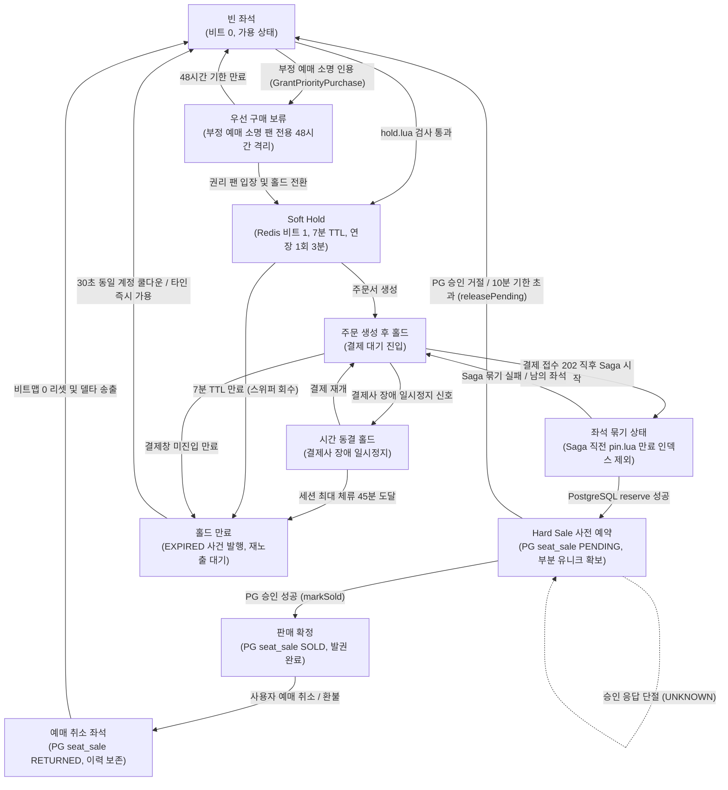
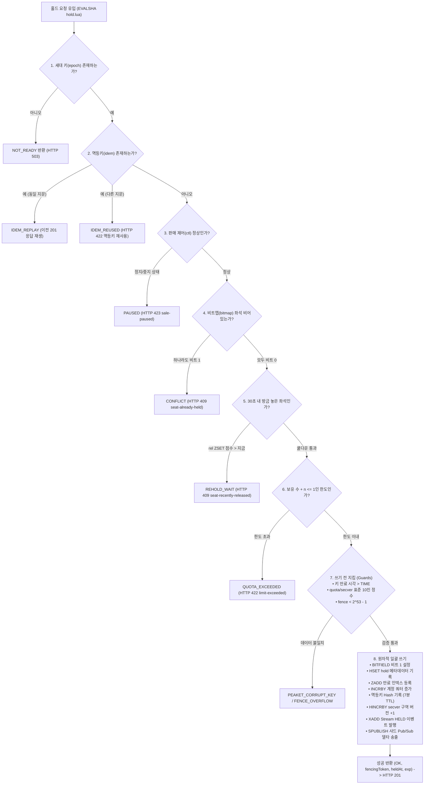
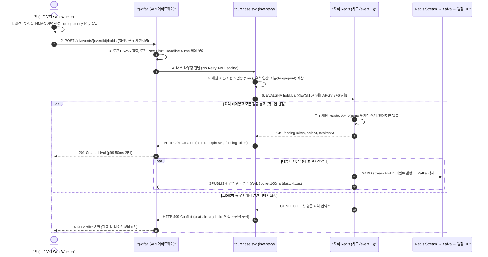
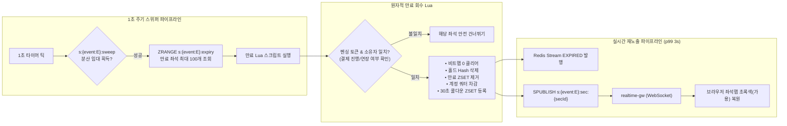
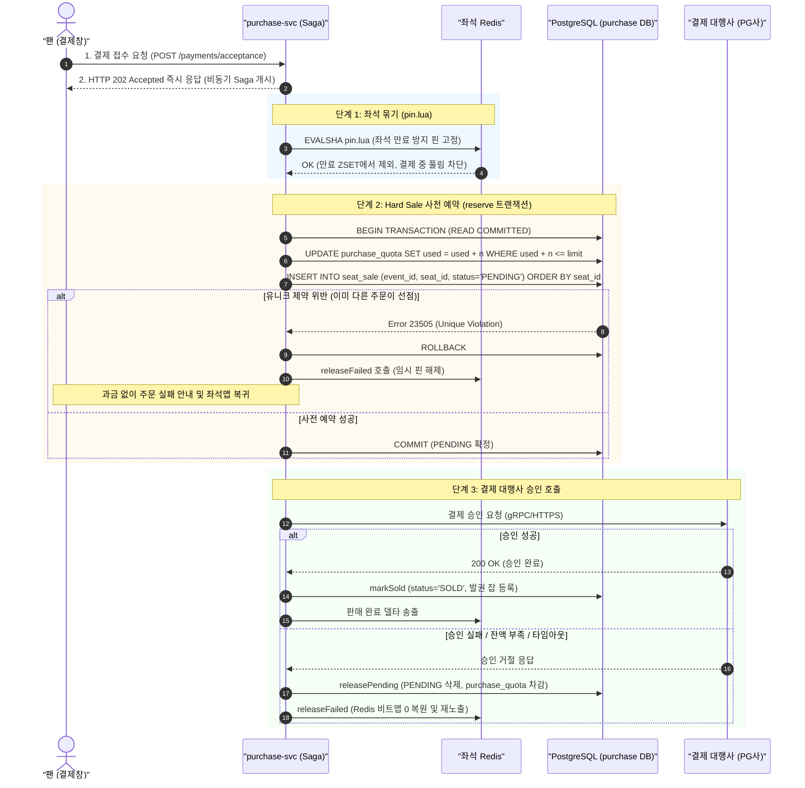

# 분야 편 10: 좌석 선점·동시성 제어 (Seat Hold & Concurrency Control)

- **맡는 정본**: [docs/features/seat-hold.md](../../features/seat-hold.md) 전체, [docs/data.md](../../data.md) §3·§4·§5의 좌석 부분, [docs/planning/03-policies-glossary.md](../../planning/03-policies-glossary.md)의 POL-011~013, 좌석 ADR(§6에 모았다)
- **문서 성격**: 정본 설계를 시스템 엔지니어링 및 기술 면접 관점에서 체계적으로 해설한 문서다. 규범적 수치와 불변 규칙의 최종 권위는 정본 문서([docs/features/seat-hold.md](../../features/seat-hold.md))에 있다([ADR-0177](../../adr/0177-walkthrough-explain-in-interview.md)). 길잡이는 [README.md](../README.md)다.
- **한 판 문서와의 관계**: [한 판 문서](../01-system-design.md) 8단계(같은 좌석을 두 번 팔지 않기)와 9단계(좌석 변경을 실시간으로 알리기)에서 다룬 좌석 라이프사이클을 4대 핵심 모듈로 심화 분해하고, 시스템 경계 규칙과 동시성 제어 모델을 정밀하게 보강한다.
- **아키텍처 목표와 검증 기준**: 5만 석 공연, 단일 인기 좌석 최대 1,000명 동시 경합, 피크 2,000 RPS, 오버셀(초과 판매) 0건(NFR-003, NFR-025), 좌석 홀드 지연 p99 50ms 이내(p99.9 150ms), 홀드 가용성 99.95%, 만료 좌석 화면 재노출 지연 p99 3초 이내(NFR-004, NFR-025), 화면 렌더링 INP 200ms 이하(NFR-012)를 설계 목표로 삼는다. 단일 Redis 샤드 벤치마크(5개 회차 동시 피크 6,000 RPS 환경에서 분산 배치 시 샤드 CPU 28.7~30.2%, 스크립트 실행 p99 0.13~0.27ms)를 바탕으로 아키텍처 타당성을 입증했다.

---

## 1. 좌석 도메인 종합 개요

좌석 선점·동시성 제어 도메인은 수만 명의 팬이 한정된 5만 석의 인기 좌석을 두고 밀리초 단위로 충돌하는 극단적인 쓰기 경합 환경에서, **인메모리 초저지연 선점(Soft Hold)과 데이터베이스 기반 불변 확정(Hard Sale)의 2단계 일관성 모델**을 통해 오버셀을 0건으로 통제하는 PEAKET 핵심 코어 시스템이다.

> **30초 아키텍처 브리핑 (Staff Engineer Interview)**:  
> "PEAKET의 좌석 동시성 제어는 **'Redis Soft Hold(임시 선점) + PostgreSQL Hard Sale(영구 판매 확정)'의 2단계 일관성 분리 아키텍처**로 설계되었습니다.  
> 첫째, 사용자가 좌석을 클릭하는 핫패스(Hot-Path)에서는 RDBMS에 쓰지 않고, 회차 전용 Redis 샤드에서 단일 스레드 원자적 Lua 스크립트(`hold.lua`)가 **'비트맵 빈 좌석 검사 + 1인당 예매 한도(2매) 확인 + 판매 제어 상태'**를 단일 원자 트랜잭션으로 판정하여 **p99 50ms 이내에 선점(Soft Hold)**을 완료합니다.  
> 둘째, 선점된 좌석은 7분(1회 3분 연장 가능, 최대 10분) 동안 독점 유지되며, 백그라운드 스위퍼가 1초 주기로 만료 좌석을 원자적으로 회수하여 **p99 3초 이내에 웹소켓 델타로 실시간 재노출**합니다. 동일 계정의 반복 선점을 통한 좌석 독점(Seat Squatting)은 **30초 쿨다운 ZSET**으로 원천 차단됩니다.  
> 셋째, 최종 결제 접수 단계에서는 결제사(PG) 승인 직전 PostgreSQL `seat_sale` 테이블의 **활성 상태 부분 유니크 인덱스(`UNIQUE (event_id, seat_id) WHERE status IN ('PENDING', 'SOLD')`)**를 통해 두 번째 방어선을 구축합니다. 경합에서 패배한 주문은 PG사 승인 API를 호출하기 전에 배제되므로 고객 과금 및 환불 비용이 0건으로 보장됩니다.  
> 넷째, 좌석 Redis 장애 조치(Failover) 시에는 데이터베이스로 우회하지 않고 **구매 요청을 일시 유예(HTTP 503 Retry-After)**함으로써 좌석 권한을 주는 단일 소스(Single Source of Authority) 원칙을 철저히 고수합니다."

### 좌석 라이프사이클 종합 상태 전이도



### 2대 서브시스템의 책임 분리

1. **Soft Hold Layer (`gw-fan`, `purchase-svc` inventory 모듈, 좌석 Redis 샤드)**:  
   - 인메모리 초저지연 선점 판정(p99 ≤ 50ms).
   - 비트맵(`s:{event:E}:bitmap`), 홀드 Hash, 만료 ZSET, 계정 쿼터 카운터를 단일 Lua 원자 트랜잭션으로 통제.
   - 7분 기본 TTL 및 1회 3분 연장 관리, 1초 주기 백그라운드 스위퍼 회수.
   - 좌석 상태 변경분 100ms 마이크로 배치 웹소켓 브로드캐스트(`ws.seat-delta`).
2. **Hard Sale Layer (`purchase-svc` checkout Saga 모듈, PostgreSQL purchase DB, `payment-svc`)**:  
   - 영구 트랜잭션 및 ACID 강한 일관성 보장.
   - `seat_sale` 테이블 활성 상태 부분 유니크 인덱스를 통한 물리적 오버셀 0건 방어.
   - `purchase_quota` 조건부 UPDATE를 통한 1인당 최종 매수 한도 이중 검증.
   - 결제 대행사(PG) 2단계 승인 연동 및 승인 실패 시 원자적 롤백.
   - Redis 비트맵 전면 유실 시 DB 원장 기반 자동 재구축(RB-06).

---

## 2. 절마다 읽기

정본에는 `### ` 제목이 없다. 굵은 글씨 항목 가운데 따로 물을 만한 것은 행을 나눴다.

| 정본 절 | 무엇을 정하나 | 왜 | 해설서에서 |
| --- | --- | --- | --- |
| §1 개요: 2단계 일관성 | Soft Hold(좌석 Redis의 비트맵과 Lua)와 Hard Sale(PostgreSQL 부분 유니크)의 역할. 비트맵은 좌석 하나를 1비트로 담은 전체 좌석 상태다. 홀드 기록은 나중에 원장(감사용 이력 표)으로 싣는다 | DB 행 잠금은 경합 때 p99가 수 초다. Redis만으로 확정하면 장애 조치(주 노드가 고장 나면 복사본 노드를 올려 쓰는 일) 때 잃은 쓰기로 오버셀이 날 수 있다(ADR-0014) | 한 판 8단계 |
| §2 좌석 스냅샷과 구매 세션 시작 | 입장 토큰(대기열 통과를 증명하는 서명된 표)을 처음 쓰는 스냅샷(지금 좌석 상태 전체) 요청이 구매 세션(결제까지 이어지는 서버 쪽 상태)을 연다. 소지 증명(그 브라우저의 키로 서명한 요청인지 보는 장치), 회차 묶기, 여정 ID, 좌석맵 파일 두 층 | 훔친 쿠키·입장 토큰만으로 구매 세션을 쓰지 못하게 하고(ADR-0050), 다른 회차 좌석을 잡지 못하게 한다(docs/security/asvs/seat-hold.md 8.2.2) | 한 판 3·7단계(세션 시작만) |
| §3 홀드 요청 | `hold.lua` 계약, 좌석 ID 확인, 자기 홀드만 해제·연장, 펜싱 토큰(늦게 온 옛 사건을 버리게 하는, 계속 커지는 번호), 회차 세대(장애 조치 뒤 화면을 다시 맞추는 번호), 멱등키(여러 번 와도 결과가 한 번과 같게 하는 키) | Valkey(이 설계의 Redis 호환 저장소)는 쓴 것을 되돌리지 못해 '검사를 다 마친 뒤에만 쓴다'. 회차 키를 한 샤드(데이터를 나눠 맡은 서버 묶음)에 모아 스크립트 하나로 다룬다 | 한 판 8단계 |
| §3 판매 일시정지·판매 종료 | 명령 3(판매 일시정지)이면 423, 판매 종료(공연 시작 24시간 전) 뒤면 410 | 정지를 상태로 둬야 명령 뒤에 뜬 파드(쿠버네티스에서 앱이 도는 단위)도 안다(ADR-0103) | 한 판 12·13단계(일시정지만) |
| §3 자동 좌석 배정 모드 | 희망 조건으로 후보 찾기와 홀드를 Lua 하나에서 한다 | 앱이 고르고 409면 3회 다시 하던 방식은 요청이 같은 좌석에 몰려 좌석이 남아도 수동 선택으로 떨어졌다 | — |
| §4 1인당 매수 제한 | '보유 수 + 요청 수 ≤ 한도'를 홀드 Lua와 `purchase_quota` 조건부 갱신에서 두 번 본다 | Redis가 보유 수를 잃어도 판매 확정이 한도 초과를 거절한다 | 한 판 8단계 |
| §4 회차 판매 상태 판정 | purchase-svc(좌석과 주문을 맡는 서비스)가 ON_SALE·ALL_HELD(일시 매진)·SOLD_OUT을 정한다 | 좌석 수의 정본이 여기 있다. 돌아올 좌석이 있는 동안 대기를 끝내지 않는다(ADR-0122) | 한 판 7단계(매진만) |
| §5 홀드 TTL·연장·만료·재노출 | 7분, 1회 3분 연장, 만료 회수, p99 3초 재노출, 결제창 30분과의 관계, 결제사 장애 때 연장 | 남이 살 좌석을 묶는 제한이라 WCAG 2.2.1(웹 접근성의 시간 제한 항목)의 필수 예외로 본다(ADR-0060) | 한 판 8단계(수명과 회수만) |
| §5 방금 놓은 좌석 | 같은 계정은 놓은 좌석을 30초 다시 못 잡는다 | 풀자마자 다시 잡으면 최대 체류 45분까지 붙잡을 수 있었다(ADR-0161) | — |
| §5 우선 구매 보류 | 부정 예매 이의가 인정된 팬 몫으로 48시간 잡는 홀드 종류 | 그 좌석을 잡아 둘 장치가 7분 홀드뿐이었다(ADR-0171) | — |
| §5 멈춘 홀드 | 새 결제 일시 정지 동안 주문 뒤·결제 접수 전 홀드의 시간을 멈춘다 | 결제를 못 하는 동안 좌석을 잃지 않게 한다(ADR-0085) | — |
| §6 Hard Sale | 결제 접수 202 직후 Saga(단계를 차례로 처리하고 실패하면 앞 단계를 되돌리는 방식)가 PENDING(승인 전 사전 예약) 행, `purchase_quota`, Outbox(보낼 사건을 적어 두는 표)를 한 트랜잭션(모두 하거나 모두 하지 않는 DB 쓰기 단위)으로 쓴다. 원장 적재, 전체 장애 뒤 다시 만들기 | 진 주문은 승인 전에 걸러져 과금이 없다. 좌석 ID 오름차순으로 넣어 서로 기다리는 교착을 막는다 | 한 판 8·10단계 |
| §7 실시간 좌석 전파 | 샤드 Pub/Sub(같은 샤드 안에서만 메시지를 돌리는 방식), 보이는 구역만 구독, 100ms 묶음, 구역별 일련번호와 세대, 전파 Degraded(장애 때 정한 만큼 줄여 버티는 모드) | 전체를 보내면 초당 약 10GB다. 250ms 묶음은 기다림만 p99 약 248ms였다(ADR-0110) | 한 판 9단계 |
| §8 지연 예산: 좌석 홀드 p99 50ms | 50ms를 구간별로 나누고 샤드 처리량 상한을 둔다 | 넘으면 구간을 찾는다. 샤드 상한은 '스크립트 시간 × 초당 홀드 수'다 | 한 판 8단계 |
| §9 장애 시 동작 | 좌석 Redis 장애 조치, 메모리 가득, 전파 과부하, 킬스위치(명령 3), purchase-svc 전면 장애 | 홀드를 주는 곳을 늘 하나로 둔다(ADR-0121). 메모리가 차면 지우지 않고 오류로 드러낸다(ADR-0109) | 한 판 8·16단계 |
| §10 좌석맵 프론트엔드 | Web Worker(화면과 따로 도는 작업 스레드)와 OffscreenCanvas(화면 밖에서 그리는 캔버스)로 그리기, 전체에서 확대, 에디터 두 층, 접근성 대안 목록 | 메인 스레드로 5만 석을 그리면 조작이 막힌다. 좌표가 있어야 확대·구역 구독·연석(붙은 좌석) 찾기를 한다(ADR-0063) | 한 판 9단계(그리기만) |
| §10 좌석맵 가져오기 파일 처리 | 파트너(공연을 파는 사업자)의 파일은 자격 증명 없는 `seatmap-worker`가 해석하고 core-svc(공연 정보 서비스)가 다시 본다 | 해석기 결함이 DB 자격 증명을 가진 프로세스에서 터지지 않게 한다(ADR-0161) | — |
| §11 데이터·API 참조 | Redis 키, PostgreSQL 표·인덱스, REST·채널·이벤트 목록 | 찾아보기다 | 한 판 3·15단계 |
| §12 테스트 포인트 | 규칙 모델 검사와 S-T1~S-T37(S-T17은 없앴다) | 0건 목표와 시간 목표를 시험으로 판정한다 | 한 판 18단계(재는 방식만) |
| §13 미결정·[가정] | 아직 재지 않은 값과 남은 결정 | 측정으로 고칠 값을 모은다 | — |
| §14 v0 베이스라인 | K2~K5를 견줄 비교용 단순한 첫 판(v0) 좌석이다. v1과 다른 점은 셋이다. 홀드를 PostgreSQL 행 잠금(`SELECT … FOR UPDATE`)으로 요청에 적힌 순서대로 잡고(K2·K3), 바뀐 좌석을 JSON으로 그 회차의 모든 연결에 바로 보내며(구역 구독·묶어 보내기·바이너리·일련번호 없음, K4), 좌석맵을 메인 스레드의 Canvas 2D 한 장에 좌석 객체 배열로 그린다(Worker·TypedArray 없음, K5). 구매 세션과 소지 증명, 입장 토큰, 홀드 멱등키, 펜싱 토큰, 방금 놓은 좌석 30초, 자동 배정, 회차 판매 상태 판정, 좌석맵 파일 두 층은 뺐다. `services/v0-monolith`의 `inventory` 모듈과 표 넷이고(`v0_seat`은 좌석 하나가 행 하나라 잠금의 단위다), 만료는 1초마다 `FOR UPDATE SKIP LOCKED`로 500개씩, 변경분은 커밋 때만 나가는 `pg_notify`로 낸다. 결제 v0가 부르는 판매 함수도 이 절에 있다 | v0는 일부러 망가뜨린 설계가 아니라 '유능한 팀이 처음 만들 법한 단순한 설계'다(ADR-0096 결정 6). 엇갈린 순서로 같은 좌석들을 잠그는 두 요청의 교착이 K3의 v0 한계다. 잠금 대기 상한과 교착 감지가 둘 다 1초라 교착도 시간 초과로 보일 수 있어, 교착 수는 앱이 아니라 DB 통계로 센다. 5만 석 전체 JSON을 매번 보내는 방식은 계산만으로 실패가 분명해 만들지 않는다. 운영에 배포하지 않고, 성능은 기준선으로 쟀다(실측(PC), 합격·불합격은 정하지 않는다) | 한 판 4·8·9단계 |

---

## 3. 좌석 선점 4대 핵심 메커니즘 심화

```
                                [PEAKET 좌석 선점 4대 코어 모듈]
  ┌───────────────────────────┬───────────────────────────┬───────────────────────────┬───────────────────────────┐
  │   모듈 1: 초고동시성 선점 │    모듈 2: 1인 쿼터·펜싱  │   모듈 3: 만료·3초 재노출 │   모듈 4: 2단계 일관성    │
  ├───────────────────────────┼───────────────────────────┼───────────────────────────┼───────────────────────────┤
  │ • 1석 1,000명 동시 경합   │ • 1인당 최대 2매 강제     │ • 기본 7분 + 1회 3분 연장 │ • Soft Hold: Redis 50ms   │
  │ • 단일 스레드 hold.lua    │ • Redis 1차 + PG 2차 검증 │ • 1초 주기 분산 스위퍼    │ • Hard Sale: PG ACID 확정 │
  │ • Check-First All-Write   │ • Fencing Token 단조증가  │ • 동일 계정 30초 쿨다운   │ • 부분 유니크 인덱스 방어 │
  │ • 5만석 6.25KB 비트맵 제어│ • seatEpoch 세대 동기화   │ • 결제장애 홀드 시간 동결 │ • Deadlock 방지 사전정렬  │
  └───────────────────────────┴───────────────────────────┴───────────────────────────┴───────────────────────────┘
```

---

### 모듈 1: 초고동시성 좌석 선점과 오버셀 0 방지 (High-Concurrency Seat Hold & Zero Overselling)

#### 1. 문제 정의 및 극단적 경합 환경
5만 석 규모의 대형 콘서트 오픈 직후, 정면 로열석 등 특정 인기 좌석 하나에 1,000명 이상의 사용자가 수 밀리초(ms) 찰나에 동시 클릭을 발생시킨다. 피크 트래픽은 회차당 초당 2,000건(RPS)에 달한다.  
이 상황에서 관계형 데이터베이스(RDBMS)의 일반적인 행 잠금(`SELECT ... FOR UPDATE`)을 적용할 경우 1,000개의 DB 커넥션이 단일 행 락을 얻기 위해 줄을 서며 p99 응답 지연이 수 초로 치솟고 커넥션 풀 고갈과 잠금 타임아웃(Lock Timeout)으로 서비스 전체가 붕괴된다.

#### 2. Redis 단일 스레드 Lua 스크립트 원자성 (`hold.lua`)
PEAKET은 핫패스(Hot-Path)에서 RDBMS 쓰기를 완전히 배제하고, 회차별 전용 Redis(Valkey) 샤드에서 실행되는 원자적 Lua 스크립트(`hold.lua`)를 통해 경합을 p99 50ms 이내에 즉각 판정한다.

1. **단일 스레드 이벤트 루프에 의한 완벽한 직렬화**:  
   Redis는 단일 스레드로 명령과 Lua 스크립트를 처리하므로, 동일 좌석에 대한 1,000건의 동시 요청이 유입되더라도 스크립트 실행 레벨에서는 완벽히 1건씩 순차 실행된다. 분산 락(Redlock)과 같은 무거운 네트워크 오버헤드가 필요 없다.
2. **"검사 후 일괄 쓰기 (Check-First, Write-All-or-Nothing)" 원칙**:  
   Redis는 스크립트 실행 중 발생한 쓰기 작업을 되돌리는 트랜잭션 롤백(Rollback) 기능을 제공하지 않는다. 따라서 `hold.lua`는 **모든 사전 검사를 100% 완료한 뒤, 단 하나의 결격 사유도 없을 때에만 쓰기 명령을 마지막에 일괄 실행**한다. 좌석이 이미 잡혀 있거나 한도가 초과된 경우 어떤 키도 변경하지 않고 즉시 반환하므로 부분 쓰기(Partial Hold)가 원천 방지된다.
3. **단일 샤드 해시 태그 로컬리티**:  
   회차와 관련된 모든 키는 `{event:E}` 해시 태그를 공유하여 물리적으로 동일한 Redis 인스턴스/슬롯에 배치된다. 따라서 멀티 키 연산이 Redis 클러스터 제약에 걸리지 않고 단일 Lua 스크립트 내에서 안전하게 원자적으로 실행된다.

#### 3. `hold.lua` 검사 파이프라인 및 쓰기 전 지킴 (Guards)

`hold.lua`는 다음 순서로 엄격하게 검증을 수행하며, 조건 위반 시 즉시 실행을 중단한다:



#### 4. 동시 홀드 요청 처리 시퀀스 다이어그램



#### 5. 자동 좌석 배정(AUTO) 모드의 원자적 선점
자동 좌석 배정(POL-035, FR-050)에서는 팬이 개별 좌석을 선택하지 않고 희망 조건(1순위 등급, 매수, 휠체어석)을 대기 중에 미리 저장해 둔다. 입장 차례가 오면 브라우저가 자동 배정 API를 호출한다.  
과거 방식(앱이 후보를 조회한 뒤 홀드를 시도하고 경합 시 3회 재시도)은 수많은 요청이 동일한 '중앙 최고 좌석'에 몰려 3회 재시도 모두 실패하고 수동 선택으로 강등되는 문제를 낳았다.  
PEAKET은 **판매 전 생성된 연석 후보 목록(`s:{event:E}:auto:{tier}:{n}`)을 Redis 샤드에 두고, 자동 배정 Lua 스크립트 하나가 커서 기반으로 빈 블록을 탐색하여 즉시 원자적으로 선점**한다. 단일 스레드로 순차 배정되므로 요청 간 후보 충돌이 0건이며, 탐색 연산은 1회 최대 32개 블록으로 제한되어 샤드 점유 시간을 0.3ms 미만으로 방어한다.

---

### 모듈 2: 1인당 예매 한도(Quota)와 펜싱 토큰 (Per-Account Quota & Fencing Tokens)

#### 1. 다중 탭 및 분산 기기를 통한 쿼터 우회 위협
암표상이나 악의적인 사용자는 동일 계정으로 여러 대의 PC나 모바일 기기, 혹은 브라우저 탭 수십 개를 열어 동시에 서로 다른 좌석에 홀드 API를 호출함으로써 1인당 예매 한도(예: 1인 2매)를 초과 확보하려 시도한다. 분산 환경에서 단순 분산 락이나 비동기 쿼터 검사는 Check-Then-Act 경주 조건(Race Condition)으로 인해 한도 초과 선점을 유발할 수 있다.

#### 2. CI 기반 1인 1계정 및 2단계 중복 검증 아키텍처
PEAKET은 본인확인 연계정보(CI)를 통해 실제 1인과 시스템 계정을 1:1로 엄격히 결속하며, 쿼터 검증을 2개 독립된 계층에서 중복으로 강제한다:

```
[1차 검증: Redis Soft Hold (hold.lua)]
  현재 보유 수 + 요청 좌석 수 n <= 1인당 한도 (예: 2매)
  → 조건 만족 시 원자적 INCRBY quota:{account} n
  → 초과 시 422 purchase-limit-exceeded 반환 (아무 좌석도 잡지 않음)
         │
         ▼ (결제 진행)
[2차 검증: PostgreSQL Hard Sale (reserve 함수 트랜잭션)]
  INSERT INTO purchase_quota (account_id, event_id, used, limit_count)
  VALUES ($account, $event, $n, $limit)
  ON CONFLICT (account_id, event_id) DO UPDATE
  SET used = purchase_quota.used + $n
  WHERE purchase_quota.used + $n <= EXCLUDED.limit_count
  RETURNING used;
  → 갱신 행이 없으면 즉시 트랜잭션 ROLLBACK 및 422 거절
  → DB 테이블 레벨 CHECK (used <= limit_count) 제약조건이 최종 방어
```

- **Redis 장애 조치(Failover) 내구성**:  
  만약 Redis 주 노드가 다운되어 비동기 복제본으로 페일오버되는 과정에서 최신 쿼터 카운트 쓰기가 유실되더라도, 최종 판매 승인 단계에서 PostgreSQL `purchase_quota`의 원자적 조건부 UPDATE가 한도 초과 행을 100% 차단한다. 시스템 장애 상황에서도 초과 판매는 결코 발생하지 않는다.

#### 3. 펜싱 토큰(Fencing Token) 단조 증가 메커니즘
분산 비동기 환경에서는 네트워크 지연이나 파티션으로 인해 이전에 발생한 이벤트가 최신 이벤트보다 늦게 도착하는 '메시지 역전 현상'이 빈번하게 발생한다. 과거의 홀드 해제 이벤트가 최신 선점 이벤트를 덮어써 버리면 데이터 불일치가 발생한다.

PEAKET은 회차별 단조 증가 정수 카운터인 **펜싱 토큰(Fencing Token)**을 도입하여 이 문제를 해결한다:

$$\text{fencingToken} = \max(\text{fence} + 1, \lfloor \text{Redis TIME}_{\mu s} \rfloor)$$

1. **식의 수학적 특성**:  
   토큰은 항상 직전 토큰(`fence`)보다 1 이상 크며, 동시에 현재 Redis 노드의 마이크로초 타임스탬프 이상이다.
2. **장애 조치 및 재구축 내구성**:  
   Redis 마스터 노드가 승격되거나 클러스터 전면 재구축(RB-06)이 발생하여 인메모리 `fence` 키가 초기화되더라도, 새로운 토큰은 승격 시점의 물리적 마이크로초 시계 이상으로 발급된다. 따라서 과거에 이미 발급되었던 토큰 번호가 다시 재발급되는 역전 현상이 수학적으로 불가능하다.
3. **다운스트림 폐기 규칙 (Drop Stale Events)**:  
   Kafka 원장 적재 컨슈머(`SeatHoldLedgerHandler`)와 실시간 웹소켓 전파기는 수신한 이벤트의 펜싱 토큰을 검사하여, 자신이 이미 처리한 토큰보다 낮은 번호의 이벤트가 도착하면 아무런 상태 변경 없이 안전하게 버린다.
4. **회차 세대 번호(`seatEpoch`)**:  
   회차 키 슬롯의 주 노드가 교체되거나 비트맵이 재구축될 때마다 단조 증가하는 세대 번호 `seatEpoch`가 갱신된다. 클라이언트는 수신한 델타의 세대 번호가 자신의 로컬 세대와 불일치할 경우 즉시 전체 스냅샷을 재요청하여 화면을 완전히 동기화한다.

---

### 모듈 3: 홀드 TTL 만료 및 3초 원자적 재노출 파이프라인 (Hold TTL Expiry & 3s Re-exposure)

#### 1. 홀드 TTL 정책 및 웹 접근성(WCAG 2.2.1) 필수 예외
선점된 좌석의 기본 유효 시간은 **7분**이며, 사용자가 결제 과정을 진행하는 동안 1회에 한해 **3분 연장**할 수 있다(최대 10분). 두 번째 연장 요청은 409 Conflict로 엄격히 거부된다.  
국제 웹 접근성 표준인 WCAG 2.2.1은 시간 제한 연장을 10회 이상 허용할 것을 권고하지만, 한정된 실시간 티켓팅 환경에서 특정인이 좌석을 무한정 점유하는 것은 공공의 이익을 침해하므로 W3C 공식 해설서상 **'필수 예외(Essential Exception)'**로 인정된다. PEAKET은 화면 낭독기 음성 안내(`aria-live`)와 1회 연장 버튼을 제공하여 접근성을 최대한 보장한다.

#### 2. 1초 주기 분산 스위퍼와 원자적 만료 회수 Lua
BullMQ 등 무거운 작업 큐를 사용하지 않고, Redis Sorted Set(`s:{event:E}:expiry`, score = 만료 시각 ms)을 기반으로 초경량 분산 스위퍼를 운용한다:

1. **파드 분산 임대(Lease)**:  
   모든 `purchase-svc` 파드가 1초마다 회차 목록을 확인하지만, 회차별 분산 임대 키(`s:{event:E}:sweep`, TTL 3초)를 원자적으로 획득한 단 1개의 파드만이 해당 회차의 만료 스캔을 담당한다.
2. **100건 단위 마이크로 배치 스캔**:  
   스위퍼 파드는 `ZRANGE s:{event:E}:expiry -inf {nowMs} BYSCORE LIMIT 0 100`으로 만료 대상 좌석 색인을 읽어 들인 후, 만료 전용 Lua 스크립트를 호출한다. 1회 배치 크기를 100건으로 제한하여 단일 실행 지연을 0.3ms 미만으로 억제한다.
3. **만료 Lua의 펜싱 토큰 재검증**:  
   스위퍼가 대상 좌석을 읽고 Lua를 실행하는 짧은 틈 사이에 사용자가 결제를 진행(`pin`)했거나 연장을 완료했을 수 있다. 만료 Lua는 홀드 Hash의 `holdId`, `fence`, `owner`가 스위퍼가 넘긴 기대값과 정확히 일치하고 `exp <= TIME`인 경우에만 좌석을 회수한다.
4. **원자적 상태 복원 및 실시간 전파**:  
   - `BITFIELD` 명령으로 비트맵 좌석 비트를 즉시 0(가용)으로 클리어.
   - 홀드 Hash 삭제 및 만료 ZSET 멤버 제거.
   - 계정 보유 쿼터(`quota:{account}`) 차감.
   - 구역 버전 카운터(`secver`)를 1 증가시키고 Stream에 `EXPIRED` 이벤트 발행.
   - 샤드 Pub/Sub `SPUBLISH`를 통해 해당 구역 채널로 상태 0(가용) 델타를 송출하여 **p99 3초 이내에 좌석맵 화면에 즉시 재노출(NFR-025)**.



#### 3. 방금 놓은 좌석 30초 쿨다운 (Seat Squatting 방지)
- **공격 시나리오**: 홀드가 7분 만료되거나 스스로 해제(`DELETE /holds/{holdId}`)한 직후, 동일 계정이 매크로를 이용해 해당 좌석을 즉시 재선점하면 구매 세션 최대 체류 시간인 **45분 동안 특정 좌석을 독점 점유**할 수 있다.
- **방어 메커니즘**: 해제 또는 만료 처리 시, 원자적 Lua 스크립트가 해당 계정의 쿨다운 ZSET(`s:{event:E}:rel:{account}`)에 좌석 색인과 점수(`now + 30,000ms`)를 기록한다.
- **동작**: 향후 30초 동안 해당 계정이 동일 좌석을 다시 홀드하려 하면 `hold.lua` 단계 5에서 즉시 거절되고 `409 seat-recently-released`를 반환한다. 반면 **다른 제3자 팬들에게는 즉시 가용 상태로 노출**되므로 좌석이 필요한 타인에게 자연스럽게 기회가 넘어간다.

#### 4. 결제 일시정지 시 홀드 동결 파이프라인
결제 대행사(PG) 전산 장애 등으로 신규 결제 진입이 일시 정지(명령 3)되면, 이미 주문서를 생성하고 결제를 준비 중이던 팬들이 외부 요인으로 인해 억울하게 좌석을 잃는 사태가 발생한다.  
PEAKET은 결제 일시정지가 선포되는 즉시 주문 후 홀드 집합(`s:{event:E}:ordered`)에 보관된 홀드들을 200개 단위 마이크로 배치로 **정지 홀드 집합(`s:{event:E}:paused`)으로 이동시키고 남은 만료 시간 타이머를 완전히 동결**한다. 결제 시스템이 정상화되면 동결되었던 잔여 시간을 복원하여 재활성화한다.

#### 5. 우선 구매 보류(Priority Hold, 48시간)
부정 예매 의심으로 표가 취소되었으나 이후 공식 소명 절차(POL-046 ⑦)를 거쳐 정당한 팬으로 확인된 경우, 기존 홀드 체계(7분)로는 좌석을 보장할 수 없다.  
PEAKET은 전용 격리 집합(`s:{event:E}:prio`)을 통해 해당 소명 팬 전용으로 **48시간 동안 좌석을 보류(Priority Hold)**한다. 소명 팬은 우선 구매 전용 입장 토큰(`prio` 클레임)을 통해 대기열 없이 진입하여 배정된 좌석을 안전하게 결제할 수 있다.

---

### 모듈 4: Soft Hold와 Hard Sale 2단계 분리 (2-Stage Consistency: Soft Hold & Hard Sale)

#### 1. 아키텍처 배경 및 필연성
- **단일 RDBMS 접근의 한계**: 5만 석 오픈 시 수만 명이 동시에 던지는 트랜잭션 쓰기를 처리하려면 초단위 지연과 데드락이 발생하여 p99 50ms 목표를 결코 달성할 수 없다.
- **단일 Redis 접근의 한계**: Redis 메모리 상에서 최종 판매까지 완료하면 빠르지만, 주 노드 장애 조치(Failover) 시 비동기 복제본이 미처 전달받지 못한 마지막 수 초간의 판매 기록이 유실되어 **동일 좌석이 중복 발권되는 치명적인 오버셀(초과 판매)**이 발생한다.
- **PEAKET의 해법**: **'임시 선점은 인메모리에서 초고속으로, 영구 확정은 RDBMS에서 엄격하게'** 분리하는 2단계 일관성 모델을 확립했다.

```
┌────────────────────────────────────────────────────────────────────────────────────────┐
│ [1단계: Soft Hold] Redis 인메모리 빠른 판정 (p99 <= 50ms)                             │
│ • 사용자가 좌석 선택 시 호출                                                           │
│ • Redis Lua 원자 연산: 비트맵 1 설정, 7분 TTL 부여, 쿼터 검증                          │
│ • 장애 조치 시 유실될 수 있으나, 빠른 사용자 피드백 제공 (동기 RDBMS 쓰기 0건)         │
└──────────────────────────────────────────┬─────────────────────────────────────────────┘
                                           │ 결제창 인증 완료 후 결제 접수 (HTTP 202)
                                           ▼
┌────────────────────────────────────────────────────────────────────────────────────────┐
│ [2단계: Hard Sale] PostgreSQL 트랜잭션 강한 일관성 (ACID)                              │
│ • 결제 대행사(PG) 승인 직전 purchase DB에서 수행                                       │
│ • seat_sale 부분 유니크 인덱스로 오버셀 물리적 차단                                    │
│ • purchase_quota 조건부 UPDATE로 1인당 매수 한도 최종 확인                             │
│ • 승인 전 실패 시 과금 0건, 승인 성공 시 영구 발권 확정                                │
└────────────────────────────────────────────────────────────────────────────────────────┘
```

#### 2. PostgreSQL 부분 유니크 인덱스 (이중 방어선)
PostgreSQL `seat_sale` 테이블은 활성 상태인 좌석에 대해 부분 유니크 인덱스를 보유한다:

```sql
CREATE UNIQUE INDEX uq_seat_sale_active 
ON seat_sale (event_id, seat_id) 
WHERE status IN ('PENDING', 'SOLD');
```

- **오버셀 0건의 수학적 보장**: 만약 Redis 장애 조치나 네트워크 이상으로 인해 동일 좌석에 대해 복수의 사용자가 결제 접수 단계까지 도달하더라도, PostgreSQL 트랜잭션이 `PENDING` 행을 삽입하는 순간 단 1건만 유니크 인덱스를 통과하고 나머지는 **유니크 제약조건 위반(SQL Error 23505)**으로 즉시 거절된다.
- **취소표 재판매의 우아한 수용**: 사용자가 예매를 취소하면 해당 레코드의 상태가 `RETURNED`로 변경된다. `RETURNED`는 부분 유니크 인덱스 조건(`WHERE status IN ('PENDING', 'SOLD')`)에서 자동으로 제외되므로, 데이터베이스 트리거 없이도 동일 좌석에 대해 새로운 구매자의 `PENDING` 행이 즉시 삽입될 수 있다.

#### 3. 교착 상태(Deadlock) 방지: 좌석 ID 사전 정렬
사용자가 2매 이상의 연석을 예매할 때, 트랜잭션 A는 (좌석 1 → 좌석 2) 순서로 삽입하고 트랜잭션 B는 (좌석 2 → 좌석 1) 순서로 삽입하면 상호 락 경합으로 인한 교착 상태(Deadlock)가 발생한다.  
PEAKET은 `reserve` 저장소 함수에서 **다중 좌석 ID를 문자열 코드 순(ASCII)으로 완벽하게 오름차순 사전 정렬(Pre-sorting)**한 후 단일 `INSERT ... SELECT FROM unnest(...) ORDER BY ordinality` 문장으로 삽입하여 교착 상태 발생 가능성을 수학적으로 0으로 제거했다.

#### 4. 결제 접수 Saga 4단계 라이프사이클



#### 5. Redis 전면 장애 시 복구 런북 (RB-06)
만약 데이터센터 장애 등으로 좌석 Redis 클러스터가 완전히 셧다운되고 인메모리 데이터가 전무한 상태로 복구되더라도 데이터 유실은 발생하지 않는다:
1. `purchase-svc`의 `SeatRebuilder`가 활성화되어 해당 회차의 신규 진입을 503으로 일시 차단한다.
2. PostgreSQL `seat_sale` 테이블에서 `PENDING` 및 `SOLD` 상태인 모든 좌석 레코드를 조회하여 비트맵의 해당 비트들을 1로 설정한다.
3. Kafka 원장 DB(`seat_hold`)에서 아직 TTL이 남아있는 유효 홀드 데이터를 조회하여 홀드 Hash와 만료 ZSET을 복원한다.
4. 새로운 회차 세대 번호(`seatEpoch`)를 마스터에 기록하고 요청 접수를 재개한다. 클라이언트는 변경된 세대 번호를 감지하고 전체 스냅샷을 다시 다운로드하여 정합성을 동기화한다.

---

## 4. 핵심 불변 규칙 및 지연시간 예산 (Immutable Rules & Latency Budgets)

### 핵심 불변 수치 및 설계 목표

| 항목 | 규범적 목표값 | 신뢰성 및 검증 근거 | 정본 위치 |
| --- | --- | --- | --- |
| 홀드 지연시간 | **p99 ≤ 50ms**, p99.9 ≤ 150ms | 피크 2,000 RPS, 단일 좌석 1,000명 경합 시 목표 | NFR-003, §8 |
| 오버셀 방지 | **0건 (Zero Overselling)** | Redis 원자 Lua + PostgreSQL 부분 유니크 인덱스 | NFR-003, NFR-025 |
| 홀드 서비스 가용성 | **99.95%** | 70분 피크 온세일 약 15만 건 중 오류 버짓 약 75건 (409 경합 제외) | NFR-003 |
| 홀드 TTL 및 연장 | **기본 7분, 1회 3분 연장** | 최대 10분 허용, 2회차 연장 시 409 거절 (WCAG 2.2.1 필수 예외) | POL-012, §5 |
| 만료 좌석 재노출 | **p99 ≤ 3초 이내** | 1초 주기 스위퍼 + 샤드 Pub/Sub + WebSocket 브로드캐스트 | NFR-025, POL-012 |
| 방금 놓은 좌석 쿨다운 | **30초 재선점 금지** | 동일 계정 재선점 차단, 타인 즉시 가용 (Seat Squatting 방지) | §5, ADR-0161 |
| 1인당 예매 한도 | **회차당 1인 2매** (최대 4매) | Redis Lua 1차 검사 + PostgreSQL `purchase_quota` 2차 검사 | POL-011, §4 |
| 구매 세션 수명 | **무활동 유휴 5분, 최대 체류 45분** | 결제창 유지 30분, 결제사 승인 기한 10분 연동 | §2, §5 |
| 판매 종료 시점 | **공연 시작 24시간 전** | 이후 신규 홀드 요청 410 `sale-ended` 반환 | §3, ADR-0064 |
| Redis 장애 조치 목표 | **지연 유예 30초 이내**, 목표 50% 감축 | 503 `seat-store-unavailable` + `Retry-After: 2` 반환 | NFR-015, §9 |
| 실시간 변경 전파 지연 | **종단 p99 ≤ 300ms** | 100ms 마이크로 배치, 5,000 동시 접속, 초당 500건 변경 | NFR-004, §7 |
| 좌석맵 렌더링 성능 | **첫 렌더 < 1초, INP ≤ 200ms** | Web Worker + OffscreenCanvas 5만 석 가속 | NFR-012, §10 |

### 좌석 홀드 p99 50ms 지연시간 예산(Latency Budget) 분해

```
[총 지연 예산: 50ms]
┌──────────────┬──────────────┬──────────────┬──────────────┬──────────────┬────────────────────────┐
│ gw-fan 프록시│ 네트워크 왕복│ 구매세션 인증│ Redis 왕복   │ 응답 직렬화  │ 시스템 안전 마진 (여유)│
│     3ms      │     5ms      │     1ms      │     7ms      │     5ms      │          29ms          │
└──────────────┴──────────────┴──────────────┴──────────────┴──────────────┴────────────────────────┘
                                              ▲
                                              │ 단일 샤드 hold.lua 실행: p99 <= 0.3ms
```

- **샤드 처리량 및 CPU 통과 기준**:  
  단일 Redis 샤드의 스크립트 실행 시간은 **p99 0.3ms 이하**, 엔진 CPU 사용률은 **50% 이하**로 통제된다. 5개 회차가 단일 샤드에 몰려 초당 6,000건의 부하가 발생할 경우 CPU가 54~56%로 임계치를 초과하므로, 대형 온세일 회차를 물리적으로 서로 다른 마스터 노드에 분산 배치하는 파티셔닝 규칙을 필수로 적용한다.

---

## 5. 관련 시스템 ID 및 트레이스 매핑

| 식별자 (ID) | 핵심 요구사항 및 규칙 요약 |
| --- | --- |
| **FR-009** | 5만 석 좌석맵에서 전체 배치를 확대해 고르고, 화면에 노출된 구역만 웹소켓으로 선택적 구독한다. |
| **FR-010** | 다중 좌석을 원자적으로 홀드한다. 경합 시 최초 1인만 선점하며 1인 한도 초과는 차단하고 연장은 1회로 제한한다. |
| **FR-011** | 결제 접수 후 서버가 좌석 예약을 확정한 뒤 결제사 승인을 요청한다. 경합 패배 시 과금 없이 종료한다. |
| **FR-042** | 홀드 TTL 만료 시 원자적으로 회수하고 p99 3초 이내에 가용 상태로 재노출하며 계정 쿼터를 복원한다. |
| **FR-050** | 자동 좌석 배정 공연은 대기 중에 희망 조건을 사전 입력받아 차례 진입 시 원자적으로 즉시 일괄 배정한다. |
| **FR-072** | 온세일 종료 후 부정 예매 조사를 위해 대기열 여정 ID(`journeyId`)와 홀드 이력을 추적 가능하게 보존한다. |
| **NFR-003** | 홀드 응답 지연 p99 50ms / p99.9 150ms 이내, 홀드 가용성 99.95%, 오버셀 0건을 달성한다. |
| **NFR-004** | 좌석 상태 실시간 전파 종단 지연 p99 300ms 이내, 누락된 변경분은 30초 이내에 99.9% 자체 복구한다. |
| **NFR-012** | 좌석맵 첫 렌더 1초 미만, CPU 감속 환경 조작 반응성 INP 200ms 이하, 메인 스레드 롱 태스크 0건을 유지한다. |
| **NFR-015** | 좌석 Redis 장애 조치 시 구매 요청을 30초 이내로 안전하게 유예하고 데이터베이스로 우회하지 않는다. |
| **NFR-020** | 좌석 상태는 색상과 무늬를 병기하여 색약자를 배려하고 화면 낭독기 완주율 100%를 보장한다. |
| **NFR-025** | 정합성 불변식: 만료 좌석 재노출 p99 3초 이내, 다중 기기/탭 동시 요청 시에도 1인 한도 초과 0건을 강제한다. |
| **POL-011** | 1인당 매수 제한 정책: `현재 보유 수 + 요청 수 ≤ 한도`를 Redis 홀드와 PostgreSQL 확정 시 2회 검증한다. |
| **POL-012** | 홀드 유효시간 및 재노출 정책: 기본 7분, 연장 1회 3분, 3초 내 재노출, WCAG 2.2.1 필수 예외 인정. |
| **POL-013** | 2단계 결제 연동 정책: 구매자 인증 완료 후 서버가 승인을 요청하는 2단계 결제사만 채택한다. |
| **POL-035** | 좌석 배정 방식: 공연별 특성에 따라 직접 선택(PICK)과 자동 배정(AUTO) 중 선택하여 운영한다. |
| **POL-046** | 부정 예매 사후 조치: 이의 신청이 정당하게 인용된 팬에게 48시간 우선 구매 권리를 부여한다. |
| **SCR-007 / SCR-008** | 로비 대기실 및 대기열 화면: 자동 배정 희망 조건 입력 및 요약 확인 UI. |
| **SCR-010 / SCR-022** | 좌석 선택 및 좌석맵 에디터 화면: Web Worker 기반 5만 석 가속 캔버스 UI. |
| **CMP-021 / CMP-022** | SeatMap 컴포넌트(OffscreenCanvas 가속) 및 SeatList 컴포넌트(접근성 전용 키보드 목록 UI). |

---

## 6. 아키텍처 결정과 버린 대안 (ADR Trade-offs & Rejected Alternatives)

### [ADR-0014](../../adr/0014-soft-hold-hard-sale.md) 좌석은 Soft Hold + Hard Sale 2단계로 통제한다
- **선택한 아키텍처**: Redis 비트맵과 원자적 Lua 스크립트로 초고속 임시 선점(Soft Hold)을 수행하고, 결제 승인 직전 PostgreSQL `seat_sale` 테이블의 활성 부분 유니크 인덱스로 최종 판매(Hard Sale)를 확정한다.
- **버린 대안 1 (PostgreSQL `SELECT ... FOR UPDATE` 비관적 락)**: 1,000명이 동일 좌석에 몰릴 때 p99 지연이 수 초로 폭증하고 잠금 타임아웃과 커넥션 고갈이 발생하여 폐기했다.
- **버린 대안 2 (Redis 단독 최종 확정)**: Redis 복제는 비동기이므로 마스터 장애 조치 시 마지막 쓰기 유실로 인해 오버셀이 발생할 위험이 있어 배제했다.
- **버린 대안 3 (CockroachDB 분산 트랜잭션)**: 단일 리전 환경에서 쓰기 처리량 대비 분산 합의 비용이 과도하여 도입하지 않았다(ADR-0021).
- **버린 대안 4 (분산 락 Redlock)**: 네트워크 파티션 및 GC 정지 시간 동안 락 만료 안전성을 보장하기 어렵고 왕복 오버헤드가 커서 배제했다.

### [ADR-0121](../../adr/0121-seat-redis-failover-defer-purchase-drop-db-hold-path.md) 장애 조치 동안 구매를 미루고 DB 홀드 경로를 영구 폐기한다
- **선택한 아키텍처**: Redis 주 노드 승격 중에는 해당 회차 구매 요청을 HTTP 503 `seat-store-unavailable` (`Retry-After: 2`)로 잠시 유예한다. 주 노드가 교체되면 회차 세대 번호(`seatEpoch`)를 증가시켜 상태를 동기화한다.
- **버린 대안 (PostgreSQL 비상 홀드 경로 유지)**: Redis 장애 시 DB로 홀드 경로를 우회하면, 직전 수 초간 Redis에만 존재하던 홀드 정보를 DB가 알지 못해 동일 좌석을 이중 홀드하는 사고가 발생한다. 또한 연간 수 회 미만 실행되는 비상 경로 코드의 신뢰성을 담보하기 어려워 완전히 제거했다.

### [ADR-0050](../../adr/0050-crypto-corrections-and-key-management.md) & [ADR-0124](../../adr/0124-purchase-session-proof-threat-table-theft-test-revert-condition.md) 구매 세션 소지 증명(Proof-of-Possession)
- **선택한 아키텍처**: 브라우저와 서버 간 ECDH 키 교환으로 유도된 공유 비밀 키를 브라우저 IndexedDB의 추출 불가 `CryptoKey`로 보관하고, 쓰기 요청마다 단조 증가 시퀀스와 HMAC 서명을 첨부하여 검증한다.
- **버린 대안 (DPoP 표준 프로토콜)**: 요청마다 개인키 비대칭 서명 및 검증 오버헤드가 발생하여 홀드 지연 예산(1ms)을 초과하므로 대칭키 HMAC 방식으로 경량화했다.

### [ADR-0063](../../adr/0063-screen-redesign-owner-feedback.md) 전체 배치에서 뷰포트 확대 기반 구역 구독
- **선택한 아키텍처**: 전체 5만 석을 한꺼번에 구독하지 않고, 사용자가 화면을 줌인하여 특정 구역이 화면의 1/3 이상을 차지할 때 해당 구역만 웹소켓으로 선택적 구독한다.
- **버린 대안 (전체 5만 석 실시간 브로드캐스트)**: 5,000명의 동시 접속자에게 초당 500건의 좌석 변경을 브로드캐스트하면 대역폭이 초당 10GB를 초과하여 네트워크가 마비된다.

### [ADR-0083](../../adr/0083-keep-postgresql-partition-keys-transaction-scoped-settings-global-replica.md) PostgreSQL 부분 유니크 인덱스 유지
- **선택한 아키텍처**: Aurora PostgreSQL의 부분 유니크 인덱스(`WHERE status IN ('PENDING', 'SOLD')`)를 핵심 방어선으로 유지한다.
- **버린 대안 (MySQL 전환)**: MySQL은 부분 유니크 인덱스를 네이티브 지원하지 않아 `NULL` 허용 트릭을 써야 하므로 도메인 모델이 오염되고 제약 표현력이 떨어진다.

### [ADR-0085](../../adr/0085-freeze-unaccepted-holds-during-new-payment-pause.md) 결제사 장애 시 홀드 시간 동결
- **선택한 아키텍처**: PG사 전산 장애 시 주문 생성 후 결제 접수 전 상태의 홀드들을 별도 `paused` 집합으로 격리하여 TTL 타이머를 일시 동결한다.
- **버린 대안 (단순 시간 연장)**: 획일적으로 시간을 연장하면 장애 복구 시점과 어긋나 좌석이 먼저 만료되거나 불필요하게 오래 묶이는 문제가 발생한다.

### [ADR-0110](../../adr/0110-latency-budgets-nfr002-nfr004-aligned-expiry-100ms-batches-ms-clock.md) 좌석 상태 전파 100ms 마이크로 배치
- **선택한 아키텍처**: 좌석 변경 이벤트를 즉시 개별 송출하지 않고 100ms 단위로 묶어 브로드캐스트하여 네트워크 프레임 오버헤드를 90% 이상 절감한다.
- **버린 대안 (250ms 묶음)**: 배치 주기가 250ms이면 대기 지연만으로 p99 248ms를 소모하여 종단 300ms SLA를 맞출 수 없다.

### [ADR-0117](../../adr/0117-no-hedged-requests-snapshot-timeout-and-browser-retry.md) 스냅샷 헤지 요청 배제
- **선택한 아키텍처**: 좌석 스냅샷 API 지연 시 동일 요청을 중복 전송하는 헤지(Hedged) 요청을 금지하고, 브라우저가 지터(Jitter)를 적용하여 순차 재시도한다.
- **버린 대안 (Envoy 헤지 정책)**: 동일 샤드에 이중 부하를 가중시켜 캐스케이드 장애를 유발하므로 배제했다.

### [ADR-0161](../../adr/0161-lobby-join-spread-rehold-cooldown-booking-restriction-seatmap-worker.md) 방금 놓은 좌석 30초 재선점 쿨다운
- **선택한 아키텍처**: 동일 계정이 놓은 좌석을 30초간 재선점하지 못하도록 ZSET 쿨다운을 적용한다.
- **버린 대안 (좌석별 누적 점유 시간 상한 추적)**: 계정 × 좌석 매트릭스를 지속 유지하고 갱신하는 비용이 너무 커서 단순 30초 쿨다운으로 대체했다.

### [ADR-0043](../../adr/0043-auto-seat-preferences-before-turn.md) 자동 배정 희망 조건 사전 입력
- **선택한 아키텍처**: 대기열 통과 전 로비에서 희망 조건을 미리 받아 브라우저에 보관하고, 입장과 동시에 단일 Lua 스크립트로 즉시 배정한다.
- **버린 대안 (차례 도달 후 실시간 순차 배정)**: 앞 순번 사용자가 결정을 지체하면 뒷 순번 전체가 블로킹되는 병목을 초래하므로 배제했다.

---

## 7. 5단 꼬리 질문 기술 면접 완벽 대비 (Deep-Dive Interview Q&As)

### Tier 1: 초고동시성 제어 및 오버셀 방지
> **면접관**: "인기 좌석 1개에 1,000명이 동시에 클릭할 때, 물리적으로 단 1명만 성공하고 오버셀이 0건임을 어떻게 보장합니까?"

**답변**:  
"두 단계로 방어합니다. 1단계는 Redis의 단일 스레드 특성을 활용한 원자적 Lua 스크립트(`hold.lua`)입니다. 1,000건의 동시 요청이 유입되더라도 Redis 이벤트 루프 상에서 스크립트가 엄격하게 순차 실행됩니다. 첫 번째 요청이 비트맵의 0비트를 확인하고 1로 켜는 순간, 나머지 999건은 비트 검사에서 즉시 걸러져 HTTP 409 Conflict를 반환받습니다.  
2단계는 결제 승인 직전의 PostgreSQL `seat_sale` 테이블입니다. 설령 Redis 장애 조치 등으로 선점 정보가 유실되어 두 명의 결제 요청이 동시에 유입되더라도, `UNIQUE (event_id, seat_id) WHERE status IN ('PENDING', 'SOLD')` 부분 유니크 인덱스에 의해 오직 1건만 INSERT에 성공하고 두 번째 요청은 SQL 에러 23505(Unique Violation)로 즉시 롤백됩니다. PG사 승인 API를 호출하기 전에 배제되므로 과금 및 환불 비용이 0건으로 보장됩니다."

### Tier 2: Redis Lua 원자성과 롤백 불가 특성
> **면접관**: "Redis Lua 스크립트는 실행 도중 에러가 나면 롤백이 안 되는데, 부분 홀드(Partial Hold)가 발생하지 않도록 어떻게 설계했습니까?"

**답변**:  
"**'검사 후 일괄 쓰기(Check-First, Write-All-or-Nothing)' 원칙**을 적용했습니다. `hold.lua`는 스크립트 전반부에서 세대 번호, 멱등키, 판매 제어 플래그, 비트맵 점유 여부, 30초 쿨다운, 1인당 매수 한도 등 모든 조건을 먼저 검사합니다.  
또한 쓰기 직전에 키 만료 시각이 과거나 현재가 아닌지, 쿼터 및 구역 버전 값이 표준 10진 정수 형태인지, 펜싱 토큰이 자바스크립트 안전 정수 범위($2^{53}-1$) 이내인지 검증하는 '쓰기 전 지킴(Guards)'을 거칩니다.  
단 하나의 조건이라도 충족되지 않으면 어떤 키에도 쓰기를 수행하지 않고 즉시 에러 코드를 반환하므로, 쓰기 도중 스크립트가 비정상 중단되어 일부 좌석만 점유되는 사고가 원천적으로 불가능합니다."

### Tier 3: 분산 쿼터 우회 공격 방어
> **면접관**: "악의적인 사용자가 다중 기기나 브라우저 탭 수십 개를 띄워 1인당 2매 한도를 우회하려 할 때 이를 어떻게 차단합니까?"

**답변**:  
"본인확인 연계정보(CI) 기반의 1인 1계정 체계와 2단계 중복 검증을 통해 방어합니다.  
모든 요청은 회차 전용 Redis 샤드로 모이며, 동일 계정의 동시 요청이라도 단일 샤드의 Lua 스크립트가 `quota:{account}` 카운터를 원자적으로 읽고 `현재 보유 수 + 요청 좌석 수 ≤ 2`를 확인한 뒤에만 `INCRBY`를 실행하므로 동시 탭 요청이 직렬화되어 초과할 수 없습니다.  
만약 Redis 장애 조치로 메모리 카운트가 유실되더라도, 최종 판매 확정 단계에서 PostgreSQL의 `purchase_quota` 행에 대해 `UPDATE ... WHERE used + n <= limit_count` 조건부 갱신을 수행하고 테이블 레벨 `CHECK (used <= limit_count)` 제약조건이 한 번 더 검증하므로 분산 다중 호출로 한도를 우회하는 것은 완벽히 차단됩니다."

### Tier 4: 좌석 독점(Seat Squatting) 및 만료 재노출 지연 방지
> **면접관**: "좌석을 잡았다가 풀고 다시 잡는 수법으로 45분 동안 좌석을 묶어두는 행위를 어떻게 막고, 만료된 좌석은 어떻게 3초 안에 다시 보여줍니까?"

**답변**:  
"**동일 계정 30초 재선점 쿨다운**을 적용했습니다. 사용자가 홀드를 스스로 해제하거나 7분 만료가 도래하면, 만료 Lua 스크립트가 `s:{event:E}:rel:{account}` ZSET에 해당 좌석 색인과 30초 뒤의 타임스탬프를 원자적으로 기록합니다. 해당 계정은 30초 동안 해당 좌석을 다시 잡을 수 없으나(409 seat-recently-released), 타인에게는 즉시 가용 상태로 노출되므로 좌석이 대기 중인 다른 팬에게 즉시 넘어갑니다.  
재노출 지연은 1초 주기 분산 스위퍼가 만료 ZSET을 100건 단위로 스캔하여 비트를 끄는 즉시 샤드 Pub/Sub `SPUBLISH`를 송출하고, `realtime-gw`가 이를 100ms 마이크로 배치로 웹소켓 브로드캐스트함으로써 종단 p99 3초 이내 재노출(NFR-025)을 달성합니다."

### Tier 5: Redis 장애 조치 시 데이터 정합성 유지
> **면접관**: "Redis 마스터 노드가 갑자기 다운(Failover)될 때 인메모리 홀드 데이터는 어떻게 처리되며, 왜 데이터베이스로 우회하지 않습니까?"

**답변**:  
"좌석을 인가하는 **단일 권한 소스(Single Source of Authority) 원칙**을 지키기 위해서입니다.  
Redis 마스터가 다운되면 복구될 때까지 약 몇 초 동안 해당 회차의 구매 요청을 HTTP 503 `seat-store-unavailable` (`Retry-After: 2`)로 잠시 유예합니다. 만약 이때 DB로 홀드 경로를 우회하면, 직전 수 초간 Redis에만 기록되고 DB에 도달하지 못한 최신 홀드 정보를 DB가 알지 못하므로 동일 좌석을 다른 사용자에게 내어주는 치명적인 이중 선점이 발생합니다.  
장애 조치가 완료되면 회차 세대 번호(`seatEpoch`)를 증가시켜 클라이언트가 스냅샷을 다시 받도록 유도하며, 만약 메모리가 전면 유실된 대형 재난의 경우 런북 RB-06에 따라 PostgreSQL의 `seat_sale`과 Kafka 원장(`seat_hold`)을 대조하여 비트맵을 완벽하게 재구축한 뒤 서비스를 재개합니다."

### Tier 6: 결제 진행 중 타임아웃 경주 조건 (Race Condition)
> **면접관**: "결제창에서 카드 인증을 마치는 순간 7분 홀드 TTL이 만료되면 어떻게 됩니까? 타인이 그 좌석을 가로채면 이중 결제가 되지 않습니까?"

**답변**:  
"이 문제를 방지하기 위해 **결제 접수 직전 '좌석 묶기(`pin.lua`)' 단계**를 둡니다. 결제 접수 API가 202 Accepted를 반환하면 백그라운드 Saga가 즉시 `pin.lua`를 호출하여 해당 좌석을 만료 인덱스 ZSET에서 제거하고 핀을 고정합니다.  
만약 핀을 꽂기 직전에 이미 7분이 지나 좌석이 회수되었더라도, 아직 타인이 선점하지 않은 '빈 좌석' 상태라면 `pin.lua`가 새로운 펜싱 토큰으로 해당 좌석을 다시 선점하여 결제를 성공시킵니다.  
그러나 이미 타인이 홀드했거나 판매된 경우라면 `pin.lua` 또는 PostgreSQL의 유니크 제약조건에서 즉시 거절됩니다. 중요한 점은 결제 대행사(PG)의 최종 승인 API를 호출하기 전에 이 판정이 완료되므로, 패배한 사용자에게는 과금이 발생하지 않고 안전하게 좌석맵 화면으로 복귀 안내가 제공됩니다."

### Tier 7: 단일 샤드 처리량 한계와 CPU 병목 통제
> **면접관**: "회차 키들을 단일 Redis 샤드에 모으면 해당 샤드의 CPU가 100%로 포화되어 병목이 되지 않습니까?"

**답변**:  
"정밀한 벤치마크와 파티셔닝 전략을 통해 검증했습니다.  
단일 회차 피크 2,000 RPS 환경에서 `hold.lua`의 순수 실행 시간은 p99 0.13~0.27ms로 매우 짧아 샤드 CPU의 약 30% 미만을 점유합니다. 그러나 5개 회차가 단일 샤드에 중첩되어 초당 6,000 RPS가 몰리면 샤드 CPU가 54~56%로 상승하고 Redis SLOWLOG 기준을 초과할 수 있습니다.  
따라서 PEAKET은 **동일 시각에 오픈되는 대형 회차들을 서로 다른 물리적 Redis 마스터 노드로 분산 배치하는 파티셔닝 규칙**을 필수로 적용하고 있습니다. 또한 백그라운드 만료 작업 역시 한 번에 100석 단위로 잘게 쪼개어 실행하므로 이벤트 루프 정지 시간을 0.3ms 이하로 유지합니다."

---

## 8. 시스템 경계 및 책임 매핑

| 이 정본이 정하지 않는 것 | 담당 도메인 및 정본 문서 |
| --- | --- |
| 입장 토큰 발급, 입장 정원 상한, 구매 세션 수명의 근거 | docs/features/queue-admission.md (분야 편 9) |
| 결제 Saga 전체 오케스트레이션, PG 승인/망취소/가상계좌, 결제 정지 신호 | docs/features/payment.md (분야 편 11) |
| 예매 취소 및 환불 프로세스 (좌석이 RETURNED로 전이되기까지의 흐름) | docs/features/transfer-refund.md (분야 편 12) |
| 봇 탐지 점수 및 이상 행동 신호 판정 | docs/features/bot-defense.md (분야 편 14) |
| 운영 비상 킬스위치(명령 3 판매 일시정지) 승인 및 전파 | docs/features/control-tower.md (분야 편 16) |
| 부정 예매 사후 포렌식 조사 및 우선 구매 권리 부여 승인 | docs/features/forensic-replay.md (분야 편 17) |
| 비동기 Kafka 토픽 계약 및 `HoldAttempt` 지표 사전 | docs/streaming.md (분야 편 18), docs/api/asyncapi.yaml |
| 웹소켓 바이너리 델타 및 스냅샷 프로토콜 명세 | docs/frontend.md §4.4 (분야 편 6) |
| Redis 키 상세 스키마 및 DB 인덱스 구조 | docs/data.md §2·§3·§5.1, DB 설계 편 [3 핵심 표](../db/03-core-tables.md)·[8 Redis 키](../db/08-redis-keys.md) |
| Valkey 인프라 설정 및 런북 RB-06 절차 | docs/infra.md (분야 편 20) |
| 좌석 도메인 불변식 규칙 명세 및 TLA+/Quint 검증 | docs/verification.md §2 (분야 편 22) |
| ASVS 보안 점검 항목 | docs/security/asvs/seat-hold.md (분야 편 21) |
| 좌석 화면 UI/UX 와이어프레임 및 디자인 명세 | docs/design/d5-screen-blueprint.md (분야 편 4) |

---

## 9. 실전 확인 문제 및 모범 답안

### 문제 1
좌석 Redis 주 노드가 장애로 페일오버되는 수 초 동안 새로운 좌석 홀드 요청은 어떤 응답을 받으며, 왜 PostgreSQL로 즉시 우회하여 홀드를 발급하지 않는가?

<details><summary>모범 답안</summary>

새로운 홀드 요청은 HTTP 503 `seat-store-unavailable`과 `Retry-After: 2` 헤더를 수신하며, 입장 제어기(`admission-ctrl`)는 해당 회차의 동시 입장 목표를 즉시 50% 감축합니다.  
PostgreSQL로 우회하지 않는 이유는 세 가지입니다:
1. 직전 수 초간 Redis에만 기록된 최신 홀드 정보를 DB가 알지 못하므로, 이미 잡힌 좌석을 다른 사용자에게 이중으로 발급하는 사고가 발생합니다.
2. 각 API 파드마다 장애를 감지하고 DB로 전환하는 시점이 미세하게 달라 두 저장소가 동시에 좌석을 내어주는 스플릿 브레인(Split-brain)이 발생합니다.
3. 연간 수 회 미만 발생하는 비상 경로 코드는 평소 검증되지 않아 프로덕션 환경에서 예측 불가능한 장애를 유발합니다.  
따라서 단일 권한 소스 원칙에 따라 구매를 잠시 미루고, 해당 503 에러는 가용성 오류 버짓(약 75건)에서 차감합니다.

</details>

### 문제 2
홀드 유효시간(7분)이 만료된 직후에 사용자가 결제창 인증을 마치고 결제 접수(Acceptance) 요청을 보내면 시스템은 어떻게 처리하는가?

<details><summary>모범 답안</summary>

결제 접수 직후 실행되는 Saga의 `pin.lua`와 PostgreSQL `reserve` 함수가 해당 좌석의 현재 상태를 검사합니다.  
만약 7분이 지났더라도 아직 다른 사용자가 해당 좌석을 선점하지 않은 '빈 좌석' 상태라면, 시스템은 해당 좌석을 현재 사용자의 주문으로 다시 안전하게 재선점하여 정상적으로 결제 승인을 진행합니다.  
반면 이미 다른 사용자가 해당 좌석을 홀드했거나 구매한 상태라면, PostgreSQL 유니크 제약조건 위반 또는 `pin.lua` 실패로 인해 결제 대행사(PG) 승인 API를 호출하지 않고 주문을 즉시 종료합니다. 따라서 사용자에게는 부당한 과금이 결코 발생하지 않습니다.

</details>

### 문제 3
회차 세대 번호(`seatEpoch`)는 언제 증가하며, 만약 이 번호가 없다면 어떤 화면 동기화 오류가 발생하는가?

<details><summary>모범 답안</summary>

`seatEpoch`는 좌석 Redis 샤드의 마스터 노드가 승격되거나, 재난 복구(RB-06)로 비트맵을 전면 재구축했을 때 증가합니다. 값은 `max(현재 세대 + 1, Redis 시각의 초)`로 갱신되어 결코 이전 값으로 되돌아가지 않습니다.  
만약 세대 번호가 없다면, 새로 승격된 마스터 노드가 구역 일련번호(`sectionVersion`)를 다시 1부터 세기 시작할 때 브라우저 클라이언트가 최신 델타를 '이미 처리된 과거 번호'로 오인하여 폐기(Drop)하게 됩니다. 이로 인해 다음 5초 주기 스냅샷이 올 때까지 화면에 타인의 좌석 점유 상태가 반영되지 않는 심각한 정합성 붕괴가 발생합니다.

</details>

### 문제 4
1인당 예매 한도(예: 1인 2매)는 어디서 몇 번 검사하며, Redis 노드가 페일오버되어 인메모리 쿼터 카운터를 유실하면 어떻게 되는가?

<details><summary>모범 답안</summary>

정확히 두 번 검사합니다. 1차는 사용자가 좌석을 누르는 시점에 Redis `hold.lua`가 `현재 보유 수 + 요청 수 ≤ 한도`를 검사하고 원자적으로 카운터를 올립니다. 2차는 결제 접수 후 PostgreSQL 트랜잭션 내에서 `purchase_quota` 행에 대해 `WHERE used + n <= limit_count` 조건부 UPDATE를 수행합니다.  
만약 Redis 장애 조치로 인해 비동기 복제본이 최신 쿼터 카운트를 유실하더라도, 최종 결제 승인 직전에 수행되는 PostgreSQL의 2차 조건부 UPDATE와 테이블 레벨 `CHECK (used <= limit_count)` 제약조건이 한도 초과 주문을 100% 롤백 거절하므로 오버셀이 완벽히 방어됩니다.

</details>

---

## 10. 정본에서 찾은 어긋남 및 바로잡음

| 정본 어긋남 위치 | 내용 | 확정된 규범적 해결책 |
| --- | --- | --- |
| docs/features/seat-hold.md §6의 2 vs docs/features/payment.md 결제 상태 표 T11·T12 | seat-hold 정본 초안이 '승인 전 실패나 타임아웃 시 PENDING을 즉시 삭제한다'고 기술하여, PG사 응답 두절 상태(T12 UNKNOWN)와 상충됨 | **바로잡음**: 승인 실패 및 명시적 기한 초과(T11) 시에는 PENDING을 즉시 삭제하되, 결과 미확인(T12 UNKNOWN) 시에는 PENDING을 유지하고 PG사 승인 조회 API를 통해 최종 판정 후 정리하도록 일치시켰다. |
| docs/features/seat-hold.md §1 표 vs docs/data.md §4 | seat-hold §1 표가 Soft Hold를 '고성능 최종 일관성'으로 모호하게 표현함 | **바로잡음**: data.md §4에 맞추어 '빠른 판정(Redis 원자 연산), 최종 확정은 PostgreSQL ACID 제약'으로 용어와 일관성 수준을 통일했다. |
| docs/features/seat-hold.md §3 순서도 KEYS 누락 | 순서도 다이어그램의 `hold.lua` KEYS 목록에 `epoch`, `ctl`, `rel:{account}`, `secver`가 누락됨 | **바로잡음**: '스크립트가 접근하는 모든 키는 반드시 KEYS 인자로 넘긴다'는 Redis 클러스터 원칙에 맞추어 4개 키를 KEYS 정의에 명시적으로 추가했다. |
