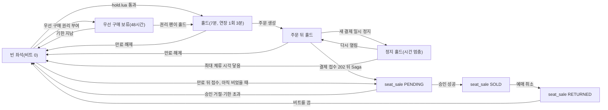

# 분야 편 10: 좌석

- **기준 시점**: ADR-0177까지, 2026-11-01. 2026-11-03에 ADR-0180과 §14(v0 베이스라인)를 더했다
- **맡는 정본**: [docs/features/seat-hold.md](../../features/seat-hold.md) 전체, [docs/data.md](../../data.md) §3·§4·§5의 좌석 부분, [docs/planning/03-policies-glossary.md](../../planning/03-policies-glossary.md)의 POL-011~013, 좌석 ADR(§5에 모았다)
- **규범이 아니다**: 정본을 풀어 쓴 해설이다. 숫자와 규칙이 정본과 다르면 정본이 맞다([ADR-0177](../../adr/0177-walkthrough-explain-in-interview.md)).
- **한 판 문서와의 관계**: [한 판 문서](../01-system-design.md) 8단계(같은 좌석을 두 번 팔지 않기)와 9단계(좌석 변경을 실시간으로 알리기)가 이야기 순서로 설명한다. 이 편은 정본을 절마다 정리하고 두 단계가 건너뛴 것(요청 서명, 자동 배정, 판매 종료, 매진 판정, 다시 잡기 제한, 우선 구매, 결제가 멈췄을 때의 홀드, 좌석맵 가져오기, 시험)을 더한다.
- **측정 전이다**: 서비스 수준 측정(NFR 목표를 운영 규모로 잰 것)은 아직 없어 성능 숫자는 설계 목표값이고 `[실측 전]`을 붙였다. 기반 PoC(wbs 0.5.1, 본 개발 전에 위험한 부분만 먼저 재 보는 시험)는 2026-11-01에 PC 한 대에서 쟀다([ADR-0176](../../adr/0176-foundation-poc-results.md), 성능 장부 docs/perf-ledger.md §5). 그 숫자는 '실측(PC)'이고 운영 규모 증거가 아니다. 정본의 `[가정]`은 그대로 옮겼다.

## 1. 이 문서가 정하는 것

docs/features/seat-hold.md는 팬이 좌석을 고르고, 결제하는 동안 잠시 잡아 두고(홀드), 판매를 확정하기까지의 규칙과 남이 잡은 좌석을 화면에 바로 보이는 규칙을 정한다. 뼈대는 2단계다. 1단계 Soft Hold는 좌석 전용 Redis(메모리에 데이터를 두는 빠른 저장소)에서 한다. Lua 스크립트(Redis 안에서 다른 명령과 섞이지 않고 한 번에 도는 짧은 프로그램) 하나가 '좌석이 비었나, 1인 한도 안인가'를 함께 보고, 둘 다 맞을 때만 잡는다. 2단계 Hard Sale은 결제사 승인 바로 앞에서 한다. PostgreSQL(표로 데이터를 두는 관계형 데이터베이스)의 `seat_sale`에 판매 행을 넣으면, 부분 유니크 인덱스(조건에 맞는 행끼리만 같은 값을 막는 색인)가 같은 좌석의 두 번째 판매를 막는다. 목표는 홀드 p99(요청 100건 중 99건이 끝나는 시간) 50ms와 오버셀(같은 좌석이 두 사람에게 팔리는 사고) 0건이다. 이 밖에 1인 매수 한도, 홀드 TTL(정해 둔 유효 시간), 좌석 변경 전파, 장애 때 동작, 5만 석 좌석맵 그리기, 시험 36개(S-T17은 없앴다)를 정한다.

> **30초 설명**: "좌석은 두 단계로 지킵니다. 고를 때는 좌석 전용 Redis에서 Lua 스크립트 하나가 빈 좌석인지, 1인 한도 안인지, 판매가 멈추지 않았는지를 한 번에 보고 모두 맞을 때만 잡습니다. 데이터베이스에 쓰지 않으니 p99 50ms 안에 답할 수 있습니다. 잡은 좌석은 7분 동안 유지되고 한 번 3분 늘릴 수 있습니다. 결제사 승인 바로 앞에서는 PostgreSQL에 판매 행을 넣는데, 좌석마다 살아 있는 판매 행은 하나뿐이라는 부분 유니크 인덱스가 마지막으로 막습니다. 경합에서 진 주문은 승인 전에 걸러져 돈이 나가지 않습니다. 좌석 Redis가 고장 나면 몇 초 동안 그 회차 구매를 미루고, 데이터베이스로 좌석을 대신 주지 않습니다. 좌석을 주는 곳을 늘 하나로 두려는 것입니다."

## 2. 절마다 읽기

정본에는 `### ` 제목이 없다. 굵은 글씨 항목 가운데 따로 물을 만한 것은 행을 나눴다.

| 정본 절 | 무엇을 정하나 | 왜 | 해설서에서 |
| --- | --- | --- | --- |
| §1 개요: 2단계 일관성 | Soft Hold(좌석 Redis의 비트맵과 Lua)와 Hard Sale(PostgreSQL 부분 유니크)의 역할. 비트맵은 좌석 하나를 1비트로 담은 전체 좌석 상태다. 홀드 기록은 나중에 원장(감사용 이력 표)으로 싣는다 | DB 행 잠금은 경합 때 p99가 수 초다. Redis만으로 확정하면 장애 조치(주 노드가 고장 나면 복사본 노드를 올려 쓰는 일) 때 잃은 쓰기로 오버셀이 날 수 있다(ADR-0014) | 한 판 8단계 |
| §2 좌석 스냅샷과 구매 세션 시작 | 입장 토큰(대기열 통과를 증명하는 서명된 표)을 처음 쓰는 스냅샷(지금 좌석 상태 전체) 요청이 구매 세션(결제까지 이어지는 서버 쪽 상태)을 연다. 소지 증명(그 브라우저의 키로 서명한 요청인지 보는 장치), 회차 묶기, 여정 ID, 좌석맵 파일 두 층 | 훔친 쿠키·입장 토큰만으로 구매 세션을 쓰지 못하게 하고(ADR-0050), 다른 회차 좌석을 잡지 못하게 한다(docs/security/asvs/seat-hold.md 8.2.2) | 한 판 3·7단계(세션 시작만) |
| §3 홀드 요청 | `hold.lua` 계약, 좌석 ID 확인, 자기 홀드만 해제·연장, 펜싱 토큰(늦게 온 옛 사건을 버리게 하는, 계속 커지는 번호), 회차 세대(장애 조치 뒤 화면을 다시 맞추는 번호), 멱등키(여러 번 와도 결과가 한 번과 같게 하는 키) | Valkey(이 설계의 Redis 호환 저장소)는 쓴 것을 되돌리지 못해 '검사를 다 마친 뒤에만 쓴다'. 회차 키를 한 샤드(데이터를 나눠 맡은 서버 묶음)에 모아 스크립트 하나로 다룬다 | 한 판 8단계 |
| §3 판매 일시정지·판매 종료 | 명령 3(판매 일시정지)이면 423, 판매 종료(공연 시작 24시간 전) 뒤면 410 | 정지를 상태로 둬야 명령 뒤에 뜬 파드(쿠버네티스에서 앱이 도는 단위)도 안다(ADR-0103) | 한 판 12·13단계(일시정지만) |
| §3 자동 좌석 배정 모드 | 희망 조건으로 후보 찾기와 홀드를 Lua 하나에서 한다 | 앱이 고르고 409면 3회 다시 하던 방식은 요청이 같은 좌석에 몰려 좌석이 남아도 수동 선택으로 떨어졌다 | — |
| §4 1인당 매수 제한 | '보유 수 + 요청 수 ≤ 한도'를 홀드 Lua와 `purchase_quota` 조건부 갱신에서 두 번 본다 | Redis가 보유 수를 잃어도 판매 확정이 한도 초과를 거절한다 | 한 판 8단계 |
| §4 회차 판매 상태 판정 | purchase-svc(좌석과 주문을 맡는 서비스)가 ON_SALE·ALL_HELD(일시 매진)·SOLD_OUT을 정한다 | 좌석 수의 정본이 여기 있다. 돌아올 좌석이 있는 동안 대기를 끝내지 않는다(ADR-0122) | 한 판 7단계(매진만) |
| §5 홀드 TTL·연장·만료·재노출 | 7분, 1회 3분 연장, 만료 회수, p99 3초 재노출, 결제창 30분과의 관계, 결제사 장애 때 연장 | 남이 살 좌석을 묶는 제한이라 WCAG 2.2.1(웹 접근성의 시간 제한 항목)의 필수 예외로 본다(ADR-0060) | 한 판 8단계(수명과 회수만) |
| §5 방금 놓은 좌석 | 같은 계정은 놓은 좌석을 30초 `[가정]` 다시 못 잡는다 | 풀자마자 다시 잡으면 최대 체류 45분까지 붙잡을 수 있었다(ADR-0161) | — |
| §5 우선 구매 보류 | 부정 예매 이의가 인정된 팬 몫으로 48시간 `[가정]` 잡는 홀드 종류 | 그 좌석을 잡아 둘 장치가 7분 홀드뿐이었다(ADR-0171) | — |
| §5 멈춘 홀드 | 새 결제 일시 정지 동안 주문 뒤·결제 접수 전 홀드의 시간을 멈춘다 | 결제를 못 하는 동안 좌석을 잃지 않게 한다(ADR-0085) | — |
| §6 Hard Sale | 결제 접수 202 직후 Saga(단계를 차례로 처리하고 실패하면 앞 단계를 되돌리는 방식)가 PENDING(승인 전 사전 예약) 행, `purchase_quota`, Outbox(보낼 사건을 적어 두는 표)를 한 트랜잭션(모두 하거나 모두 하지 않는 DB 쓰기 단위)으로 쓴다. 원장 적재, 전체 장애 뒤 다시 만들기 | 진 주문은 승인 전에 걸러져 과금이 없다. 좌석 ID 오름차순으로 넣어 서로 기다리는 교착을 막는다 | 한 판 8·10단계 |
| §7 실시간 좌석 전파 | 샤드 Pub/Sub(같은 샤드 안에서만 메시지를 돌리는 방식), 보이는 구역만 구독, 100ms 묶음, 구역별 일련번호와 세대, 전파 Degraded(장애 때 정한 만큼 줄여 버티는 모드) | 전체를 보내면 초당 약 10GB다. 250ms 묶음은 기다림만 p99 약 248ms였다(ADR-0110) | 한 판 9단계 |
| §8 지연 예산: 좌석 홀드 p99 50ms | 50ms를 구간별로 나누고 샤드 처리량 상한을 둔다 | 넘으면 구간을 찾는다. 샤드 상한은 '스크립트 시간 × 초당 홀드 수'다 | 한 판 8단계 |
| §9 장애 시 동작 | 좌석 Redis 장애 조치, 메모리 가득, 전파 과부하, 킬스위치(명령 3), purchase-svc 전면 장애 | 홀드를 주는 곳을 늘 하나로 둔다(ADR-0121). 메모리가 차면 지우지 않고 오류로 드러낸다(ADR-0109) | 한 판 8·16단계 |
| §10 좌석맵 프론트엔드 | Web Worker(화면과 따로 도는 작업 스레드)와 OffscreenCanvas(화면 밖에서 그리는 캔버스)로 그리기, 전체에서 확대, 에디터 두 층, 접근성 대안 목록 | 메인 스레드로 5만 석을 그리면 조작이 막힌다. 좌표가 있어야 확대·구역 구독·연석(붙은 좌석) 찾기를 한다(ADR-0063) | 한 판 9단계(그리기만) |
| §10 좌석맵 가져오기 파일 처리 | 파트너(공연을 파는 사업자)의 파일은 자격 증명 없는 `seatmap-worker`가 해석하고 core-svc(공연 정보 서비스)가 다시 본다 | 해석기 결함이 DB 자격 증명을 가진 프로세스에서 터지지 않게 한다(ADR-0161) | — |
| §11 데이터·API 참조 | Redis 키, PostgreSQL 표·인덱스, REST·채널·이벤트 목록 | 찾아보기다 | 한 판 3·15단계 |
| §12 테스트 포인트 | 규칙 모델 검사와 S-T1~S-T37(S-T17은 없앴다) | 0건 목표와 시간 목표를 시험으로 판정한다 | 한 판 18단계(재는 방식만) |
| §13 미결정·[가정] | 아직 재지 않은 값과 남은 결정 | 측정으로 고칠 값을 모은다 | — |
| §14 v0 베이스라인 | K2~K5를 견줄 비교용 단순한 첫 판(v0) 좌석이다(2026-11-02 더함). v1과 다른 점은 셋이다. 홀드를 PostgreSQL 행 잠금(`SELECT … FOR UPDATE`, 다른 트랜잭션이 그 행을 바꾸지 못하게 잡는 명령)으로 요청에 적힌 순서대로 잡고(K2·K3), 바뀐 좌석을 JSON으로 그 회차의 모든 연결에 바로 보내며(구역 구독·묶어 보내기·바이너리·일련번호 없음, K4), 좌석맵을 메인 스레드의 Canvas 2D 한 장에 좌석 객체 배열로 그린다(Worker·TypedArray 없음, K5). 구매 세션과 소지 증명, 입장 토큰(v0는 queue 모듈에 입장했는지 묻는다), 홀드 멱등키, 펜싱 토큰, 방금 놓은 좌석 30초, 자동 배정, 회차 판매 상태 판정, 좌석맵 파일 두 층은 뺐다. `services/v0-monolith`의 `inventory` 모듈과 표 넷이고(`v0_seat`은 좌석 하나가 행 하나라 잠금의 단위다), 만료는 1초 `[가정]`마다 `FOR UPDATE SKIP LOCKED`로 500개 `[가정]`씩, 변경분은 커밋 때만 나가는 `pg_notify`로 낸다. 결제 v0가 부르는 판매 함수(동작 9)도 이 절에 있다 | v0는 일부러 망가뜨린 설계가 아니라 '유능한 팀이 처음 만들 법한 단순한 설계'다(ADR-0096 결정 6). 엇갈린 순서로 같은 좌석들을 잠그는 두 요청의 교착(서로 상대의 잠금을 기다려 둘 다 멈춤)이 K3의 v0 한계다. 잠금 대기 상한과 교착 감지가 둘 다 1초라 교착도 시간 초과로 보일 수 있어, 교착 수(S-T10)는 앱이 아니라 DB 통계로 센다. 5만 석 전체 JSON을 매번 보내는 방식은 계산만으로 실패가 분명해 만들지 않는다. 운영에 배포하지 않고, 성능(S-T1·S-T10·S-T12·S-T15의 v0 쪽)은 wbs 1.4.1 ②(BUILD_ORDER BSL-090)에서 2026-11-03에 기준선으로 쟀다(실측(PC), 합격·불합격은 정하지 않는다, docs/verification.md §3.10 '결과') | 한 판 4·8·9단계 |

## 3. 꼭 기억할 규칙과 숫자

| 항목 | 값 | 표시 | 정본 위치 |
| --- | --- | --- | --- |
| 홀드 지연·오버셀 | p99 50ms, p99.9 150ms, 오버셀 0건(피크 초당 2,000건, 인기 좌석 하나에 1,000명) | 확정 목표, `[실측 전]` | NFR-003, §8, S-T1 |
| 홀드 가용성 | 99.95%. 70분 약 15만 건에 오류 버짓(허용 오류 수) 약 75건. 409 경합과 423 일시정지는 오류가 아니다 | 확정 목표, `[실측 전]` | NFR-003 |
| 50ms 예산 | gw-fan(팬 요청의 입구 서버) 3ms + 왕복 5ms + 구매 세션 요청 인증 1ms + Redis 왕복 7ms + 직렬화(응답 만들기) 5ms + 여유 29ms | 1ms만 `[가정]`, 전체 `[실측 전]` | §8 |
| 샤드 통과 기준 | 스크립트 실행 p99 0.1ms 이하, 샤드 CPU 50% 이하. 회차 다섯이 한 샤드에 겹친 초당 약 6,000건에서도 | `[가정]`. 2026-11-01 실측(PC)에서 두 기준은 지켰다(ADR-0176 결정 3) | §8, S-T27 |
| 홀드 TTL·연장 | 7분, 1회 3분. 두 번째 연장은 409 | 확정(부하 시험 전 초기값) | §5, §13 |
| 만료 회수·재노출 | 1초 주기로 회수, p99 3초 안 재노출 | 1초는 `[가정]`, 3초는 `[실측 전]` | §5, NFR-025 |
| 방금 놓은 좌석 | 같은 계정 30초, 409 `seat-recently-released` | `[가정]` | §5 |
| 세션·결제창 | 구매 세션 무활동 만료 5분·최대 체류 45분, 결제창 유지 30분, 승인 기한은 인증 뒤 10분 | 확정 | §3, §5 |
| 판매 종료 | 공연 시작 24시간 전, 그 뒤 새 홀드는 410 `sale-ended` | 확정(소유자 결정) | §3 |
| 우선 구매 보류 | 48시간과 입장 시작 가운데 이른 때까지, 만료 작업 1분마다 | `[가정]` | §5 |
| 자동 배정 | 한 번에 후보 32개, 이어 부르기 4회 | `[가정]` | §3, §13 |
| 회차 판매 상태 | 1초마다 센다. 가용 0이 5초면 ALL_HELD, 가용·홀드·결제 중이 모두 0이 두 번이면 SOLD_OUT | `[가정]` | §4 |
| 장애 조치 | 503 `seat-store-unavailable` + `Retry-After: 2`, 미룬 시간 30초 이하, 동시 입장 목표 50% 감축 | 2초는 `[가정]`, 30초는 `[실측 전]` | §9, NFR-015 |
| 메모리 경보 | 70% 넘으면 SEV3, 85% 넘으면 SEV2(장애 심각도, 숫자가 작을수록 심각) | `[가정]` | §9 |
| `WAIT` | 쓴다면 복제본(복사본 노드) 1대의 확인을 최대 5ms 기다린다. 쓸지는 PoC(본 개발 전에 위험한 부분을 먼저 재 보는 시험)로 정한다 | `[가정, Phase 2 부하 시험에서 확정]` | §3, §13 |
| 전파 지연 | 동시 5,000명, 초당 변경 500건에서 종단 p99 300ms, 놓친 변경은 30초 안에 99.9% 복구. 300ms 초과가 3분이면 묶음을 1초로 늘리고 약속을 p99 1.5초로 완화한다 | 확정 목표, `[실측 전]` | NFR-004, §7·§9 |
| 묶음·구독 | 묶음 100ms, 망 한쪽 120ms(모형 p99 약 130~190ms는 계산이다). 연결당 16구역, 전체 보기는 5초마다 스냅샷 | `[가정]` | §7 |
| 좌석맵 화면 | 첫 그림 1초 미만, CPU 4배 감속에서 INP(조작에 화면이 반응하기까지 걸린 시간) 200ms 이하, 긴 작업 0건, 힙(메모리) v0(가장 단순한 첫 설계) 대비 70% 절감(이 비율은 보조 숫자로 적고 합격 판정에 쓰지 않는다) | 확정 목표, `[실측 전]` | §10, NFR-012 |

## 4. 이 문서가 다루는 ID

| ID | 한 줄 |
| --- | --- |
| FR-009 | 5만 석 좌석맵에서 전체 배치를 확대해 고르고, 좌석이 보이는 구역만 구독한다 |
| FR-010 | 좌석을 홀드한다. 여러 좌석을 한 번에, 경합하면 처음 1인만 성공, 1인 한도 초과는 막고 연장은 1회다 |
| FR-011 | 주문하고 결제한다. 결제창 인증 뒤 서버가 좌석 예약을 확정한 다음 승인을 부른다. 경합에서 지면 과금이 없다 |
| FR-042 | 홀드 TTL이 끝나면 원자적으로 거두고 3초 안에 다시 보이며 보유 수를 되돌린다 |
| FR-050 | 자동 배정 공연은 차례 전에 희망 조건을 넣고, 차례가 오면 브라우저가 입장 확정과 배정을 연달아 요청한다 |
| FR-072 | 온세일 윈도우(오픈 앞뒤로 접속이 몰리는 기간)가 끝나면 조사용 기록을 고정하고 부정 예매 후보 묶음을 만든다 |
| NFR-003 | 홀드 p99 50ms·p99.9 150ms, 가용성 99.95%, 오버셀 0건 |
| NFR-004 | 좌석 상태 전파 종단 p99 300ms, 30초 안 스스로 복구 99.9% |
| NFR-012 | 사용자 체감(INP 200ms 등)과 좌석맵 1초 미만 표시·힙 절감 |
| NFR-015 | 복구 목표. 좌석 Redis 장애 조치 중 구매 요청을 30초 안에서 미룬다 |
| NFR-020 | 접근성. 좌석 상태는 색과 무늬를 함께, 화면 낭독기(글자를 소리로 읽는 프로그램)로 예매 완주 100% |
| NFR-025 | 정합성 불변식. 홀드 만료 재노출 p99 3초, 여러 탭·기기로도 1인 한도 초과 0건 등 |
| POL-011 | 1인당 매수 제한. 확보 수 + 요청 수 ≤ 한도를 홀드 때와 판매 확정 때 모두 본다 |
| POL-012 | 홀드 TTL과 재노출. 3초 안 재노출, 연장 1회, WCAG 2.2.1 필수 예외 |
| POL-013 | 결제 규칙. 구매자 인증 뒤 서버가 승인을 요청하는 2단계 결제사만 쓰고, PENDING을 잡은 뒤 승인을 부른다 |
| POL-035 | 좌석 배정 방식. 직접 선택(PICK, 기본)과 자동 배정(AUTO) 가운데 공연마다 고른다 |
| POL-046 | 부정 예매 사후 조치. 이의가 인정되면 우선 구매(⑦)를 준다 |
| SCR-007 | 로비(오픈 전 대기실). 자동 배정 희망 조건을 입력한다 |
| SCR-008 | 대기열(오픈 후). 희망 조건 한 줄 요약 |
| SCR-010 | 좌석 선택. 5만 석 좌석맵과 접근성 대안 |
| SCR-022 | 좌석맵 에디터(파트너). 팬 화면과 같은 두 층 |
| CMP-021 | SeatMap(Canvas). Worker로 그리고 보이는 구역만 구독한다 |
| CMP-022 | SeatList(접근성 대안). 구역 → 열 → 좌석 키보드 목록과 '자동 좌석 배정' 버튼 |

## 5. 결정과 버린 길

버린 길은 각 ADR의 '검토한 대안' 표에서, '본문이 옛 판인 곳'은 ADR 상태 줄과 docs/architecture.md §11·§11.1에서 옮겼다. 문서 수정 묶음 [ADR-0133](../../adr/0133-tech-review-low-doc-fixes-architecture-infra-devops-api.md)·[ADR-0134](../../adr/0134-tech-review-low-doc-fixes-data-streams-observability-hotpath.md)는 대안 표가 없다(정본에 없음). 두 묶음은 해시 태그(키를 같은 칸에 모으는 표시)가 샤드를 고르지 않는다는 점, 7ms가 Redis 왕복이라는 점, 롤백이 없다는 점, TLS(통신 암호화)를 켠 값으로 판정한다는 점을 정본에 맞췄다.

### [ADR-0014](../../adr/0014-soft-hold-hard-sale.md) 좌석은 Soft Hold + Hard Sale

- **고른 것**: Redis 비트맵과 Lua로 좌석과 1인 한도를 함께 보고 잡는다. 승인 앞에 PENDING 행과 `purchase_quota` 조건부 갱신으로 확정한다. 홀드 사건은 Redis Stream(Redis 안의 사건 목록)과 Kafka(사건을 쌓아 나눠 주는 메시지 시스템)를 거쳐 원장에 싣는다.
- **버린 길**: `SELECT … FOR UPDATE` 홀드(v0)는 경합 때 p99 수 초, 잠금 대기 시간 초과, 엇갈린 순서의 교착이 난다. Redis만으로 확정하면 잃은 쓰기로 오버셀이 날 수 있다. CockroachDB(여러 곳에 나눠 두는 분산 DB)는 한 리전에 쓰기가 적어 필요 없다(ADR-0021). 클릭 순서로 잠그면 교착이 난다.
- **본문이 옛 판인 곳**(상태 줄이 고친다): '결제 진입 시 3분 연장'은 사용자 1회 3분 연장이다. `WAIT 1 10`은 '쓴다면 최대 5ms `[가정]`, 쓸지는 PoC'다. '롤백'은 '검사를 모두 통과한 뒤에만 쓴다'다. '좌석 ID 정렬 잠금'은 판매 확정 때 PENDING을 넣는 순서다. 예산은 '요청 인증 1ms·Redis 왕복 7ms·여유 29ms'로 읽는다. 비상 경로(PostgreSQL 정렬 잠금, p99 300ms)는 ADR-0121이 없앴다.

### [ADR-0121](../../adr/0121-seat-redis-failover-defer-purchase-drop-db-hold-path.md) 장애 조치 동안 구매를 미루고 DB 홀드 경로를 없앤다

- **고른 것**: 장애 조치 동안 그 샤드 회차의 구매 요청을 503으로 미룬다. 파드마다 판단한다. 세대 키가 '준비됨' 표시이고, 주 노드가 바뀌면 세대를 max(세대 + 1, Redis 시각의 초)로 올린다. 전체 장애면 RB-06(장애 대응 절차서)으로 DB에서 다시 만든다.
- **버린 길**: DB 경로를 남기고 전환 규칙을 더하면 '확인할 수 없는 좌석'을 정할 자료가 Redis에만 있고, 드물게 도는 두 번째 구현이 남는다. 파드마다 DB로 가면 이중 홀드가 남는다. 복제본 스냅샷은 승격 중이라 읽기도 끊긴다. 홀드 시간을 멈추기에는 30초가 TTL 7분에 견줘 작다. 세대 없이 번호를 다시 세면 클라이언트가 새 델타(바뀐 좌석만 담은 메시지)를 버린다.
- **본문이 옛 판인 곳**: 결정 3의 지표는 `seat_store_unavailable{event_id}`, 감축 사유는 `seat_store`다(ADR-0145). 되돌릴 조건은 이렇다: 미룬 시간이 자주 30초를 넘거나 온세일 중 장애 조치가 분기에 한 번보다 잦으면 다시 본다.

### [ADR-0050](../../adr/0050-crypto-corrections-and-key-management.md) 결정 8과 [ADR-0124](../../adr/0124-purchase-session-proof-threat-table-theft-test-revert-condition.md) 구매 세션 소지 증명

- **고른 것**: ECDH(두 쪽이 공개키만 바꿔 같은 비밀을 얻는 방식)로 만든 비밀에서 HKDF(비밀에서 용도별 키를 뽑는 함수)로 요청 인증 키를 뽑고, 쓰기 요청마다 일련번호와 HMAC(키가 있어야 만드는 서명값)을 싣는다. 남길지는 탈취 재현 시험 S-T16이 정한다. 돈이나 티켓이 공격자에게 가는 '이득'이 나오면 남기고, '방해'뿐이면 `__Host-` 쿠키·짧은 수명·기기 표시로 바꾼다.
- **버린 길**: 페이로드 암호화는 재전송을 막지 못하고 기밀성 이득이 작다. 보호를 없애면 쿠키만 훔쳐 쓰는 길이 남는다. DPoP(요청마다 서명하는 표준 방식)는 서명·검증과 토큰 ID 저장이 들어 홀드 경로에 무겁다. 봇 비용(K6)으로 정하면 목적이 아닌 효과를 잰다.
- **본문이 옛 판인 곳**: 키는 IndexedDB(브라우저 안 저장소)의 추출 불가 키다(ADR-0079). 1ms 확정 시점은 Phase 3 3.4.1이다. 현재 판은 docs/architecture.md §11.1의 ADR-0050 표 8행이다.

### [ADR-0063](../../adr/0063-screen-redesign-owner-feedback.md) 결정 8 전체 배치에서 확대해 고른다

- **고른 것**: 구역이 화면 폭의 1/3 이상 `[가정]`이면 좌석이 나타나고 그 구역만 구독한다. 좌석맵 파일은 배치·좌석 두 층이고 판 이름 경로로 오래 캐시한다.
- **버린 길**: 배경 이미지와 클릭 영역은 좌표가 없어 확대 표시·구역 구독·연석 찾기 표시를 못 한다.
- **본문이 옛 판인 곳**: 결정 11의 판매 종료는 '공연 시작 24시간 전'이다(ADR-0064). 에디터는 네 단계와 템플릿 10종으로 정했다(ADR-0066).

### [ADR-0083](../../adr/0083-keep-postgresql-partition-keys-transaction-scoped-settings-global-replica.md) PostgreSQL을 유지한다

- **고른 것**: Aurora PostgreSQL(AWS가 운영해 주는 PostgreSQL)을 그대로 쓴다. 첫째 근거가 부분 유니크 인덱스다. `status` 전이는 HOT(인덱스를 고치지 않는 가벼운 갱신)가 아니라서 `seat_hold` 청소 기준을 0.02 `[가정]`로 당긴다.
- **버린 길**: MySQL은 '비활성이면 NULL인 식 + UNIQUE'로 흉내 내지만 활성 상태 정의가 흩어지고, 서버 쪽 시간 초과·트랜잭션 안 DDL(표 구조 변경)·파티션 표 외래 키가 걸린다. 비상 경로 `NOWAIT`는 성공률이 떨어진다.
- **본문이 옛 판인 곳**: 근거 ②(비상 경로의 밀리초 잠금 대기)와 결정 3의 `SET LOCAL lock_timeout = '100ms'`는 ADR-0121로 쓰지 않는다. 유지 판단은 그대로다.

### [ADR-0085](../../adr/0085-freeze-unaccepted-holds-during-new-payment-pause.md) 결제 일시 정지 동안 홀드를 멈춘다

- **고른 것**: 결제사 장애로 새 결제 진입이 멈춘 동안 주문 뒤·결제 접수 전 홀드의 시간을 멈춘다. 최대 체류 시각은 넘기지 않는다.
- **버린 길**: 문구만 바꾸면 팬이 장애로 좌석을 잃는다. 주문 전 홀드까지 멈추면 좌석 화면 타이머와 서버 만료가 어긋난다. 정해진 만큼 더하면 정지 길이와 맞지 않는다. 503만 보고 짐작하면 끝을 모른다.
- **본문이 옛 판인 곳**: 결정 3의 'Lua 하나로 만료 시각을 민다'는 200개 `[가정]`씩 옮기고 되돌리는 방식이 되었다(기술 검토 중간-041). 정지의 끝은 ADR-0105의 단계다.

### [ADR-0110](../../adr/0110-latency-budgets-nfr002-nfr004-aligned-expiry-100ms-batches-ms-clock.md) 좌석 전파 예산과 100ms 묶음

- **고른 것**: 300ms 목표는 두고 묶음을 250ms에서 100ms로 줄였다. 바뀐 시각부터 재고, 단말 시계는 WebSocket(연결을 열어 둔 채 주고받는 통신) 왕복으로 맞춘다.
- **버린 길**: '서버 송신까지 + 망 따로'로 나누면 약속이 준다. 묶지 않으면 프레임이 변경 수만큼 는다. `Date + Age` 보정은 ±1초가 남는다.
- **본문이 옛 판인 곳**: 상태 줄의 고침은 대기열 쪽이다. 되돌릴 조건은 S-T12에서 realtime-gw(좌석 델타를 보내는 서버) CPU가 70% `[가정]`를 넘으면 150ms로 늘려 다시 재는 것이다.

### [ADR-0117](../../adr/0117-no-hedged-requests-snapshot-timeout-and-browser-retry.md) 헤지 요청을 쓰지 않는다

- **고른 것**: 헤지 요청(답이 늦으면 같은 요청을 하나 더 보내는 방식)을 쓰지 않는다. 스냅샷은 시간 초과 뒤 브라우저가 `Retry-After`와 지터(일부러 섞는 무작위 지연)를 지켜 하나씩 다시 묻는다.
- **버린 길**: 두 번째 GET은 같은 회차 샤드를 읽어 느린 원인이 겹친다. Envoy(게이트웨이 프록시) `hedge_policy`는 게이트웨이 무재시도 규칙(ADR-0009 결정 3)과 어긋난다. gRPC(서비스끼리 묻고 답하는 통신) `hedgingPolicy`는 스냅샷이 gRPC가 아니다.
- **본문이 옛 판인 곳**: 결정 2의 '`Retry-After`를 하한으로 ±20% 지터'는 '하한 위로만 0~20%'로 읽는다. ±로 흔들면 하한보다 이르게 보낸다(상태 줄 2026-11-01).
- **함께 알 것**: 이 ADR이 ADR-0009 결정 3과 ADR-0087 결정 21의 헤지 문장을 대신한다. S-T17은 없앴다.

### [ADR-0161](../../adr/0161-lobby-join-spread-rehold-cooldown-booking-restriction-seatmap-worker.md) 결정 2·4 방금 놓은 좌석과 해석 작업

- **고른 것**: 같은 계정은 놓은 좌석을 30초 `[가정]` 못 잡는다. 해제·만료·반납을 모두 센다. 좌석맵 해석은 자격 증명과 나가는 통신이 없는 `seatmap-worker`가 한다.
- **버린 길**: 세션 단위는 세션을 다시 시작하면 피한다. 좌석별 누적 시간 상한은 키와 정리가 더 든다. 격리 버킷을 거치면 원본 비저장 규칙과 동기 응답에 맞지 않는다.
- **본문이 옛 판인 곳**: 없다(상태 줄에 고침이 없다).
- **함께 알 것**: 소유자 결정의 표현은 '같은 구매 세션'이었고, 계정 단위는 추천 적용이다.

### [ADR-0043](../../adr/0043-auto-seat-preferences-before-turn.md) 자동 배정 공연은 희망 조건을 미리 받는다

- **고른 것**: 자동 배정(AUTO) 공연은 희망 조건(1순위 등급·매수 필수, 휠체어석, 선택으로 2순위 등급·분리 좌석 허용)을 로비와 대기열 화면에서 미리 받아 브라우저 저장소에만 둔다. 차례가 오면 브라우저가 사람의 조작 없이 입장 확정과 자동 배정 홀드를 연달아 보낸다. 예상 대기가 10초 `[가정]` 안이면 브라우저도 입장 확정을 직접 보내 차례를 늦게 아는 차이를 줄인다(직접 선택 공연에는 쓰지 않는다). 사람이 고르는 시간을 배정 순서에서 빼려는 것이다. 모두 실패하면 아무 좌석도 잡지 않고 409 `manual-selection-required`로 수동 선택에 넘긴다.
- **버린 길**: 앞 순번의 결정을 기다려 순번 순으로 배정하면 한 사람이 머뭇거릴 때 뒤가 모두 묶인다. 요청을 짧은 라운드로 모아 정렬하면 라운드가 짧을 때 봇이 계속 앞 라운드에 들고, 길면 모두 기다린다. 차례가 올 때 서버가 미리 배정하면 오지 않은 사람에게도 좌석을 7분씩 잡아 ADR-0005(실제로 온 사람에게만 입장 자리)와 어긋난다. 희망 조건을 대기 중 서버에 저장하면 100만 명의 입력이 대기 중 원 서버 쓰기가 되어 대기실 무상태 원칙(ADR-0003)과 초당 약 1,000건 설계를 깬다. 웹 푸시를 받은 서비스 워커(브라우저가 페이지 뒤에서 돌리는 스크립트)가 배정하게 하면 전달 지연이 보장되지 않고, 서비스 워커가 대기표와 암호화 키를 다뤄 구현과 보안 검토가 커진다. 차례 직전 직접 확인을 직접 선택 공연에도 쓰면 속도 차이가 좌석 클릭에서 생겨 효과가 작다.
- **본문이 옛 판인 곳**: 결정 4의 '같은 Lua 홀드를 부르고 경합이면 다음 후보로 최대 3회'는 '후보 찾기와 홀드를 자동 배정 Lua 하나에서 한다'로 바뀌었다(상태 줄 2026-10-28, 기술 검토 중간-034). 판매를 열 때 등급·매수마다 후보 목록을 비트맵과 같은 슬롯에 두고, 한 번에 32개 `[가정]`까지 본다. 대기열(SCR-008)의 카드는 한 줄 요약과 [바꾸기]로 줄었다(상태 줄 2026-10-14, ADR-0063 결정 7). REST 경로는 ADR-0081의 옛 경로 대응표로 읽는다.
- **함께 알 것**: 희망 등급이 모두 매진됐거나 조건을 넣지 않아 수동 선택으로 넘어간 팬은 다시 제출 속도 경쟁을 한다. 희망 조건은 브라우저에 있어 기기를 바꾸면 다시 넣는다.

## 6. 읽는 요령

**읽는 순서**: 머리의 '관련 ID' 줄 → §1 → §3 → §6 → §9로 오버셀을 막는 길을 먼저 잡는다. 이어서 §4·§5(한도와 시간), §7·§10(화면), §8(숫자), §12·§13(재는 법과 가정)을 읽는다. §11은 찾아보기다.

**좌석 하나가 거치는 상태를 먼저 그려 둔다.** 정본은 이 흐름을 §3·§5·§6에 나눠 적는다.

- 만료·해제된 좌석은 같은 계정에게 30초 `[가정]` 동안 잡히지 않는다.
- 가상계좌 입금 대기와 결과 모름(승인 응답이 끊김)은 PENDING에 머문다.
- 판매 종료 뒤 빈 좌석은 다시 팔리지 않는다(우선 구매만 예외).

**함정**:

- **옛 판**: ADR-0014 본문의 비상 경로·예산은 옛 판이라 상태 줄을 먼저 읽는다. §11의 `event_seat_price`는 잠금 대상이 아니고, S-T10의 'v0 행 잠금 홀드'는 비교용이다. §3 자동 배정 '왜 바꿨나'의 '최대 3회 다시 시도'도 버린 방식이다.
- **겹쳐 보이는 문장**: §9 전파 과부하 행에서 뷰포트(화면에 보이는 범위) 밖 구역을 5초 스냅샷으로 바꾼다는 것은 평소에도 그렇다. 바뀌는 것은 묶음 1초다(§7).
- **정하지 않은 것**: §3의 `WAIT`는 '쓴다면'이다. 소지 증명은 S-T16 결과로 빠질 수 있고, 그러면 §8의 1ms 구간은 쿠키 해시 비교가 된다.
- **괄호 안의 바로잡음**: §2에서 주문·결제 경로는 주소에 회차가 없어 403이 아니라 자기 것만 규칙의 404로 막는다.
- **두 번호를 섞지 않는다**: 펜싱 토큰은 원장 적재와 전파가 옛 사건을 버리는 번호다. 구역별 일련번호(`sectionVersion`)는 화면이 빠진 델타를 알아채는 번호이고, 되돌아갈 수 있어 세대와 함께 본다.

## 7. 경계

| 이 정본이 정하지 않는 것 | 어디서 정하나 |
| --- | --- |
| 입장 토큰, 입장 자리, 구매 세션 수명의 근거 | docs/features/queue-admission.md(분야 편 9) |
| 결제 Saga 전체, 승인·결과 모름·가상계좌, 결제 일시 정지 신호 | docs/features/payment.md(분야 편 11) |
| 예매 취소·환불의 순서(좌석이 RETURNED가 되기까지) | docs/features/transfer-refund.md(분야 편 12) |
| 위험 점수와 행동 신호의 판정 | docs/features/bot-defense.md(분야 편 14) |
| 판매 일시정지 명령의 승인과 전달 | docs/features/control-tower.md(분야 편 16) |
| 부정 예매 조사, 우선 구매 권리를 주는 흐름 | docs/features/forensic-replay.md(분야 편 17) |
| 토픽 계약과 `HoldAttempt` 지표 사전 | docs/streaming.md(분야 편 18), docs/api/asyncapi.yaml |
| 델타·스냅샷 바이트 형식, 재연결 | docs/frontend.md §4.4(분야 편 6) |
| Redis 키와 표의 전체 구조, 쿼리별 인덱스 | docs/data.md §2·§3·§5.1. 해설은 DB 설계 편 [3 핵심 표](../db/03-core-tables.md)·[7 인덱스와 쿼리](../db/07-indexes-queries.md)·[8 Redis 키](../db/08-redis-keys.md) |
| Valkey 판과 매개변수, RB-06 절차 | docs/infra.md(분야 편 20) |
| `seat` 규칙 명세와 시험 방법 | docs/verification.md §2(분야 편 22) |
| 보안 점검 | docs/security/asvs/seat-hold.md(분야 편 21) |
| 화면 문구와 좌석 상태 표시 | docs/design/d5-screen-blueprint.md(분야 편 4) |
| 용량 어림과 회차의 샤드 배치 | docs/architecture.md §9(한 판 2·17단계) |

## 8. 꼬리 질문

| 질문 | 답의 요지 | 근거 |
| --- | --- | --- |
| Lua가 쓰다가 멈추면 좌석이 반쯤 잡히나요? | 검사를 모두 먼저 하고 쓰기는 마지막에 한꺼번에 한다. Valkey는 쓴 것을 되돌리지 못해서다. 부분 홀드 0건을 S-T4로 잰다 | seat-hold §3, ADR-0134 낮음-068 |
| 회차 하나를 샤드 하나에 두면 병목 아닌가요? | 맞다. '실행 시간 × 초당 홀드 수'가 상한이라 초당 2,000건이면 0.5ms만 걸려도 쉴 틈이 없다. 0.1ms·CPU 50% `[가정]`를 기준으로 회차 다섯이 겹친 초당 약 6,000건을 S-T27로 잰다. 2026-11-01 PC 측정에서 샤드 하나가 6,000건을 견뎠지만 SLOWLOG 기록 0 기준을 3회 중 1회 넘었다(만료 작업 Lua가 가끔 10ms 남짓). 그래서 큰 회차를 서로 다른 주 노드에 두는 배치 규칙을 두고, 만료 작업은 한 번에 100석 `[가정]`으로 한다(ADR-0176 결정 3, 실측(PC)) | seat-hold §8·§12, docs/data.md §3 |
| 멱등키는 왜 Lua 안에서 보나요? | 예전 키 `s:idem:{key}`는 해시 태그가 멱등키라 좌석 키와 다른 칸에 있어 Lua 전에 따로 읽었고, 그사이 같은 키의 동시 요청을 막지 못했다. 지금은 좌석을 잡는 같은 연산에서 봐 '처리 중' 409와 왕복 하나가 없어졌다. 잡았을 때만 적어 409 뒤 다시 시도할 수 있다 | seat-hold §3, S-T24 |
| 홀드를 풀었다 다시 잡아 오래 붙잡으면요? | 같은 계정은 30초 `[가정]` 못 잡고 그사이 다른 팬이 고른다. 계정 단위라 세션을 다시 열어도 피하지 못한다. 수요가 낮은 좌석은 여전히 붙잡힐 수 있다 | seat-hold §5, ADR-0161 |
| 홀드 7분은 무엇을 보고 바꾸나요? | 부하 시험 전에 정한 초기값이다. 홀드를 잡은 뒤 결제 접수까지 걸린 시간의 분포와 홀드 만료율을 보고, 고치면 ADR로 남긴다. 결제사가 느릴 때 홀드가 결제 줄보다 먼저 끝나지 않게 하는 장치는 입장 속도를 결제사 상한에 묶기, 재시도 큐 건의 홀드 연장, 결제 일시 정지 때 남은 시간 멈춤이다 | seat-hold §5·§13, ADR-0180 결정 10 |
| 결제사 장애로 결제가 멈추면 좌석을 잃나요? | 주문 뒤·결제 접수 전 홀드는 멈추고 주문 전 홀드는 흐른다. 멈춘 홀드는 200개 `[가정]`씩 옮긴다. Lua 하나로 수천 개를 고치면 샤드가 수십 ms 멈춰서다 | seat-hold §5, ADR-0085, S-T23 |
| 자동 배정에서 모두 같은 최고 좌석을 노리면요? | 후보 찾기와 홀드를 Lua 하나에서 해 Redis가 차례로 처리하므로 같은 후보로 부딪치지 않는다. 대가는 판매 전 후보 목록 준비와 조금 는 Lua 시간이다 | seat-hold §3, S-T19 |
| 소지 증명은 봇을 막나요? | 막지 못한다. 브라우저를 조종하는 봇은 페이지가 대신 서명한다. 목적은 쿠키와 입장 토큰을 함께 훔친 공격자다. 막는 피해가 '방해'뿐이면 더 가벼운 쿠키 방식으로 바꾼다 | seat-hold §2, ADR-0124 |
| 실제로 재 봤나요? | 서비스 수준 측정은 아직 없다. 2026-11-01 기반 PoC가 대역 Lua로 S-T27(샤드 상한)만 PC에서 쟀다(실측(PC), ADR-0176). 다섯 회차 합 초당 6,000건에서 홀드 Lua p99는 0.1ms 이하, 엔진 CPU 36~38%, 오버셀 0이었고 SLOWLOG 기준만 넘었다. 같은 PoC로 좌석 홀드 본문 검사는 경로 스키마로 정했고(결정 4), Redis 클라이언트는 판정을 보류했다(추천 node-redis, PROGRESS OPEN[11], 결정 2). S-T1(한 좌석 1,000명), S-T9(장애 조치), S-T12(전파)는 아직이고, 운영 홀드 Lua가 생기면 S-T27을 다시 잰다(BUILD_ORDER PRF-130) | seat-hold §12, docs/perf-ledger.md, ADR-0176 |

## 9. 확인 문제

1. 좌석 Redis 주 노드가 장애로 넘어가는 몇 초 동안 새 홀드 요청은 무엇을 받는가? 왜 PostgreSQL로 대신 홀드를 주지 않는가?

답

503 `seat-store-unavailable`과 `Retry-After: 2` `[가정]`를 받고, admission-ctrl(입장 인원 조절기)은 그 회차 동시 입장 목표를 50% 줄인다. DB로 주지 않는 이유는 셋이다. 마지막 몇 초의 홀드는 Redis만 알아 같은 좌석을 또 줄 수 있고, 파드마다 넘어가는 시점이 달라 두 곳이 동시에 주며, 드물게 도는 두 번째 구현이 남는다. 대가로 그 503은 가용성 오류로 세고, 온세일 중이면 오류 버짓 약 75건을 넘긴다(seat-hold §9, ADR-0121).

2. 홀드 TTL이 지난 뒤에 결제창 인증을 마치고 결제 접수가 오면 어떻게 되는가?

답

그 좌석이 아직 비어 있으면 Hard Sale PENDING 등록을 시도해 살 수 있다. 이미 다른 사람이 홀드했으면 승인을 부르지 않고 과금 없이 끝낸다. 이것은 홀드가 아니라 판매 확정이라 30초 다시 잡기 규칙과 관계없다(seat-hold §5, POL-013, S-T7).

3. 회차 세대 `seatEpoch`는 언제 오르고, 없으면 무엇이 틀리는가?

답

그 회차 슬롯의 주 노드가 바뀌었을 때와 비트맵을 다시 만들었을 때 오른다. 값은 'Redis 시각(초)과 세대 + 1 가운데 큰 값'이라 되돌아가지 않는다. 세대가 없으면 새 주 노드가 구역 번호를 작은 수부터 다시 세어, 브라우저가 새 델타를 버리고 주기 스냅샷(5초·30초)까지 화면이 틀린다(seat-hold §3·§7).

4. 1인 한도는 어디서 몇 번 검사하는가? Redis가 장애 조치로 보유 수를 잃으면 어떻게 되는가?

답

두 번 본다. 홀드 Lua가 '보유 수 + 요청 수 ≤ 한도'를 보고, 판매 확정 때 `purchase_quota`를 `used + n ≤ limit_count`일 때만 UPDATE한다. 보유 수를 잃어도 두 번째 검사가 한도 초과를 거절한다. 여러 탭으로 보내도 같은 샤드의 Lua가 차례로 처리한다(seat-hold §4, S-T3).

## 10. 정본에서 찾은 어긋남

| 어긋난 곳 | 내용 | 지금 읽는 법 |
| --- | --- | --- |
| docs/features/seat-hold.md §6의 2와 docs/features/payment.md 결제 상태 표 T11·T12 | seat-hold가 '승인 전 실패나 시간 초과면 `PENDING`을 바로 지운다'고 적어, 응답이 끊긴 결과 모름(T12 UNKNOWN)과 어긋났다 | 고침(2026-11-01 정합 점검, 세 번째 묶음). 지금은 승인 실패·승인 기한 초과(T11)면 지우고, 결과 모름은 `PENDING`을 두고 조회로 확정한다 |
| docs/features/seat-hold.md §1 표와 docs/data.md §4 | seat-hold §1이 Soft Hold를 '고성능 최종 일관성'이라 적어, data.md §4의 낮음-035(ADR-0134) 표기와 달랐다 | 고침(2026-11-01 정합 점검, 세 번째 묶음). '빠른 판정(Redis 원자 연산), 최종 확정은 PostgreSQL 제약'으로 맞췄다 |
| docs/features/seat-hold.md §3 순서도의 `hold.lua` `KEYS` 목록 | 그림의 `KEYS`에 `epoch`·`ctl`·`rel:{account}`·`secver`가 빠져, '쓰는 키를 모두 `KEYS`로'(docs/data.md §3)와 달랐다 | 고침(2026-11-01 정합 점검, 세 번째 묶음). 그림에 네 키를 더했다 |
