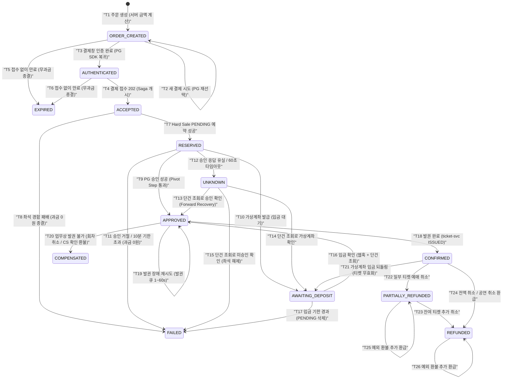
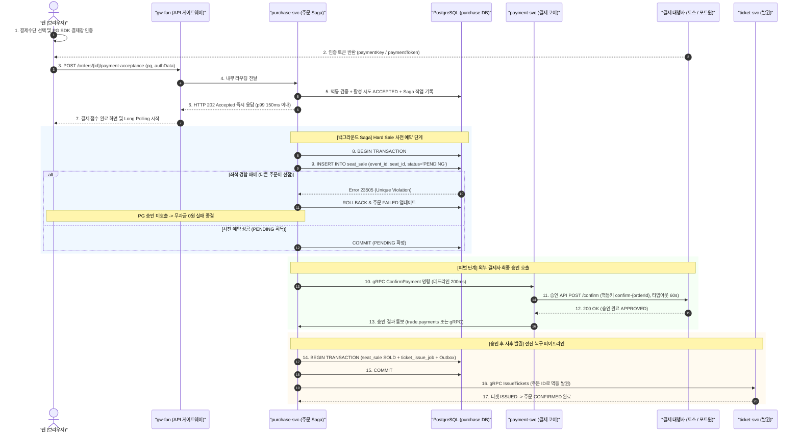
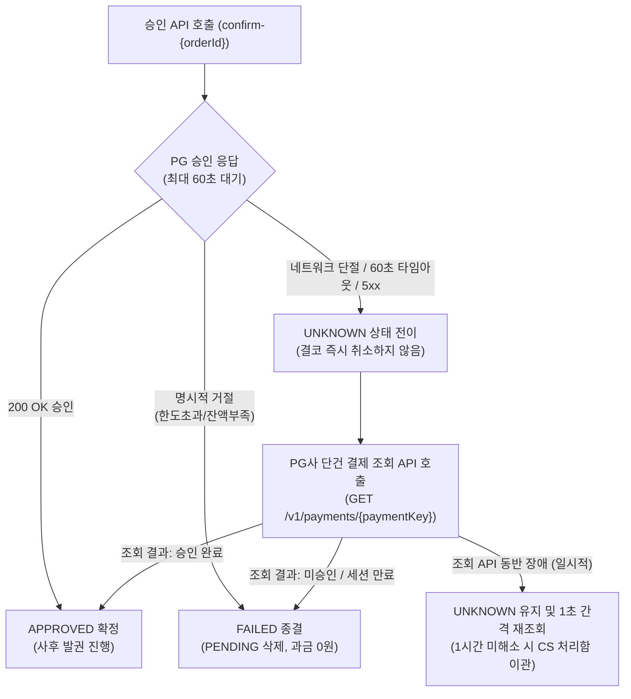
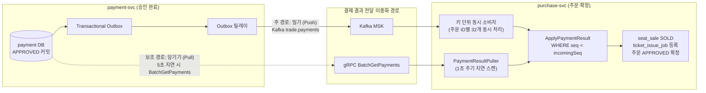

# 분야 편 11: 결제 및 분산 트랜잭션 정합성 (Payment & Distributed Consistency)

- **맡는 정본**: [docs/features/payment.md](../../features/payment.md) 전체, [docs/data.md](../../data.md) §4(데이터별 일관성과 트랜잭션 경계), [docs/api/guidelines.md](../../api/guidelines.md) §4(멱등성 키 규격), [docs/planning/03-policies-glossary.md](../../planning/03-policies-glossary.md)의 POL-013·014, 결제 ADR(§6에 집대성)
- **문서 성격**: 정본 설계를 시스템 엔지니어링 및 기술 면접 관점에서 체계적으로 해설한 문서다. 규범적 수치와 불변 규칙의 최종 권위는 정본 문서([docs/features/payment.md](../../features/payment.md))에 있다([ADR-0177](../../adr/0177-walkthrough-explain-in-interview.md)). 길잡이는 [README.md](../README.md)다.
- **한 판 문서와의 관계**: [한 판 문서](../01-system-design.md) 10단계(결제와 서비스 사이의 일관성)와 16단계(고장 시나리오 점검)에서 다룬 결제 Saga 및 장애 대응 흐름을 4대 핵심 모듈로 심화 분해하고, 시스템 경계 규칙과 멱등성·전진 복구 모델을 정밀하게 보강한다.
- **아키텍처 목표와 검증 기준**: 피크 300 TPS 결제 접수(NFR-005), 202 접수 응답 지연 p99 150ms 미만, 결제 가용성 99.95% 이상, 결제 확정 지연 p99 3초 이내(PG 2초 + 내부 1초, NFR-006), 결제 완료율 99.95% 이상, 결제 승인 후 티켓 발권 누락 0건(승인 후 60초 불변식 0건, NFR-006), 이중 결제 0건, 토스페이먼츠 300 TPS 상한 및 포트원 초당 50건 상한 준수를 설계 목표이자 신뢰성 불변식으로 삼는다.

---

## 1. 결제 도메인 종합 개요

결제 도메인은 수만 명의 팬이 한정된 좌석을 선점한 후 실제 금융 결제를 체결하고 티켓 발권까지 완료하는 핵심 비즈니스 흐름이다. PEAKET은 **외부 전자지급결제대행사(PG)의 2단계 결제 구조(인증 → 승인 분리)와 PostgreSQL의 활성 부분 유니크 인덱스를 결합한 분산 Saga 아키텍처**를 채택하여, 극단적인 동시성 환경에서도 이중 결제 0건과 경합 패배 시 무과금 종결을 완벽하게 보장한다.

> **30초 아키텍처 브리핑 (Staff Engineer Interview)**:  
> "PEAKET의 결제 시스템은 **'2단계 결제 기반 사전 좌석 확정(Hard Sale PENDING) + 3중 멱등성 방어선 + 타임아웃 전진 복구(Forward Recovery) + 비동기 사후 발권'**의 4대 원칙으로 설계되었습니다.  
> 첫째, **2단계 결제 선점 메커니즘**: 고객이 PG 결제창에서 인증을 마쳐도 가맹점 서버가 최종 승인 API를 호출하기 전에는 금융 과금이 발생하지 않습니다. 접수 유입 시 0.15초 이내에 HTTP 202로 즉각 응답하고, 백그라운드 Saga가 PostgreSQL `seat_sale`에 `PENDING` 사전 예약을 영구 트랜잭션으로 먼저 선점합니다. 경합에서 패배한 주문은 승인 API를 호출하지 않고 배제되므로 고객 과금 및 환불 비용이 0건으로 보장됩니다.  
> 둘째, **다계층 멱등성 및 이중 결제 0건 방어**: 클라이언트 요청의 `Idempotency-Key`(24시간 보관)와 PG사 승인 API의 `confirm-{orderId}`(토스 15일, 포트원 3시간 보관) 멱등키를 통해 네트워크 재시도에 따른 중복 승인을 원천 차단합니다. DB 내부적으로는 `purchase_order`의 `payment_event_seq` 낙관적 검증과 `payment_attempt` 부분 유니크 인덱스로 동일 주문의 중복 접수를 차단합니다.  
> 셋째, **PG 장애 및 타임아웃 시 전진 복구**: 승인 API 호출 중 네트워크 단절이나 60초 타임아웃이 발생해도 결코 섣부른 취소(롤백)를 하지 않습니다. `UNKNOWN` 상태로 전환 후 PG사 단건 조회 API로 최종 결과를 확인하여 상태를 맞추는 전진 복구를 고수합니다.  
> 넷째, **피벗 단계와 비동기 사후 발권**: PG 승인은 Saga의 되돌리기 어려운 '고비 단계(Pivot Step)'입니다. 승인 성공 시 트랜잭션 커밋과 동시에 `seat_sale SOLD`, `purchase_order APPROVED`, `ticket_issue_job`, Outbox 이벤트를 원자적으로 기록합니다. `ticket-svc`가 장애여도 결제를 취소하지 않고 재시도 큐(1초~60초 지수 백오프)로 끝까지 발권하며, 결과 알림은 Kafka(밀기)와 5초 지연 시 `BatchGetPayments`(당기기)의 이중화 경로로 누락 없이 p99 3초 이내 확정합니다."

### 결제 생애주기 종합 상태 전이도



### 결제 도메인 핵심 3대 서브시스템

1. **주문 Saga 오케스트레이터 (`purchase-svc` booking 모듈)**:
   - 주문 생성, 구매 세션 유효성 검증, 결제 금액 서버 단독 계산.
   - 결제 접수 HTTP 202 즉시 반환 및 백그라운드 Saga 작업(`order_saga_job`) 실행.
   - `seat_sale` PENDING 사전 예약, 부분 유니크 인덱스를 통한 오버셀 차단.
   - 결제 승인 후 `seat_sale` SOLD 확정 및 발권 재시도 큐(`ticket_issue_job`) 등록.
2. **결제사 연동 코어 (`payment-svc`)**:
   - 헥사고날 아키텍처 기반 결제 포트(`PaymentGatewayPort`) 및 어댑터(토스페이먼츠, 포트원 V2, PG 시뮬레이터).
   - 결제사 런타임 선택(`PaymentGatewaySelector`), 접수 후 결제사 고정, 비상 대체 전환(`pg_switch`).
   - 벌크헤드 및 서킷 브레이커를 통한 외부 PG 지연 격리.
   - 멱등키 `confirm-{orderId}` 기반 승인 호출 및 `UNKNOWN` 단건 조회 파이프라인.
3. **티켓 발권 및 대사 (`ticket-svc`, `invariant-checker`, 정산 배치)**:
   - 주문 ID 기반 멱등 발권(`IssueTickets`) 처리.
   - 승인 후 발권 지연 시 `ISSUE_DELAYED` 알림(60초) 및 SEV1 경보(30분).
   - 일일 자정 PG사 거래 내역 1:1 대사(Reconciliation) 및 60초 불변식 검사.

---

## 2. 절마다 읽기

정본의 절마다 한 행이다. '해설서에서'는 [한 판 문서](../01-system-design.md)가 실제로 다루는 단계다.

| 정본 절 | 무엇을 정하나 | 왜 | 해설서에서 |
| --- | --- | --- | --- |
| §1 개요 | 2단계 결제를 좌석 확정에 잇는 원칙, 결제 포트 뒤의 어댑터 셋(토스페이먼츠·포트원·시험용 시뮬레이터) | 좌석 예약에 성공한 주문만 승인하면 경합에서 진 주문은 과금 없이 끝난다. 연동을 포트 뒤에 가둬야 결제사를 더해도 Saga를 다시 쓰지 않는다(ADR-0029) | 한 판 10단계 |
| §2 흐름 | 주문 생성 → 결제 시도 → 결제창 인증 → 접수 202 → 판매 행 PENDING → 승인 → SOLD·발권 → 결과 받기 | 결제사 호출을 접수 응답에서 떼어야 접수 p99 150ms를 지킨다. 금액은 서버가 계산한다 | 한 판 10단계 |
| §2 확정 3초 예산과 승인 시간 초과 | 확정 3초 = 결제사 2초 + 내부 1초. 승인 호출은 60초까지 기다리고, 자원은 동시 호출 상한과 서킷 브레이커가 지킨다 | 2초에 끊어도 결제사는 안에서 계속 처리해, 재전송·결과 모름 조회만 늘고 한도를 깎는다(기술 검토 높음-16) | — |
| §2 '결과 당기기' | 승인 결과 사건이 5초 안에 오지 않으면 `BatchGetPayments`로 직접 묻는다 | Kafka(MSK)의 월 SLA는 99.9%인데 결제 완료율 목표는 99.95%라, 완화책 없이는 목표가 의존성보다 높다(ADR-0140) | 한 판 10·16단계 |
| §2 '키 단위 동시 처리' | 파티션 안에서 주문 ID마다 동시에 처리하고, 처리 못 하는 사건은 보류 표 `held_event`로 옮긴다 | 토픽 키가 회차라 인기 회차가 한 파티션에 몰리고, 차례대로면 건당 10ms에 초당 100건뿐이다(ADR-0142) | — |
| §2 롱 폴링 상한 | 결과 조회(답이 생길 때까지 응답을 미루는 롱 폴링) 상한 25초·27초·30초 | 앞단 CDN인 CloudFront는 원본 응답이 30초(기본값)를 넘으면 GET을 다시 보내므로, 같은 값이면 504나 이중 조회가 생긴다 | 한 판 10단계(25초만) |
| §2 주문 저장 방식·계정 병합 | 주문은 '상태 + 덧붙이기 이력 + Outbox'다. 병합해도 주문·결제의 `account_id`는 고치지 않는다 | 분쟁 증거(FR-031)는 빠짐없는 이력이면 된다(ADR-0113). 주문·결제는 5년 보존 기록이다 | 한 판 10단계(저장 방식만) |
| §2 판매 일시정지·종료·예매 제한 | 명령 3이면 새 시도·접수 423, 판매 종료 뒤 410 `sale-ended`, 제한 계정 403 `booking-restricted` | 이미 시작한 거래는 막지 않는다. 접수된 결제는 끝까지 처리하고, 판매 종료 전에 만든 홀드와 제한 전에 만든 주문은 결제를 마칠 수 있다(ADR-0103·0064·0161) | — |
| §2 조사용 칸·행동 요약 | 주문 생성 사건의 `journeyId`·`contactRef`, 첫 결제 시도의 행동 요약 | 부정 예매 조사(POL-046)에서 주문을 여정·연락처로 묶는다(ADR-0171) | — |
| §2.1 PG 어댑터 계약 | 포트 메서드 여섯, 능력 플래그, 결제사별 규격 대조, 결과 코드 여섯 가지, 실패 범주, 결제 수단 연결값, 계약 시험 | 같은 계약 시험을 세 구현에 돌려야 '이중 결제 0'을 결제사마다 따로 증명하지 않는다 | — |
| §2.2 결제사 선택·고정·전환 | 선택 순서(전환 → 회차 지정 → 플랫폼 기본), 접수 뒤 고정, 명령 12 지정, 명령 6 전환, 하위 결제사, 상한 두 갈래 | 승인 요청 전에는 돈이 움직이지 않아 다시 골라도 안전하고, 요청 뒤 옮기면 두 승인이 겹칠 수 있다(ADR-0044) | 한 판 2·7·10단계 |
| §3 상태 전이 | 주문 상태 13개와 전이 T1~T26(조건의 정본), 결제 시도·결제 원장 상태, 미결제 주문 만료, 승인 뒤 발권 | EXPIRED(접수 없이 끝남)와 FAILED(접수 뒤 과금 없이 실패)를 나눠야 실패율에 이탈이 섞이지 않는다(ADR-0107) | 한 판 10단계(발권만) |
| §4 실패·보상 표 | 실패 상황 10가지의 처리와 과금 여부 | 승인 앞 실패는 과금 없이 끝내고, 승인 뒤 장애만 과금을 유지한 채 다시 발권한다(POL-013) | 한 판 10단계 |
| §4.1 예매 취소·환불 | 견적 → 취소 Saga → 키 폐기·좌석 반환 → 환급, 공제율, 끝수, 청약철회, 결제자 기준 | 공제액을 한 곳에서 정수로 계산해야 견적·환급·정산서가 같다. 입장 시작 뒤 취소는 입장하고 환불받는 악용을 막으려고 환급을 미룬다 | — |
| §4.2 시나리오 대응표 | 결제 오류·재시도 예외 22가지의 대응과 시험 번호 | 소유자 요구로 §2·§4·§9에 흩어진 대응을 한 표에 모았다 | 한 판 16단계(일부) |
| §5 웹훅 | 받는 경로, 중복 거르기 키, 포트원 서명 검증, 보조 신호 규칙 | 토스페이먼츠 결제 웹훅에는 서명이 없어 본문을 믿을 수 없다. 상태는 조회 API 결과로만 바꾼다 | 한 판 10단계 |
| §6 가상계좌·환불 계좌 | 고수요 온세일에서는 끈다, 입금 `secret` 해시 대조, 환불 계좌 저장 안 함, 에스크로 선택권 | 입금을 기다리는 동안 좌석이 묶인다. 계좌번호를 저장하면 암호화 의무(안전성 확보조치 기준 §7②6호)가 생긴다 | — |
| §7 비밀·보안 | 비밀 키 보관, 카드 정보 격리, 요청 서명, 결제 라우트 헤더·CSP, 복귀 화면, 토큰 가리기 | 카드 번호를 결제사 화면에서만 받아 PCI-DSS 범위를 줄인다. 결제창 복귀에는 `SameSite=Strict` 쿠키가 실리지 않는다 | — |
| §8 정산·대사 | 매일 자정 결제사별 대사, 온세일과 겹치면 미룸, 결제-발권 불일치 두 종류, 불변식 검사기 | 정산서와 공연예술통합전산망 전송이 대사를 마친 원장을 쓰므로 06시 정산서 전에 끝나야 한다(ADR-0089) | 한 판 10단계 |
| §9 장애 시 동작 | 장애 9가지의 감지, 감내 모드, 완화 목표, 끝까지 지킬 것 | 결제사가 아프면 같은 키로 기다린다. 이중 결제 0은 2단계 결제와 멱등 키가 지키고, 늦어지는 것만 허용한다 | 한 판 16단계 |
| §9 '새 결제 진입 정지와 다시 열기' | 정지(확인 호출) → 시험 재개 → 모두 엶, commander 손 해제, Lease로 뽑은 판정자 | 정지 중에는 새 결제가 없어 남는 표본(재시도 큐)으로 회복을 알 수 없고, 큐가 비면 표본이 0이다(ADR-0105) | 한 판 16단계(한 줄) |
| §9 관측 | 임박 SEV2, 전환 검토, 한도 사용률, 429 | 온세일 70분 결제 확정 약 2.5만 건에 허용 실패가 약 12건이라(NFR-006), 소진 배수 경보로는 헛경보 없이 빨리 경고하지 못한다 | 한 판 13단계 |
| §10 데이터·API 참조 | purchase·payment DB 표, REST 9개, 사건 토픽 넷, 화면 | 찾아보기다 | 한 판 3·15단계 |
| §11 테스트 포인트 | 규칙 모델 검사와 P-T1~P-T52 | 규칙을 작은 모델로 모든 순서를 따져 먼저 보고, 같은 규칙을 코드에 다시 돌린다(docs/verification.md §2.1) | — |
| §12 미결정·[가정] | 외부 한도 추정, 계약 확인 필요 값, 확인할 것 | 계약이 없어 확인할 수 없는 값을 추정으로 두되 틀려도 금전 안전은 지킨다(ADR-0036) | — |
| §13 v0 베이스라인 | K7을 견줄 비교용 단순한 첫 판(v0) 결제다. 결제 확정 요청 하나가 좌석 판매 → 결제사 승인 호출 → 발권을 동기 체인으로 차례로 부른다 | v0가 보여 줄 한계를 드러내려는 것이다. 결과 모름도 실패로 끝내고 결제사에 다시 묻지 않으므로 결제사에서는 승인됐는데 v0는 좌석을 돌려줄 수 있다(좌석 누수) | 한 판 4·10단계 |

---

## 3. 결제 도메인 4대 핵심 메커니즘 심화

```
                                 [PEAKET 결제 도메인 4대 코어 모듈]
  ┌───────────────────────────┬───────────────────────────┬───────────────────────────┬───────────────────────────┐
  │   모듈 1: 2단계 결제·사전예약│   모듈 2: 멱등성·이중결제0│   모듈 3: PG타임아웃·전진복구│   모듈 4: 비동기발권·Outbox│
  ├───────────────────────────┼───────────────────────────┼───────────────────────────┼───────────────────────────┤
  │ • 결제창 인증 후 사전 예약 │ • Idempotency-Key 24시간 │ • 읽기 타임아웃 60초 대기  │ • PG 승인은 Pivot Step    │
  │ • Hard Sale PENDING 선점  │ • PG사 confirm-{orderId}  │ • 타임아웃 시 취소 금지   │ • 승인-SOLD-발권큐 원자화 │
  │ • seat_sale 부분 유니크   │ • 주문당 활성 시도 1건    │ • UNKNOWN 상태 단건 조회   │ • 티켓 장애 시 결제유지   │
  │ • 경합 패배 시 무과금 종결│ • 금액 서버 검증 (위변조X)│ • 3단계 프로브 자동 재개  │ • Push(Kafka)+Pull 이중화 │
  └───────────────────────────┴───────────────────────────┴───────────────────────────┴───────────────────────────┘
```

---

### 모듈 1: 2단계 결제와 결제 전 사전 좌석 예약 (Two-Phase Payment & Pre-Auth PENDING)

#### 1. 문제 정의 및 분산 환경의 좌석-결제 정합성 딜레마
일반적인 전자상거래에서는 장바구니 결제 후 재고를 차감해도 큰 문제가 없거나, 재고 부족 시 PG 결제를 취소(환불)하면 된다.  
그러나 수만 명이 한정된 5만 석을 두고 밀리초 단위로 경쟁하는 티켓팅 환경에서는 다음 딜레마가 발생한다:
1. **승인 후 좌석 확정 방식의 파탄**:  
   만약 PG 결제 승인을 먼저 받아 고객 계좌에서 돈이 빠져나간 뒤 좌석을 확정하려 한다면, 직전 찰나에 타인이 좌석을 가져갔을 때 이미 승인된 결제를 즉시 강제 취소(환불)해야 한다. 이는 카드사 금융 수수료 손실, 대규모 트래픽 시 취소 API 병목, 고객 민원 폭증으로 이어진다.
2. **외부 API 호출 중 DB 잠금 유지의 위험성**:  
   좌석을 빼앗기지 않기 위해 외부 PG 승인 API를 호출하는 동안 데이터베이스 행 잠금(`SELECT ... FOR UPDATE`)을 쥐고 있으면, 외부 네트워크 지연(수 초~60초) 동안 DB 커넥션 풀이 완전히 고갈되어 전체 시스템이 마비된다.

#### 2. PG사 2단계 결제 구조의 본질적 활용
토스페이먼츠 및 포트원 V2는 '1단계 브라우저 SDK 인증 → 2단계 가맹점 서버 승인 API 호출'의 2단계 결제 모델을 채택하고 있다:
- **가장 중요한 금융적 사실**: 고객이 결제창에서 카드 비밀번호나 생체인증을 마쳐도, 가맹점 서버가 최종 승인 API(`confirm`)를 호출하기 전까지는 **실제 계좌에서 돈이 1원도 출금되지 않는다.**
- **인증 유효기한**: 고객 결제창 인증 후 승인 유효기한은 토스페이먼츠 10분, 포트원 10분으로 보장된다.

#### 3. Hard Sale PENDING 사전 예약의 원자적 방어
PEAKET은 결제창 인증 완료 후 결제 접수(`POST /v1/orders/{orderId}/payment-acceptance`)가 들어오면, 외부 PG 승인 API를 호출하기 전에 PostgreSQL `seat_sale` 테이블에 `PENDING` 행을 먼저 영구 트랜잭션으로 삽입한다:

```sql
CREATE UNIQUE INDEX uq_seat_sale_active 
ON seat_sale (event_id, seat_id) 
WHERE status IN ('PENDING', 'SOLD');
```

- **오버셀 0건과 무과금 실패의 수학적 보장**:
  여러 주문이 동일 좌석에 대해 결제창 인증을 마치고 동시에 접수하더라도, PostgreSQL 트랜잭션이 `PENDING` 행을 삽입하는 순간 단 1건만 유니크 인덱스를 통과하고 나머지는 **SQL Error 23505(Unique Violation)**로 즉시 거절된다.
- **금융 과금 0원 종결**:
  경합에서 패배한 주문은 외부 PG 승인 API를 전혀 호출하지 않고 주문 상태를 즉시 `FAILED`로 안전하게 종결한다. 고객에게 금융 청구가 전혀 발생하지 않았으므로 **취소 및 환불 오버헤드가 0건**으로 종결된다.

#### 4. 2단계 결제 및 사전 예약 시퀀스 다이어그램



---

### 모듈 2: 멱등성 보장과 이중 결제 0건 방어 (Idempotency & Zero Double-Charge Guarantee)

#### 1. 분산 환경의 네트워크 재시도와 이중 결제 위협
모바일 네트워크 단절, 사용자의 결제 버튼 다중 클릭, 브라우저 새로고침, API 게이트웨이의 타임아웃 재전송 등은 동일한 결제 요청을 서버에 중복 전달한다. 외부 금융망 연동에서 중복 승인(Double Charge)은 고객의 금전적 피해와 브랜드 신뢰 실추를 초래하는 중대 사고다.

#### 2. 3중 멱등성 방어선 (Three-Tier Idempotency Architecture)

```
[Tier 1: 클라이언트-서버 구간 멱등키 (Idempotency-Key)]
  • 주문 생성, 결제 시도, 결제 접수 헤더에 UUIDv7 멱등키 부여 (24시간 보관)
  • 동일 키 + 동일 페이로드: DB 캐시된 최초 201/202 응답 그대로 재생 (Replay)
  • 동일 키 + 변조 페이로드: HTTP 422 Unprocessable Entity 거절
  • 처리 진행 중 중복 호출: 1초 대기 후 경합 지속 시 HTTP 409 Conflict 반환
         │
         ▼
[Tier 2: 서버-PG사 구간 승인 멱등키 (confirm-{orderId})]
  • payment-svc가 PG사 승인 API 호출 시 멱등키 confirm-{orderId} 강제 전달
  • 토스페이먼츠: 15일간 멱등키 보관 (처리 중 재요청 시 400 ALREADY_PROCESSING_REQUEST)
  • 포트원 V2: 3시간 동안 멱등키 보관 (안전 재시도 유효창 3시간)
  • 네트워크 타임아웃 재시도 시 PG사 내부에서 단 1회만 결제 승인
         │
         ▼
[Tier 3: 데이터베이스 레벨 무결성 제약조건]
  • payment_attempt: UNIQUE (order_id) WHERE status = 'READY' (주문당 활성 시도 1건)
  • payment 원장: order_id UNIQUE 제약조건으로 단일 주문당 단 1건 결제 생성
  • purchase_order: WHERE payment_event_seq < $seq 조건부 UPDATE (지연 이벤트 중복 방지)
```

#### 3. 결제 금액 위변조 원천 방어 (Zero Price Tampering)
- **공격 시나리오**: 공격자가 브라우저 개발자 도구나 프록시 툴을 이용해 결제창의 금액(`amount`)을 50,000원에서 1,000원으로 변조하여 결제 접수를 시도한다.
- **방어 메커니즘**:
  1. PEAKET은 클라이언트가 전달하는 금액을 결제 계산에 절대 사용하지 않으며, 서버 DB의 회차 좌석 정가(`tierPrices`)로 직접 계산한다.
  2. **토스페이먼츠 연동 시**: 결제 접수 API 본문의 `amount`가 서버 계산 금액과 1원이라도 다르면 즉시 **HTTP 400 Bad Request**로 거절하고 보안 이벤트 로그를 기록한다.
  3. **포트원 V2 연동 시**: 클라이언트로부터 금액을 수신하지 않고, 서버가 승인 API의 `totalAmount` 파라미터에 서버 계산 금액을 직접 주입하여 포트원 백엔드가 결제창 금액과 대조하도록 강제한다.
  4. 최종 승인 후에도 결제 원장의 승인 금액이 주문 원장과 일치하지 않으면 즉시 자동 취소를 호출하고 감사 플래그를 지정한다.

---

### 모듈 3: PG 장애 및 타임아웃 시 전진 복구 (Forward Recovery & Timeout Orchestration)

#### 1. PG 승인 호출 타임아웃의 본질: 2초 예산 vs 60초 대기
NFR-006의 결제 확정 SLA는 p99 3초(PG 2초 + 내부 1초)다. 하지만 승인 호출이 2초를 초과했다고 해서 연결을 임의로 끊거나 취소(롤백)해서는 안 된다:
- **핵심 이유**: 가맹점 서버가 2초 시점에 HTTP 연결을 끊더라도, **PG사와 카드사 내부에서는 승인 처리가 정상적으로 완료되어 고객의 돈이 출금**될 수 있다.
- 이 상태에서 서버가 실패를 가정하고 좌석 PENDING을 해제해 버리면, 고객은 결제 문자를 받았는데 좌석은 타인에게 팔려버리는 치명적인 불일치가 발생한다.
- 따라서 토스/포트원 공식 가이드에 따라 HTTP 호출의 읽기 타임아웃(Read Timeout)은 **60초까지 충분히 대기**한다.
- **2초의 규범적 의미**: 2초는 호출을 강제 종료하는 타임아웃 값이 아니라, 1분 이동 창에서 승인 호출 p99가 2초를 넘기면 즉시 운영팀에 경보를 발령하는 **임박(SEV2)** 감지 기준이다.

#### 2. 벌크헤드(Bulkhead)와 서킷 브레이커를 통한 자원 보호
외부 PG사의 응답 지연으로 인해 시스템 전체의 커넥션 풀과 스레드가 고갈되는 것을 방지하기 위해, 끊는 시간 대신 **채널별 동시 승인 호출 상한(벌크헤드)**을 적용한다:
- **벌크헤드 상한**: 토스페이먼츠 최대 600건 (300 TPS × 2초), 포트원 최대 100건 (50 TPS × 2초).
- 상한을 초과하는 승인 명령은 스레드를 점유하지 않고 승인 유효기한(10분) 이내에서 백그라운드 재시도 큐에서 순차 대기한다.
- 연속 실패 및 5초 초과 지연 발생 시 서킷 브레이커가 열려 신규 승인 호출을 즉각 격리한다.

#### 3. 네트워크 단절 및 타임아웃 시 전진 복구 (Forward Recovery)



- **섣부른 취소 금지 원칙**: 타임아웃 발생 시 상태를 `UNKNOWN`으로 두고 결제사 단건 조회 API를 통해 실제 승인 여부를 확인할 때까지 좌석 PENDING을 안전하게 유지한다.

#### 4. 새 결제 진입 정지와 3단계 프로브 자동 재개 (ADR-0105)
PG사 전산 장애로 서킷 브레이커가 열리거나 결제 확정 소요 p99가 5초를 초과하면, 신규 결제 진입을 즉시 일시 정지(HTTP 503)한다.  
정지 중에는 신규 결제가 유입되지 않아 PG사 회복 여부를 판단할 표본이 없으므로, Kubernetes Lease로 선출된 **단일 정지 판정자 파드가 3단계 프로브**를 운용한다:

1. **1단계: 정지 및 확인 호출 (Probing)**:  
   - 새 결제 시도는 503 반환. 판정자가 1초에 1건씩 결제가 없는 더미 번호로 단건 조회를 전송.
   - 토스 404(`NOT_FOUND_PAYMENT`) 및 포트원 404(`PAYMENT_NOT_FOUND`)를 정상 응답으로 판정.
   - 확인 호출 성공률 99% 이상이 3분간 지속되면 2단계로 승격.
2. **2단계: 시험 재개 (Trial)**:  
   - 신규 결제의 5%만 무작위로 진입 허용(나머지 95%는 503).
   - 첫 승인 결제 20건 중 5초 이내에 승인/거절 결론을 낸 비율이 95% 이상이면 3단계로 승격. 기준 미달 시 1단계로 강등.
3. **3단계: 전면 오픈 (Reopen)**:  
   - 새 결제 진입 100% 정상화. 결제 일시정지 동안 동결되었던 좌석 홀드 타이머 재개(ADR-0085).
   - 비상 시 commander 운영 명령(명령 6 해제)을 통해 1인 수동 즉시 해제 가능.

---

### 모듈 4: 비동기 사후 발권 및 결제 후 누락 0건 보장 (Asynchronous Ticketing via Outbox & Kafka Dual-Path)

#### 1. 고비 단계(Pivot Step)로서의 PG 승인
분산 트랜잭션 Saga 패턴에서 피벗 단계는 **"이 단계가 성공하면 전체 트랜잭션은 결코 롤백되지 않고 반드시 끝까지 완료(전진 복구)되어야 하는 불가역적 고비"**를 의미한다.  
PG 승인이 성공하여 금융 결제가 확정된 이후에는, 설령 다운스트림 발권 시스템(`ticket-svc`)이 셧다운되더라도 결제를 취소해서는 안 된다.

#### 2. 승인 결과 반영과 Transactional Outbox 원자적 커밋
`payment-svc`로부터 승인 통보를 수신한 `purchase-svc`는 단일 데이터베이스 트랜잭션으로 다음을 원자적으로 커밋한다:
- `seat_sale`: 상태를 `PENDING`에서 `SOLD`로 전이.
- `purchase_order`: 상태를 `APPROVED`로 변경하고 이력(`order_event`) 덧붙임.
- `ticket_issue_job`: 발권 재시도 큐 행 삽입 (발권 기한: 승인 시점 + 30분).
- Transactional Outbox: `trade.orders` `APPROVED` 이벤트를 동일 트랜잭션 내에 기록.

#### 3. 발권 재시도 큐 (`TicketIssueRunner`)와 실패 복구
- 평소 정상 상황에서는 트랜잭션 커밋 직후 인메모리 킥(`kick`)을 통해 `ticket-svc`에 gRPC `IssueTickets`를 호출하여 수백 ms 내에 발권을 마치고 `CONFIRMED`로 완료된다.
- `ticket-svc` 일시 장애 발생 시:
  - 결제를 취소하지 않고, `TicketIssueRunner`가 1초에서 2배씩 최대 60초 간격(지터 0.8~1.2)으로 지수 백오프 재시도를 수행한다.
  - **승인 후 60초 초과 시**: `trade.orders`에 `ISSUE_DELAYED` 이벤트를 발행하고, 클라이언트 화면에 "결제 완료, 티켓 발급 중" 알림을 노출하며, 운영팀에 SEV2 경보를 발령한다.
  - **승인 후 30분 기한 초과 시**: SEV1 장애를 선포하고 CS 처리함 `TICKET_NOT_ISSUED` 건으로 이관한다.
  - 결제 취소(환불)는 회차 취소가 확정되거나, CS 관리자가 시스템 장애를 확인한 경우에만 2인 승인 절차를 거쳐 예외적으로 수행된다.

#### 4. Kafka 파티션 핫스팟 극복: 키 단위 동시 처리 (ADR-0142)
`trade.payments` 토픽의 파티션 키는 회차 ID(`eventId`)이므로, 인기 회차 결제 결과 수천 건이 단일 파티션에 집중된다.  
단일 스레드로 순차 처리하면 건당 10ms 소요 시 초당 100건에 불과하여 결제 확정 SLA(p99 3초)를 달성할 수 없다:
- **주문 ID 단위 분산 동시 처리**: 컨슈머 파드는 파티션 내부에서 이벤트를 주문 ID(`orderId`) 해시 기반으로 **최대 32개 작업자에게 분산하여 동시 처리**한다.
- **오프셋 커밋 안전성**: 파티션 오프셋은 빈틈없이 처리가 완료된 최소 위치(High-Watermark)까지만 커밋하여 유실을 방지한다.
- **독약 메시지(Poison Pill) 격리**: 동일 원인으로 5회 이상 실패한 이벤트는 파티션을 블로킹하지 않고 전용 보류 테이블 `held_event`로 격리하여 타 주문의 결제 처리를 지속한다.

#### 5. Kafka 지연 극복을 위한 결과 당기기 폴백 (Dual-Path Push & Pull, ADR-0140)
Kafka(MSK)의 월 SLA는 99.9%이지만 PEAKET 결제 완료율 목표는 99.95%다:
- Kafka 브로커 점검 등으로 결제 결과 이벤트가 **5초 이내에 도착하지 않을 경우**:
- `purchase-svc`의 `PaymentResultPuller`가 1초 주기로 `order_saga_job`을 스캔하여 `payment-svc`에 직접 gRPC `BatchGetPayments`(1회 최대 100건, 데드라인 500ms)를 호출하여 상태를 당겨온다(Pull).
- 밀기(Push)와 당기기(Pull)는 동일한 `ApplyPaymentResult` 함수를 공유하며, `payment_event_seq` 순번 조건을 통해 먼저 도착한 쪽이 반영되고 늦게 온 쪽은 0행 업데이트로 안전하게 무시된다(P-T15, P-T47).



#### 6. 결제-발권 불변식 검사기 (Invariant Checker)
불변식 검사기가 1분 주기로 백그라운드 실행되어 다음 규칙을 상시 검증한다:
- **불변식 1**: PG 승인 완료 후 60초 이내에 발권 완료(`CONFIRMED`)되지도 않았고 발권 재시도 큐(`ticket_issue_job`)에 등록되지도 않은 고아 결제 건수는 **반드시 0건**이어야 한다(NFR-006).
- **불변식 2**: 결제 승인 없이 발권된 티켓 건수는 **반드시 0건**이어야 한다.

---

## 4. 핵심 불변 규칙 및 지연시간 예산 (Immutable Rules & Latency Budgets)

### 핵심 불변 수치 및 설계 목표

| 항목 | 규범적 목표값 | 신뢰성 및 검증 근거 | 정본 위치 |
| --- | --- | --- | --- |
| 결제 접수 지연 | **p99 < 150ms** | 300 TPS 피크 부하, 결제사 호출 분리 202 즉시 반환 | NFR-005, §2 |
| 결제 접수 가용성 | **99.95% 이상** | 70분 피크 온세일 약 2.5만 건 결제 기준 | NFR-005 |
| 결제 최종 확정 | **p99 ≤ 3초 이내** | PG 승인 2초 + 내부 Saga 1초 (2초는 경보 기준) | NFR-006, §2 |
| 결제 완료율 | **99.95% 이상** | 결제 5,990건 연속 무실패 기준 검증 | NFR-006, P-T5 |
| 이중 결제 방지 | **0건 (Zero Double-Charge)** | 멱등키 `confirm-{orderId}` + DB 부분 유니크 인덱스 | NFR-005 |
| 승인 후 발권 누락 | **0건 (60초 불변식)** | 승인 후 60초 내 미발권 및 큐 미등록 0건 유지 | NFR-006, §8 |
| PG사 승인 유효기한 | **인증 완료 후 10분** | 토스페이먼츠 10분, 포트원 10분 | §2.1, POL-013 |
| 승인 호출 시간 초과 | **읽기 60초, 연결 3초** | PG사 공식 권장 규격 준수 (2초에 끊지 않음) | §2, 기술 검토 높음-16 |
| 채널 호출 상한 | **토스 300 TPS, 포트원 초당 50건** | 토큰 버킷 상한 통제, 초과 시 큐 순차 대기 | §2.1, ADR-0036 |
| 벌크헤드 동시 호출 | **토스 600건, 포트원 100건** | 채널 상한 × 2초 기준 자원 격리 | §2, 기술 검토 높음-16 |
| 결제사 멱등키 보관 | **토스 15일, 포트원 3시간** | 안전 재시도 유효창 3시간 기준 운용 | §2.1 |
| 결과 당기기 폴백 | **5초 지연 시 100건 묶음** | 1초 점검 주기, 파드당 동시 4개, 데드라인 500ms | §2, ADR-0140 |
| 발권 재시도 간격 | **1초~최대 60초 지수 백오프** | 60초 초과 시 SEV2 및 알림, 30분 초과 시 SEV1 | §3, ADR-0106 |
| 롱 폴링 응답 상한 | **서버 25초, GW 27초, 브라우저 30초**| CloudFront 30초 타임아웃 이전 정상 응답 보장 | §2, 기술 검토 중간-047 |
| 공제율 법정 기준 | **10일 전 0%, 7~9일 10%, 3~6일 20%, 1~2일 30%, 당일 90%** | 공정위 고시 준수, 24시간 내 취소 전액 환급 | §4.1, POL-032 |

### 결제 확정 p99 3초 지연시간 예산(Latency Budget) 분해

```
[총 결제 확정 예산: 3,000ms]
┌──────────────────────────────────────────────┬────────────────────────────────────────────────────────┐
│         외부 PG사 승인 호출 예산: 2,000ms    │              내부 분산 Saga 처리 예산: 1,000ms         │
├──────────────────────────────────────────────┼──────────────────────────┬─────────────────────────────┤
│ • 네트워크 왕복: ~150ms                      │ • 접수 및 PENDING 예약:  │ • Outbox 릴레이 전송: ~150ms│
│ • 카드사/은행 결제망 승인 처리: ~800ms       │   ~150ms                 │ • Kafka 파티션 소비: ~200ms │
│ • 결제 응답 수신 및 암호화 검증: ~150ms      │ • 승인 명령 gRPC: ~50ms  │ • DB SOLD 및 발권큐: ~150ms │
│ • 외부 안전 마진: ~900ms                     │ • 내부 처리 마진: ~150ms │ • 발권 호출 및 완료: ~150ms │
└──────────────────────────────────────────────┴──────────────────────────┴─────────────────────────────┘
```

---

## 5. 관련 시스템 ID 및 트레이스 매핑

| 식별자 (ID) | 핵심 요구사항 및 규칙 요약 |
| --- | --- |
| **FR-011** | 홀드 좌석으로 주문·결제한다. 금액은 서버가 단독 계산하고, Hard Sale 사전 예약 후 PG 승인을 요청하며, 경합 패배 시 과금 없이 종결한다. |
| **FR-012** | 결제 승인이 확정되면 모바일 티켓이 월렛에 안전하게 비동기 발급된다. |
| **FR-031** | 감사 기록 및 재생. 주문 ID 기반 `order_event` 덧붙이기 이력을 통해 시점별 좌석 전이 과정을 역추적한다. |
| **FR-041** | 결제사 웹훅은 보조 신호로 다룬다. 전송 식별자 UNIQUE 중복 제거 후 단건 조회 API로 결과를 교차 검증한다. |
| **FR-042** | 홀드 만료 시 좌석을 원자적으로 회수하고 p99 3초 이내에 가용 상태로 재노출한다. |
| **FR-047** | 공연 시작 전까지 티켓 단위 예매 취소를 지원하며, 법정 공제율과 환불 예상액을 사전에 투명하게 고지한다. |
| **FR-051** | 회차별 결제사 지정(명령 12, 1인)과 장애 시 비상 대체 결제사 전환(명령 6, 2인 승인)을 지원한다. |
| **FR-055** | 회차 취소·연기 요청에 대해 commander 판정 및 운영자 2인 확정으로 전액 환급을 집행한다. |
| **FR-056** | 주최 측 귀책 공연 취소 시 실제 결제 금액의 10% 배상금을 지급한다. |
| **FR-062** | 대사가 완료된 결제 원장을 바탕으로 회차별 정산서를 산출하고 결제사 지급대행으로 지급한다. |
| **FR-072** | 온세일 종료 후 부정 예매 조사를 위해 여정 ID(`journeyId`)와 연락처 가명값(`contactRef`)을 결제 이력과 연계 보존한다. |
| **NFR-005** | 결제 접수: 피크 300 TPS에서 202 p99 150ms 미만, 가용성 99.95% 이상, 이중 결제 0건. |
| **NFR-006** | 결제 확정: p99 3초 이하, 완료율 99.95% 이상, 승인 후 60초 불변식 위반 0건. |
| **NFR-015** | 복구: AZ 장애 시 RPO 0, DB 페일오버 RTO 5분 이내 정상 복구. |
| **NFR-016** | 보안: ASVS 5.0.0 레벨 2 전 항목 판정 및 신용카드 정보 완전 격리. |
| **NFR-018** | 개인정보: 계약 및 대금결제에 관한 기록 5년 법정 보존. |
| **POL-012** | 홀드 유효시간 정책: 기본 7분, 1회 3분 연장, 결제창 30분 체류 보장. |
| **POL-013** | 결제 규칙: 2단계 결제만 사용, PENDING 선점 후 승인, 승인 후 발권 전진 복구, 타임아웃 시 조회 확정. |
| **POL-014** | 가상계좌 정책: 고수요 온세일에서는 가상계좌를 차단하고, 환불 계좌는 DB에 저장하지 않는다. |
| **POL-023** | 개인정보 처리 방침: 예매자 성명/연락처 암호화 및 마스킹. |
| **POL-026** | 테스트 규칙: 결제 검증에는 공식 테스트 키만 사용하고, 대규모 부하는 PG 시뮬레이터로 수행한다. |
| **POL-032** | 예매 취소 및 환불: 공정위 고시 기준을 상한으로 공제액을 정수 계산한다. |
| **POL-033** | 회원 탈퇴 연동: 미사용 티켓 환불 Saga 완료 후 탈퇴를 확정한다. |
| **POL-036** | 결제사 선택 규칙: 전환 → 회차 지정 → 플랫폼 기본 순서 적용, 접수 후 결제사 고정. |
| **POL-038** | 승인 업무: 정책 외 예외 환불은 운영자 2인 승인을 거친다. |
| **SCR-011 / SCR-012** | 주문서 화면 및 결제 결과 화면 (확정 대기, 티켓 발급 중, 실패 안내). |
| **SCR-029 / SCR-030** | 관제 콘솔 및 결제사 제어 화면 (결제사별 지연율, 지정 및 전환 제어). |
| **SCR-038 / SCR-060** | 예매 취소 화면 및 환불 계좌 입력 UI (지연 환급 전용). |
| **CMP-027** | PaymentWidgetFrame: 결제사 보안 프레임을 안전하게 렌더링하는 UI 컴포넌트. |

---

## 6. 아키텍처 결정과 버린 대안 (ADR Trade-offs & Rejected Alternatives)

### [ADR-0015](../../adr/0015-tosspayments-two-phase-approval.md) 결제 2단계를 좌석 일관성에 쓴다
- **선택한 아키텍처**: 결제창 인증 후 PG 승인 API 호출 직전에 PostgreSQL `seat_sale`에 `PENDING` 사전 예약을 영구 트랜잭션으로 선점한다. 접수와 확정을 독립된 SLI로 분리하고, 응답 유실 시 `UNKNOWN` 단건 조회로 확정한다.
- **버린 대안 1 (2PC 분산 트랜잭션)**: 외부 PG사는 2-Phase Commit 프로토콜을 지원하지 않으며, 서비스 간 2PC 적용 시 코디네이터 단일 장애점과 블로킹 락으로 초당 300 TPS를 감당할 수 없어 배제했다.
- **버린 대안 2 (승인 후 좌석 확정)**: 결제 승인을 먼저 내면 좌석 경합 패배자에게 즉시 강제 환불을 집행해야 하므로 금융 수수료 손실과 불일치 기간이 급증하여 폐기했다.
- **버린 대안 3 (외부 PG 호출 중 DB 락 점유)**: PG사 응답 대기(수 초~60초) 동안 DB 행 잠금을 쥐면 커넥션 풀이 즉각 고갈되므로 배제했다.
- **버린 대안 4 (웹훅을 첫 승인 신호로 채택)**: 토스페이먼츠 결제 웹훅에는 서명이 없어 위조 가능성이 존재하므로 상태 전이의 주 경로로 채택하지 않았다.

### [ADR-0029](../../adr/0029-pg-adapter-toss-default-portone-compatible.md) 결제사 어댑터 격리
- **선택한 아키텍처**: 서비스 코드는 `PaymentGatewayPort` 인터페이스에만 의존하며, 토스페이먼츠·포트원 V2·PG 시뮬레이터를 독립된 어댑터로 구현한다. 동일한 계약 테스트 스위트를 세 구현체에 실행하여 이중 결제 방지를 공통으로 증명한다.
- **버린 대안 1 (토스페이먼츠 단일 결합)**: 결제사 장애 시 전체 시스템이 마비되고 대체 결제사 도입 시 Saga 전체를 재작성해야 하므로 폐기했다.
- **버린 대안 2 (결제사별 분리된 Saga 운용)**: 결제사마다 비즈니스 로직과 트랜잭션 불변식을 따로 증명해야 하므로 배제했다.

### [ADR-0036](../../adr/0036-external-limits-estimates.md) 외부 한도 추정 모델과 큐 대기
- **선택한 아키텍처**: 토스페이먼츠 300 TPS, 포트원 초당 50건 상한으로 추정 모델을 확립하고 토큰 버킷으로 상한을 통제한다. 한도를 초과하는 승인 요청은 멱등키를 유지한 채 재시도 큐에서 대기하고, 10분 승인 기한 초과 시 과금 없이 만료한다.
- **버린 대안 1 (계약 체결 시까지 설계 유보)**: 외부 협상 지연으로 전체 아키텍처 일정이 중단되므로 보수적 추정치 기반 방어 설계를 선제 구축했다.
- **버린 대안 2 (낙관적 추정 900 TPS)**: 근거 없는 낙관론은 실제 피크 시 PG사 429 폭포와 10분 기한 초과 대량 주문 만료를 유발하므로 배제했다.

### [ADR-0044](../../adr/0044-dual-pg-selection-and-switchover.md) 두 결제사 병행 운영 및 런타임 전환
- **선택한 아키텍처**: 결제 시도마다 전략 패턴으로 결제사를 선택하고, 접수 완료 후에는 해당 결제사로 고정한다. 비상 장애 전환은 제어 gRPC(`pg_switch`)를 통해 2인 승인으로 집행한다.
- **버린 대안 1 (주문 생성 시 결제사 고정)**: 결제사 장애가 발생해도 기존 생성된 주문이 고장 난 결제사로만 결제를 시도하여 실패하므로 유연성이 떨어진다.
- **버린 대안 2 (서킷 브레이커 즉시 자동 전환)**: 포트원 상한(초당 50건)이 토스(300 TPS)의 1/6에 불과하여 순간 과부하로 동반 붕괴할 위험이 있고 오탐 위험이 커서 수동 2인 승인으로 제한했다.
- **버린 대안 3 (승인 요청 후 결제사 변경)**: 이미 원래 결제사로 승인 요청이 전송된 상태에서 결제사를 바꾸면 두 결제사에서 이중 승인이 발생하므로 절대 금지했다.

### [ADR-0106](../../adr/0106-forward-recovery-after-payment-approval-ticket-issue-retry.md) 승인 뒤 발권 전진 복구 (Forward Recovery)
- **선택한 아키텍처**: PG 승인을 되돌릴 수 없는 고비 단계(Pivot Step)로 정의한다. 승인 성공 후에는 `seat_sale SOLD`, `purchase_order APPROVED`, `ticket_issue_job`, Outbox를 한 트랜잭션에 기록하고, 발권 실패 시 결제를 취소하지 않고 재시도 큐(1~60초 지수 백오프)로 끝까지 발권을 완수한다.
- **버린 대안 1 (발권 실패 시 즉시 결제 취소)**: `ticket-svc`가 1분만 일시 장애를 겪어도 정상 결제한 고객들의 표가 대량 취소되고 좌석이 타인에게 재판매되는 대재앙이 발생하므로 영구 폐기했다.
- **버린 대안 2 (n회 재시도 후 자동 환불)**: 장애가 수 분 이어지면 결국 동일하게 취소 폭탄이 터지므로, 종료 조건은 횟수가 아닌 30분 기한과 CS 관리자 판정으로 확립했다.
- **버린 대안 3 (승인 전 티켓 레코드 선발급)**: 발권 서비스 장애가 결제 접수 전체를 블로킹하고, 승인 거절 시 티켓 롤백 비용이 과도하므로 배제했다.

### [ADR-0105](../../adr/0105-payment-entry-pause-probe-trial-reopen-manual-release.md) 새 결제 진입 정지 및 3단계 프로브 재개
- **선택한 아키텍처**: 결제사 장애 시 신규 결제 진입을 정지하고, 정지 중에도 회복을 검증할 수 있도록 더미 번호 확인 호출(1초 1건) → 5% 시험 재개(20건 중 95% 성공) → 전면 오픈의 3단계 파이프라인을 운용한다.
- **버린 대안 1 (정해진 시간 경과 후 자동 전면 오픈)**: PG사 장애가 지속 중인 상태에서 무조건 문을 열면 대량의 팬들이 결제 실패에 노출되므로 배제했다.
- **버린 대안 2 (확인 호출만으로 전면 오픈)**: 결제 단건 조회는 정상이더라도 실제 승인 API 경로가 여전히 고장 나 있을 수 있으므로 5% 시험 재개 단계를 필수로 두었다.

### [ADR-0140](../../adr/0140-payment-result-pull-fallback-when-kafka-is-late.md) 결과 당기기 폴백 (Dual-Path Push & Pull)
- **선택한 아키텍처**: 승인 결과는 기본적으로 Kafka `trade.payments` 이벤트(밀기)로 수신하되, 5초 지연 시 gRPC `BatchGetPayments`(당기기)로 직접 조회하여 반영한다.
- **버린 대안 1 (gRPC 동기 블로킹 대기)**: PG사 60초 타임아웃과 gRPC 데드라인이 강결합되어 스레드가 고갈되므로 배제했다.
- **버린 대안 2 (당기기 전용 폴링 구조)**: 평소 지연시간이 증가하고 payment DB 쓰기 인스턴스에 막대한 폴링 부하가 집중되므로 배제했다.

### [ADR-0142](../../adr/0142-consumer-key-concurrency-held-events-client-required-settings.md) 파티션 내 키 단위 동시 처리 및 보류 표
- **선택한 아키텍처**: 회차 키로 집중되는 Kafka 파티션 내부에서 주문 ID 단위로 최대 32개 동시 처리를 수행하고, 5회 실패한 독약 메시지는 `held_event` 보류 테이블로 격리한다.
- **버린 대안 1 (결제 토픽 파티션 키를 주문 ID로 변경)**: 동일 회차 이벤트의 순서 보장 원칙이 깨지므로 배제했다.
- **버린 대안 2 (Kafka 데드 레터 토픽 DLQ)**: DLQ 도입 시 비식별 조치 전 개인정보가 포함된 메시지가 분산 저장소에 한 벌 더 복제되어 데이터 거버넌스를 위반하므로 DB 보류 표 방식을 채택했다.

---

## 7. 5단 꼬리 질문 기술 면접 완벽 대비 (Deep-Dive Interview Q&As)

### Tier 1: 2단계 결제와 좌석 사전 선점의 필요성
> **면접관**: "결제 대행사(PG) 승인을 먼저 받고 나서 좌석을 확정하면 안 됩니까? 왜 굳이 승인 전에 좌석을 PENDING으로 먼저 잡아야 합니까?"

**답변**:  
"좌석 경합에서 패배한 고객에 대한 **'과금 후 강제 환불'을 원천 방지**하기 위해서입니다.  
수만 명이 몰리는 인기 콘서트에서는 찰나의 차이로 수많은 주문이 동일 좌석에 충돌합니다. 만약 PG 승인을 먼저 내어 결제를 체결한 뒤 좌석을 확정하려 한다면, 이미 좌석이 타인에게 팔려버렸을 때 방금 결제한 고객에게 즉시 카드 취소(환불)를 날려야 합니다. 이는 불필요한 카드사 금융 수수료 손실, 대규모 취소 트래픽 유발, 고객 민원 폭증을 낳습니다.  
토스페이먼츠와 포트원은 '인증 → 승인' 2단계 구조를 제공하므로, 결제창 인증을 마쳐도 서버가 최종 승인 API를 호출하기 전에는 돈이 1원도 나가지 않습니다. 따라서 서버는 결제 접수 직후 DB에 `seat_sale PENDING`을 먼저 영구 트랜잭션으로 삽입하여, 좌석 확보에 성공한 단 1건의 주문만 승인 API를 호출합니다. 경합에서 패배한 주문은 승인 API를 전혀 부르지 않고 무과금으로 안전하게 종료되므로 환불 비용이 0원입니다."

### Tier 2: 멱등키 설계와 분산 환경 이중 결제 방어
> **면접관**: "네트워크가 끊기거나 사용자가 새로고침을 연타할 때, 물리적으로 동일 주문에 대해 이중 결제가 발생하지 않음을 어떻게 보장합니까?"

**답변**:  
"**3중 멱등성 방어선**으로 통제합니다.  
1단계는 클라이언트-서버 간 `Idempotency-Key` 헤더입니다. 24시간 보관되며, 동일 키로 중복 요청이 유입되면 기 커밋된 202 응답을 그대로 재생(Replay)합니다.  
2단계는 서버-PG사 간 승인 멱등키인 `confirm-{orderId}`입니다. 토스페이먼츠는 15일, 포트원은 3시간 동안 이 키를 보관하며, 네트워크 지연으로 서버가 승인 API를 재시도하더라도 PG사 내부에서 단 1건만 금융 결제가 승인되고 나머지는 중복 승인이 원천 차단됩니다.  
3단계는 DB 레벨 무결성입니다. `payment_attempt` 테이블의 `UNIQUE (order_id) WHERE status = 'READY'` 부분 유니크 인덱스로 주문당 단 1건의 활성 결제만 허용되며, `purchase_order` 상태 전이 시 `WHERE payment_event_seq < $seq` 조건부 UPDATE를 통해 지연 도착한 중복 이벤트를 0행 처리로 무력화합니다."

### Tier 3: PG 타임아웃 시 전진 복구(Forward Recovery) vs 즉시 취소 금지
> **면접관**: "PG사 승인 API를 호출했는데 60초 타임아웃이 발생하거나 네트워크 연결이 뚝 끊겼습니다. 결제 취소를 날려야 합니까, 아니면 어떻게 처리합니까?"

**답변**:  
"**결코 취소(롤백)해서는 안 되며, '전진 복구(Forward Recovery)'를 고수**해야 합니다.  
네트워크 타임아웃이 발생했더라도 PG사와 카드사 내부에서는 이미 결제가 성공했을 가능성이 매우 높습니다. 이 상태에서 가맹점이 실패로 단정하고 좌석 PENDING을 풀어버리면, 고객 카드에서는 돈이 빠져나갔는데 좌석은 타인에게 팔려버리는 최악의 데이터 불일치가 발생합니다.  
따라서 시스템은 주문 상태를 즉시 `UNKNOWN(결과 모름)`으로 두고 좌석 PENDING을 안전하게 유지합니다. 그리고 백그라운드 워커가 PG사의 단건 결제 조회 API(`GET /v1/payments/{paymentKey}`)를 호출하여 실제 승인 여부를 교차 검증합니다. 조회를 통해 결제 승인이 확인되면 정상적으로 발권(`APPROVED`)으로 전진 전이하고, 미승인 상태임이 확인된 경우에만 안전하게 좌석을 해제하고 주문을 종료합니다."

### Tier 4: PG 승인 2초 예산 vs 읽기 타임아웃 60초의 관계
> **면접관**: "결제 확정 SLA가 p99 3초(PG 2초 + 내부 1초)인데, 왜 승인 HTTP 호출 타임아웃을 2초가 아닌 60초로 둡니까? 2초에 끊으면 안 됩니까?"

**답변**:  
"2초에 끊어도 **외부 PG사는 내부 처리를 멈추지 않기 때문**입니다.  
가맹점 서버가 2초 시점에 HTTP 연결을 끊는다고 해서 PG사 처리가 빨라지지 않으며, 끊긴 요청은 PG사 안에서 계속 진행되어 결국 승인됩니다. 그러면 가맹점은 같은 멱등키로 재전송해 '처리 중' 에러를 받거나 UNKNOWN 조회로 이어지며 결제사 호출 한도만 낭비하게 됩니다.  
따라서 PG사 공식 권장 규격대로 HTTP 읽기 타임아웃은 **60초까지 충분히 대기**해야 합니다. 시스템 자원을 지키는 방법은 타임아웃으로 성급히 자르는 것이 아니라, 채널별 동시 승인 호출 상한(벌크헤드: 토스 600건, 포트원 100건)과 서킷 브레이커로 동시 호출 자원을 물리적으로 격리하는 것입니다. NFR-006의 2초는 호출을 끊는 값이 아니라, 1분 창 p99가 2초를 초과하면 시스템에 경보를 울리는 **'임박(SEV2)' 관측 기준**입니다."

### Tier 5: 승인 후 ticket-svc 장애 시 즉시 취소하지 않는 이유
> **면접관**: "PG 승인이 끝난 직후 발권 서비스(ticket-svc)가 장애로 5분간 다운되었습니다. 결제를 자동 취소해야 합니까?"

**답변**:  
"**결제를 절대 취소하지 않습니다. 발권 재시도 큐를 통해 끝까지 발권을 완수**합니다.  
분산 트랜잭션 Saga에서 PG 승인은 '피벗 단계(Pivot Step)'입니다. 고객의 금융 결제가 이미 완료되었는데 다운스트림의 일시적인 네트워크 순단이나 파드 재시작 때문에 기껏 잡은 티켓을 자동 환불해 버리면, 온세일 한가운데서 정상적으로 표를 예매한 팬의 좌석이 타인에게 재판매되는 치명적인 사용자 경험 붕괴가 발생합니다.  
승인이 성공하면 `seat_sale SOLD`, `purchase_order APPROVED`, `ticket_issue_job`을 단일 트랜잭션으로 원자적으로 커밋합니다. 그리고 발권 서비스가 복구될 때까지 1초~최대 60초 지수 백오프로 재시도합니다. 승인 후 60초가 넘으면 고객 화면에 '결제 완료, 티켓 발급 중' 안내를 띄우고 운영팀에 SEV2를 발령합니다. 환불은 회차 취소가 확정되거나 30분 기한을 넘겨 CS 관리자가 확인한 경우에만 수행됩니다."

### Tier 6: 결제 결과 이벤트 전달 지연 극복 (Push vs Pull)
> **면접관**: "승인 결과는 Kafka 이벤트로 전파되는데, Kafka 브로커가 일시 지연되면 결제 확정 p99 3초를 어떻게 맞춥니까?"

**답변**:  
"**밀기(Push)와 당기기(Pull)의 이중화 경로(ADR-0140)**로 해결합니다.  
Kafka MSK의 월 SLA는 99.9%이지만 결제 완료율 목표는 99.95%입니다. 평소에는 `trade.payments` 토픽을 통한 비동기 이벤트(Push)로 수백 ms 내에 결과를 반영합니다.  
그러나 Kafka 브로커 재시작이나 릴레이 지연으로 인해 결제 접수 후 5초가 지나도 결과 이벤트가 도착하지 않으면, `purchase-svc`의 `PaymentResultPuller`가 활성화되어 `payment-svc`에 직접 gRPC `BatchGetPayments`를 호출하여 상태를 당겨옵니다(Pull).  
Push와 Pull 모두 동일한 결과 반영 함수를 사용하며, DB 레벨의 `WHERE payment_event_seq < $seq` 순번 검증을 통해 먼저 도달한 쪽이 반영되고 뒤늦게 도착한 쪽은 안전하게 건너뛰므로 중복 반영이 발생하지 않습니다."

### Tier 7: 카프카 인기 회차 파티션 핫스팟 및 키 단위 동시 처리
> **면접관**: "결제 결과 토픽의 파티션 키가 회차 ID라면, 단일 대형 콘서트 결제가 1개 파티션으로 몰리지 않습니까? 어떻게 컨슈머 병목을 방지합니까?"

**답변**:  
"**파티션 내 주문 ID 기반 키 단위 동시 처리(ADR-0142)**로 극복합니다.  
회차별 순서 보장을 위해 토픽 키는 회차 ID를 유지해야 하지만, 단일 스레드로 순차 소비하면 초당 100건에 불과하여 대형 온세일 트래픽을 감당할 수 없습니다.  
따라서 컨슈머 파드 내부에서 파티션 메시지를 주문 ID 해시 기반으로 **최대 32개 작업자 스레드에 분산하여 동시 처리**합니다. 서로 다른 주문은 완전 병렬로 처리되고 동일 주문의 이벤트만 엄격히 순서가 보장됩니다.  
오프셋 커밋은 처리가 빈틈없이 완료된 최소 오프셋까지만 안전하게 커밋하며, 5회 이상 실패한 독약 메시지는 `held_event` 보류 테이블로 격리하여 다른 주문들의 처리가 블로킹되지 않도록 방어합니다."

---

## 8. 시스템 경계 및 책임 매핑

| 이 정본이 정하지 않는 것 | 담당 도메인 및 정본 문서 |
| --- | --- |
| 좌석 홀드 비트맵, 7분 TTL, 만료 스위퍼, 30초 쿨다운 세부 | docs/features/seat-hold.md (분야 편 10) |
| 대기열 순번 발급, 입장 토큰 서명, 동시 입장 목표 상한 계산식 | docs/features/queue-admission.md (분야 편 9) |
| 회차 취소 판정, 일괄 환불 배치, 배상금(10%) 지급 절차 | docs/features/transfer-refund.md (분야 편 12) |
| 파트너 정산서 산출, 결제사 지급대행 연동, 미수금 회수 | docs/features/settlement.md (분야 편 13) |
| 발권 완료 후 모바일 티켓 수명주기, 기기 키 등록, 오프라인 검표 | docs/features/offline-gate.md (분야 편 15) |
| 비상 운영 명령 3(판매 일시정지), 명령 6(대체 결제사 전환), 명령 12(결제사 지정) | docs/features/control-tower.md (분야 편 16) |
| 본인확인 재확인 gRPC 및 계정 병합 시 주문 이력 참조 규칙 | docs/features/identity.md (분야 편 7) |
| Transactional Outbox 릴레이 공통 사양 및 Kafka 클러스터 구성 | docs/data.md §4, docs/streaming.md (분야 편 18) |
| API 멱등성 키 헤더 공통 규격 및 에러 코드 체계 | docs/api/guidelines.md §4 |
| 결제 관련 SLO 모니터링, 경보 규칙, 대시보드 메트릭 정의 | docs/observability.md §4·§5 (분야 편 19) |
| 리전 재난 복구 시 교차 리전 스냅샷 및 대사 기반 원장 복원 | docs/infra.md §6 (분야 편 20) |
| 결제 비밀키 회전, KMS 정책, ASVS 보안 점검 통제 항목 | docs/security/secrets-and-keys.md, docs/security/asvs/payment.md (분야 편 21) |

---

## 9. 실전 확인 문제 및 모범 답안

### 문제 1
좌석 경합에서 탈락한 주문이 고객에게 금융 과금되지 않고 환불 트랜잭션도 발생하지 않는 원리를 2단계 결제 구조 관점에서 설명하라.

<details><summary>모범 답안</summary>

토스페이먼츠 및 포트원 V2 등 외부 PG사는 '브라우저 SDK 인증 → 가맹점 서버 승인 API 호출'의 2단계 결제 방식을 채택하고 있어, 고객이 결제창에서 인증을 완료했더라도 서버가 승인 API를 호출하기 전까지는 실제 금융 결제가 발생하지 않습니다.  
PEAKET은 결제 접수 유입 후 승인 API를 호출하기 전에, PostgreSQL `seat_sale` 테이블의 활성 상태 부분 유니크 인덱스(`UNIQUE (event_id, seat_id) WHERE status IN ('PENDING', 'SOLD')`)를 통해 좌석 사전 예약(`PENDING`)을 먼저 시도합니다.  
경합에서 밀린 주문은 유니크 제약조건 위반으로 즉시 롤백되며, 외부 PG 승인 API를 전혀 호출하지 않고 주문을 `FAILED`로 종결합니다. 따라서 고객에게 청구된 금액이 0원이므로 환불 절차 자체가 발생하지 않습니다.

</details>

### 문제 2
PG 승인 완료 직후 발권 서비스(ticket-svc)가 일시 장애로 중단되었을 때 시스템은 어떻게 대응하며, 어떤 경우에만 결제 취소(환불)가 집행되는가?

<details><summary>모범 답안</summary>

PG 승인은 분산 Saga의 고비 단계(Pivot Step)이므로 결제를 취소하지 않고 전진 복구를 수행합니다.  
승인 결과를 수신하면 단일 DB 트랜잭션으로 `seat_sale SOLD`, 주문 `APPROVED`, `ticket_issue_job`(발권 재시도 큐) 등록을 원자적으로 커밋합니다. 그리고 `ticket_issue_job`을 통해 1초에서 2배씩 최대 60초 간격으로 지수 백오프 발권 재시도를 수행합니다.  
승인 후 60초가 넘으면 `ISSUE_DELAYED` 이벤트 발행과 함께 고객 화면에 '결제 완료, 티켓 발급 중' 안내를 띄우고 SEV2 경보를 발령하며, 30분 기한을 넘기면 SEV1을 발령하고 CS 처리함 `TICKET_NOT_ISSUED` 건으로 이관합니다.  
결제 취소(환불)는 회차 취소가 최종 확정되었거나, CS 관리자가 장애를 확인하고 '시스템 잘못이 확인된 환불'로 2인 승인한 경우에만 예외적으로 집행됩니다.

</details>

### 문제 3
주문 상태 EXPIRED와 FAILED(실패 범주 EXPIRED)의 차이점과 이 둘을 분리하여 관리하는 엔지니어링적 이유는 무엇인가?

<details><summary>모범 답안</summary>

- **주문 상태 EXPIRED**: 결제 접수(`payment-acceptance`)를 요청하지 않은 주문이 구매 세션 종료, 홀드 만료, 결제 시도 만료의 조건을 만족하여 과금 없이 만료된 상태입니다. 즉, 고객의 단순 이탈입니다.
- **주문 상태 FAILED (실패 범주 EXPIRED)**: 고객이 결제 접수를 정상 제출했으나, 결제창 인증 후 외부 PG 승인 유효기한(토스 10분, 포트원 10분)을 초과하여 승인을 호출하지 못하고 과금 없이 실패한 상태입니다.
- **분리 이유**: 단순 이탈 고객(EXPIRED)을 시스템 결제 실패율 통계에서 완벽히 분리하기 위함입니다. 이를 분리하지 않으면 순수 시스템 결제 완료율 SLO(NFR-006: 99.95%)를 정확하게 산출할 수 없게 됩니다.

</details>

### 문제 4
외부 PG사 승인 API 호출 도중 네트워크 단절 또는 60초 타임아웃이 발생했을 때 시스템이 결제를 취소하지 않고 전진 복구(Forward Recovery)를 달성하는 구체적인 메커니즘을 설명하라.

<details><summary>모범 답안</summary>

타임아웃 발생 시 서버가 임의로 결제를 취소하거나 실패로 단정하면, PG사에서 실제 승인된 건과 좌석 해제가 엇갈리는 정합성 파탄이 발생합니다.  
따라서 시스템은 주문 상태를 결코 실패로 바꾸지 않고 `UNKNOWN` 상태로 전환하며 좌석 `PENDING` 선점을 유지합니다.  
이어 백그라운드 워커가 PG사 결제 단건 조회 API(`GET /v1/payments/{paymentKey}` 또는 `/payments/{paymentId}`)를 호출하여 실제 결제 결과를 조회합니다.  
조회 결과 결제가 승인된 것으로 확인되면 `APPROVED`로 상태를 전진시켜 발권을 정상 완료하고, 결제가 승인되지 않고 만료된 것으로 확인된 경우에만 안전하게 `FAILED`로 변경하고 좌석 `PENDING`을 해제합니다.

</details>

---

## 10. 정본에서 찾은 어긋남 및 바로잡음

정본 문서 간의 교차 검증을 통해 발견된 정합성 어긋남과 확정된 규범적 해결책은 다음과 같다:

| 정본 어긋남 위치 | 불일치 내용 | 확정된 규범적 해결책 |
| --- | --- | --- |
| docs/features/payment.md §4.2 11번 vs ADR-0106 결정 3 | 승인 후 발권 장애 시 CS 확인 환불 대상에서 '발권 기한 초과 건'만 명시되어, '동일 오류 반복으로 자동 재시도가 멈춘 `TICKET_NOT_ISSUED` 건'이 누락됨 | **바로잡음**: POL-013, 주문 전이표 T20, payment.md §4.2 11번에 자동 재시도가 멈춘 건도 CS 확인 후 환불 대상에 포함하도록 일치시켰다. |
| docs/features/payment.md §9 vs ADR-0036 결정 2 | ADR-0036이 '429 응답 수신 시 채널 상한을 낮춘다'고 포괄적으로 기술하여, 멱등키 재전송이나 조회 호출의 429까지 상한을 깎는 문제 존재 | **바로잡음**: 첫 승인 호출에서 수신한 HTTP 429에 한해서만 채널 상한을 낮추고, 재전송 및 조회 호출의 429는 해당 호출의 재시도 간격만 늦추도록 통제 규칙을 정밀화했다. |
| docs/features/payment.md §2.2 vs ADR-0044 결정 4·5 | 결제사 지정 및 비상 전환의 제어 단위가 '공연(Show)'과 '회차(Event)'로 혼재 기술됨 | **바로잡음**: 결제사 지정 컬럼(`event.pg_primary`, `pg_fallback`)과 전환 테이블(`pg_switch`)의 제어 단위를 모두 '회차(Event) 또는 플랫폼 전체'로 명확히 단일화했다. |
