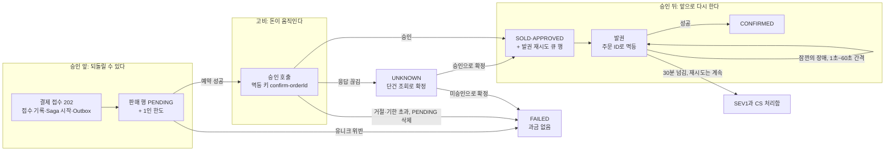

# 분야 편 11: 결제

- **기준 시점**: ADR-0177까지, 2026-11-01. 2026-11-03에 §13(v0 베이스라인)을 더했다
- **맡는 정본**: [docs/features/payment.md](../../features/payment.md). 함께 보는 곳은 [docs/data.md](../../data.md) §4(데이터별 일관성과 트랜잭션 경계. 트랜잭션은 여러 DB 변경을 한꺼번에 반영하거나 한꺼번에 취소하는 작업 단위다), [docs/api/guidelines.md](../../api/guidelines.md) §4(멱등성 키. 멱등은 같은 요청이 여러 번 와도 한 번 처리한 것과 결과가 같은 성질이다), [docs/planning/03-policies-glossary.md](../../planning/03-policies-glossary.md)의 POL-013·POL-014다.
- **규범이 아니다**: 정본을 풀어 쓴 해설이고 새 결정을 담지 않는다. 숫자와 규칙이 정본과 다르면 정본이 맞다([ADR-0177](../../adr/0177-walkthrough-explain-in-interview.md)). 길잡이는 [README.md](../README.md)다.
- **한 판 문서와의 관계**: [한 판 문서](../01-system-design.md) 10단계(결제와 서비스 사이의 일관성)와 16단계(고장 시나리오 점검)가 흐름과 고장 때 동작을 이야기로 따라간다. 이 편은 정본을 절마다 정리하고, 그 단계들이 건너뛴 것(결제사 연동 계약, 상태 전이, 취소·환불, 가상계좌, 보안, 키 단위 동시 처리, 결제 진입 정지의 단계)을 더한다.
- **측정 전이다**: 서비스 수준 측정(NFR 목표를 운영 규모로 잰 것)은 아직 없어 성능 숫자는 설계 목표값이고 `[실측 전]`을 붙였다. 기반 PoC(wbs 0.5.1, 본 개발 전에 위험한 부분만 먼저 재 보는 시험)는 2026-11-01에 PC 한 대에서 쟀다([ADR-0176](../../adr/0176-foundation-poc-results.md), 성능 장부 docs/perf-ledger.md §5). 그 숫자는 '실측(PC)'이고 운영 규모 증거가 아니다. 정본의 `[가정]`·`[추정]`은 그대로 옮긴다.

## 1. 이 문서가 정하는 것

docs/features/payment.md는 좌석을 잡은 팬이 돈을 내고 티켓을 받기까지, 그리고 예매 취소와 환불을 정한다. 일은 purchase-svc의 주문 Saga(여러 서비스에 걸친 일을 단계별로 처리하고, 중간에 실패하면 앞 단계를 되돌리는 방식), payment-svc, ticket-svc와 바깥 결제사 둘(토스페이먼츠·포트원)에 걸친다. 결제사(PG, 온라인 결제를 대신 처리해 주는 전자지급결제대행사)는 '구매자가 결제창에서 인증 → 가맹점 서버가 승인 API(프로그램끼리 요청과 응답을 주고받는 창구) 호출' 2단계로 돈을 움직인다. 정본의 뼈대는 이 두 단계 사이에 좌석 확정(DB의 좌석 판매 행을 사전 예약 상태 PENDING으로 넣기)을 끼워 넣는 것이다. 그 위에 어댑터(결제사마다 다른 API를 공통 창구인 '포트' 모양으로 바꾸는 구현), 보상(이미 한 일을 되돌리는 처리), 웹훅(일이 생기면 상대 서버가 우리 주소를 불러 알려 주는 방식), 매일 대사(결제사 거래 내역과 우리 원장을 맞대어 어긋난 곳을 찾는 일) 같은 규칙을 얹는다. 서비스 사이 사건은 Outbox(보낼 사건을 같은 트랜잭션으로 DB 표에 먼저 적어 두고 나중에 보내는 방식)에 적고, 릴레이(그 표를 읽어 보내는 작은 작업자)가 Kafka(사건을 순서대로 쌓아 두고 여러 곳에 나눠 주는 메시지 시스템)로 보낸다.

> **30초 설명**: "결제는 결제사의 2단계 구조를 씁니다. 결제창에서 인증해도 서버가 승인을 부르기 전에는 돈이 나가지 않습니다. 그래서 접수를 받으면 먼저 DB에 좌석 판매 행을 PENDING으로 넣고, 성공한 주문만 승인을 부릅니다. 경쟁에서 진 사람은 돈이 나가지 않으니 환불도 없습니다. 접수는 한 트랜잭션에 적고 0.15초 안에 202로 답하며, 결제사 호출은 응답 밖에서 합니다. 승인은 되돌리기 어려운 고비라서, 승인 뒤 발권이 실패하면 환불하지 않고 같은 주문 번호로 다시 발권합니다. 요청, 결제사 호출, 사건 받기를 모두 멱등하게 했고, 응답이 끊기면 짐작하지 않고 조회로 확정합니다. 토스페이먼츠와 포트원은 같은 포트 뒤에 두고, 시도마다 고른 뒤 접수하면 고정합니다. 숫자는 설계 목표이고 아직 재지 않았습니다."

Saga의 세 구간(ADR-0106)을 그림으로 보면 이렇다. UNKNOWN은 결제 결과 모름, SEV1은 가장 심각한 장애 등급(숫자가 작을수록 심각하다), CS 처리함은 고객 지원 담당자가 볼 건을 모으는 곳이다.

## 2. 절마다 읽기

정본의 절마다 한 행이다. '해설서에서'는 [한 판 문서](../01-system-design.md)가 실제로 다루는 단계다.

| 정본 절 | 무엇을 정하나 | 왜 | 해설서에서 |
| --- | --- | --- | --- |
| §1 개요 | 2단계 결제를 좌석 확정에 잇는 원칙, 결제 포트 뒤의 어댑터 셋(토스페이먼츠·포트원·시험용 시뮬레이터) | 좌석 예약에 성공한 주문만 승인하면 경합에서 진 주문은 과금 없이 끝난다. 연동을 포트 뒤에 가둬야 결제사를 더해도 Saga를 다시 쓰지 않는다(ADR-0029) | 한 판 10단계 |
| §2 흐름 | 주문 생성 → 결제 시도 → 결제창 인증 → 접수 202 → 판매 행 PENDING → 승인 → SOLD·발권 → 결과 받기 | 결제사 호출을 접수 응답에서 떼어야 접수 p99(요청 백 건 중 아흔아홉 건이 이 시간 안에 끝난다는 뜻) 150ms를 지킨다. 금액은 서버가 계산한다 | 한 판 10단계 |
| §2 확정 3초 예산과 승인 시간 초과 | 확정 3초 = 결제사 2초 + 내부 1초. 승인 호출은 60초 `[가정]`까지 기다리고, 자원은 동시 호출 상한과 서킷 브레이커(계속 실패하는 호출을 잠시 끊는 장치)가 지킨다 | 2초에 끊어도 결제사는 안에서 계속 처리해, 재전송·결과 모름 조회만 늘고 한도를 깎는다(기술 검토 높음-16) | — |
| §2 '결과 당기기' | 승인 결과 사건이 5초 `[가정]` 안에 오지 않으면 `BatchGetPayments`로 직접 묻는다 | Kafka(아마존이 운영해 주는 MSK)의 SLA(서비스 수준 약속)는 월 99.9%인데 결제 완료율 목표는 99.95%라, 완화책 없이는 목표가 의존성보다 높다(ADR-0140) | 한 판 10·16단계 |
| §2 '키 단위 동시 처리' | 파티션 안에서 주문 ID마다 동시에 처리하고, 처리 못 하는 사건은 보류 표 `held_event`로 옮긴다 | 토픽(메시지를 종류별로 모아 두는 통로) 키가 회차라 인기 회차가 한 파티션(토픽을 나눈 칸. 한 칸은 소비자 하나가 읽는다)에 몰리고, 차례대로면 건당 10ms `[설명용 가정]`에 초당 100건뿐이다(ADR-0142) | — |
| §2 롱 폴링 상한 | 결과 조회(답이 생길 때까지 응답을 미루는 롱 폴링) 상한 25초·27초·30초 `[가정]` | 앞단 CDN(사용자 가까이에서 대신 답하는 전송망)인 CloudFront는 원본 응답이 30초(기본값)를 넘으면 GET을 다시 보내므로, 같은 값이면 504나 이중 조회가 생긴다 | 한 판 10단계(25초만) |
| §2 주문 저장 방식·계정 병합 | 주문은 '상태 + 덧붙이기 이력 + Outbox'다. 병합해도 주문·결제의 `account_id`는 고치지 않는다 | 분쟁 증거(FR-031)는 빠짐없는 이력이면 된다(ADR-0113). 주문·결제는 5년 보존 기록이다 | 한 판 10단계(저장 방식만) |
| §2 판매 일시정지·종료·예매 제한 | 명령 3이면 새 시도·접수 423, 판매 종료 뒤 410 `sale-ended`, 제한 계정 403 `booking-restricted` | 이미 시작한 거래는 막지 않는다. 접수된 결제는 끝까지 처리하고, 판매 종료 전에 만든 홀드와 제한 전에 만든 주문은 결제를 마칠 수 있다(ADR-0103·0064·0161) | — |
| §2 조사용 칸·행동 요약 | 주문 생성 사건의 `journeyId`·`contactRef`, 첫 결제 시도의 행동 요약 | 부정 예매 조사(POL-046)에서 주문을 여정·연락처로 묶는다(ADR-0171) | — |
| §2.1 PG 어댑터 계약 | 포트 메서드 여섯, 능력 플래그(어댑터가 알리는 결제사의 기능과 한도), 결제사별 규격 대조, 결과 코드 여섯 가지, 실패 범주, 결제 수단 연결값(같은 카드의 여러 계정을 묶어 보는 약한 값), 계약 시험 | 같은 계약 시험을 세 구현에 돌려야 '이중 결제 0'을 결제사마다 따로 증명하지 않는다 | — |
| §2.2 결제사 선택·고정·전환 | 선택 순서(전환 → 회차 지정 → 플랫폼 기본), 접수 뒤 고정, 명령 12 지정, 명령 6 전환, 하위 결제사, 상한 두 갈래 | 승인 요청 전에는 돈이 움직이지 않아 다시 골라도 안전하고, 요청 뒤 옮기면 두 승인이 겹칠 수 있다(ADR-0044) | 한 판 2·7·10단계 |
| §3 상태 전이 | 주문 상태 13개와 전이 T1~T26(조건의 정본), 결제 시도·결제 원장 상태, 미결제 주문 만료, 승인 뒤 발권 | EXPIRED(접수 없이 끝남)와 FAILED(접수 뒤 과금 없이 실패)를 나눠야 실패율에 이탈이 섞이지 않는다(ADR-0107) | 한 판 10단계(발권만) |
| §4 실패·보상 표 | 실패 상황 10가지의 처리와 과금 여부 | 승인 앞 실패는 과금 없이 끝내고, 승인 뒤 장애만 과금을 유지한 채 다시 발권한다(POL-013) | 한 판 10단계 |
| §4.1 예매 취소·환불 | 견적 → 취소 Saga → 키 폐기·좌석 반환 → 환급, 공제율(환불할 때 떼는 비율), 끝수, 청약철회(정해진 기간 안에 계약을 무르는 법정 권리), 결제자 기준 | 공제액을 한 곳에서 정수로 계산해야 견적·환급·정산서가 같다. 입장 시작 뒤 취소는 입장하고 환불받는 악용을 막으려고 환급을 미룬다 | — |
| §4.2 시나리오 대응표 | 결제 오류·재시도 예외 22가지의 대응과 시험 번호 | 소유자 요구로 §2·§4·§9에 흩어진 대응을 한 표에 모았다 | 한 판 16단계(일부) |
| §5 웹훅 | 받는 경로, 중복 거르기 키, 포트원 서명 검증, 보조 신호 규칙 | 토스페이먼츠 결제 웹훅에는 서명이 없어 본문을 믿을 수 없다. 상태는 조회 API 결과로만 바꾼다 | 한 판 10단계 |
| §6 가상계좌·환불 계좌 | 고수요 온세일(표를 처음 파는 시간대)에서는 끈다, 입금 `secret` 해시 대조, 환불 계좌 저장 안 함, 에스크로(결제대금예치) 선택권 | 입금을 기다리는 동안 좌석이 묶인다. 계좌번호를 저장하면 암호화 의무(안전성 확보조치 기준 §7②6호)가 생긴다 | — |
| §7 비밀·보안 | 비밀 키 보관, 카드 정보 격리, 요청 서명, 결제 라우트 헤더·CSP(페이지가 실행할 스크립트 출처를 정하는 브라우저 규칙), 복귀 화면, 토큰 가리기 | 카드 번호를 결제사 화면에서만 받아 PCI-DSS(카드 정보 보안 표준) 범위를 줄인다. 결제창 복귀에는 `SameSite=Strict` 쿠키가 실리지 않는다 | — |
| §8 정산·대사 | 매일 자정 결제사별 대사, 온세일과 겹치면 미룸, 결제-발권 불일치 두 종류, 불변식 검사기 | 정산서와 공연예술통합전산망 전송이 대사를 마친 원장을 쓰므로 06시 정산서 전에 끝나야 한다(ADR-0089) | 한 판 10단계 |
| §9 장애 시 동작 | 장애 9가지의 감지, 감내 모드(장애 때 성능을 낮춰 버티는 동작), 완화 목표, 끝까지 지킬 것 | 결제사가 아프면 같은 키로 기다린다. 이중 결제 0은 2단계 결제와 멱등 키가 지키고, 늦어지는 것만 허용한다 | 한 판 16단계 |
| §9 '새 결제 진입 정지와 다시 열기' | 정지(확인 호출) → 시험 재개 → 모두 엶, commander(관제 운영자 권한 등급의 하나) 손 해제, Lease(정해진 시간 동안만 유효한 권한)로 뽑은 판정자 | 정지 중에는 새 결제가 없어 남는 표본(재시도 큐)으로 회복을 알 수 없고, 큐가 비면 표본이 0이다(ADR-0105) | 한 판 16단계(한 줄) |
| §9 관측 | 임박 SEV2(장애 심각도 등급, 숫자가 작을수록 심각), 전환 검토, 한도 사용률, 429 | 온세일 70분 결제 확정 약 2.5만 건에 허용 실패가 약 12건이라(NFR-006), 소진 배수 경보로는 헛경보 없이 빨리 경고하지 못한다 | 한 판 13단계 |
| §10 데이터·API 참조 | purchase·payment DB 표, REST 9개, 사건 토픽 넷, 화면 | — | 한 판 3·15단계 |
| §11 테스트 포인트 | 규칙 모델 검사와 P-T1~P-T52 | 규칙을 작은 모델로 모든 순서를 따져 먼저 보고, 같은 규칙을 코드에 다시 돌린다(docs/verification.md §2.1) | — |
| §12 미결정·[가정] | 외부 한도 추정, 2026-10-28·10-29 값의 가정, 확인할 것 | 계약이 없어 확인할 수 없는 값을 추정으로 두되 틀려도 금전 안전은 지킨다(ADR-0036) | — |
| §13 v0 베이스라인 | K7을 견줄 비교용 단순한 첫 판(v0) 결제다(2026-11-02 더함). 결제 확정 요청 하나가 좌석 판매 → 결제사 승인 호출(응답을 기다리는 동기 호출) → 발권을 단계마다 따로 된 트랜잭션으로 차례로 부른다(동기 결제 체인). Saga·Outbox·결과 모름 조회·발권 재시도 큐·대사 배치가 없고, 주문·결제 멱등키, 결제 시도, 결제사 선택·전환, 결제창, 웹훅, 취소·환불, 가상계좌, 판매 종료·일시정지·예매 제한 확인, 주문 만료도 뺐다. `services/v0-monolith`의 `booking`·`payment` 모듈과 표 다섯(`v0_order`·`v0_payment` 등)이다. 결제사 경계는 v1과 같다: payment-svc의 결제 포트와 PG 시뮬레이터 어댑터를 그대로 가져다 쓰고, 승인 멱등키도 같은 `confirm-{orderId}`다. 결제사 응답은 요청의 남은 시간 안(기본 15초)에서만 기다리고 넘으면 결과 모름이다 | v0가 보여 줄 한계를 드러내려는 것이다. 결과 모름(응답 유실·시간 초과·5xx)도 실패로 끝내고 결제사에 다시 묻지 않으므로, 결제사에서는 승인됐는데 v0는 좌석을 돌려줄 수 있다. 이 어긋남은 불변식 검사기의 P6이 센다(검사기는 v0 DB의 읽기 전용 뷰 묶음 `v0_check`를 v1 표 이름으로 읽는다). 처리 도중 프로세스가 멈추면 주문 `PAYING`·좌석 `SOLD`처럼 중간 상태에 남는다(좌석 누수. 검사기의 불변식에 없어 v0 표에서 따로 센다). 운영에 배포하지 않고 K7 비교는 성능 장부 실행으로 본다 `[실측 전]` | 한 판 4·10단계 |

## 3. 꼭 기억할 규칙과 숫자

| 항목 | 값 | 표시 | 정본 위치 |
| --- | --- | --- | --- |
| 결제 접수 | 피크 300 TPS(초당 처리 건수)에서 202 p99 150ms 미만, 가용성 99.95% 이상 | `[실측 전]` | NFR-005, §2 |
| 결제 확정 | p99 3초 이하(결제사 2초 + 내부 1초. 2초는 끊는 값이 아니다) | `[실측 전]` | NFR-006, §2 |
| 결제 완료율 | 99.95% 이상. 결제 5,990건 이상에서 실패 0건일 때 적는다 | `[실측 전]` | NFR-006, P-T5 |
| 승인 기한 | 토스페이먼츠 인증 뒤 10분, 포트원 10분 | 토스 확정, 포트원 `[추정]` | §2.1, POL-013 |
| 승인 호출 시간 초과 | 읽기 60초(계약 때 확인), 연결 3초 | `[가정]` | §2 |
| 승인 명령 접수 데드라인 | gRPC(서비스끼리 함수를 부르듯 호출하는 통신)의 데드라인(호출 마감) 200ms | `[가정]` | §2 |
| 채널 호출 상한 | 토스페이먼츠 300 TPS, 포트원 채널 하나 초당 50건. 합산 동시 입장 상한 5,000 | 상한 `[추정]`, 5,000 확정 | §2.1 |
| 결제사 멱등 키 | `confirm-{orderId}`, `cancel-{cancellationId}`. 보관은 토스 15일, 포트원 3시간이라 안전 재시도 창은 3시간 | 확정 | §2.1 |
| 요청 멱등 키 | 주문·결제 시도·결제 접수 24시간 보관, 처리 중이면 1초 기다린 뒤 409 | `[가정]` | docs/api/guidelines.md §4 |
| 결과 당기기 | 1초 점검, 5초 늦으면, 한 번에 100건, 같은 주문 5초에 한 번, 데드라인 500ms, 파드마다 4개 | `[가정]` | §2, ADR-0140 |
| Kafka 정지 중 확정 | 지연 5~10초 증가, 최대 약 6초 늦음, P-T47 기준 p99 10초 | 앞 둘 `[추정]`, 10초 `[가정]` | §9 |
| 키 단위 동시 처리 | 파티션마다 32개, 보류 전 5회, 보류 행 7일 | `[가정]` | §2, ADR-0142 |
| 결제 시도·주문 만료 | READY 40분(30분 + 10분), 안전망 10분마다 만든 지 90분 지난 주문 | `[가정]` | §3, ADR-0107 |
| 발권 재시도·기한 | 1초에서 두 배씩 최대 60초, 60초 넘으면 SEV2와 알림, 승인 뒤 30분 넘으면 SEV1 | `[가정]` | §3, ADR-0106 |
| 결제-발권 불변식 | 승인 뒤 60초 안에 발권도 재시도 큐 등록도 안 된 결제 0건, 검사기는 1분마다 | 0건 확정, 1분 `[가정]` | NFR-006, §8 |
| 완화 목표 | 결제사 장애·한도 도달 때 결제 확정 p99 60초 | `[실측 전]` | §9 |
| 정지 시작·전환 검토 | 서킷 열림 또는 결제 확정 소요(`direct`) p99 5초 초과 | 확정 | §9 |
| 임박 경보 | 1분 창 승인 호출 p99 2초 초과면 SEV2 | 확정 | §9 |
| 다시 열기 | 확인 호출 1초 1건·99%·3분, 시험 재개 5%·첫 승인 20건·5초 안 결론 95%·10분. 한도 정지는 예상 대기 10초 아래 1분 | `[가정]` | §9 |
| 결제사별 상한 | 전진 속도 = 승인 상한 ÷ 결제 비율(1.0), 동시 입장 = 승인 상한 × 180초 ÷ 결제 비율 × 0.5. 토스 2.7만 명(절대 상한 8,000명이 먼저), 포트원 4,500명 | 비율·계수 `[가정]`, 상한 `[추정]` | §2.2 |
| 결제창 실패·결과 모름 | 같은 주문 결제창 실패 3회까지, 결과 모름 1시간 넘으면 CS | `[가정]` | §4.2 7·14번 |
| 공제율 | 10일 전까지 0%, 7~9일 10%, 3~6일 20%, 1~2일 30%, 당일 90%. 공연 3일 전까지는 예매 24시간 안(비영업일 빼고) 전액 | 확정 | §4.1, POL-032 |
| 웹훅 | 토스: 10초 안 200, 최대 7회 재전송. 포트원: 최대 5회, 시각 차 5분 넘으면 거절 | 확정 | §5 |
| 가상계좌·대사 | 입금 기한 + 10분에 조회. 대사는 자정, 대형·중형 온세일과 겹치면 뒤로, 늦어도 04시 | 10분·04시 `[가정]` | §6, §8 |

## 4. 이 문서가 다루는 ID

정본 머리의 '관련 ID'와 본문이 중심으로 쓰는 ID에, ADR-0044 결정 9가 결제 화면에 더하는 CMP-027을 넣었다(payment.md에는 이 ID가 없다). 뜻은 docs/planning/02-requirements.md, docs/planning/03-policies-glossary.md, docs/planning/04-ia-flows-screens.md, docs/design/d2-design-system.md에서 줄였다.

| ID | 한 줄 |
| --- | --- |
| FR-011 | 홀드(결제하는 동안 좌석을 잠시 잡아 두는 것)한 좌석으로 주문·결제한다. 금액은 서버가 계산하고, 좌석 예약을 확정한 뒤 승인하며, 경합에서 지면 과금이 없다 |
| FR-012 | 결제가 확정되면 모바일 티켓이 월렛에 발급된다 |
| FR-031 | 감사 기록과 재생. 주문 ID로 좌석 상태를 시간 순서로 추적한다 |
| FR-041 | 결제사 웹훅은 보조 신호다. 같은 결제사 경로로 온 것만 조회로 검증하고 중복은 거른다 |
| FR-042 | 홀드 TTL(쓸 수 있는 시간)이 끝나면 좌석을 원자적으로 거둬 3초 안에 다시 보인다 |
| FR-047 | 공연 시작 전까지 티켓 단위로 예매를 취소하고, 공제 기준과 환불 예상액을 먼저 보인다 |
| FR-051 | 회차별 결제사 지정(명령 12, 1인)과 장애 때 대체 결제사 전환(명령 6, 2인) |
| FR-055 | 회차 취소·연기 요청, commander 판정, 2인 확정 |
| FR-056 | 주최 측 귀책·공연 내용 변경이면 배상금(실제 결제 금액의 10%)을 지급한다 |
| FR-062 | 회차·상품 정산서를 만들고 결제사 지급대행(결제사가 파트너 계좌로 대금을 보내는 서비스)으로 지급한다 |
| FR-072 | 윈도우가 끝나면 조사용 기록을 고정하고 부정 예매 후보 묶음을 만든다 |
| NFR-005 | 결제 접수: 300 TPS에서 p99 150ms 미만, 가용성 99.95% 이상, 이중 결제 0건 |
| NFR-006 | 결제 확정: p99 3초 이하, 완료율 99.95% 이상, 승인 뒤 60초 불변식 0건 |
| NFR-015 | 복구: AZ(같은 지역 안의 독립된 데이터센터 묶음) 장애 때 RPO(잃어도 되는 데이터의 시간 폭) 0, RTO(복구에 걸려도 되는 시간) 5분 이내 |
| NFR-016 | 보안: ASVS(웹 앱 보안 검증 항목 목록) 5.0.0 레벨 2 전 항목 판정, OWASP Top 10:2025(웹 보안 위협 10가지) 대응 |
| NFR-018 | 개인정보: 주문·결제 내역 5년 보존 |
| POL-012 | 홀드 TTL과 재노출(만료되면 3초 안에 다시 보이고, 연장은 1회) |
| POL-013 | 결제 규칙: 2단계 결제만 쓰고, PENDING 뒤 승인, 승인 뒤는 다시 발권, 결과 모름은 조회로 확정 |
| POL-014 | 가상계좌와 환불 계좌: 고수요 온세일에서는 끄고, 환불 계좌는 저장하지 않는다 |
| POL-023 | 개인정보 처리 |
| POL-026 | 테스트·윤리 규칙: 결제 검증에는 결제사 공식 테스트 키만 쓰고, 대규모 부하 시험은 PG 시뮬레이터로 한다 |
| POL-032 | 예매 취소·환불: 공정위 고시 기준을 상한으로 공제한다 |
| POL-033 | 회원 탈퇴와 재가입: 미사용 티켓을 같은 취소 Saga로 환불한 뒤 탈퇴를 확정한다 |
| POL-036 | 결제사 선택과 전환: 전환 → 회차 지정 → 플랫폼 기본 순, 접수 뒤 고정 |
| POL-038 | 승인 업무와 CS 처리함: 정책 밖 환불은 승인을 거친다 |
| SCR-011 | 주문 및 결제 화면 |
| SCR-012 | 결제 결과 화면(확정 대기, 실패, 결과 모름, '결제 완료, 티켓 발급 중') |
| SCR-029 | 중앙 관제 대시보드(결제사별 상태) |
| SCR-030 | 운영 명령 하달 및 제어(결제사 지정·전환) |
| SCR-038 | 예매 취소 및 환불 화면 |
| SCR-060 | 환불 계좌 입력(지연 환급) |
| CMP-027 | PaymentWidgetFrame. 결제사 결제 UI를 감싸는 보안 프레임이고 `pg` 값으로 변형을 고른다(ADR-0044 결정 9) |

## 5. 결정과 버린 길

'버린 길'은 각 ADR의 '검토한 대안'에서, '옛 판'은 상태 줄과 [docs/architecture.md](../../architecture.md) §11에서 옮겼다.

**[ADR-0015](../../adr/0015-tosspayments-two-phase-approval.md) 결제 2단계를 좌석 일관성에 쓴다**

- 고른 것: 좌석을 PENDING으로 먼저 잡고 승인한다. 접수와 확정을 두 SLI(서비스 품질을 재는 지표)로 나눈다. 응답이 끊기면 같은 키로 다시 보내고, 결과 모름(UNKNOWN)이면 단건 조회로 확정한다.
- 버린 길: 승인 뒤 좌석 확정(지면 환불이 필요하고 불일치 창이 커진다), 접수와 확정을 한 SLI로(어느 쪽이 느린지 모른다), 웹훅을 첫 신호로(서명이 없어 위조될 수 있다).
- 옛 판: 결정 5의 '완벽히 필터링'은 R-56이 고쳤다. 결정 8의 교차 출처 격리(다른 출처의 문서를 떼어 두는 헤더)는 결제 화면에 켜지 않는다. 결과의 '60초 이내 미보상 불일치 0건'은 NFR-006의 새 문구로 읽는다(ADR-0106). '원천 차단'은 설계 목표로 읽는다(architecture §11). 결정 7의 '새벽 대사 파일'은 매일 자정 결제사별 API 조회이고, 결정 3의 '자동 취소'는 승인을 부르지 않고 FAILED로 끝내는 것이다(상태 줄 2026-11-01).

**[ADR-0029](../../adr/0029-pg-adapter-toss-default-portone-compatible.md) 결제사 어댑터**

- 고른 것: 서비스는 `PaymentGatewayPort`에만 기대고, 결제사마다 다른 API는 어댑터가 맡는다. 어댑터는 능력 플래그(서버 승인 지원, 승인 기한, 멱등 보관 기간 등)를 돌려준다.
- 버린 길: 토스페이먼츠 단일 결합(결제사를 바꿀 때 Saga를 다시 쓴다), 포트원을 기본으로(실패 주입 헤더가 없어 결제 장애 주입 시험 자동화가 어렵다), 결제사마다 따로 만든 Saga(불변식을 결제사 수만큼 증명해야 한다).
- 옛 판: 결정 3의 결과는 `WAITING_FOR_DEPOSIT`이 더해져 여섯이다. 맥락의 '토스는 서명 없음'은 '결제 웹훅만 서명이 없다'다(ADR-0050). 결정 5의 포트원 웹훅 중복 키는 `webhook-id` UNIQUE다(상태 줄 2026-11-01).

**[ADR-0036](../../adr/0036-external-limits-estimates.md) 확인할 수 없는 외부 한도는 추정한다**

- 고른 것: 토스페이먼츠 300 TPS, 포트원 기한 10분·채널 초당 50건으로 추정한다. 토큰 버킷(일정 속도로 채워지는 토큰이 있을 때만 요청을 보내는 장치)이 상한을 지키고, 넘는 승인은 같은 키로 큐에서 기다리며 기한을 넘기면 과금 없이 만료한다.
- 버린 길: 확인될 때까지 유보(계약이 없어 끝내 미정이다), 낙관 추정 900 TPS(근거가 없고 틀리면 10분 기한을 넘겨 판매를 잃는다).
- 옛 판: 결정 1 표의 '포트원은 피크를 받지 않는다'는 ADR-0044가 대체했다. 결정 3의 '÷ 0.06 TPS/명'은 두 갈래 식으로 바뀌었다(중간-027). 결정 2의 '429를 받으면 상한을 낮춘다'는 첫 승인 호출의 429만이고, 다시 보낸 호출·조회의 429는 그 호출만 늦춘다. 결정 5의 포트원 웹훅 중복 키는 `webhook-id`다(상태 줄 2026-11-01).

**[ADR-0044](../../adr/0044-dual-pg-selection-and-switchover.md) 두 결제사를 함께 운영한다**

- 고른 것: 변환은 어댑터, 고르기는 전략 패턴(같은 포트의 구현 가운데 하나를 실행 때 고르는 구조)이다. 선택기는 payment-svc에 두고, 시도마다 고르고 접수 뒤 고정한다. 장애 전환은 사람이 승인한다.
- 버린 길: 주문 생성 때 고정(전환 뒤에도 고장 난 결제사로만 결제한다), 서킷이 열리면 자동 전환(포트원 상한이 약 1/6이라 순간 과부하, 오탐이면 괜히 바꾼다), 승인 요청 뒤 옮기기(이중 결제), 구매자·파트너가 고르기(계약과 한도는 플랫폼 책임).
- 옛 판: 결정 5의 'commander 2인 승인'은 'commander 요청 + 요청자 아닌 operator 이상 1인 승인'이다(ADR-0073. 둘은 관제 운영자의 권한 등급이다). 결정 6·'남는 한계' 1의 '약 830명, 약 6배 느림'은 '4,500명, 토스 공연의 약 90%'로 바뀌었다. 하위 결제사까지 달라야 한다(중간-042). 전환은 제어 gRPC와 `pg_switch`로 퍼진다(ADR-0143). 옛 경로 `…/payments/accept`는 지금 `…/payment-acceptance`다(ADR-0081). 결정 4의 '공연별 지정'과 결정 5의 '공연 하나'는 회차로 읽는다(상태 줄 2026-11-01).

**[ADR-0106](../../adr/0106-forward-recovery-after-payment-approval-ticket-issue-retry.md) 승인 뒤 발권은 앞으로 다시 한다**

- 고른 것: 승인을 고비 단계(되돌리기 어려운 단계)로 둔다. 승인 결과를 받으면 SOLD·APPROVED·`ticket_issue_job`·Outbox를 한 트랜잭션에 쓴다. 보상(이미 한 일을 되돌리는 처리, 여기서는 결제 취소)은 회차 취소 확정과 CS 확인 두 경우뿐이다.
- 버린 길: 바로 결제 취소(잠깐의 장애로 표가 환불되고 좌석이 다시 팔린다), 몇 번 시도 뒤 취소(장애가 몇 분이면 같은 결과다), 승인 앞에서 티켓 행 만들기(ticket-svc 장애가 접수 전체를 막는다), 기한 뒤 자동 환불(몰아서 환불된다).
- 옛 판: P-T39 ⑤는 '사건과 당기기를 함께 막으면 SEV1'로 바뀌었다(ADR-0140).

**[ADR-0105](../../adr/0105-payment-entry-pause-probe-trial-reopen-manual-release.md) 멈춘 새 결제 진입을 다시 여는 법**

- 고른 것: 확인 호출(결제가 없는 고정 번호를 1초에 1건 조회해 404를 정상으로 센다) → 시험 재개(새 결제의 5%만 받기) → 모두 엶. commander가 명령 6 해제로 1인이 바로 연다. 판정은 Lease로 뽑은 파드 하나가 하고 `payment_entry_pause`에 판 번호(옛 판정자의 늦은 쓰기를 거르는 번호) 조건으로 쓴다.
- 버린 길: 옛 조건 유지(큐가 비면 표본이 0이라 참이 될 수 없다), 확인 호출만으로 열기(조회가 살아도 승인이 아플 수 있다), 정지 직후 시험 재개(죽은 동안 팬을 실패에 노출한다), 정해진 시간 뒤 열기(회복을 보지 않는다), 2인 해제(늦게 연 피해가 잘못 연 피해보다 길다).
- 옛 판: ADR-0078 결정 2('서킷 닫힘과 p99 5초 아래 5분')와 ADR-0085 결정 4의 '일시 정지의 끝'이 옛 판이다.

**[ADR-0140](../../adr/0140-payment-result-pull-fallback-when-kafka-is-late.md)·[ADR-0116](../../adr/0116-single-polling-outbox-relay-drop-debezium-place-pgbouncer-schema-registry.md) 결과가 오는 길**

- ADR-0140 고른 것: 사건으로 받되(밀기) 5초 늦으면 직접 묻는다(당기기). 버린 길: 결과를 gRPC 응답으로(결제사 지연 60초와 데드라인이 묶인다), 결제 결과만 다른 Kafka 클러스터로(운명을 함께하고 운영비만 는다), 당기기만(평소 지연과 DB 부하가 는다). 남는 한계: Kafka와 payment-svc가 함께 멈추면 확정도 멈춘다.
- ADR-0116 고른 것: 서비스마다 폴링 릴레이 하나(복제 2, Lease로 하나만 보냄), 100ms `[가정]`마다 `seq` 순서로 보내고 모든 확인(`acks=all`)을 받은 뒤 표시한다. 잠긴 행을 건너뛰는 `SKIP LOCKED`는 리더가 바뀔 때 앞 묶음을 건너뛸 수 있어 쓰지 않는다. 버린 길: 운영만 Debezium(DB 변경 기록을 읽어 보내는 CDC 도구. 잰 길과 운영 길이 다르다), 모든 환경 Debezium(로컬에도 자바 실행 기반 Kafka Connect와 논리 복제가 필요하다). 옛 판: '릴레이가 멈추면 확정 알림이 늦다'에서 확정 자체는 당기기로 이어진다(상태 줄).

**그 밖의 결정**

- [ADR-0113](../../adr/0113-order-state-with-append-only-history-event-sourcing-only-for-ops-commands.md): 주문은 상태 + 덧붙이기 이력이고, 이벤트 소싱(상태를 사건의 재생으로만 만드는 방식)은 운영 명령에만 쓴다. 진짜 이벤트 소싱은 판 올림·재생 시험이 더해지고 사건이 10개 안팎 `[추정]`이라 스냅샷 이득이 없어 버렸다.
- [ADR-0142](../../adr/0142-consumer-key-concurrency-held-events-client-required-settings.md): 결제 토픽만 주문 키로(한 회차 한 파티션 규칙이 깨진다), 파티션 늘리기(회차 키라 효과 없다), 데드 레터 토픽(처리하지 못한 사건을 따로 모으는 토픽. 가명 처리 전 식별값이 한 벌 더 생긴다)을 버렸다. 결정 3의 '세션 45초(기본값)'는 쓰는 클라이언트 기본이 30초라 공용 모듈이 직접 넣는다(상태 줄).
- [ADR-0143](../../adr/0143-settings-commands-pg-switch-over-grpc-applied-version-outbox.md): 대체 결제사 전환만 제어 gRPC와 `pg_switch`로 보낸다. 설정형 명령 전부를 gRPC로 옮기면 권한·ack 대상이 커져 버렸다. 결정 1의 범위는 '회차 또는 플랫폼'으로 읽는다(R-166).
- [ADR-0107](../../adr/0107-expire-unpaid-orders-ticket-expired-merch-stock-reservation.md): 미결제 주문을 EXPIRED로 끝낸다. 고정 시간 일괄 만료(열린 결제창을 끊는다)와 FAILED 표시(실패율에 이탈이 섞인다)를 버렸다.
- [ADR-0085](../../adr/0085-freeze-unaccepted-holds-during-new-payment-pause.md): 새 결제 정지 동안 접수 전 홀드의 남은 시간을 멈춘다. 문구만 바꾸는 안은 정지가 홀드보다 길면 좌석을 잃어 버렸다.
- ADR-0073 결정 1: 재시도 큐 결제의 홀드를 승인 기한까지 늘린다(고정 5분 연장은 기한보다 먼저 풀릴 수 있어 버렸다). ADR-0089 결정 5: 대사는 겹칠 때만 미룬다(03시로 옮기면 FR-041의 '매일 자정'이 바뀐다).

## 6. 읽는 요령

1. **읽는 순서**: §1 → §2 순서도와 문단 → §3 전이 표 → §4·§4.2 → §9 → §2.1·§2.2 → §5~§8 → §11은 궁금한 시험만.
2. **ADR 본문보다 정본이 앞선다**: ADR-0015·0029·0036·0044 본문은 옛 판이 많다(§5). 상태 줄과 docs/architecture.md §11·§11.1을 먼저 본다.
3. **상태가 셋이다**: 주문(`purchase_order.status`, T1~T26), 결제 시도(`payment_attempt`: READY·ACCEPTED·SUPERSEDED·EXPIRED, 주문 CREATED 안에서만 바뀐다), 결제 원장(`payment`: ACCEPTED·AWAITING_DEPOSIT·APPROVED·UNKNOWN·FAILED·PARTIAL_CANCELED·CANCELED)이다. 티켓 상태는 또 따로다.
4. **같은 이름, 다른 뜻**: 주문 상태 EXPIRED는 '접수하지 않고 끝남', 실패 범주 `EXPIRED`는 '접수 뒤 승인 기한을 넘긴 FAILED'다. 2초는 끊는 값이 아니라 예산과 임박 경보의 기준이다. 5초도 넷이다(전환 검토 p99 5초, 당기기 5초 `[가정]`, 같은 주문 5초에 한 번 `[가정]`, 시험 재개 결론 5초 `[가정]`).
5. **'공연'이 회차인 곳**: 결제사 지정·전환의 단위는 회차다(저장 칸 `event.pg_primary`·`pg_fallback`, 전환 범위는 회차 하나 또는 플랫폼 전체). §2.2의 선택 규칙과 '회차별 지정'은 2026-11-01에, 하위 결제사 문단과 P-T46의 '같은 공연', '토스페이먼츠 공연'은 2026-11-02에 회차로 고쳤다(정합 점검).
6. **지금처럼 보이는 옛 문장**: §9 첫 행 괄호의 '서킷 닫힘과 p99 5초 아래 5분', §2 롱 폴링의 '처음 상한 30초', §2.2의 '예전 식 ÷ 0.06'은 바꾸기 전 값이다.
7. **표시를 지킨다**: 2026-10-28·10-29에 정한 값은 모두 `[가정]`이다(§12). §4.2의 `[보완]`은 2026-10-11에 더한 규칙 표시이지 미결이 아니다.

## 7. 경계

| 이 문서가 정하지 않는 것 | 어디서 정하나 |
| --- | --- |
| 좌석 홀드, 판매 행, 1인 한도의 세부 | [docs/features/seat-hold.md](../../features/seat-hold.md) §3~§6 |
| 입장 확정, 구매 세션, 입장 목표 계산식 | [docs/features/queue-admission.md](../../features/queue-admission.md) §5·§6 |
| 회차 취소, 일괄 환불, 배상, 승인 업무, 부정 예매 조치 | [docs/features/transfer-refund.md](../../features/transfer-refund.md) §5·§6·§7 |
| 정산서, 결제사 지급대행, 미수금 | [docs/features/settlement.md](../../features/settlement.md) |
| 발권 뒤 티켓 수명주기, 기기 키, 입장 기록 마감 | [docs/features/offline-gate.md](../../features/offline-gate.md) §2·§7.3, 티켓 상태는 [docs/planning/03-policies-glossary.md](../../planning/03-policies-glossary.md) §2.5 |
| 명령 3·6·12의 권한과 전달 경로 | [docs/features/control-tower.md](../../features/control-tower.md) §3·§5 |
| 본인확인 재확인, 계정 병합 | [docs/features/identity.md](../../features/identity.md) §2.1·§5 |
| Outbox 릴레이와 Kafka 소비의 공통 규칙 | [docs/data.md](../../data.md) §4, [docs/streaming.md](../../streaming.md) §2 |
| 요청 멱등 키의 공통 규칙 | [docs/api/guidelines.md](../../api/guidelines.md) §4 |
| 경보 규칙과 SLO 계산 | [docs/observability.md](../../observability.md) §4·§5 |
| 리전 장애 때 주문·결제 복원 | [docs/infra.md](../../infra.md) §6 |
| 비밀 키 회전, 조사용 가명 계산, 결제 보안 점검 줄 | [docs/security/secrets-and-keys.md](../../security/secrets-and-keys.md), [docs/security/asvs/payment.md](../../security/asvs/payment.md) |
| 굿즈 주문(같은 결제 포트를 쓴다) | shop 상세 설계는 아직 없다. 재고는 docs/data.md §4 경계 5 |

## 8. 꼬리 질문

한 판 10단계에 있는 질문은 빼고 한 단 더 들어간다.

| 질문 | 답의 요지 | 근거 |
| --- | --- | --- |
| 예산이 결제사 2초인데 왜 승인 호출을 2초에 끊지 않나요? | 끊어도 결제사는 안에서 계속 처리한다. 다시 보내면 '처리 중'을 받고 결과 모름 조회로 가며 한도를 깎는다. 그래서 권장대로 60초 `[가정]`를 기다리고, 자원은 채널별 동시 승인 호출 상한(벌크헤드: 의존성마다 나눈 동시 호출 몫. 토스 600건·포트원 100건 `[가정]`)과 서킷 브레이커가 지킨다 | docs/features/payment.md §2, 높음-16 |
| 결제창을 닫고 다른 결제사로 다시 시도하면 두 번 결제되지 않나요? | 승인 요청 전에는 돈이 움직이지 않는다. 주문당 활성 시도는 1건(부분 유니크 인덱스: 조건에 맞는 행끼리만 값이 겹치지 않게 막는 색인)이고 이전 시도는 SUPERSEDED다. 늦게 온 이전 시도의 접수는 `pg` 대조에서 409다 | ADR-0044 결정 2·7, §4.2 1·17번 |
| 사건과 당기기가 같은 결과를 두 번 반영하지 않나요? | 답에 마지막 결제 사건의 `eventKey`와 순번이 들고, 사건과 같은 처리기로 `WHERE payment_event_seq < $seq` 조건부 UPDATE를 한다. 이미 반영한 순번 이하는 건너뛴다. P-T15가 두 길로 같은 결과를 보내 본다 | docs/data.md §4 경계 2, ADR-0146 결정 2 |
| 인기 회차에 승인이 초당 300건 몰리면 소비자가 따라가나요? | 한 파티션이지만 주문 ID마다 동시에(32개 `[가정]`) 처리하고, 앞 사건이 다 끝난 위치까지만 커밋(어디까지 읽었는지 적는 것)한다. 같은 결과로 5회 실패한 사건은 그 주문만 보류한다. 결제 서비스로 잰 적은 아직 없다. 2026-11-01 기반 PoC는 공용 키 단위 소비 모듈만 PC에서 쟀다. 빠짐·두 번 반영·순서 뒤집힘이 0이고, 처리기 1ms에서 초당 4만 3,200~5만 800건이었다(ST-T18, 실측(PC), ADR-0176 결정 5). P-T48이 p99 3초를 넘으면 주문 키 새 토픽을 검토한다 | ADR-0142 결정 1·2, ADR-0176 결정 5 |
| 브라우저에서 금액을 바꾸면요? 포트원은요? | 금액은 서버가 계산한다. 토스는 접수 본문의 `amount`를 대조해 1원이라도 다르면 400이다. 포트원은 금액을 받지 않고 승인 API의 `totalAmount`에 서버 금액을 넣어 포트원이 대조한다. 조회한 결제액이 다르면 바로 취소한다 | §2.2, §4.2 10번, P-T7·P-T28 |
| 견적과 실제 환급, 정산서가 1원이라도 어긋날 수 있나요? | 공제율을 기준점 정수(1% = 100)로 두고 ⌊금액 × 기준점 ÷ 10,000⌋을 공용 함수 한 곳에서 계산해 세 곳이 같은 값을 쓴다. 33,333원의 10%는 3,333원 공제·30,000원 환급이다 | §4.1, P-T18 |
| 300 TPS가 틀리면요? 재 봤나요? | 공개되지 않아 추정했다. 틀려도 넘는 승인은 큐에서 기다리고 10분을 넘기면 과금 없이 만료한다. 서비스 수준 측정은 아직 없다. P-T22가 시뮬레이터 300·100 TPS로 잴 계획이고, 시뮬레이터 지연(중앙값 300ms·p99 1.5초 `[가정]`)이 근거 없어 확정 p99는 '우리 몫'과 '가정을 더한 값'으로 나눠 남긴다 | ADR-0036 결정 1·4, §2.1 |

## 9. 확인 문제

1. 좌석 경쟁에서 진 주문이 돈을 내지 않는 이유를 두 문장으로 설명하라.

답

결제사는 서버가 승인 API를 부르기 전에는 돈을 움직이지 않는다. 결제 접수 뒤 Saga가 먼저 판매 행을 PENDING으로 넣고, 유니크 위반이면 승인을 부르지 않고 주문을 FAILED로 끝내므로 과금도 환불도 없다(§1·§4, ADR-0015 결정 1).

2. 승인 직후 ticket-svc가 5분 멈췄다. 무엇이 일어나고, 언제 환불하나?

답

결제를 취소하지 않는다. 승인 결과와 함께 쓴 발권 재시도 큐 행으로, 같은 주문 ID로 1초에서 두 배씩 최대 60초 `[가정]` 간격으로 다시 발권한다. 60초 `[가정]`를 넘기면 SEV2와 `ISSUE_DELAYED` 알림('결제 완료, 티켓 발급 중'), 30분 `[가정]`을 넘기면 SEV1과 `TICKET_NOT_ISSUED` 건이다. 환불은 회차 취소 확정이나 CS 확인 뒤에만 한다(§3, ADR-0106).

3. 주문 상태 EXPIRED와 FAILED(실패 범주 `EXPIRED`)는 어떻게 다르고, 왜 나누나?

답

EXPIRED는 접수하지 않은 주문이 세 조건(구매 세션 종료, 홀드 해제·만료, 활성 결제 시도 없음)을 모두 채워 끝난 것이다. FAILED(`EXPIRED`)는 접수한 뒤 승인 기한을 넘겨 승인을 부르지 않고 끝난 것이다. 둘 다 과금이 없다. 나눠야 결제 실패율에 이탈한 주문이 섞이지 않는다(§3, ADR-0107).

4. 토스페이먼츠 결제 웹훅을 받으면 무엇을 하고, 무엇을 하지 않나?

답

전송 ID 헤더를 `webhook_receipt`에 유일 값으로 넣어 한 번만 처리하고 10초 안에 200으로 답한다. 서명이 없으므로 본문을 믿지 않고 `paymentKey`로 단건 조회한 결과로만 상태를 바꾼다. 경로의 결제사가 결제 기록과 다르면 반영하지 않는다. 웹훅을 승인의 주 경로로 쓰지 않는다(§5).

## 10. 정본에서 찾은 어긋남

정본끼리 견주어 찾은 것이다(2026-11-01). 셋 모두 같은 날 정본에서 고쳤다.

1. **보상하는 'CS 확인'의 범위**: 고침(2026-11-01 정합 점검, 세 번째 묶음). POL-013, T20 행, docs/features/payment.md §4.2 11번이 '기한을 넘겨 CS가 확인한 때'만 적어, '같은 오류로 자동 재시도를 멈춘 `TICKET_NOT_ISSUED` 건'(ADR-0106 결정 3)이 빠졌다. 세 곳에 그 경우를 더했다.
2. **ADR-0036 결정 2의 429 규칙**: 고침(2026-11-01 정합 점검, 세 번째 묶음). 상태 줄에 '첫 승인 호출의 429만 상한을 낮춘다'(payment §9, 높음-16)를 더했다.
3. **결제사 지정·전환의 단위**: 고침(2026-11-01 정합 점검, 세 번째 묶음). ADR-0044 결정 4의 '공연별 지정'과 결정 5의 '공연 하나'가 회차(ADR-0093·0143)와 어긋났다. ADR-0044 상태 줄, payment §2.2 선택 규칙 표와 '회차별 지정' 문단, POL-036을 회차로 맞췄다.
