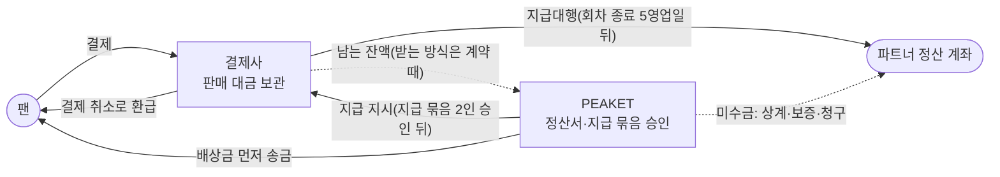

# 분야 편 12: 양도·환불·정산

- **기준 시점**: ADR-0177까지, 2026-11-01
- **맡는 정본**: [docs/features/transfer-refund.md](../../features/transfer-refund.md)(양도·취소·환불 운영), [docs/features/settlement.md](../../features/settlement.md)(정산과 지급)
- **규범이 아니다**: 정본을 풀어 쓴 해설이고 새 결정을 담지 않는다. 숫자와 규칙이 정본과 다르면 정본이 맞다([ADR-0177](../../adr/0177-walkthrough-explain-in-interview.md)). 길잡이는 [README.md](../README.md)다.
- **한 판 문서와의 관계**: [한 판 문서](../01-system-design.md) 1단계가 판매 구조와 돈의 흐름을, 14단계가 양도와 입장이 맞물리는 곳을 짧게 말한다. 10단계(승인 뒤 결제를 취소하는 두 경우)와 15단계(저장소)가 조금 닿는다. 나머지는 이 편이 맡는다.

## 1. 이 문서들이 정하는 것

두 문서는 표가 팔린 뒤 돈과 권리가 어떻게 움직이는지를 정한다. PEAKET은 통신판매중개자(직접 팔지 않고 거래를 알선하는 사업자)이고, 판매 당사자는 공연을 올린 파트너(기획사)다. transfer-refund.md는 이 구조의 법정 의무, 양도(표를 다른 회원에게 넘기는 일), 결제자만 하는 예매 취소, 회차(공연 한 번) 취소와 일괄 환불, 배상, 승인 업무와 CS 처리함을 정한다. settlement.md는 정산(수수료 등을 빼고 파트너에게 보낼 돈을 셈해 보내는 일)을 정한다. 판매 대금은 결제사(PG, 결제를 받아 주는 전자지급결제대행 회사)가 보관하다 지급대행(PEAKET 대신 파트너 계좌로 보내는 서비스)으로 보낸다. PEAKET은 정산서를 계산하고, 지급을 승인해 지시하고, 미수금(파트너에게서 돌려받을 돈)을 관리한다.

> **30초 설명**: "PEAKET은 표를 직접 파는 회사가 아니라 통신판매중개자입니다. 판매 당사자는 파트너지만, 취소와 환불은 PEAKET 시스템이 집행하고 책임도 함께 집니다. 원칙은 '정책 안이면 자동, 정책 밖이면 승인'입니다. 공제율 안의 직접 취소는 사람 손 없이 3영업일 안에 환급하고, 예외 환불·회차 취소·지급 묶음처럼 되돌리기 어려운 이동만 한 명이나 두 명이 승인합니다. 양도는 받는 사람이 수락해야 넘어가고, 환불은 언제나 결제한 사람에게 갑니다. 정산은 결제사 지급대행으로 합니다. 회차가 끝나면 결제사별 정산서를 계산하고, 2영업일 이의를 받고, 두 사람이 승인해 회차 종료 5영업일 뒤에 보냅니다. 지급 뒤 생긴 환불은 PEAKET이 먼저 떠안고 미수금으로 잡아 다음 정산서에서 상계합니다."

## 2. 절마다 읽기

역할 이름: `cs_agent`(CS 담당자), `cs_lead`(CS 책임자), operator·commander(관제 운영자의 권한. commander가 회차 취소를 판정하고 2인 승인의 제2승인자를 맡는다).

**docs/features/transfer-refund.md**

| 정본 절 | 무엇을 정하나 | 왜 | 해설서에서 |
| --- | --- | --- | --- |
| §1 개요 | 법적 지위와 대원칙 셋: 정책 안이면 자동, 정책 밖이면 승인, 취소·환급 권한은 결제자에게만 | 정상 취소를 승인 없이 3영업일 안에 돌려줘야 전자상거래법 제18조 제2항을 지킨다. 되돌리기 어려운 돈과 권리의 이동에만 사람을 넣는다 | 한 판 1단계 |
| §2 판매 구조와 법정 의무 | 판매 승인(§2.1), 중개자 고지와 판매자 정보 7항목(§2.2), 분쟁 처리 기한(§2.3), 공연예술통합전산망 전송(§2.4), 공연법 부정판매 방지(§2.5) | 법이 요구하는 일이 FR-053·054·057이 되었다(ADR-0045). 판매자 정보는 청약(구매 신청) 전까지 줘야 해 결제 직전 화면에 늘 보인다(§20②) | 한 판 1단계 |
| §2.1 판매 승인 | 확인 항목 여섯, operator 1인 승인, 판매 중지(SUSPENDED)와 재개 | 판매자와 표시 사항을 확인할 곳이 필요하다. 조건을 고치면 판매 대행형(남의 상품을 자기 이름으로 파는 형태)으로 볼 여지가 커져 고치지 않는다 | 한 판 1단계 |
| §3 권리와 상태 규칙 | 결제자(바뀌지 않는다)와 보유자, 일마다 허용 조건, 티켓 행 잠금(그 행을 잠가 한 번에 한 요청만 고친다) 안의 판정 | 권한을 결제자 하나에 묶는다. 입장 중에는 오프라인 기록이 늦게 올라와 서버가 누가 들어갔는지 모르므로 소유권과 키를 바꾸지 않는다(ADR-0051) | 한 판 14·15단계 |
| §3.2 승인 업무 종류 | 건 종류마다 요청자, 승인 인원(1인·2인), 기한 | 승인은 돈이나 소유권이 정책 밖으로 움직이는 건에만 둔다. 금액과 되돌릴 수 있는지로 인원을 나눈다(ADR-0046) | — |
| §4 양도 흐름 | 수락형 양도, 돌려주기(받은 사람이 결제자에게 되돌리는 일), 회수(탈취로 넘어간 표를 되돌리는 일), 키 폐기, 멱등키(같은 요청이 두 번 와도 한 번만 처리하게 하는 키) | 수락하면 보낸 사람 키를 바로 폐기해 옛 QR을 막는다. 팬 쿠키가 `SameSite=Strict`라 메일 앱에서 온 첫 요청에는 쿠키가 실리지 않는다 | 한 판 14단계 |
| §4.1 부정 예매 양도 잠금 | 부정 예매(매크로·명의 대여처럼 약관이 정한 부정한 예매)의 소명(의심받은 사람이 해명하는 절차)을 요청하면 양도만 잠그고, 일곱 때 가운데 먼저 오는 때 푼다 | 소명 동안 의심 표가 넘어가 되팔리지 않게 한다. 범위와 기간을 한정해 약관법 제10조 제2호·제11조 제3호를 피한다(해석, ADR-0173) | — |
| §5 회차 취소와 일괄 환불 작업 | 요청 → 판정 → 2인 확정 → 결제사별로 나눠 실행, 결제사 몫(작업을 결제사마다 나눈 부분)마다 자동 정지, 연기, 진행 중 양도 철회 | 파트너 한 명이 회차 전체를 환불하고 귀책(책임이 누구에게 있는지)을 스스로 고르던 문제를 막는다(ADR-0046). 되돌릴 수 없는 돈이라 자동으로 다시 열지 않는다 | 한 판 10단계(승인 뒤 결제 취소의 한 경우) |
| §6 배상 지급 | 결제 금액의 10%, PEAKET이 먼저 송금하고 미수금으로 회수, 계좌는 저장하지 않는다 | 결제 취소로는 결제액보다 많이 돌려줄 수 없어 계좌 입금으로 한다. 파트너가 직접 주면 팬이 따로 연락해야 하고 민원은 예매처로 온다(ADR-0046) | — |
| §7 승인 업무, CS 처리함, 권한과 노출 필드 | CS 처리함 건 종류와 기한, 소명이 들어오는 길(§7.1), 역할과 보이는 칸(§7.3) | ops-svc는 팬 요청을 받지 않는 독립 제어 평면이라 소명은 core-svc support 모듈이 받는다. 받는 사람에게 결제 금액을 보이지 않는다 `[가정]` | 한 판 11단계(CS 처리함은 ops-svc) |
| §7.2 승인 업무 | 상태도와 전이 표 T1~T16, 철회·만료, 부정 예매 조치의 실질 승인 | 철회·만료가 있어야 알림이 되풀이되거나 늦은 승인 뒤 실행에서야 실패하는 일이 준다. 부정 예매 승인은 형식적 결재가 되지 않게 한다 | — |
| §7.4 부정 예매 조치의 실행 | 표 취소와 공제 없는 전액 환급, 이용 제한, 이의 인정 뒤 우선 구매(같은 좌석이나 등급을 원래 가격에 다시 살 권리) | 취소한 좌석이 정가로 다시 팔려 실제 손해가 거의 없고, 그것을 넘는 위약금은 무효 위험이 크다(약관법 제8조, 민법 제398조) | — |
| §8 로그와 감사 | 이벤트마다 남기는 것과 남기지 않는 것 | 연락처, 계좌번호 전체, 진단명은 남기지 않는다. 감사 로그는 추가만 한다 | — |
| §9 예외 상황 대응표 | 경합·탈퇴·장애 15가지 | 한 티켓의 경합은 행 잠금으로 하나만 성공한다. 입장한 받은 사람의 돌려주기를 막아 표 한 장에 두 명이 들어가지 않게 한다 | — |
| §10 데이터·API 참조 | ticket·purchase·ops·core DB의 표, 내부 gRPC, 이벤트, 화면 | 양도는 ticket, 취소·배상은 purchase, 승인 업무·CS는 ops, 판매자 정보와 소명 글은 core에 둔다 | 한 판 15단계 |
| §11 테스트 포인트 | R-T1~R-T35 | 양도와 입장의 규칙은 기능 시험 전에 `entry` 명세를 규칙 모델 검사(일어날 수 있는 순서를 기계로 모두 따지는 검사)로 본다 | — |
| §12 미결정·[가정] | 자체 기준 숫자, 송금 어댑터, 전산망 규격, 부정 예매 환급의 정산 처리 | 숫자는 운영 데이터로 조정한다. 팬 배상은 PEAKET 자기 돈 이체라 지급대행과 따로 고른다 | — |

**docs/features/settlement.md**

| 정본 절 | 무엇을 정하나 | 왜 | 해설서에서 |
| --- | --- | --- | --- |
| §1 개요 | 대금을 PEAKET 계좌에 두지 않는 구조, PEAKET의 세 역할(정산서, 지급 승인·지시, 미수금), 결제사별 분리 정산 | 결제사가 정산대상금액(보관 중인 판매 대금)을 따로 관리할 의무를 진다(전자금융거래법 제25조의4, 2026-12-17 시행). 한 회차 대금이 두 결제사에 나뉠 수 있다 | 한 판 1단계 |
| §2 돈의 흐름과 책임 | 결제사·PEAKET·파트너의 일, PEAKET 몫, 배상 송금은 따로 | PEAKET 몫을 결제사에서 받는 방식은 공개 문서에 없어 계약 때 정한다 | 한 판 1단계 |
| §3 결제사 지급대행 등록 | 판매 승인 때 두 결제사에 등록, 예금주 이름 비교 규칙 | 판매 중에도 결제사 전환이 일어날 수 있다(ADR-0047 결정 2). 계좌는 은행과 끝 4자리만 둔다 | — |
| §4 정산서 | 다음 영업일 06시 계산과 지급액 식(§4.1), 2영업일 이의(§4.2), 2인 수기 조정(§4.3), 열 상태(§4.4) | 대사(두 기록을 맞춰 보는 일)가 끝난 원장(거래 장부)만 쓴다. 알린 금액을 덮어쓰지 않으려고 계산 뒤 환불은 보통 미수금으로 잡고, 다시 계산하면 옛 판을 남긴다 | — |
| §4.5 상품 정산서 | 굿즈·부가 상품은 주 단위 상품 정산서, 정산 기준일 | 회차 정산서는 공연 리포트에서 판매 금액과 원 단위로 맞추는 대상이라 섞지 않는다 | — |
| §5 지급 실행 | 회차 종료 5영업일 뒤 지급, 은행 영업일 달력, 잔액 확인, 지급 묶음 2인 승인(§5.1), 계산 원본은 정산서 하나(§5.4) | 결제사는 지급한 돈을 되돌려 주지 않는다. 취소·환불과 배상 상계(줄 돈에서 받을 돈을 빼고 남는 만큼만 주고받는 것)가 끝난 뒤 보내야 돌려받을 일이 준다(ADR-0047 결정 4) | — |
| §5.2·§5.3 결제사별 실행 | 토스페이먼츠는 예약지급(정한 날에 보내도록 미리 거는 지급), 포트원은 수기 정산건과 콘솔 일괄 지급, 출금 대사 | 토스페이먼츠는 요청 중 한 건이 틀리면 전체가 실패해 요청당 20건으로 줄인다. 포트원은 지급 생성 API가 없고 콘솔에 '지급 실행만' 역할이 없어 사후 대사가 주 통제다(ADR-0108) | — |
| §5.5 지급대행 잔액 대사 | 장부의 '있어야 할 잔액'과 결제사 잔액 맞추기, 결제사 사이 상계 금지 | 건별 대사로는 결제사에 남는 돈이 맞는지 모른다. 다른 결제사에서 상계하면 한쪽 잔액이 모자랄 수 있다 | — |
| §6 보류와 KYC, 정산 계좌 변경 | 보류 사유 여섯, KYC(결제사의 고객 신원 확인) 안내와 재개, 계좌 변경 절차 | 계좌 변경 뒤 3영업일 보류는 같은 명의의 다른 계좌로 바꾼 경우에 알아챌 시간을 준다(ADR-0047 결정 6) | — |
| §7 지급 뒤 환불·카드 이의제기와 미수금 | 미수금이 생기는 네 경우(카드 이의제기는 카드 회사에 결제를 문제 삼는 것), 수수료 몫 빼기, 회수 순서, 이동 기록 | 결제사가 지급한 돈을 돌려주지 않아 PEAKET이 먼저 부담한다. 파트너는 수수료를 뗀 금액만 받았으므로 그만큼만 돌려받는다 | — |
| §8 보안·비밀·로그 | 결제사 키 보관과 교체, JWE(암호화한 요청 본문), 웹훅 서명, 계좌 처리, 시험 환경 | 웹훅(상대 서버가 우리 주소를 불러 알리는 방식) 서명이 맞아도 단건 조회로 확정한다. 라이브 지급은 수수료가 붙어 시험하지 않는다 | — |
| §9 화면과 권한 | 정산 화면, 역할마다 할 수 있는 일 | CS 담당자에게는 '정산 이의' 건만 보인다(소유자 결정 2026-10-30). 서버가 `promoter_id`로 소유자를 검사한다 | — |
| §10 데이터·API·이벤트 참조 | payment·core·ops DB의 표, 결제사 API, `trade.settlements`, 보존 | 정산서·지급·미수금 기록은 5년 보관한다(전자상거래법 시행령 §6①3호) | 한 판 15단계 |
| §11 관측과 경보 | 지급 지연·실패·미승인·서명 불일치·출금 불일치 지표 | 정본에 따로 적은 이유는 없다. 보안에 닿는 것은 SEV2(보안), 지급 지연·실패는 SEV3로 나눈다(SEV는 장애 심각도 등급, 숫자가 작을수록 심각하다) | — |
| §12 예외 상황 대응표 | 회차 취소가 겹친 때, 지급 실패의 세 갈래, 결제사 장애 | 실패 이유마다 할 일이 달라 계좌 문제·점검·한도로 나눈다. 표에 없는 코드는 사람이 본다 | — |
| §13 테스트 포인트 | J-T1~J-T27 | 계산 예시(J-T1·J-T11)와 정산 불변식 SQL(늘 참이어야 할 돈의 식을 보는 쿼리)로 확인한다 | — |
| §14 미결정·한계 | 계약 때 확인할 것, 세무, 법률 해석, 포트원 콘솔의 남는 한계 | 공개 문서에 없는 조건은 계약 때 정한다. '지급 지시는 전자지급결제대행이 아니다'는 해석이다(POL-027) | 한 판 1단계(수수료율 미정) |

## 3. 꼭 기억할 규칙과 숫자

| 항목 | 값 | 표시 | 정본 위치 |
| --- | --- | --- | --- |
| 직접 취소 공제율(떼는 비율의 상한) | 관람일 10일 전까지 공제 없음, 7일 전까지 10%, 3일 전까지 20%, 1일 전까지 30%, 공연 당일 시작 전까지 90%. 공제액은 원 미만 버림 | 확정 | POL-032 |
| 공제 없는 취소 | 관람일 3일 전까지의 건을 예매 후 24시간 안에 취소, 예매 후 7일 안이고 공연일까지 10일 이상(법정 청약철회: 소비자가 계약을 물리는 권리) | 확정 | POL-032 |
| 정책 안 환급 | 3영업일 안(전자상거래법 §18②) | 확정 | transfer-refund §1 |
| 입장 시작 뒤 취소 | 키는 바로 폐기, 환급은 입장 기록 마감(스캐너가 모두 큐를 비우면 바로, 아니면 24시간 안) 뒤 | `[가정]`(24시간) | POL-032 |
| 양도 마감 | 공연 시작 2시간 전과 입장 시작 중 이른 때 | 확정 | transfer-refund §3.1 |
| 양도 수락 기한 | min(요청 뒤 48시간, 양도 마감) | 확정(자체 기준) | transfer-refund §4 |
| 입장 중 동결 | 입장 시작~입장 기록 마감의 수락·돌려주기·회수는 409 `ENTRY_STARTED` | 확정 | transfer-refund §3.1 |
| 재량 면제 1인 승인 | 주문 1건 30만 원 이하. 넘거나 여러 주문이거나 같은 팬 90일 안 두 번째면 2인 | 확정(자체 기준) | transfer-refund §3.2 |
| 일괄 환불 자동 정지 | 결제사 몫마다 1분 창 실패율 5%(호출 20건 이상일 때)·연속 실패 20건·서킷 브레이커(계속 실패하는 호출을 잠시 끊는 장치) 열림. 업무 거절률 5%면 작업 전체 | `[가정]` | transfer-refund §5 |
| 배상금 | 실제 결제 금액(할인 판매는 거래가격)의 10%, 원 미만 올림(33,333원이면 3,334원). 계약 보증은 회차 예상 매출의 10% | 확정 | transfer-refund §6 |
| 분쟁 처리 기한 | 진행 경과 3영업일, 결과 10영업일 | 확정 | transfer-refund §2.3 |
| 부정 예매 양도 잠금 | 첫 소명 요청 + 14일, 연장은 없다 | `[가정]` | transfer-refund §4.1 |
| 부정 예매 표 취소 | 마감은 공연 시작 26시간 전(판매 종료 − 2시간). 공제 없이 전액, 통지 뒤 3영업일 안. 이의 30일, 우선 구매 48시간 | `[가정]` | transfer-refund §7.4 |
| 정산서 계산 | 회차가 끝난 다음 영업일 06시, 결제사별, 대사가 끝난 원장만 | 확정 | settlement §4.1 |
| 지급액 식 | 판매 대금 − 환급 − 중개수수료 − 수수료 부가세(10%) − 상계, 원 미만 버림 | 확정 | settlement §4.1 |
| 계산 예(J-T1) | 판매 3,000만 원, 환급 200만 원, 수수료율 10%면 수수료 280만 원, 부가세 28만 원, 지급액 2,492만 원 | 확정(예시) | settlement §4.1 |
| 중개수수료율 | 판매 승인 때 공연에 고정한다. 요율 자체는 결제사 계약 때 정한다 | 정본에 없음(요율 값) | settlement §4.1, docs/planning/00-executive-summary.md §9 |
| 이의 기간 | 통지 뒤 2영업일. 처리 뒤 다시 알리면 1영업일 | 확정(자체 기준) | settlement §4.2 |
| 기본 지급일 | 회차 종료일로부터 5영업일 뒤 | 확정(자체 기준) | settlement §5.1 |
| 지급 묶음 | 지급일 전 영업일 09시에 만들고, 15시까지 승인이 없으면 다음 영업일로 | 확정 | settlement §5.1 |
| 토스페이먼츠 지급 요청 | 1건 10억 원 미만, 요청당 20건(결제사 상한 100건) | 확정(20건은 자체 기준) | settlement §5.2 |
| 지급 API가 응답하지 않을 때 | 같은 멱등키로 1분 → 30분 상한 간격, 지급일 전 영업일 22시까지 | `[가정]` | settlement §5.2 |
| 정산 계좌 변경 | TOTP(인증 앱의 일회용 코드) 재인증, 예금주 일치, 변경 뒤 3영업일 지급 보류 | 확정(자체 기준) | settlement §6 |
| KYC | 주 1천만 원 이상 지급에 필요, 미리 요청할 수 없다. 필요해지면 지급까지 약 5영업일 | 추정(일부 `[가정]`) | settlement §6 |
| 미수금 회수 | 다음 정산서 상계 → 보증 → 청구. 30일 안에 상계할 정산서가 없으면 보증으로 | 확정 | settlement §7 |
| 지급 뒤 환불의 미수금(J-T11) | 환불액 − 수수료 몫 − 그 부가세. 수수료율 10%, 50만 원이면 44만 5천 원 | 확정 | settlement §7 |
| 상품 정산서 | 주(월~일, KST) 단위, 매주 첫 영업일 06시 계산, 계산일 + 4영업일 지급 | 확정(자체 기준) | settlement §4.5 |
| 온세일 때 미루기 | 대형·중형 온세일 윈도우(T-10분~T+60분)에는 일괄 환불·지급 묶음·전산망 재전송의 새 묶음을 미룬다(최대 70분). 소형은 미루지 않는다 | `[가정]`(소형) | transfer-refund §2.4·§5, settlement §5.1 |

## 4. 이 문서들이 다루는 ID

| ID | 한 줄 |
| --- | --- |
| FR-013 | 보유자이면서 결제자인 팬이 1:1 양도를 요청한다 |
| FR-027 | 파트너가 회차별 정산 리포트와 입장 관람객 명단을 내려받는다 |
| FR-047 | 팬이 공연 시작 전까지 티켓 단위로 예매를 취소한다 |
| FR-052 | 파트너가 판매자 신원정보와 정산 계좌를 내 판매 승인을 요청한다 |
| FR-053 | 통신판매중개자 고지와 판매자 정보를 표시한다 |
| FR-054 | 공연예술통합전산망에 공연정보를 1일 단위로 보낸다 |
| FR-055 | 회차 취소·연기를 판정·2인 확정·일괄 환불로 한다 |
| FR-056 | 주최 측 귀책·공연 내용 변경 회차의 결제자에게 배상금을 지급한다 |
| FR-057 | CS 처리함에서 사람이 판단할 건을 처리한다 |
| FR-058 | 정책 밖 예외 환불을 요청하고 승인한다 |
| FR-059 | 계정 탈취로 넘어간 티켓을 회수한다 |
| FR-060 | 받는 사람이 양도 요청을 수락하거나 거절한다 |
| FR-061 | 취소·양도 남용을 표시하고 사람이 확인해 예매를 제한한다 |
| FR-062 | 회차·상품 정산서를 만들고 결제사 지급대행으로 지급한다 |
| FR-069 | 고객센터 문의(외부 되팔이 게시물 신고 포함) |
| FR-073 | 부정 예매 사건을 소명·조치·이의 순서로 처리한다 |
| POL-014 | 가상계좌와 환불 계좌(저장하지 않는다) |
| POL-016 | 굿즈·부가 상품(유형별 양도 제한, 반품) |
| POL-017 | 양도(수락형, 입장 중 동결, 재양도 금지) |
| POL-024 | 암표 방지 법정 조치 |
| POL-027 | 법률 항목 표기(확인됨·확인 필요·해석·간주·추정) |
| POL-028 | 온세일 윈도우 운영 제약 |
| POL-032 | 예매 취소·환불(공제율 상한, 회차 취소·연기, 배상) |
| POL-036 | 결제사 선택과 전환 |
| POL-037 | 판매 구조와 법적 지위 |
| POL-038 | 승인 업무와 CS 처리함 |
| POL-039 | 정산과 지급 |
| POL-046 | 부정 예매 사후 조치 |
| SCR-001 | 홈 |
| SCR-002 | 공연 상세 |
| SCR-011 | 주문 및 결제 |
| SCR-012 | 결제 결과 |
| SCR-013 | 마이 티켓(월렛) |
| SCR-014 | 티켓 양도 |
| SCR-020 | 파트너 로그인과 설정 |
| SCR-021 | 공연 등록 위저드 |
| SCR-023 | 상품 빌더 |
| SCR-027 | 정산 리포트 및 예매자 명단 다운로드 |
| SCR-038 | 예매 취소 및 환불 |
| SCR-041 | 양도 받기 |
| SCR-042 | 소명 제출 |
| SCR-043 | 배상금 계좌 입력 |
| SCR-044 | 회차 취소·연기 요청 |
| SCR-045 | CS 처리함 |
| SCR-046 | 승인 업무 |
| SCR-047 | 회차 취소 판정·일괄 환불 |
| SCR-048 | 판매 승인 |
| SCR-049 | 정산 지급 |
| SCR-071 | 사건 작업대 |
| CMP-028 | TicketCard(티켓 요약 카드) |
| CMP-031 | DataTable(표) |
| CMP-032 | StatTile(수치 지표) |
| CMP-040 | DeadlineBadge(처리 기한의 남은 시간) |
| CMP-054 | RefundQuote(공제율과 환급 예상액) |
| CMP-058 | SellerNotice(판매자 신원정보와 중개자 고지) |
| CMP-059 | TransferOfferCard(양도 요청) |
| CMP-060 | ApprovalPanel(승인·반려) |
| CMP-061 | BulkRefundProgress(일괄 환불 진행률) |
| CMP-062 | BankAccountForm(계좌 입력) |
| CMP-063 | AppealForm(소명 입력) |

## 5. 결정과 버린 길

**[ADR-0045](../../adr/0045-intermediary-legal-status.md) PEAKET은 통신판매중개자다**

- **고른 것**: 중개 + 취소·환불 공동 책임. 공연의 개최·변경·취소와 배상 책임은 파트너, 청약 확인·청약철회·환급은 PEAKET도 진다. 판매 승인을 거쳐야 공개된다.
- **버린 길**(ADR '검토한 대안'): PEAKET이 판매 당사자(파트너가 가격·회차·이행을 정하는 구조와 맞지 않고 모든 공연의 불이행 책임을 진다), 순수 중개(책임과 실행이 어긋나고 파트너가 부도나면 팬 환불이 막힐 수 있다), 하단에만 고지(지침이 부족하다고 본다), 승인 없이 공개(판매자와 표시 사항을 확인할 곳이 없다).
- **본문이 옛 판인 곳**: 결정 6은 지급 방식을 후속 결정으로 남겼고, 결정 9는 'PEAKET이 대금을 받아 파트너에게 정산한다'를 전제로 법적 지위를 따졌다. 이 정산 전제는 ADR-0047이 대신했다(대금은 결제사가 직접 보낸다). 그래서 '2026-12-16까지의 정산 대행 지위' 확인 필요가 빠지고 '지급 지시는 전자지급결제대행이 아니다'라는 해석이 생겼다('후속 결정' 줄). 결정 7은 ADR-0062가 해석으로 정했다. 결정 4의 확인 항목 넷은 지금 여섯이고, 판매 중지·재개는 ADR-0123이 더했으며, 결정 3의 공연 상세 고지 배치는 ADR-0063대로 읽는다(상태 줄 2026-11-01).

**[ADR-0046](../../adr/0046-cancel-transfer-refund-approvals.md) 정책 안이면 자동, 정책 밖이면 승인**

- **고른 것**: 직접 취소는 자동, 수락형 양도, 환불은 결제자의 원결제 수단으로만, 회차 취소는 요청·판정·2인 확정·나눠 실행, 배상은 PEAKET이 먼저, 예외 환불 두 종류, 탈취 티켓 회수는 2인, 남용 제한은 사람이 확인, `cs_lead` 역할 신설.
- **버린 길**(ADR '검토한 대안'): 모든 취소에 승인(3영업일을 넘길 위험), 승인 없음(파트너 한 명이 회차 전체를 환불한다), 받은 사람이 취소하고 결제자가 환불받음(받은 사람이 표와 돈을 잃는다), 받은 사람에게 환불(원결제 수단이 아닌 곳으로 돈이 간다), 파트너 직접 배상(민원은 예매처로 온다), 포인트 배상(현금과 다르다), 진단서 사본 보관(민감정보 부담), 자동 예매 제한(자동화된 결정의 거부권, 오탐 피해).
- **본문이 옛 판인 곳**(상태 줄, docs/architecture.md §11.1): 양도 마감에 입장 시작이 더해지고 입장 중 돌려주기·수락·회수를 막는다(ADR-0051). '수락하면 받는 사람 기기에 새 키'는 '보낸 사람 키를 폐기하고 받는 사람이 등록 버튼으로 새 키'로 읽는다. 결정 4에 결제사 몫마다 자동 정지가 더해졌다(중간-045). 결정 5의 '재원 순서'는 회수 순서로 읽고 배상금은 원 미만을 올린다(낮음-088·095).

**[ADR-0047](../../adr/0047-settlement-payout-via-pg-agency.md) 정산 지급은 결제사 지급대행(소유자 결정)**

- **고른 것**: (b) 지급대행. 판매 승인 때 두 결제사에 등록, 회차·결제사 단위 정산서, 회차가 끝난 뒤에만 지급, 지급 묶음 2인, 지급 뒤 환불은 PEAKET이 먼저 부담하고 미수금으로 회수.
- **버린 길**(ADR '대안'): (a) 직접 지급(대금이 PEAKET 계좌에 섞이고 2026-12-16까지의 지위가 확인 필요로 남는다), 포트원분만 직접 지급(그 몫에 같은 문제), 포트원 주문 정산건(계산 원본이 둘), 공연 전 선지급(취소분을 돌려받을 길이 없다), 종료 즉시 바로지급(정산 주기 전 금액은 못 보내고 이의 기간이 없다).
- **본문이 옛 판인 곳**: 결정 8의 '지급 어댑터만 읽는다'는 '`payment-svc`가 읽는다'(ADR-0050). 결정 3의 '0 이하면 미수금'은 감액 조정에서만 생기고 배상금은 정산서 줄이 아니다(중간-043). 결정 5의 포트원 지급에 사후 대사가 더해졌다(ADR-0108). 결정 6의 '판매자 정보 변경과 재승인'은 계좌 변경에 쓰지 않는다(상태 줄 2026-11-01).

**[ADR-0073](../../adr/0073-third-consistency-audit-delegated-decisions.md) 3차 정합성 점검 가운데 이 분야**

- **고른 것**: 결정 3, 실시간 판매 금액은 승인 금액 합이라(환불을 빼지 않는다) 정산서 '판매 대금'과 뜻이 같다. 결정 19, 명령 9 '배경 작업 멈춤'에 일괄 환불과 전산망 재전송은 넣고 지급 묶음은 넣지 않는다(지급일 기한). 결정 30, '반품 처리 지연'은 기한을 넘기면 CS 담당자가 반품을 인정해 환급한다.
- **버린 길과 옛 판**: 실시간 판매 금액을 순값으로 두기(같은 이름의 숫자가 둘이 되고 콘솔 숫자가 정산서와 달라진다). 이 셋은 상태 줄이 바꾸지 않았다.

**그 밖의 결정**

| ADR | 고른 것 | 버린 길과 이유(그 ADR의 대안 표) |
| --- | --- | --- |
| [ADR-0051](../../adr/0051-gate-process-end-to-end.md) 결정 10 | 입장 시작부터 입장 기록 마감까지 소유권과 키를 바꾸지 않는다 | 대안 표에 이 결정의 대안은 없다. 이유는 transfer-refund §9의 11번(표 한 장에 두 명)이다 |
| [ADR-0060](../../adr/0060-screen-blueprint-open-decisions.md) 결정 9 | 수수료율·보증 변경은 2인, 수수료율은 판매 승인 때 고정 | operator 1인(정산서 수수료율 정정이 2인인 것과 어긋나고, 한 사람이 지급액을 바꾼다) |
| [ADR-0108](../../adr/0108-portone-console-payout-reconciliation-and-account-rules.md) | 포트원 콘솔 지급을 출금 대사·계좌 대조·콘솔 계정 규칙으로 사후에 잡는다 | 상태만 맞추기(바꿔도 모른다), 권한 쪼개기(그런 역할이 없다), 직접 지급·송금대행(대금이 PEAKET을 거친다), 포트원 빼기(장애 때 돌릴 곳이 없다), 월말 대사만(한 달 걸린다) |
| [ADR-0123](../../adr/0123-sale-review-suspended-takedown-resume-or-cancel.md) | 판매 중지(SUSPENDED)를 2인으로, 재개나 회차 취소로 잇고 지급은 보류 | REJECTED 재사용(뜻이 둘), 명령 3만(공개·정산이 그대로), 명령 13(명령 12종 전제가 바뀐다), 1인(매출에 바로 영향), 중지와 함께 일괄 환불(되돌릴 수 없다) |
| [ADR-0173](../../adr/0173-post-sale-forensics-self-legal-review.md) 결정 3·4 | 양도 잠금은 최대 14일 `[가정]`, 돌려주기는 막지 않는다. 부정 예매 취소는 전액 환급 | 관객 취소와 같은 공제율(위약금 무효 위험, 분쟁해결기준에 근거 없다), 입장 시작까지 잠금(몇 주씩 잠겨 약관법 제10조 위험) |

부정 예매 사후 조치 전체는 [ADR-0171](../../adr/0171-post-sale-forensics-in-launch-scope.md)이 출시 범위에 넣었다. 이 편은 양도·환불에 닿는 부분만 다룬다.

## 6. 읽는 요령

**읽는 순서**

1. transfer-refund §1 → §3.1 → §4로 '누가 무엇을 할 수 있나'를 잡는다. 결제자와 보유자의 구분이 모든 규칙의 바탕이다.
2. §3.2와 §7.2로 승인 업무의 틀을 보고, §5(회차 취소)와 §6(배상)을 읽는다.
3. settlement §1·§2로 돈의 흐름을, §4.1의 식 → §5.1의 일정 → §7의 미수금 순서로 읽는다. §5.2·§5.3은 결제사별 세부라 나중에 본다.
4. transfer-refund §4.1·§7.4는 ADR-0171·0173과 함께 읽는다(2026-10-31의 가장 새 규칙).

**함정**

- **ADR 본문은 옛 판일 수 있다**: ADR-0046 결정 5의 '재원 순서'를 그대로 읽으면 '상계와 보증이 모자랄 때만 선지급한다'로 틀리게 말한다. 지금은 언제나 PEAKET이 먼저 보내고 그 순서로 돌려받는다. 상태 줄과 docs/architecture.md §11·§11.1을 먼저 본다.
- **자체 기준과 `[가정]`을 나눈다**: 30만 원, 48시간, 90일, 1영업일(ADR-0046)과 5영업일·2영업일·3영업일·20건(POL-039)은 자체 기준이다. 자동 정지 기준, 14일 잠금, 22시 재시도 마감은 `[가정]`이다.
- **법률 표시를 읽는다**: 법률 판단에는 '확인됨', '확인 필요', '해석', '간주'가 붙는다(POL-027). '통신판매업자인 통신판매중개자', 판매 수탁자 지위, '지급 지시는 전자지급결제대행이 아니다'는 해석이다. ADR-0173도 자체 법률 조사이고 법률 자문이 아니다.
- **법령의 말을 바꾸지 않는다**: 배상금은 '분쟁해결기준에 따른 배상금'이다. 소비자분쟁해결기준은 합의·권고의 기준이라 '법정 배상금'이 아니다(소비자기본법 §16③).
- **'판매 대금'은 총액이다**: 환불을 빼지 않고 '환급' 줄에 따로 센다(ADR-0073 결정 3).
- **영업일 달력이 둘이다**: 이의 기한은 공휴일 달력, 지급일처럼 돈이 나가는 날은 은행 영업일 달력으로 센다(settlement §5.1).
- **2인의 구성이 건마다 다르다**: 회차 취소는 판정한 commander와 다른 operator 이상, 지급 묶음은 operator 요청과 commander 승인, 수기 조정은 `cs_lead` 요청과 commander 승인이다.

## 7. 경계

| 이 문서들이 정하지 않는 것 | 정하는 곳 |
| --- | --- |
| 예매 취소 Saga(여러 서비스의 단계를 차례로 하고 실패하면 되돌리는 방식), 공제율 계산 함수, 일일 대사, 가상계좌(무통장 입금 계좌) 환불 계좌, 결제사 장애 때 동작 | docs/features/payment.md §4.1·§6·§8·§9 |
| 폐기 목록과 스캐너 변경분, 입장 기록 마감 | docs/features/offline-gate.md §5·§7.3 |
| 티켓·양도·승인 업무·회차 취소·정산서·판매 승인의 상태도, 권한 전체 | docs/planning/03-policies-glossary.md §2.5·§2.9~§2.12·§2.14·§3 |
| 역할마다 보이는 칸 | docs/security/authz-matrix.md §4.1 |
| 부정 예매의 탐지·조사·증거, 알림, CI HMAC(연계정보 대조값) 보관 | docs/features/forensic-replay.md §6.7, docs/features/notify.md §4.5, docs/features/identity.md §8 |
| 취소표 재판매, 예매 제한의 집행, 우선 구매 입장 | docs/features/seat-hold.md §4, docs/features/queue-admission.md §6 |
| 명령 3·9·12, 변경 동결 달력 | docs/features/control-tower.md §3, docs/devops.md §8.2 |
| 표 설계와 보존·파기 | docs/data.md §2·§6 |
| 보안 요구사항 추적 | docs/security/asvs/transfer-refund.md, docs/security/asvs/settlement.md |
| 법률 자문의 결론 | 정본에 없음. 해석·확인 필요는 출시 전 법률 검토 목록에 있다(POL-027) |
| 세금계산서 발행, 은행 이체 API, 최종 수수료율, PEAKET 몫을 받는 방식 | 정본에 없음. 세무는 검토하지 않았고 나머지는 계약 단계에서 정한다(transfer-refund §12, settlement §14) |

[DB 설계 편 5](../db/05-consistency-transactions.md)·[6](../db/06-concurrency.md)이 원장과 소유권의 일관성을, [결정 카드 D-30](../decisions/D30-payout-via-pg-agency.md)이 지급대행과 2인 승인을 따로 다룬다.

## 8. 꼬리 질문

| 질문 | 답의 요지 | 근거 |
| --- | --- | --- |
| 왜 판매 대금을 받아 두지 않나요? | 직접 지급하면 파트너 대금이 PEAKET 계좌에 섞이고 2026-12-16까지의 지위가 확인 필요로 남는다. 지급대행이면 결제사가 보관과 보호 의무를 진다 | ADR-0047 '대안', settlement §1 |
| 지급 뒤 환불이 생기면요? | PEAKET이 먼저 부담하고, 환불액에서 수수료 몫과 부가세를 뺀 금액을 미수금으로 잡아 같은 결제사 정산서 상계 → 보증 → 청구로 돌려받는다. 못 받으면 PEAKET 손실이다 | settlement §7, J-T11 |
| 왜 회차 종료 5영업일 뒤인가요? | 취소·회차 취소 환불·배상 상계가 끝난 뒤 보내야 돌려받을 일이 준다. 계산 1영업일, 이의 2영업일, 묶음 승인이 들어 있고 값은 자체 기준이다 | ADR-0047 결정 4, settlement §5.1 |
| 일괄 환불 중 결제사 하나가 망가지면요? | 그 결제사 몫만 멈추고 SEV2로 알린다. 결과 모름 건은 재시도 큐에 두고, 멱등키 `cancel-{cancellationId}`로 두 번 환급되지 않는다. 재개는 commander가 한다 | transfer-refund §5 |
| 양도받은 사람은 왜 취소할 수 없나요? | 환불이 결제자에게 가면 받은 사람이 표와 돈을 모두 잃고, 받은 사람에게 가면 원결제 수단이 아닌 곳으로 돈이 간다. 그래서 돌려주기만 한다 | ADR-0046 '검토한 대안' |
| 2인 승인을 콘솔에서 우회하면요? | 포트원 콘솔은 한 사람이 계좌·출금을 바꿀 수 있다. 30분마다 출금을 PEAKET 지급과 맞추고 계좌를 매일과 실행 직전에 대조한다. 미리 막지 못하고 30분 안에 알아챈다 | ADR-0108, settlement §5.3 |
| 배상 10%의 근거는요? | 소비자분쟁해결기준 공연업의 주최 측 귀책 기준이다. 합의·권고의 기준이라 '법정 배상금'이라 부르지 않는다. 배상 주체는 파트너이고 PEAKET이 먼저 준 뒤 회수한다 | ADR-0045 '맥락', POL-032 |
| 실제로 재 봤나요? | 서비스 수준 측정은 아직 없다. 2026-11-01 기반 PoC(PC 한 대, ADR-0176)도 양도·환불·정산은 재지 않았다. 일괄 환불은 1만 건·결제사 한도 300 TPS 시뮬레이터(R-T8), 정산 식은 불변식 SQL(J-T25)로 확인할 계획이다 `[실측 전]` | transfer-refund §11, settlement §13 |

## 9. 확인 문제

1. 결제자 A가 B에게 넘긴 표를 B가 가진 채 회차가 취소됐다. 환급은 누구에게 가나? 그 순간 양도 요청이 아직 OFFERED였다면?

답

보유자와 관계없이 결제자 A에게 간다. OFFERED 요청이 있으면 일괄 환불 작업이 행 잠금 안에서 그 요청을 시스템 철회(WITHDRAWN, 사유 `EVENT_CANCELLED`)하고 같은 트랜잭션에서 A에게 환급을 건다. 철회와 수락이 겹치면 먼저 온 쪽만 되고, 환급은 A에게 한 번만 간다(transfer-refund §5, R-T25).

2. 판매 대금 3,000만 원, 환급 200만 원, 수수료율 10%인 정산서를 지급한 뒤 50만 원 환불이 생겼다. 미수금은 얼마이고 어디서 상계하나?

답

지급액은 2,492만 원이었다. 미수금은 50만 원 − 수수료 몫 5만 원 − 부가세 5천 원 = 44만 5천 원이다. 결제사에서 빠진 돈이라 같은 결제사의 다음 정산서에서만 상계하고, 30일 안에 그런 정산서가 없으면 보증 → 청구로 간다. 10%는 계산 예이고 실제 요율은 정하지 않았다(settlement §4.1·§7, docs/planning/00-executive-summary.md §9).

3. 1인 승인인 승인 업무와 2인 승인인 승인 업무를 셋씩 들어 보라.

답

1인: 시스템 잘못이 확인된 환불, 30만 원 이하 재량 면제, 미성년자 계약 취소(모두 요청자가 아닌 `cs_lead`), 판매 승인(operator). 2인: 30만 원 초과 재량 면제(`cs_lead` + `commander`), 양도 회수(`cs_lead` 요청, `commander` 승인), 회차 취소 확정(판정한 commander + 다른 operator 이상), 지급 묶음, 수기 조정, 판매 중지·재개(2인 `[가정]`), 부정 예매 조치(transfer-refund §3.2, POL-038).

4. 입장이 시작된 뒤 받은 사람이 결제자에게 표를 돌려주려 한다. 왜 막나? 같은 때 회차 취소가 확정되면 입장 기록 마감을 기다리나?

답

막는다(409 `ENTRY_STARTED`). 오프라인 기록이 늦게 올라와 서버는 받은 사람이 들어갔는지 모른다. 돌려주면 결제자도 새 키로 들어가 표 한 장에 두 명이 들어갈 수 있다(transfer-refund §9, ADR-0051). 회차 취소는 기다리지 않고 바로 환급한다. 입장 여부와 관계없이 모두 돌려주므로 가릴 것이 없다(transfer-refund §5, R-T24).

## 10. 정본에서 찾은 어긋남

1. **판매 승인 요청 경로**: 고침(2026-11-01 정합 점검, 세 번째 묶음). transfer-refund.md 머리의 '관련 ID'에 옛 경로 `/v1/partner/events/{eventId}/sale-review`가 남아 있었다. 공연 단위 경로 `/v1/partner/productions/{productionId}/sale-review`(ADR-0093, §2.1·openapi)로 고쳤다.
2. **FR-056의 '재원' 표현**: 고침(2026-11-01 정합 점검, 세 번째 묶음). FR-056이 '상계 → 보증 → PEAKET 선지급'을 재원 순서로 적었다. 지금은 'PEAKET이 늘 전액 먼저 보내고, 상계 → 보증 → 청구는 돌려받는 순서'로 적는다(transfer-refund §6, ADR-0046 상태 줄 낮음-088).
3. **ADR-0045 상태 줄**: 고침(2026-11-01 정합 점검, 세 번째 묶음). 상태 줄과 docs/architecture.md §11 행이 '보완: 0062'만 적었다. 확인 항목 여섯, 판매 중지·재개(ADR-0123), 공연 상세 고지 배치(ADR-0063)를 상태 줄에 더하고 §11 행의 보완 번호를 맞췄다.
4. **POL-039 예외 칸의 표현**: 고침(2026-11-01 정합 점검, 세 번째 묶음). '판매자 정보 재승인'을 '판매자 정보 변경 요청과 운영자 확인(판매 재승인이 아니다)'으로 고쳤다(settlement §6, ADR-0047 상태 줄).
