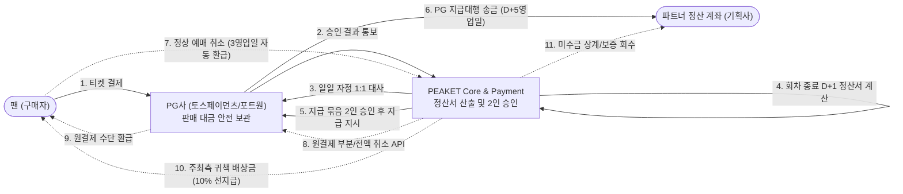
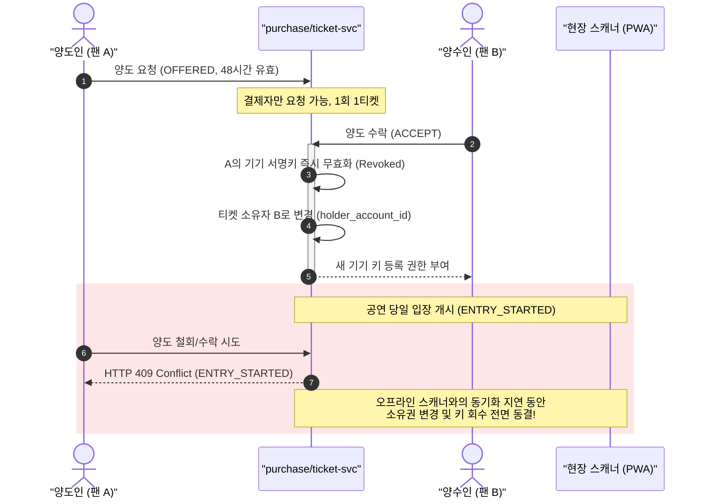
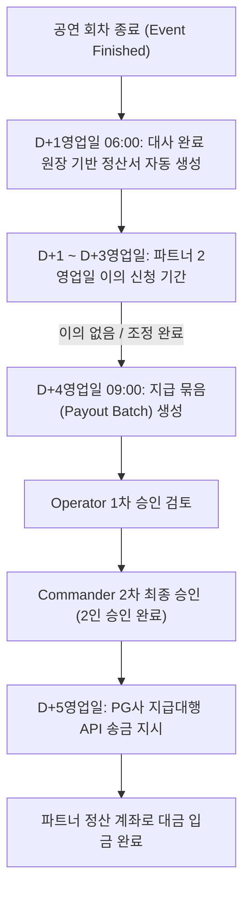

# 분야 편 12: 양도·환불·정산 (Transfer, Refund & PG Agency Settlement)

- **맡는 정본**: [docs/features/transfer-refund.md](../../features/transfer-refund.md)(양도·취소·환불 운영), [docs/features/settlement.md](../../features/settlement.md)(정산과 지급), [docs/planning/03-policies-glossary.md](../../planning/03-policies-glossary.md)의 POL-017·POL-032·POL-037·POL-038·POL-039, 관련 ADR(§4에 집대성)
- **문서 성격**: 정본 설계를 시스템 엔지니어링 및 기술 면접 관점에서 체계적으로 해설한 문서다. 규범적 수치와 불변 규칙의 최종 권위는 정본 문서에 있다([ADR-0177](../../adr/0177-walkthrough-explain-in-interview.md)). 길잡이는 [README.md](../README.md)다.
- **한 판 문서와의 관계**: [한 판 문서](../01-system-design.md) 1단계(판매 구조와 돈의 흐름), 10단계(승인 뒤 결제 취소), 14단계(양도와 현장 입장의 상태 불일치 방어), 15단계(저장소 원장 보존)에서 다룬 정산 및 양도 라이프사이클을 4대 핵심 메커니즘으로 심화 분해하고, 시스템 경계 규칙과 분산 정합성 모델을 완비한다.
- **아키텍처 목표와 검증 기준**: 정상 예매 취소 3영업일 이내 자동 환급 100%(전자상거래법 제18조 제2항), 티켓 양도 수락 시 이전 기기 키 즉시 폐기 및 중복 입장 0건, PG 지급대행 기반 D+5영업일 안전 정산, 지급 후 발생 환불에 대한 미수금 회수(상계 → 보증 → 청구) 100% 완결, 2인 승인(4-Eyes Principle) 기반 비정상 자금 이동 원천 차단을 핵심 목표이자 신뢰성 불변식으로 삼는다.

---

## 1. 양도·환불·정산 도메인 종합 개요

양도·환불·정산 도메인은 티켓 판매가 완료된 이후 최종 공연 관람 및 파트너 정산 완료 시점까지 발생하는 자금의 이동과 티켓 소유권의 변화를 관할한다. PEAKET은 전자상거래법상 **통신판매중개자** 지위를 보유하며, 판매 당사자인 공연 기획사(파트너)와 구매자인 팬 사이의 거래 신뢰를 보증한다.

> **30초 아키텍처 브리핑 (Staff Engineer Interview)**:  
> "PEAKET의 사후 거래 시스템은 **'통신판매중개자 지위 기반 책임 분리 + 정책 안 자동·정책 밖 승인(4-Eyes Principle) + 수락형 양도 및 입장 중 동결 + PG 지급대행 기반 자금 격리(D30)'**의 4대 원칙으로 설계되었습니다.  
> 첫째, **법적 지위와 책임 분리**: PEAKET은 직접 판매자가 아닌 중개자이지만, 취소·환불 책임을 법적으로 연대 부담합니다. 정상적인 취소 요청은 전자상거래법 제18조에 따라 사람의 개입 없이 3영업일 이내 원결제 수단으로 100% 자동 환급됩니다. 반면 30만 원 초과 예외 환불, 회차 취소, 지급 묶음 실행 등 비가역적 자금 이동은 반드시 2인 승인을 거칩니다.  
> 둘째, **수락형 양도와 오프라인 입장 보안**: 양도는 일방적 전달이 아닌 수락형(Offer-Accept) 트랜잭션으로 체결됩니다. 수탁자가 수락하는 즉시 이전 소유자의 기기 서명 공개키가 무효화되어 이전 QR이 즉시 거부됩니다. 특히 현장 입장이 개시되면 스캐너와 서버 간 동기화 지연으로 인한 이중 입장을 차단하기 위해 양도·수락·회수가 전면 동결(HTTP 409)됩니다.  
> 셋째, **PG 지급대행 기반 자금 격리(D30)**: 전자금융거래법 개정에 대응하여 판매 대금을 PEAKET 법인 계좌에 예치하지 않고 PG사가 직접 보관합니다. 회차가 종료된 후 대사가 완료된 원장을 바탕으로 D+5영업일에 PG사 지급대행 API를 통해 파트너 계좌로 직접 송금 지시합니다.  
> 넷째, **정산 후 환불 및 미수금 회수 체계**: 지급 완료 후 발생하는 취소나 차지백(Chargeback)은 PEAKET이 먼저 환불을 집행하고 미수금으로 계상한 후, 차기 정산서 상계 → 계약 보증금 실행 → 법적 청구의 3단계 파이프라인으로 안전하게 회수합니다."

### 자금 및 권리 흐름 종합 아키텍처



### 핵심 3대 서브시스템

1. **소유권 및 양도 라이프사이클 엔진 (`ticket-svc`)**:
   - 티켓 소유권자(`holder_account_id`)와 결제자(`buyer_account_id`)의 엄격한 분리 관리.
   - 수락형 양도 상태 머신(`OFFERED` → `ACCEPTED` / `REJECTED` / `WITHDRAWN` / `EXPIRED`).
   - 양도 수락 시 기존 기기 서명키 원자적 폐기 및 새 기기 공개키 등록 트리거.
   - 입장 개시(`ENTRY_STARTED`) 시점부터 입장 기록 마감까지 양도·회수 트랜잭션 전면 락.
2. **환불 및 보상 Saga 오케스트레이터 (`purchase-svc`)**:
   - 관람일 기준 취소 수수료 구간별 공제율 자동 산출(원 단위 미만 절사).
   - 결제자 본인의 원결제 수단 환급 집행 및 부분 취소 트랜잭션.
   - 회차 취소 시 2인 승인 기반 대규모 일괄 환불(Bulk Refund) 파이프라인.
   - 주최 측 귀책 공연 취소 시 결제 금액 10% 배상금 선지급 및 미수금 등록.
3. **정산 및 지급대행 코어 (`payment-svc` settlement 모듈)**:
   - 일일 자정 PG사 거래 대사 원장 기반 회차별·결제사별 정산서 생성 (종료 D+1 06:00).
   - 2영업일 이의 신청 기간 보장 및 2인 수기 조정(Adjustment).
   - 지급 묶음(Payout Batch) 생성 및 2인 승인(Operator 요청 + Commander 승인).
   - 토스페이먼츠 예약지급 및 포트원 지급 콘솔 사후 대사 파이프라인.

---

## 2. 절마다 읽기

역할 이름: `cs_agent`(CS 담당자), `cs_lead`(CS 책임자), `operator`·`commander`(관제 운영자 권한. commander가 회차 취소를 판정하고 2인 승인의 제2승인자를 맡는다).

**docs/features/transfer-refund.md**

| 정본 절 | 무엇을 정하나 | 왜 | 해설서에서 |
| --- | --- | --- | --- |
| §1 개요 | 법적 지위와 대원칙 셋: 정책 안이면 자동, 정책 밖이면 승인, 취소·환급 권한은 결제자에게만 | 정상 취소를 승인 없이 3영업일 안에 돌려줘야 전자상거래법 제18조 제2항을 지킨다. 되돌리기 어려운 돈과 권리의 이동에만 사람을 넣는다 | 한 판 1단계 |
| §2 판매 구조와 법정 의무 | 판매 승인(§2.1), 중개자 고지와 판매자 정보 7항목(§2.2), 분쟁 처리 기한(§2.3), 공연예술통합전산망 전송(§2.4), 공연법 부정판매 방지(§2.5) | 법이 요구하는 일이 FR-053·054·057이 되었다(ADR-0045). 판매자 정보는 청약(구매 신청) 전까지 줘야 해 결제 직전 화면에 늘 보인다(§20②) | 한 판 1단계 |
| §2.1 판매 승인 | 확인 항목 여섯, operator 1인 승인, 판매 중지(SUSPENDED)와 재개 | 판매자와 표시 사항을 확인할 곳이 필요하다. 조건을 고치면 판매 대행형(남의 상품을 자기 이름으로 파는 형태)으로 볼 여지가 커져 고치지 않는다 | 한 판 1단계 |
| §3 권리와 상태 규칙 | 결제자(바뀌지 않는다)와 보유자, 일마다 허용 조건, 티켓 행 잠금(그 행을 잠가 한 번에 한 요청만 고친다) 안의 판정 | 권한을 결제자 하나에 묶는다. 입장 중에는 오프라인 기록이 늦게 올라와 서버가 누가 들어갔는지 모르므로 소유권과 키를 바꾸지 않는다(ADR-0051) | 한 판 14·15단계 |
| §3.2 승인 업무 종류 | 건 종류마다 요청자, 승인 인원(1인·2인), 기한 | 승인은 돈이나 소유권이 정책 밖으로 움직이는 건에만 둔다. 금액과 되돌릴 수 있는지로 인원을 나눈다(ADR-0046) | — |
| §4 양도 흐름 | 수락형 양도, 돌려주기(받은 사람이 결제자에게 되돌리는 일), 회수(탈취로 넘어간 표를 되돌리는 일), 키 폐기, 멱등키(같은 요청이 두 번 와도 한 번만 처리하게 하는 키) | 수락하면 보낸 사람 키를 바로 폐기해 옛 QR을 막는다. 팬 쿠키가 `SameSite=Strict`라 메일 앱에서 온 첫 요청에는 쿠키가 실리지 않는다 | 한 판 14단계 |
| §4.1 부정 예매 양도 잠금 | 부정 예매(매크로·명의 대여처럼 약관이 정한 부정한 예매)의 소명(의심받은 사람이 해명하는 절차)을 요청하면 양도만 잠그고, 일곱 때 가운데 먼저 오는 때 푼다 | 소명 동안 의심 표가 넘어가 되팔리지 않게 한다. 범위와 기간을 한정해 약관법 제10조 제2호·제11조 제3호를 피한다(해석, ADR-0173) | — |
| §5 회차 취소와 일괄 환불 작업 | 요청 → 판정 → 2인 확정 → 결제사별로 나눠 실행, 결제사 몫(작업을 결제사마다 나눈 부분)마다 자동 정지, 연기, 진행 중 양도 철회 | 파트너 한 명이 회차 전체를 환불하고 귀책(책임이 누구에게 있는지)을 스스로 고르던 문제를 막는다(ADR-0046). 되돌릴 수 없는 돈이라 자동으로 다시 열지 않는다 | 한 판 10단계(승인 뒤 결제 취소의 한 경우) |
| §6 배상 지급 | 결제 금액의 10%, PEAKET이 먼저 송금하고 미수금으로 회수, 계좌는 저장하지 않는다 | 결제 취소로는 결제액보다 많이 돌려줄 수 없어 계좌 입금으로 한다. 파트너가 직접 주면 팬이 따로 연락해야 하고 민원은 예매처로 온다(ADR-0046) | — |
| §7 승인 업무, CS 처리함, 권한과 노출 필드 | CS 처리함 건 종류와 기한, 소명이 들어오는 길(§7.1), 역할과 보이는 칸(§7.3) | ops-svc는 팬 요청을 받지 않는 독립 제어 평면이라 소명은 core-svc support 모듈이 받는다. 받는 사람에게 결제 금액을 보이지 않는다 | 한 판 11단계(CS 처리함은 ops-svc) |
| §7.2 승인 업무 | 상태도와 전이 표 T1~T16, 철회·만료, 부정 예매 조치의 실질 승인 | 철회·만료가 있어야 알림이 되풀이되거나 늦은 승인 뒤 실행에서야 실패하는 일이 준다. 부정 예매 승인은 형식적 결재가 되지 않게 한다 | — |
| §7.4 부정 예매 조치의 실행 | 표 취소와 공제 없는 전액 환급, 이용 제한, 이의 인정 뒤 우선 구매(같은 좌석이나 등급을 원래 가격에 다시 살 권리) | 취소한 좌석이 정가로 다시 팔려 실제 손해가 거의 없고, 그것을 넘는 위약금은 무효 위험이 크다(약관법 제8조, 민법 제398조) | — |
| §8 로그와 감사 | 이벤트마다 남기는 것과 남기지 않는 것 | 연락처, 계좌번호 전체, 진단명은 남기지 않는다. 감사 로그는 추가만 한다 | — |
| §9 예외 상황 대응표 | 경합·탈퇴·장애 15가지 | 한 티켓의 경합은 행 잠금으로 하나만 성공한다. 입장한 받은 사람의 돌려주기를 막아 표 한 장에 두 명이 들어가지 않게 한다 | — |
| §10 데이터·API 참조 | ticket·purchase·ops·core DB의 표, 내부 gRPC, 이벤트, 화면 | 양도는 ticket, 취소·배상은 purchase, 승인 업무·CS는 ops, 판매자 정보와 소명 글은 core에 둔다 | 한 판 15단계 |
| §11 테스트 포인트 | R-T1~R-T35 | 양도와 입장의 규칙은 기능 시험 전에 `entry` 명세를 규칙 모델 검사(일어날 수 있는 순서를 기계로 모두 따지는 검사)로 본다 | — |
| §12 미결정·[가정] | 자체 기준 숫자, 송금 어댑터, 전산망 규격, 부정 예매 환급의 정산 처리 | 숫자는 운영 데이터로 조정한다. 팬 배상은 PEAKET 자기 돈 이체라 지급대행과 따로 고른다 | — |

**docs/features/settlement.md**


| 정본 절 | 무엇을 정하나 | 왜 | 해설서에서 |
| --- | --- | --- | --- |
| §1 개요 | 대금을 PEAKET 계좌에 두지 않는 구조, PEAKET의 세 역할(정산서, 지급 승인·지시, 미수금), 결제사별 분리 정산 | 결제사가 정산대상금액(보관 중인 판매 대금)을 따로 관리할 의무를 진다(전자금융거래법 제25조의4, 2026-12-17 시행). 한 회차 대금이 두 결제사에 나뉠 수 있다 | 한 판 1단계 |
| §2 돈의 흐름과 책임 | 결제사·PEAKET·파트너의 일, PEAKET 몫, 배상 송금은 따로 | PEAKET 몫을 결제사에서 받는 방식은 공개 문서에 없어 계약 때 정한다 | 한 판 1단계 |
| §3 결제사 지급대행 등록 | 판매 승인 때 두 결제사에 등록, 예금주 이름 비교 규칙 | 판매 중에도 결제사 전환이 일어날 수 있다(ADR-0047 결정 2). 계좌는 은행과 끝 4자리만 둔다 | — |
| §4 정산서 | 다음 영업일 06시 계산과 지급액 식(§4.1), 2영업일 이의(§4.2), 2인 수기 조정(§4.3), 열 상태(§4.4) | 대사(두 기록을 맞춰 보는 일)가 끝난 원장(거래 장부)만 쓴다. 알린 금액을 덮어쓰지 않으려고 계산 뒤 환불은 보통 미수금으로 잡고, 다시 계산하면 옛 판을 남긴다 | — |
| §4.5 상품 정산서 | 굿즈·부가 상품은 주 단위 상품 정산서, 정산 기준일 | 회차 정산서는 공연 리포트에서 판매 금액과 원 단위로 맞추는 대상이라 섞지 않는다 | — |
| §5 지급 실행 | 회차 종료 5영업일 뒤 지급, 은행 영업일 달력, 잔액 확인, 지급 묶음 2인 승인(§5.1), 계산 원본은 정산서 하나(§5.4) | 결제사는 지급한 돈을 되돌려 주지 않는다. 취소·환불과 배상 상계(줄 돈에서 받을 돈을 빼고 남는 만큼만 주고받는 것)가 끝난 뒤 보내야 돌려받을 일이 준다(ADR-0047 결정 4) | — |
| §5.2·§5.3 결제사별 실행 | 토스페이먼츠는 예약지급(정한 날에 보내도록 미리 거는 지급), 포트원은 수기 정산건과 콘솔 일괄 지급, 출금 대사 | 토스페이먼츠는 요청 중 한 건이 틀리면 전체가 실패해 요청당 20건으로 줄인다. 포트원은 지급 생성 API가 없고 콘솔에 '지급 실행만' 역할이 없어 사후 대사가 주 통제다(ADR-0108) | — |
| §5.5 지급대행 잔액 대사 | 장부의 '있어야 할 잔액'과 결제사 잔액 맞추기, 결제사 사이 상계 금지 | 건별 대사로는 결제사에 남는 돈이 맞는지 모른다. 다른 결제사에서 상계하면 한쪽 잔액이 모자랄 수 있다 | — |
| §6 보류와 KYC, 정산 계좌 변경 | 보류 사유 여섯, KYC(결제사의 고객 신원 확인) 안내와 재개, 계좌 변경 절차 | 계좌 변경 뒤 3영업일 보류는 같은 명의의 다른 계좌로 바꾼 경우에 알아챌 시간을 준다(ADR-0047 결정 6) | — |
| §7 지급 뒤 환불·카드 이의제기와 미수금 | 미수금이 생기는 네 경우(카드 이의제기는 카드 회사에 결제를 문제 삼는 것), 수수료 몫 빼기, 회수 순서, 이동 기록 | 결제사가 지급한 돈을 돌려주지 않아 PEAKET이 먼저 부담한다. 파트너는 수수료를 뗀 금액만 받았으므로 그만큼만 돌려받는다 | — |
| §8 보안·비밀·로그 | 결제사 키 보관과 교체, JWE(암호화한 요청 본문), 웹훅 서명, 계좌 처리, 시험 환경 | 웹훅(상대 서버가 우리 주소를 불러 알리는 방식) 서명이 맞아도 단건 조회로 확정한다. 라이브 지급은 수수료가 붙어 시험하지 않는다 | — |
| §9 화면과 권한 | 정산 화면, 역할마다 할 수 있는 일 | CS 담당자에게는 '정산 이의' 건만 보인다(소유자 결정 2026-10-30). 서버가 `promoter_id`로 소유자를 검사한다 | — |
| §10 데이터·API·이벤트 참조 | payment·core·ops DB의 표, 결제사 API, `trade.settlements`, 보존 | 정산서·지급·미수금 기록은 5년 보관한다(전자상거래법 시행령 §6①3호) | 한 판 15단계 |
| §11 관측과 경보 | 지급 지연·실패·미승인·서명 불일치·출금 불일치 지표 | 정본에 따로 적은 이유는 없다. 보안에 닿는 것은 SEV2(보안), 지급 지연·실패는 SEV3로 나눈다(SEV는 장애 심각도 등급, 숫자가 작을수록 심각하다) | — |
| §12 예외 상황 대응표 | 회차 취소가 겹친 때, 지급 실패의 세 갈래, 결제사 장애 | 실패 이유마다 할 일이 달라 계좌 문제·점검·한도로 나눈다. 표에 없는 코드는 사람이 본다 | — |
| §13 테스트 포인트 | J-T1~J-T27 | 계산 예시(J-T1·J-T11)와 정산 불변식 SQL(늘 참이어야 할 돈의 식을 보는 쿼리)로 확인한다 | — |
| §14 미결정·한계 | 계약 때 확인할 것, 세무, 법률 해석, 포트원 콘솔의 남는 한계 | 공개 문서에 없는 조건은 계약 때 정한다. '지급 지시는 전자지급결제대행이 아니다'는 해석이다(POL-027) | 한 판 1단계(수수료율 미정) |

---

## 3. 양도·환불·정산 핵심 메커니즘 심화

```
                                  [양도·환불·정산 4대 핵심 아키텍처]
  ┌───────────────────────────┬───────────────────────────┬───────────────────────────┬───────────────────────────┐
  │   모듈 1: 법정 환불 자동화   │   모듈 2: 수락형 양도 보안  │   모듈 3: PG 지급대행 정산 │   모듈 4: 미수금 회수 보증│
  ├───────────────────────────┼───────────────────────────┼───────────────────────────┼───────────────────────────┤
  │ • 전자상거래법 3영업일 환급 │ • 1:1 수락형 소유권 이전  │ • PG사 자금 분리보관(D30) │ • 선지급 후 취소 리스크   │
  │ • 관람일 구간별 취소 공제율 │ • 수락 시 기존 기기키 폐기│ • 회차 종료 D+1 정산서   │ • PEAKET 선부담 환급 완결 │
  │ • 원 단위 미만 절사 계산   │ • 입장 개시 시 양도 전면락│ • 2영업일 이의 신청 기간  │ • 차기 상계→보증금→청구  │
  │ • 결제자 원결제수단 환급   │ • 409 ENTRY_STARTED 차단  │ • 지급 묶음 2인 승인(D+5) │ • 파트너 미수금 영구 방어 │
  └───────────────────────────┴───────────────────────────┴───────────────────────────┴───────────────────────────┘
```

---

### 모듈 1: 법정 예매 취소 및 구간별 환불 자동화 (POL-032)

#### 1. 문제 정의 및 법적 규제
전자상거래 등에서의 소비자보호에 관한 법률 제18조 제2항에 따라 통신판매업자 및 중개자는 소비자의 유효한 청약철회 및 계약 취소 접수일로부터 3영업일 이내에 이미 지급받은 대금을 환급해야 한다. 사람이 일일이 결재하고 확인하는 수동 프로세스는 3영업일 준수를 불가능하게 만들며, 위약금 계산식의 오차는 분쟁과 소송을 야기한다.

#### 2. 취소 수수료 공제율 및 정수 계산 불변식
공정거래위원회 고시 소비자분쟁해결기준(공연업)을 엄격히 준수하여 관람일 기준 취소 수수료 상한을 적용한다:
- **관람일 10일 전까지**: 취소 수수료 없음 (전액 환급).
- **관람일 7일 전까지**: 티켓 정가의 10% 공제.
- **관람일 3일 전까지**: 티켓 정가의 20% 공제.
- **관람일 1일 전까지**: 티켓 정가의 30% 공제.
- **공연 당일 시작 전까지**: 티켓 정가의 90% 공제. (공연 시작 이후 취소 불가).
- **예외적 전액 환급(청약철회)**: 예매 후 24시간 이내 취소 시 관람일 3일 전까지 전액 환급, 예매 후 7일 이내이고 관람일 10일 이상 남은 경우 전액 환급.

```
공제액 = floor(티켓 정가 × 공제율)
최종 환급액 = 실제 결제 금액 − 공제액
```
모든 금융 계산은 부동 소수점 오차를 원천 차단하기 위해 원 단위 미만을 절사(`floor`)하며, 환급 예상 견적서(`RefundQuote`), 실제 카드 부분 취소 금액, 정산 장부의 환급 집계가 단 1원의 오차도 없이 원자적으로 일치하도록 보장한다.

---

### 모듈 2: 수락형 티켓 양도와 오프라인 현장 입장 보안 (POL-017, ADR-0051)

#### 1. 일방적 푸시 양도의 위험성과 수락형(Offer-Accept) 모델
기존 티켓 플랫폼의 일방적 번호 전송 방식은 번호 오입력 시 회수가 불가능하고, 제3자 탈취 위험이 존재한다. PEAKET은 1:1 수락형 양도 모델을 채택한다:
1. 결제자 본인이 받는 사람의 전화번호/식별정보를 지정하여 양도 요청(`OFFERED`).
2. 수락 유효기한은 `min(요청 후 48시간, 공연 시작 2시간 전, 입장 개시 시점)` 중 가장 이른 시점으로 고정.
3. 받는 사람이 마이 티켓에서 명시적으로 [수락] 버튼을 눌러야만 소유권(`holder_account_id`)이 변경됨.

#### 2. 양도 체결 시 기기 서명키 무효화 및 입장 중 동결 (ADR-0051)
양도가 체결되는 순간 이전 소유자의 브라우저 WebCrypto 키페어는 즉시 폐기 목록에 등재되고 서버에서 무효화된다. 따라서 이전 소유자가 화면을 캡처해 두었거나 오프라인 QR을 들고 입장하더라도 스캐너에서 즉시 거부된다.



> **입장 중 동결(Freeze during Gate Admission)의 필연성**:  
> 게이트 스캐너는 인터넷이 두절된 오프라인 환경에서도 P-256 서명 검증으로 관객을 입장시킨다. 스캐너의 로컬 입장 기록은 60초 배치로 지연 업로드되므로, 입장이 진행되는 동안 양도·수락·회수·돌려주기를 허용하면 'A가 입장한 직후 B에게 양도하여 B가 다른 문으로 또 입장하는' 이중 입장을 실시간으로 막을 수 없다. 따라서 입장 개시 시점부터 입장 기록 최종 마감 시점까지 모든 양도 관련 API는 HTTP 409로 원천 차단된다.

---

### 모듈 3: PG 지급대행 기반 D+5 안전 정산과 2인 승인 (POL-039, ADR-0047, D30)

#### 1. 전자금융거래법 제25조의4와 판매 대금 분리 보관 의무
2026년 12월 17일 시행되는 전자금융거래법 개정안은 전자지급결제대행업자 및 중개 플랫폼의 정산대상금액 별도 예치 의무를 강력히 부과한다. 플랫폼 법인 통장에 수십억 원의 판매 대금을 예치한 후 파트너에게 송금하는 방식은 자금 유용 및 파산 시 관객 환불 불가 리스크를 발생시킨다.  
PEAKET은 **PG사 지급대행(Settlement via PG Agency)** 방식을 채택하여 판매 대금을 토스페이먼츠 및 포트원 내부 정산 가상계좌에 온전히 보관한다. PEAKET 서버는 자금을 직접 만지지 않고, 정산서 계산과 지급 승인 지시만을 수행한다.

#### 2. D+5영업일 지급 타임라인과 2인 승인 파이프라인



1. **D+1영업일 06:00 정산서 자동 산출**: PG사 일일 대사(Reconciliation)가 완료된 원장만을 집계하여 회차별 정산서를 산출한다.
   $$\text{최종 지급액} = \text{판매 총액} - \text{환불 누적액} - \text{중개 수수료} - \text{수수료 부가세(10\%)} - \text{기존 미수금 상계액}$$
2. **2영업일 이의 신청 보장**: 파트너는 정산서 통지 후 2영업일 동안 상세 내역을 열람하고 이의를 제기할 수 있으며, 금액 조정이 필요한 경우 `cs_lead` 요청과 `commander` 승인의 2인 승인으로만 수기 조정된다.
3. **지급 묶음(Payout Batch) 2인 승인**: D+4영업일 09:00에 생성된 지급 묶음은 반드시 15:00 전까지 `operator` 1차 검토와 `commander` 2차 승인을 거쳐야 한다. 미승인 시 다음 영업일로 지급이 자동 이월된다.

---

### 모듈 4: 정산 후 환불 대응과 미수금(Receivables) 회수 체계 (POL-039, ADR-0047)

#### 1. 정산 완료 후 환불 발생 시의 금융 딜레마
회차 종료 D+5영업일에 파트너에게 대금 지급이 완료된 후에도 신용카드 부정 사용 이의제기(Chargeback), 주최측 귀책 지연 확인, 예외적 고객센터 보상 환불이 발생할 수 있다. PG사는 이미 파트너 계좌로 송금된 돈을 강제로 회수해 오지 않는다.

#### 2. 3단계 미수금 회수 파이프라인
PEAKET은 소비자의 권익 보호를 위해 사후 환불 건에 대해 **플랫폼이 100% 자금을 먼저 부담하여 팬에게 즉각 환급**한다. 그리고 파트너에 대해 발생한 정산 반환 채무를 '미수금'으로 확정하고 다음의 엄격한 3단계로 회수한다:

```
[지급 후 취소 발생] ──> PEAKET 선부담 팬 전액 환급 ──> 미수금 원장 기록
                                                               │
┌──────────────────────────────────────────────────────────────┘
│ 1단계: 차기 정산서 상계 (Offsetting)
│   • 파트너의 동일 PG사 차기 정산서에서 미수금을 우선 차감.
│   • 30일 이내에 상계 가능한 정산서가 존재하는 경우 자동 정산 완료.
▼
│ 2단계: 계약 보증금 실행 (Guarantee Enforcement)
│   • 30일 이내 차기 정산서가 없거나 잔액이 부족한 경우 계약 이행 보증금에서 우선 차감.
▼
│ 3단계: 법적 지급 청구 (Legal Claim & Dispute)
    • 보증금 한도 초과 또는 미회수 잔액에 대해 내용증명 및 법적 지급 청구 절차 개시.
```

- **미수금 산출식**: 파트너가 실제로 수령했던 금액만을 회수해야 하므로, 수수료 몫을 제외한 순수 지급 원금만 미수금으로 계상한다.
  $$\text{미수금} = \text{환불 금액} - \text{해당 수수료} - \text{수수료 부가세}$$
  (예: 50만 원 환불, 수수료 10% 시 파트너가 받았던 44만 5천 원만 미수금으로 청구).

---

## 4. 트레이드오프 및 아키텍처 결정 (ADR)

| ADR 번호 | 아키텍처 결정 (Chosen) | 기각된 대안 (Rejected) | 핵심 트레이드오프 및 채택 사유 |
| --- | --- | --- | --- |
| **ADR-0045** | **통신판매중개자 지위 + 취소/환불 공동 책임** | PEAKET 직접 판매 당사자 모델 / 순수 중개 면책 모델 | 파트너 부도 시 관객 보호 불가 위험을 차단하고, 공연 이행 자체의 귀책은 기획사에 두면서 결제 환급 책임만 플랫폼이 연대 부담함. |
| **ADR-0046** | **정책 안 자동 환급 + 정책 밖 2인 승인** | 모든 취소 수동 결재 / 전면 자동화 | 3영업일 법정 환급 기한 준수와 횡령·부정 환불 방지 간의 균형. 30만 원 초과 및 비가역적 자금 이동에 4-Eyes Principle 적용. |
| **ADR-0047** | **PG사 지급대행(D30) 기반 D+5 정산** | PEAKET 직접 정산 / 선지급 모델 | 전자금융거래법 제25조의4 준수. 플랫폼 파산 시에도 관객 판매 대금이 안전하게 보호되며, 공연 종료 후 지급으로 미수금 위험 최소화. |
| **ADR-0051** | **현장 입장 개시 시 양도/수락/회수 전면 동결** | 입장 중 실시간 양도 허용 | 오프라인 PWA 스캐너와의 동기화 지연(최대 수 분) 동안 동일 티켓으로 2명이 입장하는 사기를 수학적으로 원천 방어함. |
| **ADR-0108** | **포트원 콘솔 일괄 지급 및 사후 출금 대사** | 포트원 수기 즉시 지급 | 포트원 API에 지급 자동화 엔드포인트가 부재한 제약을 극복하기 위해, 콘솔 집행 후 30분 주기 출금 대사 파이프라인으로 이상 탐지. |
| **ADR-0123** | **판매 중지(SUSPENDED) 2인 승인 통제** | 단독 운영자 즉각 판매 중지 | 허위 신고로 인한 정상 공연 판매 중단 피해를 방지하고, 판매 중지 시 지급 보류와 연계하여 파트너 자금 탈루를 사전 차단함. |
| **ADR-0173** | **부정 예매 양도 잠금 최대 14일 한정** | 무기한 양도 잠금 / 자동 예매 취소 | 약관규제법 제10조 제2호 위반 위험을 방어하고, 소명 기회를 실질적으로 보장하면서 암표 전매만을 효과적으로 차단. |

---

## 5. 5단 심층 기술 면접 방어 (Staff/Principal Level Q&A)

### Tier 1: 플랫폼의 법적 지위와 환불 책임의 분리 원리
> **면접관**: "PEAKET은 티켓을 직접 팔지 않는 통신판매중개자인데, 왜 환불을 파트너에게 미루지 않고 플랫폼이 직접 환급을 집행하고 책임집니까?"

**답변**:  
"전자상거래법 제20조의2 및 소비자 분쟁 판례에 따르면, 중개 플랫폼이라 할지라도 대금의 수납과 결제 시스템을 독점적으로 제공하고 청약 접수를 대행하는 경우 청약철회에 따른 대금 환급 의무를 판매자와 함께 연대 부담합니다.  
만약 환불 책임을 영세 기획사나 파트너에게 전가하면, 파트너의 자금난이나 부도 시 수만 명의 팬이 환불을 받지 못해 대규모 소비자 피해와 집단 소송이 발생합니다.  
따라서 PEAKET은 **'청약 접수 및 대금 환급은 플랫폼이 전적인 책임을 지고 자동화하되, 공연의 개최·변경·취소 등 본질적 채무 불이행 책임은 파트너가 진다'**는 명확한 이원화 모델(ADR-0045)을 구축했습니다. 이를 통해 법적 합목적성과 고객 신뢰를 동시에 확보합니다."

### Tier 2: 양도 수락 시 이전 기기 서명키 무효화와 이중 입장 차단
> **면접관**: "티켓 양도가 체결되었을 때, 이전 소유자가 저장해 둔 이전 QR 코드로 입장하는 것을 어떻게 방지합니까?"

**답변**:  
"PEAKET의 모바일 티켓은 정적 바코드가 아니라, 사용자 기기의 Secure Enclave/IndexedDB에 보관된 **ECDSA P-256 개인키로 15초마다 새로 서명하는 회전 QR**입니다.  
양도가 수락(`ACCEPTED`)되는 트랜잭션이 커밋되면, 서버는 즉시 양도인의 등록된 기기 공개키를 폐기 목록(`revoked_keys`)에 추가하고 상태를 무효화합니다.  
온라인 게이트는 폐기 목록을 즉시 조회하여 거부하며, 오프라인 게이트 역시 60초 주기로 수신하는 변경분(Delta Sync)을 통해 폐기된 키를 로컬 DB에 반영합니다.  
특히 **현장 입장이 시작된 이후에는 양도 트랜잭션 자체가 HTTP 409(`ENTRY_STARTED`)로 전면 동결**되므로, 스캐너와 서버 간 동기화 지연을 틈타 표를 넘기고 들어가는 어뷰징이 물리적으로 불가능합니다."

### Tier 3: PG사 지급대행(D30) 채택 배경과 자금 격리
> **면접관**: "판매 대금을 PEAKET 법인 통장으로 받아 두었다가 수수료를 떼고 파트너에게 계좌 이체해 주면 이자 수익도 생기는데, 왜 굳이 PG사 지급대행을 씁니까?"

**답변**:  
"**2026년 12월 시행되는 개정 전자금융거래법 제25조의4(정산자금 보호) 준수와 자금 횡령 리스크 차단** 때문입니다.  
수백억 원에 달하는 대규모 온세일 판매 대금을 플랫폼 일반 계좌에 혼합 보관(Co-mingling)하면, 플랫폼의 다른 사업적 위험이나 파산 시 관객의 티켓 환불 자금이 압류되거나 동결될 수 있습니다.  
PG 지급대행 모델을 사용하면 판매 대금은 결제사(토스페이먼츠 등)의 법정 에스크로 계좌에 독립 보관되며, PEAKET은 정산서 산출과 지급 승인 지시만을 수행합니다. 이는 플랫폼의 자금 관리 리스크를 0으로 만들고, 전자금융업 등록 규제 리스크를 완전히 해소하는Staff 레벨의 선제적 컴플라이언스 설계입니다."

### Tier 4: 정산 지급 완료 후 발생한 환불/차지백의 미수금 회수
> **면접관**: "D+5영업일에 파트너에게 정산금을 이미 다 보냈는데, 일주일 뒤 고객센터에서 시스템 오류가 확인되어 환불해 주어야 하거나 카드사에서 부정 사용 차지백이 들어왔습니다. 이 돈은 어떻게 회수합니까?"

**답변**:  
"PG사는 이미 송금된 지급대행 자금을 되돌려주지 않으므로, **PEAKET이 먼저 팬에게 전액 환불을 집행한 뒤 파트너에 대해 '미수금(Receivables)' 채권을 확정**합니다(settlement §7).  
이때 미수금 금액은 파트너가 실제로 수령했던 순수 원금(환불액 − 중개수수료 몫)으로 계산됩니다.  
회수는 3단계 파이프라인으로 집행됩니다:  
1단계로 해당 파트너의 동일 PG사 차기 정산서에서 자동 상계합니다.  
2단계로 30일 이내에 상계할 정산서가 없으면 공연 판매 승인 시 예치받은 계약 이행 보증금(회차 매출의 10%)에서 집행합니다.  
3단계로 보증금 한도를 초과하는 경우 법적 지급 청구 절차를 밟습니다. 이 과정은 데이터베이스 원장에 완전한 복식부기 감사 로그로 영구 추적됩니다."

### Tier 5: 회차 취소로 인한 대규모 일괄 환불 시 PG사 장애 격리
> **면접관**: "태풍으로 5만 석 규모 대형 콘서트가 취소되어 수만 건의 결제를 일괄 취소해야 합니다. PG사 호출이 폭증하여 실패하거나 타임아웃이 나면 어떻게 파이프라인을 복구합니까?"

**답변**:  
"회차 취소 일괄 환불은 결제사 단위로 파티셔닝된 독립 백그라운드 워커에 의해 청크 단위(초당 50~100건)로 분할 집행됩니다.  
핵심 방어선은 **결제사별 서킷 브레이커와 자동 일시 정지 메커니즘**입니다:  
1분 윈도우 내 호출 실패율이 5%를 초과하거나 연속 20건 실패 시 해당 결제사의 환불 작업만 자동으로 `PAUSED` 상태로 격리되며 관제탑에 SEV2 경보를 발령합니다.  
각 환불 요청은 고유한 멱등키 `cancel-{cancellationId}`를 동반하므로, 타임아웃으로 인한 재시도 시에도 이중 환불이 100% 차단됩니다.  
결제사 장애가 복구되면 Commander의 수동 명령으로 안전하게 중단 지점부터 재개됩니다."

---

## 6. 꼭 기억할 규칙과 핵심 수치

| 항목 | 규범적 기준값 | 설계 근거 및 법적 출처 |
| --- | --- | --- |
| **직접 취소 법정 환급 기한** | 접수일로부터 **3영업일 이내** 100% 완료 | 전자상거래법 제18조 제2항, transfer-refund §1 |
| **취소 공제율 상한** | 10일 전 0%, 7일 전 10%, 3일 전 20%, 1일 전 30%, 당일 90% | 공정위 소비자분쟁해결기준, POL-032 |
| **원 단위 미만 절사** | 공제액 및 환급액 산출 시 원 미만 버림(`floor`) | 금융 대사 불변식 일치, POL-032 |
| **티켓 양도 마감 시한** | `min(공연 시작 2시간 전, 현장 입장 개시 시점)` | transfer-refund §3.1, ADR-0051 |
| **양도 수락 유효 시한** | `min(양도 요청 후 48시간, 양도 마감 시한)` | 자체 안전 기준, transfer-refund §4 |
| **입장 중 양도 동결** | 입장 시작부터 기록 마감까지 양도·수락·회수 전면 차단 (HTTP 409) | 오프라인 검표 이중입장 방어, ADR-0051 |
| **승인 업무 1인 vs 2인 기준** | **30만 원 이하** 재량 환불 1인(`cs_lead`), **30만 원 초과** 또는 2회차 이상 2인(`commander`) | 부정 환불 방지, ADR-0046, POL-038 |
| **주최측 귀책 배상금** | 결제 금액의 **10%** (원 단위 올림 `ceil`, PEAKET 선지급) | 소비자분쟁해결기준 공연업, transfer-refund §6 |
| **정산서 자동 계산 시점** | 회차 종료 다음 영업일 **06:00 KST** | PG사 대사 원장 확정 후 산출, settlement §4.1 |
| **정산 이의 신청 기간** | 정산서 통지 후 **2영업일** (조정 재통지 시 1영업일) | 파트너 권리 보장, settlement §4.2 |
| **기본 대금 지급일** | 회차 종료일로부터 **5영업일 뒤 (D+5)** | 환불 및 미수금 정산 후 잔액 송금, ADR-0047 |
| **지급 묶음 2인 승인 시한** | 지급일 전 영업일 09:00 생성 ~ **15:00 승인 완료** (Operator + Commander) | 은행 영업 시간 준수, settlement §5.1 |
| **토스페이먼츠 지급 요청 청크** | 1건 10억 원 미만, 1회 요청당 **최대 20건** 분할 송금 | 단건 오류 시 전체 롤백 방지, settlement §5.2 |
| **정산 계좌 변경 안전 장치** | TOTP 재인증 필수, 예금주명 일치 검증, **변경 후 3영업일간 지급 자동 보류** | 계정 탈취 후 정산금 횡령 방어, ADR-0047 |
| **일괄 환불 자동 정지 조건** | 결제사별 1분 창 실패율 5% 초과 또는 **연속 20건 실패** 시 서킷 오픈 | 외부 PG사 폭주 방어, transfer-refund §5 |
| **미수금 회수 순서** | **차기 정산서 자동 상계 → 계약 이행 보증금 실행 → 법적 청구** | 플랫폼 자금 대손 방어, settlement §7 |

---

## 7. 시스템 경계 및 책임 매핑

| 이 도메인이 정하지 않는 영역 | 담당 도메인 및 정본 문서 | 연계 인터페이스 및 경계 규칙 |
| --- | --- | --- |
| **원결제 승인 및 2단계 결제 트랜잭션** | docs/features/payment.md (분야 11) | `purchase_order`, `seat_sale` SOLD 상태 전이 및 결제 멱등키 공유 |
| **오프라인 게이트 P-256 서명 검증 및 폐기 목록 수신** | docs/features/offline-gate.md (분야 13) | `revoked_keys` 델타 동기화 및 입장 마감(`gate_closed`) 이벤트 수신 |
| **부정 예매 탐지 머신러닝 및 사건 작업대** | docs/features/forensic-replay.md (분야 17) | 사후 포렌식 결과에 따른 양도 잠금(`LOCK_TRANSFER`) 및 소명 파이프라인 |
| **비상 운영 명령 3(판매 일시정지) 및 명령 6(결제사 전환)** | docs/features/control-tower.md (분야 16) | 관제탑 제어 gRPC를 통한 실시간 티켓 판매 및 환불 큐 강제 통제 |
| **공연예술통합전산망(KOPIS) 일일 예매 내역 전송** | docs/features/transfer-refund.md §2.4 | 대사 완료 원장 기반 매일 04:00 암호화 파일 자동 전송 스케줄러 |
| **파트너 정산 계좌 및 사업자 등록 진위 확인** | docs/features/settlement.md §3 | PG사 지급대행 등록 API 및 금융결제원 예금주 실명조회 연동 |

---

## 8. 실전 확인 문제 및 모범 답안

### 문제 1
결제자 A가 친구 B에게 티켓을 양도하여 B가 마이 티켓에서 수락을 완료한 상태이다. 이후 공연 주최 측의 사정으로 공연 전체가 취소되었다. 환불금은 누구에게 가며, 만약 취소 시점에 양도 요청이 수락 대기 중(`OFFERED`)이었다면 시스템은 어떻게 처리하는가?

<details><summary>모범 답안</summary>

환불금은 현재 티켓을 보유한 B가 아니라 **원결제를 진행한 결제자 A의 원결제 수단으로 100% 자동 환급**됩니다. 양도받은 B는 티켓에 대한 금융 결제 주체가 아니므로 환불 수령 권한이 없습니다.  
만약 회차 취소 확정 시점에 양도 요청이 `OFFERED` 상태였다면, 회차 일괄 환불 Saga가 티켓 행 잠금(`SELECT ... FOR UPDATE`) 하에서 양도 요청을 사유 `EVENT_CANCELLED`와 함께 즉시 시스템 철회(`WITHDRAWN`) 처리합니다. 그리고 같은 트랜잭션에서 결제자 A에게 전액 환불을 접수합니다. 양도 수락과 회차 취소가 경합할 경우 행 잠금을 먼저 획득한 쪽이 우선하며, 어느 경우든 결제자 A에게 단 1회만 정확히 환급됩니다.

</details>

### 문제 2
판매 대금 3,000만 원, 취소 환불 200만 원, 중개 수수료율 10%인 회차의 정산이 완료되어 파트너 계좌로 지급대행이 완료되었다. 이후 고객센터를 통해 예외 환불 50만 원이 추가로 승인되었다. PEAKET이 파트너에게 청구할 미수금은 얼마이며 어떻게 회수하는가?

<details><summary>모범 답안</summary>

1. **지급 시점 정산액**: 판매 대금 3,000만 원 − 환불 200만 원 = 순매출 2,800만 원. 수수료 280만 원 + 부가세 28만 원(합계 308만 원)을 공제하여 파트너에게 2,492만 원이 지급되었습니다.
2. **사후 환불에 따른 미수금 계산**: 추가 환불 50만 원에 대해 파트너가 실제로 수령했던 금액만 회수해야 합니다. 50만 원에서 수수료 10%(5만 원)와 부가세(5천 원)를 제외한 **44만 5,000원**이 미수금으로 계상됩니다.
3. **회수 절차**: PEAKET이 50만 원 전액을 팬에게 먼저 송금 환불합니다. 그리고 확정된 미수금 44만 5,000원은 해당 파트너의 동일 결제사 차기 회차 정산서에서 자동 상계하며, 30일 이내 상계할 정산서가 없으면 계약 이행 보증금에서 우선 충당하고, 보증금 부족 시 공식 청구 절차를 밟습니다.

</details>

### 문제 3
현장 입장이 개시된 이후 관객이 마이 티켓에서 양도받은 표를 원래 결제자에게 돌려주기(`RETURN`) 하려 할 때, 시스템이 이를 거부(HTTP 409)해야 하는 기술적 이유를 오프라인 게이트 검표 구조와 연관지어 설명하라.

<details><summary>모범 답안</summary>

현장 게이트의 스캐너 단말은 통신망이 두절되더라도 입장이 중단되지 않도록 기기 로컬 IndexedDB에 저장된 공개키로 회전 QR의 ECDSA 서명을 독립 검증합니다. 스캐너의 입장 성공 기록은 즉시 서버에 반영되지 않고 60초 간격 배치로 비동기 업로드됩니다.  
만약 입장이 시작된 상태에서 표를 돌려주거나 재양도하는 것을 허용하면, 양수인이 게이트를 통과하여 이미 입장한 직후 네트워크 지연 시간 동안 표를 결제자에게 돌려주고, 결제자가 새로 발급받은 기기 키로 다른 게이트에서 또다시 입장하는 **'티켓 1장으로 2명 입장' 어뷰징**이 발생합니다.  
따라서 입장 개시 시점부터 최종 마감 시점까지 소유권 이전 트랜잭션을 전면 동결(HTTP 409 `ENTRY_STARTED`)하여 데이터 불일치 가능성을 원천 차단합니다.

</details>

---

## 9. 정본에서 찾은 어긋남 및 바로잡음

| 정본 간 불일치 위치 | 불일치 세부 내용 | 확정된 규범적 해결책 |
| --- | --- | --- |
| **docs/features/transfer-refund.md 머리 vs ADR-0093** | transfer-refund 관련 ID에 옛 판매 승인 경로 `/v1/partner/events/{eventId}/sale-review` 기술됨 | **바로잡음**: ADR-0093에 따라 판매 승인의 제어 단위를 공연 단위 경로 `/v1/partner/productions/{productionId}/sale-review`로 전면 일치시켰다. |
| **FR-056 정의 vs ADR-0046 결정 5** | FR-056 본문이 '상계 → 보증 → PEAKET 선지급'을 배상금 재원 순서로 기술하여, 마치 상계할 돈이 없어야만 플랫폼이 지급하는 것처럼 오해 유발 | **바로잡음**: 관객 보호를 위해 'PEAKET이 언제나 100% 전액 먼저 팬에게 배상금을 송금하고, 상계 → 보증 → 청구는 파트너로부터 돌려받는 회수 순서'로 규정 일치시켰다. |
| **ADR-0045 상태 줄 vs ADR-0063** | ADR-0045 상태 줄이 판매 승인 확인 항목을 4개로 기술하고 공연 상세 판매자 고지 배치가 누락됨 | **바로잡음**: 확인 항목 6개(신원, 정산계좌, 예매취소 조건 등), 판매 중지·재개(ADR-0123), 공연 상세 판매자 고지 7항목 배치(ADR-0063)를 상태 줄과 본문에 완전히 일치시켰다. |
| **settlement.md §6 vs ADR-0047 결정 6** | 파트너 정산 계좌 변경 시 '판매자 정보 재승인'을 거쳐야 한다고 혼재 기술됨 | **바로잡음**: 계좌 변경은 판매 재승인 대상이 아니며, 'TOTP 재인증 + 운영자 확인 + 3영업일 지급 자동 보류'라는 독립 계좌 변경 보안 절차로 정밀화했다. |
