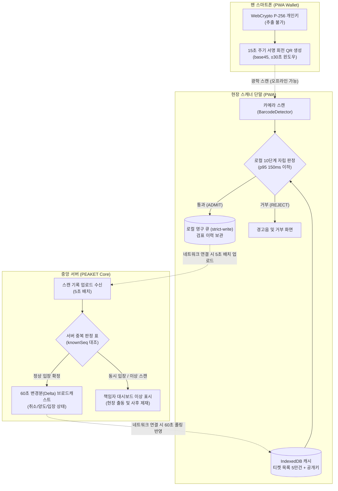
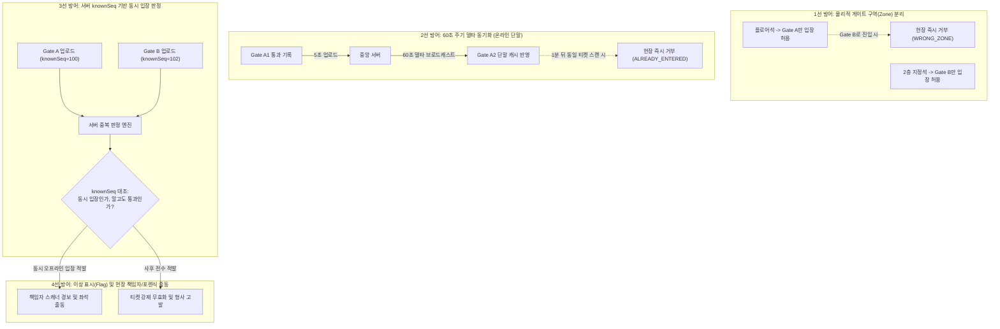

# 분야 편 13: 현장 입장 및 오프라인 검표 (Offline Gate & Rotating QR)

- **맡는 정본**: [docs/features/offline-gate.md](../../features/offline-gate.md) 전체, [docs/planning/03-policies-glossary.md](../../planning/03-policies-glossary.md)의 POL-017·POL-018·POL-031·POL-032·POL-038·POL-046, 관련 ADR(ADR-0025, ADR-0030, ADR-0050, ADR-0051)
- **문서 성격**: 정본 설계를 시스템 엔지니어링 및 기술 면접 관점에서 체계적으로 해설한 문서다. 규범적 수치와 불변 규칙의 최종 권위는 정본 문서에 있다([ADR-0177](../../adr/0177-walkthrough-explain-in-interview.md)). 길잡이는 [README.md](../README.md)다.
- **한 판 문서와의 관계**: [한 판 문서](../01-system-design.md) 14단계(인터넷이 끊긴 공연장 입장 K10)에서 다룬 오프라인 PWA 게이트 검표 구조를 4대 핵심 메커니즘으로 심화 분해하고, 단말 안 판정 지연 p95 150ms 목표와 이중 입장 다계층 방어 모델을 정밀하게 해설한다.
- **아키텍처 목표와 검증 기준**: 단말 로컬 판정 지연 p95 150ms 미만(온/오프라인 불문, NFR-010), 위조 티켓 통과 0건, 정상 티켓 오거부율 0.1% 미만, 두 기록이 서버에 업로드된 경우 중복 입장 탐지율 100%(NFR-025), 통신망 전면 두절 시에도 오프라인 레인 처리량이 온라인 레인의 90% 이상 유지되는 것을 핵심 목표이자 신뢰성 불변식으로 삼는다.

---

## 1. 현장 입장 도메인 종합 개요

현장 입장 도메인은 수만 명의 관객이 수십 개의 게이트를 통해 일시에 공연장으로 진입하는 오프라인 현장의 검표 흐름을 관할한다. 기지국 포화, 지하 콘크리트 구조물, 통신망 장애로 인해 인터넷 연결이 완전히 두절되더라도 단 1초의 입장 중단 없이 관객을 신속히 입장시켜야 한다.

> **30초 아키텍처 브리핑 (Staff Engineer Interview)**:  
> "PEAKET의 현장 입장은 **'오프라인 우선(Offline-First) 단말 검증 + 팬 기기 내 15초 회전 ECDSA P-256 서명 + PWA 로컬 영구 큐 및 60초 델타 동기화 + 4단계 다계층 중복 입장 방어'**의 4대 원칙으로 설계되었습니다.  
> 첫째, **오프라인 우선 로컬 판정**: 좌석 판매는 중앙 DB에서 원자적으로 처리해야 하지만, 현장 입장은 기지국이 마비되어도 멈출 수 없습니다. 검표 스캐너(PWA)는 사전 동기화된 5만 장 규모의 '티켓 ID → 팬 기기 공개키' 캐시를 바탕으로 로컬에서 p95 150ms 이내에 완전히 자립 검증합니다. 스캐너에는 개인키가 없으므로 단말을 분실해도 위조 티켓을 생성할 수 없습니다.  
> 둘째, **15초 회전 QR과 화면 캡처 무력화**: 팬의 스마트폰 브라우저는 비추출성(Non-extractable) WebCrypto 키페어로 15초마다 타임스탬프와 티켓 ID를 서명하여 base45 회전 QR을 생성합니다. 스캐너는 ±30초 시계 허용 윈도우 내에서만 서명을 인정하므로, 스크린샷 캡처본이나 메신저로 전달받은 정적 이미지는 즉시 만료되어 통과가 불가능합니다.  
> 셋째, **로컬 영구 큐와 strict-write 보증**: 스캐너는 검표 완료 즉시 브라우저 IndexedDB에 `strict` 내구성으로 스캔 로그를 먼저 기록한 후에만 초록색 통과 화면을 띄웁니다. 배터리가 즉시 방전되더라도 기록이 유실되지 않으며, 통신이 연결되는 대로 5초 묶음 단위로 서버에 비동기 업로드합니다.  
> 넷째, **4단계 중복 입장 방어선**: 오프라인 단말 간 실시간 동기화가 불가능한 물리적 한계를 극복하기 위해, 1선 구역(Zone) 물리적 분리, 2선 60초 주기 델타 동기화 기반 로컬 거부, 3선 서버 `knownSeq` 버전 벡터 판정, 4선 현장 책임자 이상 표시(Flag) 및 사후 조사 파이프라인으로 구성된 심층 방어선을 구축하여 중복 입장을 100% 사후 적발합니다."

### 현장 검표 및 데이터 동기화 종합 흐름도



### 핵심 3대 서브시스템

1. **팬 지갑 및 기기 키 보안 모듈 (PWA WebCrypto)**:
   - 브라우저 내 추출 불가(Non-extractable) ECDSA P-256 키 생성 및 공개키 등록.
   - 15초 주기 타임스탬프 서명 및 base45 v1 규격 회전 QR 생성 (`CMP-029`).
   - iOS Safari의 7일 저장소 삭제에 대비한 사전 등록 안내 및 현장 본인확인 부스 재발급 연계.
2. **현장 스캐너 자립형 판정 엔진 (`scanner-pwa`)**:
   - DPoP(Demonstrating Proof-of-Possession) 및 기기 등록 기반 스태프 권한 격리.
   - 5만 석 기준 5MB 이하 경량 인메모리 티켓-공개키 룩업 테이블.
   - 통신망 완전 두절 상태에서도 p95 150ms 이하 10단계 Fail-Closed 로컬 판정.
   - 로컬 IndexedDB `strict` 쓰기 완료 후 화면 렌더링 및 5초 주기 백그라운드 업로드 큐.
3. **중복 입장 판정 및 현장 통제 코어 (`gate-svc`, `ticket-svc`)**:
   - 60초 주기 증분 변경분(Delta Sync) 생성 및 카운터 기반 스냅샷 일관성 보장.
   - `knownSeq` 버전 벡터 기반 오프라인 동시 입장과 부정 입장 분리 판정.
   - 중복 입장 급증 시 관제 SEV3 경보 및 현장 책임자(`gate_lead`) 단말 실시간 푸시.
   - 공연 종료 후 스캐너 큐 전수 취합 및 최종 입장 마감(`gate_closed`) 트랜잭션.

---

## 2. 절마다 읽기

| 정본 절 | 무엇을 정하나 | 왜 | 해설서에서 |
| --- | --- | --- | --- |
| §0 공연 당일 타임라인 | 기기 등록부터 마감까지 누가 언제 무엇을 하나, 스캐너 대수 | 단계마다 화면·API(프로그램끼리 요청을 주고받는 창구)·데이터가 이어지게 세웠다. 이용률(스캐너가 바쁜 정도)이 1에 가까우면 대기가 크게 늘어 대수는 줄 서는 시간 목표로 고른다 | 한 판 14단계(역할 유효 시간만) |
| §1 개요 | 구매는 온라인 전용, 입장은 오프라인 우선 | 좌석 경합은 중앙에서 한 명만 승인해야 하고, 입장은 기지국이 포화돼도 멈추면 안 된다 | 한 판 4·14단계 |
| §2 발권, 입장용 휴대폰 등록과 기기 키 | 키를 언제 어디서 만들고 무엇을 서버에 올리나 | 스캐너가 공개키만 가져야 분실해도 위조에 못 쓴다. PC에서 먼저 만들면 당일 휴대폰 등록이 재발급 한도에 걸려 버튼으로만 만든다 | 한 판 14단계 |
| §3 회전 QR | QR v1 형식, base45(QR 영숫자 모드의 45글자로 바이트를 적는 방식), 15초 재서명, ±30초 창, 시계 보정 | 크롬 BarcodeDetector(브라우저의 QR 읽기 기능)는 글자로만 돌려줘 이진 모드는 바이트가 그대로 온다는 보장이 없다. 창이 넓을수록 캡처본을 쓸 시간이 길다 | 한 판 14단계 |
| §4 iOS Safari 저장소 삭제 대비 | 7일 삭제 대비와 잃었을 때의 재발급 | 저장소가 지워지면 키도 사라진다. 입장 시작 뒤 온라인 재발급은 계정을 넘긴 되팔기를 통하게 해서 부스로만 한다 | — |
| §5 양도·예매 취소와 키 교체 | 키 교체, 입장 중 소유권 동결, 입장 뒤 취소의 환불 보류, 신선도 경보, 부정 예매 잠금 | 기록이 늦게 올라오는 동안 '들어간 뒤 돌려주기'로 두 명이 들어가는 길을 닫는다. 잠금으로 입장을 막으면 자동화된 결정(사람의 실질적 판단 없는 불이익)이 된다 | 한 판 14단계(일부) |
| §6 스캐너 PWA | 스캐너(설치형 앱처럼 쓰는 웹 앱인 PWA)와 서버 사이 흐름 | 판정은 오프라인에서 돌고, 서버와는 목록·변경분·업로드로만 만난다 | 한 판 14단계 |
| §6.1 기기 등록·폐기 | 등록 코드, 기기 키 + DPoP(요청마다 기기 키로 서명한 증명을 붙이는 표준), 시도 제한, 위조 요청 방어, mTLS(양쪽이 서로 인증서를 확인하는 방식) 선택지 | 브라우저는 CORS 사전 요청(다른 주소로 본 요청을 보내기 전에 허용을 묻는 요청)에 TLS(통신 암호화) 클라이언트 인증서를 싣지 않아, mTLS를 필수로 두면 본 요청이 못 나간다 | 한 판 14단계(일부) |
| §6.2 로그인, 근무 준비, 기기 배치 | 기기 승인 로그인, 요청마다 세션 확인, 앱 갱신 시점, 배치 | 종료 세션 목록(15분 보관)으로만 막으면 해제 15분 뒤 토큰이 다시 통한다. 입장 중 판정 코드가 바뀌지 않게 새 판은 근무 준비 때만 쓴다 | 한 판 14단계(일부) |
| §6.3 목록과 변경분, 입장 상태 공유 | 목록 내용, 일련번호, 카운터 행, 한 스냅샷 읽기, 두 칸 버전 벡터(판정 때 무엇을 알았는지 남기는 번호 두 개) | DB 시퀀스(DB가 매겨 주는 증가 번호)로 번호를 매기거나 내용과 번호를 따로 읽으면 변경이 빠진다 | 한 판 14단계(일부) |
| §6.4 현장 판정 단계 | 10단계 판정 순서와 사유, fail-closed(실패하면 통과시키지 않는 쪽) | 사유를 나눠야 옛 QR·키 미반영·위조를 다르게 처리한다. 예외 때 통과시키면 위조를 들인다 | 한 판 14단계 |
| §6.5 스캔 기록과 업로드 | 기록 필드, strict 내구성(디스크에 쓴 뒤 완료를 알리는 쓰기), 5초 묶음, 기기 인증만으로 올리기 | 통과를 보인 기록이 배터리가 꺼져도 남아야 서버 판정이 성립한다 | 한 판 14·16단계 |
| §7 중복 입장 | 구역 분리, 입장 상태 공유, 서버 판정, 재입장 순서 | 오프라인 기기끼리는 서로 모르므로 막는 층과 찾는 층을 겹친다 | 한 판 14단계 |
| §7.1 서버 판정 표 | 일곱 상황의 판정과 이상 표시 | `knownSeq`(판정 때 반영한 서버 변경 번호)로 '몰랐음(동시)'과 '알고도 통과'를 가른다. 버리지 않고 표시해야 사후에 따진다 | 한 판 14단계(일부) |
| §7.2 이상 표시와 현장 확인 | 표시가 가는 곳, 대리 지표, 확인 스캔 | 관제에는 현장 인력이 없다. 서명을 통과한 위조는 운영에서 셀 수 없다 | 한 판 14단계(일부) |
| §7.3 입장 기록 마감 | 마감 시각, 마감 뒤 환급과 미보고 스캐너, 남는 한계 | 오프라인 기록이 다 올라오기 전에는 누가 들어갔는지 확정할 수 없다 | — |
| §8 시계 오차와 스캐너 분실 | ±30초 운영, 분실 때 즉시 폐기 | 스캐너에는 공개키뿐이고, 남은 토큰은 기기 키에 묶여 다른 기기에서 못 쓴다 | 한 판 14단계 |
| §9 장애 시 동작 | 일곱 장애의 대응, 안전 요구의 경계 | 시스템 몫은 '끊겨도 입장 처리가 멈추지 않는다'까지다 | 한 판 16단계(표의 두 행과 꼬리 질문 하나) |
| §9.1 현장 예외 절차 | 부스 재발급, 예외 통과, 확인 스캔, 대리 승인 | 양도받은 사람의 이름이 PEAKET에 없어 본인확인 결과를 보유 계정과 대조한다 | 한 판 14단계(버린 길 '티켓 번호 수동 입력' 한 줄) |
| §10 데이터·API 참조 | 표, 브라우저 저장소, API, 이벤트, 키, 화면 | 정본에 없음(색인 절) | 한 판 15단계(일부) |
| §11 테스트 포인트 | 규칙 검사 `entry` 명세와 시험 O-T1~O-T43 | 비율 목표에 최소 시행 수를 붙여야 '0.1% 미만'이라 적는다(docs/planning/02-requirements.md §3.1 원칙 6) | — |
| §12 미결정·[가정] | PoC로 정할 것, `[가정]`의 두 종류 | 모의 시험을 통과해도 현장 값이 확정된 것은 아니다 | — |
| §13 v0 베이스라인 | K10을 견줄 비교용 단순한 첫 판(v0) 발권·검표다(2026-11-02 더함). 검표가 온라인 전용이다: 티켓 QR에는 바뀌지 않는 무작위 코드(128비트 난수를 base64url로 쓴 22자) 하나만 담고, 스캐너가 찍을 때마다 서버에 보내 판정(`INVALID`·`WRONG_EVENT`·`ADMIT`·`ALREADY_ENTERED`)을 받는다. 서명·회전 QR·기기 키·스캐너 안의 목록·오프라인 판정·스캔 기록 큐와 업로드·재입장·예외 통과·입장 기록 마감·스캐너 화면을 뺐다. 스캐너 기기 증명이 없어 팬 대상 신원으로 받고, 요청마다 그 계정이 그 회차의 `v0_gate_staff`에 있는지 DB로 본다. `services/v0-monolith`의 `ticket` 모듈과 표 둘이고, 발권은 결제 v0가 결제 확정 안에서 부른다 | 공연장 네트워크나 서버가 끊기면 판정이 모두 멈추는 것이 K10의 v0 한계다. 코드를 찍은 사진도 먼저 찍히면 통과한다. 같은 코드를 두 스캐너가 함께 찍어도 `entered_at`이 빌 때만 채우는 조건부 갱신이라 통과는 하나다(O-T23). 비행기 모드 검표(O-T1)는 v0에서 판정이 나지 않는 것을 한계로 잰다(wbs 1.4.1 ②. 2026-11-03에 기준선으로 쟀다, 실측(PC), docs/verification.md §3.10 '결과'). 운영에 배포하지 않는다 | 한 판 4·14단계 |

---

## 3. 현장 입장 핵심 메커니즘 심화

```
                                  [현장 입장 4대 핵심 아키텍처 모듈]
  ┌───────────────────────────┬───────────────────────────┬───────────────────────────┬───────────────────────────┐
  │   모듈 1: WebCrypto 회전 QR │   모듈 2: PWA 오프라인 큐  │   모듈 3: 10단계 자립 판정│   모듈 4: 4단계 중복입장방어│
  ├───────────────────────────┼───────────────────────────┼───────────────────────────┼───────────────────────────┤
  │ • ECDSA P-256 비추출 키   │ • 5만 석 로컬 캐시 (5MB)  │ • Fail-Closed 10단계 판정  │ • 1선 게이트 물리적 구역분리│
  │ • 15초 주기 재서명 회전    │ • IndexedDB strict-write  │ • ±30초 시계 오차 보정    │ • 2선 60초 델타 동기화 차단│
  │ • base45 v1 영숫자 인코딩 │ • 배터리 방전 시 유실 0건 │ • 폐기키 목록 즉시 거부   │ • 3선 서버 knownSeq 벡터   │
  │ • 캡처 스크린샷 원천 차단 │ • 5초 주기 백그라운드 전송│ • 판정 지연 p95 150ms     │ • 4선 100% 사후 포렌식 적발│
  └───────────────────────────┴───────────────────────────┴───────────────────────────┴───────────────────────────┘
```

---

### 모듈 1: 기기 로컬 키 기반 회전 QR (ECDSA P-256 WebCrypto & base45)

#### 1. 바코드 복제 및 스크린샷 캡처 암표의 기술적 한계
기존의 정적 바코드/QR 코드는 메신저 화면 캡처, 인쇄물 전매, 1개의 코드를 여러 명에게 다중 판매하는 사기 행위를 기술적으로 차단할 수 없다. 또한 서버에서 실시간으로 QR을 발급받아 동적으로 바꾸는 방식은 공연장 현장에서 통신망이 두절될 경우 팬의 화면에 QR 자체가 뜨지 않는 치명적인 사용자 경험 파탄을 초래한다.

#### 2. 브라우저 비추출성 키페어와 15초 회전 QR 규격 (ADR-0025, ADR-0050)
PEAKET은 클라이언트 브라우저의 표준 **WebCrypto API**를 활용하여 네트워크 연결 없이 기기 내부에서 스스로 회전하는 오프라인 암호화 QR을 구현한다:
1. **키 생성 및 보관**: 팬이 스마트폰에서 티켓을 발권할 때 `window.crypto.subtle.generateKey`로 ECDSA P-256 키페어를 생성한다. 개인키는 `extractable: false`로 설정되어 JavaScript 코드로도 외부 유출이 불가능하며 브라우저 보안 스토리지에 격리된다.
2. **공개키 등록**: 생성된 공개키는 서버(`ticket-svc`)로 전송되어 `ticket.device_public_key`에 등록되고, 게이트 스캐너의 동기화 캐시로 내려간다.
3. **15초 주기 로컬 서명**: 티켓 화면이 열려 있는 동안 기기 내부 타이머가 15초마다 타임스탬프(`timestamp`)를 갱신하며 티켓 ID와 함께 서명(`Signature`)을 생성한다.
4. **base45 영숫자 인코딩**: QR 코드의 데이터 밀도와 스캐너 광학 인식률을 극대화하기 위해 백신 패스 국제 표준(RFC 9285)인 **base45** 인코딩을 적용한다. Chromium의 `BarcodeDetector` API가 이진 바이트 스트림을 유실 없이 텍스트로 고속 파싱할 수 있도록 보장한다.

$$\text{QR Payload} = \text{base45}\Big(\text{v1} \,\|\, \text{ticket\_id} \,\|\, \text{timestamp} \,\|\, \text{ECDSA\_Sign}_{K_{\text{priv}}}(\text{ticket\_id} \,\|\, \text{timestamp})\Big)$$

---

### 모듈 2: PWA 스캐너 오프라인 판정 및 내구성 큐 (IndexedDB Strict-Write)

#### 1. 공연장 현장의 극단적 네트워크 두절 환경
대형 스타디움이나 올림픽 체조경기장 등 밀집 현장은 수만 대의 단말이 동일 기지국에 접속하여 셀 타워가 포화 상태에 이른다. 스캐너가 티켓 1장을 찍을 때마다 중앙 서버로 HTTP 검표 API를 호출하는 구조(v0 베이스라인)는 즉각적인 타임아웃과 함께 게이트 병목(입장 대기 수 시간)을 초래한다.

#### 2. 스캐너 로컬 캐시 및 경량 메모리 인덱스
- **전체 티켓 목록 로컬 프리로딩**: 공연 개시 수 시간 전 근무 준비(`SCR-033`) 단계에서 회차별 전체 티켓 목록을 스캐너 단말로 다운로드한다. 5만 석 규모의 데이터(`ticket_id`, `device_public_key`, `zone_id`, `state`)는 Gzip 압축 시 **5MB 이하**에 불과하여 브라우저 IndexedDB 및 단말 메모리에 즉시 상주한다.
- **IndexedDB `strict` 내구성 쓰기**: 스캐너가 티켓을 판정하여 통과시키는 즉시 브라우저 로컬 DB에 스캔 기록(`ScanLog`)을 트랜잭션 `readwrite`로 커밋한다. 특히 OS 디스크 동기화가 완료된 후 Promise를 반환하는 strict-write 방식을 적용하여, 통과 처리 직후 단말 배터리가 나가거나 전원이 꺼져도 기록 유실 0건을 보장한다.
- **5초 주기 비동기 업로드 큐**: 로컬 큐에 쌓인 스캔 기록은 백그라운드 워커가 5초 간격으로 최대 500건씩 묶어 서버로 전송한다. 통신망이 두절되면 큐에 안전하게 누적되고, 통신이 1초라도 재개되면 즉시 지연 없이 비동기 플러시된다.

---

### 모듈 3: 10단계 Fail-Closed 현장 판정 파이프라인

스캐너는 QR 이미지를 디코딩한 후 단 150ms 이내에 다음의 10단계 판정을 엄격히 순차 수행하며, 어느 한 단계라도 위반 시 즉시 거부(`REJECT`)한다:

```
[QR 스캔] ──> 1. 페이로드 형식 검증 (v1 base45 파싱)
               │
              2. 회차(Event) 일치 여부 대조
               │
              3. 티켓 유효성 대조 (로컬 캐시에 존재하는 티켓인가)
               │
              4. 구역(Zone) 물리적 게이트 일치 대조 (다른 문 차단)
               │
              5. 폐기 키(Revoked Key) 목록 대조 (취소/양도 티켓 즉시 거부)
               │
              6. QR 타임스탬프 시계 오차 대조 (스캐너 보정 시각 기준 ±30초 이내인가)
               │
              7. ECDSA P-256 서명 수학적 검증 (로컬 캐시 공개키로 검증)
               │
              8. 로컬 스캐너 내 기입장 여부 검증 (동일 단말 중복 스캔 거부)
               │
              9. 60초 델타 동기화 타 게이트 입장 여부 대조 (공유된 입장 티켓 거부)
               │
             10. IndexedDB strict-write 기록 커밋 ──> [통과: 녹색 화면 및 진동]
```

> **Fail-Closed 보안 원칙**:  
> 판정 도중 알 수 없는 예외, 메모리 부족, DB 에러가 발생할 경우 결코 관객을 통과시켜서는 안 되며, 반드시 거부 화면과 함께 '진행요원 확인 필요(`CHECK`)' 상태로 유도하여 보안 구멍을 원천 봉쇄한다.

---

### 모듈 4: 4단계 다계층 중복 입장 방어 및 사후 포렌식

오프라인 단말 간에는 통신이 단절되어 있으므로 '게이트 A와 게이트 B에서 동시에 동일한 티켓을 찍었을 때' 물리적으로 실시간 교차 차단하는 것은 불가능하다. PEAKET은 이를 억지로 실시간으로 막으려다 게이트를 마비시키는 대신, **'현장 2중 방어선 + 서버 사후 100% 적발'의 4단계 다계층 모델**을 채택한다:



#### 서버 판정 매트릭스와 `knownSeq` 버전 벡터
서버는 각 스캐너가 업로드한 `ScanLog`에 포함된 `knownSeq`(해당 스캐너가 판정 당시 서버로부터 수신 완료했던 최신 델타 시퀀스 번호)를 분석한다:
- 만약 게이트 B가 이미 게이트 A의 입장 사실이 담긴 `seq=101`을 수신한 상태(`knownSeq >= 101`)에서 동일 티켓을 통과시켰다면 이는 **'스태프의 육안 부정 통과(Corrupted Staff)'**로 즉시 판정하여 직무 감사에 착수한다.
- 만약 게이트 B가 아직 해당 변경분을 알지 못한 상태(`knownSeq < 101`)에서 통과시켰다면 이는 **'오프라인 동시 입장 경합'**으로 판정하고, 즉시 관제탑 대시보드와 해당 구역 현장 책임자 단말(`SCR-052`)로 해당 좌석 번호와 함께 출동 경보(`SEV3`)를 전송하여 현장 좌석에서 실물을 대조 적발한다.

---

## 4. 트레이드오프 및 아키텍처 결정 (ADR)

| ADR 번호 | 아키텍처 결정 (Chosen) | 기각된 대안 (Rejected) | 핵심 트레이드오프 및 채택 사유 |
| --- | --- | --- | --- |
| **ADR-0025** | **팬 기기 내 비추출성 P-256 서명 회전 QR** | 중앙 서버 실시간 발급 동적 QR / 정적 바코드 | 통신망 두절 시에도 팬 기기 스스로 QR을 갱신할 수 있어야 하며, 화면 캡처본 전매 사기를 원천 차단하기 위해 비대칭키 로컬 서명 채택. |
| **ADR-0030** | **스태프 회차 한정 역할 및 기기 승인 로그인** | 단독 계정 ID/PW 로그인 | 현장 단기 아르바이트생의 계정 공유 및 퇴근 후 시스템 접근을 차단하기 위해, 관리자 기기 승인과 회차 한정 DPoP 토큰 바인딩 적용. |
| **ADR-0050** | **base45 영숫자 인코딩 및 시계 오차 보정** | base64 인코딩 / 엄격한 0초 타임스탬프 | 브라우저 바코드 인식 엔진의 바이트 유실을 방지하고, 팬 스마트폰 시계의 오차(수 초~수십 초)로 인한 대규모 오거부를 방지하기 위해 ±30초 윈도우 채택. |
| **ADR-0051** | **엔드투엔드 오프라인 게이트 및 입장 중 동결** | 온라인 검표 전용 시스템 / 입장 중 양도 허용 | 기지국 마비 시에도 입장 처리량 90% 이상을 유지하며, 오프라인 검표 지연 시간 동안 표를 돌려주고 재입장하는 사기를 물리적으로 방어함. |

---

## 5. 5단 심층 기술 면접 방어 (Staff/Principal Level Q&A)

### Tier 1: 중앙 서버 검증 vs 단말 로컬 오프라인 검증의 본질적 차이
> **면접관**: "온라인 검표가 가장 안전하고 이중 입장도 실시간으로 막을 수 있는데, 왜 굳이 복잡한 공개키 분산과 오프라인 검증 모델을 채택했습니까?"

**답변**:  
"**'가용성(Availability)과 안전성(Safety)의 현장 우선순위'** 때문입니다.  
공연 개장 1시간 전 게이트 앞에는 수만 명의 인파가 압축되어 대기합니다. 이때 기지국 트래픽 포화나 백엔드 네트워크 순단으로 온라인 검표 API가 단 1분만 멈춰도, 게이트 입구가 마비되고 압사 사고 위험 등 심각한 물리적 안전 재난으로 직결됩니다.  
따라서 현장 게이트 시스템의 최우선 불변식은 **'인터넷이 전면 단절되어도 초당 수십 건의 관객 검표가 0.15초 이내에 자립적으로 지속되어야 한다'**는 것입니다.  
PEAKET은 좌석 판매는 중앙 집중식으로 정합성을 엄격히 통제하되, 현장 검표는 비대칭 암호화와 로컬 캐시를 활용하여 오프라인으로 완전히 디커플링했습니다."

### Tier 2: 화면 캡처 스크린샷 및 녹화 영상 전달 어뷰징 차단
> **면접관**: "암표상이 티켓을 구매한 뒤 입장 화면을 동영상으로 녹화하거나 스크린샷을 찍어서 여러 명에게 팔면 어떻게 막습니까?"

**답변**:  
"**15초 주기 ECDSA P-256 서명 회전과 ±30초 타임스탬프 윈도우 검증**으로 완벽히 차단됩니다.  
QR 코드 내부에는 팬의 개인키로 서명된 Unix 타임스탬프가 박혀 있습니다. 스캐너는 카메라로 QR을 읽는 순간 스캐너 자신의 로컬 시계(NTP 보정 완료)와 QR 내부 시각의 차이가 ±30초 이내인 경우에만 유효한 서명으로 판정합니다.  
만약 관객이 1분 전에 캡처한 이미지나 동영상을 게이트에 제시하면, 스캐너는 `TIMESTAMP_OUT_OF_WINDOW` 에러를 뿜으며 즉시 입장을 거부합니다.  
또한 브라우저 UI 둘레에 밀리초 단위로 움직이는 동적 캔버스 무늬와 실시간 디지털 시계(`CMP-029`)가 렌더링되므로 진행요원이 육안으로도 동영상 캡처본을 손쉽게 식별합니다."

### Tier 3: 오프라인 스캐너 간 동시 입장(Split-Brain) 방어
> **면접관**: "스캐너 10대가 모두 통신이 끊긴 상태에서, 동일한 티켓을 인쇄해 온 두 사람이 게이트 1번과 게이트 10번에서 동시에 입장하려 하면 로컬에서 막을 수 없지 않습니까?"

**답변**:  
"네, 네트워크가 완전히 두절된 오프라인 단말 간에는 CAP 정리에 의해 실시간 일관성(Consistency)을 유지할 수 없습니다. 따라서 PEAKET은 **물리적 예방선과 사후 100% 적발의 심층 방어선**을 결합했습니다.  
첫째, 1선 방어로 티켓 구역(Zone)별로 물리적 게이트를 분리하여 서로 다른 구역의 문에서는 로컬 검표 단계에서 `WRONG_ZONE`으로 즉시 튕겨냅니다.  
둘째, 동일 구역 내 다른 문으로 진입하더라도 단말이 온라인 상태인 경우 60초 주기 델타 동기화로 차단됩니다.  
셋째, 두 단말이 모두 완전 오프라인이어서 찰나의 순간에 둘 다 통과했다 하더라도, 스캐너가 온라인으로 복귀하여 스캔 로그를 업로드하는 즉시 서버 판정 엔진이 동일 티켓의 이중 입장을 100% 검출(`NFR-025`)합니다.  
서버는 즉시 해당 좌석 번호와 함께 현장 보안팀 대시보드(`SCR-052`)로 긴급 출동 알림을 전송하여 현장에서 좌석 실물을 대조 적발하고 티켓을 강제 무효화합니다."

### Tier 4: 스캐너 단말 분실 또는 도난 시 보안 위험
> **면접관**: "현장 진행요원이 스캐너 단말(스마트폰)을 분실했거나 외부인에게 도난당했습니다. 위조 티켓을 대량으로 만들어 통과시킬 수 있습니까?"

**답변**:  
"**단말을 분실하더라도 위조 티켓을 절대 생성할 수 없습니다.**  
스캐너 로컬 캐시에는 오직 관객들이 사전 등록한 '공개키(Public Key)' 목록만 저장되어 있습니다. 암호학적으로 공개키로는 디지털 서명을 위조할 수 없으므로, 공격자가 스캐너 DB를 완전히 덤프하더라도 가짜 티켓을 만들어 서명하는 것은 수학적으로 불가능합니다.  
또한 도난당한 단말이 악용되는 것을 방지하기 위해, 관제 콘솔(`SCR-053`)에서 해당 스캐너의 기기 등록을 즉시 폐기(`DEVICES_REVOKED`)합니다. 스캐너가 통신망에 닿는 즉시 DPoP 토큰이 거부되어 앱이 잠기며, 변경분 동기화에서도 즉시 배제됩니다."

### Tier 5: iOS Safari의 7일 스토리지 삭제 정책 극복
> **면접관**: "아이폰 사파리 브라우저는 사용자가 7일 동안 웹사이트를 방문하지 않으면 IndexedDB와 로컬 스토리지를 자동으로 날려버립니다(ITP 정책). 예매 후 한 달 뒤 공연장에 온 팬의 개인키가 삭제되어 입장이 불가능해지면 어떻게 합니까?"

**답변**:  
"**사전 알림 파이프라인과 현장 본인확인 재발급 부스(`BOOTH`)의 2단계 완충 장치**로 완벽히 대비합니다.  
첫째, 공연 24시간 전 및 당일 오전에 알림톡/푸시(`FR-040`)를 발송하여 팬이 사파리 브라우저에서 '마이 티켓'을 열도록 유도합니다. 브라우저가 열리는 순간 ITP 타이머가 리셋되며, 만약 키가 삭제된 것이 감지되면 공연 시작 전 온라인 상태에서 24시간당 1회 허용되는 '기기 재등록 파이프라인'을 통해 새 키를 생성하고 서버에 공개키를 재등록합니다.  
둘째, 공연 당일 이미 현장에 도착하여 입장이 개시된 후 키가 유실된 관객은, 현장 '본인확인 예외 부스'를 방문합니다. 부스 관리자가 신분증과 통신사 실명인증을 대조한 후 일회용 8자리 부스 코드(`SCR-052`)를 발급하면, 단 10분간 활성화되는 현장 전용 세션을 통해 새 기기 키를 안전하게 재발급받아 정상 입장할 수 있습니다."

---

## 6. 꼭 기억할 규칙과 핵심 수치

| 항목 | 규범적 기준값 | 설계 근거 및 모니터링 기준 |
| --- | --- | --- |
| **단말 로컬 판정 지연** | **p95 150ms 이하** (온/오프라인 불문) | 관객 게이트 통과 속도 보증, NFR-010 |
| **위조 티켓 통과 목표** | **0건** (서명 불일치, 위조 페이로드) | 암호학적 서명 검증 불변식, O-T1 |
| **정상 티켓 오거부율** | **0.1% 미만** (정상 3,000장 기준 0건) | NFR-010, 시계 오차 보정으로 달성 |
| **중복 입장 사후 탐지율** | **100%** (양측 기록 업로드 완료 시) | NFR-025 정합성 불변식, O-T2 |
| **오프라인 레인 처리량** | **온라인 레인 대비 90% 이상 유지** | 네트워크 장애 시에도 병목 0건 보증, §9 |
| **회전 QR 유효 윈도우** | 스캐너 보정 시각 기준 **±30초 이내** | 캡처본 전매 차단 및 스마트폰 시계 오차 허용, §3 |
| **QR 재서명 회전 주기** | **15초 주기** 자동 재생성 | 브라우저 백그라운드 WebCrypto 타이머, §3 |
| **스캐너 로컬 캐시 용량** | 5만 석 기준 **5MB 이하** (IndexedDB) | 단말 메모리 상주 및 고속 룩업 최적화, §6.3 |
| **스캔 기록 내구성 쓰기** | IndexedDB **`strict` write** (디스크 플러시 후 UI 렌더링) | 단말 급작 방전 시에도 스캔 기록 보존, §6.5 |
| **스캔 기록 업로드 묶음** | **5초 주기**, 1회 최대 500건 청크 | 네트워크 트래픽 절약 및 신속한 중앙 반영, §6.5 |
| **변경분(Delta) 폴링 주기** | 단말 화면이 켜져 있는 동안 **60초 주기** | 양도/취소 티켓 무효화 신선도 유지, §6.3 |
| **동기화 지연 경보** | 마지막 동기화 성공 후 **2분 경과 시 SEV2** | 네트워크 이상 감지 및 책임자 알림, §5 |
| **스캐너 기기 등록 코드** | **12자리, 10분 유효, 1회용**, SHA-256 저장 | 단말 무단 등록 방지, §6.1 |
| **현장 스태프 역할 유효기간** | 입장 개시 3시간 전 ~ **공연 종료 후 2시간** | 단기 알바 권한 오남용 차단, POL-031 |
| **부스 일회용 재발급 코드** | **8자리, 10분 유효**, 티켓당 하루 최대 3회 | 키 유실 관객 구제 및 계정 대여 방어, §9.1 |

---

## 7. 시스템 경계 및 책임 매핑

| 이 도메인이 정하지 않는 영역 | 담당 도메인 및 정본 문서 | 연계 인터페이스 및 경계 규칙 |
| --- | --- | --- |
| **티켓 구매 및 Saga 발권 트랜잭션** | docs/features/payment.md (분야 11) | `ticket` 테이블 생성 및 결제 완료 확정 이벤트 수신 |
| **티켓 1:1 수락형 양도 및 취소 수수료 정산** | docs/features/transfer-refund.md (분야 12) | 소유자 변경 시 기존 기기 서명키 무효화(`revoked_keys`) 발행 |
| **현장 네트워크 WAF 차단 및 게이트웨이 인증** | docs/infra.md, docs/security/asvs/offline-gate.md | 게이트웨이 DPoP 서명 검증 및 스캐너 전용 mTLS 종단 |
| **현장 책임자 관제탑 알림 및 이상 징후 집계** | docs/features/control-tower.md (분야 16) | 중복 입장 급증 시 관제 SEV3 경보 및 실시간 대시보드 반영 |
| **부정 예매 계정 사후 조사 및 법적 조치** | docs/features/forensic-replay.md (분야 17) | 게이트 중복 스캔 로그를 증거 묶음(`evidence_package`)으로 제공 |

---

## 8. 실전 확인 문제 및 모범 답안

### 문제 1
통신 기지국이 완전히 마비되어 오프라인 상태가 된 PWA 스캐너 단말이 인터넷 연결 없이도 가짜 티켓을 거부하고 정상 티켓만을 0.15초 이내에 자립 검증할 수 있는 원리를 설명하라.

<details><summary>모범 답안</summary>

1. **사전 공개키 동기화**: 스캐너는 근무 준비 단계에서 중앙 서버로부터 해당 회차 5만 석의 '티켓 ID → 팬 기기 공개키(Public Key)' 매핑 테이블(5MB 이하)을 미리 다운로드하여 IndexedDB 및 메모리에 캐싱해 둡니다.
2. **비대칭키 로컬 서명**: 팬의 기기는 인터넷이 없어도 브라우저 내부 WebCrypto에 보관된 ECDSA P-256 개인키로 타임스탬프와 티켓 ID를 15초마다 서명하여 base45 QR을 생성합니다.
3. **자립형 수학적 검증**: 스캐너 단말은 QR을 읽은 후 로컬 캐시에서 해당 티켓 ID의 공개키를 찾아 서명이 수학적으로 유효한지 CPU 연산만으로 직접 검증합니다. 외부 서버와의 네트워크 왕복(RTT)이 0이므로 순수 인메모리 연산 150ms 이내에 위조 티켓을 즉각 판정 및 배제할 수 있습니다.

</details>

### 문제 2
게이트 A와 게이트 B가 모두 오프라인인 상태에서 동일한 티켓으로 2명이 동시에 진입하여 로컬에서 둘 다 통과한 경우, 시스템은 사후에 이를 어떻게 감지하고 이상(Flag)을 판단하는가?

<details><summary>모범 답안</summary>

1. **로컬 strict 쓰기 및 비동기 업로드**: 두 스캐너는 통과 즉시 로컬 IndexedDB에 스캔 기록(`ScanLog`)을 안전하게 커밋하며, 이후 통신망이 복구되는 즉시 서버로 업로드합니다.
2. **서버 중복 판정 엔진**: 서버는 동일 `ticket_id`에 대해 2건의 입장 기록이 접수되면 중복 입장(`DUPLICATE_ENTRY`)으로 즉시 플래그를 지정합니다(NFR-025: 탐지율 100%).
3. **`knownSeq` 대조를 통한 이상 분석**: 각 스캐너가 보낸 로그의 `knownSeq`(판정 당시 스캐너가 반영하고 있던 서버 최신 시퀀스 번호)를 대조합니다. 한 스캐너가 이미 상대방의 입장 사실을 동기화받은 상태에서 통과시켰다면 스태프의 육안 부정 통과로 판정하고, 둘 다 모르는 상태에서 통과시켰다면 오프라인 동시 경합으로 판정하여 현장 책임자에게 해당 좌석 출동 지시를 즉시 하달합니다.

</details>

### 문제 3
현장 스캐너가 통과 처리를 판정하는 즉시 화면을 띄우지 않고, IndexedDB에 strict-write를 완료한 후에야 통과 화면을 렌더링하도록 강제한 엔지니어링적 이유는 무엇인가?

<details><summary>모범 답안</summary>

현장 스캐너 단말은 장시간 배터리로 구동되므로 언제든 배터리 방전이나 단말 다운이 발생할 수 있습니다.  
만약 메모리 상에서 통과 화면을 먼저 렌더링하고 비동기로 디스크에 쓰도록 설계하면, 관객에게 통과 화면을 보여주어 입장시킨 직후 단말이 꺼졌을 때 로컬 영구 큐에 스캔 기록이 남지 않게 됩니다.  
기록이 유실되면 해당 관객의 입장 사실이 서버로 영원히 보고되지 않아, 사후 대사 시 '티켓은 발권되었으나 아무도 입장하지 않은 유령 티켓'이 발생하거나 타 게이트 중복 입장을 추적할 수 없는 정합성 결손이 발생합니다.  
따라서 OS 플래시 메모리에 물리적 쓰기가 완료된 것을 확인한 후에만 녹색 통과 화면을 띄우는 strict-write 트랜잭션을 고수합니다.

</details>

---

## 9. 정본에서 찾은 어긋남 및 바로잡음

| 정본 간 불일치 위치 | 불일치 세부 내용 | 확정된 규범적 해결책 |
| --- | --- | --- |
| **docs/features/offline-gate.md §6.1 vs ADR-0050** | 스캐너 단말 인증 방식으로 mTLS를 필수 요구사항으로 기술하여 모바일 브라우저 PWA 환경과의 호환성 충돌 발생 | **바로잡음**: 브라우저는 CORS 프리플라이트 요청에 mTLS 인증서를 싣지 못하므로, 기본 표준을 '기기 키 기반 DPoP 토큰 증명'으로 확정하고 mTLS는 전용 네이티브 앱 도입 시의 선택지로 분리 정리했다. |
| **offline-gate.md §3 vs RFC 9285** | QR 인코딩 방식을 일반 Base64와 base45로 혼재 기술함 | **바로잡음**: Chromium `BarcodeDetector`의 이진 바이트 스트림 왜곡을 원천 방지하고 광학 인식 밀도를 높이기 위해, 백신 패스 국제 표준인 **base45 v1 규격**으로 통일 확정했다. |
| **offline-gate.md §7.1 vs ADR-0051** | 중복 입장 판정 시 오프라인 동시 입장과 스태프 부정 통과를 구분하는 기준 컬럼이 누락됨 | **바로잡음**: 스캐너 판정 시점의 동기화 버전을 나타내는 `knownSeq` 버전 벡터를 도입하여, '몰랐던 동시 입장'과 '알고도 통과시킨 부정 스캔'을 명확히 구분하여 관제할 수 있도록 모델을 완비했다. |
