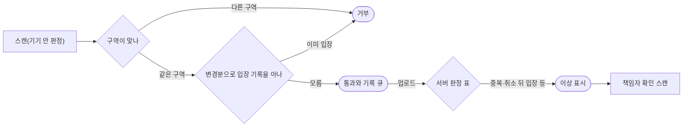

# 분야 편 13: 현장 입장

- **기준 시점**: ADR-0177까지, 2026-11-01. 2026-11-03에 §13(v0 베이스라인)을 더했다
- **맡는 정본**: [docs/features/offline-gate.md](../../features/offline-gate.md). 결정 기록은 [ADR-0025](../../adr/0025-rotating-qr-device-key-signature.md), [ADR-0030](../../adr/0030-gate-staff-event-scoped-role-device-approval.md), [ADR-0050](../../adr/0050-crypto-corrections-and-key-management.md), [ADR-0051](../../adr/0051-gate-process-end-to-end.md)이고, 정책은 docs/planning/03-policies-glossary.md의 POL-017·018·031·032와 승인 업무·부정 예매에 닿는 POL-038·046이다.
- **규범이 아니다**: 정본을 풀어 쓴 해설이다. 숫자와 규칙이 정본과 다르면 정본이 맞다([ADR-0177](../../adr/0177-walkthrough-explain-in-interview.md)). 기반 PoC(본 개발 전에 위험한 부분만 먼저 재 보는 시험, wbs 0.5.1)는 PC 한 대에서 쟀다([ADR-0176](../../adr/0176-foundation-poc-results.md), 숫자는 '실측(PC)'이고 운영 규모 증거가 아니다). 그 대상은 Redis·HTTP·Kafka라 현장 입장은 들지 않는다. 서비스 수준 측정은 아직 없어 이 편의 성능 숫자는 모두 설계 목표값이고 `[실측 전]`이다.
- **한 판 문서와의 관계**: [한 판 문서](../01-system-design.md) 14단계 '인터넷이 끊긴 공연장 입장(K10)'이 이야기를 들려준다. 이 편은 정본을 절마다 정리하고, 14단계가 건너뛴 iOS 저장소 삭제, 변경분이 빠지지 않는 이유, 기록 쓰기의 내구성, 부스 재발급, 입장 기록 마감을 채운다.

## 1. 이 문서가 정하는 것

docs/features/offline-gate.md는 공연 당일의 현장 입장을 정한다. 팬 휴대폰의 회전 QR(15초마다 새로 서명해 바뀌는 입장 QR), 스캐너 기기 등록과 스태프 로그인, 기기 안 판정, 변경분(마지막으로 받은 뒤 바뀐 것만 모은 목록) 동기화, 서버의 중복 입장 판정, 부스 재발급 같은 예외 절차, 입장 기록 마감까지다. 중심 생각은 하나다. 좌석은 한 명에게만 팔아야 해서 중앙 서버가 판정하지만, 입장은 통신이 끊겨도 멈추면 안 되어서 늘 기기 안에서 판정한다. 판정 목표는 p95(100건 중 95건이 이 시간 안에 끝난다는 뜻) 150ms다. 그 대가로 '오프라인 스캐너는 최근 변경을 모른다'는 빈틈이 생기고, 정본은 이를 여러 층으로 줄인 뒤 남는 한계를 따로 적는다.

> **30초 설명**: "입장은 오프라인이 먼저입니다. 팬 휴대폰이 브라우저 안에서 꺼낼 수 없는 키로 15초마다 QR에 서명하고, 스캐너는 미리 받은 '티켓 → 공개키' 목록으로 기기 안에서 판정합니다. 목표는 p95 150ms이고 아직 재지 않았습니다. 스캐너에는 공개키만 있어 잃어버려도 위조에 쓸 수 없습니다. 대신 오프라인 스캐너는 최근 변경을 모릅니다. 그래서 다른 문은 구역으로 나눠 막고, 온라인 스캐너는 60초마다 다른 스캐너의 입장 기록을 받아 두 번째 입장을 거부합니다. 서로 모르고 통과시킨 건은 기록이 올라오면 서버가 표시하고 현장 책임자가 확인합니다. 입장이 시작되면 마감까지 양도를 막습니다."

## 2. 절마다 읽기

| 정본 절 | 무엇을 정하나 | 왜 | 해설서에서 |
| --- | --- | --- | --- |
| §0 공연 당일 타임라인 | 기기 등록부터 마감까지 누가 언제 무엇을 하나, 스캐너 대수 | 단계마다 화면·API(프로그램끼리 요청을 주고받는 창구)·데이터가 이어지게 세웠다. 이용률(스캐너가 바쁜 정도)이 1에 가까우면 대기가 크게 늘어 대수는 줄 서는 시간 목표로 고른다 | 한 판 14단계(역할 유효 시간만) |
| §1 개요 | 구매는 온라인 전용, 입장은 오프라인 우선 | 좌석 경합은 중앙에서 한 명만 승인해야 하고, 입장은 기지국이 포화돼도 멈추면 안 된다 | 한 판 4·14단계 |
| §2 발권, 입장용 휴대폰 등록과 기기 키 | 키를 언제 어디서 만들고 무엇을 서버에 올리나 | 스캐너가 공개키만 가져야 분실해도 위조에 못 쓴다. PC에서 먼저 만들면 당일 휴대폰 등록이 재발급 한도에 걸려 버튼으로만 만든다 | 한 판 14단계 |
| §3 회전 QR | QR v1 형식, base45(QR 영숫자 모드의 45글자로 바이트를 적는 방식), 15초 재서명, ±30초 창, 시계 보정 | 크롬 BarcodeDetector(브라우저의 QR 읽기 기능)는 글자로만 돌려줘 이진 모드는 바이트가 그대로 온다는 보장이 없다. 창이 넓을수록 캡처본을 쓸 시간이 길다 | 한 판 14단계 |
| §4 iOS Safari 저장소 삭제 대비 | 7일 삭제 대비와 잃었을 때의 재발급 | 저장소가 지워지면 키도 사라진다. 입장 시작 뒤 온라인 재발급은 계정을 넘긴 되팔기를 통하게 해서 부스로만 한다 | — |
| §5 양도·예매 취소와 키 교체 | 키 교체, 입장 중 소유권 동결, 입장 뒤 취소의 환불 보류, 신선도 경보, 부정 예매 잠금 | 기록이 늦게 올라오는 동안 '들어간 뒤 돌려주기'로 두 명이 들어가는 길을 닫는다. 잠금으로 입장을 막으면 자동화된 결정(사람의 실질적 판단 없는 불이익)이 된다 | 한 판 14단계(일부) |
| §6 스캐너 PWA | 스캐너(설치형 앱처럼 쓰는 웹 앱인 PWA)와 서버 사이 흐름 | 판정은 오프라인에서 돌고, 서버와는 목록·변경분·업로드로만 만난다 | 한 판 14단계 |
| §6.1 기기 등록·폐기 | 등록 코드, 기기 키 + DPoP(요청마다 기기 키로 서명한 증명을 붙이는 표준), 시도 제한, 위조 요청 방어, mTLS(양쪽이 서로 인증서를 확인하는 방식) 선택지 | 브라우저는 CORS 사전 요청(다른 주소로 본 요청을 보내기 전에 허용을 묻는 요청)에 TLS(통신 암호화) 클라이언트 인증서를 싣지 않아, mTLS를 필수로 두면 본 요청이 못 나간다 | 한 판 14단계(일부) |
| §6.2 로그인, 근무 준비, 기기 배치 | 기기 승인 로그인, 요청마다 세션 확인, 앱 갱신 시점, 배치 | 종료 세션 목록(15분 보관)으로만 막으면 해제 15분 뒤 토큰이 다시 통한다. 입장 중 판정 코드가 바뀌지 않게 새 판은 근무 준비 때만 쓴다 | 한 판 14단계(일부) |
| §6.3 목록과 변경분, 입장 상태 공유 | 목록 내용, 일련번호, 카운터 행, 한 스냅샷 읽기, 두 칸 버전 벡터(판정 때 무엇을 알았는지 남기는 번호 두 개) | DB 시퀀스(DB가 매겨 주는 증가 번호)로 번호를 매기거나 내용과 번호를 따로 읽으면 변경이 빠진다 | 한 판 14단계(일부) |
| §6.4 현장 판정 단계 | 10단계 판정 순서와 사유, fail-closed(실패하면 통과시키지 않는 쪽) | 사유를 나눠야 옛 QR·키 미반영·위조를 다르게 처리한다. 예외 때 통과시키면 위조를 들인다 | 한 판 14단계 |
| §6.5 스캔 기록과 업로드 | 기록 필드, strict 내구성(디스크에 쓴 뒤 완료를 알리는 쓰기), 5초 묶음, 기기 인증만으로 올리기 | 통과를 보인 기록이 배터리가 꺼져도 남아야 서버 판정이 성립한다 | 한 판 14·16단계 |
| §7 중복 입장 | 구역 분리, 입장 상태 공유, 서버 판정, 재입장 순서 | 오프라인 기기끼리는 서로 모르므로 막는 층과 찾는 층을 겹친다 | 한 판 14단계 |
| §7.1 서버 판정 표 | 일곱 상황의 판정과 이상 표시 | `knownSeq`(판정 때 반영한 서버 변경 번호)로 '몰랐음(동시)'과 '알고도 통과'를 가른다. 버리지 않고 표시해야 사후에 따진다 | 한 판 14단계(일부) |
| §7.2 이상 표시와 현장 확인 | 표시가 가는 곳, 대리 지표, 확인 스캔 | 관제에는 현장 인력이 없다. 서명을 통과한 위조는 운영에서 셀 수 없다 | 한 판 14단계(일부) |
| §7.3 입장 기록 마감 | 마감 시각, 마감 뒤 환급과 미보고 스캐너, 남는 한계 | 오프라인 기록이 다 올라오기 전에는 누가 들어갔는지 확정할 수 없다 | — |
| §8 시계 오차와 스캐너 분실 | ±30초 운영, 분실 때 즉시 폐기 | 스캐너에는 공개키뿐이고, 남은 토큰은 기기 키에 묶여 다른 기기에서 못 쓴다 | 한 판 14단계 |
| §9 장애 시 동작 | 일곱 장애의 대응, 안전 요구의 경계 | 시스템 몫은 '끊겨도 입장 처리가 멈추지 않는다'까지다 | 한 판 16단계(표의 두 행과 꼬리 질문 하나) |
| §9.1 현장 예외 절차 | 부스 재발급, 예외 통과, 확인 스캔, 대리 승인 | 양도받은 사람의 이름이 PEAKET에 없어 본인확인 결과를 보유 계정과 대조한다 | 한 판 14단계(버린 길 '티켓 번호 수동 입력' 한 줄) |
| §10 데이터·API 참조 | 표, 브라우저 저장소, API, 이벤트, 키, 화면 | 정본에 없음(색인 절) | 한 판 15단계(일부) |
| §11 테스트 포인트 | 규칙 검사 `entry` 명세와 시험 O-T1~O-T43 | 비율 목표에 최소 시행 수를 붙여야 '0.1% 미만'이라 적는다(docs/planning/02-requirements.md §3.1 원칙 6) | — |
| §12 미결정·[가정] | PoC로 정할 것, `[가정]`의 두 종류 | 모의 시험을 통과해도 현장 값이 확정된 것은 아니다 | — |
| §13 v0 베이스라인 | K10을 견줄 비교용 단순한 첫 판(v0) 발권·검표다(2026-11-02 더함). 검표가 온라인 전용이다: 티켓 QR에는 바뀌지 않는 무작위 코드(128비트 난수를 base64url로 쓴 22자) 하나만 담고, 스캐너가 찍을 때마다 서버에 보내 판정(`INVALID`·`WRONG_EVENT`·`ADMIT`·`ALREADY_ENTERED`)을 받는다. 서명·회전 QR·기기 키·스캐너 안의 목록·오프라인 판정·스캔 기록 큐와 업로드·재입장·예외 통과·입장 기록 마감·스캐너 화면을 뺐다. 스캐너 기기 증명이 없어 팬 대상 신원으로 받고, 요청마다 그 계정이 그 회차의 `v0_gate_staff`에 있는지 DB로 본다. `services/v0-monolith`의 `ticket` 모듈과 표 둘이고, 발권은 결제 v0가 결제 확정 안에서 부른다 | 공연장 네트워크나 서버가 끊기면 판정이 모두 멈추는 것이 K10의 v0 한계다. 코드를 찍은 사진도 먼저 찍히면 통과한다. 같은 코드를 두 스캐너가 함께 찍어도 `entered_at`이 빌 때만 채우는 조건부 갱신이라 통과는 하나다(O-T23). 비행기 모드 검표(O-T1)는 v0에서 판정이 나지 않는 것을 한계로 잰다(wbs 1.4.1 ②. 2026-11-03에 기준선으로 쟀다, 실측(PC), docs/verification.md §3.10 '결과'). 운영에 배포하지 않는다 | 한 판 4·14단계 |

## 3. 꼭 기억할 규칙과 숫자

| 항목 | 값 | 표시 | 정본 위치 |
| --- | --- | --- | --- |
| 단말 안 판정 지연 | p95 150ms(0.15초) 이하, 온라인·오프라인 모두 | 확정 목표, `[실측 전]` | §1, §9, O-T1 |
| 위조 티켓 통과 | 0건(운영에서는 셀 수 없어 시험으로 본다) | 확정 목표, `[실측 전]` | §7.2 |
| 정상 티켓 오거부율 | 0.1% 미만(정상 3,000장 이상에서 오거부 0건일 때만) | 확정 목표, `[실측 전]` | O-T1 |
| 중복 입장 탐지율 | 100%(두 기록이 모두 올라온 경우만, 시도 3,000건 이상) | 확정 목표, `[실측 전]` | §7.1, O-T2 |
| 오프라인 레인 처리량 | 온라인의 90% 이상, 전환 중 판정이 멈춘 시간 0초 | `[가정]`, `[실측 전]` | §9, O-T40·O-T41 |
| 스캐너 허용 창 | QR 시각이 보정 시각 ±30초 안 | 확정(조정은 현장 도입 때) | §3, §12 |
| 변경분 주기 | 화면이 켜진 동안 60초 | `[가정]`(모의 확인) | §6.3, §12 |
| 업로드 묶음 | 5초, 최대 500건 | `[가정]` | §6.5 |
| 전체 목록 | 5만 장 기준 5MB 이하 | `[가정]` | §6.3 |
| 입장 상태 공유 지연 | 둘 다 온라인이면 약 1~2분 | `[가정]` | §6.3 |
| 양도 뒤 옛 QR 거부 | 온라인 스캐너에서 약 1분 안(계속 동기화할 때만) | 확정 | §5 |
| 동기화 신선도 경보 | 마지막 동기화 뒤 2분 넘으면 SEV2(장애 심각도 등급, 숫자가 작을수록 심각)와 책임자 알림 | `[가정]`(현장 도입 때 확정) | §5 |
| 세션 확인 캐시 | 5초(해제 뒤 늦어도 5초 뒤 요청부터 401 인증 실패) | `[가정]` | §6.2 |
| 기기 등록 코드 | 12자, 10분, 1회용, 서버는 SHA-256 해시(되돌릴 수 없게 바꾼 값)만 보관 | `[가정]`(10분) | §6.1 |
| 등록 시도 제한 | IP당 실패 10분 10회 넘으면 10분 차단(429 요청 과다). 전체 10분 100회 넘으면 SEV3만 | `[가정]` | §6.1 |
| 스태프 역할 유효 | 입장 시작 3시간 전부터 `ends_at`(공연 종료 예정 시각) + 2시간까지. 확인 코드 8자 | 확정 | §0, §6.2, §7.3 |
| 재발급 한도 | 입장 시작 전 티켓당 24시간에 1회, 입장 시작 뒤에는 부스만 | `[가정]`(Phase 5 5.1.2) | §4 |
| 부스 코드 | 8자, 10분. 찍은 뒤 BOOTH 등록 10분 허용. 요청은 티켓당 하루 3회 | 확정(3회는 `[가정]`) | §9.1 |
| 이상 표시 전달 | 파트너 콘솔에 10초 안. 책임자 스캐너에는 다음 변경분으로 간다 | `[가정]`(10초) | §7.2 |
| 중복 입장 급증 경보 | 같은 회차 10분에 10건 넘으면 SEV3 | `[가정]` | §7.2 |
| 입장 기록 마감 | 모두 큐를 비웠으면 역할 유효 끝에, 아니면 모두 보고한 때와 24시간 중 이른 때 | `[가정]`(24시간) | §7.3 |
| 줄 서는 시간 목표 | p95 10분 이하 | `[가정, 현장 도입 때 확정]` | §0 |
| 현장 업로드 양 | 회차당 초당 수십 건 | `[추정]` | §6.3 |

## 4. 이 문서가 다루는 ID

| ID | 한 줄 |
| --- | --- |
| FR-012 | 월렛 발급, 15초마다 기기 안에서 바뀌는 입장 QR, 등록 버튼으로만 만드는 키 |
| FR-013 | 보유자 겸 결제자의 1:1 양도 요청 |
| FR-035 | 스캐너가 회차 목록과 폐기 키 목록을 받아 두고 오프라인에서 QR을 검증한다 |
| FR-036 | 모든 판정을 영구 큐에 쌓아 올리고 60초마다 변경분을 받는다 |
| FR-040 | 안내 알림(공연 전날·당일 월렛 열기 안내, 휴대폰 등록 안내) |
| FR-046 | 파트너가 회차 단위 초대로 `gate_staff`(일반)·`gate_lead`(책임자)를 임명·해임한다 |
| FR-047 | 팬의 티켓 단위 예매 취소(결제자 보유 티켓만) |
| FR-059 | 계정 탈취로 넘어간 티켓의 회수(입장 시작 전, 입장 기록 없을 때만) |
| FR-060 | 양도 수락·거절 |
| FR-065 | 운영자의 스캐너 기기 등록·폐기, 기기 키와 DPoP |
| FR-066 | 책임자·파트너의 현장 운영(배치, 이상 표시, 부스 허용, 예외 통과) |
| FR-067 | 서버의 입장 판정과 입장 기록 마감 |
| FR-072 | 부정 예매 조사 기록 고정과 후보 묶음(입장 스캔도 쓴다) |
| FR-073 | 부정 예매 사건 처리(양도 잠금은 입장을 막지 않는다) |
| NFR-010 | 게이트 판정 p95 150ms 이하, 위조 통과 0건, 오거부율 0.1% 미만 |
| NFR-019 | 지원 플랫폼. PWA 방침이라 네이티브 월렛을 쓰지 않는다 |
| NFR-020 | 접근성. 판정을 색·아이콘·글자·소리·진동으로 함께 알린다 |
| NFR-025 | 정합성 불변식. 두 기록이 올라온 경우 중복 입장 탐지율 100% |
| POL-017 | 양도. 입장 시작부터 마감까지 수락·돌려주기·회수 금지 |
| POL-018 | 입장 판정과 중복 입장. 회전 QR, ±30초, 구역, 입장 상태 공유, 재입장, 재발급 |
| POL-031 | 현장 스태프 계정. 등록 기기, 회차 한정 역할, 기기 승인 로그인 |
| POL-032 | 예매 취소·환불. 입장 뒤 취소 접수는 키 즉시 폐기, 환불은 마감 뒤 |
| POL-038 | 승인 업무와 CS 처리함(사람이 판단할 건을 기한과 함께 처리하는 화면). ③ 양도 회수 조건 |
| POL-046 | 부정 예매 사후 조치(③ 양도 잠금은 입장을 막지 않는다) |
| SCR-013 | 마이 티켓(월렛)과 부스 재발급 동의 문안(⑩) |
| SCR-014 | 티켓 양도 |
| SCR-017 | 계정 설정(스캐너 세션 보기·끝내기) |
| SCR-029 | 중앙 관제의 공연 당일 입장 탭(감시만) |
| SCR-033 | 근무 준비 |
| SCR-034 | 티켓 스캔 및 입장 판정 |
| SCR-035 | 동기화 상태 및 이상 표시 |
| SCR-036 | 현장 스태프 로그인(기기 승인) |
| SCR-037 | 파트너의 현장 스태프 관리와 현장 운영 |
| SCR-041 | 양도 받기 |
| SCR-050 | 현장 스태프 초대 수락 |
| SCR-051 | 스캐너 승인(스태프 휴대폰) |
| SCR-052 | 현장 관리(책임자 전용) |
| SCR-053 | 스캐너 기기 관리(관제 콘솔) |
| CMP-029 | RotatingQR. 기기 안에서 만드는 회전 QR과 둘레의 움직이는 무늬·지금 시각 |
| CMP-041 | ScanResult. 통과·거부·확인 필요를 큰 색·아이콘·글자와 사유로 보인다 |

## 5. 결정과 버린 길

중복 입장을 다루는 층부터 본다. 앞의 두 층은 현장에서 막고, 뒤의 두 층은 지나간 뒤 찾는다. 올라오지 않은 기록은 어느 층도 찾지 못한다(정본 §7.3).

**[ADR-0025](../../adr/0025-rotating-qr-device-key-signature.md) 회전 QR은 기기 키 서명**

- **고른 것**: 대칭키 TOTP(시간마다 바뀌는 숫자를 공유 비밀로 만드는 방식) 대신 WebCrypto(브라우저의 암호 기능)의 ECDSA P-256 전자서명을 쓴다. 팬 기기가 서명하는 개인키를 갖고, 스캐너는 검증하는 공개키 목록과 폐기 목록(더는 받지 않는 키 번호 목록)만 갖는다.
- **버린 길**: TOTP 대칭키는 오프라인 스캐너마다 비밀키를 둬야 해서 1대만 잃어도 위조 티켓을 제한 없이 만들 수 있다. 온라인 전용 중앙 검증(v0)은 통신이 포화되면 스캐너가 시간 초과에 빠져 입장이 멈춘다.
- **본문이 옛 판인 곳**(상태 줄): 결정 2와 결과 첫 줄의 'Secure Enclave/Keystore'는 틀렸고 키는 브라우저 프로필 안의 소프트웨어 키다(ADR-0050 결정 1). 키는 월렛 접속 때가 아니라 등록 버튼으로 만든다. QR에는 형식 버전과 keyId(공개키를 가리키는 8바이트 번호)가 더해졌다. 변경분은 앱 타이머로 받고 다른 스캐너의 입장도 받는다. '완벽히 방어'(결정 7)는 '줄인다'이고, 보고 대상(결정 8)은 관제가 아니라 구역 책임자와 파트너다.

**[ADR-0030](../../adr/0030-gate-staff-event-scoped-role-device-approval.md) 현장 스태프는 회차 한정 역할과 기기 승인 로그인**

- **고른 것**: 자기 PEAKET 계정으로 회차 초대를 수락하면 `gate_staff`나 `gate_lead`가 그 회차에만 붙는다. 로그인은 RFC 8628 기기 승인(스캐너 화면의 QR을 스태프 휴대폰으로 열어 승인하는 표준)이라 비밀번호와 PIN이 없다. 스캔마다 스태프 계정 ID를 남긴다.
- **버린 길**: mTLS 기기 인증서만 쓰면 스태프를 역추적할 수 없고 책임자 권한을 나눌 수 없다. 전원 백오피스 계정은 단기 인력 수백 명의 가입 비용이 크고 공용 기기에서 비밀번호를 빼앗길 위험이 크다. 공용 마스터 PIN은 누가 했는지 남지 않고, 한 명만 새도 모든 기기를 다시 설정해야 한다.
- **본문이 옛 판인 곳**(상태 줄): 초대 수락 조건(본인확인, 검증 이메일 일치, 동의 두 개)이 더해졌다. 확인 코드는 4자리가 아니라 8자이고, 구역은 기기 배치가 정한다. '롱 폴링'은 RFC 8628의 간격 폴링(기본 5초)이다. 'mTLS 인증서 탑재 기기'와 'TLS 인증서 지문 바인딩'은 기기 키 DPoP와 `cnf.jkt`(기기 키 지문)로 읽고, 결과 첫 줄을 고쳐 읽게 한 정정문의 '기기 인증서'도 기기 키 DPoP로 읽는다. 결정 3의 스태프 토큰에는 역할을 싣지 않는다(ADR-0172, 상태 줄 2026-11-01). 해제는 요청마다의 세션 확인, 대리 승인은 일반 스태프 권한, 번호 수동 조회는 책임자 예외 통과로 바뀌었다.

**[ADR-0050](../../adr/0050-crypto-corrections-and-key-management.md) 기기 키의 실제 한계와 재발급 제한(결정 1·2·9)**

- **고른 것**: 기기 키는 하드웨어에 있지 않다고 기록한다. 막는 것은 30초 지난 캡처본, 스캐너 분실로 위조, 일반 사용자의 기기 옮기기다. 못 막는 것은 실시간 중계, 계정을 넘긴 뒤 재발급, 루팅(기기 보호를 푼 상태)·프로필 복사다. 재발급은 입장 시작 전 재인증 뒤 티켓당 24시간에 1회 `[가정]`, 입장 시작 뒤에는 부스만이다. 스태프 토큰은 팬·관리 토큰과 다른 키로 서명하고 gw-scanner(스캐너 요청을 받는 입구 서버)는 그 키만 믿는다.
- **버린 길**: WebAuthn 패스키(브라우저 표준 로그인 키)는 동기화 패스키가 기기 결속이 아니고 서명마다 사용자 확인이 필요해 15초 자동 회전에 맞지 않아 기각했다. 네이티브 월렛은 PWA 방침(NFR-019)과 부딪혀 보류했다. 입장 시작 뒤 온라인 재발급 1회 허용은 계정을 넘긴 되팔기가 현장 신분 확인 없이 통해 기각했다.
- **본문이 옛 판인 곳**(상태 줄): 부스 '신분증·예매 정보 대조'는 본인확인 결과의 해시(`ci_hmac`, 사람마다 하나인 연계정보를 키로 해시한 값)와 보유 계정의 대조, 부스 코드, 책임자 허용으로 바뀌었다(ADR-0051). 지연 환급 시점(결정 3)은 '입장 기록 마감 뒤'다.
- **되돌릴 조건**: 계정 넘기기 재판매가 크게 나타나면 네이티브 월렛을, 부스 재발급이 회차 관람객의 0.5% `[가정]`를 넘으면 한도를 다시 본다.

**[ADR-0051](../../adr/0051-gate-process-end-to-end.md) 현장 입장 과정을 처음부터 끝까지**

- **고른 것**(결정 15개 가운데 큰 것): 운영자의 기기 등록(1), 요청마다 해제 확인(4), 다른 스캐너의 입장 공유(6), QR v1(7), 서버 판정 표(8), 기기 인증 업로드(9), 입장 중 소유권·키 동결(10), 현장 예외 절차(11), 이상 표시는 책임자와 파트너에게(12), 입장 기록 마감(13). 결정마다 지금 문장의 자리는 docs/architecture.md §11.1의 ADR-0051 표에 있다.
- **버린 길**

| 대안 | 판단 |
| --- | --- |
| 종료 세션 목록 보관을 역할 유효 끝까지 늘림 | 기각. 파드(서버 프로그램이 도는 단위)가 다시 뜨면 목록이 사라지고 Kafka(이벤트를 쌓아 나눠 주는 메시지 시스템) 재생 범위가 수 시간으로 는다. 스캐너 요청은 적어 요청마다 확인해도 된다 |
| 다른 스캐너의 입장 기록을 공유하지 않음 | 기각. 재입장 판정을 할 수 없고 모든 두 번째 입장이 동시 스캔이 된다 |
| 스캐너끼리 서버 없이 직접 동기화 | 기각. PWA에는 기기끼리 통신할 표준 수단이 마땅치 않고(WebRTC도 중개 서버가 필요하다) 기기 인증 경계가 는다 |
| 입장 시작 뒤 첫 키 등록도 부스로 | 기각. 당일 처음 여는 정상 관객이 부스로 몰린다 |

- **본문이 옛 판인 곳**(상태 줄과 §11.1): 결정 1의 기본 자격은 당시 보류한 '대안 B'(기기 키 + DPoP)이고 mTLS는 선택지다. '인증서와 비교'(결정 4)는 DPoP 키와 비교로, 'TLS 단계에서 막힘'(결정 9)은 '다음 요청부터 403'으로 읽는다. 일련번호(결정 6)는 회차별 카운터 행이다(ADR-0086). 예외 통과 사유(결정 11)는 '부스 통신 두절'을 더해 다섯이다. 마감 뒤 환급(결정 13)은 팬의 예매 취소에만 쓴다. '× 1.2 `[가정]`'(결정 14)는 줄 서는 시간 목표와 모의로 바뀌었다. 결정 3 대리 승인의 `gate_staff`는 토큰이 아니라 스캐너 세션의 역할이다(ADR-0172, 상태 줄 2026-11-01). 본문의 REST 경로(API 주소)는 ADR-0081의 대응표로 읽는다.

**정본 본문과 다른 ADR이 적은 버린 길**

| 정한 것 | 버린 길과 이유 | 근거 |
| --- | --- | --- |
| 기본 기기 자격은 기기 키 + DPoP | mTLS 기본: 사전 요청에 인증서가 실리지 않아 끊긴다. 크롬의 인증서 자동 선택은 Android 143부터이고 크롬이 넣은 인증서만 고른다 | 정본 §6.1, 기술 검토 중간-057 |
| 변경 번호는 카운터 행 `UPDATE … RETURNING` | DB 시퀀스: 번호 순서와 커밋(쓰기를 확정하는 것) 순서가 어긋나 이어 받기에서 빠질 수 있다 | [ADR-0086](../../adr/0086-query-index-rules-plan-diagnostics-data-pattern-gaps.md) |
| 부정 예매 잠금은 입장을 막지 않음 | 자동으로 취소하거나 입장을 막음: 자동화된 결정이 되고 정상 팬 행동과 섞여 잘못 잡을 위험이 크다 | [ADR-0171](../../adr/0171-post-sale-forensics-in-launch-scope.md) |

## 6. 읽는 요령

- **읽는 순서**: §0 → §1 → §2·§3(월렛) → §6.1~§6.5(스캐너) → §7~§7.2(서버와 현장) → §5(양도·취소와 입장) → §9·§9.1(장애와 예외) → §7.3(마감). §11 시험표는 '이 규칙을 무엇으로 보이나'를 확인할 때 편다.
- **함정 1, ADR 본문의 옛 판**: ADR-0025의 Secure Enclave, ADR-0030의 4자리 코드와 mTLS, ADR-0051의 mTLS 기본안과 '× 1.2'는 지금 판이 아니다. 상태 줄부터 읽고, ADR-0050·0051은 docs/architecture.md §11.1 표로 지금 문장의 자리를 찾는다.
- **함정 2, '모드 전환'이라는 말**: 판정은 온라인일 때도 늘 기기 안에서 한다. 서버에 묻는 온라인 판정 모드는 없고, 끊겨서 달라지는 것은 변경분 받기와 업로드뿐이다. 그래서 O-T40은 끊기는 순간 '판정이 멈춘 시간 0초'를 본다. 정본 §9의 'Degraded'를 '판정 방식이 바뀐다'로 읽지 않는다.
- **함정 3, `[가정]`의 두 종류**: §12는 '모의 확인'(변경분 주기, 업로드 묶음, 목록 크기 등)과 '현장 도입 때 확정'(동기화 경보, 마감 대기, 줄 서는 시간 목표, ±30초 조정 등)을 나눈다. 모의 시험을 통과해도 뒤의 값은 확정이 아니다.
- **함정 4, 조건이 붙은 숫자**: '탐지율 100%'는 두 기록이 모두 올라온 경우, '약 1분 안에 옛 QR 거부'는 계속 동기화할 때다. NFR-010의 '게이트당 분당 60명'은 판정 지연을 재는 부하 조건이지 대수 계획이 아니다.
- **함정 5, 기본안과 선택지**: §6.1의 mTLS 문단(인증서 30일, `VerifyIfGiven`, PoC ①~⑤)은 선택지다. 기본안은 `credentials: 'omit'`과 `DPoP` 헤더로 간다.
- **함정 6, 거부와 확인 필요**: §6.4 9단계의 '퇴장 기록 없음'·'입장 기록 없음'은 거부(빨강)가 아니라 확인 필요(노랑)다. 책임자 예외 통과가 아니면 들여보내지 않는다.
- **어긋나 보이지만 맞는 곳**: §1은 월렛이 Dexie(IndexedDB를 감싸는 라이브러리) 없이 IndexedDB(브라우저 안 저장소)를 쓴다고 하고, §6.4는 스캐너의 Dexie를 말한다. 다른 앱이라 맞다(docs/frontend.md §2.3·§3.8).

## 7. 경계

| 이 문서가 정하지 않는 것 | 정하는 곳 |
| --- | --- |
| 스태프 초대·수락과 기기 승인 로그인의 세부 | docs/features/identity.md §6.1 |
| 휴대폰 본인확인과 연계정보 처리 | docs/features/identity.md §5 |
| 항목별 보안 요구사항 판정 | docs/security/asvs/offline-gate.md |
| 결제 승인 뒤 발권 호출과 발권 재시도 | docs/features/payment.md §2·§4 |
| 양도 흐름, 부정 예매 양도 잠금, 회차 취소 일괄 환불, CS 처리함 | docs/features/transfer-refund.md §4·§4.1·§5·§7.1 |
| 환불 공제율과 취소 기한 | docs/planning/03-policies-glossary.md POL-032 |
| 브라우저 저장소 이름, 판정 지연 예산 분해, 월렛 CSP(페이지가 실행할 스크립트 출처 규칙) | docs/frontend.md §3.7·§3.8·§5.5·§5.14 |
| 표와 칸의 정의, 표 나누기와 지우기 | docs/data.md §2 |
| 경보 등급과 알림 길, 관제 입장 탭 | docs/observability.md §5, docs/features/control-tower.md §2 |
| 분실·도난 런북 RB-22, 도쿄 보조 클러스터와 재해 복구 | docs/infra.md §10·§6 |
| 키 목록과 교체 주기 | docs/security/secrets-and-keys.md |
| 규칙 검사 `entry` 명세와 장애 주입 기록 검사 | docs/verification.md §2.1·§2.5 |
| 입장 스캔을 조사 저장소에 싣는 적재 | docs/streaming.md §6.4 |
| 줄 세우기, 여는 입구 수, 인원 통제, 퇴장 조치 | 파트너의 현장 운영 절차(정본 §9 '안전 요구의 경계', §7.2) |
| 스탠딩·정리번호 입장의 좌석 확인 | 지금 범위 밖(정본 §7.2) |

## 8. 꼬리 질문

| 질문 | 답의 요지 | 근거 |
| --- | --- | --- |
| mTLS 대신 DPoP를 기본으로 하면 무엇을 잃나요? | DPoP의 기기 키도 브라우저 안 소프트웨어 키라 하드웨어 결속이 없다. 루팅 기기에서 프로필을 복사하면 옮겨지고, 같은 출처의 악성 스크립트는 온라인 동안 증명을 만들 수 있다. 관리형 기기, 스캐너 CSP, 요청마다 기기 상태 확인, 즉시 폐기로 줄인다. mTLS 선택지는 PoC 다섯 항목을 모두 통과할 때만 쓴다 | 정본 §6.1 |
| 변경분이 빠지지 않는다고 어떻게 말하나요? | 시각이 아니라 서버 일련번호로 이어 받는다. 번호는 변경을 적는 트랜잭션(여러 쓰기를 모두 하거나 모두 안 하게 묶는 단위) 안에서 카운터 행을 올려 받아, 행 잠금이 커밋까지 이어지므로 번호 순서와 커밋 순서가 같다. 목록은 내용과 마지막 번호를 REPEATABLE READ(처음 찍은 상태만 끝까지 보는 격리 수준) 한 스냅샷에서 읽는다(O-T30·O-T38) | 정본 §6.3 |
| 통과 화면 직후 배터리가 빠지면 기록은요? | 기록을 스캔 큐에 먼저 쓰고 쓰기가 끝난 뒤 화면을 띄운다. 크롬 121부터 IndexedDB 쓰기 기본이 relaxed(운영체제 버퍼에 닿으면 완료)라 스캔 큐만 strict로 쓴다. 이 비용이 150ms 안인지는 관리형 기기에서 잰다(O-T39). 분실·저장 장치 고장은 남는 위험이다 | 정본 §6.5 |
| 해제된 스태프의 토큰이 붙은 업로드는 받나요? | 401 `invalid_token`이다. DPoP 토큰이 붙은 요청은 모든 확인이 성공할 때만 받는다(RFC 9449 §7.1). 앱은 토큰을 지우고 같은 묶음을 기기 키 증명만으로 다시 보낸다. 기록 ID로 멱등(두 번 와도 한 번 처리한 결과와 같음)이라 한 번만 쌓이고, 해제 뒤 기록은 '세션 밖 기록'이 된다 | 정본 §6.5, O-T21 |
| 입장 시작 뒤 월렛 저장소를 잃은 관객은요? | 월렛 재발급은 없다. 대조 목적에 따로 동의하고 휴대폰 본인확인을 해서 `ci_hmac`이 보유 계정과 같으면 부스 코드(8자, 10분)가 나온다. 책임자가 찍으면 BOOTH 키 등록이 10분 열린다. 부스 통신이나 본인확인기관이 멈추면 예외 통과와 사후 검토다 | 정본 §9.1 |
| QR에 왜 base45를 쓰나요? | 크롬 BarcodeDetector는 읽은 값을 글자(`rawValue`)로만 돌려줘, 이진 모드의 바이트가 그대로 온다는 보장이 없다. 그래서 93바이트를 base45로 140자로 바꿔 영숫자 모드로 싣는다 | 정본 §3 |
| 5만 명 공연에 스캐너는 몇 대인가요? | '처리량 > 도착률'로 정하지 않는다. 이용률이 1에 가까우면 짧은 몰림에도 대기가 크게 는다. 줄 서는 시간 p95 10분 `[가정]`을 목표로 도착 곡선을 흔들어 수백 번 모의하고, 가장 작은 대수에 예비를 더한다. 측정 전 예시로 1대가 분당 15명이면 45대는 공연 시작 때 약 4,750명이 남고 마지막 사람이 약 7분 기다린다 | 정본 §0 |
| 실제로 재 봤나요? | 아니다. 현장 입장의 측정 기록은 없다(기반 PoC는 Redis·HTTP·Kafka만 쟀다). 판정 p95 150ms와 오거부 0.1% 미만은 `[실측 전]`이다. 정상 3,000장 이상을 오거부 0건으로 판정해야 '0.1% 미만'이라 적는다(O-T1). QR 인식은 wbs(작업 분해표) 5.1.3, 목록 크기는 5.4.4, strict 지연은 5.4.7, 1대 처리량과 현장 입장 모의는 5.7.1에서 잰다 | 정본 §11·§12, [현황 한 장](../00-status.md) |

## 9. 확인 문제

1. 오프라인 스캐너가 어떤 QR을 '키 미반영'으로 거부했다. '옛 QR' 거부와 무엇이 다르고, 왜 QR에 keyId가 있어야 둘을 나눌 수 있나?

답

'옛 QR'(`KEY_REVOKED`)은 keyId가 폐기 목록에 있는 경우로, 양도·취소·재발급 전의 키다. '키 미반영'(`KEY_UNKNOWN`)은 폐기 목록에도 없고 그 티켓의 유효 키도 아닌 경우다. 입장 직전에 등록한 키를 스캐너가 아직 받지 못했다는 뜻이라 부스나 책임자에게 안내한다. keyId가 있어야 스캐너가 어느 키로 서명했는지 보고 폐기된 키, 모르는 키, 서명 위조(`BAD_SIGNATURE`)를 나눠 보인다(정본 §3·§6.4).

2. 재입장 불허 회차에서 스캐너 A가 19:00:10에, B가 19:01:30에 같은 티켓을 통과시켰다. A의 기록은 변경 기록에 일련번호 120으로 실렸고, B의 기록은 `knownSeq`가 118이다. 서버는 어떻게 판정하나?

답

보정 시각이 가장 이른 A만 정상이고 B에 '중복 입장' 이상 표시를 단다. B의 `knownSeq`(118)가 A가 실린 번호(120)보다 작으므로 B는 판정 때 A의 입장을 몰랐다. 그래서 '몰랐음(동시)'이다. 120 이상이었다면 '알고도 통과'이고, 책임자 예외 통과가 아니면 앱 오류나 남용을 의심한다. 표시는 그 구역 책임자 스캐너와 파트너 콘솔에 가고, 책임자가 좌석에서 확인 스캔을 한다(정본 §7.1·§7.2).

3. 입장이 시작된 뒤 팬이 예매를 취소했다. 키와 환불은 어떻게 되고, 오프라인 스캐너가 그 사이 통과시켰다면? 회차 자체가 취소된 경우와는 무엇이 다른가?

답

키는 바로 폐기 목록에 올라 변경분으로 퍼진다. 환불은 입장 기록 마감까지 보류한다. 오프라인 통과 기록이 올라오면 '취소 뒤 입장' 표시가 붙고 CS가 확인해 취소를 무효로 확정한다. 기록이 없으면 마감 뒤 환급한다(정본 §5·§7.3). 회차 취소 일괄 환급은 모두 돌려주므로 마감을 기다리지 않는다(ADR-0051 상태 줄).

4. `ends_at`이 22:00이다. 그 회차에 로그인했던 기기 가운데 한 대가 큐를 비웠다고 보고하지 않았다. 입장 기록 마감은 언제이고, 그 기기는 어떻게 되나?

답

역할 유효 끝은 `ends_at` + 2시간인 24:00이다. 한 대가 보고하지 않았으므로 그 기기가 보고하는 때와 24:00에서 24시간 `[가정]`이 지난 때 가운데 이른 때 마감한다. 24시간이 지나도록 보고하지 않으면 그 기기는 CS 처리함 '미보고 스캐너'로 올라가 3영업일 `[가정]` 안에 닫고, 마감 뒤 올라온 기록은 '마감 뒤 도착'으로 표시한다(정본 §7.3).

## 10. 정본에서 찾은 어긋남

| 어긋나는 곳 | 내용 | 지금 판 |
| --- | --- | --- |
| docs/architecture.md §7 NFR-010 행의 Degraded 칸 | '완전 오프라인 로컬 판정 모드로 바꾼다', '백그라운드에서 한꺼번에 동기화한다'는 표현이 정본(늘 기기 안 판정, 온라인이면 5초 묶음 업로드)과 어긋났다 | 고침(2026-11-01 정합 점검 세 번째 묶음). 늘 기기 안에서 판정하고 온라인이면 5초 묶음으로 올린다고 고쳤다(offline-gate §6.5·§9) |
| docs/planning/04-ia-flows-screens.md F-04 첫 문단 | '스캐너 대수를 도착률에 맞춰 확보한다'는 옛 문장이 남아, 정본 §0(줄 서는 시간 목표와 모의)과 어긋났다 | 고침(2026-11-01 정합 점검 세 번째 묶음). 줄 서는 시간 목표로 모의해 고른다고 고쳤다(offline-gate §0) |
| ADR-0030 상태 줄의 결과 첫 줄 정정문 | 결과 첫 줄 정정문에 '기기 인증서'가 남았다 | 고침(2026-11-01 정합 점검 세 번째 묶음). 상태 줄이 '등록 기기의 기기 키(DPoP)'로 읽게 한다(offline-gate §6.1) |
