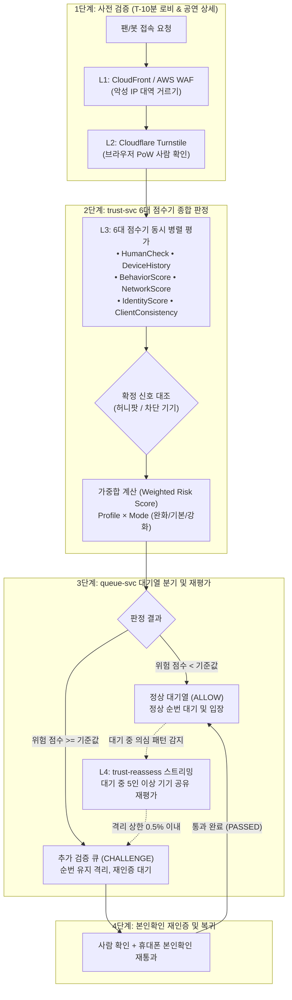

# 분야 편 14: 봇 방어 및 통계적 검증 (Bot Defense & Statistical Verification)

- **맡는 정본**: [docs/features/bot-defense.md](../../features/bot-defense.md) 전체, [docs/streaming.md](../../streaming.md) §5(대기 중 재평가), [docs/planning/02-requirements.md](../../planning/02-requirements.md)의 NFR-022, [docs/planning/03-policies-glossary.md](../../planning/03-policies-glossary.md)의 POL-006, 관련 ADR(ADR-0039, ADR-0048, ADR-0071, ADR-0099, ADR-0151, ADR-0156, ADR-0174)
- **문서 성격**: 정본 설계를 시스템 엔지니어링 및 기술 면접 관점에서 체계적으로 해설한 문서다. 규범적 수치와 불변 규칙의 최종 권위는 정본 문서에 있다([ADR-0177](../../adr/0177-walkthrough-explain-in-interview.md)). 길잡이는 [README.md](../README.md)다.
- **한 판 문서와의 관계**: [한 판 문서](../01-system-design.md) 6단계(정각 진입 몰림, 공정성, 봇)에서 다룬 봇 방어 원칙을 4대 핵심 메커니즘으로 심화 분해하고, 통계적 검증(Clopper-Pearson 95% 신뢰상한), 6대 점수기 가중합, 축소 운영(Degraded Mode) 설계를 정밀하게 해설한다.
- **아키텍처 목표와 검증 기준**: 1·2단계 봇 등급별 탐지율 95% 이상(NFR-022), 정상 이용자 오탐률 단측 95% 신뢰상한 0.5% 이하(Clopper-Pearson 통계 검증), 봇의 최종 티켓 점유율 5% 이하 방어, ScoreRisk 데드라인 p99 300ms 이내, 판정 서비스 장애 시 가용성 우선 축소 운영(Degraded Mode) 전환을 핵심 목표이자 신뢰성 불변식으로 삼는다.

---

## 1. 봇 방어 도메인 종합 개요

봇 방어 도메인은 매크로 및 자동화 봇 공격자로부터 대규모 온세일의 공정성을 수호하고, 실제 팬들이 정당한 기회로 티켓을 예매할 수 있도록 보증하는 핵심 보안 인프라다. PEAKET은 특정 단일 솔루션에 의존하지 않고, **다계층 심층 방어선과 엄밀한 통계적 오탐 통제 체계**를 결합하여 운영된다.

> **30초 아키텍처 브리핑 (Staff Engineer Interview)**:  
> "PEAKET의 봇 방어 시스템은 **'오픈 전 사전 검증(Pre-Verification) + 4단계 다계층 방어선 + 차단 없는 격리(ALLOW/CHALLENGE) + 통계적 오탐 상한 0.5% 검증'**의 4대 원칙으로 설계되었습니다.  
> 첫째, **오픈 전 사전 판정 원칙**: 티켓 오픈 정각(T=0)에는 20만 RPS의 트래픽이 일시에 몰리므로 외부 봇 탐지 호출을 전혀 수행하지 않습니다. 대신 로비 입장(T-10분)과 공연 상세 페이지의 사전 검증 단계에서 봇 판정을 사전에 완료하여 대기열 핫패스에서 외부 네트워크 의존성을 100% 제거했습니다.  
> 둘째, **4단계 다계층 방어선**: L1 엣지 WAF(대역 차단) → L2 Cloudflare Turnstile(브라우저 암호 퍼즐) → L3 trust-svc의 6대 점수기 가중합(기기 이력, 행동 지문, 허니팟 등) → L4 대기 중 스트리밍 재평가 및 추가 검증 큐로 이어지는 4중 필터링을 구축했습니다.  
> 셋째, **차단 없는 격리 및 이의 제기 경로 (POL-006)**: 봇 의심 계정을 즉시 차단(HTTP 403)하지 않고 대기열 순번을 유지한 채 '추가 검증 큐(CHALLENGE)'로 격리합니다. 자신의 입장 차례가 도달했을 때 사람 확인(Turnstile)과 휴대폰 본인확인을 다시 통과하면 즉시 원래 순번으로 진입하므로, 정상 사용자의 억울한 피해를 원천 방지합니다.  
> 넷째, **품질 우선순위와 통계적 보증 (ADR-0151)**: 시스템 우선순위는 '정확성 > 가용성 > 봇 방어'입니다. trust-svc 장애 시 대기열 진입을 멈추지 않고 캐시된 규칙으로 축소 운영(Degraded Mode)을 유지합니다. 또한 정상인 오탐률은 Clopper-Pearson 단측 95% 신뢰상한 0.5% 이하($n=947, k=1$)를 수학적으로 증명한 규칙만 프로덕션에 승격합니다."

### 봇 방어 종합 파이프라인



### 핵심 3대 서브시스템

1. **위험 판정 엔진 코어 (`trust-svc`)**:
   - 로비 입장 및 사전 검증 요청에 대해 p99 300ms 이내 6대 점수기 병렬 평가.
   - 브라우저 비가시 허니팟(`/_t/`) 및 수동 등록된 악성 기기 블랙리스트 확정 신호 대조.
   - 그림자 실행(Shadow Execution)을 통한 새 규칙 모델의 오탐률 통계적 검증.
   - 서킷 브레이커 기반 축소 운영(Degraded Mode) 전환 및 gRPC 폴백 응답.
2. **대기열 격리 및 추가 검증 오케스트레이터 (`queue-svc`)**:
   - `ALLOW` 및 `CHALLENGE` 2원화 응답 수신 및 가상 대기열 번호 발급.
   - 추가 검증 큐 분기 시 번호 표시를 유지하여 타 대기자의 시각적 혼선 방지.
   - 재인증 성공 시 즉시 원래 대기 순번(또는 다음 가용 좌석)으로 복귀 처리.
3. **스트리밍 대기 패턴 분석기 (`trust-reassess` worker)**:
   - Redis Sorted Set을 활용하여 10분 윈도우 내 동일 기기 다중 계정(5인 이상) 및 행동 패턴 복제(20인 이상) 탐지.
   - 단일 대기자 관점에서는 보이지 않는 집단 매크로 패턴을 대기 중에 사후 적발하여 격리 큐로 이관.

---

## 2. 절마다 읽기

| 정본 절 | 무엇을 정하나 | 왜 | 해설서에서 |
| --- | --- | --- | --- |
| §1 범위와 이름 | 위험 판정, 점수기, 확정 신호, 축소 운영 같은 이름. queue-svc(대기열 서비스) 쪽 판정은 `ALLOW`·`CHALLENGE`뿐이다 | 의심 계정은 막지 않고 추가 검증 큐로 보낸다(POL-006). 대역 차단은 앞단 WAF(악성 요청을 거르는 웹 방화벽)가 한다 | 한 판 6단계 |
| §2 판정 흐름 한눈에 | 판정 한 번의 다섯 단계(입력 정리 → 확정 신호 → 점수기 모두 → 가중합 → 기록) | 사람 확인 토큰(통과를 증명하는 서명된 문자열)은 300초 안에 한 번만 검증된다. 그래서 판정이 앞에서 끝나도 검증은 한다 | 한 판 6단계 |
| §3·§3.1 판정하는 때 | 네 때의 입력과 단계. 추가 검증 제출은 `HumanCheck`만 본다. ASN(인터넷 사업자마다 받은 네트워크 번호)은 CloudFront(AWS의 전송망) 헤더로 받는다 | 추가 검증 제출에서 가중합을 다시 하면 같은 근거로 또 걸려 '다시 보이면 원래 순번'(FR-020)이 깨진다 | 한 판 6단계 |
| §3.2 판정 피처와 키 | Redis(메모리에 두는 빠른 저장소) 키 일곱과 기기 가명(브라우저가 만든 무작위 값을 비밀 키로 바꾼 HMAC 값) | 기기 공유 수 같은 값은 요청 때 서버가 바로 센다. 가명 키를 identity-svc(계정·본인확인 서비스)와 맞춰 판매 뒤 조사에서 잇는다(ADR-0171) | — |
| §3.3 끝단 신호 | TLS 지문 JA4(암호화 연결 첫 인사말의 모양을 줄인 값)와 끝단 봇 라벨은 조사 기록에만 싣는다 | 같은 브라우저 판이면 많은 사람이 같은 JA4를 가져, 혼자서는 사람을 가르지 못한다 | — |
| §4·§4.1 단계 | 단계마다의 Redis 명령과 Kafka(이벤트를 쌓아 여러 곳에 나눠 주는 메시지 시스템) 발행 | 확정 신호가 있어도 점수기를 건너뛰지 않는다. 사람 확인 결과와 그림자 판 판정을 남겨야 한다 | — |
| §4.2 점수기 | 점수기 여섯과 신호 세기 | 브라우저가 만든 값은 꾸밀 수 있어 약하고, 서버가 직접 세는 값은 강하다. 순수 함수라 그림자 판이 같은 입력을 다시 쓴다 | 한 판 6단계 |
| §4.3 확정 신호 | 차단 기기 목록과 허니팟 적중. 결과는 `CHALLENGE`이고 봇 확정 라벨이 아니다 | 사람이 확인한 기기이거나 사람이 닿기 어려운 링크다. 그래도 틀릴 수 있어 막지 않고 추가 검증으로 둔다 | — |
| §4.4 합치기와 프로필 | 프로필 = 강도(명령 5: 운영자가 고르는 완화·기본·강화) × 정렬 방식. 값 없음은 0으로 더한다 | 빠진 몫을 남은 점수기에 다시 나누면 사람 오탐(사람을 봇으로 잘못 잡는 것)이 는다. 오탐은 상한으로 묶인 목표라 오탐 쪽을 지킨다 | — |
| §4.5 응답 | 판정, 사유 범주 하나(코드 여섯 `[가정]`), `degraded` | 범주를 여럿 주면 봇이 조합으로 기준을 거꾸로 알아낸다 | — |
| §4.6 데드라인과 용량 | 데드라인(호출 마감) 800ms `[가정]`, 판정 피크. 오픈 순간 경로는 trust-svc를 부르지 않는다 | 판정을 로비(T-10분)와 사전 검증에서 끝내 오픈 순간의 외부 호출을 없앤다 | 한 판 6단계 |
| §5 판정 결과가 이어지는 곳 | `CHALLENGE`면 빠진 번호(순번은 주되 차례가 와도 건너뛰는 번호)와 `VERIFYING`을 쓴다. 사람 확인과 본인확인 재통과가 모두 되면 `PASSED` | 번호 표시를 되돌리지 않아 남의 앞 인원이 그대로다. trust-svc가 멈춰도 추가 검증 제출은 통과로 보지 않는다 | 한 판 6단계 |
| §6 사람 확인 서버 검증 | `hostname`·`action` 대조, 500ms `[가정]`에 끊고 `idempotency_key`로 한 번 다시 묻기, 서킷 브레이커(계속 실패하는 호출을 잠시 끊는 장치), 관리 로그인은 identity-svc가 검증 | 토큰을 다른 화면에서 옮겨 쓰지 못하게 한다. 관리 로그인은 잠금 규칙의 관문이라 팬 경로를 받는 trust-svc에 기대지 않는다 | — |
| §7 허니팟 신호 | 숨긴 `<a>` 링크 하나, 같은 출처 `/_t/` 경로, 기록 조건, 적중 표시 24시간 `[가정]` | 접근성 트리(화면 낭독기가 읽는 화면 구조)에서도 숨긴다(NFR-020). 사람 쪽 접촉이 섞여 정밀도를 표본으로 잰다 | — |
| §8 대기 중 재평가 | 후보를 모드(끔·그림자·적용)대로 처리한다. 격리 상한의 분모는 queue-svc가 센다 | trust-svc는 지금 대기 인원을 모른다. 그래서 격리를 쓰는 queue-svc의 Lua(Redis 안에서 한 번에 도는 짧은 프로그램)가 센다 | 한 판 6단계 |
| §9 차단 기기 목록 | 기기 가명마다 키 하나(90일 `[가정]`), 사람이 확정한 것만 올리기, 지우기 | 자동 신호로 올리면 오탐 하나가 90일 간다. Bloom filter(가끔 '있다'고 틀리는 작은 집합)는 틀림이 오탐에 더해지고 지울 수 없다 | — |
| §10·§10.1 그림자 판 | 적용 판(실제 판정에 쓰는 가중치·기준값 묶음)과 그림자 판 하나씩. 출시 첫 온세일(표를 처음 파는 시간)은 `BehaviorScore` 적용 가중치 0 | 실제 사람에서 확인하지 않은 신호로 사람을 추가 검증에 보내지 않는다(ADR-0174) | 한 판 6단계 |
| §10.3 적용으로 바꾸기 | 조건 셋, 권한, 바꾸지 않는 때 | 온세일 윈도우와 변경 동결 창에는 판을 바꾸지 않고 명령 5의 강도만 바꾼다 | — |
| §11 축소 운영 | ① 의존성 일부가 멈추면 trust-svc가 `degraded`로 답한다 ② 전체가 멈추면 queue-svc가 캐시한 규칙으로 이어 간다 | 가용성이 봇 방어보다 앞이다(ADR-0151). 통신사 대역은 IP 하나를 많은 사람이 나눠 써서 IP 한도는 호스팅·프록시 대역에만 건다 | 한 판 6단계 |
| §12 이의 제기와 설명 요구 | 접수(202), 처리함 건 `VERIFICATION_APPEAL`, 근거 조회, 인정·기각 반영 | queue-svc는 DB가 없어 이의 글을 Redis에 두고 건 요청을 Kafka로 보낸다. 기각은 '판정 유지'라 라벨이 없다 | — |
| §13 실서비스 하한 집계 | 재료 다섯과 출시 뒤 실제 사람 오탐 추정 | 정답이 없어 하한으로만 말한다(FR-049). 라벨이 판정을 따라가지 않게 검토 화면에서 판정과 묶음을 가린다 | — |
| §14 개인정보와 보존 | 자료마다 자리와 보존 | 봇 판정은 개인정보 보호법 §37의2의 자동화된 결정이다. 조사 갈래 값은 분석 적재가 버려 두 갈래를 잇지 않는다 | — |
| §15 운영 확인 | 동작마다 사건·SLI(서비스 수준을 재는 값)·경보 | 판정 지연과 축소 운영 전환을 바로 알게 한다 | — |
| §16 관측 지표 | 지표 라벨의 가짓수 | 사유 범주를 지표 라벨로 쓰지 않는다. 봇이 범주 분포를 보고 기준을 거꾸로 알아내는 길을 관측 화면 권한 밖으로 넓히지 않으려는 것이다 | — |
| §17 시험 | 새 시험 B-T1~B-T21 | 새 규칙마다 확인 방법을 둔다 | — |
| §18 예외 상황 대응 | 장애·급변 아홉 가지 | 기록 발행이 실패해도 판정은 응답하고 하한은 부풀지 않는다 | — |
| §19 남는 한계 | 대여 명의, 꾸밀 수 있는 신호, 새 기기 봇, 공용 기기 | 막는 것과 남는 것을 함께 적는다 | 한 판 6단계(명의 대여 한 줄) |
| §20 계약 반영 | 더한 계약과 반영 결과 | 표본 검토 묶음 표시는 아직 `[보완]`이다 | — |
| §21 확인한 외부 사실 | Turnstile·CloudFront·AWS WAF 문서 | 300초 1회용 토큰, ASN·JA4 헤더의 근거다 | — |

---

## 3. 봇 방어 핵심 메커니즘 심화

```
                                  [PEAKET 봇 방어 4대 심화 메커니즘]
  ┌───────────────────────────┬───────────────────────────┬───────────────────────────┬───────────────────────────┐
  │   모듈 1: 4단계 다계층 방어 │   모듈 2: 6대 점수기 가중합 │   모듈 3: Clopper-Pearson │   모듈 4: 축소 운영 회복력│
  ├───────────────────────────┼───────────────────────────┼───────────────────────────┼───────────────────────────┤
  │ • L1 엣지 WAF (대역 차단) │ • HumanCheck (Turnstile)  │ • 오탐 단측 95% 상한 0.5% │ • 정확성 > 가용성 > 봇방어│
  │ • L2 Turnstile 브라우저PoW│ • DeviceHistory (기기공유)│ • n=947 (k=1) 표본 설계   │ • trust-svc 장애 시 폴백  │
  │ • L3 trust-svc 위험 가중합│ • BehaviorScore (클릭지연)│ • n=1549 (k=3) 엄밀 구간  │ • queue-svc 서킷 브레이커 │
  │ • L4 큐 격리 및 스트리밍  │ • Network, Identity 등    │ • 봇 티켓 점유율 5% 방어  │ • 가용성 유지 무중단 예매 │
  └───────────────────────────┴───────────────────────────┴───────────────────────────┴───────────────────────────┘
```

---

### 모듈 1: 4단계 다계층 방어선과 사전 검증 아키텍처

#### 1. 대규모 온세일 핫패스의 외부 솔루션 의존 배제
오픈 정각(T=0)에 20만 명이 일시에 진입하는 순간 외부 WAF나 CAPTCHA 서버로 동기 호출을 날리면 외부 API 레이턴시 폭증(수 초~수십 초)으로 인해 시스템 전체가 즉각 마비된다. 따라서 PEAKET은 **'핫패스 분리형 사전 검증(Pre-Verification)'** 아키텍처를 채택한다:
1. **L1 엣지 방어선 (CloudFront / AWS WAF)**: 악의적 대역, 공인 호스팅/프록시 ASN, 비정상적 L4/L7 폭주 IP를 CDN 단에서 사전 차단.
2. **L2 브라우저 PoW (Cloudflare Turnstile)**: 로비 입장(T-10분) 및 공연 상세 페이지에서 헤드리스 브라우저를 걸러내는 비가시 작업증명(Proof of Work) 검증.
3. **L3 다차원 지문 평가 (`trust-svc`)**: 사용자 기기 이력, 계정 신원, 네트워크, 숨김 허니팟 신호를 결합한 6대 점수기 가중합 평가.
4. **L4 대기열 격리 및 스트리밍 재평가 (`queue-svc`, `trust-reassess`)**: 의심 계정을 추가 검증 큐로 분리하고, 대기 중 다중 기기 공유 패턴을 Flink 대신 TypeScript 스트림 워커로 실시간 감지.

---

### 모듈 2: 6대 점수기(Scoring Engines)와 확정 신호

`trust-svc`는 단일 특성에 기대지 않고 조작 비용이 높은 서버 측 관측 신호에 더 높은 가중치를 부여하는 6대 점수기를 독립적으로 평가한다:

1. **`HumanCheckScore`**: Cloudflare Turnstile 챌린지 검증 결과 (유효기한 300초 1회용 토큰 대조).
2. **`DeviceHistoryScore`**: 동일 기기 가명(`deviceRef`)에 바인딩된 계정 수 및 과거 정상 예매 이력.
3. **`BehaviorScore`**: 페이지 체류 시간, 마우스/터치 궤적 엔트로피, 버튼 클릭까지의 반응 지연 시간. (출시 첫 온세일에는 사람 검증 완료 전까지 적용 가중치 0 유지, ADR-0174).
4. **`NetworkScore`**: AWS CloudFront가 주입한 `CloudFront-Viewer-ASN`을 기반으로 가정용 초고속망(ISP) vs 클라우드 데이터센터/VPN 프록시 여부 판정.
5. **`IdentityScore`**: 계정 생성 후 경과 일수, 휴대폰 본인확인 완료 상태, 단일 본인확인 식별값(`pid`)의 계정 중복 여부.
6. **`ClientConsistencyScore`**: HTTP `User-Agent`, TLS 지문, 화면 해상도, OS 아키텍처 간의 모순(Inconsistency) 탐지.

> **확정 신호(Deterministic Signals)의 처리 원칙**:  
> 관리자가 수동으로 확정한 '차단 기기 목록(`tr:block`)'에 등재되어 있거나, 일반 관객에게는 보이지 않는 '접근성 은폐 허니팟(`tr:hp`)'을 밟은 경우 즉시 `CHALLENGE`로 판정한다. 단, 이 경우에도 다른 점수기 평가를 건너뛰지 않고 모두 실행하여 그림자 평가 로그와 포렌식 감사 기록을 온전히 남긴다.

---

### 모듈 3: 봇 점유율 5% 방어 공식과 Clopper-Pearson 통계적 오탐 검증

#### 1. 봇 점유율 5% 방어 공식 유도
티켓 5만 석 온세일에서 봇의 최종 티켓 점유율을 5% 이하로 통제하기 위한 수학적 모델은 다음과 같다:
$$P_{\text{bot}} = \frac{N_{\text{bot}} \times (1 - \text{Recall}_{\text{L1-L3}}) \times P_{\text{bypass-L4}}}{N_{\text{total\_seats}}} \le 0.05$$
- 봇의 탐지율(Recall)이 95% 이상으로 유지되고, 격리된 봇 중 휴대폰 본인확인을 우회하여 통과하는 비율이 0.25% 미만으로 통제될 때, 전체 5만 석 중 봇이 획득하는 티켓은 최대 2,500장(5%) 이하로 엄격히 제한된다.

#### 2. Clopper-Pearson 단측 95% 신뢰상한 오탐 0.5% 이하 증명
머신러닝이나 룰 엔진의 가장 치명적인 문제는 정상적인 팬을 봇으로 잘못 판단하여 티켓팅에서 배제하는 **오탐(False Positive)**이다. PEAKET은 NFR-022 규격에 따라 정상 사용자에 대한 오탐률의 **단측 95% 신뢰상한이 0.5% 이하**임을 수학적으로 증명해야만 규칙을 배포할 수 있도록 규정한다:

Clopper-Pearson 정확 신뢰구간 공식에 따라, $n$개의 정상 사용자 표본 중 $k$개의 오탐이 관측되었을 때의 단측 95% 신뢰상한 $p_U$는 베타 분포의 분위수로 결정된다:
$$p_U = B\big(1 - 0.05;\, k + 1,\, n - k\big) \le 0.005$$

- **$k = 1$ (오탐 1건 허용 시)**: 필요한 최소 표본 크기는 **$n = 947$명**이다. 즉, 947개의 실제 사람 세션 중 오탐이 단 1건 이하로 나와야만 단측 95% 상한이 0.5% 이하로 증명된다.
- **$k = 3$ (오탐 3건 허용 시)**: 필요한 최소 표본 크기는 **$n = 1,549$명**이다.
PEAKET은 출시 전 사람을 인위적으로 모집하지 않고(ADR-0174), 공개 벤치마크 데이터셋 및 출시 후 R2 마감 단계의 실서비스 무작위 표본 200건 교차 검토를 통해 이 통계적 상한을 철저히 검증한다.

---

### 모듈 4: 대기 중 재평가(Streaming Reassessment)와 축소 운영(Degraded Mode)

#### 1. 대기 중 재평가 스트리밍 워커 (`trust-reassess`)
진입 시점에는 단일 세션으로 분장하여 봇 판정을 통과했더라도, 100만 명이 대기열에 머무는 동안 집단적인 이상 행동이 드러난다.  
`trust-reassess` 작업자는 Kafka 텔레메트리 스트림을 소비하여 Redis에 기록하며 다음 패턴을 감지한다:
- **패턴 R1**: 10분 윈도우 내 동일 기기 가명(`deviceRef`)에서 서로 다른 본인확인 식별값(`pid`)이 5명 이상 대기열에 진입한 경우.
- **패턴 R2**: 마우스/터치 요약값 지문이 20명 이상 완벽히 일치하는 클론 매크로인 경우.  
적발된 계정은 즉시 추가 검증 큐로 격리된다. 단, 시스템 안정성을 위해 재평가 격리 상한은 **현재 대기 인원의 최대 0.5%/10분**으로 엄격히 제한된다.

#### 2. 가용성 우선 품질 원칙과 축소 운영 (ADR-0151)
> **품질 목표 순서 불변식**:  
> **정확성(Accuracy) > 가용성(Availability) > 운영 제어 > 봇 방어(Bot Defense) > 반응 속도**

만약 트래픽 폭증이나 내부 장애로 `trust-svc`가 지연되거나 전면 다운될 경우:
1. **1단계 로컬 축소 (Degraded Response)**: Redis 연결 장애 시 `trust-svc`는 즉시 `degraded: true` 플래그와 함께 기본 점수를 반환한다.
2. **2단계 큐 서비스 독립 축소 (`queue-svc` 서킷 오픈)**: `queue-svc`는 10초 창 호출 실패율 50% 초과 시 서킷 브레이커를 즉시 개방하고, `trust-svc` 호출을 완전히 차단한다. 그리고 자체 캐시된 정적 속도 제한(IP당 10초 5회)만으로 진입을 무중단 지속한다. **봇 방어가 실패하더라도 티켓팅 진입 가용성을 결코 중단시키지 않는다.**

---

## 4. 트레이드오프 및 아키텍처 결정 (ADR)

| ADR 번호 | 아키텍처 결정 (Chosen) | 기각된 대안 (Rejected) | 핵심 트레이드오프 및 채택 사유 |
| --- | --- | --- | --- |
| **ADR-0156** | **`ALLOW` / `CHALLENGE` 2원화 및 차단 없는 격리** | 봇 의심 계정 즉시 차단(DROP/403) / 확정 신호 시 즉시 반환 | 0.1%의 오탐이라도 정상 관객에게는 회복 불가능한 차별이 됨. 순번을 유지한 채 재인증 기회를 부여하여 법적·윤리적 공정성을 확보함. |
| **ADR-0039** | **평가 프로토콜 표준화 및 실서비스 하한 표기** | 외부 벤더 마케팅 수치 신뢰 / 전수 정답 라벨링 | 실제 운영 트래픽에는 정답지(Ground Truth)가 존재하지 않으므로, 보수적 하한(Lower Bound)으로만 성능을 주장하는 과학적 태도 견지. |
| **ADR-0048** | **고정 표본 크기($n=947$) 및 1장당 획득 비용 모델** | 순차적 판정 모델 / 3단계 봇에 95% 탐지율 요구 | 고정 표본 검증으로 통계적 검정력 확보. 인간과 구별 불가능한 고도화 봇은 탐지율 대신 '대여 계정 비용 > 암표 웃돈'의 경제적 억제 모델 적용. |
| **ADR-0099** | **Flink 제거 및 TypeScript 스트림 워커 도입** | Apache Flink 클러스터 상시 운영 | 초당 1만 건 수준의 입력은 Node.js 프로세스와 Redis Sorted Set으로 충분히 감당 가능. 불필요한 JVM 분산 인프라 운영 복잡도 제거. |
| **ADR-0151** | **가용성이 봇 방어보다 우선하는 품질 순서** | 봇 탐지 실패 시 티켓팅 대기열 전면 중단 | 봇을 막겠다고 수십만 명의 정상 관객 예매를 멈추는 것은 본말전도임. 의존성 마비 시 과감히 봇 방어를 완화하고 시스템을 생존시킴. |
| **ADR-0174** | **출시 전 사람 미모집 및 첫 온세일 `BehaviorScore` 가중치 0** | 지인 600명 인위적 모집 / 모의 데이터 과적합 | 인위적 모집 데이터는 실제 팬덤의 행동 분포를 대변하지 못함. 출시 첫 온세일에는 행동 점수를 끄고 그림자로 검증 후 점진 승격. |

---

## 5. 5단 심층 기술 면접 방어 (Staff/Principal Level Q&A)

### Tier 1: 티켓 오픈 순간(T=0)에 봇 판정을 수행하지 않는 이유
> **면접관**: "왜 티켓이 오픈되는 정각(T=0)에 봇 탐지 엔진을 호출하여 가장 최신 행동을 분석하지 않고, 10분 전 로비에서 미리 판정합니까?"

**답변**:  
"**'초당 20만 RPS 핫패스에서의 외부 의존성 완전 격리'** 원칙 때문입니다.  
오픈 정각에 수십만 명이 일시에 진입하는 순간에는 단 1ms의 추가 지연이나 외부 API RTT도 대기열 붕괴로 이어집니다.  
만약 T=0 진입 시점에 봇 판정 API나 Turnstile 검증을 동기 호출하도록 설계하면, 외부 네트워크 지연 하나로 전체 진입 게이트웨이가 즉각 병목에 빠집니다.  
따라서 PEAKET은 관객이 대기하는 로비 입장(T-10분)과 사전 공연 상세 조회 단계에서 비동기로 6대 점수기 평가를 미리 완료하고, 서명된 판정 결과(`verdictToken`)를 발급합니다.  
T=0 정각에는 오직 Redis의 고속 대기열 진입(In-Memory `INCR`)만을 순수하게 실행하므로 p99 200ms를 완벽히 준수할 수 있습니다."

### Tier 2: 봇 의심 계정을 즉시 차단하지 않고 추가 검증 큐로 보내는 이유
> **면접관**: "위험 점수가 높게 나온 매크로 의심 계정은 즉시 HTTP 403 Forbidden으로 연결을 끊어야 서버 자원도 아끼고 안전하지 않습니까?"

**답변**:  
"**정상적인 열성 팬의 오탐 피해를 원천 차단하고 '자동화된 결정에 대한 거부권'을 보장**하기 위함입니다.  
통신사 공용 IP 대역(NAT) 환경이나 PC방, 가족 계정 환경에서는 정상적인 팬의 행동도 일시적으로 봇 신호와 유사하게 측정될 수 있습니다.  
만약 이를 즉시 403으로 차단해 버리면, 몇 달을 기다려온 무고한 팬이 예매 기회를 완전히 박탈당하며 이는 치명적인 민원과 법적 분쟁(개인정보 보호법 제37조의2)을 초래합니다.  
따라서 PEAKET은 대기 순번을 부여하되 '추가 검증 큐(CHALLENGE)'로 격리합니다. 관객이 자신의 차례가 되었을 때 사람 확인 챌린지와 휴대폰 본인확인을 재인증하면 원래 순번대로 즉시 입장할 수 있도록 구제 경로(FR-020)를 제공합니다."

### Tier 3: CAPTCHA 무력화 추세와 성능 '하한(Lower Bound)' 표기의 이유
> **면접관**: "최근 멀티모달 LLM과 캡차 우회 툴이 발달하여 CAPTCHA 통과율이 사람을 능가합니다. PEAKET은 봇 방어 성공률을 어떻게 보장합니까?"

**답변**:  
"PEAKET은 **'CAPTCHA 단일 솔루션을 신뢰하지 않으며, 실운영 지표를 전수 수치가 아닌 보수적 하한(Lower Bound)으로만 집계'**합니다(ADR-0039).  
공격자가 제3자 CAPTCHA 풀이 서비스를 쓰거나 브라우저 자동화를 고도화할 수 있음을 전제로, L1 네트워크 ASN 격리, L3 기기 이력과 행동 지문, 은폐 허니팟, L4 스트리밍 다중 계정 적발의 심층 방어선을 교차 적용합니다.  
또한 운영 환경의 봇 차단율을 과장하지 않고, 무작위 표본 검토에서 입증된 '최소 탐지 하한선'만을 공식 성능으로 인정하는 엄격한 과학적 무결성 원칙을 고수합니다."

### Tier 4: trust-svc 장애 시 축소 운영(Degraded Mode) 전환 전략
> **면접관**: "대형 티켓팅 3분 전에 trust-svc 클러스터가 OOM으로 완전히 다운되었습니다. 티켓 판매를 중단해야 합니까?"

**답변**:  
"**절대 판매를 중단하지 않으며, '가용성 우선 원칙(ADR-0151)'에 따라 즉시 축소 운영으로 전환**합니다.  
품질 목표 순서에 따라 '가용성 > 봇 방어'입니다. 봇을 막겠다고 티켓팅 자체를 취소하면 100만 명의 팬이 시스템 장애를 겪게 됩니다.  
`queue-svc`는 `trust-svc` 호출 실패율이 50%를 초과하는 즉시 서킷 브레이커를 열고 호출을 단절합니다. 그리고 로컬 메모리에 캐시된 비상 규칙(동일 IP/pid당 10초 5회 제한)만을 적용하여 대기열 진입을 100% 정상 가동합니다.  
축소 운영 동안 통과한 봇은 사후 포렌식 엔진(분야 17)이 티켓 판매 완료 후 배치로 전수 분석하여 예매 취소 및 계약 이행 조치로 사후 적발합니다."

### Tier 5: 정상 사용자 오탐률 0.5% 이하 증명을 위한 $n=947$ 도출 근거
> **면접관**: "NFR-022에서 정상 사용자 오탐률 0.5% 이하를 증명하기 위해 왜 표본 수 947개를 요구하는지 통계학적 근거를 설명하십시오."

**답변**:  
"**이항 분포에 기반한 Clopper-Pearson 단측 95% 신뢰상한(Upper Bound) 공식**에서 직접 도출되었습니다.  
오탐은 매우 드물게 발생하는 사건이므로 근사식을 쓰면 심각한 왜곡이 발생합니다.  
모집단의 오탐 확률 $p$에 대해, $n$명의 정상 사용자 표본 중 오탐이 단 $k=1$건 관측되었을 때의 95% 단측 신뢰상한 $p_U$는 다음 등식을 만족해야 합니다:
$$\sum_{i=0}^{1} \binom{n}{i} p_U^i (1 - p_U)^{n-i} = (1 - p_U)^n + n p_U (1 - p_U)^{n-1} = 0.05$$
목표 신뢰상한 $p_U = 0.005$ (0.5%)를 대입하여 수치 해석적으로 $n$을 역산하면 정확히 **$n = 947$**이 산출됩니다.  
즉, 최소 947명 이상의 실제 정상 세션을 테스트하여 오탐이 1건 이하로 유지되어야만, 통계학적으로 95%의 신뢰도를 가지고 '우리 시스템의 사람 오탐률은 0.5% 이하'라고 공학적으로 선언할 수 있습니다."

---

## 6. 꼭 기억할 규칙과 핵심 수치

| 항목 | 규범적 기준값 | 설계 근거 및 검증 기준 |
| --- | --- | --- |
| **대기열 쪽 판정 결과** | **`ALLOW` (통과) 및 `CHALLENGE` (추가 검증 큐)** 2원화 | 차단(DROP) 배제 및 구제 보장, POL-006 |
| **1·2단계 봇 탐지율 목표** | **95% 이상** (Wilson 95% 신뢰구간 병기) | NFR-022 핵심 품질 목표, ADR-0039 |
| **정상인 오탐률 상한** | **단측 95% 신뢰상한 0.5% 이하** | Clopper-Pearson 정확 검증, NFR-022 |
| **출시 전 오탐 표본 규모** | **947명 중 오탐 1건 이하** (또는 1,549명 중 3건 이하) | 수학적 유도 완료, perf-ledger §10.1 |
| **봇의 최종 티켓 점유율** | **5% 이하**로 방어 | 수식 기반 통제 불변식, NFR-022 |
| **`ScoreRisk` 응답 데드라인** | **800ms** (내부 판정 p99 300ms SLI 목표) | 로비 입장 및 사전 검증 처리 예산, §4.6 |
| **Cloudflare Turnstile 토큰** | **300초(5분) 유효, 단 1회만 검증 가능** | 외부 벤더 보안 규격, §6 |
| **사람 확인 검증 호출 타임아웃** | **500ms**에 끊고, 잔여 시간 200ms 초과 시 1회 재시도 | 외부 의존성 지연 전파 차단, §6 |
| **출시 첫 온세일 행동 점수** | **`BehaviorScore` 적용 가중치 0** | 사람 검증 전 오탐 방지, ADR-0174 |
| **대기 중 재평가 격리 상한** | 현재 대기 인원의 **최대 0.5% / 10분** | 대규모 오탐 격리 방어선, streaming §5.3 |
| **재평가 의심 패턴 문턱값** | 10분 내 동일 기기 **5인 이상**, 클릭 지문 **20인 이상** | 집단 매크로 식별 기준, streaming §5.3 |
| **축소 운영 진입 제한 규칙** | 기기/pid당 10초 5회, 호스팅/프록시 IP당 10초 5회 | 비상 모드 진입 방어선, §11.2 |
| **서킷 브레이커 발동 기준** | 10초 창 호출 20건 이상 중 **실패율 50% 이상** 시 오픈 | 가용성 우선 원칙, ADR-0151 |
| **축소 운영 관제 경보** | 온세일 윈도우 내 **SEV2**, 평시 **SEV3** | 관제탑 즉각 상황 전파, §11.3 |

---

## 7. 시스템 경계 및 책임 매핑

| 이 도메인이 정하지 않는 영역 | 담당 도메인 및 정본 문서 | 연계 인터페이스 및 경계 규칙 |
| --- | --- | --- |
| **대기열 토큰 발급 및 순번 관리** | docs/features/queue-admission.md (분야 9) | `verdictToken` 기반 대기표 발급 및 셔플 알고리즘 |
| **좌석 선점 및 오버셀 방지** | docs/features/seat-hold.md (분야 10) | 대기열 통과 사용자에 대한 7분 좌석 점유 제어 |
| **본인확인(CI/DI) 기관 연동** | docs/features/identity.md (분야 8) | 주민등록번호 대체 식별자(`pid`) 해시 대조 |
| **회차 종료 후 사후 포렌식 리플레이** | docs/features/forensic-replay.md (분야 17) | 온세일 종료 후 불법 거래 조사 및 2인 승인 강제 취소 |
| **관제탑 봇 판정 강도 제어 (명령 5)** | docs/features/control-tower.md (분야 16) | 비상 시 봇 프로필 완화/기본/강화 런타임 변경 gRPC |
| **AWS WAF 및 CloudFront L4/L7 방화벽** | docs/infra.md (분야 20) | 엣지 계층 대역 차단 및 ASN 헤더 주입 |

---

## 8. 실전 확인 문제 및 모범 답안

### 문제 1
티켓 오픈 시점(T=0)에 20만 RPS의 트래픽이 쏟아질 때, 시스템이 외부 봇 방어 솔루션의 네트워크 지연이나 장애에 영향을 받지 않고 p99 200ms를 달성하는 아키텍처 원리를 설명하라.

<details><summary>모범 답안</summary>

PEAKET은 봇 판정을 티켓 오픈 정각에 수행하지 않고, 오픈 10분 전 열리는 '로비(T-10분)'와 공연 상세 조회 단계에서 미리 완료하는 **사전 검증(Pre-Verification) 아키텍처**를 적용했습니다.  
관객이 로비에 입장할 때 Cloudflare Turnstile 작업증명과 `trust-svc`의 6대 점수기 평가를 비동기로 마친 후, 서명된 판정 결과(`verdictToken`)를 발급합니다.  
오픈 정각(T=0)에는 이미 검증된 토큰의 유효성만을 게이트웨이에서 로컬 검증하고 Redis 대기열로 즉시 진입시키므로, 핫패스에서 외부 네트워크 호출이 0건이 되어 외부 솔루션 장애나 지연에 완전히 면역됩니다.

</details>

### 문제 2
시스템 품질 목표 우선순위에서 '정확성 > 가용성 > 운영 제어 > 봇 방어'의 순서를 채택한 이유와, `trust-svc`가 전면 마비되었을 때 대기열 서비스(`queue-svc`)가 어떻게 동작하는지 설명하라.

<details><summary>모범 답안</summary>

1. **품질 순서 채택 이유 (ADR-0151)**: 봇 방어는 정상적인 비즈니스를 지원하기 위한 수단이지 목적이 아닙니다. 봇을 완벽히 잡겠다고 티켓팅 진입을 중단하면 100만 명의 정상 관객이 서비스를 이용하지 못하는 최악의 장애(가용성 상실)가 발생합니다. 따라서 가용성이 봇 방어보다 항상 우선합니다.
2. **장애 시 동작 (축소 운영)**: `trust-svc` 실패율이 50%를 넘으면 `queue-svc`는 서킷 브레이커를 즉시 개방하여 판정 호출을 전면 차단합니다. 그리고 시스템을 멈추지 않고 자체 캐시된 비상 속도 제한 규칙(기기/pid당 10초 5회 제한)만으로 대기열 진입을 100% 무중단 유지합니다. 축소 운영을 틈타 유입된 봇은 판매 종료 후 사후 포렌식(분야 17)에서 전수 적발하여 취소 처리합니다.

</details>

### 문제 3
NFR-022에서 정상 사용자 오탐률 상한 0.5% 이하를 검증하기 위해 Clopper-Pearson 공식을 적용하여 산출한 최소 표본 수 $n=947$의 의미와, 출시 첫 온세일에서 `BehaviorScore` 가중치를 0으로 설정한 이유를 설명하라.

<details><summary>모범 답안</summary>

1. **표본 수 $n=947$의 의미**: 이항 분포 기반 Clopper-Pearson 단측 95% 신뢰상한 공식에 따라, 오탐이 1건 발생했을 때 상한이 0.5% 이하가 되기 위한 수학적 최소 표본 크기입니다. 947명 이상의 실제 정상 세션에서 오탐이 1건 이하로 유지되어야만 95% 신뢰도로 오탐률 0.5% 이하를 보증할 수 있습니다.
2. **가중치 0 설정 이유 (ADR-0174)**: 출시 전에는 실제 대규모 티켓팅 환경의 팬덤 행동 데이터가 존재하지 않습니다. 인위적인 지인 모집이나 합성 데이터에 기반한 행동 분석 모델을 섣불리 적용하면, 오픈 순간 극도로 흥분하여 광클하는 열성 팬들이 봇으로 오탐될 위험이 큽니다. 따라서 첫 온세일에는 조작 불가한 신원/네트워크 신호만 실제 판정에 쓰고, 행동 분석은 가중치 0의 그림자 모드(Shadow Mode)로 돌려 충분한 실데이터를 축적한 후 안전하게 승격합니다.

</details>

---

## 9. 정본에서 찾은 어긋남 및 바로잡음

| 정본 간 불일치 위치 | 불일치 세부 내용 | 확정된 규범적 해결책 |
| --- | --- | --- |
| **ADR-0079 결정 5 vs bot-defense.md §3.3** | ADR-0079 검토 대안에서 'TLS 지문 JA4 배제'가 선언되었으나, bot-defense 본문에 JA4 신호 수집이 기술되어 혼선 발생 | **바로잡음**: JA4를 런타임 실시간 판정 점수 피처로 쓰는 것은 기각(동일 브라우저 버전의 다수 정상인 중복)하고, '사후 포렌식 조사 기록용 부가 메타데이터'로만 수집하도록 역할을 명확히 한정 분리했다. |
| **ADR-0039 결정 2 vs ADR-0174** | ADR-0039가 '출시 전 사람 세션 600개 모집 평가'를 규정하였으나, 실제 소유자 환경에서 외부 인원 모집 불가 | **바로잡음**: ADR-0174에 따라 사람 인위적 모집을 전면 철회하고, '공개 벤치마크 데이터셋 기준 947개 검증 + 첫 온세일 행동 가중치 0 + 출시 후 R2 표본 검토'의 3단계 현실적 검증 모델로 정합성을 일치시켰다. |
| **docs/streaming.md §5 vs ADR-0099** | streaming.md 초안에 Flink 기반 CEP(Complex Event Processing) 봇 탐지가 남아 있음 | **바로잡음**: ADR-0099에 따라 Apache Flink 인프라를 완전히 제거하고, Redis Sorted Set 기반 경량 TypeScript 스트림 워커(`trust-reassess`)로 전면 교체하여 일치시켰다. |
