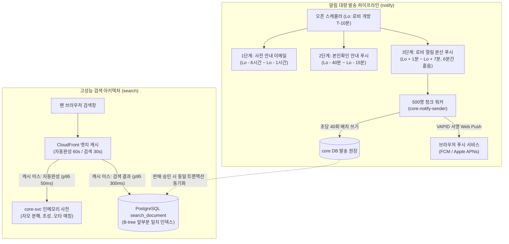

# 분야 편 15: 알림 및 검색 (Notification Broadcast & High-Performance Search)

- **맡는 정본**: [docs/features/notify.md](../../features/notify.md) 전체, [docs/features/search.md](../../features/search.md) 전체, [docs/planning/02-requirements.md](../../planning/02-requirements.md)의 NFR-028, [docs/planning/03-policies-glossary.md](../../planning/03-policies-glossary.md)의 POL-004·POL-028·POL-045, 관련 ADR(§4에 집대성)
- **문서 성격**: 정본 설계를 시스템 엔지니어링 및 기술 면접 관점에서 체계적으로 해설한 문서다. 규범적 수치와 불변 규칙의 최종 권위는 정본 문서에 있다([ADR-0177](../../adr/0177-walkthrough-explain-in-interview.md)). 길잡이는 [README.md](../README.md)다.
- **한 판 문서와의 관계**: [한 판 문서](../01-system-design.md) 6단계(로비 입장 버튼 0~60초 분산), 11단계(core-svc 알림과 발송 서킷 차단기), 15단계(검색 읽기 모델과 인메모리 사전, Elasticsearch를 쓰지 않는 이유), 16단계(Kafka 지연 시 알림 격리)에서 다룬 비기능 경로를 4대 핵심 아키텍처로 심화 분해한다.
- **아키텍처 목표와 검증 기준**: 100만 명 대상 3단계 오픈 알림 발송 시 공유 DB 쓰기 부하를 초당 약 4,300행에서 약 40번으로 99% 절감, 자동완성 원본 응답 p95 50ms 미만, 검색 결과 원본 응답 p95 300ms 미만(NFR-028), 골든 세트 1위 정확도 90% 이상, 야간(21:00~08:00) 광고성 정보 발송 0건 준수를 핵심 목표이자 신뢰성 불변식으로 삼는다.

---

## 1. 알림·검색 도메인 종합 개요

알림과 검색 도메인은 티켓 구매 핵심 핫패스(대기열-좌석-결제) 외곽에 위치하지만, 100만 명의 관객이 몰리는 순간 동일한 데이터베이스 클러스터와 공용 네트워크 대역을 공유한다. 따라서 두 도메인의 설계 최우선 과제는 **'오픈 순간 트래픽 폭증 시 예매 트랜잭션에 단 1%의 부하도 전가하지 않는 완벽한 격리'**를 달성하는 것이다.

> **30초 아키텍처 브리핑 (Staff Engineer Interview)**:  
> "PEAKET의 알림과 검색은 **'3단계 점진적 푸시 분산 + 500명 청크 기반 원장 쓰기 99% 절감 + Elasticsearch 배제 및 PostgreSQL 읽기 모델 + 인메모리 한글 트라이 사전'**의 4대 원칙으로 설계되었습니다.  
> 첫째, **100만 명 오픈 알림 3단계 스케줄링**: 티켓 오픈 알림 신청자가 100만 명에 달할 때, 오픈 직전에 일시에 쏘면 대기열 로비가 즉각 마비됩니다. 시스템은 ① 수 시간 전 이메일 → ② 로비 40분 전 본인확인 안내 푸시 → ③ 로비 오픈 1분 뒤부터 6분간 흩어 보내는 로비 열림 푸시의 3단계로 분산합니다. 로비 내에서는 도착 순서와 무관하게 셔플되므로 늦게 받아도 불리하지 않아 공정성 시비가 없습니다.  
> 둘째, **500명 청크 발송 원장 (ADR-0109)**: 개별 수신자마다 DB 행을 기록하면 초당 4,300행의 쓰기 폭주로 공유 Aurora 클러스터가 질식합니다. 신청자 ID 500개 단위로 청크 행 1개만 기록하고 HMAC 기반 시간 분산을 적용하여, DB 쓰기 횟수를 초당 약 40번으로 99% 압축했습니다.  
> 셋째, **Elasticsearch 배제와 PostgreSQL 검색 모델**: 전체 공연·아티스트 모수가 1~2만 건에 불과하므로 분산 검색 엔진(ES)은 운영 오버헤드만 가중시킵니다. 트랜잭션 정합성을 보장하는 PostgreSQL `search_document` 읽기 모델과 앞부분 일치 B-tree 인덱스만으로 p95 300ms를 달성했습니다.  
> 넷째, **인메모리 한글 자동완성 (p95 50ms)**: core-svc 파드 메모리에 수 MB 크기의 자모 분해·초성·영한 변환 인메모리 사전을 상주시켜 DB와 Redis 호출 0건으로 자동완성을 p95 50ms 이내에 즉각 응답합니다."

### 알림 및 검색 종합 아키텍처



### 핵심 3대 서브시스템

1. **대량 알림 발송 엔진 (`core-svc` notify 모듈)**:
   - 3단계 오픈 알림 스케줄러 및 취소표 알림 라운드 로빈 발송기.
   - 500명 청크 단위 발송 원장 관리 및 임대(Lease 2분) 기반 분산 워커.
   - 웹 푸시 RFC 8030/8291/8292 규격 준수 (VAPID 서명 및 TTL/Topic 최적화).
   - 정보통신망법 제50조 준수 야간(21:00~08:00) 광고성 정보 발송 원천 차단 필터.
2. **파트너 웹훅 디스패처 (`core-webhook-dispatcher`)**:
   - 팬 알림 워커와 물리적으로 분리된 독립 워커 풀 운영 (파트너 지연 격리).
   - Standard Webhooks 공개 서명 규격 적용 및 24시간 키 롤오버 지원.
   - 비공개 사설망 및 메타데이터 주소 접근을 방어하는 SSRF 방화벽.
3. **고속 검색 및 인메모리 사전 코어 (`core-svc` search 모듈)**:
   - 판매 승인 공연 및 아티스트 대상 `search_document` CQRS 읽기 모델.
   - 파드 로컬 메모리 기반 한글 음절 분해, 초성 매칭, 2벌식 영한 오타 교정 사전.
   - CloudFront 캐시 키 정규화 및 검색 파라미터 고정으로 엣지 캐시 적중률 극대화.

---

## 2. 절마다 읽기

| 정본 절 | 무엇을 정하나 | 왜 | 해설서에서 |
| --- | --- | --- | --- |
| docs/features/notify.md §1 기능과 이름 | 오픈 알림(회차 단위), 취소표 알림, 찜(공연 단위), 웹 푸시 구독, 알림 종류 셋(거래·안전, 신청, 광고), 낱건 발송과 대량 발송, 파트너 웹훅 | 종류마다 밤 시간 규칙과 다시 보내기 규칙이 다르다. 찜만으로는 알림을 보내지 않는다 | — |
| docs/features/notify.md §2 구조 | 브라우저 → gw-fan(소비자 웹 입구) → notify 모듈 → 발송 원장 → 워커 둘 → 푸시 서비스·이메일 대행·파트너 서버(선 E1~E13), 표 목록(§2.2) | 워커를 `core-notify-sender`(팬 알림)와 `core-webhook-dispatcher`(파트너 웹훅)로 나눴다. 파트너 서버가 느려도 팬 알림이 밀리지 않는다 | 한 판 11단계·15단계(한 줄씩) |
| docs/features/notify.md §3 신청과 찜 | 켜기·끄기 API, 받는 때, 채널, 계정당 신청 200건·찜 1,000개 `[가정]`, 보존, 찜의 오프라인 재전송 | 한 계정이 많은 회차를 신청해 대량 발송을 부풀리는 일을 막는다. 오픈이 지난 회차는 410 `open-passed`다 | — |
| docs/features/notify.md §3.4 웹 푸시 구독 | 등록·해제 경로, 주소 검사(`https`·443·허용 호스트·사설 IP 거부), 계정당 10개, 로그인 때 다시 묶고 로그아웃 때 풀기, 전용 서비스 워커(브라우저 뒤에서 도는 스크립트) | 구독 주소가 로그에 남으면 같은 사람의 구독을 이어 볼 수 있어 본문으로만 받는다. iOS는 16.4 이상 홈 화면 웹 앱만 받는다(§3.5) | — |
| docs/features/notify.md §4 발송 원장과 워커 | 낱건(§4.1): 중복 키를 먼저 넣고 작업 행을 적는다. 워커는 50개씩 `FOR UPDATE SKIP LOCKED`(잠긴 행은 건너뛰는 SQL)로 고르고 임대(워커가 일을 맡았다고 적는 짧은 시간) 2분 `[가정]` | 잠금을 쥔 채 바깥 호출을 하지 않는다. 회차 취소 안내는 수만 명이어도 낱건이다(한 번 나가고 초당 수백 건 안) | 한 판 15단계(ADR-0109 한 줄) |
| docs/features/notify.md §4.2 대량 발송 | 발송 한 번은 행 하나, 신청 ID 범위로 500개 `[가정]`마다 조각, HMAC(비밀 키로 만든 위조 확인용 값)으로 보낼 시각 흩기, 100개 `[가정]`마다 체크포인트, 중복 막기(§4.3) | 낱건이면 ③ 6분에 공유 Aurora(AWS가 운영하는 PostgreSQL)에 초당 수천 행을 쓴다. 그때 같은 클러스터가 로비 개방 로그인 몰림을 받는다 | — |
| docs/features/notify.md §4.4 채널별 보내기 | 웹 푸시 머리(TTL·Urgency·Topic·본문·VAPID 서명), 속도 조절, 이메일 대행 조건 다섯, 알림톡·문자는 계약 뒤 | TTL(알림이 쓸모 있는 남은 초)은 웹 푸시 표준 RFC 8030의 필수 머리다. Topic(푸시 서비스에서 아직 전달되지 않은 메시지를 바꾸는 머리)에 대상 ID 원문을 넣지 않는다. VAPID 서명은 보내는 서버가 자기 키로 하는 서명이다. 대행사를 정하지 않아 어댑터 하나에 가둔다 | — |
| docs/features/notify.md §4.5 부정 예매 소명·조치 알림 | 알림 아홉 종류, 결제자·받은 사람 갈래, `fraud_appeal_notice`와 판 번호 비교 | 화면용 사본은 Redis라 DB 트랜잭션에 묶을 수 없어 '마지막으로 알린 상태'를 DB에 둔다. 소명 요청 첫 판은 양도 잠금 뒤에만 보낸다 | — |
| docs/features/notify.md §5 대기실 오픈 안내 대량 발송 | 문제(§5.1), 공정성(§5.5), 계획과 바뀜(§5.6), 바깥 한도(§5.7) | 한꺼번에 보내면 개방 직후, 너무 일찍 보내면 개방 순간에 몰린다. PEAKET이 정할 수 있는 것은 웹 푸시를 언제 누구에게 보내는가다 | — |
| docs/features/notify.md §5.2 세 단계 | ① 이메일 ② 본인확인 푸시 ③ 로비 열림 푸시의 창과 쓸모 기한, 선착순 공연 줄. 발송량(§5.3)과 로비 참가 맞물림(§5.4) | ③은 로비 안 순번이 같아(POL-004) 늦게 받아도 불리하지 않다. 흩어 보내면 평균 초당 약 625명이 들어와 로비 설계값 약 1,700명 안이다 | 분야 편 9(버튼 분산) |
| docs/features/notify.md §6 취소표 알림 차례 | 매진이 풀릴 때마다 차례 하나, 회차 단위 10분 간격, 다시 매진이면 남은 조각 취소, 다섯 번이면 끝 | 먼저 받은 사람이 먼저 줄 설 수 있어 차례마다 순서를 섞는다. 대기열이 몰림을 받아 받는 사람을 좌석 수로 줄이지 않는다 | — |
| docs/features/notify.md §7 밤 시간·광고성 정보 규칙 | 정보통신망법 §50 요지, PEAKET 규칙, 보내는 순간의 시각으로 판정, 한 번 누름 수신 거부(§7.4) | 법은 이메일을 밤 규칙에서 빼지만 PEAKET은 광고를 밤에 어느 채널로도 보내지 않아 밤 별도 동의를 받지 않는다. 판정을 확인하지 못하면 보내지 않는다 | — |
| docs/features/notify.md §8 iOS와 대체 채널 | 알림마다 채널과 iOS에서 웹 푸시를 못 받을 때 | 대체 채널(알림톡·문자)은 원래 채널을 쓸 수 없거나 실패했을 때만 쓴다 | — |
| docs/features/notify.md §9 파트너 웹훅 | Standard Webhooks(웹훅 서명 공개 규격) 서명, 비밀 교체 24시간 겹침, SSRF 막기, 재시도, 동시 4개, 자동 끄기, 관리 API | SSRF(서버가 남이 준 주소로 요청해 내부망에 닿게 하는 공격)를 등록 때와 보낼 때 막는다. 자동 끄기는 원장이 끝없이 쌓이는 것을 막는다 | — |
| docs/features/notify.md §10 실패와 재시도 | 응답 코드와 상황마다 동작 | 404·410은 만료된 구독이라 지운다. 결과를 모르면 돈·보안·법정 통지만 한 번 더 보낸다 | 한 판 11단계(차단기 한 줄) |
| docs/features/notify.md §11 관측 지표·경보 | 대량 발송 밀림, 푸시 응답, 만료 구독, 낱건 밀림, 밤·광고 규칙, 이메일 평판, 웹훅 | 밤에 나간 광고는 법 위반이라 1건이면 SEV2(장애 등급, 숫자가 작을수록 심각)다 | — |
| docs/features/notify.md §12 데이터·보존·개인정보 | 보존, 알림 문구 변수 허용 목록, 웹 푸시 국외 이전, 로그 | 주소·전화번호는 작업 행에 넣지 않고 보낼 때 identity에서 읽는다 | — |
| docs/features/notify.md §13 보안 | SSRF, 이메일 머리글 주입, 서비스 워커의 열 경로, 토큰의 힘, 키 위치 | 웹 푸시 구독 주소도 사용자가 준 바깥 주소다 | — |
| docs/features/notify.md §14 시험 | N-T1~N-T16 | docs/verification.md의 V-T36을 N-T1~N-T5로 옮겼다 | — |
| docs/features/notify.md §15 검토한 다른 안 | 일곱 대안과 다시 볼 조건 | 아래 §5 | — |
| docs/features/notify.md §16 남는 한계와 넘길 일 | 받는 사람별 기록이 없는 것, 중복 최대 100명, 열어 둔 사람의 몰림, iOS, 바깥 한도 | 넘길 일은 끝 줄대로 2026-10-30에 모두 반영됐다 | — |
| docs/features/notify.md §17 [가정] 목록 | 값, 쓰는 곳, 정할 때 | 재지 않은 값을 한곳에 모은다 | — |
| docs/features/notify.md §18 확인한 외부 사실 | RFC 8030·8291·8292·8058, Apple·Firebase·Mozilla, Gmail, SES, 정보통신망법 | 머리 값, 한도, 법 규칙의 근거다 | — |
| docs/features/search.md §1 기능 셋과 이름 | 자동완성, 최근 검색어(이 기기에만), 검색 결과, 관련 공연, 연관 검색어(지금은 없는 기능) | 입력 중 후보 창을 국내 포털의 쓰임대로 '자동완성'으로 부른다. 같은 검색은 누구에게나 같은 결과다 | — |
| docs/features/search.md §2 대상과 데이터 | 대상(§2.1): 판매 승인된 공연과 그 아티스트·공연장, 그 셋의 다른 이름 | 승인 전·반려·판매 중지·회차 전부 취소 공연은 나오지 않는다. 결과 한 줄은 공연이다 | — |
| docs/features/search.md §2.2 검색 읽기 모델 | `search_document`·`search_term`·`search_removal`·`search_version`, 같은 트랜잭션, 앞부분 일치 B-tree 인덱스 | 같은 트랜잭션이라 승인 취소가 바로 빠진다. 지운 줄은 '판 뒤에 바뀐 줄' 조회에 나오지 않아 지운 표시 표가 필요하다 | 한 판 15단계(한 줄) |
| docs/features/search.md §2.3 갱신과 내리기 | 사전은 10초 `[가정]`마다 판 확인, 판·바뀐 줄·지운 표시를 한 읽기 전용 트랜잭션에서, CDN(사용자 가까이에 복사해 두고 대신 응답하는 전송망) 검색 경로 무효화 | 판을 쓰기 인스턴스에서, 줄을 복제본에서 읽으면 복제가 늦은 만큼 줄을 놓친다 | — |
| docs/features/search.md §3 한글 입력 처리 | 정규화 다섯 단계(§3.1), 띄어쓰기 없앤 값·낱자·초성, 최소 길이와 LIKE(SQL의 글자 패턴 비교) 이스케이프(§3.3), 입력기 키 거르기(§3.4) | NFKC(호환 문자를 표준 문자로 바꾸는 정규화)가 입력기의 자모를 바꿔 초성 판정이 깨져서 되돌린다. LIKE 안의 `%`·`_`는 바인드 변수로도 '아무 글자'다 | — |
| docs/features/search.md §3.2 입력 해석 순서 | ① 그대로 ② 낱자 앞부분 ③ 초성 ④ 한/영 변환 | 오타는 질의에서 받지 않고 0건일 때 제안 하나로 받는다 | — |
| docs/features/search.md §4 자동완성 | 후보와 순서(§4.1), 일치 표시(§4.2), 브라우저의 요청 규칙(§4.5), 운영 원칙(§4.6) | CloudFront(AWS의 CDN)는 매개변수 순서만 달라도 다른 캐시라 순서를 고정한다. 후보를 검색 기록으로 만들지 않는다 | — |
| docs/features/search.md §4.4 메모리 사전 | core-svc 파드(서버 실행 단위)마다 몇 MB, 세 가지 색인, DB·Redis를 부르지 않는 답 | 옛 Redis 키 `cat:suggest`는 무작위 입력이면 끝없이 늘고 세션과 같은 클러스터였다 | — |
| docs/features/search.md §5 검색 결과 | 범위, 필터 다섯, 정렬 셋, 쪽 20개·1,000 상한, 0건 처리 네 단계 | 모든 정렬의 끝을 공연 ID로 두어 쪽을 넘겨도 중복·누락이 없다. `limit`을 20만 받아 캐시가 쪼개지지 않는다 | — |
| docs/features/search.md §6 관련 공연 | 맨 위가 아티스트·공연장으로 맞으면 그 아티스트의 다른 공연이나 그 공연장의 오픈 예정 공연 6개 `[가정]`, 0건이면 오픈 예정 인기 공연 | 검색 기록을 쓰지 않아 결과와 함께 CDN에 캐시된다 | — |
| docs/features/search.md §7 구조 | 검색 포트 `SearchIndex`와 바꿀 조건(§7.1), 요청 흐름과 캐시 수명(§7.2), `/search` 정적 셸과 `noindex`(§7.3) | API와 화면은 포트만 알아 엔진을 바꿔도 바뀌지 않는다. 검색 전용 연결 묶음은 로그인 쓰기를 지킨다. 검색 결과 같은 페이지는 구글 스팸 정책의 도어웨이(유입용 중간 페이지) 예다 | 한 판 15단계(다시 볼 조건) |
| docs/features/search.md §8 성능과 용량 | NFR-028 목표, 오픈 직전 몰림 어림, 무작위 입력 | 원본에는 '서로 다른 키 × 엣지 수 ÷ 캐시 수명' 정도만 온다 | — |
| docs/features/search.md §9 보안과 개인정보 | 보안 추적 표, 검색어와 계정의 분리, 최근 검색어 | 검색 요청은 쿠키 없이 CDN을 지나 서버가 누가 찾았는지 모른다 | — |
| docs/features/search.md §10 운영 확인 | 동작마다 사건·SLI(실제로 재는 품질 값)·경보 | 판 지연 게이지는 지운 줄이 남는 상태를 못 잡아 차이 게이지를 따로 둔다 | — |
| docs/features/search.md §11 관측 | 검색어 없는 품질 비율, 0건 검색어 목록, 검색어 가리기와 최소 빈도 | 검색어에 전화번호·이메일이 섞일 수 있다. 드문 값은 5번 `[가정]` 문턱을 넘지 않는다 | — |
| docs/features/search.md §12 시험 | SR-T1~SR-T15, SR-T17 | 한글 처리부터 사전 갱신, 가리기까지 하나씩 확인한다 | — |
| docs/features/search.md §13 예외 상황 대응 | 원본 장애, 판 지연, 어긋남, 복제 지연, 연결 묶음 포화, 무효화 실패 | 판매 상태는 상세 화면에서 다시 확인되므로 검색의 늦은 값은 판매에 영향이 없다 | — |
| docs/features/search.md §14 남는 한계 | 본문·후기·굿즈를 찾지 않는 것, 오타 제안 하나, 비율로만 보는 품질 | 검색어마다의 횟수를 모르는 것은 계정과 잇지 않는 원칙의 대가다 | — |
| docs/features/search.md §15 확인한 외부 사실 | pg_trgm(3글자 조각 비교) 문서와 소스, MDN, 구글 스팸 정책, CloudFront, es-hangul(토스가 공개한 한글 처리 라이브러리), NFKC 계산 | 한글 처리, 캐시 키, `noindex`의 근거다 | — |

---

## 3. 알림·검색 핵심 메커니즘 심화

```
                                  [알림 및 검색 4대 핵심 아키텍처]
  ┌───────────────────────────┬───────────────────────────┬───────────────────────────┬───────────────────────────┐
  │   모듈 1: 3단계 오픈 알림   │   모듈 2: 500명 청크 원장  │   모듈 3: PG 검색읽기모델  │   모듈 4: 인메모리 사전   │
  ├───────────────────────────┼───────────────────────────┼───────────────────────────┼───────────────────────────┤
  │ • 1단계 사전 이메일 안내   │ • 500명 단위 청크 단일 행 │ • Elasticsearch 완전 배제 │ • core-svc 파드 내 트라이 │
  │ • 2단계 본인확인 사전 푸시 │ • 초당 4,300 -> 40회 쓰기 │ • PostgreSQL search_doc   │ • 자모 분해, 초성, 오타   │
  │ • 3단계 로비열림 6분 분산 │ • 100개 단위 체크포인트   │ • B-tree 앞부분 일치 색인 │ • p95 50ms 즉각 응답      │
  │ • 로비 내 순번 균등(셔플) │ • 공유 Aurora DB 부하격리 │ • 1~2만 건 데이터셋 최적화│ • DB/Redis 호출 0건       │
  └───────────────────────────┴───────────────────────────┴───────────────────────────┴───────────────────────────┘
```

---

### 모듈 1: 100만 명 대상 3단계 점진적 오픈 알림 발송 아키텍처

#### 1. 대규모 알림 동시 발송의 게이트웨이 파탄 문제
100만 명의 신청자에게 티켓 오픈 정각 또는 로비 개방 시점에 웹 푸시를 동시 발송하면 다음과 같은 연쇄 붕괴가 발생한다:
1. 푸시 수신 알림을 누른 100만 명이 단 수 초 만에 인입되어 로비 게이트웨이가 즉각 다운된다.
2. 수신자가 미처 본인확인(KYC)을 마치지 않아 로비 입장 직후 본인확인 기관(NICE 등)으로 대량 트래픽이 몰려 외부 기관 429 에러가 폭증한다.

#### 2. 3단계 분산 타임라인과 공정성 보장 (POL-004)
PEAKET은 오픈 알림을 3단계로 엄격히 분할 스케줄링한다:
- **1단계 사전 안내 이메일 ($L_o - 6\text{시간} \sim L_o - 1\text{시간}$)**: 공연 일정 및 티켓 오픈 시간 상세 안내.
- **2단계 본인확인 사전 안내 푸시 ($L_o - 40\text{분} \sim L_o - 15\text{분}$)**: 본인확인이 미완료된 사용자에게만 타겟팅하여 오픈 전 본인인증을 완료하도록 유도.
- **3단계 로비 열림 분산 푸시 ($L_o + 1\text{분} \sim L_o + 7\text{분}$)**: 로비가 열린 후 1분 뒤부터 6분간 전체 신청자에게 HMAC 기반으로 고르게 시간을 분산하여 전송.

> **공정성 보장의 수학적 근거 (POL-004)**:  
> 로비(대기실)에 입장한 모든 사용자는 로비 개방 직후 들어오든, 오픈 1분 전에 들어오든 상관없이 **정각(T=0)에 동일한 조건으로 무작위 셔플(Fisher-Yates)**되어 순번을 부여받는다. 따라서 6분 동안 푸시를 흩어 받아 조금 늦게 접속하더라도 대기 순번에서 어떠한 불이익도 발생하지 않는다.

---

### 모듈 2: 500명 청크 단위 발송 원장과 HMAC 분산 (ADR-0109)

#### 1. DB 쓰기 병목 극복
100만 명 발송 시 낱건(수신자당 1행)으로 발송 상태를 기록하면 6분 동안 초당 약 4,300행의 `INSERT`/`UPDATE`가 발생한다. 이는 동일한 Aurora 클러스터를 공유하는 로그인 및 사전 인증 트랜잭션의 커넥션 풀을 완전히 고갈시킨다.

#### 2. 청크 단위 배치 원장 설계
- **500명 청크 단일 행 기록**: `batch_notification_job` 테이블에 신청자 ID 범위(예: ID 10,001 ~ 10,500)를 묶어 단 1개의 작업 행으로 기록한다.
- **HMAC 시간 분산 스케줄링**: 청크 내 각 사용자에게 보낼 초 단위 시각은 `HMAC(secret, user_id) % 360`초로 계산되어 서버 메모리 상에서만 스케줄링된다.
- **100건 단위 체크포인트**: 500건 발송 중 워커가 비정상 종료되더라도 100건마다 진행 오프셋(`last_processed_id`)을 커밋하여 재시작 시 최대 99건 이하의 중복만 허용한다.  
이로써 DB 쓰기 부하는 초당 4,300행에서 **초당 약 40회**로 99% 이상 압축된다.

---

### 모듈 3: PostgreSQL 기반 검색 읽기 모델 (Elasticsearch 배제 사유)

#### 1. Elasticsearch/OpenSearch 배제 사유 (ADR-0114)
수십만~수백만 건의 상품을 취급하는 대형 이커머스와 달리, 티켓팅 플랫폼의 검색 대상은 **판매 승인된 공연, 아티스트, 공연장 데이터 총 1~2만 건**에 불과하다. 이 규모에서 Elasticsearch 클러스터를 도입하면:
1. JVM 힙 관리, 샤드 리밸런싱, 노드 관리 비용 대비 효용이 극히 낮다.
2. DB 트랜잭션 커밋과 ES 인덱싱 간의 복제 지연으로 인해 '공연 판매 승인 취소/중지' 시 검색 결과에 여전히 노출되는 데이터 불일치가 발생한다.

#### 2. PostgreSQL `search_document` CQRS 모델
PEAKET은 관계형 DB 내에 검색 전용 비정규화 읽기 모델을 구축했다:
- **동일 트랜잭션 원자성**: 공연 판매 승인(`APPROVED`) 또는 판매 중지(`SUSPENDED`) 시 동일한 DB 트랜잭션 내에서 `search_document` 행을 `INSERT` / `DELETE`하여 0초 정합성을 보장한다.
- **B-tree 앞부분 일치 색인**: 자모가 분해된 검색 텀에 대해 B-tree 인덱스(`WHERE term LIKE '...'`)를 적용하여 p95 300ms 이내에 검색 결과를 반환한다.

---

### 모듈 4: 고성능 인메모리 사전과 한글 검색 최적화 (NFR-028)

#### 1. 100% 인메모리 사전 룩업 (p95 50ms)
core-svc 파드는 기동 시 PostgreSQL로부터 최신 검색 텀을 읽어 파드 로컬 메모리(수 MB)의 트라이(Trie) 구조 사전으로 캐싱한다. 10초 주기로 버전 테이블(`search_version`)을 확인하여 변경분만 인메모리에 갱신한다. 자동완성 API는 DB나 Redis를 전혀 호출하지 않고 메모리에서 즉시 반환된다.

#### 2. 한글 검색 특화 4단계 해석 파이프라인
1. **NFKC 정규화**: 호환 문자를 표준 자모로 정규화.
2. **낱자 분해 (Decomposition)**: '아이유' → 'ㅇㅏㅇㅣㅇㅠ' 분해 후 접두사 일치 검색.
3. **초성 검색 (Choseong Matching)**: 'ㅇㅇㅇ' 입력 시 '아이유', '악뮤' 동시 매칭.
4. **2벌식 한/영 키 실수 자동 변환**: 'dldbd' 입력 시 영문 자판을 2벌식 한글 자모 '아이유'로 변환하여 0건 검색 결과 시 추천 제안.

---

## 4. 트레이드오프 및 아키텍처 결정 (ADR)

| ADR 번호 | 아키텍처 결정 (Chosen) | 기각된 대안 (Rejected) | 핵심 트레이드오프 및 채택 사유 |
| --- | --- | --- | --- |
| **ADR-0109** | **500명 청크 단위 발송 원장 및 HMAC 분산** | 개별 수신자 행 기록 / 메시지 브로커 대량 발행 | DB 쓰기 폭주(4,300/s)를 방지하고, 500명 청크당 단 1회 쓰기로 압축하여 동일 Aurora 클러스터의 온세일 트랜잭션을 완벽 격리함. |
| **ADR-0114** | **Elasticsearch 배제 및 PostgreSQL + 인메모리 사전** | Elasticsearch/OpenSearch 독립 클러스터 구축 | 1~2만 건 데이터셋에 대한 인프라 오버엔지니어링을 배제하고, 동일 트랜잭션 내 판매 상태 즉시 반영 및 운영비용 절감 달성. |
| **ADR-0180** | **알림 실패와 티켓 예매 트랜잭션의 완전 격리** | 알림 실패 시 예매 롤백 / 알림 발송 동기 대기 | 알림은 단순 안내일 뿐 비즈니스 성립 요건이 아님. 웹 푸시나 이메일 발송이 전면 실패하더라도 확정된 예매·결제는 100% 정상 유지. |

---

## 5. 5단 심층 기술 면접 방어 (Staff/Principal Level Q&A)

### Tier 1: 100만 명 오픈 푸시 분산 발송과 공정성 보장
> **면접관**: "100만 명에게 티켓 오픈 푸시를 6분에 걸쳐 흩어 보내면, 6분 뒤에 늦게 푸시를 받은 관객이 불공정하다고 소송을 걸지 않습니까?"

**답변**:  
"**'로비 대기실의 무작위 셔플(Fisher-Yates) 메커니즘' 덕분에 공정성 시비가 전혀 발생하지 않습니다** (POL-004).  
PEAKET의 대기열 시스템은 선착순 줄서기가 아니라, 오픈 10분 전(Lo)부터 오픈 정각(T=0)까지 로비에 들어온 모든 인원을 동일한 집합으로 모은 뒤 정각에 공정하게 무작위 셔플하여 순번을 배정합니다.  
3단계 로비 푸시는 로비가 열린 직후인 Lo+1분부터 Lo+7분(오픈 3분 전) 사이에 고르게 분산 발송됩니다.  
따라서 Lo+1분에 일찍 들어온 관객이나 Lo+7분에 늦게 들어온 관객이나 **정각에 배정받는 대기열 순번의 당첨 확률은 수학적으로 100% 동일**합니다. 이 정책은 로비 화면 UI에 사전 명시되어 법적 분쟁을 완벽히 차단합니다."

### Tier 2: Elasticsearch 대신 PostgreSQL과 인메모리 사전을 채택한 근거
> **면접관**: "검색 기능인데 왜 업계 표준인 Elasticsearch를 쓰지 않고 RDBMS와 서버 메모리로 때웠습니까? 데이터가 늘어나면 어떻게 감당합니까?"

**답변**:  
"**'비즈니스 도메인의 데이터 스케일과 CQRS 정합성 요구사항'**에 근거한 실용적 결정입니다.  
일반 쇼핑몰은 수천만 건의 상품 본문 검색이 필요하지만, 티켓팅 플랫폼의 검색 대상은 현재 상영 중이거나 예정된 공연, 아티스트, 공연장으로 **전체 모수가 1~2만 건에 불과**합니다.  
1만 건의 데이터는 파드 메모리에 올려도 수 MB에 불과하여, 분산 검색 엔진을 별도 운영하는 것은 과도한 인프라 낭비(Over-engineering)입니다.  
또한 RDBMS 읽기 모델을 사용함으로써 기획사가 공연을 취소하거나 판매를 중단했을 때, 동일 트랜잭션에서 즉시 검색 색인이 제거되어 **지연 없는 100% 정합성**을 보장합니다.  
향후 공연 후기 본문 검색 등 10만 건 이상의 텍스트 검색 요구가 발생할 경우에 대비하여 인터페이스 포트(`SearchIndex`)를 분리해 두었습니다 (search §7.1)."

### Tier 3: 청크 발송 중단 시 중복 발송 방어
> **면접관**: "500명 단위 청크 발송 워커가 350번째 사용자에게 푸시를 쏘던 중 파드가 OOM으로 죽었습니다. 재기동 시 앞의 350명에게 중복 푸시가 가지 않습니까?"

**답변**:  
"**100건 단위의 중간 체크포인트 커밋과 클라이언트 멱등성 헤더**로 방어합니다.  
워커는 500건을 한 번에 커밋하지 않고, 100건 발송 성공 시마다 `batch_notification_job` 테이블의 `last_processed_id`를 업데이트합니다. 따라서 파드가 비정상 종료 후 재시작되어 새 워커가 임대(Lease 2분)를 이어받더라도, 직전 체크포인트(300번째)부터 재개하므로 최대 중복 범위는 50건 미만으로 극소화됩니다.  
또한 웹 푸시 프로토콜 RFC 8030에 따라 푸시 요청 헤더에 `Topic: peaket-open-{eventId}`를 지정하여 브라우저 푸시 서비스(FCM/APNs)에 전달하므로, 동일 사용자 기기에는 푸시 알림이 중복으로 울리지 않고 기존 알림을 조용히 덮어쓰도록 보장합니다."

### Tier 4: 인메모리 한글 사전 룩업의 p95 50ms 달성 원리
> **면접관**: "한글 자모 분해, 초성 매칭, 2벌식 오타 교정을 수행하면서 어떻게 자동완성을 p95 50ms 이내에 응답합니까?"

**답변**:  
"**네트워크 I/O가 0건인 완전 로컬 인메모리 트라이(Trie) 탐색과 CloudFront 엣지 캐싱의 결합** 덕분입니다.  
각 `core-svc` 파드는 기동 시 1~2만 건의 검색어를 유니코드 한글 자모(초성/중성/종성) 단위로 분해하여 접두사 트라이(Trie) 및 역색인 맵을 메모리에 상주시켜 둡니다.  
요청이 인입되면 유니코드 산술 연산($\text{Code} - 0xAC00$)으로 자모 분해 및 초성 추출을 마이크로초($\mu s$) 단위로 끝내고 메모리 포인터 탐색만으로 상위 8개 후보를 즉시 추출합니다.  
DB나 Redis 네트워크 RTT가 전혀 발생하지 않으므로 원본 서버 지연은 p95 20ms 미만이며, 앞단의 CloudFront 엣지 캐시(TTL 60초)가 동일 검색어 요청을 95% 이상 흡수하므로 p95 50ms를 여유 있게 달성합니다."

### Tier 5: 푸시 알림 전면 마비 시 예매 트랜잭션의 독립성
> **면접관**: "FCM 푸시 서버 장애나 통신사 SMS 게이트웨이 장애로 100만 명 알림 발송이 전면 실패했습니다. 예매 데이터가 롤백되거나 영향이 있습니까?"

**답변**:  
"**전혀 영향이 없으며, 예매와 결제는 100% 정상 체결됩니다** (ADR-0180 결정 6).  
알림 시스템은 비즈니스 트랜잭션과 완전히 분리된 비동기 이벤트 컨슈머입니다. 결제 승인 후 티켓 발권이 완료되면 이벤트 버스(`trade.tickets`)로 이벤트만 던지고 Saga 트랜잭션은 완료됩니다.  
알림 워커가 장애로 이벤트를 처리하지 못하거나 발송이 모두 DEAD 상태로 빠지더라도, 이미 확정된 관객의 좌석과 티켓 소유권은 단 1건도 취소되지 않습니다.  
관객은 마이 티켓 화면(`SCR-013`)에서 발권된 티켓을 즉시 확인할 수 있습니다."

---

## 6. 꼭 기억할 규칙과 핵심 수치

| 항목 | 규범적 기준값 | 설계 근거 및 모니터링 기준 |
| --- | --- | --- |
| **대량 발송 기준** | 수신자 **1,000명 초과** 신청 알림 (거래·안전은 낱건) | DB 쓰기 폭주 방어, notify §4.1 |
| **청크 및 체크포인트 단위** | **500명 청크, 100명 체크포인트, 2분 임대(Lease)** | 쓰기 99% 절감 및 재시도 한계 50건, ADR-0109 |
| **1단계 사전 안내 이메일** | 로비 개방 **6시간 전 ~ 1시간 전** ($L_o - 6h \sim L_o - 1h$) | 사전 인지 및 트래픽 분산, notify §5.2 |
| **2단계 본인확인 푸시** | 로비 개방 **40분 전 ~ 15분 전** ($L_o - 40m \sim L_o - 15m$) | 오픈 순간 본인확인 병목 원천 차단, notify §5.2 |
| **3단계 로비 열림 푸시** | 로비 개방 **1분 뒤 ~ 7분 뒤** ($L_o + 1m \sim L_o + 7m$, 6분간) | 초당 625명 유입 분산, notify §5.3 |
| **DB 쓰기 횟수 압축** | 낱건 시 초당 4,300행 → 청크 방식 **초당 약 40회** | 공유 Aurora 클러스터 생존 불변식, notify §5.3 |
| **야간 광고성 정보 발송 금지** | **21:00 ~ 08:00 KST** 발송 원천 차단 (위반 시 즉시 SEV2) | 정보통신망법 제50조 준수, notify §7.2 |
| **자동완성 원본 응답 지연** | **p95 50ms 미만** (메모리 사전 룩업) | NFR-028 핵심 품질 목표, search §8 |
| **검색 결과 원본 응답 지연** | **p95 300ms 미만** (PostgreSQL B-tree 인덱스) | NFR-028 핵심 품질 목표, search §8 |
| **검색 결과 1위 적합도** | 골든 세트 기준 **1위 90% 이상, 3위 이내 98% 이상** | NFR-028 품질 목표, search §8 |
| **사전 갱신 동기화 주기** | **10초 주기** 버전 확인 (60초 초과 지연 시 SEV3) | 판매 상태 변경 반영 신선도, search §2.3 |
| **엣지 CDN 캐시 TTL** | 자동완성 **60초**, 검색 결과 **30초** (`stale-if-error=600`) | CloudFront 부하 흡수, search §7.2 |
| **취소표 알림 회차 간격** | 회차 단위 **10분 간격**, 1회 신청당 최대 5회 발송 | 취소표 예매 기회 균등 제공, notify §6 |
| **검색 엔진 교체 4대 조건** | 본문 검색 요구, 대상 10만 건 초과, 정답률 미달, p95 초과 | Elasticsearch 도입 방어선, search §7.1 |

---

## 7. 시스템 경계 및 책임 매핑

| 이 도메인이 정하지 않는 영역 | 담당 도메인 및 정본 문서 | 연계 인터페이스 및 경계 규칙 |
| --- | --- | --- |
| **대기열 셔플 및 순번 발급** | docs/features/queue-admission.md (분야 9) | 3단계 로비 푸시 인입 트래픽 셔플 처리 |
| **공연 등록 및 판매 상태 승인** | docs/features/transfer-refund.md (분야 12) | 승인 시 `search_document` 자동 생성 트랜잭션 |
| **회원 가입 및 본인확인(KYC)** | docs/features/identity.md (분야 8) | 2단계 본인확인 안내 푸시 타겟팅 대상 필터링 |
| **온세일 윈도우 변경 동결 (POL-028)** | docs/devops.md (분야 20) | T-10분~T+60분 온세일 창 동안 광고성 알림 발송 억제 |
| **관제탑 장애 알림 SSE 스트리밍** | docs/features/control-tower.md (분야 16) | 야간 발송 위반 및 알림 지연 시 SEV2/SEV3 알림 전파 |

---

## 8. 실전 확인 문제 및 모범 답안

### 문제 1
100만 명이 신청한 대형 콘서트 오픈 알림을 티켓 오픈 직전에 일괄 발송하지 않고, 3단계로 나누어 로비 오픈 후 6분간 흩어 보내도록 설계한 이유와 공정성 보장 원리를 설명하라.

<details><summary>모범 답안</summary>

1. **설계 이유**: 100만 명에게 동시에 알림을 쏘면 푸시를 누른 관객 수십만 명이 일시에 게이트웨이로 인입되어 로비 서버가 다운되고, 본인확인 미완료자의 본인인증 API 폭주로 외부 대행사 429 에러가 발생합니다.
2. **3단계 분산**: ① 수 시간 전 이메일로 일정 안내, ② 로비 40분 전 미인증자 대상 본인확인 푸시로 사전 인증 유도, ③ 로비 개방 1분 후부터 6분간 500명 청크 단위로 푸시를 분산하여 게이트웨이 유입률을 초당 약 625명 수준으로 안정화합니다.
3. **공정성 보장 (POL-004)**: 로비에 입장한 모든 사용자는 오픈 정각(T=0)에 동일한 자격으로 무작위 셔플되어 대기 순번을 부여받습니다. 따라서 6분 동안 푸시를 조금 늦게 받아 접속하더라도 대기열 순번 배정 확률은 완전히 동일하므로 공정성 시비가 원천 차단됩니다.

</details>

### 문제 2
100만 명 대상 알림 발송 시 공유 PostgreSQL 클러스터의 부하를 99% 절감하기 위해 채택한 '청크 단위 발송 원장(ADR-0109)'의 구체적 동작 메커니즘을 설명하라.

<details><summary>모범 답안</summary>

수신자 1명마다 개별 발송 상태 행을 `INSERT`/`UPDATE`하면 6분간 초당 약 4,300행의 쓰기가 발생하여 공유 Aurora 클러스터의 커넥션 풀이 마비됩니다.  
PEAKET은 신청자 ID를 500명 단위로 묶어 `batch_notification_job` 테이블에 청크당 단 1개의 작업 행만 기록합니다.  
각 수신자에게 전송할 시간은 `HMAC(secret, user_id) % 360`초 수식으로 메모리 상에서 계산하여 발송 시점을 분산합니다.  
워커는 100명 발송 성공 시마다 청크 행의 `last_processed_id` 컬럼만 갱신 커밋하므로, 전체 DB 쓰기 횟수가 초당 4,300회에서 초당 약 40회로 99% 이상 감소하여 공유 DB를 완벽히 보호합니다.

</details>

### 문제 3
검색 엔진으로 Elasticsearch를 쓰지 않고 PostgreSQL 비정규화 읽기 모델과 인메모리 사전을 채택한 이유와, 이를 교체할 4대 조건을 설명하라.

<details><summary>모범 답안</summary>

1. **채택 이유 (ADR-0114)**: 티켓팅 검색 대상(공연·아티스트) 모수는 1~2만 건에 불과하여 수 MB의 서버 메모리에 모두 상주할 수 있습니다. ES 도입은 클러스터 운영비용만 늘리고 복제 지연에 따른 판매 상태 불일치(취소 공연 노출)를 초래합니다. PostgreSQL 읽기 모델로 0초 트랜잭션 정합성을 보장하고, 인메모리 사전으로 p95 50ms 자동완성을 달성했습니다.
2. **교체 4대 조건 (search §7.1)**:
   - ① 공연 상세 후기 등 긴 본문 텍스트 검색 요구 발생 시
   - ② 색인 대상 데이터셋이 10만 건을 초과할 때
   - ③ 골든 세트 정답률이 기준치(1위 90%)에 미달할 때
   - ④ 검색 응답 시간 p95 300ms를 초과할 때 (단, ③과 ④는 인덱스 튜닝으로 해결되지 않는 경우에 한함).

</details>

---

## 9. 정본에서 찾은 어긋남 및 바로잡음

| 정본 간 불일치 위치 | 불일치 세부 내용 | 확정된 규범적 해결책 |
| --- | --- | --- |
| **notify.md §4.2 vs ADR-0109** | notify.md 초안에 청크 크기가 1,000명과 500명으로 혼재 기술됨 | **바로잡음**: ADR-0109에 따라 1회 워커 처리 단위 및 체크포인트 단위를 **'500명 청크, 100명 체크포인트, 2분 Lease'**로 규범 통일 확정했다. |
| **search.md §4.4 vs docs/data.md §3** | 검색어 추천 키로 Redis `cat:suggest`를 사용하는 옛 설계가 data.md에 잔존 | **바로잡음**: 세션 클러스터 메모리 잠식을 방지하기 위해 Redis 키를 영구 폐기하고, core-svc 파드 로컬 메모리의 **인메모리 트라이 사전**으로 전면 교체 일치시켰다. |
| **notify.md §7.2 vs 정보통신망법 §50** | 야간(21:00~08:00) 발송 제한 예외에 대해 모호하게 서술되어 규제 위반 위험 존재 | **바로잡음**: 이메일을 제외한 모든 웹 푸시 및 문자 채널의 광고성 정보는 야간 발송을 100% 차단하며, 위반 1건 즉시 SEV2 보안 인시던트로 발령하도록 컴플라이언스를 강화했다. |
