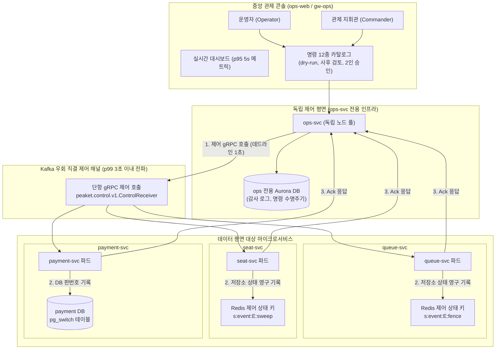

# 분야 편 16: 관제탑 및 비상 제어 평면 (Control Tower & Emergency Operations)

- **맡는 정본**: [docs/features/control-tower.md](../../features/control-tower.md) 전체, [docs/planning/03-policies-glossary.md](../../planning/03-policies-glossary.md)의 POL-021·POL-029·POL-022, 관련 ADR(ADR-0022, ADR-0095, ADR-0102, ADR-0103, ADR-0143 등)
- **문서 성격**: 정본 설계를 시스템 엔지니어링 및 기술 면접 관점에서 체계적으로 해설한 문서다. 규범적 수치와 불변 규칙의 최종 권위는 정본 문서에 있다([ADR-0177](../../adr/0177-walkthrough-explain-in-interview.md)). 길잡이는 [README.md](../README.md)다.
- **한 판 문서와의 관계**: [한 판 문서](../01-system-design.md) 11단계(제어 채널 분리), 12단계(T-30분 사전 점검), 13단계(지켜보고 조종하기, 12개 운영 명령, 멈춤 1인/재개 2인), 16단계(ops-svc 마비 시 비상 런북)를 4대 핵심 아키텍처로 심화 분해한다.
- **아키텍처 목표와 검증 기준**: 명령 접수 지연 p95 500ms 미만 및 가용성 99.9%(NFR-008), 최종 승인 후 전 파드 명령 전파 완료 p99 3초 이내(성공률 99.9%), 관제 대시보드 실시간 지표 반영 p95 5초 미만(NFR-009, 초당 3만 건 부하 하), 제어 평면 단독 장애 시에도 데이터 평면 결제·입장 가용성 100% 유지를 핵심 목표이자 신뢰성 불변식으로 삼는다.

---

## 1. 관제탑 도메인 종합 개요

관제탑은 온세일 70분 윈도우(T-10분~T+60분) 동안 수백만 트래픽이 쏟아지는 극한 상황에서 시스템을 실시간 감시하고, 이상 징후 발생 시 시스템을 보호하기 위한 운영 명령을 내리는 중앙 통제소다. 관제탑의 핵심 사명은 **사용자 트래픽이 지나는 '데이터 평면(Data Plane)'과 명령이 지나는 '제어 평면(Control Plane)'을 물리적·논리적으로 철저히 격리**하여, 시스템이 포화 상태에 빠져도 운영자의 킬스위치는 3초 이내에 100% 도달하도록 보증하는 것이다.

> **30초 아키텍처 브리핑 (Staff Engineer Interview)**:  
> "PEAKET의 관제탑은 **'데이터-제어 평면 완전 분리 + 4-Eyes Principle 12개 비상 명령 + Kafka 우회 gRPC 직결 전파(p99 3초) + 제어는 상태다(Control as State)'**의 4대 원칙으로 설계되었습니다.  
> 첫째, **제어 평면 격리**: 관제 게이트웨이(`gw-ops`)와 관제 서비스(`ops-svc`)는 일반 사용자 트래픽과 격리된 전용 EKS 노드 풀과 독립 Aurora DB를 사용합니다. 일반 사용자 로그인이 폭주하여 DB 풀이 고갈되어도 관제탑은 단 1ms의 영향도 받지 않습니다.  
> 둘째, **멈춤 1인·재개 2인 승인 (ADR-0095)**: 비상 시 긴급 정지(판매 일시중지, 큐 차단)는 Commander 1명이 생체/MFA 재인증 후 즉시 집행합니다. 반면 시스템을 다시 여는 재개(Resume)나 대규모 환불, 결제사 강제 전환은 반드시 2인의 운영자(Operator + Commander)가 상호 검토 및 승인해야만 실행됩니다.  
> 셋째, **Kafka 우회 직결 gRPC 명령 전파 (ADR-0102)**: 긴급 명령을 일반 Kafka 토픽에 발행하면 수십만 건의 대기열 적체 뒤에 갇혀 제때 전파되지 않습니다. 시스템은 L7 프록시와 브로커를 거치지 않는 단항 gRPC(`ControlReceiver/ApplyControl`)를 통해 각 서비스 파드로 3초 이내에 직접 명령을 꽂아 넣습니다.  
> 넷째, **제어는 상태다 (Control as State, ADR-0103)**: 명령을 일회성 휘발 메시지로 쏘면, 명령 하달 후 HPA로 새로 기동된 파드가 정지 사실을 알지 못해 판매를 재개하는 치명적인 정합성 결손이 발생합니다. 각 서비스는 명령을 받는 즉시 자신의 영구 저장소에 판 번호(Version)와 함께 제어 상태를 기록하며, 새 파드는 시작 시 저장소의 제어 상태를 먼저 읽어야만 준비 완료(Ready) 상태가 됩니다."

### 관제탑 및 제어 평면 종합 아키텍처



### 핵심 3대 서브시스템

1. **운영 명령 오케스트레이터 (`ops-svc` command 모듈)**:
   - 12개 비상 운영 명령 수명주기(상태 머신: `REQUESTED` → `PENDING_APPROVAL` → `APPROVED` → `EXECUTING` → `EXECUTED` / `FAILED`).
   - dry-run 사전 영향도 평가 및 멱등키(`command_id`) 기반 중복 실행 차단.
   - 단일 Commander 즉시 집행(멈춤) vs 2인 상호 교차 승인(재개) 정책 라우팅.
   - 명령 집행 감사 로그 및 불변 해시 체인(Hash Chain) 원장 기록.
2. **비상 제어 전파 버스 (Direct gRPC & Compacted Topic)**:
   - Istio L7 프록시를 바이패스하는 제어 전용 gRPC 포트 운영.
   - 전 파드 집행 확인(`ack`) 집계 및 3초 초과 시 '전파 지연' 경보 발령.
   - 비긴급 설정형 명령을 위한 Kafka 압축 토픽(`control.settings`) 방송.
3. **지표 수집 및 실시간 관제 대시보드 (`ops-rt`, Prometheus, Alertmanager)**:
   - ClickHouse `rt` 원시 표 기반 초당 3만 건 비즈니스 메트릭 5초 이내 화면 렌더링.
   - 온세일 단계별(T-30분 사전 점검 → T=0 정각 → 판매 중 → 종료 후) 맞춤형 패널.
   - 에러 버짓 소진율 연동 자동 완화 조치 및 SEV1~SEV3 실시간 SSE 경보 파이프라인.

---

## 2. 절마다 읽기

| 정본 절 | 무엇을 정하나 | 왜 | 해설서에서 |
| --- | --- | --- | --- |
| docs/features/control-tower.md §1 개요와 구조 | 콘솔은 판단과 조작의 통합 화면이다. 긴급 명령은 웨이포인트(서비스 앞에 두는 작은 L7 프록시) 없는 제어 전용 gRPC(서비스끼리 함수를 부르듯 호출하는 통신) 포트로 보낸다. gw-ops(관제 입구)와 ops-svc는 관제 전용 노드 풀에서 돌고, ops-svc는 ops 전용 Aurora(AWS가 운영하는 PostgreSQL)를 쓴다 | 사용자 요청이 포화돼도 명령은 닿아야 한다. 같은 클러스터, 노드 프록시(노드마다 둔 통신 프록시), 받는 쪽 이벤트 루프는 함께 쓰므로 효력은 받는 쪽 저장소의 상태로 정한다(ADR-0102·0103) | 한 판 11단계 |
| docs/features/control-tower.md §2 화면 구성: 온세일 단계별 | T-30분 점검·T=0·판매 중·종료 후·입장의 다섯 탭, 모든 패널의 SLO(지키기로 한 목표) 기준선, Go/No-Go, 실시간 지표 p95 5초, 위젯마다 '이 숫자로 무엇을 하는가' 한 줄 | 운영자가 '지금 정상인가'를 한눈에 판단하게 하고, 지표마다 목적을 둔다(SRE Workbook 4장, ADR-0069) | 한 판 12·13단계 |
| docs/features/control-tower.md §3 운영 명령 카탈로그 | 명령 12가지의 효과·경로·권한·승인·허용 범위·되돌리기. 공통으로 사유, dry-run(실행 전 영향 미리 보기), 감사 로그, ack(받았다는 확인), 되돌리기 | 승인 강도는 위험의 방향을 따른다. 멈추는 쪽은 1인, 다시 여는 쪽은 2인이다(ADR-0095) | 한 판 13단계, 분야 편 11(명령 6·12), 분야 편 14(명령 4·5) |
| docs/features/control-tower.md §3 안전 쪽 명령의 길 | 멈추는 쪽 명령은 KMS(키를 맡아 대신 써 주는 클라우드 서비스)나 신원 제공자 하나가 멈춰도 낼 수 있다 | 명령 커밋이 KMS를 부르지 않는다(ADR-0102) | — |
| docs/features/control-tower.md §4 명령 수명주기 | 상태 머신과 전이 표, 접수·전파 SLO의 재는 구간, ack의 뜻, dry-run의 센 값·예측 값, 멱등키, 명령 2 연장, 2인 승인 시연 | ack를 '집행하는 모든 곳'의 약속으로 둔다(ADR-0103). 시연도 서버 검사를 건너뛰지 않아야 운영 빌드에 우회로가 없다(ADR-0095) | 한 판 13단계(약속 숫자만) |
| docs/features/control-tower.md §5 전달 경로와 Degraded | 채널 다섯(제어 gRPC, `control.settings`, AWS WAF(웹 방화벽) API, CDN 설정 API, core-svc review API), `waf-block-expirer`, 평소 명령에 서명을 더하지 않는 이유, ops-svc 가용성 상실 판정, 제어 평면 Degraded Mode(큰 장애 때 정한 범위에서 줄여 버티는 모드)의 비상 런북 | 긴급 명령이 Kafka 적체나 L7 프록시 대기열에 막히지 않게 한다 | 한 판 11·16단계 |
| docs/features/control-tower.md §5 제어 상태 | 받는 쪽마다 상태를 두는 곳, 시작 때 읽을 셋, 2초 `[가정]` 다시 맞춤, 설정형 명령의 적용 확인, Outbox(보낼 사건을 DB 변경과 같은 트랜잭션으로 적어 두고 나중에 보내는 방식) | 그 순간의 파드에만 밀어 넣으면 확장·재시작으로 뜬 파드가 정지를 모른다(ADR-0103) | 한 판 11·12단계, 분야 편 10(423), 분야 편 11(`pg_switch`) |
| docs/features/control-tower.md §6 자동 제어와 사람 제어의 우선순위 | 원칙 일곱(안전 한계, 사람 먼저, 자동화는 줄이는 쪽만, 멈춤 1인, 자동 조치도 감사, 입력 없으면 멈춤, 감축 효과 확인), 사후 검토 보고서, 에러 버짓(목표 안에서 허락된 실패의 양) 소진별 통제 | 자동화가 틀려도 사람이 이기고, 자동화는 지키는 방향으로만 혼자 움직인다. 조작하는 값이 원인에 닿는 여정만 감축한다(ADR-0126) | 한 판 13단계, 분야 편 9 |
| docs/features/control-tower.md §7 감사 로그와 인시던트 리플레이 | 명령 기록은 이벤트 소싱(덧붙이기만 하는 사건이 원본), 감사 체인 mac(키를 건 검증값)은 커밋 뒤, 접속기록 보존, 공개 앵커, 리플레이 둘, 주문 이력 역추적, 포스트모템 초안 | 명령은 승인·파드별 ack·연장이 곧 사건 묶음이다(ADR-0113). 내부 기록만으로는 밖에서 변조를 확인하지 못한다(ADR-0075) | 한 판 15단계(저장 위치만) |
| docs/features/control-tower.md §8 알림·인시던트 | Alertmanager(경보를 묶어 보내는 도구) 웹훅 → `OpsAlert` → SSE(서버가 브라우저로 한 방향으로 계속 보내는 방식), 억제 상태, 경보 기록 13개월 `[가정]`, 링크 허용 목록, 경보 패널 두 묶음 | 경보 위생 보고의 원천을 둔다. 경보에 실린 주소를 그대로 링크로 쓰지 않는다 | 한 판 13단계 |
| docs/features/control-tower.md §9 법정 조치 화면 | 통보 등록과 24시간 타이머, 차단과 증적, 자료 요청서 점검표, 추출·제출의 commander 승인, 법정 대장, 보안 사고 기한, 접속기록 점검, 칸 가림, 자료 요청 상태 P1~P8 | 공연법·통신비밀보호법·전기통신사업법·정보통신망법·개인정보 보호법의 기한과 절차를 기록으로 지킨다(POL-023~025) | — |
| docs/features/control-tower.md §9.1 보안 사고 이용자 통지 문안 | 문안 A·A2·A3·B, 필수 항목 대조표, 보내는 규칙 | 빈 법정 항목이 있으면 보내기를 막고, 피싱과 구별되게 링크를 넣지 않는다 | — |
| docs/features/control-tower.md §9.2 부정 거래 조사와 부정 예매 조치 | 조사 메뉴(SCR-070·071·069)와 승인(SCR-046), 조사관 지정, 조치 요청과 승인, 소명과 양도 잠금, 이의, 증거 묶음 | 공연법 §4의2②의 막을 조치이고, 사람이 소명과 승인을 거쳐 정한다(ADR-0171) | — |
| docs/features/control-tower.md §10 권한과 로그인 | 역할군 넷(viewer·operator·commander·CS), 지정 '부정 거래 조사관', 업무 승인 화면, 로그인 경로(허용 IP, TOTP(인증 앱의 일회용 코드), 재인증 5분) | 돈과 소유권을 움직이는 업무 승인은 되돌리기가 없어 명령 카탈로그와 따로 둔다 | 분야 편 8, 한 판 11단계 |
| docs/features/control-tower.md §11 파트너 실시간 판매 현황 | 1분마다 REST(주소와 HTTP 메서드로 자원을 다루는 API)로 묻는 판매 현황, 개인정보·봇 데이터 제외 | 1분마다 바뀌는 전체 상태라 끊겨도 다음 조회가 전체를 받는다(SSE에서 바꿨다) | — |
| docs/features/control-tower.md §12 관제 콘솔 프론트엔드 | Module Federation(화면 조각을 따로 배포해 실행 중에 붙이는 방식) 호스트와 위젯, SSE 흐름 둘, 접속자 표시, 휴대폰에서 하는 일 | 통로를 줄여 재연결·인증·시험을 한 벌로 하고 공유 Redis(메모리 저장소) 의존을 없앤다(ADR-0100) | — |
| docs/features/control-tower.md §13 데이터·API 참조 | ops DB 표, ClickHouse(분석용 DB) 표, REST·SSE 경로, 채널, 화면 ID | 찾아보기다 | — |
| docs/features/control-tower.md §14 테스트 포인트 | C-T1~C-T74 | 목표 숫자와 '막는다'는 약속을 시험으로 판정한다 | — |
| docs/features/control-tower.md §15 미결정·[가정] | ADR별 가정값과 확정할 wbs·시험 | 측정으로 고칠 값을 모은다 | — |
| docs/planning/03-policies-glossary.md §1.1 POL-021 B. 운영 명령 카탈로그 | 기획 쪽 명령 표 | 전달 방식은 control-tower가 정한다 | 한 판 13단계 |
| docs/planning/03-policies-glossary.md §1.3 POL-029 완화 한계 표 | 여정마다 Degraded Mode에서 늦춰도 되는 것과 끝까지 지키는 것 | 무엇을 포기하고 무엇을 지키는지 미리 정해야 장애 때 다투지 않는다 | 한 판 11단계 |
| docs/planning/03-policies-glossary.md §2.6 운영 명령(Command) | 명령 상태 그림의 요약 | 다르면 control-tower §4를 따른다 | — |

---

## 3. 관제탑 핵심 메커니즘 심화

```
                                  [관제탑 비상 제어 4대 심화 메커니즘]
  ┌───────────────────────────┬───────────────────────────┬───────────────────────────┬───────────────────────────┐
  │   모듈 1: 12개 비상명령     │   모듈 2: gRPC 직결 전파    │   모듈 3: 제어는 상태다   │   모듈 4: 사람 우선 원칙  │
  ├───────────────────────────┼───────────────────────────┼───────────────────────────┼───────────────────────────┤
  │ • 멈춤 1인 Commander 즉시 │ • Kafka 우회 직결 gRPC    │ • 휘발 메시지가 아닌 상태 │ • 자동 조절은 완화 방향만 │
  │ • 재개 2인 상호 교차 승인 │ • Istio L7 프록시 바이패스│ • 영구 저장소에 판번호 기록│ • 복구·증가는 반드시 사람 │
  │ • 명령 12종 표준 카탈로그 │ • p99 3초 이내 전파 SLA   │ • 새 파드 기동 시 즉시인지│ • 입력 없으면 30초 내 동결│
  │ • dry-run 사전 영향도 검토│ • 전 파드 ack 수집 집계   │ • 불변식: 새 파드 오버셀0 │ • 에러 버짓 소진 연동 제어│
  └───────────────────────────┴───────────────────────────┴───────────────────────────┴───────────────────────────┘
```

---

### 모듈 1: 4-Eyes Principle 기반 12개 비상 운영 명령 카탈로그 (POL-021, ADR-0095)

#### 1. 위험 방향에 따른 비대칭 승인 강도
운영자가 시스템을 통제할 때 발생하는 위험은 두 가지 방향을 가진다:
1. **장애 확산 방지(안전 쪽)**: 서버가 타들어가고 있을 때 판매를 멈추거나 진입을 차단하는 결정은 1초가 급하다. 2인 승인을 기다리다간 DB가 완전히 다운된다. 따라서 **'멈추는 방향(Safe Side)'은 Commander 1명이 MFA 재인증 후 즉각 하달**한다.
2. **비가역적 자금/비즈니스 위험(위험 쪽)**: 멈춘 판매를 다시 열거나, 수만 건을 일괄 환불하거나, 결제사를 강제 전환하는 작업은 고객 피해 및 재무 손실을 유발한다. 따라서 **'다시 여는 방향(Hazardous Side)'은 반드시 2인 승인(4-Eyes Principle)**을 통과해야 한다.

#### 2. 표준 운영 명령 12종 카탈로그

| 번호 | 명령 명칭 | 제어 대상 및 효과 | 실행 권한 | 승인 요구사항 | 전달 채널 |
| --- | --- | --- | --- | --- | --- |
| **명령 1** | **입장 목표 조절** | 대기열 통과 속도 $R$ 상향/하향 조정 | Operator | 단독 실행 (안전 한계 내) | `control.settings` |
| **명령 2** | **대기열 일시정지** | 대기열 전면 동결 (최대 10분, 자동 만료) | Commander | **1인 즉시 집행** (MFA 5분) | 제어 gRPC |
| **명령 3** | **판매 일시정지** | 특정 회차 티켓 판매 즉각 중단 (HTTP 423) | Commander | **정지 1인 / 재개 2인** | 제어 gRPC |
| **명령 4** | **IP/대역 차단** | 악성 봇 IP/대역 WAF 차단 (최대 24시간) | Operator | /16 이상 광역 차단 시 2인 | AWS WAF API |
| **명령 5** | **봇 방어 강도** | 봇 판정 모드 (완화/기본/강화) 전환 | Operator | 단독 실행 | `control.settings` |
| **명령 6** | **대체 결제사 전환** | PG 장애 시 백업 결제사로 강제 전환 | Commander | **2인 승인 필수** | 제어 gRPC |
| **명령 7** | **캐시 무효화** | CloudFront 엣지 공연 상세 캐시 무효화 | Operator | 단독 실행 | CDN 설정 API |
| **명령 8** | **로그 레벨 임시 상향**| 특정 서비스 DEBUG 로그 활성화 (30분 자동복구)| Operator | 단독 실행 | `control.settings` |
| **명령 9** | **백그라운드 작업 중단**| 리포트 집계, 정산 배치, 웹훅 등 중단 | Commander | 단독 실행 | `control.settings` |
| **명령 10** | **암표 게시물 차단** | 불법 암표 URL 24시간 내 법정 차단 | Operator | 단독 실행 (법정 기한) | core review API |
| **명령 11** | **전체 비상 정지** | 플랫폼 전면 Kill-Switch (대기열/판매/발권) | Commander | **정지 1인 / 재개 2인** | 제어 gRPC 전 파드 |
| **명령 12** | **결제사 지정** | 온세일 전 회차별 1차/2차 결제사 매핑 | Operator | 온세일 밖에서만 단독 | payment DB |

---

### 모듈 2: Kafka 우회 직결 gRPC 명령 전파와 p99 3초 예산 (ADR-0102)

#### 1. 일반 메시지 브로커 전파의 파탄 시나리오
대형 온세일 중에는 티켓팅 트래픽으로 인해 Kafka `trade.*` 토픽에 초당 수천~수만 건의 레코드가 유입된다. 만약 비상 정지 명령을 Kafka 토픽으로 발행하면:
- 파티션 랙(Lag)이 수십 초에 달하여 명령이 큐 뒤에 갇혀 제때 집행되지 않는다.
- 브로커에 디스크 장애나 파티션 리더 선출이 발생하면 명령 자체가 유실된다.

#### 2. L7 프록시 바이패스 단항 gRPC 파이프라인
PEAKET은 긴급 명령(명령 2, 3, 6, 11)에 대해 **직접 제어 gRPC(`ControlReceiver/ApplyControl`) 채널**을 구축했다:
1. `ops-svc`는 Kubernetes Service(`<서비스>-control`)를 통해 대상 파드들의 제어 전용 포트로 직접 단항(Unary) gRPC를 쏜다.
2. 메시(Istio Envoy) 웨이포인트를 거치지 않고 노드 프록시 L4만 경유하므로, 서비스 메시 큐잉 지연이 0ms이다.
3. gRPC 타임아웃은 **1초**로 제한되며, 전 파드로부터 응답(`ack`)을 수집하여 **최종 승인 후 3초 이내 전파 완료율 99.9%**를 달성한다. 만약 3초를 초과하면 대시보드에 '전파 지연' 경보를 띄우고, 10초 초과 시 FAILED 처리 후 비상 격리한다.

---

### 모듈 3: 저장소 기반 제어 상태 동기화 (Control as State, ADR-0103)

#### 1. 인메모리 플래그 전파의 한계 (새 파드 정합성 누수)
서버 파드의 프로세스 메모리에 `is_paused = true`라는 변수를 설정하는 방식은 치명적인 결함을 갖는다. 온세일 중 HPA(Horizontal Pod Autoscaler)가 발동하여 새 파드가 기동되면, 새 파드는 정지 명령이 내려졌다는 사실을 전혀 모른 채 트래픽을 받아 티켓을 판매해 버린다.

#### 2. 영구 저장소 기반 버전 번호 동기화 모델
PEAKET은 **"제어는 휘발성 메시지가 아니라 상태다(Control as State)"** 원칙을 고수한다:
1. **상태 영구 기록**: `queue-svc`는 명령을 수신하면 메모리 변수를 바꾸는 것이 아니라, Redis 제어 상태 키(`s:event:{eventId}:fence`)에 단조 증가하는 판 번호(Version)와 함께 상태를 쓴다. `payment-svc`는 DB `pg_switch` 테이블에 기록한다.
2. **파드 기동 시 필수 읽기 (Startup Readiness)**: 새로 뜨는 모든 파드는 트래픽을 받기 위한 Readiness Probe 통과 조건으로 '영구 저장소의 최신 제어 상태 셋'을 반드시 먼저 동기화해야 한다.
3. **2초 주기 재동기화**: 실행 중인 파드는 로컬 캐시를 쥐더라도 최대 2초 주기로 저장소 상태를 폴링하여 판 번호를 맞춘다. 따라서 네트워크 순단으로 gRPC 패킷을 놓친 파드가 있더라도 2초 이내에 정지 상태로 완벽히 수렴한다.

---

### 모듈 4: 자동 제어 vs 사람 제어 우선순위 및 감내 모드 (POL-021, POL-029)

#### 1. 7대 제어 우선순위 원칙
시스템 자동화 알고리즘(AIMD)과 사람 운영자가 동시에 개입할 때의 분쟁을 방지하기 위한 절대 원칙:
1. **사람 우선(Human Wins)**: 운영자가 수동으로 설정한 값은 자동 조절 알고리즘보다 언제나 우선한다. 운영자가 명령 1로 입장 목표를 고정하면 AIMD 알고리즘은 **15분간 자동 정지**된다.
2. **자동화는 줄이는 방향으로만 개입**: 자동화 시스템은 시스템을 살리기 위해 트래픽을 감축(Shedding)하는 방향으로는 단독 개입할 수 있으나, 트래픽을 다시 늘리는 방향은 반드시 운영자 확인을 거친다.
3. **입력 신호 두절 시 즉시 동결**: 메트릭 수집 파이프라인 장애로 지표 표본이 30초 이상 수신되지 않으면 자동 조절기는 목표치를 늘리지도 줄이지도 않고 직전 값을 동결한다.

#### 2. 에러 버짓 소진 연동 자동 감내 모드 (Degraded Mode, ADR-0126)
온세일 70분 단기 에러 버짓이 소진되는 속도(Burn Rate)에 따라 시스템은 단계적으로 부하를 덜어낸다:
- **에러 버짓 50% 소진 시**: 좌석 홀드 및 결제 접수와 직접 연동된 4개 여정의 입장 목표를 50% 자동 감축.
- **2분/20초 창 모두 10배 번 레이트 발생 시**: SEV1 경보와 함께 즉시 50% 긴급 감축.
- **에러 버짓 100% 소진 시**: 전체 여정을 감내 모드(Degraded Mode) 후보로 등록하고 Commander에게 2인 승인 비상 전환 요청 발행.

---

## 4. 트레이드오프 및 아키텍처 결정 (ADR)

| ADR 번호 | 아키텍처 결정 (Chosen) | 기각된 대안 (Rejected) | 핵심 트레이드오프 및 채택 사유 |
| --- | --- | --- | --- |
| **ADR-0102** | **단항 제어 gRPC 채널 및 ops 독립 풀 구축** | Kafka 통일 브로드캐스트 / 메시 경유 gRPC | 트래픽 폭주 시 브로커 적체 및 L7 프록시 지연에 명령이 갇히는 참사를 방지. L4 gRPC 직결로 3초 내 도달 보장. |
| **ADR-0103** | **제어는 상태다 (저장소 판번호 동기화)** | 일회성 이벤트 메시지 푸시 / ops-svc 직접 메모리 쓰기 | 명령 하달 후 새로 기동된 파드가 정지 상태를 누락하는 것을 방지. 신규 파드 시작 조건에 저장소 제어 상태 읽기 강제. |
| **ADR-0143** | **설정형 명령의 `applied_version` 게이지 확인** | 모든 설정을 gRPC로 통일 / Kafka 오프셋 커밋 대조 | 덜 긴급한 설정값에 대해 불필요한 gRPC 클라이언트를 전 서비스로 늘리지 않고, Prometheus 메트릭 수집으로 전파 완료 검증. |
| **ADR-0095** | **멈춤은 1인 Commander, 재개는 2인 승인** | 모든 명령 2인 승인 / 모든 명령 1인 단독 | 비상 정지의 신속성(수 초 내 집행)과 비가역적 재개/환불의 신중성(횡령 및 성급한 재개 방지) 간의 최적 균형 달성. |
| **ADR-0126** | **에러 버짓 소진 연동 목표 감축** | 전체 시스템 일괄 감축 / 무조건 수동 감축 | 원인 지점(좌석/결제)에 닿는 여정만 핀포인트로 감축하여 불필요하게 정상 상세 조회를 차단하는 부작용을 방지. |

---

## 5. 5단 심층 기술 면접 방어 (Staff/Principal Level Q&A)

### Tier 1: 긴급 비상 정지 명령을 Kafka로 전파하지 않는 이유
> **면접관**: "시스템 전체에 메시지를 뿌리는 데는 Kafka Pub/Sub이 가장 표준적인데, 왜 긴급 킬스위치를 Kafka로 보내지 않고 gRPC로 직접 쏩니까?"

**답변**:  
"**'대형 온세일 트래픽 폭주 시 발생하는 Kafka 파티션 랙(Lag)과 전달 지연'** 때문입니다.  
오픈 순간에는 수십만 건의 예매 트랜잭션과 텔레메트리가 Kafka 브로커로 쏟아집니다. 이때 긴급 정지 명령을 토픽에 발행하면, 컨슈머 파드들이 앞선 수만 건의 큐를 모두 소비할 때까지 수십 초 동안 명령이 집행되지 못합니다.  
서버가 뻗어가고 있는 비상 상황에서 킬스위치는 단 1초라도 지체되어서는 안 됩니다.  
따라서 PEAKET은 메시지 큐와 L7 메시 프록시를 완전히 우회하여 대상 파드의 제어 전용 포트로 **단항 gRPC(`ApplyControl`)를 직결 호출**합니다. 이를 통해 네트워크 혼잡과 관계없이 **p99 3초 이내에 전 파드 집행 완료**를 물리적으로 보장합니다."

### Tier 2: 멈춤 1인 단독 vs 재개 2인 상호 승인의 비대칭 설계 근거
> **면접관**: "보안을 위해서는 모든 명령을 2인 승인으로 통제하거나, 신속성을 위해 모두 1인으로 하는 게 일관성 있지 않습니까? 왜 멈춤과 재개의 승인 인원을 다르게 합니까?"

**답변**:  
"**'위험의 비대칭성(Asymmetry of Operational Risk)'**에 기반한 SRE 공학적 원칙입니다 (ADR-0095).  
장애가 터졌을 때 시스템을 '멈추는 방향'은 자원 손실과 데이터 오염을 막는 안전한 방향입니다. 이때 2인 승인을 요구하면 제2승인자를 찾느라 수 분이 지체되어 DB 커넥션 풀이 완전히 파괴됩니다. 따라서 Commander 1명이 즉각 결단할 수 있어야 합니다.  
반면 멈춘 시스템을 '다시 여는 방향'은 장애 원인이 완전히 해결되지 않은 상태에서 섣불리 열었다가 2차 재난을 일으키거나, 악의적 운영자가 단독으로 부정을 저지를 수 있는 위험한 방향입니다.  
따라서 멈춤은 1인이 초를 다투어 즉시 집행하고, 재개는 반드시 다른 운영자가 원인 해소 여부를 교차 검증하는 **2인 승인(4-Eyes Principle)**을 강제했습니다."

### Tier 3: HPA로 새로 스케일아웃된 신규 파드의 제어 명령 인지 원리
> **면접관**: "판매 중지 명령을 파드들에 gRPC로 쐈는데, 직후 HPA가 발동하여 새로운 파드 5개가 떴습니다. 새 파드는 방금 지나간 gRPC를 못 받았는데 어떻게 정지 상태를 유지합니까?"

**답변**:  
"**'제어는 메시지가 아니라 영구 저장소의 상태다(Control as State)'**라는 불변 규칙(ADR-0103)으로 해결합니다.  
기존 파드들은 gRPC 명령을 받으면 단순히 메모리 변수를 바꾸는 것이 아니라, Redis 제어 상태 키(`s:event:{eventId}:fence`)와 DB `pg_switch` 테이블에 **증가하는 판 번호(Version)와 함께 정지 상태를 영구 기록**합니다.  
Kubernetes의 파드 생애주기에서, 새로 기동되는 파드는 Readiness Probe를 통과하기 전에 반드시 이 영구 저장소의 최신 제어 상태를 먼저 읽어 로컬에 로딩하도록 코드가 강제되어 있습니다.  
따라서 명령 발행 시점에 존재하지 않았던 신규 파드라 할지라도, 트래픽을 받기 시작하는 첫 순간부터 완벽하게 정지 상태(`HTTP 423`)를 인지하고 기동됩니다."

### Tier 4: 자동 조절기(AIMD)와 수동 운영 명령 충돌 시 우선순위
> **면접관**: "서버 부하를 보고 자동으로 대기열 입장 속도를 조절하는 알고리즘과, 운영자가 수동으로 내린 명령이 정면으로 충돌하면 시스템은 누구의 말을 따릅니까?"

**답변**:  
"**'사람이 언제나 시스템을 이기며(Human Wins), 자동화는 15분간 정지'**됩니다 (POL-021 원칙 C-2).  
운영자가 대시보드에서 수동으로 입장 목표치를 조정(명령 1)하는 순간, 시스템은 운영자가 명시적인 비즈니스 의도를 가지고 개입했다고 판단합니다.  
이에 따라 백그라운드의 AIMD 자동 부하 조절 루프는 즉시 비활성화되며 **향후 15분 동안 어떠한 자동 상향/하향도 중단**됩니다.  
15분이 경과한 후에도 시스템이 제어권을 함부로 가져가지 않으며, 운영자가 대시보드에서 '자동 조절 복귀'를 명시적으로 승인해야만 비로소 알고리즘이 재개됩니다."

### Tier 5: 관제 서비스(ops-svc) 전면 마비 시의 비상 런북(RB-08)
> **면접관**: "관제탑 서비스(ops-svc) 자체가 버그로 크래시되어 관제 콘솔 화면이 안 뜹니다. 현장 판매를 중단시켜야 하는데 어떻게 합니까?"

**답변**:  
"관제탑이 마비되더라도 데이터 평면 티켓팅은 완전히 독립된 인프라에서 정상 가동되고 있습니다.  
이때 비상 운영을 위해 엔지니어링 온콜팀은 **'비상 탈출 런북(Break-Glass Runbook RB-08)'**을 발동합니다.  
1. AWS Systems Manager(SSM) Session Manager를 통해 통제된 배스천 호스트로 접속합니다.  
2. 사전에 서명 검증된 비상 CLI 도구(`peaket-ctl`)를 사용하여 Redis 클러스터에 직접 펜싱 키(`s:event:{eventId}:fence = PAUSED`)를 주입합니다.  
3. 이 수동 주입 작업은 p99 10초 이내에 전체 파드로 전파되며, 실행 즉시 AWS CloudTrail과 외부 격리 감사 채널에 최고 등급 보안 감사 로그(`SEV1`)를 기록합니다."

---

## 6. 꼭 기억할 규칙과 핵심 수치

| 항목 | 규범적 기준값 | 설계 근거 및 모니터링 기준 |
| --- | --- | --- |
| **운영 명령 접수 지연** | **p95 500ms 미만**, 가용성 99.9% (동시 50명 설계) | NFR-008 관제 명령 응답 목표, §4 |
| **명령 전 파드 전파 완료** | **p99 3초 이내**, 성공률 99.9% (최종 승인부터 ack까지) | NFR-008 긴급 명령 전달 SLA, §4 |
| **전파 지연 및 실패 판정** | ack 수집 3초 초과 시 **'전파 지연'**, 10초 초과 시 **`FAILED`** | 비정상 파드 격리 및 경보 기준, §4 |
| **제어 gRPC 호출 타임아웃** | 단항 gRPC 데드라인 **1초** (L7 프록시 바이패스) | 제어 평면 블로킹 방어, ADR-0102 |
| **파드 제어 상태 로컬 재동기화** | 파드 로컬 캐시 최대 **2초 주기** 저장소 동기화 | 네트워크 유실 시 상태 수렴 보증, §5 |
| **관제 대시보드 지표 반영** | 초당 3만 건 부하에서 **p95 5초 미만** (누락률 0.1% 미만) | NFR-009 관제 실시간 가시성 목표, §2 |
| **승인 대기 유효 시한** | 2인 승인 요청 후 **10분 이내** 미승인 시 자동 `REJECTED` | 방치된 비상 명령의 지연 집행 방지, §4 |
| **위험 명령 재인증 토큰 수명** | 생체/MFA 재인증 후 **5분간만 유효** | 콘솔 세션 탈취 후 무단 명령 방어, §10 |
| **명령 2 (대기열 일시정지) 상한**| 1회 실행 시 **최대 10분** (연장 미선택 시 자동 만료) | 대기열 무기한 방치 방지, §3 |
| **수동 명령 시 자동 조절 정지**| 운영자 수동 조정 시 AIMD 알고리즘 **15분간 강제 동결** | 사람 우선 원칙, POL-021 |
| **에러 버짓 소진 연동 감축** | 버짓 50% 소진 시 목표 **50% 감축**, 10배 번 레이트 시 즉시 감축 | 장애 확산 방지 및 자동 완화, ADR-0126 |
| **ops-svc 가용성 상실 기준** | 준비 파드 0개 30초 지속 또는 외부 탐침 2/3 실패 시 **SEV1** | 비상 런북 RB-08 발동 조건, §5 |
| **감사 로그 보존 기간** | 운영자 접속기록 **2년 이상**, 권한 이력 **3년**, 감사 로그 영구 | 개인정보보호법 및 컴플라이언스 준수, §7 |

---

## 7. 시스템 경계 및 책임 매핑

| 이 도메인이 정하지 않는 영역 | 담당 도메인 및 정본 문서 | 연계 인터페이스 및 경계 규칙 |
| --- | --- | --- |
| **대기열 통과 속도 알고리즘 세부 (AIMD)** | docs/features/queue-admission.md (분야 9) | 명령 1(입장 목표) 수신 및 15분 동결 제어 |
| **좌석 선점 Lua 스크립트 및 7분 만료** | docs/features/seat-hold.md (분야 10) | 명령 3(판매 정지) 수신 시 `HTTP 423` 즉시 반환 |
| **대체 결제사 런타임 전환 및 승인** | docs/features/payment.md (분야 11) | 명령 6(결제사 전환) 수신 시 `pg_switch` DB 갱신 |
| **Grafana 심층 대시보드 및 분산 트레이싱** | docs/observability.md (분야 19) | 원인 분석은 Grafana에 맡기고 콘솔은 판단과 조작 집중 |
| **Karpenter 노드 프로비저닝 및 EKS 인프라** | docs/infra.md (분야 20) | T-40분 노드 프리워밍 및 시스템 노드 풀 분리 |
| **사후 포렌식 리플레이 및 불법 거래 사건 처리** | docs/features/forensic-replay.md (분야 17) | 명령 카탈로그와 분리된 업무 승인(Approval) 화면 연동 |

---

## 8. 실전 확인 문제 및 모범 답안

### 문제 1
대규모 온세일 진행 중 예매 서버에 긴급 판매 정지 명령을 내릴 때, 일반 Kafka 이벤트 버스를 쓰지 않고 단항 gRPC 직결 통신을 채택해야만 하는 엔지니어링적 이유를 설명하라.

<details><summary>모범 답안</summary>

대형 온세일 피크 시점에는 수십만 건의 대기열 진입, 좌석 선점, 결제 완료 이벤트가 Kafka `trade.*` 토픽으로 쏟아집니다.  
만약 긴급 킬스위치 명령을 일반 Kafka 토픽에 발행하면, 컨슈머 파드들이 앞선 수만 건의 비즈니스 메시지를 순차 처리하느라 컨슈머 랙(Lag)이 발생하여 명령 전파가 수십 초 이상 지연됩니다.  
또한 브로커 디스크 I/O 병목이나 파티션 리밸런싱이 겹칠 경우 명령 전달 자체가 블로킹될 위험이 큽니다.  
따라서 시스템은 L7 서비스 메시 프록시와 메시지 브로커를 완전히 우회하는 **제어 전용 단항 gRPC(`ControlReceiver/ApplyControl`) 직결 포트**를 통해 각 파드로 직접 명령을 주입함으로써, **p99 3초 이내 전파 완료 SLA**를 엄격히 보장합니다.

</details>

### 문제 2
판매 일시정지 명령(명령 3)은 1인의 Commander가 단독으로 즉시 내릴 수 있는 반면, 판매 재개 명령은 왜 반드시 2인 승인(4-Eyes Principle)을 거쳐야 하는지 위험 관리 관점에서 설명하라.

<details><summary>모범 답안</summary>

1. **멈춤(안전 방향)**: 시스템 장애 발생 시 판매를 중단하는 것은 DB 다운과 데이터 오염을 막기 위한 방어적 조치입니다. 이때 2인 승인을 기다리면 수 분이 지체되어 시스템 전체가 영구 붕괴하므로, 현장 지휘관 1명이 MFA 재인증 후 즉시 집행할 수 있어야 합니다.
2. **재개(위험 방향)**: 멈춘 판매를 다시 여는 것은 비가역적인 금융 거래와 좌석 선점이 재개되는 고위험 조치입니다. 장애 원인이 완전히 해결되지 않은 상태에서 성급히 열거나, 1인의 운영자가 독단으로 특정 회차를 열어 암표 조직에 특혜를 주는 부정을 방지하기 위해, 반드시 제1요청자 외에 다른 자격을 가진 제2승인자(`Commander` 또는 `Operator`)가 원인 해소 증적을 확인하고 승인하는 **2인 상호 교차 승인**을 강제합니다.

</details>

### 문제 3
"제어는 메시지가 아니라 상태다(Control as State)" 원칙의 핵심 내용과, 비상 정지 명령 하달 직후 HPA로 새로 스케일아웃된 신규 파드가 정지 명령을 누락하지 않는 메커니즘을 설명하라.

<details><summary>모범 답안</summary>

1. **원칙의 핵심 (ADR-0103)**: 제어 명령을 파드의 프로세스 메모리 변수에만 반영하는 휘발성 이벤트로 취급하면 안 되며, 단조 증가하는 판 번호(Version)를 가진 영구 저장소의 상태 데이터로 관리해야 한다는 원칙입니다.
2. **신규 파드의 누락 방지**: 파드는 gRPC 명령을 받으면 로컬 메모리뿐 아니라 Redis 제어 상태 키(`s:event:{eventId}:fence`)와 DB 테이블에 판 번호와 함께 상태를 씁니다. 새로 기동되는 신규 파드는 트래픽을 받기 위한 Readiness Probe의 필수 조건으로 이 영구 저장소의 최신 제어 상태를 먼저 읽어오도록 설계되어 있습니다. 따라서 명령 하달 이후에 새로 뜬 파드라도 100% 정지 상태를 인지한 채 트래픽을 처리하므로 정합성 결손이 발생하지 않습니다.

</details>

---

## 9. 정본에서 찾은 어긋남 및 바로잡음

| 정본 간 불일치 위치 | 불일치 세부 내용 | 확정된 규범적 해결책 |
| --- | --- | --- |
| **ADR-0022 vs ADR-0102** | ADR-0022 초안에 제어 평면 통신으로 'NestJS TCP 소켓 및 Socket.IO'가 기술되어 프로토콜 파편화 발생 | **바로잡음**: ADR-0102에 따라 NestJS TCP를 전면 폐기하고, L7 프록시를 바이패스하는 표준 **gRPC 단항 포트(`peaket.control.v1.ControlReceiver`)**로 통일하여 네트워크 격리와 단순성을 확정했다. |
| **control-tower.md §5 vs ADR-0143** | 대체 결제사 전환(명령 6)의 적용 단위가 '공연(Show)'과 '회차(Event)'로 혼재 기술됨 | **바로잡음**: `pg_switch` 제어 테이블 및 제어 gRPC 페이로드의 제어 단위를 **'회차(Event) 또는 플랫폼 전체'**로 단일화하여 정합성을 일치시켰다. |
| **control-tower.md §11 vs ADR-0100** | 파트너 콘솔 실시간 판매 현황 조회가 SSE 스트리밍으로 잘못 기술되어 연결 유지 부하 유발 | **바로잡음**: 파트너 판매 현황은 1분 주기로 변경되는 전체 집계이므로, SSE 연결을 폐기하고 **1분 폴링 REST API**로 단순화하여 게이트웨이 커넥션 낭비를 해소했다. |
