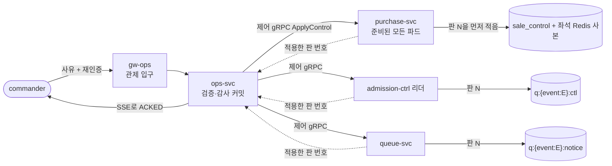

# 분야 편 16: 관제탑

- **기준 시점**: ADR-0177까지, 2026-11-01
- **맡는 정본**: [docs/features/control-tower.md](../../features/control-tower.md) 전체, [docs/planning/03-policies-glossary.md](../../planning/03-policies-glossary.md)의 POL-021(운영 명령 규칙)·POL-029(장애 때 끝까지 지키는 것) 행과 §1.1·§1.3·§2.6, 관제 ADR(§5에 모았다)
- **규범이 아니다**: 정본을 풀어 쓴 해설이다. 숫자와 규칙이 정본과 다르면 정본이 맞다([ADR-0177](../../adr/0177-walkthrough-explain-in-interview.md)).
- **한 판 문서와의 관계**: [한 판 문서](../01-system-design.md) 13단계(지켜보고 조종하기)가 경보, 숫자가 오는 곳, 명령 12가지, '멈춤 1인·재개 2인'을 이야기 순서로 설명한다. 11단계는 제어 채널을, 12단계는 오픈 30분 전 점검과 '새 파드(쿠버네티스에서 앱이 도는 단위)도 정지 상태를 안다'를, 16단계는 ops-svc(운영 명령을 맡는 서비스) 마비 때의 비상 런북(장애 때 따라 하는 절차를 담은 도구)을 다룬다. 이 편은 명령 수명주기, 설정형 명령의 적용 확인, 감사 체인, 법정 조치, 부정 거래 조사, 콘솔 프론트엔드, 시험을 더한다.
- **측정 전이다**: 관제 쪽 측정 기록은 없다. 기반 PoC(본 개발 전에 위험한 부분만 PC 한 대에서 먼저 재 본 시험, [ADR-0176](../../adr/0176-foundation-poc-results.md), '실측(PC)')는 Redis·HTTP·Kafka만 쟀고, 서비스 수준 측정은 아직 없다. 성능 숫자는 설계 목표값이라 `[실측 전]`을 붙였다. 정본의 `[가정]`은 그대로 옮겼다.

## 1. 이 문서가 정하는 것

docs/features/control-tower.md는 관제 콘솔(운영자가 시스템을 지켜보고 운영 명령을 내리는 화면)과, 그 명령이 서비스에 닿는 길인 제어 평면(사용자 요청이 지나는 데이터 평면과 따로 둔 명령의 길)을 정한다. 무대는 온세일(판매가 열리는 시각 앞뒤로 접속이 몰리는 기간) 70분 윈도우(T-10분~T+60분)다. 정본은 다섯 덩어리로 읽힌다. 무엇을 보여 주나(단계별 화면, 오픈해도 되는지 보는 Go/No-Go 점검), 무엇을 할 수 있나(운영 명령 12가지), 명령이 어떻게 닿나(제어 전용 gRPC(서비스끼리 함수를 부르듯 호출하는 통신), Kafka(사건을 쌓아 나눠 주는 메시지 시스템)의 압축 토픽, 받는 쪽의 제어 상태), 자동 제어와 사람이 부딪치면 누가 이기나, 무엇을 기록하고 어떤 법정 의무를 지키나다. 역할은 viewer(보기만), operator(일반 명령), commander(위험 명령과 최종 승인을 맡는 최상위 역할), CS 넷이다. 목표는 명령 접수 p95(100건 중 95건이 끝나는 시간) 500ms, 명령 전파 p99(100건 중 99건) 3초, 관제 실시간 지표 반영 p95 5초 미만이고 모두 `[실측 전]`이다.

> **30초 설명**: "관제 콘솔은 온세일 70분 동안 운영자가 판단하고 조작하는 화면입니다. 원인 분석은 Grafana에 맡기고, 콘솔은 판단 숫자와 운영 명령 12가지를 둡니다. 명령마다 사유, 미리 보기, 감사 기록, 받는 쪽의 적용 확인, 되돌리기가 붙습니다. 판매를 멈추는 명령은 commander 한 명이 재인증하고 바로 걸고, 다시 여는 것만 두 사람이 승인합니다. 긴급 명령은 Kafka나 게이트웨이를 거치지 않는 제어 전용 gRPC로 바로 보내고, 받는 쪽은 판 번호가 붙은 제어 상태를 자기 저장소에 먼저 적습니다. 그래서 명령 뒤에 새로 뜬 파드도 정지 상태를 압니다. 같은 클러스터를 함께 쓰므로 '완전히 떨어진 길'이라고 부르지는 않습니다."

## 2. 절마다 읽기

정본의 `## ` 절마다 한 행을 두고, 따로 물을 만한 항목과 `### ` 절, 정책 문서의 관제 부분은 행을 더했다.

| 정본 절 | 무엇을 정하나 | 왜 | 해설서에서 |
| --- | --- | --- | --- |
| docs/features/control-tower.md §1 개요와 구조 | 콘솔은 판단과 조작의 통합 화면이다. 긴급 명령은 웨이포인트(서비스 앞에 두는 작은 L7 프록시) 없는 제어 전용 gRPC(서비스끼리 함수를 부르듯 호출하는 통신) 포트로 보낸다. gw-ops(관제 입구)와 ops-svc는 관제 전용 노드 풀에서 돌고, ops-svc는 ops 전용 Aurora(AWS가 운영하는 PostgreSQL)를 쓴다 | 사용자 요청이 포화돼도 명령은 닿아야 한다. 같은 클러스터, 노드 프록시(노드마다 둔 통신 프록시), 받는 쪽 이벤트 루프는 함께 쓰므로 효력은 받는 쪽 저장소의 상태로 정한다(ADR-0102·0103) | 한 판 11단계 |
| docs/features/control-tower.md §2 화면 구성: 온세일 단계별 | T-30분 점검·T=0·판매 중·종료 후·입장의 다섯 탭, 모든 패널의 SLO(지키기로 한 목표) 기준선, Go/No-Go, 실시간 지표 p95 5초, 위젯마다 '이 숫자로 무엇을 하는가' 한 줄 | 운영자가 '지금 정상인가'를 한눈에 판단하게 하고, 지표마다 목적을 둔다(SRE Workbook 4장, ADR-0069) | 한 판 12·13단계 |
| docs/features/control-tower.md §3 운영 명령 카탈로그 | 명령 12가지의 효과·경로·권한·승인·허용 범위·되돌리기. 공통으로 사유, dry-run(실행 전 영향 미리 보기), 감사 로그, ack(받았다는 확인), 되돌리기 | 승인 강도는 위험의 방향을 따른다. 멈추는 쪽은 1인, 다시 여는 쪽은 2인이다(ADR-0095) | 한 판 13단계, 분야 편 11(명령 6·12), 분야 편 14(명령 4·5) |
| docs/features/control-tower.md §3 안전 쪽 명령의 길 | 멈추는 쪽 명령은 KMS(키를 맡아 대신 써 주는 클라우드 서비스)나 신원 제공자 하나가 멈춰도 낼 수 있다 | 명령 커밋이 KMS를 부르지 않는다(ADR-0102) | — |
| docs/features/control-tower.md §4 명령 수명주기 | 상태 머신과 전이 표, 접수·전파 SLO의 재는 구간, ack의 뜻, dry-run의 센 값·예측 값, 멱등키, 명령 2 연장, 2인 승인 시연 | ack를 '집행하는 모든 곳'의 약속으로 둔다(ADR-0103). 시연도 서버 검사를 건너뛰지 않아야 운영 빌드에 우회로가 없다(ADR-0095) | 한 판 13단계(약속 숫자만) |
| docs/features/control-tower.md §5 전달 경로와 Degraded | 채널 다섯(제어 gRPC, `control.settings`, AWS WAF(웹 방화벽) API, CDN 설정 API, core-svc review API), `waf-block-expirer`, 평소 명령에 서명을 더하지 않는 이유, ops-svc 가용성 상실 판정, 제어 평면 Degraded Mode(큰 장애 때 정한 범위에서 줄여 버티는 모드)의 비상 런북 | 긴급 명령이 Kafka 적체나 L7 프록시 대기열에 막히지 않게 한다 | 한 판 11·16단계 |
| docs/features/control-tower.md §5 제어 상태 | 받는 쪽마다 상태를 두는 곳, 시작 때 읽을 셋, 2초 `[가정]` 다시 맞춤, 설정형 명령의 적용 확인, Outbox(보낼 사건을 DB 변경과 같은 트랜잭션으로 적어 두고 나중에 보내는 방식) | 그 순간의 파드에만 밀어 넣으면 확장·재시작으로 뜬 파드가 정지를 모른다(ADR-0103) | 한 판 11·12단계, 분야 편 10(423), 분야 편 11(`pg_switch`) |
| docs/features/control-tower.md §6 자동 제어와 사람 제어의 우선순위 | 원칙 일곱(안전 한계, 사람 먼저, 자동화는 줄이는 쪽만, 멈춤 1인, 자동 조치도 감사, 입력 없으면 멈춤, 감축 효과 확인), 사후 검토 보고서, 에러 버짓(목표 안에서 허락된 실패의 양) 소진별 통제 | 자동화가 틀려도 사람이 이기고, 자동화는 지키는 방향으로만 혼자 움직인다. 조작하는 값이 원인에 닿는 여정만 감축한다(ADR-0126) | 한 판 13단계, 분야 편 9 |
| docs/features/control-tower.md §7 감사 로그와 인시던트 리플레이 | 명령 기록은 이벤트 소싱(덧붙이기만 하는 사건이 원본), 감사 체인 mac(키를 건 검증값)은 커밋 뒤, 접속기록 보존, 공개 앵커, 리플레이 둘, 주문 이력 역추적, 포스트모템 초안 | 명령은 승인·파드별 ack·연장이 곧 사건 묶음이다(ADR-0113). 내부 기록만으로는 밖에서 변조를 확인하지 못한다(ADR-0075) | 한 판 15단계(저장 위치만) |
| docs/features/control-tower.md §8 알림·인시던트 | Alertmanager(경보를 묶어 보내는 도구) 웹훅 → `OpsAlert` → SSE(서버가 브라우저로 한 방향으로 계속 보내는 방식), 억제 상태, 경보 기록 13개월 `[가정]`, 링크 허용 목록, 경보 패널 두 묶음 | 경보 위생 보고의 원천을 둔다. 경보에 실린 주소를 그대로 링크로 쓰지 않는다 | 한 판 13단계 |
| docs/features/control-tower.md §9 법정 조치 화면 | 통보 등록과 24시간 타이머, 차단과 증적, 자료 요청서 점검표, 추출·제출의 commander 승인, 법정 대장, 보안 사고 기한, 접속기록 점검, 칸 가림, 자료 요청 상태 P1~P8 | 공연법·통신비밀보호법·전기통신사업법·정보통신망법·개인정보 보호법의 기한과 절차를 기록으로 지킨다(POL-023~025) | — |
| docs/features/control-tower.md §9.1 보안 사고 이용자 통지 문안 | 문안 A·A2·A3·B, 필수 항목 대조표, 보내는 규칙 | 빈 법정 항목이 있으면 보내기를 막고, 피싱과 구별되게 링크를 넣지 않는다 | — |
| docs/features/control-tower.md §9.2 부정 거래 조사와 부정 예매 조치 | 조사 메뉴(SCR-070·071·069)와 승인(SCR-046), 조사관 지정, 조치 요청과 승인, 소명과 양도 잠금, 이의, 증거 묶음 | 공연법 §4의2②의 막을 조치이고, 사람이 소명과 승인을 거쳐 정한다(ADR-0171) | — |
| docs/features/control-tower.md §10 권한과 로그인 | 역할군 넷(viewer·operator·commander·CS), 지정 '부정 거래 조사관', 업무 승인 화면, 로그인 경로(허용 IP, TOTP(인증 앱의 일회용 코드), 재인증 5분) | 돈과 소유권을 움직이는 업무 승인은 되돌리기가 없어 명령 카탈로그와 따로 둔다 | 분야 편 8, 한 판 11단계 |
| docs/features/control-tower.md §11 파트너 실시간 판매 현황 | 1분마다 REST(주소와 HTTP 메서드로 자원을 다루는 API)로 묻는 판매 현황, 개인정보·봇 데이터 제외 | 1분마다 바뀌는 전체 상태라 끊겨도 다음 조회가 전체를 받는다(SSE에서 바꿨다) | — |
| docs/features/control-tower.md §12 관제 콘솔 프론트엔드 | Module Federation(화면 조각을 따로 배포해 실행 중에 붙이는 방식) 호스트와 위젯, SSE 흐름 둘, 접속자 표시, 휴대폰에서 하는 일 | 통로를 줄여 재연결·인증·시험을 한 벌로 하고 공유 Redis(메모리 저장소) 의존을 없앤다(ADR-0100) | — |
| docs/features/control-tower.md §13 데이터·API 참조 | ops DB 표, ClickHouse(분석용 DB) 표, REST·SSE 경로, 채널, 화면 ID | 찾아보기다 | — |
| docs/features/control-tower.md §14 테스트 포인트 | C-T1~C-T74 | 목표 숫자와 '막는다'는 약속을 시험으로 판정한다 | — |
| docs/features/control-tower.md §15 미결정·[가정] | ADR별 가정값과 확정할 wbs·시험 | 측정으로 고칠 값을 모은다 | — |
| docs/planning/03-policies-glossary.md §1.1 POL-021 B. 운영 명령 카탈로그 | 기획 쪽 명령 표 | 전달 방식은 control-tower가 정한다 | 한 판 13단계 |
| docs/planning/03-policies-glossary.md §1.3 POL-029 완화 한계 표 | 여정마다 Degraded Mode에서 늦춰도 되는 것과 끝까지 지키는 것 | 무엇을 포기하고 무엇을 지키는지 미리 정해야 장애 때 다투지 않는다 | 한 판 11단계 |
| docs/planning/03-policies-glossary.md §2.6 운영 명령(Command) | 명령 상태 그림의 요약 | 다르면 control-tower §4를 따른다 | — |

## 3. 꼭 기억할 규칙과 숫자

| 항목 | 값 | 표시 | 정본 위치 |
| --- | --- | --- | --- |
| 명령 접수 | p95 500ms 미만, 가용성 99.9%(운영자 10명). 승인 대기는 빼고 감사 로그 1차 저장 뒤 응답까지. 설계 용량 50명 | 확정 목표, `[실측 전]` | NFR-008, §4 |
| 명령 전파 | p99 3초 이하, 성공률 99.9%(최종 승인부터 ack까지, 3,000번 이상). ack가 3초를 넘으면 '전파 지연', 10초면 FAILED | 목표는 `[실측 전]`, 10초는 `[가정]` | NFR-008, §4 |
| 제어 gRPC·다시 맞춤 | 데드라인 1초, 같은 명령 ID·판 번호면 같은 결과. 파드는 2초마다 다시 맞추고, 시작 때 Kafka에 30초 못 닿으면 마지막 값으로 준비 상태(트래픽을 받아도 된다는 표시)가 되고 SEV2(장애 심각도 등급, 숫자가 작을수록 심각) | `[가정]` | §5 |
| 설정형 명령 확인 | 30초 안에 준비된 파드가 모두 그 판 이상인지 Prometheus(지표를 긁어 모으는 저장소)로 본다. 못 미치면 SEV3, 10분 동안 1분마다 다시 본다. Outbox 지연이 5초를 넘으면 '보냄 · 전파 대기' | `[가정]` | §5, ADR-0143 |
| 비상 런북 전파 | ops-svc가 모두 멈추면 p99 10초로 완화 | 확정 목표, `[실측 전]` | §5, POL-029 |
| ops-svc 가용성 상실 | 준비된 파드 0개가 30초, 또는 외부 탐침 3곳 중 2곳 이상 실패면 SEV1(런북 RB-08) | 30초는 `[가정]` | §5 |
| 승인 대기·재인증 | 2인 명령은 10분 넘으면 REJECTED, 명령 3·11 재개 요청은 10분 넘으면 정지 유지. 위험 명령은 5분 재인증 토큰 | 확정(10분은 추천 적용) | §4, §10 |
| 명령 2 | 최대 10분, 1분 전 재확인, 연장하면 그때부터 10분, 안 하면 AUTO_EXPIRED | 확정(추천 적용) | §3 |
| 명령 1 범위 | 상한은 8,000명과 결제사 상한 중 낮은 값, 하한은 1,000명과 상한의 절반 중 낮은 값(포트원 공연 1,000~4,500명) | 포트원 범위는 `[가정, Phase 2 2.3.2에서 확정]` | §3 |
| 명령 4 | 만료 최대 24시간 필수. ASN(망 운영자 번호) 단위, IPv4 /16·IPv6 /48보다 넓거나 보호 대역이면 2인. 만료 정리 1분마다, 실패 5분이면 SEV2 | 대역 값은 `[가정, Phase 4 4.4.1에서 확정]`, 1분·5분은 `[가정]` | §3, §5 |
| 명령 8·10·12 | 로그 레벨 30분 뒤 복귀. 게시물 차단 24시간(고시 사항 10시간, 고시는 확인 필요). 결제사 지정은 온세일 윈도우 밖에서만 | 확정 | §3 |
| 자동 조절 멈춤 | 운영자가 목표를 정하면 AIMD(나빠지면 크게 줄이고 좋으면 조금씩 늘리는 조절) 15분 멈춤, 운영자 확인 뒤 복귀 | 확정 | §6 |
| 입력 없음·감축 확인 | 마지막 표본이 30초보다 오래되면 늘리지도 줄이지도 않는다. 감축 뒤 35초 또는 2분까지 추가 감축 없음 | `[가정]` | §6 |
| 에러 버짓 연동 | 연동 여정 넷은 50% 사용이면 감축, 2분·20초 창 모두 10배면 즉시 50% 감축(경보 시점 예산 소모 29%). 어느 여정이든 100%면 Degraded 후보와 2인 승인 | 창 값은 `[가정]` | §6, ADR-0126 |
| 사후 검토 보고서 | 명령 3·11 실행자가 48시간 안에 쓰고 다른 commander가 7일 안에 검토, 넘기면 SEV3 | 확정(추천 적용) | §6 |
| 실시간 지표 | 사건부터 화면까지 p95 5초 미만(초당 3만 건). `ops-rt` 묶음 0.25초, 조회 0.5초 | 5초 `[실측 전]`, 나머지 `[가정]` | §2, NFR-009 |
| 감사 체인·앵커 | mac 빈 행 1분이면 SEV2. 체크포인트는 매일 00:10과 윈도우 끝 뒤 10분 안 | 1분은 `[가정]`, 체크포인트 시각은 `[가정, Phase 4 4.4.1에서 확정]` | §7 |
| 보존 | 접속기록 2년 이상, 권한 이력 3년 이상, 경보 기록 13개월 | 13개월은 `[가정]` | §7·§8 |
| 보안 사고·자료 요청 | 침해사고 신고 24시간, 개인정보 유출 72시간. 22시간·60시간에 SEV2 재알림. 추출 승인 대기 24시간이나 제출 기한 중 이른 때 만료 | 법정 기한은 확정, 24시간 대기는 `[가정]` | §9 |

## 4. 이 문서가 다루는 ID

정의는 docs/planning/02(FR·NFR), docs/planning/03(POL), docs/planning/04(SCR), docs/design/d2(CMP)에서 옮겼다.

| ID | 한 줄 |
| --- | --- |
| FR-026 | 파트너가 실시간 판매 현황을 최대 1분 지연으로 읽기만 한다 |
| FR-028 | 운영자 로그인은 업무 이메일·비밀번호·MFA와 허용 IP·VPN, 고위험 명령은 재인증 |
| FR-029 | 온세일 단계별 관제 대시보드. SLO 기준선, 인프라 지표와 비즈니스 퍼널을 나눈다 |
| FR-030 | 표준 운영 명령 12개를 사유·dry-run·승인 정책과 함께 실행한다 |
| FR-031 | 명령과 자동 조치를 불변 감사 로그에 남기고 지난 인시던트를 타임라인으로 재생한다 |
| FR-032 | 핵심 여정별 Degraded Mode를 수동으로 켜거나 자동으로 발동한다 |
| FR-033 | 통보된 암표 게시물을 차단하고 24시간 법정 기한을 거꾸로 센다 |
| FR-034 | 신고기관·사법기관의 자료 요청을 검증하고 승인된 범위만 제공한다 |
| FR-049 | 실서비스 봇 탐지 성능의 보수적 하한(종료 후 탭) |
| FR-051 | 결제사 지정(명령 12)과 장애 때 대체 결제사 전환(명령 6) |
| FR-063 | 침해사고·개인정보 유출등을 등록하고 신고·통지 기한을 추적한다 |
| FR-064 | 관리 계정의 접속기록과 개인정보 다운로드를 정기 점검한다 |
| FR-068 | 회차 뒤 마감 단계별 공연 리포트(R0 잠정, R1~R3 확정)와 결정 기록 |
| FR-071 | 지난 회차의 좌석 변화와 진입·홀드·결제 흐름을 다시 본다 |
| FR-072 | 윈도우가 끝나면 조사용 기록을 고정하고 부정 예매 후보 묶음을 만든다 |
| FR-073 | 부정 예매 사건을 소명·조치 요청·승인으로 처리한다 |
| FR-074 | 조치한 사건의 증거 묶음을 보존하고 내보낸다 |
| NFR-008 | 명령 접수 p95 500ms·가용성 99.9%, 전파 p99 3초·성공률 99.9%, 설계 용량 50명 |
| NFR-009 | 초당 3만 건에서 관제 실시간 표 반영 p95 5초 미만, 누락률 0.1% 미만 |
| NFR-017 | 명령·자동 조치·Degraded 전환의 100% 불변 기록, 접속기록 2년·권한 3년 |
| NFR-023 | 주입 장애 10종 탐지율 100%와 탐지 60초 이내, 보안 사고 모의훈련 연 1회 |
| POL-021 | 운영 명령 규칙. A 공통 원칙, B 카탈로그, C 자동·수동 제어의 우선순위 |
| POL-022 | 알림 심각도(SEV1~3)와 인시던트 대응·선언 기준·포스트모템 |
| POL-023 | 개인정보 처리 |
| POL-024 | 암표 방지 법정 조치(공연법 §4의2②) |
| POL-025 | 신고기관·수사기관 요청 대응 |
| POL-028 | 온세일 윈도우(T-10분~T+60분) 운영 제약과 변경 동결 |
| POL-029 | 장애 때 끝까지 지키는 것(Degraded Mode의 완화 한계) |
| POL-038 | 승인 업무와 CS 처리함. ⑪이 부정 예매 조치 |
| POL-046 | 부정 예매 사후 조치(대상, 소명, 조치, 이의와 되돌림) |
| SCR-026 | 실시간 판매 현황 모니터링(파트너) |
| SCR-028 | 운영자 통합 로그인 |
| SCR-029 | 중앙 관제 대시보드(온세일 단계별 패널과 입장 패널) |
| SCR-030 | 운영 명령 하달 및 제어 |
| SCR-031 | 감사 로그 및 인시던트 리플레이 |
| SCR-032 | 법정 조치 관리 |
| SCR-046 | 승인 업무(부정 예매 조치의 승인자 쪽) |
| SCR-068 | 공지 관리(대기실 공지 템플릿, 파트너 긴급 공지, 홈 구성) |
| SCR-069 | 포렌식 리플레이 |
| SCR-070 | 부정 거래 조사 사건 목록 |
| SCR-071 | 사건 작업대 |
| CMP-036 | CommandCard. 명령 하나의 권한, 안전 한계, 되돌리기를 한 카드에 |

## 5. 결정과 버린 길

[결정 카드 목록](../decisions/README.md) §2 자리표는 분야 편 16에 자리를 준 ADR이 없다고 적는다. 관제의 결정은 결정 카드 셋, [D-17](../decisions/D17-prescale-and-auto-actions.md)(미리 늘리기와 자동 조치, ADR-0069), [D-18](../decisions/D18-control-as-state-grpc.md)(제어 상태와 제어 gRPC, ADR-0022·0102·0103·0143), [D-21](../decisions/D21-command-approval-and-audit-anchor.md)(명령 승인과 감사 앵커, ADR-0095·0075)이 맡는다. 그 밖에 [D-20](../decisions/D20-onsale-alerts-error-budget.md)이 ADR-0049·0126을, [D-19](../decisions/D19-observability-stack.md)가 ADR-0067을, [D-07](../decisions/D07-realtime-transport-per-screen.md)이 ADR-0100을 다룬다. 버린 길은 '검토한 대안'에서, '옛 판'은 상태 줄과 docs/architecture.md §11.1에서 옮겼다.

### [ADR-0022](../../adr/0022-control-plane-tcp-out-of-band.md) → [ADR-0102](../../adr/0102-control-plane-direct-grpc-dedicated-pool-ops-db-audit-chain-worker-break-glass.md) 직접 제어 채널

- **고른 것**: 긴급 명령은 제어 전용 gRPC 단항 호출(요청 하나에 응답 하나) `peaket.control.v1.ControlReceiver/ApplyControl`로 웨이포인트 없는 Service(`<서비스>-control`)에 보낸다. 관제 노드 풀(상태 줄로 관제·시스템 풀), ops 전용 Aurora, 커밋 뒤 감사 체인 작업자, 비상 접근 전용 계정을 둔다.
- **버린 길**: ADR-0022는 Kafka 통일이면 긴급 정지가 큐 뒤에 갇히고 메시 경유 gRPC는 프록시 과부하와 운명을 같이한다며 NestJS TCP를 골랐다. ADR-0102는 웨이포인트 없는 포트의 gRPC도 노드 프록시의 L4만 지나 격리 이득이 같다고 보고, RPC 방식이 하나 더 느는 NestJS TCP를 버렸다. 게이트웨이·엣지 집행은 원자적 홀드와 따로 논다. ops를 공유 Aurora에 두면 NFR-008이 로그인 몰림에 묶인다.
- **옛 판**: ADR-0022 본문의 NestJS TCP, '대역 외', Socket.IO ack, 'M-of-N 서명'은 상태 줄이 각각 제어 gRPC, 직접 제어 채널, SSE, 두 운영자의 KMS 서명으로 고친다.

### [ADR-0103](../../adr/0103-control-as-state-startup-sync-broadcast-topics-compacted-settings.md) 제어는 메시지가 아니라 상태다

- **고른 것**: 명령마다 범위·종류의 현재 값에 판 번호(그 범위·종류에서 늘어나기만 하는 수)를 붙여 받는 쪽 저장소에 두고, 판 번호가 클 때만 쓴다. 파드는 시작할 때 제어 상태, `control.settings`, 종료 세션 목록을 읽어야 준비 상태(트래픽을 받아도 된다는 표시)가 된다. `control.settings`는 압축 토픽(키마다 마지막 값을 남기는 Kafka 토픽)이고 파드마다 따로 읽는다.
- **버린 길**: ops-svc가 좌석 Redis에 직접 쓰면 다른 컨텍스트의 저장소를 쓴다. 상태를 모두 압축 토픽 하나에 두면 홀드 Lua가 토픽을 못 보고, 시작 때 Kafka가 멈추면 정지 여부를 모른다. 뜰 때 ops-svc API로 받으면 ops-svc가 멈출 때 확장하지 못한다. 그 순간의 파드에만 밀어 넣으면 새 파드가 정지를 모른다.
- **옛 판**: 결정 1의 'DB 정렬 잠금 경로'는 ADR-0121로 없어졌다. ack 대상에 payment-svc(`pg_switch`)가 더해졌다(ADR-0143). 소비자 그룹 이름은 토픽마다 `<서비스>-<파드 이름>.<토픽>`이다.

### [ADR-0143](../../adr/0143-settings-commands-pg-switch-over-grpc-applied-version-outbox.md) 설정형 명령의 전파

- **고른 것**: 대체 결제사 전환(명령 6)만 제어 gRPC로 보내고 payment DB `pg_switch`에 판 번호와 둔다. 나머지 설정형 명령은 받는 파드가 낸 `control_settings_applied_version{service, key}`로 적용을 확인한다. 제어 사건은 Outbox로 낸다.
- **버린 길**: 모두 gRPC로 옮기면 받는 서비스가 모든 서비스로 는다. Kafka 소비 위치로 확인하려 해도 방송형 소비자는 오프셋을 커밋하지 않는다. Outbox 없이 보내면 Kafka가 멈춘 동안의 명령을 잃을 수 있다.
- **옛 판**: `pg_switch` 범위 '공연 또는 플랫폼'은 '회차 또는 플랫폼'이다.

### [ADR-0095](../../adr/0095-sale-pause-single-commander-and-two-person-approval-demo.md) 멈춤은 1인, 재개는 2인

- **고른 것**: 명령 3은 commander 한 명이 재인증하고 바로 건다. 재개만 2인이다. 명령 11의 사후 검토 보고서를 명령 3에도 붙인다. 2인 승인 시연은 데모 승인자 계정으로 실제 승인한다.
- **버린 길**: 2인으로 두면 최대 10분 승인 대기 동안 오버셀·이중 결제가 이어질 수 있다. 전체 범위만 2인이면 가장 급한 때가 늦다. 두 번째 승인을 건너뛰는 데모 버튼은 운영 빌드의 우회로가 된다.
- **옛 판**: 없다. 되돌릴 조건은 명령 3이 실수나 악의로 한 분기에 한 번이라도 실행되거나 사후 검토의 '적절하지 않았다'가 되풀이되는 것이고, 그때 강화를 새 ADR로 다시 본다.

### [ADR-0069](../../adr/0069-ops-control-principles-audit-self-safety-alert-hygiene-wide-events.md) 자동 제어의 자기 안전과 경보 관리

- **고른 것**: 입력이 없으면 멈추고 목표를 유지한다. 감축 뒤 효과를 확인할 시간을 둔다. 경보는 회차·여정으로 묶는다. 인시던트 선언은 명령 2·3·6 실행부터다. 명령 4·5에 효과 줄을 둔다.
- **버린 길**: 입력이 없을 때 안전 하한으로 줄이면 관측 장애 하나로 판매가 크게 느려진다. 마지막 값으로 계속 조절하면 낡은 값으로 늘린다. 오토스케일 정지를 명령 13으로 두면 화면·API·2인 승인 흐름이 는다.
- **옛 판**: 입력은 30초 창, 감축 확인은 '35초 또는 2분'이다(기술 검토 높음-12). 버짓 연동 감축은 ADR-0126으로 네 여정만이다.

### [ADR-0126](../../adr/0126-error-budget-reduction-only-for-admission-bound-journeys.md) 버짓 연동 감축은 입장 목표가 부하를 정하는 여정에만

- **고른 것**: 좌석 홀드·좌석 상태 전파·결제 접수·결제 확정의 예산으로만 동시 입장 목표를 줄인다. 공연 상세·대기열 진입·대기 상태 전파는 호출과 그 여정의 자동 보호만 부른다. 결제사 쪽 원인이면 '노출 줄이기'로 적는다.
- **버린 길**: 모든 여정에 걸면 인과 경로가 없는 오차로 판매 속도만 반이 된다. 경보마다 원인을 추정하면 틀릴 때 자동화가 엉뚱하게 움직인다. 연동 감축을 없애면 결제사 쪽 실패에서 노출을 줄일 길이 없다.
- **옛 판**: 감축 사유 `reason`에 `seat_store`가 더해졌다.

### [ADR-0100](../../adr/0100-console-rest-sse-drop-trpc-module-federation-showcase-baseline.md) 관제 통신은 REST와 SSE 둘

- **고른 것**: 명령은 REST, 실시간은 SSE 흐름 둘(`/v1/ops/live`, `/v1/ops/events/{eventId}/live`)이다. 파드 사이 전달은 ops DB 알림 표 `ops_push_event`다. Module Federation은 한 앱 기준선과 같은 화면으로 잰다(FE-T29).
- **버린 길**: GraphQL 하나는 영속 쿼리만 써서 장점이 작고 보안 표면만 남는다. Socket.IO는 공유 Redis 어댑터가 필요하고 기본 보장이 '많아야 한 번'이라 결국 REST로 다시 읽는다. 파드 사이를 Kafka로 이으면 제어 평면이 Kafka 적체에 묶인다.
- **옛 판**: 파트너 판매 현황은 1분 REST 조회다.

### 함께 알 ADR(한 줄씩)

- [ADR-0067](../../adr/0067-console-vs-observability-tools-and-measured-backend-choice.md): 콘솔은 판단과 조작, Grafana(지표·로그 그래프 도구)는 원인 분석, Sentry(오류 추적 도구)는 오류 관리다. Grafana를 iframe으로 끼우면 클릭재킹 방어가 풀려 새 탭 링크로 연다(카드 [D-19](../decisions/D19-observability-stack.md)).
- [ADR-0075](../../adr/0075-public-audit-anchor-signed-merkle-checkpoints.md): 서명한 머클 체크포인트(여러 기록의 해시를 나무 모양으로 묶은 요약값)를 OpenTimestamps(비트코인에 시각을 고정하는 공개 타임스탬프)에 고정한다. 사설 블록체인은 혼자 돌리면 합의의 가치가 없다.
- [ADR-0113](../../adr/0113-order-state-with-append-only-history-event-sourcing-only-for-ops-commands.md): 이벤트 소싱은 운영 명령에만 쓴다.
- [ADR-0062](../../adr/0062-open-items-delegated-decisions.md)·[ADR-0073](../../adr/0073-third-consistency-audit-delegated-decisions.md): 명령 2의 10분과 연장, 명령 11 사후 검토, ack 시간 초과 10초, ops-svc 가용성 상실 30초를 정했다.
- [ADR-0049](../../adr/0049-onsale-alert-windows-and-ops-metrics.md): 온세일 경보 창, Go/No-Go, 보안 사고 기한을 정했다(카드 [D-20](../decisions/D20-onsale-alerts-error-budget.md)).
- [ADR-0053](../../adr/0053-crypto-hardening-pseudonyms-webhooks-stores-runbook-audit.md): 키 건 해시 체인, 5분 S3 앵커, 비상 런북의 KMS 서명 묶음을 정했다.
- [ADR-0144](../../adr/0144-edge-load-balancer-shared-fate-separation-and-failure-response.md): 관제 입구는 따로 둔 관제 원본 NLB(네트워크 부하 분산기)이고, CloudFront(AWS의 전송망)가 멈추면 비상 런북 CLI로 명령을 낸다.
- [ADR-0171](../../adr/0171-post-sale-forensics-in-launch-scope.md)·[ADR-0173](../../adr/0173-post-sale-forensics-self-legal-review.md): 부정 거래 조사 메뉴와 조치 승인, 자료 요청 점검표에 더한 넷.

## 6. 읽는 요령

**읽는 순서**: §1 → §3 → §4 → §5로 '명령 하나가 어떻게 닿는가'를 먼저 잡고, §6(자동 제어), §2(화면), §7·§8(기록과 경보)을 읽는다. §9·§9.1·§9.2는 표의 구조와 기한 숫자만 잡고 조문은 필요할 때 찾는다. §13은 찾아보기, §14는 시험 목록이다.

**판매 일시정지(명령 3) 하나가 가는 길**: 정본은 이 흐름을 §3·§4·§5에 나눠 적는다.

- 셋 모두 '판 N 이상을 적용했다'고 답해야 ACKED다. ops-svc는 EndpointSlice(준비된 파드 주소 목록)를 다시 읽어 새로 준비된 파드도 부른다.
- 홀드 Lua(Redis 안에서 한 번에 도는 짧은 프로그램)는 좌석 Redis 사본을 읽어 423을 낸다. 결제 시도·접수는 파드 메모리의 같은 상태로 막는다.
- 접수된 결제, 결과 조회, 홀드 해제, 환불, 양도, 입장 스캔은 계속한다. 만료는 없다.

**명령의 상태는 한 줄로 외운다**: 사유 입력(DRAFTED) → 범위·권한 검증(DRY_RUN) → 1인이면 APPROVED, 2인이면 PENDING_APPROVAL → 감사 기록 뒤 송신(DISPATCHED) → 받는 쪽 적용(ACKED) 또는 시간 초과(FAILED, 같은 명령 ID로 다시 보냄) → 되돌리기(REVERTED), 명령 3·11은 재개 승인 대기(REVERT_PENDING), 만료 있는 명령은 AUTO_EXPIRED다. 시스템 자동 조치는 승인 없이 바로 DISPATCHED로 간다. 그림과 조건의 정본은 control-tower §4다.

**함정**:

- **옛 판**: 머리의 '원문 출처' 줄에 남은 'Socket.IO 실시간 통신'과 ADR-0022의 'TCP 대역 외 채널'은 지금 판이 아니다. 지금은 SSE와 제어 전용 gRPC다.
- **'독립'이라고 말하지 않는다**: 직접 제어 채널은 Kafka·게이트웨이·웨이포인트를 피할 뿐이다. 같은 클러스터·리전, 노드 프록시, 받는 프로세스의 이벤트 루프는 함께 쓴다. 받는 쪽이 과부하면 ack가 늦을 수 있고 효력은 저장소의 상태로 먼저 난다(C-T48).
- **ack가 있는 명령과 없는 명령**: 제어 gRPC 명령과 WAF로 거는 명령 4는 ack가 있다. 설정형 명령(5·나머지 6·purchase-svc 쪽 7·8·9·12)은 ack가 없고 Prometheus로 본 '적용 확인됨·안 됨'만 있다.
- **1인과 2인을 섞지 않는다**: '멈춤 1인·재개 2인'은 명령 3과 11에만 걸린다. 명령 2는 operator 1인이 걸고 풀며 10분 뒤 저절로 풀린다. 명령 5·6은 걸 때 2인(commander 요청 + 요청자 아닌 operator 이상 승인, 정책 표 §1.1의 '2인 상호 승인')이고, 명령 6 해제는 commander 1인이다.
- **자동 Degraded와 명령 6**: 진입 Degraded 자동 전환이나 payment-svc가 스스로 거는 새 결제 진입 정지는 여정마다 정해 둔 자기 보호다(docs/architecture.md §7). 에러 버짓 자동화는 후보를 내놓기만 하고 명령 6 전환은 사람이 한다(POL-021 C(3)). POL-029의 '자동 발동'은 docs/architecture.md §7의 발동 조건을 가리킨다.
- **전이 번호**: control-tower §4와 planning/03 §2.6은 한때 같은 전이에 다른 T 번호를 붙였으나, 2026-11-01 정합 점검에서 control-tower 번호(검증 통과 T2, ack T9)로 맞췄다(§10).

## 7. 경계

| 이 정본이 정하지 않는 것 | 어디서 정하나 |
| --- | --- |
| SEV 체계, SLO·에러 버짓 계산, 경보 창, 관제 자체의 감시, Game Day | docs/observability.md §4·§5·§10·§12(분야 편 19), 카드 [D-20](../decisions/D20-onsale-alerts-error-budget.md) |
| AIMD 루프, 입력 없음의 세부, 결제사 상한 두 갈래 | docs/features/queue-admission.md §5(분야 편 9) |
| 홀드 Lua의 정지 사본 읽기 | docs/features/seat-hold.md §3·§9(분야 편 10) |
| 결제사 선택기, `pg_switch` 읽기, 새 결제 진입 정지 | docs/features/payment.md §2.2·§9(분야 편 11) |
| 봇 판정 강도 프로필 | docs/features/bot-defense.md(분야 편 14) |
| 관리 계정 로그인, 재인증 토큰, 종료 세션 목록 | docs/features/identity.md §3·§6(분야 편 8) |
| 권한 매트릭스, 칸 가림, 지정 확인 | docs/planning/03 §3(분야 편 3), docs/security/authz-matrix.md(분야 편 21) |
| 관제 실시간 표 `rt`와 `ops-rt`, 신선도 예산 | docs/streaming.md §4(분야 편 18) |
| 감사 체인 표, 경보 기록 표, 조사 저장소 `inv` | docs/data.md §2·§4(DB 설계 편 [3](../db/03-core-tables.md)·[10](../db/10-analytics-store.md)) |
| 노드 풀, NLB, 데드맨 스위치, 런북 목차, 제어 포트 정책 | docs/infra.md §1·§4·§9·§10(분야 편 20) |
| 긴급 접근, 변경 동결, Kyverno 정책 | docs/devops.md §4.3·§8·§10.2(분야 편 20) |
| 후보 묶음 규칙, 사건 상태, 증거 묶음 형식, 공연 리포트 | docs/features/forensic-replay.md, docs/features/analytics.md §8(분야 편 17) |
| 콘솔 화면 배치와 위젯별 연결 판단 표 | docs/design/d5 §7.2·§7.3(분야 편 4) |
| SSE 재연결, 원격 위젯 계약 | docs/frontend.md §4.4·§4.5(분야 편 6) |
| 부하 관리 장치의 순서, 여정별 Degraded 발동 조건 | docs/architecture.md §5·§7(한 판 11·16단계) |
| 보안 요구사항 추적, 접속기록 점검 기준값 | [docs/security/asvs/control-tower.md](../../security/asvs/control-tower.md), docs/security/internal-management-plan.md(분야 편 21) |

## 8. 꼬리 질문

| 질문 | 답의 요지 | 근거 |
| --- | --- | --- |
| Kafka가 막히면 판매 일시정지가 늦지 않나요? | 명령 3은 Kafka를 거치지 않는 제어 전용 gRPC로 가고 받는 쪽 저장소에 상태로 남는다. Kafka에 기대는 설정형 명령은 Outbox에 남았다가 돌아오면 이어 나간다 | control-tower §5, ADR-0102·0143 |
| 명령 뒤에 오토스케일로 뜬 파드는 정지를 아나요? | 안다. 시작할 때 자기 저장소의 제어 상태를 읽어야 준비 상태가 되고, 읽지 못하면 준비되지 않는다. 그 뒤 2초 `[가정]`마다 다시 맞춘다. C-T50이 파드를 둘에서 여섯으로 늘려 확인한다 | control-tower §5, ADR-0103 |
| ops-svc가 통째로 죽으면요? | 비상 런북 CLI가 클러스터 안 비상 Job으로 같은 제어 gRPC에 서명 묶음을 보낸다. 판매 일시정지 묶음은 commander 한 명, 판매 재개 묶음은 서로 다른 commander 두 명, 그 밖의 묶음은 서로 다른 두 운영자의 KMS 서명이다. 전파 목표는 p99 10초다. 결과는 감사 앵커 버킷에 바로 쓰고 복구 뒤 체인에 넣는다 | control-tower §5, POL-029, C-T13 |
| 한 사람이 판매를 멈추면 위험하지 않나요? | 위험은 남는다. 재인증, 허용 IP, 감사 기록, 48시간 사후 검토 보고서와 다른 commander의 검토로 줄인다. 잘못 멈추면 재개 승인까지 멈춰 있다 | ADR-0095 |
| Prometheus가 죽으면 자동 제어가 목표를 엉뚱하게 바꾸지 않나요? | 빈 결과를 0으로 읽지 않는다. 표본이 30초 `[가정]`보다 오래되면 늘리지도 줄이지도 않는다. 이 SEV2는 ops-svc가 admission-ctrl 상태를 읽어 띄우므로 Alertmanager가 멈춰도 뜬다 | control-tower §6·§8, ADR-0069 |
| 평소 제어 명령에는 왜 서명이 없나요? | 평소 경로는 같은 클러스터 안 ops-svc 신원 하나에서만 오고 메시 정책이 묶는다. 서명을 넣으면 KMS 호출이 커밋 경로에 들어간다. ops-svc 신원을 빼앗기면 정상 명령처럼 보낼 수 있다는 위험은 남는다 | control-tower §5 |
| 실제로 재 봤나요? | 아니다. 관제 명령의 측정 기록은 없다. C-T1(접수), C-T2(전파), C-T48(받는 쪽 과부하), C-T49(KMS 정지)로 재서 성능 장부에 남긴다 | control-tower §14, docs/perf-ledger.md |

## 9. 확인 문제

1. 판매 일시정지(명령 3)의 ack는 무엇을 뜻하고, 왜 '그 순간의 파드 모두가 받았다'로 두지 않는가?

답

판 N의 ack는 '그 받는 쪽에서 집행하는 곳이 모두 판 N 이상을 적용했다'다. purchase-svc는 `sale_control`, 좌석 Redis 사본, 준비된 파드 전부이고, admission-ctrl·queue-svc는 각자의 Redis 키다. 셋이 모두 답해야 ACKED다. 그 순간의 파드에만 밀어 넣으면 명령 뒤에 뜬 파드가 정지를 모른다. 새 파드는 저장소의 상태를 읽어야 준비되므로 ACKED 뒤에 뜬 파드도 정지를 안다(control-tower §4·§5, ADR-0103).

2. 운영자가 동시 입장 목표를 직접 정한 지 5분 뒤, 결제 확정 예산이 2분·20초 창 모두에서 10배로 닳는 새 경보가 울렸다. 무엇이 일어나는가? 공연 상세 예산이었다면?

답

결제 확정은 연동 여정 넷 가운데 하나이고, 운영자가 정한 뒤 새로 울린 경보다. 그래서 자동 조절 멈춤(15분) 중이어도 목표를 즉시 50% 줄이고 멈춤을 끝낸다. 그 뒤에는 운영자가 명령 1로 정할 때까지 자동 증액을 멈춘다. 결제사 쪽 원인 경보가 함께 켜져 있으면 '노출 줄이기'를 남긴다. 공연 상세였다면 SEV1 호출과 그 여정의 자동 보호만 부르고 목표는 그대로다(control-tower §6, ADR-0126).

3. Kafka가 멈춘 동안 명령 9(비핵심 기능 끄기)와 명령 6 대체 결제사 전환을 냈다. 둘은 각각 어떻게 되는가?

답

명령 9는 `control.settings` 설정 사건이라 ops-svc Outbox에 남는다. 지연이 5초 `[가정]`를 넘으면 카드에 '보냄 · 전파 대기'가 보이고, Kafka가 돌아오면 이어 나간다. 그동안 뜬 새 파드는 마지막 값이나 기본값으로 돈다. 대체 결제사 전환은 제어 gRPC로 payment-svc 모든 파드와 admission-ctrl 리더에 바로 가고, `pg_switch`에 판 번호와 남아 새 파드도 읽고 준비된다(control-tower §5, ADR-0143, C-T53).

4. 명령 4(대역 차단)의 만료는 누가 거두고, 왜 ops-svc가 직접 거두지 않는가?

답

ops-svc와 따로 도는 CronJob(정해진 주기로 도는 쿠버네티스 작업) `waf-block-expirer`가 1분 `[가정]`마다 명령 4 행만 보이는 읽기 전용 보기를 읽고, 만료됐고 다른 살아 있는 명령 4에 들지 않은 대역만 관제용 IP 집합에서 뺀다. 권한은 그 IP 집합 하나와 그 보기 하나뿐이다. ops-svc는 차단을 걸고 손으로 푸는 일만 하고, 빠진 것을 확인한 뒤 AUTO_EXPIRED로 적는다. 마지막 성공이 5분 `[가정]`보다 오래되면 SEV2다(control-tower §5, C-T61). 따로 둔 까닭은 ops-svc가 멈추면 만료된 차단을 거둘 곳이 없어서다(docs/review/open-items.md 70번 ①, 2026-10-30 소유자 결정).

## 10. 정본에서 찾은 어긋남

| 어긋난 곳 | 내용 | 지금 읽는 법 |
| --- | --- | --- |
| docs/features/control-tower.md §4 전이 표와 docs/planning/03-policies-glossary.md §2.6 전이 표 | 같은 명령 상태 그림인데 T 번호가 다르다. control-tower는 검증 통과를 T2, 대상 ack를 T9, 시스템 자동 조치를 T12로 둔다. planning/03은 자동 조치를 T2, 검증 통과를 T3, ack를 T10으로 두어 T2~T12가 어긋난다. 두 표 모두 '번호는 그림과 같다'고 적었다 | 고침(2026-11-01 정합 점검 네 번째 묶음). planning/03 §2.6을 control-tower §4 번호로 맞췄다 |
| [ADR-0102](../../adr/0102-control-plane-direct-grpc-dedicated-pool-ops-db-audit-chain-worker-break-glass.md) 결정 1과 상태 줄 | 결정 1은 제어 포트를 여는 받는 서비스를 admission-ctrl·purchase-svc·queue-svc 셋으로 적는다. ADR-0143(2026-10-29)이 payment-svc를 더했지만 ADR-0102 상태 줄에는 그 고침이 없다(ADR-0103 상태 줄에는 있다) | 고침(2026-11-01 정합 점검 네 번째 묶음). ADR-0102 상태 줄이 payment-svc를 더해 넷으로 읽게 한다(architecture §5, control-tower §5) |
