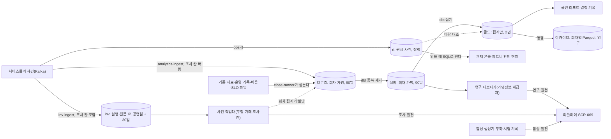

# 분야 편 17: 분석·사후 포렌식

- **기준 시점**: ADR-0177까지, 2026-11-01
- **맡는 정본**: [docs/features/analytics.md](../../features/analytics.md) 전체, [docs/features/forensic-replay.md](../../features/forensic-replay.md) 전체, 두 문서의 ADR(§5에 모았다). 저장 쪽(층, ClickHouse 물리 설계, 아카이브)은 [DB 설계 편 10](../db/10-analytics-store.md)이 DB 면접 순서로 따로 풀었다.
- **규범이 아니다**: 정본을 풀어 쓴 해설이다. 숫자와 규칙이 정본과 다르면 정본이 맞다([ADR-0177](../../adr/0177-walkthrough-explain-in-interview.md)).
- **한 판 문서와의 관계**: [한 판 문서](../01-system-design.md) 13단계가 관제 실시간 표와 조회 시점 집계를, 15단계가 ClickHouse의 층과 S3 회차별 Parquet 파일을 한 줄씩 다룬다. 사후 포렌식은 1단계(화면 앱 목록)와 18단계(만든 것)에 이름만 나온다. 이 편은 마감 단계, 지표 사전, 결정 절차, 조사·연구 두 갈래, 사건 처리, 증거 묶음을 더한다.
- **측정 전이다**: 분석·포렌식 쪽 측정 기록은 없다. 기반 PoC(본 개발 전에 위험한 부분만 PC 한 대에서 먼저 재 본 시험, [ADR-0176](../../adr/0176-foundation-poc-results.md), '실측(PC)')는 Redis·HTTP·Kafka만 쟀고, 서비스 수준 측정은 아직 없다. 성능 숫자는 설계 목표값이라 `[실측 전]`을 붙였다. 정본의 `[가정]`은 그대로 옮겼다. 포트폴리오에는 실제 팬이 없어 두 기능 모두 합성 데이터로만 돌려 본다.

## 1. 이 문서가 정하는 것

두 정본은 '판매가 끝난 뒤 기록을 어떻게 쓰나'를 정한다. docs/features/analytics.md는 회차가 끝난 뒤 "다음 회차를 어떻게 열지"를 정하는 분석 저장소다. 저장소는 ClickHouse(대량 이벤트 집계에 강한 분석용 데이터베이스)와 S3(클라우드 파일 저장소)의 회차별 Parquet(열 단위로 저장하는 공개 파일 형식) 아카이브다. 길은 둘이다. 온세일(판매가 열리는 시각 앞뒤로 접속이 몰리는 기간) 중 관제가 보는 잠정 숫자는 실시간 표 `rt`에, 결정에 쓰는 확정 숫자는 브론즈(원본)·실버(중복을 지운 가명 사건)·골드(사람 단위 행이 없는 집계) 층에 둔다. 마감 단계 R0~R3가 숫자를 확정하고, 지표 사전 32개와 결정 규칙이 '검토할 결정'을 연다. docs/features/forensic-replay.md는 사후 포렌식이다. 온세일이 끝나면 실제 기록으로 봇·매크로 부정 예매를 찾고, 사람이 소명(의심받은 사람이 정상 구매라고 해명하는 절차)과 2인 승인을 거쳐 취소·이용 제한을 정하며, 근거를 증거 묶음으로 남긴다. 원천은 셋이다. 조사 갈래는 실명 기록을 담는 조사 저장소 `inv`, 연구 갈래는 실버의 가명 사건, 시험·시연은 합성 데이터다. 조사와 연구는 잇지 않는다. 지난 회차를 좌석맵과 시간축으로 다시 보는 리플레이 화면(SCR-069)은 세 원천이 함께 쓴다.

> **30초 설명**: "분석은 두 길로 나눴습니다. 온세일 중 관제 숫자는 원시 사건을 실시간 표에 싣고 읽을 때 세는 잠정 숫자이고, 판매 정책 같은 결정은 마감 단계 R1부터 R3까지 확정한 숫자로만 합니다. 결정을 실행할 수 있는 속도보다 빠른 숫자는 쓰지 않는다는 원칙입니다. 판매가 끝나면 사후 포렌식이 돕니다. 기록을 고정해 해시를 남기고, 같은 기기·결제 수단·연락처를 쓰며 1인 한도를 넘게 산 계정 묶음을 자동으로 찾습니다. 조치는 시스템이 하지 않습니다. 조사관이 소명을 받고, 요청자가 아닌 승인자가 근거를 직접 읽고 이유를 적어 승인해야 취소나 이용 제한이 됩니다. 실명 조사 저장소와 가명 분석 저장소는 키도, 사람도, 파일도 서로 잇지 않습니다. 가명 기록을 실명 주문과 맞춰 보면 개인정보 보호법의 재식별 금지에 걸리기 때문입니다."

## 2. 절마다 읽기

지표 32개, 사실 표 15개, 시험 A-T1~A-T25와 FX-T1~FX-T24, 사건 전이 C1~C17, 조사 API 같은 큰 표는 '무엇이 있고 어디서 찾는지 알게' 읽는다. 따로 물을 만한 하위 절은 행을 나눴다.

| 정본 절 | 무엇을 정하나 | 왜 | 해설서에서 |
| --- | --- | --- | --- |
| docs/features/analytics.md §1 개요와 역할 원칙 | 답하는 질문 여섯(용량, 정렬 방식, 구매 제한, 결제 전환, 봇, 단위 경제성), 결정별 신선도, 분석 단위 | 관제는 "지금 정상인가", 이 저장소는 "다음 회차부터 무엇을 바꿀까"에 답한다 | 한 판 13단계(두 길만), DB 편 10 |
| docs/features/analytics.md §1.2 역할 원칙 | 실행 속도 일치, 결정은 확정 숫자로만, 지표 사전 하나 | 숫자가 늦게 확정되고, 온세일 중엔 판매 조건을 바꾸지 않으며, 한 회차는 잡음이 크다(§1.3) | DB 편 10 |
| docs/features/analytics.md §2 구조: 두 길과 분석 층 | `rt`와 네 층의 보장·보존·읽는 주체 | 메달리온(층을 거치며 품질을 올리는 패턴)은 필수 표준이 아니고, 중요한 것은 층마다의 보장이다 | 한 판 13·15단계, DB 편 10 |
| docs/features/analytics.md §3 원천과 적재 | 토픽 열 개를 원본 그대로, 파일 원천은 수집 버킷으로. 점검 회차와 `investigation.requests`는 싣지 않는다 | 원본을 실어야 Kafka(사건을 쌓아 두고 여러 곳에 나눠 주는 메시지 시스템) 재처리로 다시 만든다(ADR-0042 결정 2) | DB 편 10 |
| docs/features/analytics.md §3.3 가명 처리와 금지 필드 | 회차별 HMAC(비밀 키를 섞어 만드는 해시) 가명, 금지 필드와 허용 목록, 조사 칸 버리기, 조사 라벨은 집계로만, KMS(암호 키를 보관하고 대신 써 주는 클라우드 서비스) 실패 때 멈춤 | 조사 칸은 회차를 넘어 값이 같아 '회차를 넘는 연결 없음'을 깨고 `inv`와 잇는 키가 된다 | DB 편 10·11 |
| docs/features/analytics.md §4 변환과 마감 | dbt(SQL 변환 모델을 짜고 시험하는 도구) 계층, 실버 delete+insert, 골드 판 바꾸기, 10분 CronJob(쿠버네티스에서 정해진 때마다 도는 작업) | delete+insert는 도중에 실패하면 반쯤 지운 회차가 남는다(ADR-0086) | DB 편 10 |
| docs/features/analytics.md §4.2 마감 단계 | R0~R3·동결의 시각과 그때 확정되는 것 | 영역마다 확정되는 때가 다르다(결제는 상태 불명 정리 뒤, 봇은 표본 검토 뒤, 입장은 공연 뒤) | [분야 편 14](14-bot-defense.md)(봇 하한), DB 편 10 |
| docs/features/analytics.md §4.4 실시간 대비 대조 | 같은 지표를 `rt`와 골드로 세어 차이를 남긴다 | 둘 다 `eventKey`로 지우고 같은 규칙의 SQL로 세므로 유실이 없으면 판매 차이가 0이다 | DB 편 10 |
| docs/features/analytics.md §5 스타 스키마(골드) | 버스 매트릭스, 사실 표 F1~F15, 차원, 실버의 원자 단위 표 | 비율 대신 분자·분모를 저장해야 회차를 합칠 때 평균이 맞는다 | 한 판 15단계, DB 편 10 |
| docs/features/analytics.md §5.5 ClickHouse 물리 설계 | 엔진·정렬·TTL(정해 둔 시간이 지나면 지우는 설정), `gold.current_run`, 아카이브 쓰기·읽기 | ReplacingMergeTree(병합 때 같은 키의 중복을 지우는 표 엔진)는 병합 시점을 보장하지 않고 머티리얼라이즈드 뷰(넣을 때마다 미리 합산하는 뷰)는 중복 전달분을 더한다 | 한 판 15단계, DB 편 10 |
| docs/features/analytics.md §6 지표 사전 | 목표 다섯 → 질문 → 지표 32개, `metrics.yml` 형식 | 관제·리포트·파트너가 같은 정의를 써야 숫자가 갈라지지 않는다 | — |
| docs/features/analytics.md §6.4 결정 규칙 판정 | 네 판정, 95% Wilson 구간(표본으로 잰 비율의 95% 구간), 같은 규모 기준선 셋 | 입장 1,000명이면 구간 폭이 ±2%p 안팎이라 목표 근처 값은 우연만으로 걸리거나 빠질 수 있다 | — |
| docs/features/analytics.md §7 데이터 품질(NFR-026) | 검사 아홉과 실패 때 동작 | 파이프라인에도 SLI(실제로 재는 품질 값)를 둬야 리포트를 믿는다 | — |
| docs/features/analytics.md §8 공연 리포트와 보여 주기 | 화면별 숫자 지위, 리포트 11절, 파트너 판매 요약, 홈 장르별 랭킹 | 리포트 생성기는 지표 뷰와 F11·F12만 읽고 따로 계산하지 않는다 | — |
| docs/features/analytics.md §9 분석 절차 | 마감 확인 → 목표 대비 → 비교 → 분해 → 나눠 보기 → 시간 대조 → 가설 → 결정 기록 → 확인 | 회차 안에서 사람을 나눠 시험하지 않아(POL-040 ⑤) 짝 비교로 원인을 좁힌다 | — |
| docs/features/analytics.md §10 결정 절차(POL-040) | 회의 다섯, 결정 권한과 최소 근거, `decision_record`, 끝에서 끝까지 예 | 되돌리기 쉬운 결정은 빨리, 어려운 결정은 근거를 더 모아서 한다 | [분야 편 3](03-policies-glossary.md)(POL-040) |
| docs/features/analytics.md §11 개인정보와 보안 | 법 근거, 작은 칸 합치기, 키 분리, 처리 기록, 두 갈래 분리, ClickHouse 사용자 표 | 1명짜리 칸은 집계여도 사람에 대한 판단이 드러난다 | DB 편 10·11 |
| docs/features/analytics.md §12 데이터·API 참조 | 계약, 경로, 표, 코드 위치 | 찾아보기다 | — |
| docs/features/analytics.md §13 테스트 포인트 | A-T1~A-T25 | 약속을 시험으로 판정한다 | — |
| docs/features/analytics.md §14 알려진 한계 | 비용 원천 없음, 실제 팬 없음 등 13가지 | 남는 한계를 적는다 | — |
| docs/features/analytics.md §15 미결정·[가정] | 마감 시각, 허용 차이, 보관 기간 | 측정으로 정할 값을 모은다 | — |
| docs/features/forensic-replay.md §1 무엇을, 왜 | 목적, 세 원천, 범위 밖, 전체 흐름 | 온세일 중 판정은 빨라야 해 한계가 있다. 판매 뒤 기록을 모으면 같은 기기·결제 수단·연락처를 쓴 묶음이 드러난다 | 한 판 1·18단계(이름만) |
| docs/features/forensic-replay.md §1.2 기획서에서 받은 것과 바꾼 것 | DuckDB-WASM(브라우저 안 SQL 분석 엔진)·WebGPU(브라우저에서 GPU로 그리는 새 기능)·공유 메모리 필수·'탐색 중'·IP C클래스 군집을 빼거나 바꿨다 | 엔진이 압축 뒤 약 7.1MB이고, WebGPU는 Baseline(주요 브라우저가 모두 지원한다는 웹 기능 표시)이 아니며, 서버는 누가 어느 좌석을 보는지 모른다 | — |
| docs/features/forensic-replay.md §2 화면(SCR-069) | 머리·좌석 리플레이·타임라인·교차 필터·후보 패널·상태 띠 | 원천마다 후보 패널이 다르다(합성은 산점도, 연구는 한 축, 조사는 단계별 시간 대 정상 기준선) | [분야 편 5](05-design-system.md)(부품) |
| docs/features/forensic-replay.md §3 구조 | 메인 스레드와 Worker(화면과 따로 도는 작업 스레드) 셋, 복사 방식, 비트마스크 교차 필터 | 화면과 입력만 메인 스레드에 둬야 수백만 사건을 걸러도 조작이 막히지 않는다 | [분야 편 6](06-frontend.md)(COEP: 교차 출처 격리를 켜는 헤더) |
| docs/features/forensic-replay.md §4 데이터 | 사건 종류 일곱, Arrow IPC 파일(열 단위로 담는 공개 표준 형식, 판 2, 열 16개), 원천별 칸 규칙, 검증, 한도 | 세 원천이 한 형식을 쓰고 원천마다 비울 칸이 다르다. 검증이 하나라도 실패하면 그리지 않는다 | — |
| docs/features/forensic-replay.md §5 시험·시연 원천 | 프리셋 셋, 재현성 규칙, 부하 시험 기록, 조사 갈래 시험 시드 | 서버·개인정보 없이 시연하고, 정답을 심은 시드로 조사 규칙을 시험한다 | — |
| docs/features/forensic-replay.md §6 운영 원천(§6.1 경계와 조건) | 두 갈래의 원천·키·사람·목적·근거·보존, 여는 조건, 가명처리 적정성 검토 | 가명정보로 개인에게 조치하면 §28의5(재식별 금지)에 걸린다 | — |
| docs/features/forensic-replay.md §6.3 연구 갈래 내보내기 | 내보내기 API와 열 허용 목록, 안 (가)(나)(다) | 실버 가명과 trust-svc 원시 표를 이을 키가 없고, 행동 요약을 실버에 실으면(안 (가)) 가명정보 범위가 넓어진다(기술 검토 중간-093) | — |
| docs/features/forensic-replay.md §6.6 두 갈래를 잇지 않는 장치 | 일곱 장치(조사 칸 버림, 다른 키, DB 권한, 지정 분리, 원천 하나, 내려받기 없음, 집계 라벨만) | 키·질의·사람·화면·파일·라벨 어느 길로도 두 기록이 이어지지 않게 한다 | DB 편 10(권한) |
| docs/features/forensic-replay.md §6.7.1 조사 저장소 | `inv` 네 표, 보존과 파기 작업, 사용자 셋, 조사 원천 리플레이 파일 | 정상 이용자 모두의 원문 IP를 모으는 곳이 이익형량에서 가장 약해 보존을 짧게 끊는다 | [DB 편 11](../db/11-privacy.md)(보존) |
| docs/features/forensic-replay.md §6.7.2 기록 고정과 해시 | 적재 확인, 판 범위, 판 해시(내용이 한 바이트라도 바뀌면 값이 달라지는 파일 지문) 사슬, 하루 검증 | '그 시각까지 들어온 기록이 이것이었다'를 나중에 증명하려는 것이다 | — |
| docs/features/forensic-replay.md §6.7.3 후보 묶음 | 규칙 R1~R6, 강한·약한 연결, 후보 조건, 점수, 결정적 계산 | 이름이 다른 계정들이 한 사람이면 1인 한도를 넘게 산 셈이다 | — |
| docs/features/forensic-replay.md §6.7.4 사건 상태 | 상태 일곱과 전이 C1~C17 | 전이와 조건의 정본은 표이고 그림은 길잡이다(docs/planning/03 §5.5). FX-T12가 C1~C17을 하나씩 돈다 | — |
| docs/features/forensic-replay.md §6.7.5 소명·조치·이의 | 소명 기한, 양도 잠금, 조치 셋, 승인자의 실질 관여, 전액 환급, 취소 마감, 우선 구매 | 형식적인 결재만 있으면 자동화된 결정으로 볼 수 있다(안내서 p.7) | [분야 편 12](12-transfer-refund-settlement.md)(잠금·실행), 분야 편 3(POL-046) |
| docs/features/forensic-replay.md §6.7.6 증거 묶음 | 파일 일곱, 묶음 해시, 관리 연속성 사슬, Object Lock(정한 동안 누구도 지우거나 덮어쓰지 못하게 하는 기능), 보존 | 조사용 기록이 지워지기 전에 분쟁·수사에 필요한 것을 떼어 둔다 | — |
| docs/features/forensic-replay.md §6.7.7 내보내기와 외부 게시물 | 양식 셋, 고소장 최소 항목, 게시물 최소화 규칙 | 고소장에 남의 개인정보를 붙이면 누설이 될 수 있다(대법원 2018도1966) | — |
| docs/features/forensic-replay.md §6.8 화면 위치와 배포 | 관제 콘솔 주소 아래 따로 여는 페이지 `/forensics?event=` | 빌드 구조가 달라(webpack 대 Vite) 끼우기 어렵고, 무거운 계산이 관제 화면을 느리게 하지 않게 한다 | 분야 편 6(COEP) |
| docs/features/forensic-replay.md §7 성능 목표 | 리플레이 목표와 조사 갈래 용량 | 상시 운영 환경이 없어 1/10 시드로 재고 외삽한다 | — |
| docs/features/forensic-replay.md §8 시험 | FX-T1~FX-T24 | 약속을 시험으로 판정한다 | — |
| docs/features/forensic-replay.md §9 운영 확인 | 적재·고정·후보·잠금·파기·증거 검증의 경보 | 여럿은 실제 회차가 끝나야 돌아 '확인 불가'다 | — |
| docs/features/forensic-replay.md §10 남는 한계 | 합성 한계, 자체 법률 해석, 잠금 14일 뒤 퍼짐 | 막지 못하는 것을 밝혀 둔다 | — |
| docs/features/forensic-replay.md §11 확인한 외부 사실 | 기술 사실과 법·집행 사례 | 근거를 확인 날짜와 함께 남긴다 | — |

## 3. 꼭 기억할 규칙과 숫자

| 항목 | 값 | 표시 | 정본 위치 |
| --- | --- | --- | --- |
| 층별 보존 | `rt` 판매류·대기열·홀드 400일·판정 90일·심장 박동 7일, 브론즈 적재 뒤 90일, 실버 90일, 골드 2년, 아카이브 영구 | `rt`는 `[가정]` | analytics §2 |
| 관제 반영 | 초당 3만 건에서 반영 p95(백 건 중 아흔다섯 건이 이 안에 드는 값) 5초 미만, 누락률 0.1% 미만 | `[실측 전]` | NFR-009 |
| 마감 단계 | R0 = 온세일 윈도우 종료(T+60분) + 30분, R1 다음 영업일 10시, R2 오픈 + 7일, R3 회차 종료 다음 영업일 10시, 동결 = R2·R3 중 늦은 때 + 7일 | `[가정, Phase 4 4.3.6에서 확정]` | analytics §4.2 |
| 마감 실행 | 10분마다, 회차 하나씩, 회차당 20분 상한 | `[가정]` | analytics §4.1 |
| 대조 기준 | 판매 좌석·금액은 `rt`와 차이 0, 퍼널 0.1% 이내. R3 판매 대금·환급은 정산서와 0원 차이 | 0.1%는 `[가정]` | analytics §4.4·§7 |
| 가명 | 회차 키 = `HMAC(분석 가명 키, "PEAKET-analytics-v1" ‖ 회차 ID)`, 가명 = `HMAC-SHA256(회차 키, 식별값)`. HMAC은 비밀 키를 섞어 만드는 해시다 | 확정 | analytics §3.3 |
| 키·원본 보관 | 분석 가명 키 1년마다 교체, Kafka 분석 토픽 7일 이상 | `[가정, Phase 4 4.3.4에서 확정]` | analytics §3.3·§3.5 |
| 작은 칸 합치기 | 사람 판단이 든 칸 세션 5 미만, 파트너 요약 판매 5건 미만, 부정 예매 집계 계정 5 미만 | `[가정]` | analytics §3.2·§5.2·§8.4 |
| 비율 규칙과 기준선 | Wilson 구간이 목표 밖이면 걸림, 품으면 경계(걸림으로 세지 않는다), 안이면 안 걸림. 기준선은 같은 규모 확정 회차 n < 3이면 없고, 3~9면 범위(약함), 10 이상이면 중앙값·사분위 | 확정 | analytics §6.4 |
| 대표 목표 | 전환율 83% 이상(매진·입장 1,000명 이상일 때), 매진 22분 이하, 봇 점유율 하한 5% 이하, CS 2,600건 이하, 불변식 0건 | 적용 조건은 `[가정]` | analytics §6.2·§6.3 |
| 기록 고정 | 적재가 T+65분까지 읽혔을 때 고정, 30분 기다려도 안 되면 '늦은 적재'. 판은 판매 종료까지 1시간마다, 게시물 등록 뒤 10분 안 | `[가정]` | forensic §6.7.2, FR-072 |
| 첫 후보 | 온세일 윈도우 끝 뒤 2시간 안, 한 번 p95 20분, 실패하면 자동 3번 | `[가정]`, `[실측 전]` | forensic §6.7.3·§7.2 |
| 후보 점수 | R1 강한 연결 3·약한 연결 1, R2 2, R3 2(다시 쓴 입장 링크 3), R4 1, R5 4, R6 4, 구매 P > L이면 3·P ≥ 3L이면 5. 높음 8 이상, 중간 5~7, 낮음 4 이하. 공개하지 않는다 | 시작값 `[가정]` | forensic §6.7.3 |
| 소명 기한 | min(요청 + 3일, 취소 마감 − 6시간), 24시간 아래로 내리지 않는다 | `[가정]` | forensic §6.7.5 |
| 양도 잠금 | 그 계정이 결제한 그 회차 표 전부. 일곱 때 가운데 먼저 오는 때 풀리고, 최대 첫 소명 요청 + 14일이고 연장은 없다 | 14일은 `[가정]` | forensic §6.7.5 |
| 취소 마감·환급 | 판매 종료 − 2시간 = 공연 시작 26시간 전. 전액 환급은 결정을 알린 뒤 3영업일 안, 공제 0원 | `[가정]` | forensic §6.7.5 |
| 이용 제한·이의 | 이용 제한은 건 날 + 1년 이하, 이의 창 30일, 우선 구매 48시간 | `[가정]` | forensic §6.7.5 |
| 보존 | `inv` 그 회차 공연일 + 30일, 증거 묶음 보존 이유 끝 + 30일(없으면 조치일 + 1년), 사건 기록 닫힌 뒤 3년, 조사 화면 접속기록 2년 | 접속기록만 확정, 나머지 `[가정]` | forensic §6.7.1·§6.7.6·§6.4 |
| 되돌릴 조건 | 첫 세 회차 소명 인정 비율(오탐률) 20% 초과면 후보 규칙과 조치 기준을 다시 본다 | `[가정]` | forensic §6.7.3, analytics 지표 32 |
| 리플레이 | 한도 사건 300만·200MB·좌석 1천~10만·30분. 목표 필터 반영 p95 50ms, 프레임 p95 20ms, INP(조작에 화면이 반응하기까지 걸린 시간) 200ms | `[가정]`, `[실측 전]` | forensic §4.3·§7.1 |

## 4. 이 문서가 다루는 ID

| ID | 한 줄 |
| --- | --- |
| FR-026 | 파트너 실시간 판매 현황(최대 1분 지연) |
| FR-029 | 관제 대시보드의 온세일 단계별 화면 |
| FR-031 | 운영 명령 감사 로그와 인시던트 리플레이 |
| FR-034 | 신고기관·사법기관 자료 요청을 법정 절차로 처리한다 |
| FR-064 | 관리 계정 접속기록·다운로드 정기 점검 |
| FR-068 | 공연 리포트를 마감 단계별로 받고 결정 기록을 남긴다 |
| FR-069 | 고객 문의('외부 되팔이 게시물 신고' 유형) |
| FR-071 | 지난 회차를 좌석맵과 타임라인으로 다시 본다(원천 셋) |
| FR-072 | T+60분에 조사용 기록을 고정하고 후보 묶음을 만든다 |
| FR-073 | 부정 예매 사건: 소명, 양도 잠금, 2인 승인 조치, 이의 |
| FR-074 | 조치한 사건의 증거 묶음 보존과 내보내기 |
| NFR-009 | 관제 지표 반영 p95 5초 미만, 누락률 0.1% 미만 |
| NFR-018 | 수집 항목·법정 보존 기간을 data-classification 기준으로 관리한다 |
| NFR-022 | 봇 탐지 정확도. 합성 정밀도·재현율로 재지 않는다 |
| NFR-026 | 분석 파이프라인 마감 품질(신선도·정확성·커버리지) |
| POL-006 | 추가 검증 큐(자동화된 결정). 미리 공개한 규칙과 이의 경로 |
| POL-017 | 양도(수락형). 받은 표도 결제자의 부정 예매로 취소될 수 있다 |
| POL-022 | 알림 심각도(SEV)와 인시던트 대응 |
| POL-023 | 개인정보 처리 |
| POL-025 | 신고기관·수사기관 요청 대응 |
| POL-027 | 법률 항목 표기와 검토(확인됨·확인 필요·해석·간주) |
| POL-028 | 온세일 윈도우(T-10분~T+60분) 운영 제약 |
| POL-030 | 온세일 단계 정의 |
| POL-033 | 회원 탈퇴와 재가입(이용 제한 중 탈퇴의 대조값 예외) |
| POL-037 | 판매 구조와 법적 지위(파트너가 정하는 것은 권고만) |
| POL-038 | 승인 업무와 CS 처리함(⑪ 부정 예매 조치의 2인 승인) |
| POL-039 | 정산과 지급(정산서가 원본, 골드는 대조 대상) |
| POL-040 | 분석 숫자와 결정 절차 |
| POL-046 | 부정 예매 사후 조치 |
| SCR-001 | 홈(장르별 랭킹) |
| SCR-011 | 주문·결제(잠금 중 새 구매 안내) |
| SCR-017 | 계정 설정(탈퇴 포함) |
| SCR-026 | 파트너 실시간 판매 현황 |
| SCR-027 | 파트너 정산 리포트(판매 요약, 부정 예매 조치 탭) |
| SCR-029 | 중앙 관제 대시보드(판매 중 잠정, 종료 후 공연 리포트) |
| SCR-031 | 감사 로그와 인시던트 리플레이 |
| SCR-041 | 양도 받기 |
| SCR-042 | 소명 제출 |
| SCR-046 | 승인 업무 |
| SCR-067 | 봇 판정 표본 검토 |
| SCR-069 | 포렌식 리플레이 |
| SCR-070 | 부정 거래 조사 사건 목록 |
| SCR-071 | 사건 작업대 |
| CMP-021 | SeatMap(`replay` 변형) |
| CMP-033 | TimeSeriesChart(타임라인 막대) |
| CMP-039 | AuditTimeline(`scrub` 변형) |
| CMP-060 | ApprovalPanel(사건 요약 읽기 전용) |
| CMP-063 | AppealForm(부정 예매 소명) |
| CMP-064 | ReauthPrompt(재인증) |
| CMP-079 | ScatterBrush(산포도와 영역 고르기) |
| CMP-080 | LinkGraph(연결 그래프) |
| CMP-081 | CaseStatusBadge(사건 상태·점수 범주) |
| CMP-082 | ReplaySourceBadge(원천 배지) |
| CMP-083 | StepBaselineChart(단계별 시간 대 정상 기준선) |

## 5. 결정과 버린 길

버린 길은 각 ADR의 '검토한 대안'(ADR-0052는 '대안') 표에서, '본문이 옛 판인 곳'은 ADR 상태 줄에서 옮겼다. 분석 저장소의 기술 결정 ADR-0042·0052·0115의 자리는 [결정 카드 D-26](../decisions/D26-analytics-clickhouse-parquet.md)이고, 이 편은 정본을 읽는 데 필요한 만큼만 든다.

### [ADR-0042](../../adr/0042-analytics-store-and-decision-rules.md)·[ADR-0052](../../adr/0052-analytics-medallion-star-schema-close-stages.md) 분석 저장소와 확정·잠정 분리

- **고른 것**: ClickHouse를 공연별 사후 분석 저장소로 넓혀 리포트와 결정 규칙 표로 결정에 잇는다. 실시간 길과 확정 길은 같은 지표 정의를 쓰되 표를 섞지 않는다. 층, 스타 스키마(사실 표 하나에 차원 표를 붙인 분석 구조), dbt, 마감 단계, 결정 절차를 두고, 가명정보는 §28의2 통계작성으로 본다.
- **버린 길**: Mimir 장기 보관은 퍼널·구역·실패 사유로 나눠 보지 못하고, S3 + Athena는 리포트가 수십 분 넘게 늦다(ADR-0042). 원시 삽입에 머티리얼라이즈드 뷰(넣을 때마다 미리 합산하는 뷰)로 마트를 만들면 중복이 합산되고 잠정과 확정이 섞인다. 스트림 하나로 확정까지 하면 며칠 뒤 확정되는 숫자를 스트림 상태로 붙들어야 한다. 넓은 표 하나는 그레인(한 행이 무엇인지)이 달라 대기 인원을 잘못 더한다. §15③ 추가적 이용은 §28의7 적용 제외가 없어 삭제 요구마다 가명을 다시 계산해야 한다(ADR-0052).
- **본문이 옛 판인 곳**: ADR-0042의 'S3 Iceberg'는 회차별 Parquet(ADR-0115), '관제 읽기 모델 흡수'는 ADR-0052가 대신했고, 'Flink 경로'는 `analytics-ingest`(ADR-0099), 'pid 해시'는 회차별 키 HMAC이다. ADR-0052의 'Flink 집계 → `rt`'는 '`ops-rt` 원시 적재 → 조회 시점 집계'다. 사실 표는 15개, 지표는 32개이고, 골드는 판 바꾸기다(ADR-0086).

### [ADR-0115](../../adr/0115-analytics-archive-per-event-parquet-files-read-with-clickhouse-s3.md) 아카이브는 회차별 Parquet 파일

- **고른 것**: 동결 때 표마다 Parquet 파일 하나와 manifest(파일·행 수·SHA-256 목록)를 S3에 쓰고, 뷰 `archive.<표>`가 manifest에 있는 파일만 `s3()`로 읽는다. 마감 실행기는 쓰기만 하고 지우지 못한다.
- **버린 길**: 골드를 오래 두고 매일 백업하면 '바뀌지 않음'을 권한으로만 지키고 백업에 가명 사건·원시 IP가 함께 들어 7일 [가정]만 둔다. Iceberg 표 + Glue는 카탈로그와 정리 작업을 운영하고, 26.8의 Iceberg 쓰기가 Beta이며, 읽는 엔진이 하나뿐이다. CSV·JSON은 자료형이 없고 크다.
- **본문이 옛 판인 곳**: 결정 6의 'LocalStack'은 AWS 흉내 서버 moto다.
- **다시 볼 조건**: 다른 엔진이 아카이브를 표로 읽거나 행을 고쳐야 하거나 비교 조회가 10초 [가정]를 넘으면 Iceberg를 다시 본다(결정 5).

### [ADR-0080](../../adr/0080-forensic-replay-synthetic-demo-first.md) 포렌식 리플레이를 줄여 넣는다(자리: 이 편)

- **고른 것**: 기획서를 그대로 넣지 않고 서버 없는 정적 앱 `apps/forensics`, 좌석맵 공용 패키지, 열 배열·비트마스크 교차 필터, WebGL2 산점도, 시드 고정 생성기로 줄였다.
- **버린 길**: 기획서 그대로는 '탐색 중'·좌석별 경합·IP 군집 데이터가 없다. 넣지 않으면 서버 없는 시연을 버린다. DuckDB-WASM은 약 7.1MB이고 정식판이 2025-12 뒤 없다. 관제 원격 위젯부터 하면 서버·권한·법률 검토가 먼저라 시연이 늦다.
- **본문이 옛 판인 곳**: 결정 1·3·11의 '2단계는 출시 뒤 선택'은 ADR-0171이 대신했다. 결정 6의 공유 메모리 시계는 목표를 못 맞출 때만 더한다. 결정 8에 셋째 프리셋 '사람 흉내 봇'이 더해졌다. 상태 줄(2026-11-01 정합 점검)대로 결정 7의 파일 형식은 판 2(`peaket-forensics-v2`, 사건 종류 일곱, 열 16개), 결정 4의 내보내기 경로는 `/v1/ops/research-exports`이고, '그림자 실행으로 잰 뒤 채택'은 연구 갈래 밖으로 뺐다(ADR-0173 결정 8).

### [ADR-0171](../../adr/0171-post-sale-forensics-in-launch-scope.md) 사후 포렌식을 출시 범위에 넣는다(자리: 이 편)

- **고른 것**: FR-071을 Must로 올리고 FR-072~074를 더한다. 조사·연구 두 갈래로 나누고 잇지 않는다. 조치는 사람이 결정하고 시스템은 양도 잠금만 건다. 묶음 분석에 필요한 수집(공통 추적 ID, 기기 키 통일, 조사용 네트워크 기록, 홀드 시도의 좌석 번호, 결제 연결값, 연락처 해시)을 보강한다.
- **버린 길**: ADR-0080 그대로는 사후 분석과 공연법 개정 뒤 자료 요청에 대응할 묶음 분석이 없다. 한 갈래(가명 기록으로 개인 조치까지)는 §28의5와 가이드라인 p.25에 걸린다. 자동 취소·입장 차단은 §37의2 자동화된 결정이 되고 열성 팬의 정상 행동과 섞여 오탐 위험이 크다. 조사 화면을 따로 연 앱으로 하면 로그인·IP 제한·재인증·감사를 새로 만든다.
- **본문이 옛 판인 곳**(상태 줄과 ADR-0173이 고친다): 결정 2의 근거 '제4호 또는 제6호'는 제6호이고, '그림자 실행으로 검증'은 연구 갈래에서 뺐다. 결정 3의 잠금은 반려·만료와 14일 상한이 더해졌고 돌려주기는 막지 않는다. 결정 5의 '공연 종료 뒤 30일'은 '그 회차 공연일 + 30일'이다. 행동 요약은 계정끼리 견주지 않는다(forensic-replay §6.7.3).

### [ADR-0173](../../adr/0173-post-sale-forensics-self-legal-review.md) 법률 확인 30~37번을 자체 법률 조사로(자리: 이 편)

- **고른 것**: 법률 자문이 아니라 원문을 읽은 해석이다. 근거는 정당한 이익(§15①6) 하나와 목적마다 이익형량(PEAKET의 이익과 이용자가 잃는 권리를 견주는 판단) 기록이다. 승인자는 이유를 직접 적고 요약을 연 기록이 있어야 한다. 잠금 14일 상한, 공제 없는 전액 환급, 행동 요약은 세션 하나에만, 고소장에 개인정보를 넣지 않기, 보존 상한을 둔다.
- **버린 길**: 계약 이행(제4호)은 제3자 제공 근거에 없어 수사기관에 넘길 길이 막힌다. 관객 취소와 같은 공제율은 실제 손해가 거의 없어 위약금 무효 위험이 크다. 행동 요약으로 계정을 잇는 것은 민감정보가 될 위험이 크다. 잠금을 입장 시작까지 두면 몇 주씩 잠겨 약관법 §10 위험이 남는다.
- **본문이 옛 판인 곳**: 없다(상태 줄에 고침이 없다). 정책·기능 문서 반영은 BUILD_ORDER FRN-080에서 했다.

### 이 편에 둔 ADR과 함께 알 것

docs/walkthrough/decisions/README.md §2가 이 편을 자리로 둔 ADR은 셋이다.

- ADR-0080: 포렌식 리플레이는 합성 데이터 브라우저 데모부터 넣는다(지금은 시험·시연 원천).
- ADR-0171: 사후 포렌식을 출시 범위에 넣는다(두 갈래, 사람이 하는 조치, 수집 보강).
- ADR-0173: 법률 확인 30~37번을 자체 법률 조사로 검토하고 설계에 반영한다.

함께 알 것: [ADR-0099](../../adr/0099-drop-flink-typescript-stream-workers-read-time-aggregation.md)(TypeScript 스트림 작업자와 조회 시점 집계, [결정 카드 D-28](../decisions/D28-drop-flink-stream-workers.md)), [ADR-0086](../../adr/0086-query-index-rules-plan-diagnostics-data-pattern-gaps.md) 결정 8(골드 판 바꾸기), [ADR-0039](../../adr/0039-bot-detection-evaluation-protocol.md)(그림자 실행과 표본 검토), [ADR-0004](../../adr/0004-drop-cassandra-from-runtime.md)(Cassandra를 빼고 ClickHouse로, [D-26](../decisions/D26-analytics-clickhouse-parquet.md)).

## 6. 읽는 요령

**읽는 순서**: analytics §1.2 → §2 → §4.2·§4.4 → §6.4 → §10으로 '숫자가 결정이 되기까지'를 먼저 잡고, §3.3·§11로 가명을 본다. §5는 표 이름을 찾을 때 읽는다. forensic-replay는 §1 → §6.1·§6.6(두 갈래) → §6.7.2~§6.7.6(조사 흐름) 순서로 읽고, §2~§5(화면과 앱)는 뒤에 읽는다. §6.7.8과 analytics §12는 찾아보기다.

**세 원천과 두 저장소를 먼저 그려 둔다.** 정본은 이 그림을 analytics §2와 forensic-replay §1.4·§6.6에 나눠 그린다.

- `inv`와 분석 DB는 같은 ClickHouse에 있어도 권한이 따로라 서로 읽지 못한다. 리플레이는 원천 하나만 연다.

**함정**:

- **이름이 겹친다**: 마감 단계 R1(다음 영업일 10시)과 후보 규칙 R1(연결 그래프)은 다르다. trust-svc 대기 중 재평가에도 R2가 있다.
- **옛 이름**: ADR-0080의 '1단계 데모'는 시험·시연 원천, '2단계'는 연구 갈래다.
- **F2와 F15**: F2는 R2에 동결된다. R3 판매 대금과 공연 전날 판매율은 F15의 합이다.
- **두 가명 키**: 분석 가명 키(회차 키를 만드는 키)와 조사용 가명 키 `inv-ref-key`는 다른 키이고 쓰는 신원도 다르다.
- **행동 요약의 두 쓰임**: 조사 갈래는 계정끼리 견주지 않는다. trust-svc 재평가가 똑같은 값의 반복을 보는 것은 그대로 두되 자동화의 근거로만 쓴다.
- **합성 정밀도·재현율**: 생성기가 봇을 그 특징으로 만들어서 높다. 탐지 성능(NFR-022)으로 옮기지 않는다.
- **해시의 범위**: '고정한 뒤 바뀌지 않았다'만 보인다. 처음부터 잘못 들어온 기록은 막지 못한다.
- **예시 숫자는 가상이다**: analytics §10.4의 전환율 78%, VIP 경합 패배율 61%는 측정 전 가상 숫자다.

## 7. 경계

| 이 정본이 정하지 않는 것 | 어디서 정하나 |
| --- | --- |
| 온세일 중 관제 화면·운영 명령, 지정을 주는 길, FR-034 자료 요청 절차 | docs/features/control-tower.md(화면 §2, 명령 §3, 지정·FR-034 §9, 분야 편 16) |
| 메트릭·SLO·경보, 목표를 점검하는 세 질문 | docs/observability.md(세 질문은 §13, 분야 편 19) |
| `rt` 표 정의, `analytics-ingest`·`inv-ingest` 적재 | docs/streaming.md §4·§6(분야 편 18) |
| 결정 규칙 표의 기준값과 적용 조건 | docs/planning/01-overview.md §3.2(분야 편 1) |
| 표의 칸 이름, `inv` 표 엔진, 보존·암호화 | docs/data.md(DB 설계 편 10·11) |
| 봇 판정, 표본 검토, 그림자 실행 | docs/features/bot-defense.md([분야 편 14](14-bot-defense.md)) |
| 양도 잠금의 실행, 표 취소·환급, 우선 구매 보류 | docs/features/transfer-refund.md §4.1·§7.4([분야 편 12](12-transfer-refund-settlement.md)), docs/features/seat-hold.md §5([분야 편 10](10-seat-hold.md)) |
| 조사용 기록을 모으는 쪽(여정 ID, 기기 키, 결제 수단 연결값) | 각 서비스 문서(분야 편 8·9·10·11·14), BUILD_ORDER FRN-030 |
| 처리 근거, 이익형량 기록, 법률 확인 30~37번, 대량 조회 규칙 | docs/security/data-classification.md, docs/security/internal-management-plan.md §4.2(분야 편 21) |
| 증거 버킷의 Object Lock과 키 | docs/infra.md §9, docs/security/secrets-and-keys.md(분야 편 20·21) |
| 화면 배치와 문구, API 칸과 오류 코드 | docs/design/d5-screen-blueprint.md(분야 편 4), docs/api/openapi.yaml(분야 편 7) |
| 보안 점검 | docs/security/asvs/analytics.md, docs/security/asvs/forensic-replay.md(분야 편 21) |

## 8. 꼬리 질문

| 질문 | 답의 요지 | 근거 |
| --- | --- | --- |
| 관제 숫자로 바로 정책을 바꾸면 안 되나요? | 결제·봇·환불·입장이 늦게 확정되고, 온세일 중엔 판매 조건을 바꾸지 않으며, 한 회차는 잡음이 크다. 실시간 숫자는 운영 명령과 '잠정' 표시에만 쓴다 | analytics §1.3 |
| 같은 사건이 두 번 오면 두 번 세지나요? | 실버는 `eventKey`로 `LIMIT 1 BY`, `rt`는 읽을 때 같은 키로 지운다. 병합 엔진과 뷰에 맡기지 않는다(A-T1) | analytics §5.5 |
| 회차마다 가명이 다르면 여러 회차 봇은요? | 분석 저장소 안에서는 일부러 잇지 않고 trust-svc가 판별한다. 대가로 사람 단위 지표가 없다 | analytics §3.3·§14 |
| 후보 묶음이 나오면 바로 취소하나요? | 아니다. 시스템은 소명 요청 때 양도 잠금만 건다. 취소는 조사관 요청과 다른 commander(운영 리더 역할)의 승인(이유와 요약 열람 필수, 한 번에 하나)으로만 한다 | forensic §6.7.5 |
| 연구 갈래에는 왜 기기·행동 신호가 없나요? | 실버 가명과 trust-svc 원시 표를 이을 키가 없고, 실으면(안 (가)) 가명정보 범위가 넓어진다. 기기 신호 봇은 trust-svc 그림자 실행과 표본 검토가 맡는다 | forensic §6.3 |
| 행동이 똑같은 계정은 왜 묶지 않나요? | 행동적 특징을 특정 개인을 알아볼 목적으로 쓰면 민감정보다(시행령 §18 3호). 계정끼리 행동을 견주어 같은 사람으로 판단하는 것은 그 '식별'과 구조가 같다(해석). 민감정보는 정당한 이익으로 처리하지 못한다(통합 안내서 p.52). FX-T24로 시험한다 | ADR-0173 결정 5 |
| 해시로 고정하면 위조를 막나요? | 고정 뒤 바뀌지 않았다는 것만 보인다. 판 해시를 사슬로 잇고 공개 체크포인트(ADR-0075)로 그 시각에 있었음을 보인다. 하루 검증이 어긋나면 SEV2다 | forensic §6.7.2 |
| 실제로 돌려 봤나요? | 아니다. 측정 0건이다. 분석은 합성 정답과 리포트를 대조하고(A-T10), 조사 갈래는 1/10 시드로 재서 외삽한다(FX-T22) | forensic §7.2 |

## 9. 확인 문제

1. R3 판매 대금은 왜 판매 사실 F2가 아니라 F15로 구하는가?

답

F2는 R2(오픈 + 7일)에 동결되는데, 매진되지 않은 회차는 그 뒤에도 몇 주~몇 달 판다. 그래서 날짜별 판매 사실 F15에 매일 전날분을 넣는다. 전날 사건은 실버에 아직 있어 빠지는 날이 없다. R3 판매 대금은 F15의 판매 금액 합 − 되돌림 금액 합이고 정산서와 0원 차이여야 한다(analytics §4.3·§7, A-T18).

2. 같은 규모의 확정 회차가 둘뿐인데 전환율이 낮아 보인다. 판정과 결정은 어떻게 되는가?

답

같은 규모 확정 회차가 3회 미만이면 기준선이 없어 '기준선 밖'을 쓰는 판정은 '판정 보류(기준선 없음)'다. 모든 규모를 합친 기준선은 '참고'로만 보인다. 판매 정책 기본값처럼 되돌리기 어려운 결정은 같은 방향 2회차 이상과 기준선 밖이 필요하고, 3~9회의 범위 기준선은 근거가 약해 10회까지 미루는 것이 기본이다(analytics §6.4·§10.2).

3. 조사관이 소명을 요청하면 팬 쪽에서 무엇이 바뀌고, 언제 풀리는가?

답

그 계정이 결제한 그 회차 표 전부(보유자가 바뀐 표 포함)에 양도 잠금이 걸리고, 진행 중인 양도 요청은 철회된다. 입장, 본인 취소, 돌려주기는 막지 않는다. 소명 인정, 정상 종료, 조치 실행 끝, 계정 빼기, 입장 시작, 조치 요청의 반려·만료, 첫 소명 요청 + 14일 [가정] 가운데 먼저 오는 때 풀리고, 철회로는 풀리지 않는다(forensic §6.7.5, FX-T15).

4. 가명정보 취급자 지정이 있는 commander가 부정 예매 표 취소를 승인할 수 있는가?

답

없다. 승인자는 요청자가 아니고, 가명정보 취급자 지정이 없으며, 지난 90일 [가정] 안에 그 지정을 거둔 적도 없는 commander여야 한다. 서버가 승인 때 identity-svc에 바로 물어 확인한다. 가명 기록을 본 사람이 실명 사건을 판단하면 두 갈래를 머릿속에서 잇게 되기 때문이다(forensic §6.2·§6.7.5, ADR-0171 결정 7).

## 10. 정본에서 찾은 어긋남

2026-11-01에 읽은 판 기준이다. 네 건 모두 같은 날 정본에서 고쳤다.

| 어긋난 곳 | 내용 | 지금 판 |
| --- | --- | --- |
| docs/features/analytics.md §3.2 '부정 예매 사건 집계' 행 | "연구 갈래가 받는 정답 라벨은 이 집계뿐"이라 적어, 실버로 가는 CS 확인 라벨(§3.3·§11)과 forensic-replay §4.1의 사후 라벨과 어긋났다 | 고침(2026-11-01 정합 점검 네 번째 묶음). '조사 갈래에서 받는 라벨은 이 집계뿐이고, 다른 사후 라벨은 실버 `slv_trust_label`로 받는다'로 고쳤다 |
| ADR-0080 상태 줄(2026-10-31) | "결정 5~10은 그대로"라 적었으나 결정 7의 형식(판 2), 결정 4의 경로, 그림자 실행(ADR-0173 결정 8)이 바뀌었다 | 고침(2026-11-01 정합 점검 네 번째 묶음). 상태 줄이 셋을 고쳐 읽게 한다(forensic-replay §4.2·§6.3·§6.5) |
| docs/architecture.md §11 ADR 목록의 상태 칸 | 0080·0171·0042·0052 행에 ADR-0171·0173·0099의 보완이 없었다 | 고침(2026-11-01 정합 점검 네 번째 묶음) |
| docs/data.md §6 '부정 예매 조사 저장소' 행 | 접근 칸에 파기 사용자 `inv_purger`가 빠졌다(analytics §11, forensic-replay §6.7.1) | 고침(2026-11-01 정합 점검 네 번째 묶음). 적재 `inv_ingest`, 읽기 `inv_reader`, 파기 `inv_purger` 셋이다 |
