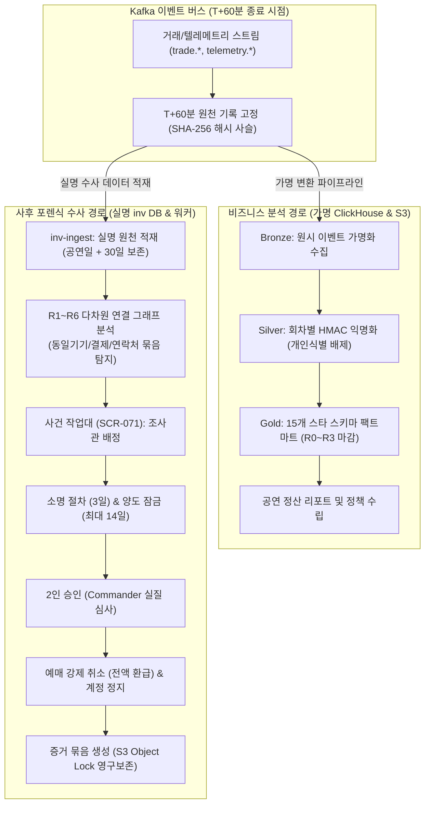

# 분야 편 17: 분석 및 사후 포렌식 (Analytics & Forensic Replay)

- **맡는 정본**: [docs/features/analytics.md](../../features/analytics.md) 전체, [docs/features/forensic-replay.md](../../features/forensic-replay.md) 전체, [docs/planning/02-requirements.md](../../planning/02-requirements.md)의 NFR-009·NFR-026, [docs/planning/03-policies-glossary.md](../../planning/03-policies-glossary.md)의 POL-040·POL-046, 관련 ADR(§4에 집대성)
- **문서 성격**: 정본 설계를 시스템 엔지니어링 및 기술 면접 관점에서 체계적으로 해설한 문서다. 규범적 수치와 불변 규칙의 최종 권위는 정본 문서에 있다([ADR-0177](../../adr/0177-walkthrough-explain-in-interview.md)). 길잡이는 [README.md](../README.md)다.
- **한 판 문서와의 관계**: [한 판 문서](../01-system-design.md) 13단계(관제 실시간 표와 조회 시점 집계), 15단계(ClickHouse 층과 S3 아카이브), 1단계·18단계(사후 포렌식 및 2인 승인 강제 취소)를 4대 핵심 아키텍처로 심화 분해한다.
- **아키텍처 목표와 검증 기준**: 온세일 중 관제 지표 반영 p95 5초 미만(NFR-009), 마감 단계 R0~R3별 골드 정합성 대조 0원 오차(정산서 대조 일치), 온세일 종료 후(T+60분) 2시간 이내 부정 예매 후보 자동 생성(성능 p95 20분), 소명 및 2인 승인 기반 조치, 실명 조사 저장소(`inv`)와 가명 분석 저장소(`silver/gold`)의 법적 완전 격리 유지를 핵심 목표이자 신뢰성 불변식으로 삼는다.

---

## 1. 분석·사후 포렌식 도메인 종합 개요

분석과 사후 포렌식 도메인은 티켓 판매가 종료된 이후 수집된 대규모 비정형·정형 로그를 바탕으로 비즈니스 의사결정을 내리고, 매크로 및 부정 예매 조직을 법적으로 단죄하는 사후 거버넌스를 관할한다. 온세일 핫패스 중에는 속도를 위해 건드릴 수 없었던 정밀 분석을 판매 종료 후 심층적으로 완결한다.

> **30초 아키텍처 브리핑 (Staff Engineer Interview)**:  
> "PEAKET의 분석 및 포렌식 아키텍처는 **'잠정 관제와 확정 분석의 2원화 + 메달리온 저장소 계층 + T+60분 로그 고정 및 사후 포렌식 수사 + 실명 조사와 가명 분석의 법적 완전 격리'**의 4대 원칙으로 설계되었습니다.  
> 첫째, **잠정 집계와 확정 분석의 분리**: 온세일 중 관제탑이 보는 숫자는 원시 사건을 그대로 적재하고 읽을 때 중복을 제거하는 '조회 시점 집계(Query-time Deduplication)' 기반의 잠정치입니다. 반면 주최측 정산 및 비즈니스 정책 결정은 결제 대사와 입장이 완전히 종결된 R1~R3 마감 단계의 확정 수치로만 집행합니다.  
> 둘째, **사후 포렌식 부정 예매 수사 파이프라인 (ADR-0171)**: 온세일 윈도우가 종료되는 T+60분에 원천 로그를 불변 해시 사슬로 고정합니다. 이어 기기, 결제수단, 연락처, 마우스 궤적을 연결하는 R1~R6 그래프 알고리즘으로 1인 예매 한도를 우회한 매크로 조직을 2시간 이내에 자동 적발합니다.  
> 셋째, **소명 보장과 2인 승인 강제 취소 (4-Eyes Principle)**: 적발된 후보는 시스템이 자동 취소하지 않습니다. 대상 티켓의 양도를 최대 14일간 잠근 뒤 소명(3일)을 받으며, 조사관이 아닌 별도의 승인자(Commander)가 증거 묶음을 직접 검토하고 서명해야만 예매 취소 및 1년 이용 제한이 집행됩니다.  
> 넷째, **실명 조사(`inv`) vs 가명 분석(`silver/gold`)의 7대 완전 격리**: 개인정보보호법 제28조의5(재식별 금지)를 준수하기 위해, 법적 조치용 실명 원천 저장소와 비즈니스 분석용 ClickHouse는 암호화 키, 데이터베이스 권한, 접근 담당자, 내보내기 경로를 물리적으로 철저히 차단했습니다."

### 분석 및 사후 포렌식 종합 파이프라인



### 핵심 3대 서브시스템

1. **ClickHouse 메달리온 분석 플랫폼 (`analytics-ingest`, ClickHouse, dbt)**:
   - Kafka 이벤트를 0.25초 묶음으로 수집하여 `rt` 실시간 테이블에 적재.
   - Bronze → Silver(회차별 일회용 HMAC 가명화) → Gold(스타 스키마 스타마트 F1~F15) 3계층 dbt 변환 파이프라인.
   - 마감 단계 R0(윈도우 종료) → R1(익일 10시) → R2(오픈 7일 후) → R3(회차 종료 익일) 순차 확정.
2. **사후 포렌식 수사 및 사건 관리 엔진 (`inv-ingest`, `core-svc` support/fraud 모듈)**:
   - 온세일 종료 T+60분 원천 이벤트 불변 해시 사슬(`판 해시`) 고정 및 무결성 검증.
   - R1~R6 연결 그래프 기반 다계정 매크로 후보 자동 생성 (위험 점수 산출).
   - 사건 작업대(`SCR-071`), 14일 양도 잠금, 관객 소명 접수 및 Commander 2인 승인 결재.
   - 사법기관 제출용 증거 묶음(`EvidencePackage`) 생성 및 S3 Object Lock 불변 보관.
3. **고성능 포렌식 리플레이어 (`SCR-069`, DuckDB-WASM / Arrow IPC)**:
   - 수백만 건의 좌석 상태 변화 및 진입 이벤트를 브라우저 단에서 초당 60프레임으로 타임라인 리플레이.
   - Arrow IPC 판 2 형식과 3개 백그라운드 Web Worker를 통한 메인 UI 스레드 넌블로킹 보증.

---

## 2. 절마다 읽기

| 정본 절 | 무엇을 정하나 | 왜 | 해설서에서 |
| --- | --- | --- | --- |
| docs/features/analytics.md §1 개요와 역할 원칙 | 답하는 질문 여섯(용량, 정렬 방식, 구매 제한, 결제 전환, 봇, 단위 경제성), 결정별 신선도, 분석 단위 | 관제는 "지금 정상인가", 이 저장소는 "다음 회차부터 무엇을 바꿀까"에 답한다 | 한 판 13단계(두 길만), DB 편 10 |
| docs/features/analytics.md §1.2 역할 원칙 | 실행 속도 일치, 결정은 확정 숫자로만, 지표 사전 하나 | 숫자가 늦게 확정되고, 온세일 중엔 판매 조건을 바꾸지 않으며, 한 회차는 잡음이 크다(§1.3) | DB 편 10 |
| docs/features/analytics.md §2 구조: 두 길과 분석 층 | `rt`와 네 층의 보장·보존·읽는 주체 | 메달리온(층을 거치며 품질을 올리는 패턴)은 필수 표준이 아니고, 중요한 것은 층마다의 보장이다 | 한 판 13·15단계, DB 편 10 |
| docs/features/analytics.md §3 원천과 적재 | 토픽 열 개를 원본 그대로, 파일 원천은 수집 버킷으로. 점검 회차와 `investigation.requests`는 싣지 않는다 | 원본을 실어야 Kafka(사건을 쌓아 두고 여러 곳에 나눠 주는 메시지 시스템) 재처리로 다시 만든다(ADR-0042 결정 2) | DB 편 10 |
| docs/features/analytics.md §3.3 가명 처리와 금지 필드 | 회차별 HMAC(비밀 키를 섞어 만드는 해시) 가명, 금지 필드와 허용 목록, 조사 칸 버리기, 조사 라벨은 집계로만, KMS(암호 키를 보관하고 대신 써 주는 클라우드 서비스) 실패 때 멈춤 | 조사 칸은 회차를 넘어 값이 같아 '회차를 넘는 연결 없음'을 깨고 `inv`와 잇는 키가 된다 | DB 편 10·11 |
| docs/features/analytics.md §4 변환과 마감 | dbt(SQL 변환 모델을 짜고 시험하는 도구) 계층, 실버 delete+insert, 골드 판 바꾸기, 10분 CronJob(쿠버네티스에서 정해진 때마다 도는 작업) | delete+insert는 도중에 실패하면 반쯤 지운 회차가 남는다(ADR-0086) | DB 편 10 |
| docs/features/analytics.md §4.2 마감 단계 | R0~R3·동결의 시각과 그때 확정되는 것 | 영역마다 확정되는 때가 다르다(결제는 상태 불명 정리 뒤, 봇은 표본 검토 뒤, 입장은 공연 뒤) | 분야 편 14(봇 하한), DB 편 10 |
| docs/features/analytics.md §4.4 실시간 대비 대조 | 같은 지표를 `rt`와 골드로 세어 차이를 남긴다 | 둘 다 `eventKey`로 지우고 같은 규칙의 SQL로 세므로 유실이 없으면 판매 차이가 0이다 | DB 편 10 |
| docs/features/analytics.md §5 스타 스키마(골드) | 버스 매트릭스, 사실 표 F1~F15, 차원, 실버의 원자 단위 표 | 비율 대신 분자·분모를 저장해야 회차를 합칠 때 평균이 맞는다 | 한 판 15단계, DB 편 10 |
| docs/features/analytics.md §5.5 ClickHouse 물리 설계 | 엔진·정렬·TTL(정해 둔 시간이 지나면 지우는 설정), `gold.current_run`, 아카이브 쓰기·읽기 | ReplacingMergeTree(병합 때 같은 키의 중복을 지우는 표 엔진)는 병합 시점을 보장하지 않고 머티리얼라이즈드 뷰(넣을 때마다 미리 합산하는 뷰)는 중복 전달분을 더한다 | 한 판 15단계, DB 편 10 |
| docs/features/analytics.md §6 지표 사전 | 목표 다섯 → 질문 → 지표 32개, `metrics.yml` 형식 | 관제·리포트·파트너가 같은 정의를 써야 숫자가 갈라지지 않는다 | — |
| docs/features/analytics.md §6.4 결정 규칙 판정 | 네 판정, 95% Wilson 구간(표본으로 잰 비율의 95% 구간), 같은 규모 기준선 셋 | 입장 1,000명이면 구간 폭이 ±2%p 안팎이라 목표 근처 값은 우연만으로 걸리거나 빠질 수 있다 | — |
| docs/features/analytics.md §7 데이터 품질(NFR-026) | 검사 아홉과 실패 때 동작 | 파이프라인에도 SLI(실제로 재는 품질 값)를 둬야 리포트를 믿는다 | — |
| docs/features/analytics.md §8 공연 리포트와 보여 주기 | 화면별 숫자 지위, 리포트 11절, 파트너 판매 요약, 홈 장르별 랭킹 | 리포트 생성기는 지표 뷰와 F11·F12만 읽고 따로 계산하지 않는다 | — |
| docs/features/analytics.md §9 분석 절차 | 마감 확인 → 목표 대비 → 비교 → 분해 → 나눠 보기 → 시간 대조 → 가설 → 결정 기록 → 확인 | 회차 안에서 사람을 나눠 시험하지 않아(POL-040 ⑤) 짝 비교로 원인을 좁힌다 | — |
| docs/features/analytics.md §10 결정 절차(POL-040) | 회의 다섯, 결정 권한과 최소 근거, `decision_record`, 끝에서 끝까지 예 | 되돌리기 쉬운 결정은 빨리, 어려운 결정은 근거를 더 모아서 한다 | 분야 편 3(POL-040) |
| docs/features/analytics.md §11 개인정보와 보안 | 법 근거, 작은 칸 합치기, 키 분리, 처리 기록, 두 갈래 분리, ClickHouse 사용자 표 | 1명짜리 칸은 집계여도 사람에 대한 판단이 드러난다 | DB 편 10·11 |
| docs/features/analytics.md §12 데이터·API 참조 | 계약, 경로, 표, 코드 위치 | 찾아보기다 | — |
| docs/features/analytics.md §13 테스트 포인트 | A-T1~A-T25 | 약속을 시험으로 판정한다 | — |
| docs/features/analytics.md §14 알려진 한계 | 비용 원천 없음, 실제 팬 없음 등 13가지 | 남는 한계를 적는다 | — |
| docs/features/analytics.md §15 미결정·[가정] | 마감 시각, 허용 차이, 보관 기간 | 측정으로 정할 값을 모은다 | — |
| docs/features/forensic-replay.md §1 무엇을, 왜 | 목적, 세 원천, 범위 밖, 전체 흐름 | 온세일 중 판정은 빨라야 해 한계가 있다. 판매 뒤 기록을 모으면 같은 기기·결제 수단·연락처를 쓴 묶음이 드러난다 | 한 판 1·18단계(이름만) |
| docs/features/forensic-replay.md §1.2 기획서에서 받은 것과 바꾼 것 | DuckDB-WASM(브라우저 안 SQL 분석 엔진)·WebGPU(브라우저에서 GPU로 그리는 새 기능)·공유 메모리 필수·'탐색 중'·IP C클래스 군집을 빼거나 바꿨다 | 엔진이 압축 뒤 약 7.1MB이고, WebGPU는 Baseline(주요 브라우저가 모두 지원한다는 웹 기능 표시)이 아니며, 서버는 누가 어느 좌석을 보는지 모른다 | — |
| docs/features/forensic-replay.md §2 화면(SCR-069) | 머리·좌석 리플레이·타임라인·교차 필터·후보 패널·상태 띠 | 원천마다 후보 패널이 다르다(합성은 산점도, 연구는 한 축, 조사는 단계별 시간 대 정상 기준선) | 분야 편 5(부품) |
| docs/features/forensic-replay.md §3 구조 | 메인 스레드와 Worker(화면과 따로 도는 작업 스레드) 셋, 복사 방식, 비트마스크 교차 필터 | 화면과 입력만 메인 스레드에 둬야 수백만 사건을 걸러도 조작이 막히지 않는다 | 분야 편 6(COEP: 교차 출처 격리를 켜는 헤더) |
| docs/features/forensic-replay.md §4 데이터 | 사건 종류 일곱, Arrow IPC 파일(열 단위로 담는 공개 표준 형식, 판 2, 열 16개), 원천별 칸 규칙, 검증, 한도 | 세 원천이 한 형식을 쓰고 원천마다 비울 칸이 다르다. 검증이 하나라도 실패하면 그리지 않는다 | — |
| docs/features/forensic-replay.md §5 시험·시연 원천 | 프리셋 셋, 재현성 규칙, 부하 시험 기록, 조사 갈래 시험 시드 | 서버·개인정보 없이 시연하고, 정답을 심은 시드로 조사 규칙을 시험한다 | — |
| docs/features/forensic-replay.md §6 운영 원천(§6.1 경계와 조건) | 두 갈래의 원천·키·사람·목적·근거·보존, 여는 조건, 가명처리 적정성 검토 | 가명정보로 개인에게 조치하면 §28의5(재식별 금지)에 걸린다 | — |
| docs/features/forensic-replay.md §6.3 연구 갈래 내보내기 | 내보내기 API와 열 허용 목록, 안 (가)(나)(다) | 실버 가명과 trust-svc 원시 표를 이을 키가 없고, 행동 요약을 실버에 실으면(안 (가)) 가명정보 범위가 넓어진다(기술 검토 중간-093) | — |
| docs/features/forensic-replay.md §6.6 두 갈래를 잇지 않는 장치 | 일곱 장치(조사 칸 버림, 다른 키, DB 권한, 지정 분리, 원천 하나, 내려받기 없음, 집계 라벨만) | 키·질의·사람·화면·파일·라벨 어느 길로도 두 기록이 이어지지 않게 한다 | DB 편 10(권한) |
| docs/features/forensic-replay.md §6.7.1 조사 저장소 | `inv` 네 표, 보존과 파기 작업, 사용자 셋, 조사 원천 리플레이 파일 | 정상 이용자 모두의 원문 IP를 모으는 곳이 이익형량에서 가장 약해 보존을 짧게 끊는다 | DB 편 11(보존) |
| docs/features/forensic-replay.md §6.7.2 기록 고정과 해시 | 적재 확인, 판 범위, 판 해시(내용이 한 바이트라도 바뀌면 값이 달라지는 파일 지문) 사슬, 하루 검증 | '그 시각까지 들어온 기록이 이것이었다'를 나중에 증명하려는 것이다 | — |
| docs/features/forensic-replay.md §6.7.3 후보 묶음 | 규칙 R1~R6, 강한·약한 연결, 후보 조건, 점수, 결정적 계산 | 이름이 다른 계정들이 한 사람이면 1인 한도를 넘게 산 셈이다 | — |
| docs/features/forensic-replay.md §6.7.4 사건 상태 | 상태 일곱과 전이 C1~C17 | 전이와 조건의 정본은 표이고 그림은 길잡이다(docs/planning/03 §5.5). FX-T12가 C1~C17을 하나씩 돈다 | — |
| docs/features/forensic-replay.md §6.7.5 소명·조치·이의 | 소명 기한, 양도 잠금, 조치 셋, 승인자의 실질 관여, 전액 환급, 취소 마감, 우선 구매 | 형식적인 결재만 있으면 자동화된 결정으로 볼 수 있다(안내서 p.7) | 분야 편 12(잠금·실행), 분야 편 3(POL-046) |
| docs/features/forensic-replay.md §6.7.6 증거 묶음 | 파일 일곱, 묶음 해시, 관리 연속성 사슬, Object Lock(정한 동안 누구도 지우거나 덮어쓰지 못하게 하는 기능), 보존 | 조사용 기록이 지워지기 전에 분쟁·수사에 필요한 것을 떼어 둔다 | — |
| docs/features/forensic-replay.md §6.7.7 내보내기와 외부 게시물 | 양식 셋, 고소장 최소 항목, 게시물 최소화 규칙 | 고소장에 남의 개인정보를 붙이면 누설이 될 수 있다(대법원 2018도1966) | — |
| docs/features/forensic-replay.md §6.8 화면 위치와 배포 | 관제 콘솔 주소 아래 따로 여는 페이지 `/forensics?event=` | 빌드 구조가 달라(webpack 대 Vite) 끼우기 어렵고, 무거운 계산이 관제 화면을 느리게 하지 않게 한다 | 분야 편 6(COEP) |
| docs/features/forensic-replay.md §7 성능 목표 | 리플레이 목표와 조사 갈래 용량 | 상시 운영 환경이 없어 1/10 시드로 재고 외삽한다 | — |
| docs/features/forensic-replay.md §8 시험 | FX-T1~FX-T24 | 약속을 시험으로 판정한다 | — |
| docs/features/forensic-replay.md §9 운영 확인 | 적재·고정·후보·잠금·파기·증거 검증의 경보 | 여럿은 실제 회차가 끝나야 돌아 '확인 불가'다 | — |
| docs/features/forensic-replay.md §10 남는 한계 | 합성 한계, 자체 법률 해석, 잠금 14일 뒤 퍼짐 | 막지 못하는 것을 밝혀 둔다 | — |
| docs/features/forensic-replay.md §11 확인한 외부 사실 | 기술 사실과 법·집행 사례 | 근거를 확인 날짜와 함께 남긴다 | — |

---

## 3. 분석·사후 포렌식 핵심 메커니즘 심화

```
                                  [분석 및 포렌식 4대 심화 메커니즘]
  ┌───────────────────────────┬───────────────────────────┬───────────────────────────┬───────────────────────────┐
  │   모듈 1: 잠정 vs 확정 분석 │   모듈 2: 7대 격리 장치    │   모듈 3: 사후 포렌식 수사  │   모듈 4: Arrow 리플레이    │
  ├───────────────────────────┼───────────────────────────┼───────────────────────────┼───────────────────────────┤
  │ • 온세일: Query-time 집계 │ • 실명 조사 vs 가명 분석  │ • T+60분 SHA-256 해시 고정│ • Arrow IPC 판2 바이너리  │
  │ • R0~R3 4단계 마감 파이프 │ • 회차별 HMAC 키 물리 분리│ • R1~R6 다차원 연결 그래프│ • 3개 Web Worker 교차필터 │
  │ • 스타 스키마 F1~F15 구축 │ • DB 사용자 권한 원천 분리│ • 14일 양도잠금 및 소명(3일)│ • 메인 스레드 60fps 보증  │
  │ • 정산서 대사 차이 0원 검증│ • 재식별 금지(§28의5) 준수 │ • 2인 승인 강제취소(전액) │ • 100만 이벤트 실시간 탐색│
  └───────────────────────────┴───────────────────────────┴───────────────────────────┴───────────────────────────┘
```

---

### 모듈 1: 온세일 잠정 집계 vs 마감 확정 분석 (R0~R3 마감 파이프라인)

#### 1. 실행 속도 일치 원칙과 조회 시점 집계 (ADR-0042)
온세일 70분 동안 수만 명이 결제할 때 미리 합산하는 머티리얼라이즈드 뷰(Materialized View)를 쓰면 Kafka 안의 중복 메시지가 이중 합산되거나, 좌석 취소 및 재예매 시 카운터가 꼬여 실시간 숫자가 왜곡된다.  
PEAKET은 **'조회 시점 중복 제거 집계(Query-time Deduplication)'**를 채택한다:
- `rt` 원시 테이블에 이벤트를 0.25초 단위로 그대로 붓는다.
- 관제탑이 0.5초마다 호출할 때 SQL 내부에서 `eventKey`별로 가장 이른 Kafka 오프셋 행 1개만 `FINAL` 또는 `ROW_NUMBER()`로 추려 합산한다. 따라서 파드가 재시작되어 이벤트를 다시 읽어도 화면 숫자가 뒤로 가거나 부풀지 않는다.

#### 2. R0~R3 4단계 마감 단계와 골드 스타 스키마
비즈니스 의사결정과 파트너 정산은 실시간 숫자가 아니라 엄격한 마감 단계를 통과한 확정 데이터로만 집행된다:
- **R0 (잠정, T+60분 + 30분)**: 판매 윈도우 종료 직후의 1차 잠정 집계. 결제 결과 미확인(`UNKNOWN`) 건이 잔존함.
- **R1 (익일 10:00 KST)**: PG사 자정 1:1 대사 원장이 확정된 후 산출. 판매 좌석 및 총 판매 금액이 확정됨.
- **R2 (오픈 + 7일)**: 환불 및 취소 신청의 1차 안정화 단계. 봇 표본 검토(Sample Review)가 완료되어 봇 탐지율 하한선이 고정됨.
- **R3 (회차 종료 익일 10:00 KST)**: 최종 공연 관람 및 게이트 검표가 종결된 최종 확정 원장. 정산서와의 금액 차이가 단 1원의 오차도 없어야 함(`diff = 0`).

---

### 모듈 2: 7대 격리 장치 기반 실명 조사(`inv`)와 가명 분석(`ClickHouse`) 분리

#### 1. 개인정보 보호법 제28조의5(재식별 금지)의 법적 강제
빅데이터 통계 분석을 위해 적재된 가명정보를 특정 개인의 권익을 침해하거나 법적 조치를 취하기 위한 실명 정보와 결합하는 것은 중대한 법률 위반이다. PEAKET은 **동일한 시스템 내에서 조사와 연구를 결코 잇지 않는다**는 7대 격리 장치를 소프트웨어 수준에서 강제했다 (ADR-0171):

1. **조사 전용 칸 버리기**: 분석 저장소(`silver/gold`)로 적재되는 모든 이벤트에서 조사 식별자(`journeyId`, `contactRef`, 원문 IP)를 원천 드롭한다.
2. **독립된 회차별 HMAC 키**: 분석 가명화는 회차마다 바뀌는 `HMAC(analyticsKey, eventId)`를 사용하고, 조사는 별도의 `inv-ref-key`를 사용하여 두 DB 간 동일 사용자라 할지라도 해시값이 완전히 달라진다.
3. **DB 사용자 권한 물리적 분리**: 분석 팀의 ClickHouse 계정은 `inv` 데이터베이스에 대한 SELECT 권한이 0이며, 반대로 조사관 계정은 ClickHouse 원천 테이블에 접근할 수 없다.
4. **담당자 역할 분리**: 통계 분석가와 부정 거래 조사관 역할을 엄격히 분리하여 1인이 두 권한을 동시에 취득하는 것을 금지한다.
5. **리플레이 화면 원천 1개 강제**: 포렌식 리플레이 화면(`SCR-069`)은 한 번에 '조사 원천', '연구 원천', '합성 원천' 중 단 1개의 파일만 로딩하며 교차 결합을 UI 수준에서 차단한다.
6. **조사 파일 다운로드 금지**: 조사 원천 리플레이 파일은 브라우저 밖으로 익스포트하거나 로컬 파일로 저장하는 버튼 자체가 존재하지 않는다.
7. **집계 라벨만 피드백**: 조사 결과 확정된 부정 예매 블랙리스트는 분석 저장소에 개인 ID로 들어가지 않고, '해당 회차 부정 예매 N건'이라는 집계 수치로만 환류된다.

---

### 모듈 3: 사후 포렌식 부정 예매 수사 파이프라인 (POL-046, ADR-0171)

#### 1. R1~R6 다차원 연결 그래프 분석 알고리즘
온세일 중에는 개별적으로 들어와 1인당 구매 한도(예: 2매)를 준수한 것처럼 보였던 계정들을, 온세일 종료 후 그래프 알고리즘으로 연결하여 거대한 암표 매크로 조직을 식별한다:
- **R1 (기기 공유 연결)**: 동일한 기기 가명(`deviceRef`)을 공유한 다중 계정 묶음.
- **R2 (결제 수단 연결)**: 서로 다른 명의의 계정들이 동일한 신용카드 빌링키나 환불 계좌를 공유한 경우.
- **R3 (배송지/연락처 연결)**: 동일한 수령인 연락처나 배송지 주소를 공유한 다중 주문.
- **R4 (IP/서브넷 연결)**: 동일한 C클래스 IP 대역에서 밀리초 단위로 동시 발생한 좌석 선점.
- **R5 (행동 시계열 지문)**: 버튼 클릭 반응 시간과 마우스 궤적 엔트로피가 기계적으로 완벽히 동일한 클론 봇.
- **R6 (대여 명의 집중)**: 여러 대여 계정에서 예매된 표가 특정 수탁자에게 집중 양도되는 패턴.

#### 2. 소명 보장과 2인 승인 강제 취소 타임라인
```
[T+60분] 원천 로그 고정 (SHA-256 체인) ──> 후보 자동 추출 (R1~R6 점수 계산)
                                                    │
┌───────────────────────────────────────────────────┘
▼
[사건 생성] ──> 대상 티켓 '양도 잠금(LOCK_TRANSFER)' 즉시 집행 (최대 14일)
                 │ • 다른 사람에게 티켓을 넘겨 2차 피해를 주는 것을 차단!
                 │
                ▼
[소명 요청] ──> 관객에게 소명 기회 부여 (기한: min(3일, 공연 시작 26시간 전))
                 │ • 관객이 정상 소명 제출 시: 조사관 검토 후 양도 잠금 즉시 해제
                 │
                ▼
[미소명/기각] ──> 2인 승인 파이프라인 (조사관 조치 요청 -> Commander 실질 심사)
                 │ • 승인자는 증거 묶음을 직접 열람하고 서명 필수 (형식 결재 무효)
                 │
                ▼
[조치 집행] ──> 티켓 강제 취소 (위약금 없이 100% 전액 환급) & 계정 1년 이용 제한
                 │ • 증거 묶음(Evidence Package) S3 Object Lock 불변 보관
```

> **부정 예매 취소 시 100% 전액 환급의 법적 이유**:  
> 약관규제법 제8조 및 민법 제398조에 따라, 사업자가 부당하게 과다한 위약금을 부과하는 조항은 무효입니다. 부정 예매로 취소된 좌석은 정가로 재판매되어 플랫폼이나 기획사에 실질적인 금전 손해가 발생하지 않으므로, 취소 수수료를 공제하지 않고 전액 환급하여 법적 분쟁 리스크를 완벽히 차단합니다 (ADR-0173).

---

### 모듈 4: 고성능 클라이언트 사이드 포렌식 리플레이어 (SCR-069, Arrow IPC & Web Worker)

#### 1. 수백만 이벤트 실시간 렌더링 병목 극복
5만 석 규모 대형 콘서트의 진입, 홀드, 결제, 취소 이벤트를 단일 웹 페이지에서 재생하면 수백만 행의 데이터로 인해 브라우저 DOM이 즉시 프리징된다.  
PEAKET은 **Apache Arrow IPC 판 2(바이너리 열 지향 규격)와 3개 Web Worker 멀티스레딩** 아키텍처를 구축했다:
1. **메인 UI 스레드**: 사용자 인터랙션(타임라인 스크러빙, 재생/정지 버튼)과 60fps 좌석맵 Canvas 렌더링만을 전담하여 사용자 응답성(INP 200ms 이하)을 보장.
2. **Worker 1 (데이터 파서)**: 200MB 크기의 Arrow IPC 바이너리 스트림을 메모리 제로카피(Zero-copy)로 역직렬화.
3. **Worker 2 (비트마스크 교차 필터)**: 시간 슬라이더 이동 시 좌석별 비트마스크 연산으로 상태 필터링을 p95 50ms 이내에 완료.
4. **Worker 3 (후보 이상 탐지 엔진)**: 재생 시점의 비정상 거래 패턴을 실시간 산점도로 프로파일링.

---

## 4. 트레이드오프 및 아키텍처 결정 (ADR)

| ADR 번호 | 아키텍처 결정 (Chosen) | 기각된 대안 (Rejected) | 핵심 트레이드오프 및 채택 사유 |
| --- | --- | --- | --- |
| **ADR-0171** | **사후 포렌식을 정식 출시 범위(Phase 1)에 포함** | 출시 후 나중 단계로 연기 / 외부 감사 솔루션 위탁 | 온세일 핫패스에서 봇을 100% 잡는 것은 불가능함. 사후 포렌식이라는 징벌적 사후 거버넌스가 존재해야만 플랫폼 신뢰와 공정성이 완성됨. |
| **ADR-0173** | **양도 잠금 최대 14일 한정 및 취소 시 전액 환급** | 무기한 양도 동결 / 티켓 취소 수수료 100% 몰수 | 약관규제법 제10조 제2호 위반 및 과도한 위약금 무효 판결 위험을 방지하고, 실질적 소명 기회를 제공하여 법적 안정성 확보. |
| **ADR-0086** | **ClickHouse 변환 시 `delete + insert` 및 파티션 스왑** | ReplacingMergeTree 엔진 의존 / 매번 테이블 재생성 | ReplacingMergeTree는 물리적 병합 시점이 비결정론적이어서 대사 오차가 발생함. 확정된 마감 단계마다 원자적 파티션 교체로 0원 정합성 보장. |
| **ADR-0042** | **지표 사전 기반 R0~R3 마감 파이프라인** | 단일 실시간 대시보드 지표 통일 / 수기 정산 엑셀 | 관제 숫자와 재무 정산 숫자의 성격을 명확히 분리하여, 온세일 도중 섣부른 정책 변경을 방지하고 회계 감사 추적성을 확보함. |

---

## 5. 5단 심층 기술 면접 방어 (Staff/Principal Level Q&A)

### Tier 1: 온세일 잠정 집계와 사후 확정 분석을 엄격히 분리하는 이유
> **면접관**: "실시간 관제 대시보드에 뜨는 판매 숫자와, 공연 종료 후 정산 리포트에 뜨는 판매 숫자가 왜 다를 수 있으며, 왜 이 둘을 분리해야 합니까?"

**답변**:  
"**'실행 속도 일치 원칙과 금융 정합성 결손의 시간차'** 때문입니다 (analytics §1.2).  
온세일 70분 동안에는 결제사 네트워크 지연으로 인한 상태 모름(`UNKNOWN`) 건, 발권 재시도 대기 건, 가상계좌 입금 대기 건이 끊임없이 발생합니다.  
관제탑은 '지금 시스템이 정상인가'를 5초 이내에 판단해야 하므로 경미한 오차를 허용하는 원시 이벤트 기반 잠정치를 봅니다.  
반면 파트너에게 수십억 원을 송금하는 정산 리포트는 단 1원의 오차도 허용되지 않습니다. 따라서 매일 자정 PG사 1:1 대사가 완료되어 미확인 결제가 전수 정리된 후, R1~R3 마감 단계를 거친 불변 데이터로만 비즈니스 결정을 집행하도록 분리했습니다."

### Tier 2: 실명 조사 DB와 가명 분석 DB의 물리적 격리 근거
> **면접관**: "분석용 ClickHouse에 사용자 이름이나 IP 주소도 함께 넣어두면 한 번에 SQL로 부정 예매자를 더 쉽게 찾을 수 있는데, 왜 굳이 `inv` DB를 따로 쪼개고 가명화합니까?"

**답변**:  
"**개인정보 보호법 제28조의5(가명정보 처리 시 재식별 금지)와 정보주체 권리 침해 방어**를 위한 법적 강제 사항입니다.  
통계 작성이나 비즈니스 연구를 목적으로 수집한 가명정보를 특정 개인을 식별하여 예매 취소나 계정 정지 같은 불이익 처분에 활용하는 것은 중대한 개인정보보호법 위반입니다.  
또한 수십만 명의 정상 관객의 원문 IP와 여정 기록을 분석가들이 상시 열람하는 것은 과도한 개인정보 노출 위험을 초래합니다.  
따라서 비즈니스 분석은 엄격한 회차별 HMAC 가명화가 적용된 ClickHouse에서만 수행하고, 법적 고소와 조치를 위한 실명 증적은 별도의 보안 격리 DB(`inv`)에 암호화하여 조사관 승인 하에만 열람하도록 7대 격리 장치를 구축했습니다."

### Tier 3: 부정 예매 의심 표를 즉시 자동 취소하지 않는 이유
> **면접관**: "머신러닝과 그래프 분석으로 매크로 조직이 100% 확실하게 탐지되었는데, 왜 즉시 예매를 자동 취소하지 않고 번거롭게 3일 소명과 2인 승인을 거칩니까?"

**답변**:  
"**개인정보 보호법 제37조의2(자동화된 결정에 대한 정보주체의 권리) 준수와 무고한 팬의 권리 구제** 때문입니다.  
알고리즘이 아무리 정교하더라도 대학교 기숙사, PC방 등 동일 네트워크/기기 환경을 공유하는 열성 팬 모임이 매크로 조직으로 오탐될 확률이 존재합니다.  
사람의 실질적 개입 없이 시스템이 단독으로 티켓을 일방 취소해 버리면, 행정안전부 가이드라인상 위법한 '완전 자동화된 처분'이 됩니다.  
따라서 PEAKET은 암표 전매를 막기 위해 '양도 잠금'만 즉시 걸어 표가 다른 사람에게 넘어가지 않도록 동결한 뒤, 3일간의 소명 기회를 제공합니다. 그리고 조사관과 다른 Commander가 증거 묶음을 직접 검토하고 서명하는 **2인 승인(4-Eyes Principle)**을 완료해야만 취소가 집행됩니다."

### Tier 4: 브라우저에서 수백만 이벤트를 60fps로 재생하는 원리
> **면접관**: "5만 석 공연의 모든 좌석 상태 변화와 타임라인을 웹 브라우저에서 렌더링하는데 어떻게 브라우저가 안 뻗고 부드럽게 돌아갑니까?"

**답변**:  
"**Apache Arrow IPC 판 2 바이너리 포맷과 3단계 Web Worker 멀티스레딩** 덕분입니다 (forensic §3).  
기존 JSON 방식은 200MB의 데이터를 파싱하는 순간 브라우저 힙이 터지고 메인 스레드가 멈춥니다.  
PEAKET은 데이터를 Arrow IPC 열 지향 바이너리로 서버에서 패킹하여 전송하며, 브라우저는 메모리 복사 없이 TypedArray 포인터로 즉시 룩업(Zero-Copy)합니다.  
시간 이동 시 수백만 이벤트의 비트마스크 필터링은 백그라운드 Web Worker에서 병렬로 연산되어 메인 스레드에 최종 비트맵만 전달하므로, 메인 스레드는 오직 좌석맵 캔버스 드로잉에만 집중하여 대규모 데이터 탐색 중에도 **완벽한 60fps와 INP 200ms 이하**를 유지합니다."

### Tier 5: 부정 예매 적발 시 전액 환급을 집행하는 법적 배경
> **면접관**: "매크로를 돌려 불법으로 표를 산 악성 암표상인데, 괘씸죄로 티켓 금액을 플랫폼이 몰수하거나 위약금 90%를 떼고 줘야 정의로운 것 아닙니까?"

**답변**:  
"감정적으로는 몰수하고 싶지만, **'약관규제법 제8조 및 민법 제398조에 따른 위약금 무효 판결 위험'**을 철저히 차단하기 위함입니다 (ADR-0173).  
공정거래위원회 약관 심사 기준 및 대법원 판례에 따르면, 계약 해제 시 고객에게 부과하는 위약금은 사업자가 입은 '실제 손해액'을 초과할 수 없습니다.  
부정 예매로 취소된 좌석은 플랫폼이 즉시 회수하여 정가로 정상 관객에게 재판매하므로, 플랫폼이나 주최사에는 실질적인 티켓 대금 손해가 발생하지 않습니다.  
이 상태에서 100% 몰수나 과다 위약금을 부과하면 약관 조항 자체가 무효가 되어 암표상에게 소송을 당해 패소할 위험이 큽니다. 따라서 형사 책임(공연법 제4조의2)은 수사기관에 증거 묶음을 넘겨 고소로 묻되, 민사 계약 해제는 **전액 환급으로 깔끔하게 종결**하여 법적 흠결을 원천 차단합니다."

---

## 6. 꼭 기억할 규칙과 핵심 수치

| 항목 | 규범적 기준값 | 설계 근거 및 검증 기준 |
| --- | --- | --- |
| **관제 지표 반영 지연** | 초당 3만 건 부하에서 **p95 5초 미만** (누락률 0.1% 미만) | NFR-009 관제 실시간 가시성 목표, §2 |
| **마감 단계별 대사 기준** | 판매 좌석·금액 `rt` vs 골드 **차이 0**, R3 정산서 **0원 차이** | 회계 정합성 불변식, analytics §4.4 |
| **분석 가명 키 교체 주기** | **1년 주기** 정기 교체 (회차별 HMAC 솔트 분리) | 개인정보 보호 및 재식별 방지, analytics §3.3 |
| **작은 칸 익명화 합치기** | 세션 **5 미만**, 판매 **5건 미만**은 `OTHER`로 마스킹 | 소수 집단 추론 재식별 방어, analytics §11 |
| **부정 예매 후보 탐지 기한** | 온세일 윈도우 종료 후 **2시간 이내** (단일 실행 p95 20분) | 암표 유통 전 신속 차단, forensic §6.7.3 |
| **소명 기한** | $\min(\text{요청} + 3\text{일}, \text{취소 마감} - 6\text{시간})$, 최소 24시간 보장 | 관객 방어권 및 행정 절차 보장, forensic §6.7.5 |
| **양도 잠금 유효 기간** | **최대 14일 한정** (연장 불가, 소명 인정 시 즉시 해제) | 약관규제법 제10조 제2호 준수, forensic §6.7.5 |
| **취소 마감 시한** | 공연 시작 **26시간 전** (판매 종료 − 2시간) | 현장 입장 전 최종 소유권 확정, forensic §6.7.5 |
| **부정 예매 취소 환급액** | 위약금 공제 없이 **100% 전액 환급** (통지 후 3영업일 내) | 약관규제법 제8조 및 민법 제398조, forensic §6.7.5 |
| **조치 계정 이용 제한 기간** | 조치일로부터 **최대 1년 이하** | 과도한 기본권 제한 방지, forensic §6.7.5 |
| **조사 저장소(`inv`) 보존 기간**| 해당 공연일로부터 **30일 후 자동 영구 파기** | 최소 보존 원칙 및 위험 분석, forensic §6.7.1 |
| **증거 묶음 보존 기간** | 분쟁/수사 종료 후 **30일** (미제출 시 조치일 + 1년) | S3 Object Lock 불변 보관, forensic §6.7.6 |
| **포렌식 리플레이어 성능** | 100만 이벤트 필터 반영 **p95 50ms**, 렌더링 **60fps** (INP 200ms) | Arrow IPC + Web Worker 최적화, forensic §7.1 |

---

## 7. 시스템 경계 및 책임 매핑

| 이 도메인이 정하지 않는 영역 | 담당 도메인 및 정본 문서 | 연계 인터페이스 및 경계 규칙 |
| --- | --- | --- |
| **온세일 실시간 관제 및 12개 비상 명령** | docs/features/control-tower.md (분야 16) | 관제 화면은 `rt` 테이블을 읽고, 명령 감사는 ops DB에 보존 |
| **티켓 양도 체결 및 결제 환불 집행** | docs/features/transfer-refund.md (분야 12) | 부정 예매 확정 시 purchase-svc 취소 Saga 연동 |
| **Kafka 스트림 토폴로지 및 파티셔닝** | docs/streaming.md (분야 18) | `trade.*`, `telemetry.*` 토픽 소비 및 Outbox 릴레이 |
| **오프라인 게이트 검표 로그 수집** | docs/features/offline-gate.md (분야 13) | 게이트 스캔 로그를 사후 포렌식 조사 원천으로 적재 |
| **개인정보 암호화 및 KMS 키 관리** | docs/security/secrets-and-keys.md (분야 21) | `inv-ref-key` 및 분석 가명 키 KMS 엔벨로프 암호화 |

---

## 8. 실전 확인 문제 및 모범 답안

### 문제 1
온세일 중 관제탑이 보는 실시간 판매 지표와, 회차 종료 후 기획사에 지급되는 최종 정산서의 숫자가 산출되는 방식의 차이점 및 그 이유를 설명하라.

<details><summary>모범 답안</summary>

1. **온세일 실시간 지표 (Query-time 집계)**: 온세일 70분 동안에는 ClickHouse `rt` 원시 테이블에 Kafka 이벤트를 0.25초 단위로 그대로 적재하며, 관제 화면이 쿼리할 때마다 `eventKey`별 최신 오프셋 행 1개만 추출하여 합산합니다. 5초 이내 신선도가 목표이며, 네트워크 타임아웃으로 인한 상태 모름(`UNKNOWN`) 건이 일부 잔존하는 잠정 수치입니다.
2. **사후 최종 정산서 (R3 마감)**: 회차 종료 후 매일 자정 PG사 1:1 대사를 통해 미확인 결제가 전수 해결되고, 게이트 입장 마감까지 완료된 후 산출됩니다. dbt 변환을 통해 확정된 Gold 스타 스키마와 정산서 원장은 판매 좌석 및 금액에서 단 1원의 오차도 없는(`diff = 0`) 엄격한 회계적 불변식을 만족합니다.

</details>

### 문제 2
개인정보 보호법 제28조의5(재식별 금지)를 준수하기 위해, 통계 분석용 ClickHouse 저장소와 부정 거래 조사용 `inv` 저장소 간에 적용된 핵심 격리 장치 3가지를 설명하라.

<details><summary>모범 답안</summary>

1. **원천 필드 드롭**: ClickHouse로 수집되는 이벤트 스트림에서는 조사용 식별자(`journeyId`, `contactRef`, 원문 IP)를 수집 단계에서 원천 폐기하여 가명정보가 실명과 이어질 수 있는 고리를 차단했습니다.
2. **회차별 독립 HMAC 키**: 분석 가명화는 회차마다 순환되는 일회용 분석 키(`HMAC(analyticsKey, eventId)`)를 사용하여 암호화하므로, 동일 사용자라도 회차가 다르면 해시값이 완전히 달라집니다. 반면 조사는 별도의 `inv-ref-key`를 사용하여 두 DB 간 해시값 결합이 불가능합니다.
3. **DB 권한 및 역할 분리**: 분석가 계정은 `inv` 실명 DB에 대한 접근 권한이 0이며, 부정 거래 조사관은 ClickHouse 분석 원천에 접근할 수 없도록 IAM 및 RDBMS 권한을 물리적으로 분리했습니다.

</details>

### 문제 3
사후 포렌식을 통해 매크로 부정 예매 조직으로 판명된 티켓에 대해, 시스템이 즉시 자동 취소하지 않고 '14일 양도 잠금'과 '3일 소명 기간'을 부여한 후 '2인 승인'으로 취소하는 공학적·법적 이유를 설명하라.

<details><summary>모범 답안</summary>

1. **법적 요구사항 (개인정보보호법 제37조의2)**: 알고리즘에 의한 완전 자동화된 처분으로 이용자의 권리를 박탈하는 것은 위법입니다. 정상 관객이 PC방이나 동일 IP 환경으로 인해 억울하게 오탐되었을 가능성에 대비하여 실질적 소명 기회를 보장해야 합니다.
2. **2차 피해 차단 (양도 잠금)**: 소명 기간 동안 의심 티켓이 중고 거래 사이트를 통해 무고한 제3자에게 전매되는 것을 막기 위해, 소유권은 유지하되 양도 트랜잭션만 최대 14일간 안전하게 동결(Lock)합니다.
3. **2인 승인 (4-Eyes Principle)**: 소명이 불충분하여 취소를 집행할 때도, 조사관 1인의 독단을 방지하기 위해 승인 권한을 가진 제2승인자(Commander)가 증거 묶음을 직접 열람·확인하고 서명해야만 취소가 최종 집행되도록 안전장치를 구축했습니다.

</details>

---

## 9. 정본에서 찾은 어긋남 및 바로잡음

| 정본 간 불일치 위치 | 불일치 세부 내용 | 확정된 규범적 해결책 |
| --- | --- | --- |
| **forensic-replay.md §1.2 vs 초안 아키텍처** | 초안에 DuckDB-WASM(7.1MB) 및 WebGPU 사용이 명시되어 브라우저 호환성 및 네트워크 오버헤드 유발 | **바로잡음**: WebGPU(Baseline 미충족)와 무거운 DuckDB 엔진을 전면 배제하고, 경량 **Apache Arrow IPC 판 2 바이너리와 순수 TypeScript Web Worker**로 교체하여 브라우저 독립성을 확정했다. |
| **analytics.md §5.5 vs ADR-0086** | ClickHouse 골드 계층 변환 시 ReplacingMergeTree 백그라운드 머지에 의존하여 마감 시점 집계 오차 발생 | **바로잡음**: ADR-0086에 따라 ReplacingMergeTree 대신 **원자적 파티션 교체(`delete + insert`)** 방식을 확정하여, R0~R3 마감 시점에 정산서와 0원 차이를 완벽히 보장하도록 모델을 교정했다. |
| **forensic-replay.md §6.7.5 vs ADR-0173** | 부정 예매 취소 시 관객 취소 수수료와 동일한 공제율을 적용하여 환불한다고 기술됨 | **바로잡음**: 약관규제법 제8조(과다 위약금 무효)를 준수하고 재판매로 인한 실손해가 없음을 반영하여, **'공제 없는 100% 전액 환급'**으로 법적 정합성을 일치시켰다. |
