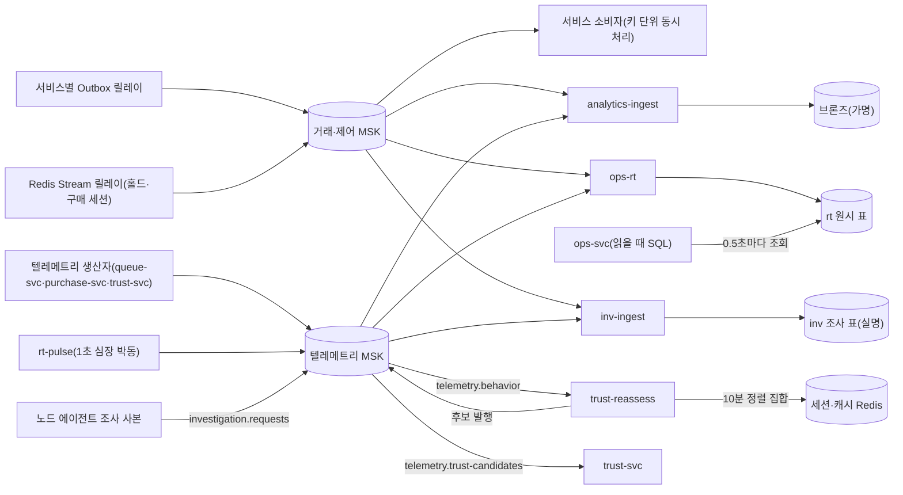

# 분야 편 18: 이벤트 흐름

- **기준 시점**: ADR-0177까지, 2026-11-01
- **맡는 정본**: [docs/streaming.md](../../streaming.md) 전체, [docs/api/asyncapi.yaml](../../api/asyncapi.yaml)의 토픽 구조(`info`의 공통 규칙, `servers`, `channels`, `operations`, 메시지 목록), 이벤트 흐름 ADR(§5에 모았다)
- **규범이 아니다**: 정본을 풀어 쓴 해설이다. 숫자와 규칙이 정본과 다르면 정본이 맞다([ADR-0177](../../adr/0177-walkthrough-explain-in-interview.md)).
- **한 판 문서와의 관계**: [한 판 문서](../01-system-design.md) 10단계(결제와 서비스 사이의 일관성), 11단계(서비스 나누기, 입구 서버, 장애 격리), 13단계(지켜보고 조종하기), 15단계(저장소 총정리)가 이야기 순서로 다룬다. 겹치는 곳은 10단계의 사건 릴레이와 결제 결과 직접 묻기, 11단계의 토픽 세 갈래, 13단계의 관제 숫자 세는 법, 15단계의 저장소 자리다. 6·12·16·17단계도 한두 줄씩 든다. 이 편은 그 단계들이 건너뛴 것(커밋과 다시 시도, 클라이언트 필수 설정, 심장 박동, 판매 좌석 세는 법, 원본 적재와 조사 적재, 키 규칙, 실패 처리, 시험)을 더한다.
- **측정 전이다**: 기반 PoC(본 개발 전에 위험한 부분만 따로 재는 시험, wbs 0.5.1)는 PC 한 대에서 쟀다([ADR-0176](../../adr/0176-foundation-poc-results.md), 2026-11-01 채택, 원본은 docs/perf-ledger.md §5). 숫자는 '실측(PC)'이고 운영 규모 증거가 아니다. 서비스 수준 측정(NFR 목표를 운영 규모로 잰 것)은 아직 없어, 이 편의 작업자·조회·신선도 숫자는 설계 목표나 어림이라 `[실측 전]`을 붙였다. 정본에 적힌 로컬 확인은 다섯이다. 소비자 설정 시험 ST-T20(2026-10-30 통과), 사건 릴레이의 리더를 멈췄을 때 PC의 작은 클러스터에서 11.1·13.5초에 이어받은 것(ADR-0116 상태 줄), 그리고 2026-11-01 PoC의 셋(ADR-0176 결정 5)이다. 텔레메트리 초당 5,600건과 거래 초당 300건을 함께 넣었을 때 거래 사건 보내기 p99(백 번 중 아흔아홉 번이 이 시간 안)가 7.8·7.9·7.8ms였고, 키 단위 동시 처리 시험 ST-T18이 통과했으며(빠짐 0·두 번 반영 0, 처리기 1ms로 초당 4만 3,200~5만 800건, 실측(PC)), Kafka 접속 토큰 함수 시험 ST-T14 ①이 통과했다. 정본의 `[가정]`·`[추정]`은 그대로 옮겼다.

## 1. 이 문서가 정하는 것

docs/streaming.md는 Kafka(사건을 순서대로 쌓아 두고 여러 곳에 나눠 주는 메시지 시스템)의 토픽(사건을 종류별로 모아 두는 통로)을 계속 읽어 다른 저장소에 쓰는 스트림 작업자 넷과, 작업자와 서비스가 함께 쓰는 소비 규칙을 정한다. 작업자는 서비스와 같은 Node.js·NestJS로 만든 작은 TypeScript 앱이다. `analytics-ingest`는 사건의 식별값을 가명(추가 정보 없이는 누구인지 알 수 없게 바꾼 값)으로 바꿔 분석 저장소의 원본 층(브론즈)에 싣는다. `ops-rt`는 관제 화면 숫자의 원료인 원시 사건을 ClickHouse(대량 사건 집계에 강한 분석용 데이터베이스)의 `rt` 표에 싣기만 한다. 세는 일은 ops-svc(관제 서비스)가 읽을 때마다 SQL로 한다. 이것을 조회 시점 집계라고 부른다. `trust-reassess`는 기다리는 사람들 사이의 봇 패턴을 Redis(메모리에 데이터를 두는 빠른 저장소)로 세어 추가 검증 후보를 낸다. `inv-ingest`는 부정 예매 사후 조사의 원천을 가명 없이 조사 저장소에 싣는다. 공통 뼈대는 넷이다. 쓰기가 성공한 뒤에만 읽은 위치를 확정(커밋)한다. 실패한 묶음은 버리지 않고 그 파티션(토픽을 나눈 칸. 한 칸 안에서만 순서가 지켜진다)의 소비를 멈춰 기다린다. 데드 레터 토픽(처리 못 한 메시지를 옮겨 두는 토픽)을 두지 않는다. 중복은 사건마다 붙은 키 `eventKey`로 읽는 쪽이 지운다. 이 밖에 서비스 소비자의 키 단위 동시 처리와 보류 표, Kafka 클라이언트 필수 설정, 키 규칙, 신선도 재기, 시험 24개, Flink(흘러드는 사건을 실시간으로 계산하는 스트림 처리 엔진)를 쓰지 않는 이유와 다시 볼 조건을 정한다. docs/api/asyncapi.yaml은 그 사건이 흐르는 클러스터와 토픽, 누가 내고 누가 받는지를 적은 계약 파일이다.

> **30초 설명**: "Kafka 사건을 읽는 쪽은 스트림 작업자 넷과 서비스 소비자입니다. 원칙은 '빠뜨리지 않고, 중복은 읽는 쪽이 지운다'입니다. 쓰기가 성공한 뒤에만 읽은 위치를 확정하고, 저장소가 멈추면 사건을 버리지 않고 그 파티션을 멈춰 기다립니다. 그래서 장애 때 숫자가 틀리는 대신 늦어집니다. 관제 판매 숫자는 원시 사건을 그대로 싣고, 읽을 때마다 사건 키로 중복을 지운 뒤 확정 숫자와 같은 규칙의 SQL로 셉니다. 입력이 초당 약 1만 건이고 상태가 1GB 안이라 Flink를 쓰지 않았고, 조회가 무거워지거나 순서 패턴이 필요해지면 다시 봅니다. 거래 사건의 키는 회차라 한 회차의 사건이 한 파티션에 순서대로 옵니다. 대신 인기 회차가 한 파티션에 몰리므로, 서비스 소비자는 그 안에서 주문마다 동시에 처리합니다."

## 2. 절마다 읽기

asyncapi.yaml에는 번호 붙은 절이 없어 맨 위 칸 이름으로 행을 나눴다. 오프셋은 파티션 안에서 메시지마다 붙는 위치 번호다. 소비자 그룹은 같은 토픽을 나눠 읽는 소비자 묶음이고, 재조정은 그 안에서 파티션을 다시 나누는 일이다.

| 정본 절 | 무엇을 정하나 | 왜 | 해설서에서 |
| --- | --- | --- | --- |
| docs/streaming.md §1 작업자 목록 | 작업자 넷과 심장 박동 발행기 `rt-pulse`의 입력·출력·전달 보장. 읽는 MSK(AWS가 운영해 주는 Kafka) 클러스터는 거래·제어와 텔레메트리 둘이다 | 작업자끼리 상태를 나누지 않아 하나가 멈춰도 다른 작업자와 거래 경로(Outbox와 Saga)는 영향이 없다. Outbox는 보낼 사건을 같은 DB 트랜잭션으로 표에 먼저 적어 두는 방식, Saga는 여러 서비스에 걸친 일을 단계별로 처리하는 방식이다 | 한 판 13단계(`ops-rt`), 6단계(`trust-reassess`) |
| docs/streaming.md §2 공용 소비 규칙과 실행 기반 | §2.1 클라이언트, §2.2 배포(파드 복제 2 `[가정]`, 자동 확장 끔), §2.3 권한·네트워크, §2.5 자원, §2.7 지표와 로그. 파드는 쿠버네티스에서 앱이 도는 단위다 | 규칙을 공용 모듈 `@peaket/stream-worker` 한 곳에 둔다. 소비자 수는 파티션 수를 넘어도 늘지 않고 바꿀 때마다 재조정이 생겨 자동 확장을 끈다 | 한 판 12단계(복제 고정) |
| docs/streaming.md §2.4 커밋·묶음·다시 시도 | 자동 커밋 끔, 묶음, 중복 거르기 토큰, 지수 지연 다시 시도, 읽지 못한 레코드는 위치만 | 쓰기 성공 뒤 커밋하면 죽어도 빠지는 것이 없다. 데드 레터 토픽은 가명 처리 전 식별값을 한 벌 더 만든다(ADR-0072 결정 7) | — |
| docs/streaming.md §2.4 '서비스 소비자의 규칙' | 파티션 안 업무 키(주문 ID 등) 단위 동시 처리, 앞 사건이 끝난 위치까지만 커밋, 보류 표 `held_event` | 인기 회차가 한 파티션에 몰려도 소비자 하나가 차례로 처리하느라 밀리지 않게 한다(ADR-0142) | 분야 편 11 |
| docs/streaming.md §2.6 Kafka 연결 | 소비자 그룹과 시작 위치, IAM(AWS 권한 관리) 토큰, Avro(필드 구조를 미리 정한 이진 형식) 읽기, 모르는 열거 기호, 클라이언트 필수 설정 | 파드 자격을 그대로 쓰면 자격이 바뀔 때 세션 이름이 바뀌어 재인증 때 연결이 끊긴다. 클라이언트 기본값이 문서 가정과 달라 공용 모듈이 값을 박고 정적 검사 D-T45가 지킨다 | — |
| docs/streaming.md §3 시간 기준과 심장 박동 | 시간 창을 만들지 않는다. `rt-pulse`가 1초마다 텔레메트리 토픽 셋의 모든 파티션에 `PipelinePulse`를 넣는다 | '이 시각 전 사건은 다 왔다'는 표시(Flink의 워터마크)를 기다리지 않고 늦은 사건도 제 칸에 든다. 거래 토픽은 생산자를 Outbox 릴레이 하나로 두어 넣지 않는다 | — |
| docs/streaming.md §4 관제 실시간 표 | §4.1 지표, §4.2 싣는 사건(사람 식별값 없음), §4.4 적재 설정, §4.6 실시간 대비 대조 | 지표 사전과 같은 정의·사건·키·SQL로 세어 골드(확정 집계 층)와 차이가 0이 되게 한다. 판단·제어 숫자는 Prometheus(지표를 모아 저장하는 도구)가 출처다(ADR-0068 결정 2) | 한 판 13단계 |
| docs/streaming.md §4.3 표 | `rt` 원시 표 다섯, 매개변수 뷰(조회할 때 회차 같은 값을 넘겨 쓰는 뷰) 셋, 판매 좌석 SQL, 0.5초 조회 | 원시 표는 중복을 받아도 되고, 읽을 때 `eventKey`마다 가장 이른 Kafka 위치의 한 줄만 남긴다. 그래서 재시작해도 숫자가 뒤로 가지 않는다 | 한 판 13단계(0.5초 조회만) |
| docs/streaming.md §4.5 신선도와 지연 예산 | SLI(실제로 재는 품질 값) `rt_freshness_seconds{path}`, 1분 p95(잰 값 백 개 중 아흔다섯 개가 이 값 이하) 5초 미만, Degraded(정한 만큼 줄여 버티는 상태) 전환, 구간별 예산 | 심장 박동이 사건과 같은 길을 지나 끝에서 끝까지 잰다. 늦어도 버리지 않으므로 장애는 누락이 아니라 신선도로 드러난다 | 한 판 13단계(목표만) |
| docs/streaming.md §4.7 원시 행의 보존과 다시 채우기 | 400일·90일·7일 `[가정]`. Kafka 7일 안은 다시 읽고, 더 오래된 판매류는 브론즈에서 채운다 | 판매 기간과 R3(회차가 끝난 다음 영업일의 마감 단계) 대조를 덮는다. 표 TTL(지우는 시한)은 표마다 하나다(ADR-0146 결정 7) | — |
| docs/streaming.md §4.8 미리 합산을 쓸 때 | 넣는 순간 합산하는 머티리얼라이즈드 뷰는 중복에 안전한 숫자에만 | 뷰는 넣는 묶음만 보고 계산해 Kafka 안의 중복을 두 번 셀 수 있다 | — |
| docs/streaming.md §5 봇 대기 중 재평가 | 패턴 R1·R2, 후보 `TrustCandidate`, trust-svc(봇 판정 서비스)의 처리, Redis 키와 Lua(Redis 안에서 한 번에 도는 짧은 프로그램), 세션 창·CEP(순서 있는 사건에서 패턴을 찾는 기능)를 쓰지 않는 이유 | 판정 때 한 사람만 봐서는 안 보이는 여러 사람 사이의 패턴(같은 기기에 계정 다섯)을 기다리는 동안 다시 본다 | 한 판 6단계, 분야 편 14 |
| docs/streaming.md §6 원본 적재 | 소비 → 역직렬화 → 가명 → 금지 필드 제거 → 삽입, 회차 키를 KMS(키 관리 서비스)로 얻기, 거절 기록, 마감 커버리지 대조 | 가명 키를 못 얻으면 원문을 쓰지 않고 멈춘다(fail-closed). 빠짐을 (파티션, 오프셋) 개수로 찾으므로 압축 토픽 `control.settings`는 대조에서 뺀다 | — |
| docs/streaming.md §6.4 조사 적재 | `inv-ingest`의 원천 열 개와 `inv` 표 넷, 계정 연결 값, 여정 잇기, 기록 고정, 보존 | 조사 갈래는 실명 기록으로 부정 예매를 조치해 가명을 하지 않고, 분석 저장소에는 한 행도 쓰지 않는다(ADR-0171 결정 2) | — |
| docs/streaming.md §7 키 규칙 | `trade.*`는 회차 키, 텔레메트리는 메시지별 키. 순서가 지켜지는 범위, 인기 회차 쏠림, 파티션 12개 `[가정]` | 판매 좌석 규칙이 '한 회차는 토픽마다 한 파티션'에 기댄다. 같은 좌석·주문의 순서는 Outbox 릴레이가 지킨다(ADR-0116) | 한 판 11단계(토픽 갈래만) |
| docs/streaming.md §8 복구와 판 올리기 | 상태 없는 복구, 롤링, 열은 더하기만, 되돌리기 | 상태가 없어 다시 뜨면 커밋한 위치부터 읽는다 | — |
| docs/streaming.md §9 운영 확인 표 | 확인할 동작 12개의 SLI·패널·경보 | docs/architecture.md §8.4의 운영 확인 절차를 따른다 | — |
| docs/streaming.md §10 시험 포인트 | ST-T1~ST-T24 | 중복·재시작·늦은 사건·저장소 정지·재평가·IAM·쏠림·키 단위 처리·조사 적재를 시험으로 판정한다 | — |
| docs/streaming.md §11 용량 산정 | 입력 약 1만/초 `[추정]`, 원시 표 크기, 조회 비용 | 시험 부하에서 파드 하나가 초당 약 1만 5천 건을 넣어야 해, 한 스레드인 Node.js 소비자가 버티는지가 위험이다 | 한 판 13단계(입력 크기만) |
| docs/streaming.md §12 실패 처리 | MSK 둘, Schema Registry(스키마를 ID로 찾게 하는 서버), ClickHouse, Redis, KMS, 파드, 느린 조회 | 장애마다 '버리지 않고 멈춘다'의 결과와 경보·회복을 한 표에 둔다 | 한 판 16단계(거래 Kafka 정지만) |
| docs/streaming.md §13 이미지·배포·시험 도구 | 코드 위치, 이미지 서명, 공용 차트, 배포 흐름, 시험 다섯 층 | 서비스와 같은 이미지·차트·보안 기준을 쓴다(ADR-0099 결정 8) | — |
| docs/streaming.md §14 대시보드·경보·런북 | '스트림 작업자' 화면, 경보 SEV3(장애 심각도 등급. 숫자가 작을수록 심각하다), 런북(장애 때 따라 하는 절차서) RB-34 | 운영 명령이 아니라 엔지니어 호출과 런북으로 이어진다 | — |
| docs/streaming.md §15 남는 한계 | 조회 비용, 키 규칙 의존, 같은 주문의 차례 처리, 재평가 문맥 10분, MSK IAM 미확인, 심장 박동의 범위 | 측정과 운영에서 고칠 값과 남는 위험을 모은다 | — |
| docs/streaming.md §16 대안과 바꿀 조건 | 대안 일곱과 스트리밍 엔진으로 갈 조건 넷 | 소유자가 B안을 정하며 대안의 트레이드오프도 표로 남기라고 했다(ADR-0099) | 한 판 13·17단계 |
| docs/streaming.md §17 참고 자료 | 클라이언트·ClickHouse·Kafka·RisingWave·Flink·AWS 원문 | 외부 제품 사실을 2026-10-27~29에 원문으로 확인했다 | — |
| docs/api/asyncapi.yaml `info` | 중복 제거 키는 `eventKey` 하나, 필수 칸, 키와 순서, 파티션 수 바꾸는 법 | 순서는 한 생산자가 낸 같은 주문·좌석 사건끼리만 지켜져, 소비자가 펜싱 토큰(늦게 온 옛 사건을 버리게 하는 번호)·판 번호로 거른다 | — |
| docs/api/asyncapi.yaml `servers` | `kafka-trade`·`kafka-telemetry`(IAM 포트 9098, 복제 3벌, 보존 7일)와 실시간 서버 둘 | 텔레메트리 장애가 거래 브로커(Kafka 서버)를 쓰지 않게 나눈다(ADR-0026·0141) | 한 판 11·15단계 |
| docs/api/asyncapi.yaml `channels` | Kafka 채널 17개(예약 `telemetry.rum` 포함)와 WebSocket·SSE 채널 셋 | 이름이 거래(`trade.*`)·제어(`control.*`)·텔레메트리(`telemetry.*`) 갈래를 드러낸다 | 한 판 11단계, 분야 편 10(좌석 델타) |
| docs/api/asyncapi.yaml `operations` | 보내기·받기 짝마다 누가 내고 누가 받는지 | 사건 하나를 바꿀 때 영향을 받는 소비자를 한곳에서 찾는다 | — |
| docs/api/asyncapi.yaml `components.messages` | 메시지 34개의 칸. Kafka 메시지는 JSON Schema로 적은 설명이고 실제로는 Avro로 보낸다(조사 요청 기록 `InvestigationRequest`와 `RumSample`은 JSON, WebSocket 프레임은 바이너리, SSE 사건은 JSON) | Avro 스키마는 docs/api/avro/에 있고, 계약 검사를 붙인 뒤(wbs 0.2.2)에는 그쪽이 원본이다(ADR-0165) | — |

## 3. 꼭 기억할 규칙과 숫자

| 항목 | 값 | 표시 | 정본 위치 |
| --- | --- | --- | --- |
| 작업자 자원 | `ops-rt`·`analytics-ingest` CPU 1·1GiB, `trust-reassess` CPU 0.5·512MiB, 복제 2. 합 CPU 5개·5GiB로 Flink 설계(15.5개·31GiB)의 약 3분의 1 | `[가정, 4.3.9에서 확정]`. `inv-ingest` 자원은 정본에 없음(열린 일 98번) | §2.2, §2.5 |
| 묶음과 다시 시도 | `ops-rt` 2,000건 또는 0.25초, 원시 적재 10,000건 또는 1초. 중복 토큰은 토픽·파티션·첫 오프셋·끝 오프셋. 실패하면 0.2초에서 최대 30초 지수 지연으로 그 파티션만 멈춘다 | 숫자는 `[가정]` | §2.4, §4.4 |
| 서비스 소비자 | 파티션마다 동시 처리 키 32개, 같은 결과 실패 5회면 `held_event`로 보류(결제·주문 SEV2, 그 밖 SEV3), 다시 처리 뒤 7일에 지움 | `[가정]` | §2.4, ADR-0142 |
| 필수 설정(생산자) | `acks=all`, 멱등 생산 켬, 동시 요청 5 이하, 파티셔너 `murmur2_random`, 전달 상한 Outbox 릴레이 10초·그 밖 5초 | 5초만 `[가정]` | §2.6 |
| 필수 설정(소비자) | 자동 커밋 끔, `cooperative-sticky`, 세션 시간 초과 45초, `group.protocol=classic`. ST-T20에서 값을 안 준 그룹은 파티션 6개를 모두 내놓고 28.9초에 회복했고, 공용 모듈 값은 3개만 내놓고 44.7초에 회복했다 | 회복 값은 로컬 확인(2026-10-30) | §2.6, §10 |
| 관제 표 신선도 | 1분 p95 5초 미만(NFR-009), p99는 60초까지 허용, 누락률 0.1% 미만 | 확정 목표, `[실측 전]` | §4.5 |
| Degraded 전환 | p95 5초 초과가 3분 넘으면 Prometheus 대체 표시와 SEV3. 5초 미만이 5분 이어지면 자동 복귀 | 5분만 `[가정]` | §4.5, §9 |
| 지연 예산 | 생산자 0.05 + 작업자 0.25 + 비동기 삽입 0.2 + 조회 주기 0.5 + 조회 실행 0.05 + 푸시·그리기 0.3 = 누적 약 1.4초, 1초 칸 약 2.4초. Flink 설계는 약 2.3초·3.9초 | `[가정]`·`[추정]`, `[실측 전]` | §4.5 |
| 조회 | ops-svc가 회차마다 0.5초에 한 번, 실행 상한 1초. p95 0.25초 미만 목표, 10분 넘게 넘으면 SEV3 | `[가정]`, `[실측 전]` | §4.3, §9 |
| 보존 | `rt.sale_event`·`rt.queue_aggregate`·`rt.hold_attempt` 400일, `rt.verdict` 90일, `rt.pulse` 7일, `brz_rejected` 90일, `trust.behavior_raw` 30일. Kafka 7일, `investigation.requests` 3일 | `rt` 표 셋·`rt.verdict`·`rt.pulse`와 `investigation.requests` 3일은 `[가정]`. 나머지는 정본에 표시 없음 | §4.7, §5.4, §6.3, infra §11, asyncapi |
| 재평가 | R1 같은 기기 가명 10분 안 서로 다른 pid(사람 식별값) 5명 이상, R2 같은 요약값 지문 20명 이상. 기본 그림자(기록만 하고 적용하지 않음), 격리 상한은 대기 인원의 0.5%/10분 | `[가정]` | §5.3·§5.5 |
| 파티션과 입력량 | 토픽마다 12개로 계산하고 줄이지 않는다. 입력 약 1만/초, 텔레메트리 클러스터 약 5,600/초, 시험 3만/초 | `[가정, 4.3.3에서 확정]`, 입력은 `[추정]` | §7, §11 |
| 조사 기록 고정 | T+60분. 커밋이 T+65분 사건까지 갔는지 보고, 30분 넘게 못 따라오면 '늦은 적재'로 고정하고 SEV3 | 5분·30분 `[가정]` | §6.4 |
| 거래 쪽 끊김 | 온세일 중 거래 사건 60초 없음 SEV3, Outbox 릴레이 지연 5초를 1분 넘게 넘으면 SEV2 | `[가정]` | §9 |
| Outbox 릴레이 | 리더 하나가 100ms마다 500행씩 `seq` 순서로 보내고, 리더가 멈추면 15초 안에 이어받는다 | `[가정]`, 이어받기는 로컬 확인 11.1·13.5초 | ADR-0116 |

## 4. 이 문서가 다루는 ID

뜻은 docs/planning/02·03·04에서 줄여 옮겼다. asyncapi.yaml이 메시지 설명에서 드는 그 밖의 ID(NFR-002·NFR-004·POL-009·POL-017·POL-019·POL-034·POL-039·POL-044·SCR-009)는 그 기능의 분야 편이 다룬다.

| ID | 한 줄 |
| --- | --- |
| NFR-009 | 관제 지표 반영. 초당 3만 건(한 회차에 몰림)에서 관제 실시간 표 지표가 원천 발생부터 화면까지 p95 5초 미만, 누락률 0.1% 미만. 판단·제어 숫자는 대상이 아니다 |
| NFR-022 | 봇 탐지 정확도. 등급별 탐지율 95% 이상, 정상 이용자 오탐률의 단측 95% 신뢰상한 0.5% 이하. 재평가를 적용으로 바꾸는 기준이다 |
| NFR-003 | 좌석 홀드. 피크 초당 2,000건에서 p99 50ms, 오버셀 0건. `HoldAttempt` 입력량의 근거다 |
| FR-071 | 지난 회차의 좌석 상태 변화와 대기·홀드·결제 흐름을 좌석맵과 타임라인으로 다시 본다(두 갈래 나눔 시험 ST-T22) |
| FR-072 | 온세일 윈도우가 끝나면(T+60분) 조사용 기록을 고정하고, 늦으면 '늦은 적재'로 표시해 고정한다. 부정 예매 후보 묶음을 만든다(ST-T21·ST-T23) |
| FR-074 | 조치한 사건의 증거 묶음을 보존하고 내보낸다(조사 저장소 보존 시험 ST-T24) |
| POL-006 | 추가 검증 큐. 위험 점수로 순번을 바꾸지 않고 규칙대로 떼어 내며 이의 절차를 안내한다. 재평가 격리가 차단이 아닌 근거다 |
| POL-028 | 온세일 윈도우(T-10분~T+60분) 운영 제약과 변경 동결 창. 작업자 판 올리기와 복제 수 변경을 막는다 |
| POL-041 | 변경 관리와 배포. 작업자 라이브러리 판 올리기의 공통 조치 기한이다 |
| POL-021 | 운영 명령 규칙. 설정 사건 `control.settings`를 ops-svc가 낸다 |
| SCR-029 | 중앙 관제 대시보드. 판매 중 탭 머리에 관제 표 신선도를 보인다 |

## 5. 결정과 버린 길

[결정 카드 목록](../decisions/README.md) §2에 따르면 분야 편 18이 자리인 ADR은 없다. 이 분야의 결정은 카드 셋이 맡는다. [D-10](../decisions/D10-order-history-polling-outbox.md)(주문 이력과 폴링 Outbox), [D-16](../decisions/D16-kafka-topics-and-clusters.md)(Kafka 토픽과 클러스터), [D-28](../decisions/D28-drop-flink-stream-workers.md)(Flink를 뺀 스트림 작업자)이다. 함께 보는 ADR 가운데 ADR-0140은 [D-08](../decisions/D08-payment-two-phase-forward-recovery.md)이, ADR-0103·0143은 [D-18](../decisions/D18-control-as-state-grpc.md)이 맡는다. 아래는 이 정본을 읽을 때 함께 볼 ADR이다. 버린 길은 각 ADR의 '검토한 대안'에서, 옛 판은 상태 줄과 docs/architecture.md §11·§11.1에서 옮겼다.

### [ADR-0026](../../adr/0026-kafka-topic-separation.md) 토픽을 거래·텔레메트리·제어로 나눈다

- **고른 것**: 거래 사건은 Outbox로 내고 `acks=all`(복제본이 받은 뒤에야 보냈다고 보는 설정)과 멱등 생산(다시 보내도 한 번만 남는 설정)으로 보낸다. 키는 회차다. 텔레메트리는 사람·세션 단위 키로 퍼뜨리고 버퍼가 차면 버리고 센다. 제어·보안 사건은 거래·제어 클러스터에 따로 둔다. 소비자는 '정확히 한 번' 트랜잭션 대신 멱등 처리로 중복을 견딘다.
- **버린 길**: 한 토픽에 모두 두면 텔레메트리 폭주가 같은 브로커의 디스크 I/O를 잠식해 결제 승인 전파가 수십 초 늦는다. 거래 사건에 사용자 ID 키를 쓰면 같은 좌석을 여러 사람이 다툴 때 좌석 상태 전이의 선후가 지켜지지 않는다.
- **본문이 옛 판인 곳**(상태 줄): 키 '공연 ID'는 회차 ID다. 텔레메트리 피크는 '초당 200,000건'이 아니라 약 5,600건 `[추정]`이라, 물리 분리는 장애 격리와 권한·보존 분리의 근거다. 'DLQ 구축'은 보류 표다. MSK는 관측 전용을 더해 셋이다.

### [ADR-0099](../../adr/0099-drop-flink-typescript-stream-workers-read-time-aggregation.md) Flink를 빼고 스트림 작업자와 조회 시점 집계로

- **고른 것**: Flink 잡 셋을 같은 이름의 TypeScript 작업자로 바꾼다. 쓰기 성공 뒤에만 커밋하고 실패한 묶음은 버리지 않는다. 관제 숫자는 원시 사건을 읽을 때 `eventKey`로 중복을 지운 뒤 골드와 같은 규칙의 SQL로 센다. 퍼널의 '처음'은 생산자가 표시하고, 재평가는 Redis 정렬 집합(점수 순으로 정렬되는 집합)으로 센다.
- **버린 길**(대안 표): Flink 잡 셋은 자바 업무 코드로 규칙이 세 언어에 나뉘고 워터마크·세이브포인트(업그레이드 때 남기는 작업 상태 저장본) 장치가 들며 자원이 CPU 15.5개·31GiB `[가정]`다. Flink SQL만은 ClickHouse 공식 커넥터가 DataStream(자바로 연산자를 짜는 API)만 받고 회차별 KMS 가명에 자바 함수가 필요하며 실행 기반은 Flink 잡과 같다. 관리형 Flink도 잡 코드와 워터마크·세이브포인트 장치는 그대로다. RisingWave(스트리밍 데이터베이스)는 운영할 분산 시스템이 하나 더 생기고 KMS 가명을 안에서 못 한다. Kafka Connect + 머티리얼라이즈드 뷰는 데드 레터 토픽이 원문을 복제하고 뷰가 중복을 두 번 더한다. ClickHouse만 쓰면 가명 처리 전 식별값이 ClickHouse에 들어간다. Kafka Streams·ksqlDB·Spark는 모두 JVM이고 Flink보다 나은 점이 없다.
- **본문이 옛 판인 곳**: 클라이언트는 'Confluent 공식이 기본, kafkajs는 대체안'이고, 2026-11-01 PoC로 Confluent 클라이언트를 확정했다(ADR-0176 결정 5). '처음' 표시는 선택 필드가 아니라 기본값 false다(ADR-0150). 재평가 키는 `tr:ra:dev:{deviceRef}:E`이고 해시 태그(키를 같은 칸에 모으는 표시)는 기기 가명·지문에 둔다. 상태 줄이 고치지 않은 곳은 §10에 적었다.

### [ADR-0071](../../adr/0071-flink-design-verification-rt-upsert-heartbeat-bot-reassess.md)·[ADR-0072](../../adr/0072-flink-detailed-design-operators-config-capacity-operations.md) Flink 설계에서 이어받은 규칙

- **이어받은 것**: 지표 출처 표, 심장 박동 신선도와 Degraded 전환, 봇 A안(판정 피처는 trust-svc가 Redis에서 바로 세고 재평가는 판정 밖에서), 패턴 숫자·격리 상한·그림자 기본, 텔레메트리 키, 커버리지 대조, 판매 좌석 상태 규칙, 거절 기록. 이 밖의 Flink 잡·덮어쓰기 표·워터마크·싱크 버림·HyperLogLog(어림 개수)는 쓰지 않는다.
- **지금도 유효한 버린 길**: 모든 실시간 숫자를 관제 표에서 내면 제어 입력에 원격 경로와 추가 지연이 들어오고, 모두 Prometheus에서 내면 등급·구역별 시계열 수가 커진다. 판매 좌석을 'SOLD +1, RETURNED −1'로 세면 입금 되돌림(SOLD → PENDING)을 놓친다.

### [ADR-0116](../../adr/0116-single-polling-outbox-relay-drop-debezium-place-pgbouncer-schema-registry.md) Outbox 릴레이는 모든 환경에서 폴링 하나

- **고른 것**: 서비스마다 `<서비스>-outbox-relay`를 두고 Lease(정해진 시간 동안만 유효한 권한)로 리더 하나가 보낸다. Outbox 행은 순서 칸 `seq`(DB 시퀀스로 매긴다)를 달고 트랜잭션의 마지막 문장으로 넣는다. 리더는 100ms `[가정]`마다 `seq` 순서로 500행을 잠가 읽고 모든 확인을 받은 뒤 보냄 표시를 한다. `SKIP LOCKED`(잠긴 행을 건너뛰는 옵션)는 쓰지 않는다. 거래 토픽 쓰기 권한은 릴레이 역할에만 준다.
- **버린 길**: 운영만 Debezium(DB 변경 기록을 읽어 Kafka로 보내는 도구)이면 측정한 길과 운영 길이 다르고 복제 슬롯 위험이 운영에만 있다. 모든 환경에 Debezium이면 이 크기에서 얻는 지연 이득이 작다. 서비스 파드 안에서 보내면 확장·배포가 리더를 자주 바꾸고 요청 파드에 거래 토픽 쓰기 권한이 생긴다.
- **본문이 옛 판인 곳**(상태 줄): 남는 한계의 '릴레이가 멈춘 동안 결제 확정 알림이 늦는다'에서 결제 확정 자체는 당기기(ADR-0140)로 이어지고, 늦는 것은 알림과 관제 표다. 상태 줄이 더한 구현 값은 Lease 12초·갱신 한도 8초·다시 시도 2초 `[가정]`(이어받기 약 14초)이고, 2026-11-01에 `seq`가 글자 순서로 정렬되던 구현 결함을 고쳤다.

### [ADR-0142](../../adr/0142-consumer-key-concurrency-held-events-client-required-settings.md) 키 단위 동시 처리, 보류 표, 클라이언트 필수 설정

- **고른 것**: 회차 키는 두고, 서비스 소비자는 파티션 안에서 업무 키 단위로 동시에 처리한다(주문 Saga와 알림은 주문 ID, 홀드 원장 적재는 좌석 ID). 처리 못 하는 사건은 `held_event`로 옮기고 같은 키의 뒤 사건도 함께 보류한다. 공용 모듈이 필수 설정으로 클라이언트를 만든다.
- **버린 길**: 결제 토픽만 주문 ID 키로 바꾸면 '한 회차는 토픽마다 한 파티션' 규칙이 깨진다. 파티션이나 소비자를 늘려도 한 회차는 여전히 한 파티션이다. Kafka 4.1 공유 그룹은 순서를 지키지 않고 3.9에 없다.
- **본문이 옛 판인 곳**(상태 줄): '세션 45초(기본값)'는 클라이언트의 KafkaJS 호환 설정 기본이 30초와 round-robin이라 맞지 않아, 공용 모듈이 45초와 `cooperative-sticky`, `group.protocol=classic`을 직접 넣는다.

### [ADR-0140](../../adr/0140-payment-result-pull-fallback-when-kafka-is-late.md)·[ADR-0143](../../adr/0143-settings-commands-pg-switch-over-grpc-applied-version-outbox.md)·[ADR-0141](../../adr/0141-msk-cluster-settings-brokers-version-alerts-dr-rebuild.md) Kafka가 늦거나 멈출 때

- **ADR-0140**: 결제 결과는 사건으로 받고, 5초 `[가정]` 안에 반영 못 한 주문은 `BatchGetPayments`로 묻는다. 반영한 순번 이하는 건너뛴다. 버린 길은 결과를 gRPC(서비스끼리 함수를 부르듯 호출하는 통신) 응답으로 받기(결제사 지연과 데드라인이 묶인다), 결제 결과만 다른 클러스터로(공유 운명이 남는다), 당기기만(관제·알림은 어차피 사건이 필요하다)이다.
- **ADR-0143**: `control.settings`와 `control.sessions-terminated`도 각 서비스 Outbox로 낸다. Outbox 없이 바로 보내면 Kafka가 멈춘 동안 낸 명령을 잃을 수 있다. 적용 확인을 Kafka 소비 위치로 하려 해도 방송형 소비자(파드마다 따로 읽는 소비자)는 커밋하지 않아 읽을 위치가 없다.
- **ADR-0141**: 두 클러스터에 `unclean.leader.election.enable=false`(뒤처진 복제본을 대표로 올리지 않음)와 `min.insync.replicas=2`를 적고, 거래·제어 브로커는 6대 `[가정]`, Kafka 3.9.x로 시작한다. 브로커 3대를 버린 이유는 데이터센터 구역 하나를 잃은 뒤 하나가 더 멈추면 모든 파티션의 쓰기가 멈추기 때문이다. 상태 줄은 '버퍼가 차면 버리고 센다'를 필수 칸이 빈 텔레메트리 사건에도 쓴다(ADR-0150 결정 5).

**함께 알 것**: 조사 적재는 [ADR-0171](../../adr/0171-post-sale-forensics-in-launch-scope.md)이, 방송형 토픽을 파드마다 따로 읽고 뜰 때 처음부터(세션 종료는 지금 − 15분부터) 읽는 규칙은 [ADR-0103](../../adr/0103-control-as-state-startup-sync-broadcast-topics-compacted-settings.md)이, MSK IAM 재인증을 선택 클라우드 보정에서 확인하는 일은 [ADR-0154](../../adr/0154-deferred-docs-timing-msk-iam-calibration-no-network-queue-tuning-glosses.md)가 정한다.

## 6. 읽는 요령

**읽는 순서**: 머리의 '표시 규칙' → §1 → §2.4·§2.6(공용 규칙과 필수 설정) → §7(키 규칙) → §4.3(판매 좌석 SQL) → §3·§4.5(심장 박동과 신선도) → §12(실패 처리) → §16(대안). 그다음 §5(분야 편 14와 함께), §6·§6.4, §10·§11을 읽는다. §9·§14·§17과 asyncapi.yaml은 찾아보기다.

**사건이 흐르는 길을 먼저 그려 둔다.** 정본은 이 그림을 §1·§3·§7과 asyncapi `operations`에 나눠 적는다.

방송형 제어 토픽(`control.settings`·`control.sessions-terminated`)은 모든 서비스의 모든 파드가 따로 읽어 그림에서 뺐다. `analytics-ingest`는 `telemetry.behavior`와 `investigation.requests`를, `ops-rt`는 `control.settings`를 읽지 않는다.

**함정**:

- **작업자 수**: §1은 넷이다. §7 키 표와 §13 코드 위치는 2026-11-01 정합 점검에서 넷째를 더했고, §2.2·§2.4·§2.5·§2.6 표는 아직 셋만 다룬다. `inv-ingest`의 자원·네임스페이스·소비자 그룹은 열린 일 98번이다(§10).
- **두 소비 규칙**: 스트림 작업자는 '파티션마다 묶음 하나, 읽지 못한 레코드는 위치만', 서비스 소비자는 '키 단위 동시 처리, 같은 결과 실패 5회면 보류 표'다. 저장소 연결 실패는 둘 다 보류하지 않고 그 파티션을 멈춘다.
- **중복과 빠짐**: `insert_deduplication_token`은 같은 묶음을 다시 보낼 때만 거른다. 묶음 경계가 바뀐 중복은 읽을 때(`rt`)와 실버(브론즈의 중복을 지운 정리 층)가 `eventKey`로 지운다. (파티션, 오프셋) 수는 빠짐을 찾는 데 쓴다.
- **옛 설계의 말**: §3의 워터마크, §4.5의 '약 2.3초·3.9초', §5.8의 체크포인트는 Flink 설계와 견주는 말이다. 옛 문장의 'CDC 지연'은 Outbox 릴레이 지연 `outbox_relay_lag_seconds`다(ADR-0116 결정 5).
- **실시간 숫자는 잠정이다**: 확정 숫자로 고쳐 쓰지 않는다. 판매 중 탭의 퍼널 위젯은 Prometheus 카운터다(§4.1). 잔여석은 판매 대상 − 판매 좌석이라 홀드 중인 좌석을 빼지 않는다.
- **신선도가 정상이어도 끊길 수 있다**: 심장 박동은 텔레메트리 경로만 지난다. 거래·제어 MSK가 멈추면 판매 누적이 멈춰도 신선도는 정상으로 보여 60초 무사건 경보와 릴레이 지연을 따로 본다(§12).
- **asyncapi의 payload**: Kafka 메시지의 payload는 칸을 적은 설명이고 실제로는 Avro로 보낸다(`InvestigationRequest`·`RumSample`은 JSON). Avro 스키마에서는 열거 맨 앞에 읽는 쪽 전용 기호 `UNRECOGNIZED`가 붙는다.

## 7. 경계

| 이 정본이 정하지 않는 것 | 어디서 정하나 |
| --- | --- |
| 브론즈·실버·골드 표, 마감 단계, 지표 사전, 조사 저장소 `inv`의 칸과 기록 고정 판 | docs/features/analytics.md, docs/features/forensic-replay.md, docs/data.md(분야 편 17) |
| 봇 판정, 점수기, 격리 상한의 분모, 사유 범주 | docs/features/bot-defense.md(분야 편 14) |
| Outbox 표와 릴레이의 보내는 규칙 | docs/data.md §4의 7번, ADR-0116(DB 설계 편 5) |
| 결제 결과 당기기, 주문 Saga, P-T48 | docs/features/payment.md(분야 편 11) |
| 관제 화면, SSE 위젯 흐름, 운영 명령 전파 | docs/features/control-tower.md(분야 편 16), docs/frontend.md §4.4(분야 편 6) |
| 경보 등급표, 지표 출처 표, Degraded 대체 표시 | docs/observability.md §5·§8·§10(분야 편 19) |
| MSK 브로커 설정, RB-34·RB-11 본문, 토픽 변경 절차, D-T45, MSK 권한 | docs/infra.md §4·§10, docs/devops.md §6.5·§7.5·§9.4(분야 편 20) |
| Avro 스키마, 등록, 생산자 스키마 ID, 열거 규칙 | docs/api/avro/README.md(분야 편 7) |
| 성능 시험 V-T12~V-T15·V-T19·V-T27·V-T28, 선택 클라우드 보정 | docs/verification.md §3.7·§6·§9(분야 편 22) |

## 8. 꼬리 질문

| 질문 | 답의 요지 | 근거 |
| --- | --- | --- |
| Flink를 왜 쓰지 않았나요? | 입력이 초당 약 1만 건(시험 3만)이고 상태가 1GB 안 `[추정]`이다. Flink가 잘하는 일(수십만 건, 수십 GB 상태, 복잡한 창, 순서 패턴, 과거 재계산)을 쓰지 않는데 규칙이 세 언어에 나뉘고 자원은 약 3배였다. 조회가 0.25초를 넘거나 순서 패턴이 필요해지면 다시 본다 | streaming §16, ADR-0099 |
| '적어도 한 번'이면 숫자를 두 번 세지 않나요? | 쓰기 성공 뒤에만 커밋해 빠지지는 않고 중복은 들어올 수 있다. 읽을 때 `eventKey`마다 가장 이른 Kafka 위치의 한 줄만 남겨 두 번 세지 않고, 재시작해도 숫자가 뒤로 가지 않는다(ST-T1) | streaming §2.4·§4.3 |
| '좌석마다 마지막 상태'로 세는데 순서는 누가 지키나요? | 회차 키라 한 회차의 거래 사건은 토픽마다 한 파티션에 온다. 같은 좌석의 사건은 Outbox 릴레이가 `seq` 순서·리더 하나·`SKIP LOCKED` 없이 보낸다. 다른 좌석 사이의 순서는 쓰지 않는다. 이 숫자는 뷰로 미리 합산하지 못한다. 뷰가 '마지막'을 Kafka 위치로 가르면 다시 보낸 옛 사건이 더 늦은 위치로 들어와 이기기 때문이다 | streaming §4.3·§4.8·§7, ADR-0116 |
| 회차 키면 인기 회차가 한 파티션에 몰리지 않나요? | 몰린다. 작업자는 ST-T17로 한 파티션 처리량을 재고, 서비스 소비자는 파티션 안에서 주문마다 동시에 처리한다(32 키 `[가정]`). 그래도 P-T48을 못 넘으면 결제 토픽을 주문 키의 새 토픽으로 옮긴다 | streaming §7, ADR-0142 |
| 데드 레터 토픽은 왜 없나요? | 가명 처리 전 식별값이 다른 토픽에 한 벌 더 생겨서다. 작업자는 위치만 남기고 원문은 Kafka 7일 안에서 다시 읽는다. 서비스 소비자는 자기 DB 보류 표에 둔다 | streaming §2.4·§6.3, ADR-0072 결정 7 |
| ClickHouse가 멈추면 관제 화면은요? | 작업자는 묶음을 버리지 않고 그 파티션을 멈춘다. p95 5초 초과가 3분이면 Prometheus 대체 표시로 바뀌고, 돌아오면 밀린 것을 이어 싣는다. 누락은 0이다(ST-T4) | streaming §4.5·§12 |
| 거래 Kafka가 멈추면요? | 결제 확정은 5초 뒤 당기기로 이어지고 5~10초 `[추정]` 늦다. 판매 누적은 멈추는데 신선도는 정상으로 보여 60초 무사건 경보와 릴레이 지연 SEV2로 안다. 쌓인 Outbox 행은 돌아오면 `seq` 순서로 나간다 | streaming §12, ADR-0140 |
| 실제로 재 봤나요? | PC 한 대에서 잰 기반 PoC(실측(PC), 판정은 ADR-0176)뿐이고 서비스 수준 측정은 없다. 로컬 확인은 ST-T20(재조정 방식·회복 시간), 릴레이 이어받기(11.1·13.5초), PoC의 거래 사건 보내기 p99 7.8~7.9ms, ST-T18(키 단위 동시 처리, 빠짐 0·두 번 반영 0), ST-T14 ①(토큰 함수)이다. 작업자의 실제 처리량은 ST-T17·V-T12·V-T19로, MSK IAM 재인증은 선택 클라우드 보정(ST-T14 ②)으로 잰다 | streaming §2.1·§2.6·§10·§15, ADR-0116, ADR-0176 결정 5 |

## 9. 확인 문제

1. 관제 표의 판매 금액은 어떤 사건으로 어떻게 세는가? 환불은 빼는가?

답

`PaymentEvent`의 승인(`APPROVED`)을 더하고 가상계좌 입금 되돌림(`DEPOSIT_REVERSED`)을 뺀다. 취소·부분 취소·환불은 빼지 않는다. 지표 사전 26번과 정산서 '판매 대금'과 같은 총액이기 때문이다. 다시 보낸 사건은 `eventKey`마다 한 줄만 남겨 두 번 더하지 않는다. 합계라서 머티리얼라이즈드 뷰로 미리 합산하지 않는다(streaming §4.1·§4.3·§4.8).

2. 새로 뜬 작업자 파드가 Schema Registry에 닿지 못하는 동안 처음 보는 스키마 ID의 레코드를 받으면 어떻게 하는가? 레지스트리가 '그 ID를 모른다'고 답하면 무엇이 다른가?

답

닿지 못한 것(시간 초과·5xx)은 다시 시도할 장애로 보고 그 파티션 소비를 멈춘다. 거절하지 않으므로 빠지는 레코드는 없고 소비 밀림만 는다. 새 파드는 캐시가 비어 이 경우를 먼저 겪는다. 레지스트리가 모른다고 답할 때(404)만 읽지 못한 레코드로 거절한다. 원본 적재면 `bronze.brz_rejected`에 위치를 남기고 SEV3다. 생산자는 실행 중에 레지스트리를 부르지 않아 영향이 없다(streaming §2.6·§12, ST-T16).

3. `trust-reassess`가 문턱을 넘긴 메시지를 처리한 직후, 후보를 Kafka에 내기 전에 죽으면 그 후보는 사라지는가?

답

사라지지 않는다. 발행 확인을 받은 뒤에만 입력 오프셋을 커밋하므로 다시 뜨면 그 메시지를 다시 읽는다. 넘음 표시(`:over`)에는 표시를 켠 메시지의 (파티션, 오프셋)이 들어 있어, 같은 메시지를 다시 읽으면 새 pid만이 아니라 집합 전체를 돌려준다. 후보의 `eventKey`는 회차·pid·패턴·10분 칸으로 만들어 같은 값이라 trust-svc가 한 번만 처리한다(streaming §5.4·§5.8, ST-T13).

4. 원본 적재의 마감 커버리지 대조는 무엇을 세고, 왜 `control.settings`를 빼는가?

답

파티션마다 대상 오프셋 구간 안의 고유한 (파티션, 오프셋) 수가 구간 길이와 같은지 센다. 거절 기록의 오프셋도 넣고, 모자라면 Kafka 7일 안에서 그 구간을 다시 적재한다. 이 대조는 트랜잭션 생산자를 쓰지 않고(트랜잭션 표시가 오프셋을 차지한다) 토픽이 삭제 보존이라는 전제에 선다. `control.settings`는 압축 토픽이라 같은 키의 옛 값을 지운 자리가 빈 구간으로 보이고, 다시 적재해도 키마다 마지막 값만 남아서 뺀다. 설정이 바뀐 시각의 원본은 ops-svc 명령 기록이다(streaming §6).

## 10. 정본에서 찾은 어긋남

| 어긋난 곳 | 내용 | 지금 읽는 법 |
| --- | --- | --- |
| docs/streaming.md §5.5와 docs/features/bot-defense.md §8, ADR-0156 결정 10, docs/api/proto/peaket/queue/v1/queue.proto | streaming은 `IsolateWaiting` 응답을 셋으로 적고 격리 상한을 trust-svc가 지키는 것처럼 적었다. 2026-10-30부터 queue-svc가 격리 Lua에서 상한을 세고 넷째 응답 `ISOLATE_RESULT_CAP_REACHED`로 답한다 | 고침(2026-11-01 정합 점검 네 번째 묶음). §5.5가 넷째 응답과 queue-svc의 셈을 적는다(bot-defense §8) |
| docs/streaming.md §4.3 `rt.hold_attempt`의 `result` 주석과 §4.1 표, asyncapi `HoldAttempt.result` | 표 정의의 주석은 `HELD·CONFLICT·LIMIT·ERROR` 넷인데, §4.1과 계약에는 `RECENTLY_RELEASED`(같은 계정이 방금 놓은 좌석을 30초 `[가정]` 안에 다시 잡으려 한 거절, ADR-0161)가 더 있다 | 고침(2026-11-01 정합 점검 네 번째 묶음). 주석이 다섯 값이다 |
| docs/streaming.md §4.2·§6.1과 docs/features/analytics.md §3.1 | analytics는 외부 합성 점검용 회차의 사건을 `analytics-ingest`와 `ops-rt`가 싣지 않는다고 적는데(기술 검토 중간-075, 시험 Q-T50), streaming의 거르기 표와 단계 표에는 이 규칙이 없었다 | 고침(2026-11-01 정합 점검 네 번째 묶음). 두 작업자 모두 배포 설정의 점검 회차 목록에 든 사건을 거른다 |
| docs/streaming.md §2.2·§2.4·§2.5·§2.6·§7·§13과 §1·§2.3·§6.4 | 작업자를 넷으로 늘렸지만(2026-10-31) 네임스페이스·커밋 표·자원·소비자 그룹과 시작 위치·코드 위치는 셋만 적는다. 그래서 '합 CPU 5개·메모리 5GiB'에 `inv-ingest`가 들지 않는다. §7 키 표에도 `investigation.requests`(asyncapi는 '키 없음')가 없다 | §7 키 표와 §13 코드 위치는 고침(2026-11-01 정합 점검 네 번째 묶음). 자원·네임스페이스·소비자 그룹은 열린 일 98번이다. 중복은 표 엔진 `ReplacingMergeTree`(같은 정렬 키의 행을 병합 때 하나로 줄이는 엔진)가 지운다 |
| ADR-0099 상태 줄 | 결정 1의 '작업자 셋'과 결정 1·2의 저장소 이름(`peaket-data`·`peaket-trust`·`peaket-platform`)을 고치는 줄이 없다(ADR-0071 본문의 저장소 이름도 같다). 지금은 작업자 넷(ADR-0171)이고, 코드는 모노레포 `peaket`의 `services/`와 `packages/platform`에 있다(ADR-0165) | 고침(2026-11-01 정합 점검 네 번째 묶음). 상태 줄이 작업자 넷과 모노레포로 읽게 한다. ADR-0071 본문의 이름은 그대로다 |
