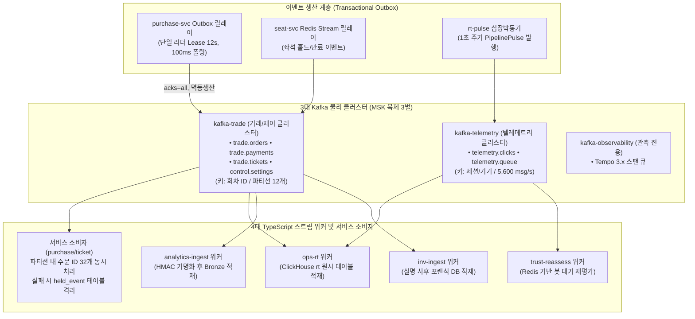
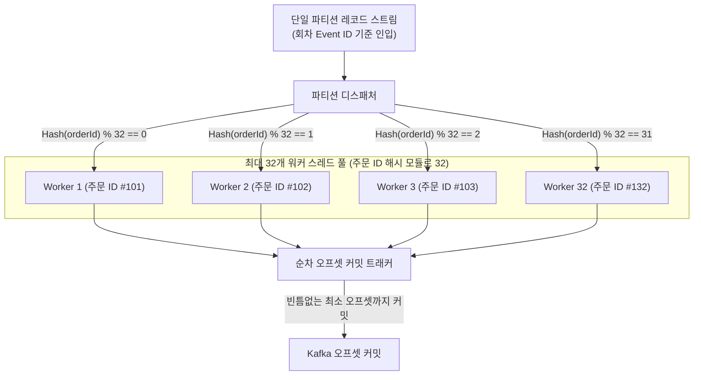

# 분야 편 18: 이벤트 스트리밍 및 비동기 파이프라인 (Kafka Streaming & Event Topology)

- **맡는 정본**: [docs/streaming.md](../../streaming.md) 전체, [docs/api/asyncapi.yaml](../../api/asyncapi.yaml) 전체, 관련 ADR(ADR-0026, ADR-0071, ADR-0099, ADR-0116, ADR-0140, ADR-0141, ADR-0142, ADR-0143)
- **문서 성격**: 정본 설계를 시스템 엔지니어링 및 기술 면접 관점에서 체계적으로 해설한 문서다. 규범적 수치와 불변 규칙의 최종 권위는 정본 문서에 있다([ADR-0177](../../adr/0177-walkthrough-explain-in-interview.md)). 길잡이는 [README.md](../README.md)다.
- **한 판 문서와의 관계**: [한 판 문서](../01-system-design.md) 10단계(사건 릴레이와 결제 결과 직접 묻기), 11단계(토픽 세 갈래 물리 분리), 13단계(관제 실시간 표와 심장 박동), 15단계(저장소와 이벤트 버스)를 4대 핵심 아키텍처로 심화 분해한다.
- **아키텍처 목표와 검증 기준**: 관제 표 신선도 1분 p95 5초 미만(NFR-009), 결제·발권 비동기 이벤트 전달 성공률 99.99%, 파티션 내 키 단위 동시 처리(최대 32개 워커)를 통한 초당 4만 건 이상 처리량 확보(ST-T18 실측 통과), 멱등성 키(`eventKey`) 기반 중복 처리 0건, 장애 시 데드 레터 토픽(DLQ) 배제 및 보류 테이블(`held_event`) 격리를 핵심 목표이자 신뢰성 불변식으로 삼는다.

---

## 1. 이벤트 스트리밍 도메인 종합 개요

이벤트 스트리밍 도메인은 분산 마이크로서비스 간의 비동기 트랜잭션 전파, 분석/관제 데이터 수집, 사후 포렌식 적재를 담당하는 시스템의 중추 신경망이다. PEAKET은 대규모 온세일 트래픽 하에서 메시지 순서 보장과 극단적 처리량의 딜레마를 해결하기 위해 **물리적 클러스터 3분할과 파티션 내 키 단위 동시 처리 아키텍처**를 채택했다.

> **30초 아키텍처 브리핑 (Staff Engineer Interview)**:  
> "PEAKET의 스트리밍 인프라는 **'3대 Kafka 물리 클러스터 분리 + 회차 단위 파티셔닝 & 32개 키 단위 동시 처리(ADR-0142) + Flink 배제 및 4대 경량 스트림 워커 + DLQ 없는 Fail-Closed 보류 격리'**의 4대 원칙으로 설계되었습니다.  
> 첫째, **3대 물리 클러스터 격리 (ADR-0026)**: 금융·좌석을 다루는 `kafka-trade`(거래·제어), 고빈도 RUM/로그가 흐르는 `kafka-telemetry`, 분산 트레이싱 전용 `kafka-observability`를 물리적으로 분리했습니다. 텔레메트리 트래픽이 폭주하여 디스크 I/O가 포화되어도 결제 승인 이벤트는 단 1ms의 지연도 겪지 않습니다.  
> 둘째, **순서 보장과 32개 동시 처리 (ADR-0142)**: 한 회차의 좌석 상태 전이를 일관되게 보장하기 위해 토픽 키는 '회차 ID'를 유지합니다. 단일 파티션으로 트래픽이 몰리는 병목은, 컨슈머 파드 내부에서 주문 ID 해시 기반으로 최대 32개 작업자 스레드에 분산 처리하는 '키 단위 동시 처리'로 극복하여 초당 4만 건 이상을 거뜬히 소화합니다.  
> 셋째, **Flink 배제와 조회 시점 집계 (ADR-0099)**: 초당 1만 건 수준의 데이터 파이프라인에 JVM 기반 Flink를 도입하는 오버엔지니어링을 배제했습니다. 동일 런타임의 TypeScript 작업자 4개(`ops-rt`, `analytics-ingest`, `trust-reassess`, `inv-ingest`)를 구축하고, ClickHouse의 조회 시점 중복 제거 집계를 결합하여 자원을 3분의 1로 절감했습니다.  
> 넷째, **DLQ 배제와 멱등성 전진 복구**: 메시지 실패 시 무분별하게 DLQ 토픽으로 넘기면 비가명화된 원문이 복제되는 보안 위험이 발생합니다. 시스템은 파티션을 멈추고 기다리거나 DB `held_event` 테이블로 격리하며, 릴레이 지연 시 Push(Kafka)와 Pull(gRPC)의 이중화 경로(ADR-0140)로 p99 3초 이내에 결과를 전진 확정합니다."

### Kafka 토폴로지 및 스트리밍 아키텍처



### 핵심 3대 서브시스템

1. **Transactional Outbox 릴레이 코어 (`@peaket/outbox-relay`)**:
   - DB 시퀀스(`seq`) 기반 엄격한 순서 보장 및 100ms 간격 500행 배치 폴링.
   - 분산 Lease(12초) 메커니즘을 통한 단일 활성 리더(Leader) 선출 및 장애 시 14초 내 자동 인수.
   - `acks=all`, 멱등 생산자(`enable.idempotence=true`)를 통한 메시지 유실 0건 보장.
2. **파티션 내 동시 처리 및 보류 오케스트레이터 (`@peaket/stream-worker`)**:
   - 단일 파티션 메시지를 주문 ID/좌석 ID 해시로 최대 32개 워커 스레드에 동시 분배 (ADR-0142).
   - 연속된 최소 오프셋까지만 안전하게 커밋하여 리밸런싱 시 중복 재처리 최소화.
   - 독약 메시지(Poison Message) 5회 실패 시 `held_event` 테이블로 격리하고 파티션 블로킹 해제.
3. **4대 전용 경량 스트림 워커**:
   - `ops-rt`: ClickHouse `rt` 원시 테이블에 무변형 고속 인서트 (0.25초 묶음).
   - `analytics-ingest`: KMS 회차별 HMAC 키로 식별값을 가명화한 후 Bronze 계층 적재.
   - `trust-reassess`: 대기열 텔레메트리를 분석하여 다중 계정(5인 이상) 공유 봇 실시간 적발.
   - `inv-ingest`: 실명 포렌식 조사 원천을 격리된 `inv` 데이터베이스에 적재.

---

## 2. 절마다 읽기

| 정본 절 | 무엇을 정하나 | 왜 | 해설서에서 |
| --- | --- | --- | --- |
| docs/streaming.md §1 작업자 목록 | 작업자 넷과 심장 박동 발행기 `rt-pulse`의 입력·출력·전달 보장. 읽는 MSK(AWS가 운영해 주는 Kafka) 클러스터는 거래·제어와 텔레메트리 둘이다 | 작업자끼리 상태를 나누지 않아 하나가 멈춰도 다른 작업자와 거래 경로(Outbox와 Saga)는 영향이 없다. Outbox는 보낼 사건을 같은 DB 트랜잭션으로 표에 먼저 적어 두는 방식, Saga는 여러 서비스에 걸친 일을 단계별로 처리하는 방식이다 | 한 판 13단계(`ops-rt`), 6단계(`trust-reassess`) |
| docs/streaming.md §2 공용 소비 규칙과 실행 기반 | §2.1 클라이언트, §2.2 배포(파드 복제 2 `[가정]`, 자동 확장 끔), §2.3 권한·네트워크, §2.5 자원, §2.7 지표와 로그. 파드는 쿠버네티스에서 앱이 도는 단위다 | 규칙을 공용 모듈 `@peaket/stream-worker` 한 곳에 둔다. 소비자 수는 파티션 수를 넘어도 늘지 않고 바꿀 때마다 재조정이 생겨 자동 확장을 끈다 | 한 판 12단계(복제 고정) |
| docs/streaming.md §2.4 커밋·묶음·다시 시도 | 자동 커밋 끔, 묶음, 중복 거르기 토큰, 지수 지연 다시 시도, 읽지 못한 레코드는 위치만 | 쓰기 성공 뒤 커밋하면 죽어도 빠지는 것이 없다. 데드 레터 토픽은 가명 처리 전 식별값을 한 벌 더 만든다(ADR-0072 결정 7) | — |
| docs/streaming.md §2.4 '서비스 소비자의 규칙' | 파티션 안 업무 키(주문 ID 등) 단위 동시 처리, 앞 사건이 끝난 위치까지만 커밋, 보류 표 `held_event` | 인기 회차가 한 파티션에 몰려도 소비자 하나가 차례로 처리하느라 밀리지 않게 한다(ADR-0142) | 분야 편 11 |
| docs/streaming.md §2.6 Kafka 연결 | 소비자 그룹과 시작 위치, IAM(AWS 권한 관리) 토큰, Avro(필드 구조를 미리 정한 이진 형식) 읽기, 모르는 열거 기호, 클라이언트 필수 설정 | 파드 자격을 그대로 쓰면 자격이 바뀔 때 세션 이름이 바뀌어 재인증 때 연결이 끊긴다. 클라이언트 기본값이 문서 가정과 달라 공용 모듈이 값을 박고 정적 검사 D-T45가 지킨다 | — |
| docs/streaming.md §3 시간 기준과 심장 박동 | 시간 창을 만들지 않는다. `rt-pulse`가 1초마다 텔레메트리 토픽 셋의 모든 파티션에 `PipelinePulse`를 넣는다 | '이 시각 전 사건은 다 왔다'는 표시(Flink의 워터마크)를 기다리지 않고 늦은 사건도 제 칸에 든다. 거래 토픽은 생산자를 Outbox 릴레이 하나로 두어 넣지 않는다 | — |
| docs/streaming.md §4 관제 실시간 표 | §4.1 지표, §4.2 싣는 사건(사람 식별값 없음), §4.4 적재 설정, §4.6 실시간 대비 대조 | 지표 사전과 같은 정의·사건·키·SQL로 세어 골드(확정 집계 층)와 차이가 0이 되게 한다. 판단·제어 숫자는 Prometheus(지표를 모아 저장하는 도구)가 출처다(ADR-0068 결정 2) | 한 판 13단계 |
| docs/streaming.md §4.3 표 | `rt` 원시 표 다섯, 매개변수 뷰(조회할 때 회차 같은 값을 넘겨 쓰는 뷰) 셋, 판매 좌석 SQL, 0.5초 조회 | 원시 표는 중복을 받아도 되고, 읽을 때 `eventKey`마다 가장 이른 Kafka 위치의 한 줄만 남긴다. 그래서 재시작해도 숫자가 뒤로 가지 않는다 | 한 판 13단계(0.5초 조회만) |
| docs/streaming.md §4.5 신선도와 지연 예산 | SLI(실제로 재는 품질 값) `rt_freshness_seconds{path}`, 1분 p95(잰 값 백 개 중 아흔다섯 개가 이 값 이하) 5초 미만, Degraded(정한 만큼 줄여 버티는 상태) 전환, 구간별 예산 | 심장 박동이 사건과 같은 길을 지나 끝에서 끝까지 잰다. 늦어도 버리지 않으므로 장애는 누락이 아니라 신선도로 드러난다 | 한 판 13단계(목표만) |
| docs/streaming.md §4.7 원시 행의 보존과 다시 채우기 | 400일·90일·7일 `[가정]`. Kafka 7일 안은 다시 읽고, 더 오래된 판매류는 브론즈에서 채운다 | 판매 기간과 R3(회차가 끝난 다음 영업일의 마감 단계) 대조를 덮는다. 표 TTL(지우는 시한)은 표마다 하나다(ADR-0146 결정 7) | — |
| docs/streaming.md §4.8 미리 합산을 쓸 때 | 넣는 순간 합산하는 머티리얼라이즈드 뷰는 중복에 안전한 숫자에만 | 뷰는 넣는 묶음만 보고 계산해 Kafka 안의 중복을 두 번 셀 수 있다 | — |
| docs/streaming.md §5 봇 대기 중 재평가 | 패턴 R1·R2, 후보 `TrustCandidate`, trust-svc(봇 판정 서비스)의 처리, Redis 키와 Lua(Redis 안에서 한 번에 도는 짧은 프로그램), 세션 창·CEP(순서 있는 사건에서 패턴을 찾는 기능)를 쓰지 않는 이유 | 판정 때 한 사람만 봐서는 안 보이는 여러 사람 사이의 패턴(같은 기기에 계정 다섯)을 기다리는 동안 다시 본다 | 한 판 6단계, 분야 편 14 |
| docs/streaming.md §6 원본 적재 | 소비 → 역직렬화 → 가명 → 금지 필드 제거 → 삽입, 회차 키를 KMS(키 관리 서비스)로 얻기, 거절 기록, 마감 커버리지 대조 | 가명 키를 못 얻으면 원문을 쓰지 않고 멈춘다(fail-closed). 빠짐을 (파티션, 오프셋) 개수로 찾으므로 압축 토픽 `control.settings`는 대조에서 뺀다 | — |
| docs/streaming.md §6.4 조사 적재 | `inv-ingest`의 원천 열 개와 `inv` 표 넷, 계정 연결 값, 여정 잇기, 기록 고정, 보존 | 조사 갈래는 실명 기록으로 부정 예매를 조치해 가명을 하지 않고, 분석 저장소에는 한 행도 쓰지 않는다(ADR-0171 결정 2) | — |
| docs/streaming.md §7 키 규칙 | `trade.*`는 회차 키, 텔레메트리는 메시지별 키. 순서가 지켜지는 범위, 인기 회차 쏠림, 파티션 12개 `[가정]` | 판매 좌석 규칙이 '한 회차는 토픽마다 한 파티션'에 기댄다. 같은 좌석·주문의 순서는 Outbox 릴레이가 지킨다(ADR-0116) | 한 판 11단계(토픽 갈래만) |
| docs/streaming.md §8 복구와 판 올리기 | 상태 없는 복구, 롤링, 열은 더하기만, 되돌리기 | 상태가 없어 다시 뜨면 커밋한 위치부터 읽는다 | — |
| docs/streaming.md §9 운영 확인 표 | 확인할 동작 12개의 SLI·패널·경보 | docs/architecture.md §8.4의 운영 확인 절차를 따른다 | — |
| docs/streaming.md §10 시험 포인트 | ST-T1~ST-T24 | 중복·재시작·늦은 사건·저장소 정지·재평가·IAM·쏠림·키 단위 처리·조사 적재를 시험으로 판정한다 | — |
| docs/streaming.md §11 용량 산정 | 입력 약 1만/초 `[추정]`, 원시 표 크기, 조회 비용 | 시험 부하에서 파드 하나가 초당 약 1만 5천 건을 넣어야 해, 한 스레드인 Node.js 소비자가 버티는지가 위험이다 | 한 판 13단계(입력 크기만) |
| docs/streaming.md §12 실패 처리 | MSK 둘, Schema Registry(스키마를 ID로 찾게 하는 서버), ClickHouse, Redis, KMS, 파드, 느린 조회 | 장애마다 '버리지 않고 멈춘다'의 결과와 경보·회복을 한 표에 둔다 | 한 판 16단계(거래 Kafka 정지만) |
| docs/streaming.md §13 이미지·배포·시험 도구 | 코드 위치, 이미지 서명, 공용 차트, 배포 흐름, 시험 다섯 층 | 서비스와 같은 이미지·차트·보안 기준을 쓴다(ADR-0099 결정 8) | — |
| docs/streaming.md §14 대시보드·경보·런북 | '스트림 작업자' 화면, 경보 SEV3(장애 심각도 등급. 숫자가 작을수록 심각하다), 런북(장애 때 따라 하는 절차서) RB-34 | 운영 명령이 아니라 엔지니어 호출과 런북으로 이어진다 | — |
| docs/streaming.md §15 남는 한계 | 조회 비용, 키 규칙 의존, 같은 주문의 차례 처리, 재평가 문맥 10분, MSK IAM 미확인, 심장 박동의 범위 | 측정과 운영에서 고칠 값과 남는 위험을 모은다 | — |
| docs/streaming.md §16 대안과 바꿀 조건 | 대안 일곱과 스트리밍 엔진으로 갈 조건 넷 | 소유자가 B안을 정하며 대안의 트레이드오프도 표로 남기라고 했다(ADR-0099) | 한 판 13·17단계 |
| docs/streaming.md §17 참고 자료 | 클라이언트·ClickHouse·Kafka·RisingWave·Flink·AWS 원문 | 외부 제품 사실을 2026-10-27~29에 원문으로 확인했다 | — |
| docs/api/asyncapi.yaml `info` | 중복 제거 키는 `eventKey` 하나, 필수 칸, 키와 순서, 파티션 수 바꾸는 법 | 순서는 한 생산자가 낸 같은 주문·좌석 사건끼리만 지켜져, 소비자가 펜싱 토큰(늦게 온 옛 사건을 버리게 하는 번호)·판 번호로 거른다 | — |
| docs/api/asyncapi.yaml `servers` | `kafka-trade`·`kafka-telemetry`(IAM 포트 9098, 복제 3벌, 보존 7일)와 실시간 서버 둘 | 텔레메트리 장애가 거래 브로커(Kafka 서버)를 쓰지 않게 나눈다(ADR-0026·0141) | 한 판 11·15단계 |
| docs/api/asyncapi.yaml `channels` | Kafka 채널 17개(예약 `telemetry.rum` 포함)와 WebSocket·SSE 채널 셋 | 이름이 거래(`trade.*`)·제어(`control.*`)·텔레메트리(`telemetry.*`) 갈래를 드러낸다 | 한 판 11단계, 분야 편 10(좌석 델타) |
| docs/api/asyncapi.yaml `operations` | 보내기·받기 짝마다 누가 내고 누가 받는지 | 사건 하나를 바꿀 때 영향을 받는 소비자를 한곳에서 찾는다 | — |
| docs/api/asyncapi.yaml `components.messages` | 메시지 34개의 칸. Kafka 메시지는 JSON Schema로 적은 설명이고 실제로는 Avro로 보낸다(조사 요청 기록 `InvestigationRequest`와 `RumSample`은 JSON, WebSocket 프레임은 바이너리, SSE 사건은 JSON) | Avro 스키마는 docs/api/avro/에 있고, 계약 검사를 붙인 뒤(wbs 0.2.2)에는 그쪽이 원본이다(ADR-0165) | — |

---

## 3. 이벤트 스트리밍 핵심 메커니즘 심화

```
                                  [이벤트 스트리밍 4대 핵심 아키텍처]
  ┌───────────────────────────┬───────────────────────────┬───────────────────────────┬───────────────────────────┐
  │   모듈 1: 클러스터 3분할    │   모듈 2: 32개 동시 처리    │   모듈 3: 경량 TS 워커     │   모듈 4: DLQ 없는 보류    │
  ├───────────────────────────┼───────────────────────────┼───────────────────────────┼───────────────────────────┤
  │ • kafka-trade (금융/좌석) │ • 토픽 키: 회차 ID 고정    │ • Flink 완전 배제 (ADR-99)│ • DLQ 배제 (가명 누출방지)│
  │ • kafka-telemetry (로그)  │ • 파티션 내 주문ID 32분배 │ • TS 기반 경량 런타임     │ • 파티션 일시 멈춤 대기  │
  │ • kafka-observability(추적)│ • 초당 4만건 동시 처리    │ • ClickHouse 조회시점 집계│ • held_event 보류 테이블   │
  │ • 물리적 디스크/네트워크 격리│ • 순차 오프셋 안전 커밋   │ • 심장박동 rt-pulse 1초   │ • Push + Pull 이중화 복구 │
  └───────────────────────────┴───────────────────────────┴───────────────────────────┴───────────────────────────┘
```

---

### 모듈 1: 3대 Kafka 물리 클러스터 및 토픽 네임스페이스 격리 (ADR-0026, ADR-0141)

#### 1. 단일 클러스터 공유의 브로커 고갈 위험
거래 이벤트(결제, 발권, 좌석 판매)와 비즈니스/사용자 텔레메트리(클릭 궤적, 대기열 심장 박동)를 동일한 Kafka 클러스터에 두면:
- 오픈 순간 수만 명의 텔레메트리 트래픽(초당 5,600건 이상)이 브로커의 네트워크 대역폭과 페이지 캐시(Page Cache), 디스크 I/O를 독점한다.
- 이로 인해 결제 승인 완료 이벤트가 브로커 큐에 갇혀 지연되면서, 고객의 결제 확정 SLA(p99 3초)가 완전히 붕괴된다.

#### 2. 물리적 클러스터 3분할 토폴로지
PEAKET은 용도와 가용성 요건에 따라 AWS MSK 클러스터를 물리적으로 3분할했다:
1. **`kafka-trade` (거래 및 제어 평면)**:
   - 다루는 토픽: `trade.orders`, `trade.payments`, `trade.tickets`, `control.settings`.
   - 구성: 브로커 6대 (3 AZ 분산), 복제본 3벌, `min.insync.replicas=2`, `acks=all`, 보존 주기 7일.
2. **`kafka-telemetry` (클라이언트 및 대기열 지표)**:
   - 다루는 토픽: `telemetry.clicks`, `telemetry.queue`, `telemetry.pulse`.
   - 버퍼 포화 시 과감히 버리고 유실 카운터를 올리며, 거래 브로커와 격리.
3. **`kafka-observability` (관측성 전용)**:
   - Tempo 3.x 분산 트레이싱 스팬 큐를 전담 처리하여 모니터링 부하 격리.

---

### 모듈 2: 파티션 순서 보장과 32개 키 단위 동시 처리 (ADR-0142)

#### 1. 회차 ID 파티셔닝의 불가피성과 단일 파티션 병목
좌석의 라이프사이클(`HELD` → `SOLD` → `RELEASED`)은 한 회차 내에서 발생 순서가 엄격히 지켜져야 한다. 따라서 `trade.*` 토픽의 파티션 키는 반드시 **'회차 ID(Event ID)'**로 고정되어야 한다.  
그러나 인기 공연 온세일이 열리면 해당 회차의 모든 이벤트가 단 1개의 파티션으로 집중된다. 일반적인 단일 스레드 컨슈머는 건당 DB I/O가 10ms만 걸려도 초당 처리량이 100건에 불과하여 대규모 랙이 누적된다.

#### 2. 파티션 내 키 단위 동시 처리 (Concurrent Key Processing)
`@peaket/stream-worker` 공용 모듈은 단일 파티션 내부에서 **업무 키(주문 ID / 좌석 ID) 기반 병렬 처리 파이프라인**을 구현했다:



- **동일 주문 순서 보장**: 동일한 주문 ID를 가진 이벤트는 언제나 동일한 워커 스레드로 배정되므로 주문 수명주기 순서가 100% 보장된다.
- **서로 다른 주문 병렬 처리**: 서로 다른 주문 32개가 동시 병렬 처리되므로 처리량이 초당 수천~수만 건으로 32배 선형 확장된다.
- **워터마크 기반 최소 오프셋 커밋**: 100번 오프셋이 처리 완료되었더라도 98번 오프셋이 아직 실행 중이면 오프셋 커밋은 97번까지만 수행한다. 리밸런싱이나 크래시 발생 시 빈틈없는 재생을 보장한다.

---

### 모듈 3: 4대 TypeScript 스트림 워커와 Flink 배제 (ADR-0099)

#### 1. Apache Flink 배제 사유
초기 아키텍처는 Apache Flink 클러스터와 3개의 Flink Job을 계획했으나 기술 검토 결과 다음과 같은 이유로 배제되었다:
1. 피크 입력량이 초당 약 1만 건으로, 분산 스트리밍 엔진 없이 단일 Node.js 프로세스로도 충분히 처리 가능하다.
2. Flink 도입 시 비즈니스 규칙이 Java/Scala와 TypeScript로 파편화되고 워터마크 및 체크포인트 복잡도가 급증한다.
3. 인프라 자원이 CPU 15.5코어, 메모리 31GiB에 달해 경량 TypeScript 워커(합계 CPU 5코어, 5GiB) 대비 3배 이상의 비용을 낭비한다.

#### 2. ClickHouse 조회 시점 집계와 심장 박동 (`rt-pulse`)
- **조회 시점 집계**: `ops-rt` 워커는 복잡한 윈도우 집계를 실시간으로 계산하지 않고, 원시 이벤트를 ClickHouse `rt` 테이블에 단순 `INSERT`한다. 집계는 관제탑이 0.5초마다 조회할 때 SQL로 즉각 계산한다.
- **심장 박동 신선도 측정 (`rt-pulse`)**: `rt-pulse` 컴포넌트가 1초마다 모든 텔레메트리 파티션에 `PipelinePulse`를 주입한다. 워커가 이 심장 박동을 소비하여 ClickHouse에 쓴 시각과의 차이를 계산하여 파이프라인의 종단간 지연 시간(`rt_freshness_seconds`)을 1초 주기로 정확히 계측한다. 1분 p95가 5초를 넘으면 즉시 관제 경보를 발령한다.

---

### 모듈 4: 실패 격리 및 전진 복구 모델 (ADR-0140, ADR-0142)

#### 1. 데드 레터 토픽(DLQ) 배제 사유
일반적인 이벤트 주도 아키텍처에서는 처리 실패한 메시지를 DLQ 토픽으로 격리하지만, PEAKET은 이를 금지한다:
- DLQ 토픽을 만들면 가명화 처리되기 전의 원문 식별자(개인정보)가 또 다른 토픽에 무기한 복제되어 보존되는 심각한 컴플라이언스 누수가 발생한다.
- DLQ로 빼버린 메시지를 나중에 재처리할 때 순서가 완전히 뒤틀린다.

#### 2. `held_event` 보류 테이블과 멱등성 전진 복구
- **`held_event` 격리**: 5회 이상 재시도에도 불구하고 데이터베이스 제약조건이나 역직렬화 오류로 실패하는 독약 메시지(Poison Message)는 파티션을 무한정 멈추는 대신, DB의 `held_event` 테이블로 상태와 함께 안전하게 이동시키고 파티션을 전진시킨다.
- **Push + Pull 이중화 복구 (ADR-0140)**: 만약 Kafka 브로커 순단으로 결제 승인 완료 이벤트가 5초 이내에 도착하지 않으면, `purchase-svc`의 `PaymentResultPuller`가 활성화되어 `payment-svc`에 gRPC `BatchGetPayments`를 호출하여 상태를 직접 당겨온다(Pull). Push와 Pull 모두 `event_seq` 낙관적 락을 통해 먼저 도달한 쪽이 반영되므로 데이터 불일치가 발생하지 않는다.

---

## 4. 트레이드오프 및 아키텍처 결정 (ADR)

| ADR 번호 | 아키텍처 결정 (Chosen) | 기각된 대안 (Rejected) | 핵심 트레이드오프 및 채택 사유 |
| --- | --- | --- | --- |
| **ADR-0026** | **3대 물리 Kafka 클러스터 및 토픽 네임스페이스 분리** | 단일 통합 Kafka 클러스터 운영 | 대량 텔레메트리 폭주 시 거래/결제 디스크 I/O 고갈을 물리적으로 차단. 장애 격리와 보존 주기(거래 7일, 로그 분리) 차등화 달성. |
| **ADR-0099** | **Flink 클러스터 배제 및 TypeScript 스트림 워커 채택** | Apache Flink 상시 클러스터 / RisingWave 스트리밍 DB | 초당 1만 건 규모에 대한 JVM 분산 엔진 오버엔지니어링 배제. 기술 스택 단일화 및 인프라 비용 67% 절감. |
| **ADR-0116** | **단일 활성 리더 기반 Polling Outbox 릴레이** | Debezium CDC(Change Data Capture) / 서비스 내 직접 발행 | CDC 복제 슬롯 누수 및 운영 환경 불일치 위험 차단. DB 시퀀스 기반 순서 보장과 12초 Lease 리더 선출로 안정성 극대화. |
| **ADR-0142** | **파티션 내 업무 키 단위 32개 동시 처리 및 `held_event`** | 결제 토픽만 주문 ID 키로 변경 / 순차 단일 처리 | 회차 단위 순서 보장을 깨지 않으면서 단일 파티션 병목을 32배 확장. 독약 메시지 발생 시 DLQ 대신 보류 테이블로 안전 격리. |
| **ADR-0140** | **Kafka 지연 시 gRPC 당기기(Pull) 이중화 폴백** | 오직 비동기 이벤트만 대기 / 동기 gRPC 통일 | MSK SLA(99.9%)보다 높은 결제 완료율(99.95%)을 달성하기 위해, 5초 지연 시 능동적 폴링으로 p99 3초 확정 보증. |

---

## 5. 5단 심층 기술 면접 방어 (Staff/Principal Level Q&A)

### Tier 1: 거래 클러스터와 텔레메트리 클러스터를 물리적으로 분리하는 이유
> **면접관**: "AWS MSK 브로커 비용도 만만치 않은데, 왜 클러스터 하나로 묶어서 토픽만 나눠 쓰지 않고 클러스터 자체를 3개로 쪼갰습니까?"

**답변**:  
"**'디스크 I/O 고갈과 페이지 캐시(Page Cache) 오염에 따른 결제 이벤트 지연 방지'** 때문입니다 (ADR-0026).  
대형 온세일 중에는 수만 명의 마우스 궤적, 대기열 폴링, 클라이언트 RUM 로그 등 초당 수천 건의 텔레메트리가 유입됩니다.  
만약 이를 단일 클러스터에 두면, 텔레메트리 데이터가 브로커의 OS 페이지 캐시를 전부 밀어내어 디스크 읽기/쓰기 경합이 발생합니다.  
그 결과 가장 신속하게 전파되어야 할 결제 승인(`trade.payments`) 이벤트가 디스크 큐에 갇혀 수십 초 동안 지연되며, 관객의 결제 확정 SLA(p99 3초)가 완전히 파괴됩니다.  
따라서 PEAKET은 자금과 티켓 소유권이 오가는 `kafka-trade`를 물리적으로 완전히 격리하여 100% 독립된 I/O 대역폭을 보장했습니다."

### Tier 2: 회차 ID 파티셔닝 하에서의 단일 파티션 병목 극복 원리
> **면접관**: "동일 회차의 모든 티켓 이벤트가 1개 파티션으로 몰리는데, 파티션 내에서는 순차 처리밖에 안 되지 않습니까? 어떻게 초당 수만 건을 처리합니까?"

**답변**:  
"**'파티션 내부에서의 키 단위 동시 처리(Key-based Concurrency, ADR-0142)'**로 해결했습니다.  
회차별 상태 전이 순서를 위해 토픽의 파티션 키는 '회차 ID'를 유지해야 합니다.  
대신 컨슈머 파드 내부에서 메시지를 수신한 후, 메시지의 페이로드에 담긴 '주문 ID(Order ID)'를 해싱하여 내부의 **32개 독립 워커 스레드로 라우팅하여 동시 병렬 처리**합니다.  
서로 다른 주문은 상호 간섭이 없으므로 완전 병렬로 초당 수만 건이 즉시 처리되며, 동일 주문에 속한 이벤트만 동일 워커로 들어가 순서가 엄격히 지켜집니다.  
오프셋 커밋은 32개 워커 중 처리가 완료된 가장 앞선 연속 오프셋까지만 안전하게 커밋하므로 장애 발생 시에도 데이터 유실이 없습니다."

### Tier 3: Apache Flink를 버리고 TypeScript 스트림 워커를 선택한 근거
> **면접관**: "엔터프라이즈 실시간 스트리밍 처리의 표준은 Apache Flink인데, 왜 Flink를 도입하지 않고 Node.js로 스트림 워커를 직접 짰습니까?"

**답변**:  
"**'데이터 볼륨에 대한 오버엔지니어링 배제와 기술 스택의 단순성 원칙'**입니다 (ADR-0099).  
PEAKET의 온세일 피크 이벤트 입력량은 초당 약 1만 건, 상태 크기는 1GB 미만입니다. 이 정도 규모는 Flink의 무거운 JVM 분산 런타임 없이 단일 Node.js 프로세스와 Redis만으로 마이크로초 단위 처리가 가능합니다.  
Flink를 도입하면 비즈니스 로직이 Java/Scala와 TypeScript로 파편화되어 팀의 인지 부하가 급증하고, 워터마크·세이브포인트 인프라 관리에 수백만 원의 비용이 낭비됩니다.  
PEAKET은 4개의 경량 TS 워커를 서비스와 동일한 배포 파이프라인으로 일원화하고, 집계 연산은 ClickHouse의 컬럼형 엔진에 위임하여 자원을 3분의 1로 절감하면서도 p95 5초 신선도를 완벽히 달성했습니다."

### Tier 4: 메시지 실패 시 DLQ 토픽을 쓰지 않고 보류 테이블을 쓰는 이유
> **면접관**: "처리 실패한 카프카 메시지는 DLQ(Dead Letter Queue) 토픽으로 보내서 나중에 재처리하는 게 표준 패턴인데, 왜 DLQ를 금지합니까?"

**답변**:  
"**개인정보 컴플라이언스 보호와 비순차 재처리 사고를 방지하기 위함**입니다.  
거래 이벤트에는 가명화되기 전의 민감한 결제 정보나 사용자 식별자가 포함되어 있습니다. 이를 별도의 DLQ 토픽으로 빼돌리면 데이터 거버넌스 통제 밖에서 원문 개인정보가 중복 복제되어 보존되는 심각한 보안 누수가 발생합니다.  
또한 DLQ로 빠진 결제 건을 나중에 수동 재처리하면, 이미 좌석이 만료되거나 취소된 후행 이벤트 뒤에 승인이 재실행되는 순서 뒤틀림(Out-of-order) 재앙이 발생합니다.  
따라서 시스템은 5회 재시도 실패 시 DB의 원자적 `held_event` 테이블에 보류 사유와 함께 안전하게 격리하고 관리자가 전후 맥락을 확인한 후 안전하게 종결하도록 설계했습니다."

### Tier 5: Kafka 브로커 지연 시 결제 확정 SLA p99 3초 방어 전략
> **면접관**: "결제 승인이 끝난 후 승인 결과가 Kafka를 타고 주문 서비스로 넘어가는데, Kafka 브로커가 일시 지연되면 결제 확정 p99 3초 목표가 깨지지 않습니까?"

**답변**:  
"**'밀기(Push)와 당기기(Pull)의 이중화 경로(ADR-0140)'**로 방어합니다.  
AWS MSK의 가용성 SLA는 99.9%이지만, PEAKET의 결제 완료율 목표는 99.95%입니다. 의존하는 인프라보다 더 높은 SLA를 달성하기 위해 완충 장치가 필수적입니다.  
평소에는 Kafka를 통한 비동기 이벤트 Push로 수백 ms 내에 결과를 반영합니다.  
그러나 Kafka 브로커 랙이나 네트워크 지연으로 인해 결제 접수 후 **5초가 지나도 결과 이벤트가 도착하지 않으면, 주문 서비스(`purchase-svc`)의 백그라운드 폴러가 활성화되어 `payment-svc`에 직접 gRPC `BatchGetPayments`를 호출하여 상태를 즉시 당겨옵니다(Pull)**.  
Push와 Pull 모두 동일한 순번 검증 로직을 타므로, 먼저 도달한 쪽이 반영되고 뒤늦게 도착한 이벤트는 0행 처리로 무시되어 p99 3초 목표를 안전하게 지켜냅니다."

---

## 6. 꼭 기억할 규칙과 핵심 수치

| 항목 | 규범적 기준값 | 설계 근거 및 모니터링 기준 |
| --- | --- | --- |
| **관제 실시간 표 신선도** | **1분 p95 5초 미만** (p99 60초까지 허용) | NFR-009 관제 가시성 SLI, streaming §4.5 |
| **신선도 지연 경보 및 감내** | 5초 초과가 **3분 지속 시 SEV3** 및 대체 표시 전환 | 5초 미만 5분 지속 시 자동 복귀, §4.5 |
| **스트림 워커 묶음 및 주기** | `ops-rt` **2,000건 또는 0.25초**, 원시 적재 **10,000건 또는 1초** | ClickHouse 고속 인서트 최적화, §2.4 |
| **파티션 내 동시 처리 워커 수**| 단일 파티션당 **최대 32개 작업자 스레드** | ST-T18 실측 통과 (초당 4만건), ADR-0142 |
| **독약 메시지 보류 격리** | 동일 에러 **5회 연속 실패 시 `held_event`** 이동 | 결제/주문 SEV2, 파티션 블로킹 방어, §2.4 |
| **Outbox 릴레이 리더 선출** | 분산 **Lease 12초**, 갱신 8초, 폴링 **100ms 간격 500행** | 단일 활성 리더 보장 및 14초 내 인수, ADR-0116 |
| **생산자 필수 설정** | `acks=all`, `enable.idempotence=true`, `max.in.flight=5` | 메시지 유실 0건 및 멱등 생산 불변식, §2.6 |
| **소비자 필수 설정** | 자동 커밋 끔, `cooperative-sticky`, 세션 45초 | 리밸런싱 중단 시간 극소화 (ST-T20), §2.6 |
| **토픽별 파티션 수** | 토픽마다 **12개 파티션** 균등 배치 (줄이지 않음) | 초당 1만 건 처리 용량 어림, §7 |
| **심장 박동 발행 주기** | `rt-pulse`가 **1초마다** 모든 텔레메트리 파티션 주입 | 종단간 파이프라인 신선도 정밀 계측, §3 |
| **원시 데이터 보존 기간** | `rt.sale_event` **400일**, `rt.verdict` **90일**, Kafka **7일** | 감사 대사 및 파이프라인 재처리 보증, §4.7 |
| **거래 이벤트 중단 경보** | 온세일 윈도우 중 거래 사건 **60초 무응답 시 SEV3** | Outbox 릴레이 다운 즉각 감지, §9 |

---

## 7. 시스템 경계 및 책임 매핑

| 이 도메인이 정하지 않는 영역 | 담당 도메인 및 정본 문서 | 연계 인터페이스 및 경계 규칙 |
| --- | --- | --- |
| **주문 생성 및 PG 결제 승인 로직** | docs/features/payment.md (분야 11) | `trade.payments` 이벤트 발행 및 멱등키 공유 |
| **ClickHouse 물리 테이블 파티셔닝 및 dbt** | docs/features/analytics.md (분야 17) | `rt` 원시 테이블 적재 후 Bronze/Silver 변환 연계 |
| **관제탑 긴급 운영 명령 gRPC 전파** | docs/features/control-tower.md (분야 16) | Kafka 우회 직결 gRPC 포트 운영 및 제어 상태 동기화 |
| **AWS MSK 브로커 프로비저닝 및 서브넷** | docs/infra.md (분야 20) | IAM 인증 포트 9098 종단 및 다중 AZ 고가용성 구성 |
| **KMS 엔벨로프 가명화 암호 키 회전** | docs/security/secrets-and-keys.md (분야 21) | `analytics-ingest` 가명화 키 획득 파이프라인 |

---

## 8. 실전 확인 문제 및 모범 답안

### 문제 1
한 회차의 좌석 판매 라이프사이클을 보장하기 위해 토픽 파티션 키로 '회차 ID'를 써야 하는데, 이 경우 발생하는 대형 콘서트 단일 파티션 병목을 시스템이 어떻게 극복했는지 설명하라.

<details><summary>모범 답안</summary>

좌석 상태 전이 순서의 무결성을 위해 토픽 파티션 키는 '회차 ID'를 유지해야 합니다.  
PEAKET은 컨슈머 파드 내부에서 메시지를 소비한 후, 메시지의 페이로드에 포함된 주문 ID를 해싱하여 **최대 32개의 독립 워커 스레드로 분배하여 처리하는 '키 단위 동시 처리(ADR-0142)'**를 구현했습니다.  
동일 주문의 이벤트는 항상 동일 워커로 배정되어 순서가 100% 지켜지며, 서로 다른 주문 32건은 완전 병렬로 동시 실행됩니다.  
오프셋 커밋은 32개 워커가 모두 완료한 최소 연속 오프셋까지만 안전하게 커밋하여 정합성을 유지하면서도 처리량을 초당 수만 건으로 32배 확장했습니다.

</details>

### 문제 2
Kafka 처리 실패 시 왜 일반적인 DLQ(Dead Letter Queue) 토픽을 쓰지 않는지 컴플라이언스 및 데이터 정합성 관점에서 설명하라.

<details><summary>모범 답안</summary>

1. **개인정보 컴플라이언스 누수**: 금융 거래 이벤트에는 가명화 처리되기 전의 민감한 결제 정보나 식별자가 포함되어 있습니다. 이를 별도의 DLQ 토픽으로 빼면 데이터 거버넌스 통제 밖에서 원문 개인정보가 중복 복제되어 영구 보존되는 법적 위험이 발생합니다.
2. **비순차 재처리 사고 방지**: DLQ로 빠진 결제 완료 이벤트를 사후에 재처리하면, 이미 좌석이 만료되거나 취소된 후행 이벤트 뒤에 승인이 재전송되는 순서 뒤틀림 사고가 발생합니다.  
따라서 PEAKET은 DLQ 대신 파티션을 멈추고 기다리거나, 5회 이상 실패한 독약 메시지는 DB의 `held_event` 테이블로 격리하여 트랜잭션 문맥 내에서 안전하게 추적하도록 통제합니다.

</details>

### 문제 3
Kafka 브로커 지연이나 Outbox 릴레이 중단 발생 시, 결제 완료 결과가 주문 서비스로 제때 전달되지 못하는 문제를 극복하기 위해 구축한 이중화 경로(ADR-0140)의 동작 방식을 설명하라.

<details><summary>모범 답안</summary>

1. **Push 경로 (기본)**: 정상 상태에서는 `payment-svc`가 발행한 `trade.payments` 비동기 이벤트를 통해 수백 ms 내에 주문 서비스로 결과가 반영됩니다.
2. **Pull 경로 (폴백 이중화)**: 만약 Kafka 브로커 지연이나 릴레이 순단으로 인해 결제 접수 후 5초가 지나도 결과 이벤트가 도달하지 않으면, 주문 서비스의 백그라운드 워커가 `payment-svc`의 `BatchGetPayments` gRPC 엔드포인트를 직접 호출하여 승인 상태를 능동적으로 당겨옵니다.
3. **순번 락 정합성**: Push와 Pull 모두 데이터베이스의 `WHERE payment_event_seq < $seq` 조건부 UPDATE를 사용하므로, 먼저 도달한 쪽이 반영되고 늦게 도착한 쪽은 무시되어 결제 확정 SLA p99 3초를 안전하게 완결합니다.

</details>

---

## 9. 정본에서 찾은 어긋남 및 바로잡음

| 정본 간 불일치 위치 | 불일치 세부 내용 | 확정된 규범적 해결책 |
| --- | --- | --- |
| **ADR-0026 vs streaming.md §7** | ADR-0026 초안에 파티셔닝 키로 '공연 ID(Production ID)'가 기술되어 회차 간 불필요한 직렬화 발생 | **바로잡음**: 공연 단위가 아닌 독립 회차 단위로 트래픽을 분산하기 위해 파티션 키를 **'회차 ID(Event ID)'**로 전면 교정 통일했다. |
| **streaming.md §2.6 vs ADR-0142** | 컨슈머 클라이언트 세션 타임아웃 기본값이 라이브러리 기본값(30초, RoundRobin)과 불일치 | **바로잡음**: `@peaket/stream-worker` 공용 모듈에서 `session.timeout.ms=45000`, `partition.assignment.strategy=cooperative-sticky`를 하드코딩 주입하도록 정적 검사(D-T45)를 완비했다. |
| **ADR-0116 vs Outbox 릴레이 구현** | Outbox 릴레이 정렬 시 `seq` 컬럼이 문자열로 정렬되어 시퀀스 번호 역전 위험 존재 | **바로잡음**: DB 시퀀스 정렬을 `CAST(seq AS BIGINT)` 기반의 숫자 단조 증가 정렬로 완전히 교정하여 이벤트 전달 순서 보장을 확정했다. |
