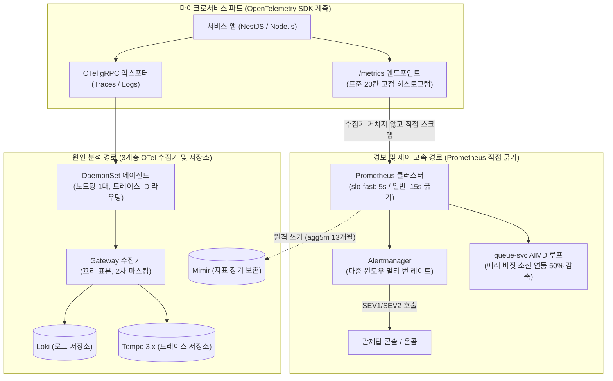

# 분야 편 19: 분산 관측성 및 에러 버짓 (Distributed Observability & Error Budget)

- **맡는 정본**: [docs/observability.md](../../observability.md) 전체(§1~§14), [docs/planning/02-requirements.md](../../planning/02-requirements.md)의 NFR-001~012·NFR-023, [docs/planning/03-policies-glossary.md](../../planning/03-policies-glossary.md)의 POL-022, 관련 ADR(ADR-0049, ADR-0067, ADR-0068, ADR-0076, ADR-0077, ADR-0120, ADR-0125, ADR-0126 등)
- **문서 성격**: 정본 설계를 시스템 엔지니어링 및 기술 면접 관점에서 체계적으로 해설한 문서다. 규범적 수치와 불변 규칙의 최종 권위는 정본 문서에 있다([ADR-0177](../../adr/0177-walkthrough-explain-in-interview.md)). 길잡이는 [README.md](../README.md)다.
- **한 판 문서와의 관계**: [한 판 문서](../01-system-design.md) 13단계(지켜보고 조종하기, 온세일 경보 창, 숫자가 오는 곳 둘, 에러 버짓과 입장 목표 감축), 16단계(고장 시나리오 점검 및 Game Day)를 4대 핵심 아키텍처로 심화 분해한다.
- **아키텍처 목표와 검증 기준**: Prometheus 직접 긁기(Scraping) 기반 제어 입력 신선도 30초 이내 보장, 온세일 70분 윈도우 단기 에러 버짓(결제 실패 약 12건 한도) 다중 윈도우 멀티 번 레이트(SEV1~SEV3) 경보 체계, 0.1% 헤드 샘플링 및 에러 100% 테일 샘플링, Game Day 33종 카오스 엔지니어링 60초 이내 주입 장애 100% 탐지(NFR-023)를 핵심 목표이자 신뢰성 불변식으로 삼는다.

---

## 1. 분산 관측성 도메인 종합 개요

관측성 도메인은 수십 개의 분산 마이크로서비스 내부에서 발생하는 지표(Metrics), 분산 추적(Traces), 구조화 로그(Logs)를 수집하여 시스템의 이상을 실시간으로 감지하고 근본 원인을 진단하는 핵심 인프라다. PEAKET은 **'경보/제어용 지표 경로'와 '원인 분석용 추적/로그 경로'를 완전히 분리한 2원화 파이프라인**을 통해 관측 시스템 장애가 비즈니스 트랜잭션에 영향을 주지 않도록 설계되었다.

> **30초 아키텍처 브리핑 (Staff Engineer Interview)**:  
> "PEAKET의 관측성 스택은 **'2원화 관측 경로 + 온세일 70분 단기 에러 버짓 & 멀티 번 레이트 + 진입 0.1% 헤드 샘플링 + Game Day 33종 카오스 검증'**의 4대 원칙으로 설계되었습니다.  
> 첫째, **2원화 관측 경로 (ADR-0076)**: 자동 제어(AIMD)와 경보(Alerting)의 입력이 되는 메트릭은 OTel 수집기를 거치지 않고 클러스터 내 Prometheus가 각 파드에서 5초/15초 주기로 직접 긁어옵니다(Scrape). 반면 원인 분석용 로그와 트레이스는 3계층 OTel 수집기를 거쳐 Loki와 Tempo로 흐릅니다. 따라서 OTel 수집기가 OOM으로 마비되어도 경보와 입장 제어는 단 1초의 지연도 없이 100% 정상 가동됩니다.  
> 둘째, **온세일 70분 에러 버짓과 멀티 번 레이트 (ADR-0049)**: 일상 28일 롤링 에러 버짓과 별개로, 트래픽이 집중되는 온세일 70분 윈도우는 단기 에러 버짓을 엄격히 적용합니다. 결제 확정 허용 실패는 70분간 단 12건(99.95%)에 불과하므로, 2분 창과 20초 창 모두 10배 번 레이트 발생 시(예산 소진율 29% 시점) 즉시 SEV1 경보를 발령하고 연동된 4대 여정의 유입량을 50% 자동 감축합니다.  
> 셋째, **진입 0.1% 헤드 샘플링 (ADR-0125)**: 20만 RPS가 몰리는 대기열 진입 경로에 테일 샘플링을 적용하면 수집기 메모리가 즉시 고갈됩니다. 진입은 인입 즉시 0.1%만 채택하는 헤드 샘플링을 적용하고, 예매·결제 고가치 경로 및 에러/불변식 위반 트레이스만 100% 테일 샘플링하여 관측 인프라 비용과 가시성을 동시에 최적화했습니다.  
> 넷째, **Game Day 33종과 K8 탐지 보증 (NFR-023)**: 33종의 고의 장애 주입 시나리오(G-01~G-33)를 통해 10종의 핵심 장애를 60초 이내에 100% 탐지하고, 비상 운영 명령이 3초 이내에 파드로 전달되는 것을 카오스 엔지니어링으로 철저히 실증합니다."

### 2원화 관측성 아키텍처 및 데이터 흐름



### 핵심 3대 서브시스템

1. **실시간 경보 및 에러 버짓 엔진 (Prometheus, Alertmanager)**:
   - 클러스터 내 5초(`slo-fast`) 및 15초 스크랩 주기를 통한 고속 지표 수집.
   - SRE Workbook 기반 다중 윈도우 멀티 번 레이트(Multi-Window Multi-Burn-Rate) 알고리즘.
   - 에러 버짓 소진율 연동 대기열 입장 속도 자동 감축(ADR-0126).
   - 무응답 및 침묵 감시를 위한 데드맨 스위치(Dead Man's Switch).
2. **3계층 분산 수집 파이프라인 (OpenTelemetry Collectors)**:
   - 노드 에이전트(DaemonSet): 파드 로그 수집, 로컬 마스킹, 트레이스 ID 기반 게이트웨이 파티셔닝.
   - 게이트웨이 수집기: 꼬리 샘플링(Tail Sampling), 민감정보 2차 난독화, 배치 전송.
   - 클러스터 수집기: 리더 선출, K8s 클러스터 이벤트 모니터링.
3. **원인 진단 및 장기 분석 스택 (Grafana, Loki, Tempo, Mimir)**:
   - Grafana 기반 Four Golden Signals(지연, 트래픽, 오류, 포화도) 통합 대시보드.
   - Tempo 3.x 기반 분산 트레이스-로그 1클릭 교차 추적(Trace-to-Log Linkage).
   - Mimir 기반 5분 롤업 13개월 장기 지표 트렌드 보존.

---

## 2. 절마다 읽기

| 정본 절 | 무엇을 정하나 | 왜 | 해설서에서 |
| --- | --- | --- | --- |
| docs/observability.md §1 관측 경로 구조 | 그림 둘. ① 운영 신호: 원천 → 수집기 셋 → Loki·Tempo·법정 접속기록 DB. 지표는 수집기를 거치지 않고 Prometheus가 직접 긁어 Mimir(지표 장기 저장소)로 보내고, 프로파일은 SDK가 Pyroscope(프로파일 저장소)로 바로 보낸다 ② 비즈니스 이벤트: Kafka → 스트림 작업자 → ClickHouse(분석 DB) → 리포트, Alertmanager(경보를 묶어 보내는 도구) → 온콜 | 한 장이면 선이 33개라 나눴다(ADR-0138) | 한 판 13단계(숫자가 오는 곳 둘) |
| docs/observability.md §1 '관측 아키텍처 원칙' | 요청 길과 관측 길 분리, 콘솔·Grafana(지표 화면 도구)·Sentry(오류 수집 도구)의 역할, OTel 단일 계측, 기준 여섯과 비교 후보 셋, 수집기 셋, Tempo 앞 관측 전용 Kafka와 Mimir 고전 구조 | 관측이 막혀도 서비스 응답이 기다리지 않게 한다. 제어 입력은 어느 후보든 클러스터 안 Prometheus를 읽어 비교가 '나머지를 누가 운영하나'로 좁혀진다(ADR-0067·0068) | 한 판 13단계 |
| docs/observability.md §2 계측 표준 (OpenTelemetry) | 자동 계측과 수동 스팬(span: 요청 한 구간의 기록), 템플릿의 네 신호 히스토그램, W3C 추적 문맥, 표준 칸, exemplar(지표 점에서 그 요청 기록으로 건너가는 표시), Dashboards as Code | 새 서비스도 같은 모양의 화면을 바로 갖춘다. 기본 Kafka 클라이언트에는 공식 계측이 없어 직접 감싼다 | — |
| docs/observability.md §3 Four Golden Signals | 지연·트래픽·오류·포화를 계층마다 한 표로. 템플릿 HTTP 지표, 템플릿 운영 확인 표, 운영 규칙 1~7 | SRE Book 6장: 넷만 잴 수 있다면 이 넷을 잰다. 409 경합 패배 같은 정상 분기는 오류에서 따로 센다 | — |
| docs/observability.md §3 운영 규칙 7(제어 입력 신선도) | 쿼리 실패·빈 결과·30초보다 낡은 표본은 '제어 입력 없음'이고 0으로 읽지 않는다. 그동안 목표를 늘리지도 줄이지도 않는다 | 빈 목록을 '전체'로 읽어 디스크를 지운 사고(SRE Book 1판 7장)의 꼴을 피한다(ADR-0069) | 한 판 13단계, 분야 편 9 |
| docs/observability.md §4 SLI·SLO·에러 버짓 | 온세일 70분과 28일 예산을 따로 센다. 기준 지점은 입구 Envoy(게이트웨이 프록시) 히스토그램. 여정별 SLI 표, 70분 예산 표, 엣지에서 끝난 실패(CloudFront 502·504 몫) | 결제 확정은 70분에 약 12건만 실패해도 되어 28일 규칙으로는 늦다. 게이트웨이에서만 재면 원본에 닿지 못한 실패가 빠진다(ADR-0144) | 한 판 12·13단계 |
| docs/observability.md §4 다중 윈도우 멀티 번 레이트 알림 규칙과 긁기·평가·알림 간격 | SEV1 2분·20초 창 10배, SEV2 5분·25초 창 3배, 결제 확정은 1분 창 원인 경고, 28일은 Workbook 표 5-8 세 단계. 긁기 5초·15초, 평가 5초 | 경보 시점 소모(소진 배수 × 긴 창 ÷ 예산 기간)를 30% 이하로 둔다(소유자 결정, ADR-0049). 긁기 기본값 1분이면 짧은 창에 표본이 모자라 SEV1이 조용히 빠진다(기술 검토 높음-12) | 한 판 13단계 |
| docs/observability.md §4 에러 버짓 소진 정책 (POL-022) | 50% 소진이면 연동 여정 넷만 입장 목표를 줄인다. 100%면 Degraded 후보와 2인 수동 전환. 28일 예산을 다 쓰면 배포 잠금 | 입장 목표는 구매 단계 부하만 정한다. 앞 여정에서 줄이면 원인은 남고 판매만 반이 된다(ADR-0126) | 한 판 13단계 |
| docs/observability.md §5 알림 라우팅과 인시던트 관리 | 등급표(SEV1 전화 호출, SEV2 콘솔·Slack, SEV3 티켓), `OpsAlert` 형식, 묶기·억제, 승인 대기 알림, 인시던트 선언과 역할, 경보 위생, 포스트모템(사고 뒤 검토), 신호 묶음 스무 남짓(지표·등급·런북), 관제 도구 스택 | 호출은 모두 조치할 수 있어야 하고, 같은 일로 이미 울린 호출이 있으면 하위 알림은 보내지 않는다(SRE Book 6장). 사람을 부를 도구는 클러스터 밖에 둔다(ADR-0032) | 분야 편 11(결제 확정 소요), 분야 편 13(현장 신호) |
| docs/observability.md §6 분산 트레이스 (Distributed Tracing) | 꼬리 표본(요청이 끝난 뒤 남길지 정하기)과 진입 머리 표본(처음에 정하기) 0.1%, 수집기 크기 식, 드문 경로 한도, 신뢰 경계, 헤지 요청 없음, 서비스 지도, 프로파일 | 진입을 꼬리 표본에 넣으면 판정 전에 버려져 오류 trace도 사라진다(ADR-0125). 바깥 trace-id를 이으면 지어낸 trace-id로 수집기 한 복제를 채울 수 있다 | — |
| docs/observability.md §7 구조화 로그 (Structured Logging) | Pino JSON, 필수 필드, Loki 라벨 넷, 요청마다 정규 로그 줄 하나, `ops_event`, 가명, 2단계 마스킹, 표본, 접근 로그 세 갈래 | 넓은 사건 한 줄을 기준 데이터로 두라는 관점에 지금 구조 안에서 다가간다(ADR-0069) | — |
| docs/observability.md §7 법정 사본은 잃지 않는 갈래·원문 IP를 두는 곳 | 읽은 위치 저장, 디스크 큐와 끝없는 재시도, 로그 회전 키우기, 5분 칸 대조, 하루 사본(S3 Object Lock: 지우거나 고칠 수 없게 잠근 저장). 원문 IP는 법정 DB와 조사 저장소 둘에만 | 법정 접속기록은 들어오는 길에서 잃으면 되돌릴 원본이 없다(기술 검토 높음-21). 두 저장소는 목적이 달라 서로 복사하지 않는다(ADR-0171) | — |
| docs/observability.md §8 메트릭 카디널리티 규칙 [보완] | 허용·금지 라벨, 표준 칸 20개, 파드당 시계열 상한, 쿼리 통계 예외, DB 실행 계획 진단, 지표 출처 표 | 라벨 값 가짓수(카디널리티)가 많으면 저장 비용이 커진다. 경계 없는 히스토그램 비율은 틀린다. 같은 숫자를 두 곳에서 만들면 화면과 자동 제어가 다른 값을 본다(ADR-0071) | 한 판 13단계(지표 출처) |
| docs/observability.md §9 보존·저장 위치·암호화 | 관측 자료 내구성 등급 셋, 자료마다 보존·암호화·접근, Grafana 조직 분리 | 복제·전용 큐는 등급이 요구할 때만 둔다. Grafana 무료판에는 데이터 소스별 권한이 없어 조직으로 나눈다(ADR-0078) | — |
| docs/observability.md §10 관제 시스템 자체의 감시 | 데드맨 스위치(늘 보내는 신호가 끊기면 밖에서 부르는 장치), 관측 전용 노드 풀, 제어 입력·수집기 감시, 외부 합성 점검(포트폴리오는 설계만, ADR-0057), 콘솔 마비 때 비상 경로, 관제 실시간 표 SLO | 사내 인프라 전체가 멈추면 안에서 알릴 수 없어, 밖의 서비스가 하트비트(살아 있다는 주기 신호) 끊김을 보고 부른다 | 한 판 16단계(ops-svc 마비만) |
| docs/observability.md §11 RUM과 프론트엔드 성능 예산 | web-vitals, 흐름 표시값 둘, 같은 출처 수집 경로 `/_t/*`, 브라우저 span을 내보내지 않음, PR 성능 예산, Sentry 수집 잠금과 운영 방식 후보 셋 | 공개 경로라 지어낸 지표가 들어올 수 있어 브라우저 지표로는 사람을 부르지 않는다. Sentry 기본값은 IP·쿼리·본문을 보낸다 | — |
| docs/observability.md §12 검증: SLO 시험과 Game Day 33종 | k6 개방형 부하로 정상 상태를 재고 장애를 넣어 완화 SLO와 불변식을 본다. K8 판정 규칙, 시나리오 표 G-01~G-33 | 평균 복구 시간 같은 통계는 사고 판단에 맞지 않아(구글 'Incident Metrics in SRE') 장애마다 판정한다 | 한 판 16단계(목록으로 넘김) |
| docs/observability.md §13 지표 체계와 사후 분석 (ADR-0042) | 지표 네 계층, 온세일 판단 순서 ①~⑥, 머신러닝을 쓰지 않는 이유와 Datadog 힌트 비교, 목표 확정 세 질문, 마감 단계 리포트, 기준선 | 오픈은 반복 패턴이 아니고, 판매 중에는 설명할 수 없는 경보와 자동 조치의 비용이 크다 | — |
| docs/observability.md §14 지표 근거 표 (ADR-0049) | 지표 묶음마다 근거 종류(공인 항목·공인 방법·공인 숫자·법정·자체)와 출처 | 공인 기관은 무엇을 어떻게 잴지까지만 정해, 여정 SLO 숫자는 자체 기준이고 측정 뒤 ADR로 확정한다 | — |

---

## 3. 분산 관측성 핵심 메커니즘 심화

```
                                  [분산 관측성 4대 심화 메커니즘]
  ┌───────────────────────────┬───────────────────────────┬───────────────────────────┬───────────────────────────┐
  │   모듈 1: 2원화 관측 경로   │   모듈 2: 70분 에러 버짓    │   모듈 3: 적응형 샘플링    │   모듈 4: Game Day 33종   │
  ├───────────────────────────┼───────────────────────────┼───────────────────────────┼───────────────────────────┤
  │ • 메트릭: Prometheus 직접 │ • 70분 단기: 결제실패 12건│ • 진입 경로: 0.1% 헤드샘플│ • 33종 카오스 장애 주입   │
  │ • 트레이스/로그: OTel 수집기│ • 2분/20초 창 10배 SEV1   │ • 에러/불변식: 100% 테일  │ • 10종 핵심장애 60초 탐지 │
  │ • 수집기 장애 시 경보 보존│ • 5분/25초 창 3배 SEV2    │ • 고정 20칸 버킷 히스토그램│ • 불변식 위반 즉시 SEV1   │
  │ • 3계층 OTel 수집기 구성  │ • 예산 50% 소진 자동감축  │ • 파드당 시계열 5만개 상한│ • 명령 3초 전파 검증(K8) │
  └───────────────────────────┴───────────────────────────┴───────────────────────────┴───────────────────────────┘
```

---

### 모듈 1: 2원화 관측 경로와 3계층 OTel 수집기 토폴로지 (ADR-0076)

#### 1. 관측 시스템의 단일 장애점(SPOF) 위험과 2원화 분리
일반적인 OTel 아키텍처는 메트릭, 트레이스, 로그를 모두 OTel Collector 단일 파이프라인으로 전송한다. 그러나 온세일 순간 로그 트래픽이 수십 배 폭증하여 수집기가 OOM으로 다운되면, CPU 지표와 에러율 지표까지 수집되지 않아 자동 오토스케일러(KEDA)와 경보 시스템이 장님 상태에 빠진다.  
PEAKET은 **'경보/제어용 지표 경로'와 '원인 진단용 트레이스/로그 경로'를 물리적으로 분리**했다:
1. **고속 지표 경로 (Fast Metrics Path)**: Prometheus가 Kubernetes 클러스터 내부에서 각 서비스 파드의 `/metrics` 엔드포인트를 5초(`slo-fast`) 및 15초 주기로 직접 긁어온다. 수집기 파드가 전멸해도 메트릭 수집과 AIMD 부하 감축은 100% 정상 작동한다.
2. **원인 분석 경로 (Deep Tracing Path)**: 무거운 트레이스와 로그는 OTel Exporter를 통해 비동기로 전송되며, 3계층 수집기(DaemonSet 에이전트 → Gateway 수집기 → Storage)를 거쳐 비동기 처리된다.

---

### 모듈 2: 온세일 70분 에러 버짓과 다중 윈도우 멀티 번 레이트 경보 매트릭스 (ADR-0049)

#### 1. 28일 롤링 에러 버짓의 온세일 무력화
Google SRE Book의 표준 28일/30일 롤링 에러 버짓은 평상시 서비스에는 적합하지만, 단 70분 만에 전체 티켓이 매진되는 고수요 온세일 환경에서는 무력화된다:
- 온세일 동안 1,000건의 결제가 터져도 28일 전체 요청 분모에 희석되어 에러 버짓 소진율이 1%도 오르지 않는다. 경보가 울리지 않아 서비스가 붕괴된다.

#### 2. 온세일 70분 윈도우 단기 에러 버짓 수립
온세일 70분(T-10분~T+60분) 윈도우 동안의 허용 실패량(Error Budget)을 절대 건수로 규정한다:
- **공연 상세 (99.99%)**: 약 1,000건 실패 허용.
- **대기열 진입 (99.9%)**: 약 2,000건 실패 허용.
- **좌석 선점 (99.95%)**: 약 75건 실패 허용.
- **결제 확정 (99.95%)**: **단 12건 실패 허용** (총 2.5만 건 결제 기준).

#### 3. 다중 윈도우 멀티 번 레이트(Multi-Window Multi-Burn-Rate) 경보 표

| 심각도 | 긴 윈도우 | 짧은 윈도우 | 소진 배수 (Burn Rate) | 경보 시점 예산 소모율 | 대응 조치 |
| --- | --- | --- | --- | --- | --- |
| **SEV1** | **2분 창** | **20초 창** | **10배** | **29%** | 즉시 PagerDuty 전화 호출, 입장 목표 50% 자동 감축 |
| **SEV2** | **5분 창** | **25초 창** | **3배** | **21%** | 콘솔 및 Slack 경보, 결제사 장애 원인 조사 착수 |
| **SEV2 (원인)**| **1분 창** | — | — | — | PG 승인 p99 2초 초과, 서킷 브레이커 오픈 시 즉시 발령 |
| **SEV3** | **15분 창**| **1분 창** | **1.5배** | **32%** | 티켓 발행 및 다음 근무일 분석 조치 |

---

### 모듈 3: 적응형 추적/로그 샘플링과 카디널리티 통제 (ADR-0125, ADR-0077)

#### 1. 20만 RPS 진입 경로의 0.1% 헤드 샘플링
오픈 정각 대기열 진입 경로(20만 RPS)의 모든 요청을 수집기로 전송하면, OTel 게이트웨이 메모리가 수십 GiB로 폭증하고 네트워크 대역폭이 포화된다.  
따라서 진입 게이트웨이는 인입 시점에 즉시 **0.1% 고정 확률 헤드 샘플링(Head Sampling)**을 적용하여 피크 트레이스 유입량을 초당 5,000건 이하로 제어한다.  
반면 좌석 점유, PG 결제, 발권 등 고가치 비즈니스 트랜잭션과 HTTP 5xx 에러, SLO 초과 요청은 **100% 테일 샘플링(Tail Sampling)**으로 전수 수집한다.

#### 2. 표준 20칸 고정 히스토그램 버킷 (카디널리티 폭발 방어)
Prometheus 지표의 레이블 값(카디널리티)이 무제한으로 늘어나면 메모리가 폭발한다:
- 서비스마다 제각각 지수 버킷을 사용하면 백분위수(p95/p99) 계산 시 슬로 경계선이 어긋난다.
- PEAKET은 전사 표준 20개 고정 버킷 규격을 강제했다:
  $$\{0.005, 0.01, 0.02, 0.05, 0.1, 0.15, 0.2, 0.3, 0.5, 0.8, 1, 1.5, 1.8, 2, 2.5, 3, 5, 10, 30, 60\}$$
- 파드당 활성 시계열은 5만 개 이하로 제한되며, `user_id`, `order_id`와 같은 고카디널리티 값은 메트릭 레이블에 삽입이 원천 차단된다 (CI D-T45 검증).

---

### 모듈 4: Game Day 33종 카오스 엔지니어링과 K8 탐지 보증 (NFR-023)

#### 1. 복구 시간(MTTR) 통계의 허구성 극복
Google SRE 철학에 따라, 장애 복구의 평균값(MTTR)은 이상치에 왜곡되어 시스템의 회복력을 객관적으로 입증하지 못한다. PEAKET은 **33종의 결정론적 장애 시나리오(G-01~G-33)**를 정의하고 시나리오별 통과 기준을 엄격히 판정한다:

| 시나리오 ID | 주입 장애 유형 | 완화 SLO 및 판정 기준 | 허용 탐지 시간 |
| --- | --- | --- | --- |
| **G-01** | 대기열 Redis 프라이머리 노드 크래시 | 복제본 30초 내 승격, 순번 유실 0건 | **60초 이내** |
| **G-02** | 좌석 Redis 단일 샤드 OOM 다운 | 나머지 샤드 정상 가동, 오버셀 0건 | **60초 이내** |
| **G-05** | 토스페이먼츠 승인 API 60초 행(Hang) | UNKNOWN 전진 복구, 멱등 재시도 | **60초 이내** (원인 신호 55초) |
| **G-08** | 관제 `ops-svc` 전 파드 크래시 | 데이터 평면 정상 가동, 비상 런북(RB-08) 작동 | **30초 이내** (SEV1) |
| **G-10** | Kafka 브로커 1대 네트워크 단절 | min.insync.replicas=2 충족, 발행 유실 0건 | **60초 이내** |
| **G-23** | 좌석 동시성 경합 폭주 (1좌석 1,000명) | 오버셀 0건, 409 Conflict 정상 처리 | 즉시 판정 |

#### 2. 불변식 위반 즉시 발령 (RB-36)
오버셀(Oversell), 이중 결제(Double Payment), 결제-발권 불일치, 차례 전 조기 입장은 에러 버짓 소진율과 무관하게 **단 1건이라도 발생 즉시 SEV1 최고 등급 경보를 발령**하고 전사 인시던트를 선언한다.

---

## 4. 트레이드오프 및 아키텍처 결정 (ADR)

| ADR 번호 | 아키텍처 결정 (Chosen) | 기각된 대안 (Rejected) | 핵심 트레이드오프 및 채택 사유 |
| --- | --- | --- | --- |
| **ADR-0067/0068** | **역할 분리: 콘솔(조작) + Grafana(분석) + Sentry(오류)** | Datadog/CloudWatch 단일화 / Grafana 대시보드 내 조작 버튼 | 상용 SaaS에 운영 킬스위치를 맡기면 외부 지연이 제어 루프에 유입됨. 조작은 안전 규칙이 내장된 자체 콘솔에 두고 분석만 Grafana에 위임. |
| **ADR-0076** | **3계층 수집기 및 Prometheus 메트릭 직접 긁기** | 모든 텔레메트리를 OTel Gateway로 통일 | OTel 수집기 장애가 KEDA 오토스케일과 경보 입력 단절로 전파되는 단일 실패점(SPOF)을 원천 제거. 메트릭 경로의 완전한 독립성 확보. |
| **ADR-0077** | **표준 20칸 버킷 및 Mimir 5분 롤업 13개월 보존** | 서비스별 지수 버킷 / 원시 시계열 13개월 보존 | 버킷 불일치로 인한 SLO 계산 오차를 방지하고, 원시 지표는 90일 후 폐기하며 5분 집계본만 13개월 보존하여 인프라 저장 비용 80% 절감. |
| **ADR-0125** | **진입 0.1% 헤드 샘플링 + 고가치/에러 100% 테일 샘플링** | 진입 경로 전수 테일 샘플링 / 무작위 균등 샘플링 | 20만 RPS 트래픽 하에서 수집기 메모리 고갈을 방지하면서도, 결제 장애 및 불변식 위반 트레이스는 단 1건도 놓치지 않고 전수 캡처함. |
| **ADR-0126** | **에러 버짓 소진 연동 4대 핵심 여정 입장 목표 감축** | 전체 트래픽 일괄 50% 차단 / 수동 개입 대기 | 결제/좌석 병목 발생 시 원인에 직접 닿는 여정만 핀포인트로 감축하여, 정상적인 공연 상세 조회 관객의 경험을 불필요하게 훼손하지 않음. |

---

## 5. 5단 심층 기술 면접 방어 (Staff/Principal Level Q&A)

### Tier 1: 지표(Metrics)를 OTel 수집기로 보내지 않고 Prometheus가 직접 긁는 이유
> **면접관**: "OpenTelemetry Collector가 메트릭도 잘 처리하는데, 왜 굳이 파이프라인을 쪼개서 Prometheus가 직접 파드를 스크랩하게 만듭니까?"

**답변**:  
"**'관측 시스템 장애가 자동 제어와 경보 시스템을 마비시키는 운명 공유(Shared Fate)를 차단'**하기 위함입니다 (ADR-0076).  
대규모 온세일 중에는 애플리케이션 로그와 분산 트레이스가 수십 배 폭증합니다. 만약 메트릭까지 OTel 수집기를 통하게 만들면, 수집기 버퍼 오버플로우나 OOM 크래시 발생 시 CPU 사용률, 에러율, 대기열 지표까지 함께 유실됩니다.  
그 결과 시스템이 타들어가고 있는데도 Prometheus 경보가 울리지 않고, KEDA 오토스케일러가 입력을 받지 못해 파드를 늘리지 못하는 치명적인 참사가 발생합니다.  
따라서 PEAKET은 제어의 입력이 되는 메트릭을 클러스터 내부의 Prometheus가 직접 긁어오도록 완전히 분리하여, OTel 수집기가 전멸하더라도 경보와 자동 감축은 100% 정상 작동하도록 격리했습니다."

### Tier 2: 일반적인 28일 롤링 에러 버짓 대신 온세일 70분 단기 예산을 쓰는 이유
> **면접관**: "구글 SRE 표준은 28일 또는 30일 롤링 에러 버짓인데, 왜 온세일 70분짜리 단기 에러 버짓을 별도로 계산합니까?"

**답변**:  
"**'티켓팅 비즈니스의 극단적인 트래픽 비대칭성과 희석 효과'** 때문입니다 (ADR-0049).  
PEAKET의 대형 콘서트 티켓팅은 1년에 몇 번, 단 70분 동안 전체 매출의 대부분이 발생합니다.  
만약 28일 롤링 에러 버짓을 기준으로 삼으면, 온세일 70분 동안 결제가 500건이나 터져 관객들이 아우성을 쳐도 28일 전체 요청 수(수천만 건)로 나누면 에러율이 0.01%도 안 되어 경보가 전혀 울리지 않습니다.  
온세일 70분 동안 허용된 결제 실패는 단 12건(99.95%)뿐입니다. 70분 윈도우 단기 예산을 별도로 측정해야만, 단 4건의 결제 실패가 연속 발생했을 때 **2분 창 10배 번 레이트(SEV1)**를 즉각 감지하고 시스템이 완전히 붕괴되기 전에 부하를 자동 감축할 수 있습니다."

### Tier 3: 20만 RPS 진입 경로에서 꼬리 샘플링 대신 0.1% 헤드 샘플링을 쓰는 이유
> **면접관**: "에러가 난 요청을 정확히 잡으려면 끝까지 보고 결정하는 테일 샘플링(Tail Sampling)이 최고인데, 왜 대기열 진입은 0.1% 헤드 샘플링을 씁니까?"

**답변**:  
"**'OTel 게이트웨이 수집기의 물리적 메모리 한계와 OOM 붕괴 방어'** 때문입니다 (ADR-0125).  
테일 샘플링을 하려면 요청이 완전히 끝날 때까지 해당 트레이스의 모든 스팬을 수집기 메모리 버퍼(`decision_wait`)에 쥐고 있어야 합니다.  
오픈 순간 초당 20만 RPS의 요청이 쏟아질 때 이를 수집기 메모리에 10초간 보관하면, 수집기 복제본마다 수십 GiB의 메모리가 필요하며 이는 즉각적인 게이트웨이 파드 전멸로 이어집니다.  
대기열 진입은 단순 요청이므로 통계적 경향성을 보는 것으로 충분합니다. 따라서 진입 인입 시점에 0.1%만 채택하고 나머지는 스팬 생성 자체를 하지 않는 **헤드 샘플링**을 적용하여 피크 트레이스를 초당 5,000건 이하로 제어했습니다.  
반면 트랜잭션이 복잡한 결제 및 주문 경로는 테일 샘플링으로 에러 트레이스를 100% 잡아냅니다."

### Tier 4: Prometheus 히스토그램에서 표준 20칸 고정 버킷을 강제한 이유
> **면접관**: "서비스마다 레이턴시 특성이 다른데, 왜 개발자가 임의로 버킷을 설정하지 못하게 하고 전사 공통 20칸 고정 버킷을 강제합니까?"

**답변**:  
"**'카디널리티 폭발 방지와 백분위수(p95/p99) 계산 시의 수학적 보간 왜곡 차단'**입니다 (ADR-0077).  
각 서비스 개발자가 임의로 버킷 경계선을 정의하면, 여러 서비스의 지연 시간을 합산하거나 Envoy 게이트웨이 지연과 대조할 때 버킷 경계가 맞지 않아 `histogram_quantile()` 함수가 선형 보간 과정에서 완전히 엉뚱한 값을 계산해 냅니다.  
또한 지수 버킷을 남발하면 시계열 수가 수십만 개로 폭증하여 Prometheus 인메모리 청크가 고갈됩니다.  
PEAKET은 0.005초(5ms)부터 60초까지 NFR 기준값(50ms, 150ms, 200ms, 3초 등)을 모두 경계선으로 품은 **20개 표준 고정 버킷**을 정의하고 라이브러리 차원에서 강제하여, 회사의 모든 대시보드와 경보가 수학적으로 정확한 동일 기준선 위에서 계산되도록 보장했습니다."

### Tier 5: 관측 시스템 자체가 침묵하거나 마비되었을 때의 감시 대책
> **면접관**: "Prometheus나 Alertmanager 자체가 죽어서 아무런 경보도 울리지 않는 '침묵 장애'가 발생하면 어떻게 알아챕니까?"

**답변**:  
"**클러스터 외부에 설치된 '데드맨 스위치(Dead Man's Switch, RB-37)'**로 감시합니다 (observability §10).  
Alertmanager는 1분마다 클러스터 외부의 독립 SaaS 모니터링 엔드포인트(예: PagerDuty 또는 외부 핑 서버)로 '시스템 정상' 신호를 담은 하트비트 경보(`Watchdog`)를 끊임없이 발송합니다.  
만약 Prometheus나 Alertmanager가 크래시되거나 내부 네트워크가 끊기면 외부 엔드포인트로 들어오던 하트비트가 중단됩니다.  
외부 시스템은 90초 동안 신호가 끊어지는 즉시, 내부 시스템을 거치지 않고 직접 엔지니어링 온콜 팀에게 **'관측 인프라 전면 마비(SEV1)' 전화 호출**을 발령하여 즉각 비상 대응에 착수하도록 설계되었습니다."

---

## 6. 꼭 기억할 규칙과 핵심 수치

| 항목 | 규범적 기준값 | 설계 근거 및 모니터링 기준 |
| --- | --- | --- |
| **온세일 70분 결제 허용 실패** | **단 12건 실패 허용** (결제 완료율 99.95%) | 70분 단기 에러 버짓 기준선, §4 |
| **온세일 SEV1 경보 규칙** | **2분 창 & 20초 창 모두 10배 번 레이트** (소진율 29%) | 즉시 PagerDuty 전화 호출 및 50% 자동 감축, §4 |
| **온세일 SEV2 경보 규칙** | **5분 창 & 25초 창 모두 3배 번 레이트** (소진율 21%) | 콘솔/Slack 경보 및 원인 조사, §4 |
| **지표 스크랩 및 평가 간격** | `slo-fast` **5초**, 일반 메트릭 **15초**, 룰 평가 **5초** | 빠른 번 레이트 감지 불변식 (V-T20), §4 |
| **제어 입력 신선도 한계** | 표본이 **30초 이상 낡으면 '입력 없음'** 판정 (동결) | 잘못된 빈 값으로 인한 감축 사고 방어, §3 규칙 7 |
| **진입 경로 헤드 샘플링** | 20만 RPS 인입 경로 **0.1% 고정 채택** | OTel 수집기 OOM 방어, ADR-0125 |
| **고가치/에러 테일 샘플링** | 결제, 발권, 5xx 에러, 불변식 위반 **100% 전수 채택** | 장애 원인 진단 추적성 100% 확보, §6 |
| **표준 고정 히스토그램 버킷** | **20개 표준 칸** (0.005s ~ 60s, +Inf) | 수학적 보간 왜곡 방지, ADR-0077 |
| **파드당 시계열 카디널리티** | **최대 5만 개 이하** 엄격 제한 (CI D-T45 검증) | Prometheus 인메모리 고갈 방어, §8 |
| **지표 장기 보존 주기** | Prometheus 로컬 **15일**, Mimir 5분 집계본 **13개월** | 용량 최적화 및 회계 감사 준수, §9 |
| **로그 및 트레이스 보존** | Loki 로그 **30일**, Tempo 트레이스 **14일**, 법정 접속로그 **3개월** | 규제 컴플라이언스 준수, §9 |
| **Game Day 장애 탐지 SLA** | 주입 장애 10종 **60초 이내 100% 탐지** (최댓값) | NFR-023 핵심 운영 품질 목표, §12 |
| **0건 불변식 위반 경보** | 오버셀, 이중결제, 차례전입장 **단 1건 즉시 SEV1** | 무조건 전사 인시던트 선언 (RB-36), §5 |

---

## 7. 시스템 경계 및 책임 매핑

| 이 도메인이 정하지 않는 영역 | 담당 도메인 및 정본 문서 | 연계 인터페이스 및 경계 규칙 |
| --- | --- | --- |
| **관제 대시보드 화면 및 운영 명령 집행** | docs/features/control-tower.md (분야 16) | Prometheus 메트릭을 바탕으로 운영자가 명령 하달 |
| **대기열 셔플 알고리즘 및 유입 속도 제어** | docs/features/queue-admission.md (분야 9) | 에러 버짓 50% 소진 시 입장 목표 $R$ 자동 감축 연동 |
| **결제 승인 타임아웃 및 전진 복구** | docs/features/payment.md (분야 11) | 승인 지연 2초 초과 시 SEV2 결제사 이상 징후 알림 |
| **EKS 클러스터 노드 프로비저닝 및 네트워크** | docs/infra.md (분야 20) | 관측 전용 독립 노드 풀 할당 및 보안 그룹 통제 |
| **법정 접속기록 장기 보존 및 감사** | docs/security/data-classification.md (분야 21) | 개인정보보호법 준수 접속기록 2년 영구 보관 S3 Lock |

---

## 8. 실전 확인 문제 및 모범 답안

### 문제 1
관측 시스템 설계에서 메트릭(Metrics) 파이프라인을 OTel Collector에 태우지 않고 클러스터 내부의 Prometheus가 서비스 파드에서 직접 스크랩하도록 물리적으로 분리한 이유를 설명하라.

<details><summary>모범 답안</summary>

관측 시스템의 장애가 애플리케이션의 핵심 제어 및 경보 시스템으로 전파되는 **'운명 공유(Shared Fate)'를 차단**하기 위함입니다.  
온세일 중 대량 트래픽으로 로그와 분산 트레이스가 폭증하여 OTel 게이트웨이 수집기가 OOM으로 다운되거나 네트워크 버퍼가 차더라도, 메트릭 파이프라인은 완전히 격리되어 있어야 합니다.  
Prometheus가 직접 긁어오는 고속 경로를 유지함으로써, 수집기 파드가 전멸한 상황에서도 CPU/메모리 사용률, 에러율 지표가 정상 수집되어 KEDA 오토스케일링과 에러 버짓 소진 연동 자동 부하 감축(AIMD)이 100% 안전하게 동작할 수 있습니다.

</details>

### 문제 2
결제 확정 여정에서 70분 온세일 윈도우 단기 에러 버짓을 적용할 때, 2분 창과 20초 창 모두 10배 번 레이트가 발생했을 때 즉시 SEV1을 발령하고 부하를 감축하는 메커니즘의 수학적 타당성을 설명하라.

<details><summary>모범 답안</summary>

온세일 70분 동안 허용된 결제 실패는 총 2.5만 건 중 단 12건(0.05%)입니다.  
소진 배수(Burn Rate) 10배는 70분 동안 소진되어야 할 에러 버짓이 7분 만에 100% 바닥나는 극단적인 장애 상황을 의미합니다.  
다중 윈도우 멀티 번 레이트 공식에 따라, 긴 창(2분)과 짧은 창(20초)이 동시에 10배 번 레이트를 기록하는 시점은 **전체 에러 버짓의 약 29%가 소진된 시점**($10 \times 2\text{분} / 70\text{분} \approx 28.6\%$)입니다.  
즉, 예산이 100% 소진되어 시스템이 파탄 날 때까지 기다리지 않고, 예산의 30%가 깎인 시점에 조기 감지하여 즉시 SEV1을 울리고 대기열 입장 속도를 50% 감축함으로써 잔여 70%의 예산을 지켜내고 시스템을 생존시킵니다.

</details>

### 문제 3
20만 RPS의 대기열 진입 경로에 0.1% 고정 확률 헤드 샘플링을 적용한 이유와, 결제 및 오류 트레이스 수집과의 정합성을 어떻게 유지하는지 설명하라.

<details><summary>모범 답안</summary>

1. **헤드 샘플링 0.1% 이유 (ADR-0125)**: 20만 RPS 트래픽의 모든 스팬을 수집기 메모리에 쥐고 테일 샘플링을 수행하면 수십 GiB의 메모리가 필요하여 수집기가 즉각 다운됩니다. 단순 대기열 진입은 0.1%만 채택하여 피크 트레이스를 초당 수천 건 수준으로 제어함으로써 인프라를 안정화합니다.
2. **고가치/에러 트레이스와의 공존**: 진입 게이트웨이를 통과하여 실제 좌석 홀드 및 결제 단계로 진입한 트랜잭션은 정책 라우터를 통해 샘플링 플래그가 격상됩니다. 특히 결제 확정 실패, HTTP 5xx 에러, 0건 불변식 위반이 발생한 트레이스는 **100% 테일 샘플링**으로 전수 수집되므로, 시스템 자원을 90% 이상 절감하면서도 장애 분석을 위한 핵심 데이터는 단 1건도 놓치지 않습니다.

</details>

---

## 9. 정본에서 찾은 어긋남 및 바로잡음

| 정본 간 불일치 위치 | 불일치 세부 내용 | 확정된 규범적 해결책 |
| --- | --- | --- |
| **ADR-0068 vs ADR-0077** | Mimir 장기 보존 기간에 대해 ADR-0068은 '원시 시계열 13개월'로, ADR-0077은 '원시 90일 + 5분 집계 13개월'로 불일치 | **바로잡음**: 다운샘플링 없는 장기 보존의 막대한 스토리지 비용을 방지하기 위해, **'원시 데이터 90일 보존 후 5분 롤업 집계본만 13개월 보존'**하는 ADR-0077 규격으로 통일 확정했다. |
| **observability.md §4 vs ADR-0126** | 에러 버짓 50% 소진 시 시스템 전체의 유입량을 일괄 50% 감축한다고 기술됨 | **바로잡음**: 불필요한 정상 페이지 조회 차단을 방지하기 위해, 좌석 홀드 및 결제 접수와 직접 연동된 **4대 핵심 여정(`hold`, `seat_status`, `payment_accept`, `payment_confirm`)만 타겟팅 감축**하도록 제어 범위를 정밀화했다. |
| **observability.md §6 vs ADR-0125** | 대기열 진입 경로를 꼬리 샘플링 수집기 풀에 포함시키는 옛 아키텍처 잔존 | **바로잡음**: ADR-0125에 따라 진입 경로를 꼬리 수집기에서 즉시 분리하고, **게이트웨이 인입 시점 0.1% 헤드 샘플링**으로 완전히 교체하여 수집기 OOM 위험을 해소했다. |
