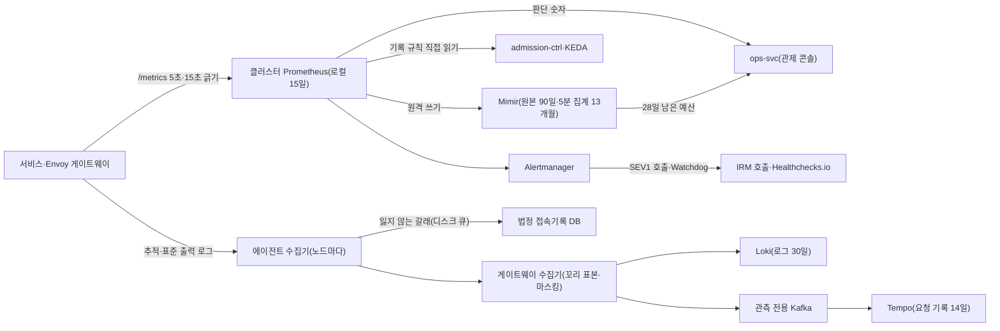

# 분야 편 19: 관측

- **기준 시점**: ADR-0177까지, 2026-11-01
- **맡는 정본**: [docs/observability.md](../../observability.md) 전체(§1~§14)와 관측 ADR(§5에 모았다). 함께 읽는 정본은 [docs/planning/02-requirements.md](../../planning/02-requirements.md)의 NFR-001~012·NFR-023과 [docs/planning/03-policies-glossary.md](../../planning/03-policies-glossary.md)의 POL-022다.
- **규범이 아니다**: 정본을 풀어 쓴 해설이다. 숫자와 규칙이 정본과 다르면 정본이 맞다([ADR-0177](../../adr/0177-walkthrough-explain-in-interview.md)).
- **한 판 문서와의 관계**: [한 판 문서](../01-system-design.md) 13단계(지켜보고 조종하기)가 온세일 경보 창, 숫자가 오는 곳 둘, 에러 버짓과 입장 목표를 잇는 범위를 설명한다. 16단계(고장 시나리오 점검)는 §12 Game Day 목록으로 넘기고, 12단계는 진입 예산 계산만 쓴다. 이 편은 두 단계가 건너뛴 것(계측, 신호 묶음, 표본, 카디널리티, 보존, 자체 감시, RUM, 사후 분석)을 더한다. 두 핵심 결정은 결정 카드 [D-19](../decisions/D19-observability-stack.md)(관측 도구와 표본)와 [D-20](../decisions/D20-onsale-alerts-error-budget.md)(온세일 경보와 감축)이 다룬다.
- **측정 전이다**: 관측 쪽 숫자(K8 탐지 시간, 경보 창, 수집기 크기)의 측정 기록은 없다. 기반 PoC(본 개발 전에 위험한 부분만 PC 한 대에서 먼저 재 본 시험, [ADR-0176](../../adr/0176-foundation-poc-results.md), '실측(PC)')는 Redis·HTTP·Kafka 구성 요소만 쟀고, 서비스 수준 측정은 아직 없다. 설계 목표값에는 `[실측 전]`을 붙였고 정본의 `[가정]`·`[추정]`·`[보완]`은 그대로 옮겼다.

## 1. 이 문서가 정하는 것

docs/observability.md는 시스템 안을 들여다보는 일(관측) 전체를 정한다. 지표·로그·요청 기록(trace: 요청 하나가 여러 서비스를 지난 길의 기록)을 어떻게 내고(OpenTelemetry 계측 표준), 어디로 모으고(수집기 셋과 저장소), 무엇을 재는지(SLI: 실제로 재는 서비스 품질 값, SLO: 팀이 정한 목표)를 적는다. 목표가 허락하는 실패의 양(에러 버짓)을 쓰는 속도(번 레이트)로 경보를 걸고, 등급(SEV1~3)과 경로로 나눠 사람에게 보낸다. 뼈대는 '두 길'이다. 경보와 자동 제어가 읽는 지표는 클러스터 안 Prometheus(지표 저장·질의 도구)가 서비스에서 직접 긁고, 원인을 찾는 로그와 요청 기록은 수집기를 거쳐 Loki(로그 저장소)와 Tempo(요청 기록 저장소)로 간다. 이 밖에 라벨 규칙, 보존, 자체 감시, 브라우저 성능 측정(RUM), 일부러 장애를 내는 연습(Game Day) 33종, 사후 분석, 지표 근거 표를 둔다.

> **30초 설명**: "관측은 두 길로 나눴습니다. 경보와 자동 제어가 읽는 지표는 클러스터 안 Prometheus가 서비스에서 직접 긁고, 원인 분석용 로그와 요청 기록은 수집기를 거쳐 Loki와 Tempo로 갑니다. 그래서 수집기가 멈춰도 경보와 입장 제어는 그대로입니다. 목표는 사용자 여정마다 SLO로 두고 온세일 70분은 따로 오류 허용량을 셉니다. 결제 확정은 70분에 약 12건만 실패해도 되므로, 경보가 울릴 때 쓴 허용량이 30% 이하가 되게 2분 창과 20초 창을 함께 봅니다. 사람을 부르는 경보는 사용자가 겪는 증상으로만 걸고, 자동 제어는 입력이 끊기면 멈춰 목표를 지킵니다. 로그와 요청 기록은 같은 문턱으로 표본을 골라 같은 요청을 가리키고, 사람을 가리키는 값은 키를 건 가명으로만 남깁니다. 맞는지는 Game Day 33종으로 확인할 계획이고 아직 재지는 않았습니다."

## 2. 절마다 읽기

정본의 `### ` 제목은 '관측 아키텍처 원칙' 하나다. 굵은 글씨 묶음 가운데 따로 물을 만한 것은 행을 나눴다.

| 정본 절 | 무엇을 정하나 | 왜 | 해설서에서 |
| --- | --- | --- | --- |
| docs/observability.md §1 관측 경로 구조 | 그림 둘. ① 운영 신호: 원천 → 수집기 셋 → Loki·Tempo·법정 접속기록 DB. 지표는 수집기를 거치지 않고 Prometheus가 직접 긁어 Mimir(지표 장기 저장소)로 보내고, 프로파일은 SDK가 Pyroscope(프로파일 저장소)로 바로 보낸다 ② 비즈니스 이벤트: Kafka → 스트림 작업자 → ClickHouse(분석 DB) → 리포트, Alertmanager(경보를 묶어 보내는 도구) → 온콜 | 한 장이면 선이 33개라 나눴다(ADR-0138) | 한 판 13단계(숫자가 오는 곳 둘) |
| docs/observability.md §1 '관측 아키텍처 원칙' | 요청 길과 관측 길 분리, 콘솔·Grafana(지표 화면 도구)·Sentry(오류 수집 도구)의 역할, OTel 단일 계측, 기준 여섯과 비교 후보 셋, 수집기 셋, Tempo 앞 관측 전용 Kafka와 Mimir 고전 구조 | 관측이 막혀도 서비스 응답이 기다리지 않게 한다. 제어 입력은 어느 후보든 클러스터 안 Prometheus를 읽어 비교가 '나머지를 누가 운영하나'로 좁혀진다(ADR-0067·0068) | 한 판 13단계 |
| docs/observability.md §2 계측 표준 (OpenTelemetry) | 자동 계측과 수동 스팬(span: 요청 한 구간의 기록), 템플릿의 네 신호 히스토그램, W3C 추적 문맥, 표준 칸, exemplar(지표 점에서 그 요청 기록으로 건너가는 표시), Dashboards as Code | 새 서비스도 같은 모양의 화면을 바로 갖춘다. 기본 Kafka 클라이언트에는 공식 계측이 없어 직접 감싼다 | — |
| docs/observability.md §3 Four Golden Signals | 지연·트래픽·오류·포화를 계층마다 한 표로. 템플릿 HTTP 지표, 템플릿 운영 확인 표, 운영 규칙 1~7 | SRE Book 6장: 넷만 잴 수 있다면 이 넷을 잰다. 409 경합 패배 같은 정상 분기는 오류에서 따로 센다 | — |
| docs/observability.md §3 운영 규칙 7(제어 입력 신선도) | 쿼리 실패·빈 결과·30초보다 낡은 표본은 '제어 입력 없음'이고 0으로 읽지 않는다. 그동안 목표를 늘리지도 줄이지도 않는다 | 빈 목록을 '전체'로 읽어 디스크를 지운 사고(SRE Book 1판 7장)의 꼴을 피한다(ADR-0069) | 한 판 13단계, 분야 편 9 |
| docs/observability.md §4 SLI·SLO·에러 버짓 | 온세일 70분과 28일 예산을 따로 센다. 기준 지점은 입구 Envoy(게이트웨이 프록시) 히스토그램. 여정별 SLI 표, 70분 예산 표, 엣지에서 끝난 실패(CloudFront 502·504 몫) | 결제 확정은 70분에 약 12건만 실패해도 되어 28일 규칙으로는 늦다. 게이트웨이에서만 재면 원본에 닿지 못한 실패가 빠진다(ADR-0144) | 한 판 12·13단계 |
| docs/observability.md §4 다중 윈도우 멀티 번 레이트 알림 규칙과 긁기·평가·알림 간격 | SEV1 2분·20초 창 10배, SEV2 5분·25초 창 3배, 결제 확정은 1분 창 원인 경고, 28일은 Workbook 표 5-8 세 단계. 긁기 5초·15초, 평가 5초 | 경보 시점 소모(소진 배수 × 긴 창 ÷ 예산 기간)를 30% 이하로 둔다(소유자 결정, ADR-0049). 긁기 기본값 1분이면 짧은 창에 표본이 모자라 SEV1이 조용히 빠진다(기술 검토 높음-12) | 한 판 13단계 |
| docs/observability.md §4 에러 버짓 소진 정책 (POL-022) | 50% 소진이면 연동 여정 넷만 입장 목표를 줄인다. 100%면 Degraded 후보와 2인 수동 전환. 28일 예산을 다 쓰면 배포 잠금 | 입장 목표는 구매 단계 부하만 정한다. 앞 여정에서 줄이면 원인은 남고 판매만 반이 된다(ADR-0126) | 한 판 13단계 |
| docs/observability.md §5 알림 라우팅과 인시던트 관리 | 등급표(SEV1 전화 호출, SEV2 콘솔·Slack, SEV3 티켓), `OpsAlert` 형식, 묶기·억제, 승인 대기 알림, 인시던트 선언과 역할, 경보 위생, 포스트모템(사고 뒤 검토), 신호 묶음 스무 남짓(지표·등급·런북), 관제 도구 스택 | 호출은 모두 조치할 수 있어야 하고, 같은 일로 이미 울린 호출이 있으면 하위 알림은 보내지 않는다(SRE Book 6장). 사람을 부를 도구는 클러스터 밖에 둔다(ADR-0032) | 분야 편 11(결제 확정 소요), 분야 편 13(현장 신호) |
| docs/observability.md §6 분산 트레이스 (Distributed Tracing) | 꼬리 표본(요청이 끝난 뒤 남길지 정하기)과 진입 머리 표본(처음에 정하기) 0.1%, 수집기 크기 식, 드문 경로 한도, 신뢰 경계, 헤지 요청 없음, 서비스 지도, 프로파일 | 진입을 꼬리 표본에 넣으면 판정 전에 버려져 오류 trace도 사라진다(ADR-0125). 바깥 trace-id를 이으면 지어낸 trace-id로 수집기 한 복제를 채울 수 있다 | — |
| docs/observability.md §7 구조화 로그 (Structured Logging) | Pino JSON, 필수 필드, Loki 라벨 넷, 요청마다 정규 로그 줄 하나, `ops_event`, 가명, 2단계 마스킹, 표본, 접근 로그 세 갈래 | 넓은 사건 한 줄을 기준 데이터로 두라는 관점에 지금 구조 안에서 다가간다(ADR-0069) | — |
| docs/observability.md §7 법정 사본은 잃지 않는 갈래·원문 IP를 두는 곳 | 읽은 위치 저장, 디스크 큐와 끝없는 재시도, 로그 회전 키우기, 5분 칸 대조, 하루 사본(S3 Object Lock: 지우거나 고칠 수 없게 잠근 저장). 원문 IP는 법정 DB와 조사 저장소 둘에만 | 법정 접속기록은 들어오는 길에서 잃으면 되돌릴 원본이 없다(기술 검토 높음-21). 두 저장소는 목적이 달라 서로 복사하지 않는다(ADR-0171) | — |
| docs/observability.md §8 메트릭 카디널리티 규칙 [보완] | 허용·금지 라벨, 표준 칸 20개, 파드당 시계열 상한, 쿼리 통계 예외, DB 실행 계획 진단, 지표 출처 표 | 라벨 값 가짓수(카디널리티)가 많으면 저장 비용이 커진다. 경계 없는 히스토그램 비율은 틀린다. 같은 숫자를 두 곳에서 만들면 화면과 자동 제어가 다른 값을 본다(ADR-0071) | 한 판 13단계(지표 출처) |
| docs/observability.md §9 보존·저장 위치·암호화 | 관측 자료 내구성 등급 셋, 자료마다 보존·암호화·접근, Grafana 조직 분리 | 복제·전용 큐는 등급이 요구할 때만 둔다. Grafana 무료판에는 데이터 소스별 권한이 없어 조직으로 나눈다(ADR-0078) | — |
| docs/observability.md §10 관제 시스템 자체의 감시 | 데드맨 스위치(늘 보내는 신호가 끊기면 밖에서 부르는 장치), 관측 전용 노드 풀, 제어 입력·수집기 감시, 외부 합성 점검(포트폴리오는 설계만, ADR-0057), 콘솔 마비 때 비상 경로, 관제 실시간 표 SLO | 사내 인프라 전체가 멈추면 안에서 알릴 수 없어, 밖의 서비스가 하트비트(살아 있다는 주기 신호) 끊김을 보고 부른다 | 한 판 16단계(ops-svc 마비만) |
| docs/observability.md §11 RUM과 프론트엔드 성능 예산 | web-vitals, 흐름 표시값 둘, 같은 출처 수집 경로 `/_t/*`, 브라우저 span을 내보내지 않음, PR 성능 예산, Sentry 수집 잠금과 운영 방식 후보 셋 | 공개 경로라 지어낸 지표가 들어올 수 있어 브라우저 지표로는 사람을 부르지 않는다. Sentry 기본값은 IP·쿼리·본문을 보낸다 | — |
| docs/observability.md §12 검증: SLO 시험과 Game Day 33종 | k6 개방형 부하로 정상 상태를 재고 장애를 넣어 완화 SLO와 불변식을 본다. K8 판정 규칙, 시나리오 표 G-01~G-33 | 평균 복구 시간 같은 통계는 사고 판단에 맞지 않아(구글 'Incident Metrics in SRE') 장애마다 판정한다 | 한 판 16단계(목록으로 넘김) |
| docs/observability.md §13 지표 체계와 사후 분석 (ADR-0042) | 지표 네 계층, 온세일 판단 순서 ①~⑥, 머신러닝을 쓰지 않는 이유와 Datadog 힌트 비교, 목표 확정 세 질문, 마감 단계 리포트, 기준선 | 오픈은 반복 패턴이 아니고, 판매 중에는 설명할 수 없는 경보와 자동 조치의 비용이 크다 | — |
| docs/observability.md §14 지표 근거 표 (ADR-0049) | 지표 묶음마다 근거 종류(공인 항목·공인 방법·공인 숫자·법정·자체)와 출처 | 공인 기관은 무엇을 어떻게 잴지까지만 정해, 여정 SLO 숫자는 자체 기준이고 측정 뒤 ADR로 확정한다 | — |

## 3. 꼭 기억할 규칙과 숫자

| 항목 | 값 | 표시 | 정본 위치 |
| --- | --- | --- | --- |
| 온세일 윈도우 | T-10분 ~ T+60분, 70분. 회차마다 단기 예산. 일상은 28일 롤링 | 확정 | §4 |
| 70분 허용 실패 | 공연 상세 약 1,000건(99.99%), 대기열 진입 약 2,000건(99.9%), 좌석 홀드 약 75건(99.95%), 결제 확정 약 12건(99.95%) | 요청 수는 어림, `[실측 전]` | §4 |
| SEV1 온세일 | 2분 창과 20초 창이 모두 10배. 경보 시점 예산 29%. 결제 확정은 2분에 약 4건 | 창·배수 `[가정, Phase 6 Game Day 재실행에서 확정]` | §4 |
| SEV2 온세일 | 5분 창과 25초 창이 모두 3배(21%). 결제 확정만 1분 창 원인(승인 호출 p99 2초 초과, 서킷 열림, 결제사 오류율 상승, 한도 초과 응답) | `[가정]` | §4 |
| 60초 안 탐지 | 소진 약 27배 이상(결제 실패율 약 1.35% 이상). 20배는 약 75초 | 계산, `[실측 전]` | §4 |
| 28일 경보 | 1시간/5분 창 14.4배·6시간/30분 창 6배는 SEV1, 3일/6시간 창 1배는 SEV3 | Workbook 표 5-8 | §4 |
| 간격 | 긁기 5초(`slo-fast`)·15초, 평가 5초·30초, SEV1·2 `group_wait` 5초. 짧은 창은 긁기의 4배, 입력 없음은 3배 이상(V-T20) | `[가정, Phase 2 2.3.2·Phase 4 4.2.1에서 확정]` | §4 |
| 제어 입력 없음 | 30초보다 낡은 표본·쿼리 실패·빈 결과. AIMD 조회 창 30초 | `[가정, Phase 2 2.3.2에서 확정]` | §3 규칙 7 |
| 감축 확인 시간 | 인원이 새 목표 아래로 오고 30초 + 5초, 또는 2분. 연동 감축은 경보·소진선 하나에 한 번 | `[가정]` | §4 |
| 연동 여정 | `hold`·`seat_status`·`payment_accept`·`payment_confirm`. `detail`·`queue_entry`·`queue_state`는 호출과 자기 보호만 | 일곱 이름 모두 `[가정, wbs 4.2.1]`(ADR-0126 결정 1) | §4 |
| 결제사 전환 검토(RB-07) | 결제 확정 소요 p99 5초 초과(`direct`만) 또는 서킷 열림 | 확정 | §4·§5 |
| 표준 칸(초) | 0.005, 0.01, 0.02, 0.05, 0.1, 0.15, 0.2, 0.3, 0.5, 0.8, 1, 1.5, 1.8, 2, 2.5, 3, 5, 10, 30, 60(+Inf). 경보는 경계 칸 비율로 | 확정(20칸) | §8 |
| 라벨 상한 | `event_id`는 동시 온세일 10개 이하, 파드당 활성 시계열 5만 개(넘으면 CI가 막는다) | `[가정, Phase 4 관측 비용 측정에서 확정]` | §8 |
| 추적 표본 | 오류·SLO 지연 초과·불변식 위반 100%, 정상 온세일 1%·평시 10%, 진입 머리 표본 0.1% | 1%·10% `[가정, Phase 4]`, 0.1% `[가정, 4.1.4]` | §6 |
| 수집기 크기 | 진입을 뺀 피크 초당 약 5,000 trace, 복제 3, `decision_wait` 10초, 메모리 복제마다 약 200MiB | 5,000·200MiB `[추정]`, 복제 3·10초 `[가정, 4.1.4]` | §6 |
| 로그 표본 | 정상 2xx 온세일 1%·평시 10%. 4xx·5xx·차단기 503·'곧 입장'·SLO 지연 초과는 전수 | `[가정, Phase 4]` | §7 |
| 보존 | Prometheus 15일, Mimir 원본 90일·5분 집계 13개월, Loki 30일, Tempo 14일, Pyroscope 7일, 진단 증거 14일, 법정 접속기록 3개월, 운영 감사 로그 영구 | 90일·13개월은 소유자 결정, 진단 14일 `[가정]` | §9 |
| 외부 합성 점검 | 온세일 1분(대형·중형)·평시 5분. API 3종 탐침 3곳, 결제 흐름 브라우저 1곳. 콘솔 SEV1은 3곳 중 2곳 실패 | 탐침 3곳 `[가정]`, 설계만 | §10 |
| 관제 실시간 표 | 신선도 p95 5초 미만, 누락률 0.1% 미만. 5초 초과가 3분이면 Prometheus 대체 표시 | NFR-009, `[실측 전]` | §5·§10 |
| K8 | 주입 장애 10종(G-01~G-10) 탐지율 100%, 장애마다 60초 이내(최댓값), 명령 반영 3초 이내(최댓값). 원인 신호는 약 55초 | 목표, `[실측 전]` | §12 |
| 처리량 급감 | 앞 단계가 분당 100건 넘는 동안 5분 창 비율이 기준선 절반 아래면 SEV2(`kind` flow), 기준선이 없으면 0.8 | `[가정]` | §5 |
| 0건 불변식 | 오버셀, 이중 결제, 결제-발권 불일치, 차례 전 입장은 1건이라도 SEV1(`kind` invariant, RB-36) | 확정 | §5·§14 |

## 4. 이 문서가 다루는 ID

뜻은 정의 문서(docs/planning/02-requirements.md, docs/planning/03-policies-glossary.md, docs/planning/04-ia-flows-screens.md)에서 줄여 옮겼다. CMP ID는 이 정본에 없다.

| ID | 한 줄 |
| --- | --- |
| FR-029 | 관제 대시보드의 온세일 단계별 화면, 모든 패널에 SLO 기준선 표시 |
| FR-031 | 운영 명령과 자동 제어 조치를 감사 로그에 불변으로 남기고 지난 인시던트를 타임라인으로 다시 본다 |
| FR-044 | 법정 보존 기간이 끝난 개인정보를 영구 파기한다 |
| FR-063 | 침해사고·개인정보 유출을 보안 사고로 등록하고 법정 신고·통지 기한을 추적한다 |
| FR-064 | 관리 계정 접속기록과 개인정보 다운로드를 정기 점검하고 매일 이상을 탐지한다 |
| NFR-001 | 대기열 진입: 피크 20만 RPS에서 p99 200ms, 가용성 99.9% |
| NFR-002 | 대기 상태 전파: 입장 임박 대기자 차례 반영 p99 2초, 조회 가용성 99.95% |
| NFR-003 | 좌석 홀드: p99 50ms·p99.9 150ms, 가용성 99.95%, 오버셀 0건 |
| NFR-004 | 좌석 상태 전파: 종단 p99 300ms, 30초 안 스스로 복구 99.9% |
| NFR-005 | 결제 접수: `202 Accepted` p99 150ms 미만, 가용성 99.95%, 이중 결제 0건 |
| NFR-006 | 결제 확정: 확정 화면까지 p99 3초, 결제 완료율 99.95% |
| NFR-007 | 공연 페이지: TTFB p99 150ms, LCP p75 2.5초, 가용성 99.99% |
| NFR-008 | 관제 운영 명령: 접수 p95 500ms 미만·99.9%, 전파 p99 3초 |
| NFR-009 | 관제 실시간 표 지표 반영 p95 5초 미만, 누락률 0.1% 미만 |
| NFR-010 | 게이트 판정 p95 150ms(오프라인 포함), 위조 통과 0건, 오거부 0.1% 미만 |
| NFR-011 | 기본 SLO: REST p95 500ms·99.9%, 내부 gRPC p95 100ms·99.95%, 핫패스 gRPC p99 20ms |
| NFR-012 | 사용자 체감: INP 200ms, LCP 2.5초, CLS 0.1 이하(RUM p75) |
| NFR-017 | 감사 로그: 운영 명령·자동 조치·Degraded 전환을 100% 불변 기록 |
| NFR-022 | 봇 탐지 정확도: 탐지율 95% 이상, 사람 오탐 상한 0.5% 이하 |
| NFR-023 | 운영: 주입 장애 10종 탐지율 100%, 장애마다 60초 이내, 보안 모의훈련 연 1회 이상, 미조치 알림 0건 등 |
| NFR-026 | 분석 파이프라인 마감 품질(신선도·정확성·커버리지) |
| NFR-027 | 장시간 운영: 6시간 `[가정]` 돌려 힙·RSS 등의 시간당 증가가 시작값의 1% `[가정]` 이하인지 본다 |
| NFR-028 | 검색과 자동완성: 자동완성 원본 p95 50ms, 검색 원본 p95 300ms(`[가정]`) |
| POL-013 | 결제 규칙: 구매자 인증 뒤 상점 서버가 승인을 요청하는 2단계 결제사만 쓴다 |
| POL-021 | 운영 명령 규칙. C-3은 자동화가 줄이는 쪽으로만 개입한다는 원칙 |
| POL-022 | 알림 심각도와 인시던트 대응, 에러 버짓 소진 정책 |
| POL-025 | 신고기관·수사기관 요청 대응, 접속기록 3개월 보존 |
| POL-028 | 온세일 윈도우 운영 제약: 70분 동안 규모별 동결 범위의 새 배포를 하지 않는다 |
| POL-029 | 장애 때 끝까지 지키는 것(Degraded Mode의 완화 한계) |
| POL-037 | 판매 구조와 법적 지위: 가격·등급은 파트너가 정하고 PEAKET은 권고만 한다 |
| POL-040 | 분석 숫자와 결정 절차: 실시간은 잠정, 정책은 마감된 확정 숫자로만 바꾼다 |
| SCR-029 | 중앙 관제 대시보드 |
| SCR-031 | 감사 로그 및 인시던트 리플레이 |
| SCR-032 | 법정 조치 관리(보안 사고 신고·통지, 접속기록 점검 등) |
| SCR-037 | 현장 스태프 관리와 현장 운영(파트너 콘솔) |
| SCR-052 | 현장 관리(현장 책임자 전용 스캐너 메뉴) |

## 5. 결정과 버린 길

버린 길은 각 ADR의 '검토한 대안'(또는 '대안') 표에서, '본문이 옛 판인 곳'은 ADR 상태 줄과 docs/architecture.md §11·§11.1에서 옮겼다. '높음-12'·'중간-021' 같은 표시는 기술 검토(docs/review/tech-review.md) 항목 번호다. 자리 카드는 ADR-0067·0068·0076·0077·0120·0125가 [D-19](../decisions/D19-observability-stack.md), ADR-0049·0126이 [D-20](../decisions/D20-onsale-alerts-error-budget.md), ADR-0069가 [D-17](../decisions/D17-prescale-and-auto-actions.md)이다.

### [ADR-0067](../../adr/0067-console-vs-observability-tools-and-measured-backend-choice.md)·[ADR-0068](../../adr/0068-observability-stack-rationale-and-managed-alternatives.md) 도구 역할과 스택 고르기(결정 카드 D-19)

- **고른 것**: 콘솔은 판단과 조작, Grafana는 원인 분석, Sentry는 오류 관리. 스택은 기준 여섯으로 견주고, 직접 운영·서울 AWS 관리형(AMP·AMG)·Datadog을 wbs 4.8.2에서 재어 R1·R3을 통과한 후보 가운데 연간 총비용이 가장 낮은 것을 고른다(차이 10% `[가정]` 안이면 지금 구성).
- **버린 길**: Datadog으로 콘솔을 대신해도 안전 규칙과 승인자 확인은 우리 서버에 있어야 하고 기록이 두 곳에 생긴다. Grafana 패널 iframe은 `allow_embedding`이 클릭재킹(보이지 않는 틀로 클릭을 가로채기) 방어를 푼다. Grafana Cloud는 한국 리전이 없다. 제어 입력을 외부에서 읽으면 200ms 루프에 원격 지연·한도·장애가 들어온다.
- **본문이 옛 판인 곳**: ADR-0068의 '13개월'은 원본 90일·5분 집계 13개월이다(ADR-0077). 28일 예산·배포 잠금은 Mimir `raw` 값 하나로 판정한다(높음-13). Sentry 판정에 무료 등급 제약과 GlitchTip 후보가 더해졌다(중간-024). 결정 6의 Tempo 근거('객체 저장소만으로 돈다')는 Tempo 3.0이 Kafka 호환 큐를 요구해 맞지 않게 됐다(중간-021). 운영 시간은 ±50% 민감도 표로 넣고, 직접 운영은 +50% 쪽에서도 1위여야 고른다(중간-023).

### [ADR-0076](../../adr/0076-observability-reference-alignment-collector-tiers.md) 수집기 셋, 지표는 Prometheus가 긁는다

- **고른 것**: 에이전트(노드마다 하나씩 도는 DaemonSet, 추적을 trace ID 기준으로 게이트웨이 수집기의 같은 복제에 보낸다), 게이트웨이 수집기(꼬리 표본, 2차 마스킹, 브라우저 입구), 클러스터 수집기(리더 선출, 쿠버네티스 이벤트). 지표는 수집기를 거치지 않는다. 로그 표본은 앱이, 접근 로그 분기는 에이전트가 한다. 이상 탐지는 규칙과 통계로만 한다.
- **버린 길**: 수집기 하나면 복제가 둘 이상일 때 꼬리 표본 판정이 틀어진다. 지표도 수집기로 보내면 수집기 장애가 AIMD·KEDA의 입력을 끊는다. 접근 로그 분기를 게이트웨이 수집기에서 하면 원문 IP가 노드 밖 일반 경로로 간다. 머신러닝 호출은 Google SRE·CNCF가 헛경보와 설명 가능성을 이유로 권하지 않는다.
- **본문이 옛 판인 곳**: 진입은 꼬리 표본에서 뺐다(ADR-0125). 브라우저 수집은 모두 gw-fan 텔레메트리 입구로 간다(ADR-0079). 법정 갈래는 '잃지 않는 갈래'다(높음-21). 엣지는 바깥 추적 문맥을 지운다(중간-066).

### [ADR-0077](../../adr/0077-observability-book-review-buckets-storage-retention.md) 표준 칸, 관측 전용 Kafka, 보존

- **고른 것**: 기준값을 모두 경계로 품은 칸 목록 하나를 템플릿과 Envoy가 쓴다. Tempo 앞 관측 전용 Kafka와 원본 90일·5분 집계 13개월은 소유자 결정이다. 용량을 줄이는 자동 보호는 늘 알린다.
- **버린 길**: 서비스마다 지수 칸에 보간하면 경계가 없을 때 비율 식이 틀린다. Tempo가 거래용 MSK를 같이 쓰면 거래 장애와 관측 장애가 묶인다. 13개월 원본은 다운샘플링(오래된 자료를 굵게 줄여 두기)이 없어 비용이 크다.
- **본문이 옛 판인 곳**: 칸은 20칸이다(ADR-0087). 세 번째 MSK는 내구성이 아니라 Tempo 3.x 요구로 두고 유지 여부는 wbs 4.8.2가 정한다(중간-021). '예산 50% 감축'은 연동 여정 넷만이다(ADR-0126).

### [ADR-0120](../../adr/0120-long-term-metrics-keep-mimir-classic-after-thanos-comparison.md) Mimir 고전 구조를 둔다

- **고른 것**: 13개월에 둘 것은 정해 둔 집계뿐이라 Prometheus가 5분 기록 규칙 결과만 `agg5m` 테넌트(저장 공간을 나눈 단위)로 보낸다. 로컬 측정은 Prometheus 하나로 한다.
- **버린 길**: Thanos는 모든 시계열을 두 해상도로 더 두고, Receive의 AZ 인식 배치가 실험 기능이며, 사이드카가 제어용 Prometheus 설정을 바꾼다. ingest storage는 지표 쓰기를 관측 Kafka에 묶는다. Prometheus 보존만 늘리면 AZ 장애와 13개월을 한 디스크에 맡긴다.
- **본문이 옛 판인 곳**: 없다(상태 줄에 고침이 없다).

### [ADR-0125](../../adr/0125-entry-path-head-sampling-collector-sizing-shared-sample-threshold.md) 진입은 머리 표본, 로그와 추적은 같은 문턱

- **고른 것**: gw-queue 요청은 Envoy가 0.1% `[가정]`만 고르고 뒤 SDK는 부모 표시를 따른다. 수집기 크기는 진입을 뺀 피크 식으로 정한다. 정상 표본은 OTel 확률 표본 규약(trace ID 끝 56비트 R ≥ (1 − p) × 2^56이면 남김)으로 템플릿이 한 번 계산하고 로그도 같은 값으로 고른다.
- **버린 길**: 진입도 꼬리 표본이면 피크에 오류 trace까지 판정 전에 버려진다. 수집기를 진입 피크에 맞추면 버릴 span 수십만 개를 매초 판정한다. 진입을 추적하지 않으면 구간별 지연을 못 본다. Loki 한도를 표본 없는 피크에 맞추면 비용이 크고 같은 줄은 법정 사본에 있다.
- **본문이 옛 판인 곳**: 없다(상태 줄에 고침이 없다).

### [ADR-0049](../../adr/0049-onsale-alert-windows-and-ops-metrics.md) 온세일 경보 창과 운영 지표(결정 카드 D-20)

- **고른 것**: 경보 시점 예산 소모 30% 이하(소유자 결정), SEV1 2분 창 10배, SEV2 5분 창 3배, 결제 확정은 원인 경고. 외부 의존·법정 기한·위생·현장·대기 순서 신호와 지표 근거 표를 더한다.
- **버린 길**: 5분 창 10배는 경보 시점에 예산 71%가 없다. 1분 창 10배는 결제 확정 헛경보 80%, 결제 확정 5분 창 3배는 81%다. 합성 결제를 많이 넣으면 결제사 한도(추정 300 TPS)를 팬과 나눠 쓴다.
- **본문이 옛 판인 곳**: SEV1 짧은 창은 20초다(높음-12). '60초 탐지 범위 2.5%→1%'는 '약 1.35% 이상, 1%는 약 75초'다(2026-11-01). 차례 전 입장은 SEV1이다(중간-078). 인증서 만료는 수명 비례다(중간-060).

### [ADR-0126](../../adr/0126-error-budget-reduction-only-for-admission-bound-journeys.md) 연동 감축은 여정 넷에만(결정 카드 D-20)

- **고른 것**: 10배 소진과 50% 소진선의 감축은 좌석 홀드·좌석 상태 전파·결제 접수·결제 확정에만. 다른 셋은 SEV1 호출과 자기 보호만, 50% 소진은 SEV2 '예산 50% 사용(입장 목표 그대로)'다. 결제사 원인이면 '노출 줄이기'로 적는다.
- **버린 길**: 모든 여정에서 줄이면 앞 여정의 오차에는 인과 경로가 없어 판매만 반이 된다. 경보마다 원인을 추정하면 틀릴 때 자동화가 엉뚱하게 움직인다. 연동 감축을 없애면 결제사 쪽 실패에서 노출을 줄일 길이 없다.
- **본문이 옛 판인 곳**: 감축 사유에 `seat_store`가 더해졌다(2026-11-01, ADR-0145 결정 8).

### [ADR-0069](../../adr/0069-ops-control-principles-audit-self-safety-alert-hygiene-wide-events.md) 관제 운영 원칙 보강

- **고른 것**: 입력이 없으면 멈춰 목표 유지(소유자 결정), 감축 확인 시간, 부하 관리 장치 표, 경보 묶기·억제와 규칙 시험, 인시던트 선언 기준(명령 2·3·6부터, 소유자 결정), 결제사 두 단계, 명령 4·5 효과 줄, 정규 로그 줄·표본 비율·`exploreUrl`(미리 채운 조회 링크).
- **버린 길**: 입력이 없을 때 안전 하한으로 줄이면 관측 장애 하나로 판매가 크게 느려진다. 마지막 값으로 계속 조절하면 Force Multiplier·Diskerase 꼴이다. 명령 1을 넣으면 거의 모든 회차가 포스트모템 대상이다.
- **본문이 옛 판인 곳**: 확인 시간은 '예매 단계 인원이 새 목표 아래로 오고 감축 뒤 35초가 지남, 또는 2분'이다(높음-12). '승인 호출은 2초에 끊긴다'는 더 맞지 않다(높음-16). 결제 확정 소요에 `path`가 생겼다(ADR-0105). 결정별 현재 판은 docs/architecture.md §11.1의 ADR-0069 표다.

### [ADR-0070](../../adr/0070-incident-response-evidence-probes-timeouts-throughput-soak.md) 장애 순간의 손잡이

- **고른 것**: 재시작 전 진단 증거(치명 오류 보고서, 파드 하나 수집, 쿠버네티스 이벤트, DB·Redis 순간 상태, 전용 저장소 14일), 프로브(파드가 살아 있고 받을 준비가 됐는지 묻는 검사) 규칙(준비 상태에 공유 의존성을 넣지 않는다), 앱 시간 초과 기본값, 느린 쿼리 끊기(RB-32), 처리량 급감 경보(RB-33), 장시간 시험과 누수 의심 경보.
- **버린 길**: 준비 상태에 의존성을 넣으면 의존성 하나가 죽을 때 모든 파드가 빠진다. 디버그 컨테이너는 범위가 너무 넓다. 힙 스냅샷 자동 수집은 힙의 두 배 메모리가 들고 이벤트 루프를 멈춘다. 처리량 급감을 고정 숫자로 잡으면 회차 규모 차이를 못 따른다. 장시간 시험을 클라우드에서 하면 지출 상한(5만 원)을 넘는다.
- **본문이 옛 판인 곳**: 결제사 시간 초과는 읽기 60초 `[가정]`이고 2초는 경보 기준이다(높음-16). CDC 슬롯 경보는 Outbox 릴레이 경보(RB-39)로 바뀌었다(ADR-0116). 풀 대기 초과는 429 `server-busy`다(낮음-140). 좌석 DB 대체 경로는 없앴다(ADR-0121).

### [ADR-0032](../../adr/0032-oncall-alerting-status-tools.md) 온콜·알림·상태 페이지는 관리형 무료 등급 조합

- **고른 것**: Grafana Cloud IRM(호출·인시던트, 월 활성 3명), Slack, GitHub Issues, Healthchecks.io(데드맨, 점검 대상 20개), Grafana Synthetic Monitoring(합성 점검), Upptime(상태 페이지). 모두 클러스터 밖이다.
- **버린 길**: Grafana OnCall OSS는 2026-03-24에 보관 처리됐고 클러스터 안에 두면 관측 스택과 함께 죽는다. 유료 온콜은 요금 페이지를 확인하지 못했고 무료 조합으로 충분하다. 상태 페이지를 앱 안에 두면 장애 중에 함께 안 열릴 수 있다.
- **본문이 옛 판인 곳**: 1분 합성 점검은 대형·중형 온세일만이다. API 점검은 탐침 3곳·브라우저 점검은 1곳이고 콘솔 SEV1은 3곳 중 2곳 실패다(중간-075). 도구 기록에 이용자 식별값을 쓰지 않는다(ADR-0139).

### [ADR-0053](../../adr/0053-crypto-hardening-pseudonyms-webhooks-stores-runbook-audit.md) 결정 1 로그 가명

- **고른 것**: pid·세션 ID·계정 ID는 `pidRef`·`sidRef`·`accountRef`(키를 건 HMAC 앞 16바이트)로만 남기고 IP는 앞부분만 둔다.
- **버린 길**: 로그 IP도 HMAC으로 하는 안은 운영에서 IP로 하는 일이 같은 망 묶음을 보는 정도라 앞부분이면 충분하고 수집기에 키를 두지 않아도 되어 버렸다.
- **본문이 옛 판인 곳**: '원문 IP는 법정 접속기록에만'은 ADR-0171 결정 1이 대신한다. 이 ADR의 자리는 분야 편 21이다.

**docs/walkthrough/decisions/README.md §2가 이 편에 둔 ADR**: ADR-0032(온콜·알림·상태 페이지 도구)와 ADR-0070(장애 순간의 손잡이). 둘 다 위에서 다뤘다.

**함께 알 것(자리는 다른 편이나 결정 카드)**: ADR-0071·0099(관제 실시간 표, 지표 출처 표, [D-28](../decisions/D28-drop-flink-stream-workers.md)), ADR-0073(불변식 SEV1), ADR-0078(`ops_event`, 경보 위생 보고, Grafana 조직, [D-17](../decisions/D17-prescale-and-auto-actions.md)), ADR-0116(Outbox 릴레이 경보, [D-10](../decisions/D10-order-history-polling-outbox.md)), ADR-0145 결정 8(`journey` 일곱 값), ADR-0171(조사 사본).

## 6. 읽는 요령

**읽는 순서**: §1로 두 길을 잡고 §4, §5 등급표와 묶기·억제, §3 규칙 7, §8 지표 출처 표를 읽으면 '무엇이 사람을 부르고 무엇이 자동으로 줄이나'가 선다. 그 뒤 §6·§7, §9~§13 순이다. §5 신호 묶음과 §14는 찾아보기로 쓴다.

**두 길을 먼저 그려 둔다.** 정본 §1 그림 ①을 판단 길과 분석 길로 줄였다.

- 판단 길(위쪽)은 수집기를 거치지 않는다. 수집기·Tempo가 멈춰도 경보와 자동 제어는 그대로이고 잃는 것은 원인 분석 자료다.
- 예외 둘: 브라우저 지표는 게이트웨이 수집기가 내놓은 값을 긁고, Tempo 서비스 그래프 지표는 Mimir로 바로 쓰지만 경보·자동 제어에는 쓰지 않는다.
- 자동 감축은 Alertmanager를 거치지 않고 admission-ctrl이 같은 기록 규칙을 읽어 `group_wait`이 더해지지 않는다.

**함정**:

- **두 '게이트웨이'**: Envoy 입구 서버(gw-queue·gw-fan 등)와 OTel '게이트웨이 수집기'는 다른 것이다(ADR-0076 용어).
- **'창' 두 가지**: 경보의 창(2분·20초)과 온세일 윈도우(70분)는 다른 말이다(docs/planning/03 §5.4).
- **짧은 창의 뜻**: 짧은 창은 장애가 끝난 뒤 경보가 멈추는 때를 정하고, 울리는 때는 긴 창이 정한다. 그래서 20초로 바꿔도 29%는 그대로다.
- **엣지 실패의 자리**: CloudFront 502·504 몫은 28일 예산·배포 잠금·70분 남은 허용 실패에는 들지만 온세일 빠른 경보와 자동 감축에는 넣지 않는다(1분 단위로 늦게 온다).
- **표본 비율 표기**: `sampleRate`는 'N건에 1건'의 N이고(정상 100 또는 10, 전수 1), 문턱 밖인데 머리 표본이라 남긴 진입 줄은 0이다. 온세일에 N을 100으로 바꾸는 연결은 미해결이다(docs/PROGRESS.md OPEN[09]).
- **옛 판 문장**: ADR-0049의 10초 창, ADR-0068의 '13개월', ADR-0077의 18칸, ADR-0070의 '결제사 2초 시간 초과'는 옛 판이다. §4 끝의 '이전 문서의 승인 p99 5초 초과'는 결제 확정 소요로 읽는다.
- **운영에서 못 세는 0건**: 위조 통과는 시험(O-T4·O-T8·O-T33)으로 보고, 운영은 중복 입장 이상 표시를 대리 지표로 본다.
- **차단의 사각지대**: 의도한 403·429는 진입 SLI 분모 밖이라, 사람을 잘못 막아도 SLO에 안 보인다. 차단 효과 신호(`entry_blocked_ratio`)가 메운다.

## 7. 경계

| 이 정본이 정하지 않는 것 | 어디서 정하나 |
| --- | --- |
| 관제 위젯, 운영 명령 12종, 승인·ack·T-30분 점검 | docs/features/control-tower.md(분야 편 16) |
| NFR 숫자의 원본과 측정 조건 | docs/planning/02-requirements.md, docs/quality/quality-requirements.md(분야 편 2) |
| AIMD 루프와 입력 없음 동작 | docs/features/queue-admission.md §5(분야 편 9) |
| 결제 확정 소요·새 결제 진입 정지의 단계 | docs/features/payment.md §9(분야 편 11) |
| 부하 관리 장치 표, 시간 초과 기본값, 프로브 규칙 | docs/architecture.md §5(한 판 11·16단계) |
| 관제 실시간 표와 스트림 작업자 운영 | docs/streaming.md §4·§9·§14(분야 편 18) |
| 공연 리포트, 골드·아카이브, 기준선, 조사 저장소의 쓰임 | docs/features/analytics.md, docs/features/forensic-replay.md(분야 편 17) |
| 런북 목록, 관측 노드 풀, 백업·복원 | docs/infra.md §4·§6·§10(분야 편 20) |
| 카나리 분석, 변경 동결, 배포 잠금 게이트 | docs/devops.md §5·§6·§8(분야 편 20) |
| 경보 규칙 시험과 Game Day 실행 방식(로컬 대체 장애) | docs/verification.md §2.7·§5.2(분야 편 22) |
| 측정 기록, K8 판정 보정, 관측 비교 비용식 | docs/perf-ledger.md §8·§11(분야 편 22) |
| 브라우저 지표 묶음 형식과 성능 예산 시나리오 | docs/frontend.md §5.8·§5.16(분야 편 6) |
| 접속기록 점검 규칙의 시작값, 키 목록, 국외 이전 | docs/security/internal-management-plan.md §4, docs/security/secrets-and-keys.md, docs/security/data-classification.md(분야 편 21) |

## 8. 꼬리 질문

| 질문 | 답의 요지 | 근거 |
| --- | --- | --- |
| Prometheus가 죽으면 자동 제어가 빈 값을 0으로 읽지 않나요? | 쿼리 실패·빈 결과·30초보다 낡은 표본은 '입력 없음'이라 늘리지도 줄이지도 않는다. 표본 나이는 `timestamp()`로 잰다. 즉시 조회는 5분 안의 마지막 값을 돌려줘 값이 나왔다고 새 표본은 아니다 | §3 규칙 7, ADR-0069 |
| 수집기나 Tempo가 멈추면 경보도 멈추나요? | 아니다. 지표는 Prometheus가 직접 긁는다. 관측 스택 전체가 멈추면 Watchdog이 끊겨 Healthchecks.io가 밖에서 부른다 | §1·§10, ADR-0076 |
| 짧은 창은 왜 Workbook대로 10초가 아닌가요? | `rate()`는 표본이 둘 이상이어야 값을 내서 긁기 5초의 4배보다 짧으면 SEV1과 자동 감축이 조용히 빠진다. 짧은 창은 멈추는 때만 정해 29%는 그대로다 | §4 |
| 오류 trace를 다 남긴다면서 진입은 0.1%인가요? | 진입을 꼬리 표본에 넣으면 복제당 trace가 한도를 크게 넘어 오류 trace까지 버려진다. 진입 오류 수와 지연은 지표와 전수 로그 줄로 모두 센다 | §6, ADR-0125 |
| 로그에 개인정보가 남지 않나요? | 원문 ID 대신 키를 건 가명만, IP는 앞부분만 남긴다. 앱 `redact`와 수집기 정규식으로 두 번 가린다. 키는 30일마다 바꾸고 옛 키는 그 로그의 보존(30일)이 끝나면 지워, 그 뒤에는 지난 로그를 사람과 다시 잇지 못한다 | §7, ADR-0053 |
| 머신러닝 이상 탐지는 왜 안 쓰나요? | 오픈은 반복 패턴이 아니고 합성 데이터뿐이며, 2분 안에 정원을 줄일지 정할 때 설명할 수 없는 경보는 믿을 수도 무시할 수도 없다. 소진 속도·처리량 급감·선형 고갈 예측·Sentry 새 오류·0건 불변식이 대신 잡는다. Datadog 14일 체험으로 한 번 견준다 | §13, ADR-0076 |
| 실제로 해 봤나요? | 아니다. 관측 측정 기록은 없다. 공용 모듈에 네 신호 지표, 정규 로그 줄, 추적 문맥 경계를 만들었고, Outbox 리더 교체 kind 시험은 두 번 11.1·13.5초였다(장부가 아닌 기능 시험). K8은 Game Day, 수집기 크기는 V-T30, 비교는 wbs 4.8.2에서 잰다 | §3 운영 확인 표, docs/perf-ledger.md §5 |

## 9. 확인 문제

1. 온세일 70분 결제 확정 예산은 몇 건이고, SEV1이 울릴 때 예산의 몇 %를 쓴 상태인가? 식은?

답

약 12건(2.5만 건 × 0.05%)이다. 경보 시점 소모 = 소진 배수 × 긴 창 ÷ 예산 기간 = 10 × 2분 ÷ 70분 ≈ 29%이고, 결제 확정이면 2분에 약 4건 실패한 때다. 기준 '30% 이하'는 소유자 결정이다. 바꾸기 전 5분 창 10배는 71%를 쓴 뒤에 울렸다(ADR-0049).

2. 공연 상세 원본 오류로 그 여정 예산이 10배로 닳아 SEV1이 울렸다. 입장 목표는 줄어드나? 무엇이 대신 지키나?

답

줄지 않는다. 연동 감축은 좌석 홀드·좌석 상태 전파·결제 접수·결제 확정에만 건다. 공연 상세는 입장 목표 앞이라 줄여도 부하가 그대로다. SEV1로 온콜을 부르고 CloudFront `stale-if-error`(캐시 신선도 최대 10분 연장)가 지킨다. `admission_budget_signal_ignored_total{journey}`만 오른다(G-04, ADR-0126).

3. 지연 히스토그램 칸을 서비스마다 바꾸면 안 되는 이유는? 'p99 > 150ms' 경보는 어떻게 쓰나?

답

고전 히스토그램의 비율 식은 기준값이 칸 경계로 있어야 맞고, 없으면 결과가 없거나 경고 없이 틀린다. 그래서 20칸 목록 하나를 템플릿과 Envoy가 함께 쓰고, 경보는 '150ms 넘은 비율 > 1%'처럼 경계 칸 비율로 쓴다(§8, ADR-0077).

4. Game Day G-21에서 purchase-svc 지표 수집을 끊었다. 콘솔과 자동 제어는 어떻게 되나? 이 알림은 왜 Alertmanager를 거치지 않나?

답

30초 `[가정]` 안에 콘솔 SEV2 '자동 제어 입력 없음'과 상태 바 <입력 없음>이 뜬다. AIMD 증감과 연동 감축은 0건, 운영 명령 1·2는 그대로 ack, KEDA는 복제 수를 유지한다. 입력이 돌아오면 감축은 바로 다시 하고 증액은 운영자 확인 뒤에만 한다. admission-ctrl이 `q:{event:E}:ctl`에 쓰고 ops-svc가 읽어 띄우므로 관측 스택이 멈춰도 동작한다(§5, §12).

## 10. 정본에서 찾은 어긋남

- **표준 칸 목록에 없는 지연 경보 기준값**: docs/observability.md §8은 표준 칸 목록이 'SLO 기준값과 경보·자동 전환 기준값을 모두 칸 경계로 담는다'고 하고, 지연 경보는 경계 칸 비율로 쓰며 경보 시험 CI가 `le` 값을 목록과 대조한다고 적는다. 그런데 목록에 없는 값을 쓰는 지연 경보가 둘 있다. ① §5 스트림 작업자 신호와 docs/streaming.md §14의 '조회 시점 집계 p95(`rt_query_seconds`) 0.25초를 10분 넘게 넘으면 SEV3'(0.2와 0.3 사이에 경계가 없다) ② docs/features/search.md §10의 '검색 원본 p95가 목표의 2배'(NFR-028 300ms의 2배 600ms, 0.5와 0.8 사이에 경계가 없다). 두 경보가 다른 칸이나 계산을 쓰는지는 정본에 없다. 공용 모듈 시험이 칸 목록 문장을 읽어 코드와 견주므로 문서만 고칠 수 없어 열린 일 99번으로 남았다(2026-11-01 정합 점검).
- 그 밖에 이 편이 다룬 ADR 상태 줄은 본문의 옛 판을 모두 고쳐 두었다(2026-11-01 기준).
