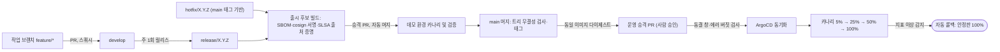

# 분야 편 20: 인프라·배포

- **맡는 정본**: [docs/infra.md](../../infra.md)(배포 구성, 환경, 가용성, 백업·재해 복구, 런북 목차, 비용), [docs/devops.md](../../devops.md)(저장소, CI, 공급망, 승격, 워크로드별 배포, 데이터 변경, 변경 동결, 사람의 접근), [docs/infra-handover.md](../../infra-handover.md)(인프라·관제팀 인수 문서). 결정 기록은 §5에 모았다.
- **규범이 아니다**: 정본을 풀어 쓴 해설이다. 숫자와 규칙이 정본과 다르면 정본이 맞다([ADR-0177](../../adr/0177-walkthrough-explain-in-interview.md)). 운영·스테이징은 띄우지 않고 설계와 코드로만 둔다([ADR-0057](../../adr/0057-verification-without-full-scale-infra.md)). 기반 PoC는 PC 한 대에서 쟀다([ADR-0176](../../adr/0176-foundation-poc-results.md), 숫자는 '실측(PC)'이고 운영 규모 증거가 아니다). 성능·복구 숫자는 설계 목표값이고 `[실측 전]`이다.
- **한 판 문서와의 관계**: [한 판 문서](../01-system-design.md)의 11단계(입구 경로, 서비스 디스커버리와 메시), 12단계(오픈 전 프리워밍과 동결 창), 16단계(장애 시나리오, 리전 장애)가 이 편의 일부를 설명한다. 2·15·18단계도 연계된다. 이 편은 한 판 문서가 다루지 않은 CI 파이프라인, 소프트웨어 공급망, 환경 승격, 동결 달력, 정비 시간, 사람의 운영 접근을 상세히 다룬다.

## 1. 이 문서가 정하는 것

세 문서는 PEAKET 시스템이 어떤 클라우드 토폴로지 위에 배치되고, 코드가 어떤 검증 경로를 거쳐 운영 환경으로 승격되며, 인프라 장애 발생 시 시스템과 운영 조직이 어떻게 대처하는지를 정한다.

> **30초 설명**: "운영 설계는 AWS 서울 리전 1개와 3개 AZ(가용 영역) 기반입니다. AZ 장애 발생 시 Aurora는 RPO 0·RTO 5분, Redis는 RTO 30초 내에 자동 장애 조치(Failover)됩니다. 반면 리전 전체 장애 시에는 값비싼 액티브-액티브를 배제하고 즉시 판매를 일시 중단한 뒤, 도쿄 보조 클러스터 원장 보존과 Terraform 재구축을 통해 24시간 내 복구(RTO 24시간)합니다. 현장 입장은 스캐너의 PWA ECDSA 오프라인 판정으로 지속됩니다. 코드는 모노레포에서 SLSA Build L3 기반 CI 검증을 거친 불변 다이제스트 컨테이너 이미지만 승격시키며, ArgoCD GitOps 카나리(5%→25%→50%→100%)로 배포합니다. 특히 대형 온세일 오픈 전후 150분(T-90분~T+60분) 동안은 프로덕션 변경 동결(Change Freeze) 창을 강제합니다."

### 4대 핵심 아키텍처 모듈

1. **Multi-AZ 인프라 토폴로지 및 격리 구조**:
   - AWS 서울 리전 3개 AZ에 걸쳐 EKS 노드 풀을 5개로 분리(핫패스, 일반, 관제·시스템, 관측, 데이터)하여 온세일 폭주가 관제 및 데이터 저장 계층으로 전파되는 것을 물리적으로 차단합니다.
   - 데이터 저장소는 도메인 결합도와 장애 격리를 기준으로 Aurora 5개 클러스터, ElastiCache Valkey(Redis) 3개 클러스터, MSK(Kafka) 3개 클러스터로 엄격히 분리 배치합니다.
2. **온세일 T-40분 프리워밍 및 오토스케일링**:
   - 판매 오픈(T=0) 시 급증하는 트래픽에 맞춰 반응형 확장은 지연(EC2 노드 기동 2~4분, JVM/Node 웜업 30초)으로 실패하므로, T-40분에 Karpenter 사전 스케일링(노드 사전 프로비저닝)과 캐시/DB 연결 풀 예열을 실행합니다.
   - T-30분에 관제 자동 진단(Go/No-Go 판정)을 수행하여 인프라 준비 상태를 확정합니다.
3. **CloudFront 7개 배포 및 WAF 격리 정책**:
   - 단일 배포의 기본 요청 한도(25만 RPS, 150 Gbps) 병목 및 장애 전파를 막기 위해 도메인/트래픽 특성별 7개 CloudFront 배포로 분할합니다.
   - 정적 캐시가 99.8%를 흡수하는 대기열 파일 배포(`queue-files`)에는 불필요한 과금과 IP 오탐을 유발하는 WAF를 배제하고 한도 사용률 알림과 Origin Shield로 보호합니다.
4. **GitOps 배포 파이프라인과 변경 동결(Change Freeze) 창**:
   - `develop` 브랜치에서 빌드·서명된 단일 컨테이너 이미지 다이제스트를 데모 카나리 검증 후 `main` 태그 승격을 통해 프로덕션에 무변경 배포합니다.
   - 장애의 70%가 변경에서 비롯된다는 원칙에 따라, 대형·중형 온세일은 T-90분~T+60분 동안 운영 승격을 차단하고 T-45분에 미완료 카나리를 강제 중단합니다.

## 2. 절마다 읽기

| 정본 절 | 무엇을 정하나 | 왜 | 해설서에서 |
| --- | --- | --- | --- |
| docs/infra.md §1 배포 구성도 | 엣지 → NLB(연결을 서버들에 나눠 주는 AWS 장치) 셋 → 게이트웨이 다섯 → 노드 풀(같은 용도의 서버 묶음) 다섯, Aurora 다섯·ElastiCache 셋·MSK(AWS가 운영하는 Kafka) 셋 | 저장소를 나눈 근거는 처리량이 아니라 장애 격리·비밀 범위·재해 복구 차이라, 합치거나 더 나누는 일은 잰 값이 조건을 넘을 때만 한다 | 한 판 11단계 |
| docs/infra.md §2 데이터 흐름도(DFD)와 신뢰 경계 | 경계 0~5, 스캐너 API(F1)·결제사 웹훅(F2), 개인정보가 경계를 넘을 때의 통제 | 경계마다 다른 통제를 두려면 무엇이 어디서 넘는지 먼저 그려야 한다 | — |
| docs/infra.md §3 환경 분리 | 로컬·스테이징·데모·운영, 계정 없는 AWS 흉내 서버 moto, 로컬 kind 클러스터 | 운영·스테이징을 늘 켜면 지출 상한을 넘어 코드로만 두고 측정은 로컬에서 한다(ADR-0057) | 한 판 18단계(일부) |
| docs/infra.md §4 구성 요소별 가용성·이중화 | 구성 요소마다 이중화, 장애 때 동작, 근거와 검증 | 자동으로 넘기는 동안 무엇을 잃고 누가 마지막을 지키는지(DB 유니크 제약, 세대 번호)를 미리 적는다 | 한 판 12·16단계 |
| docs/infra.md §4.1 CloudFront 배포와 한도 | 배포 일곱과 한도를 올리는 셋, 호스트, 캐시 정책, 원본 요청 헤더, 단계 배포, 사용률 경보 | 배포 하나의 기본 한도(초당 25만 건)를 공연 페이지 피크(30만) 하나로도 넘는다 | 한 판 2단계(일부) |
| docs/infra.md §5 프리워밍과 오토스케일 | T-40분 예약 확장, 노드·캐시 예열, 오픈 뒤 확장 신호, T-30분 Go/No-Go, 끝난 뒤 회수 | 새 노드 부팅이 확장 지연의 대부분이라 반응해서 늘리면 늦다 | 한 판 12단계 |
| docs/infra.md §6 백업·DR | 저장소별 RPO(잃어도 되는 시간 폭)·RTO(복구까지 걸려도 되는 시간)·백업, 리전 재해 절차, 도쿄 보조 클러스터 | 리전 장애는 드물고 자동 전환은 비싸며 Redis 상태는 옮길 수 없어 판매를 멈추고 다시 세운다 | 한 판 15·16단계 |
| docs/infra.md §7 CI/CD | devops.md의 요약 그림과 연결 고리 | 정본은 devops.md다 | — |
| docs/infra.md §8 서비스 디스커버리, 무중단 배포, 리더 선출 | Service 이름, 메시(서비스 사이 통신을 앱 대신 맡는 층)의 요청 단위 분산, preStop(종료 직전 대기)·PDB(동시에 내려도 되는 파드 수 상한), admission-ctrl의 Lease 리더 | 따로 두는 서비스 레지스트리는 운영할 것만 늘리고(ADR-0010), 중앙 내부 게이트웨이는 단일 장애 지점과 병목이 된다. 리더가 둘이 되는 일은 세대 번호로 막는다 | 한 판 11단계(일부) |
| docs/infra.md §9 보안 구성 | 엣지·관제 입구·DNS·헤더·네트워크·저장소 인증·비밀·인증서·공급망·감사·비상 런북, 배포별 WAF 규칙표 | 사람과 봇은 사람 확인 서비스 Turnstile과 trust-svc가 가르고 WAF(웹 방화벽)는 값싼 규칙으로 큰 덩어리만 거른다 | — |
| docs/infra.md §10 런북 목차 | RB-01~RB-41, 원인 유형별 첫 런북 색인, Game Day(일부러 장애를 내고 연습하는 날) 33종의 자리 | 경보마다 따라 할 절차와 연습을 미리 정한다. 절차 파일은 아직 없다(wbs 4.7.1) | — |
| docs/infra.md §11 비용 통제 | 비용 태그·OpenCost(쿠버네티스 비용 측정 도구), Infracost(Terraform 변경의 비용 차이 계산), 상시 데모 없음, WAF 요금, 상시 기본 비용 어림표 | 온세일 1회 비용과 상시 비용을 나눠 보고 줄일 때 잃는 것을 함께 적는다 | — |
| docs/devops.md §1 범위와 원칙 | 맡는 영역 표, 원칙 아홉 | 작게 자주, 한 번 만든 산출물, Git에 선언, 온세일 중 변경 멈춤, 1인 운영의 한계 기록 | — |
| docs/devops.md §2 저장소와 브랜치 | 저장소 둘(공개 `peaket`, 비공개 `peaket-bots`), 설계 문서 공개 범위, git flow, 버전·태그, 강제 장치 | GitHub 무료 등급은 공개 저장소에만 규칙 세트·출처 증명을 준다. 봇 코드는 공개하지 않는다(POL-026) | — |
| docs/devops.md §2.2.4 병합 결과 트리 검사 | `main` 병합 결과의 트리가 출시 후보 트리와 같은지 병합 전후에 본다 | `main`에 새 병합 커밋이 생겨 SHA가 달라도, 내용이 같아야 검증한 이미지를 다시 빌드 없이 올린다 | — |
| docs/devops.md §3 CI | `ci.yml` 하나가 바뀐 범위만 고름, 재사용 워크플로, 유형별 필수 검사, 시험 배치 | 경로 필터로 건너뛴 필수 검사는 '대기'로 남아 병합을 막는다 | — |
| docs/devops.md §4 공급망 보안 | SBOM(소프트웨어 부품 목록)·cosign 키 없는 서명·SLSA 출처 증명, Kyverno 입장 검사, pnpm 설정, 취약점 기한, CI 자체 보안 | 빌드 코드가 서명 신원을 꺼내지 못하게 빌드 잡과 게시 잡을 나눈다 | — |
| docs/devops.md §5 환경과 승격 | 환경별 배포 경로, `deploy/` 구조와 네임스페이스 지도, 승격 흐름, 설정 세 종류 | 같은 다이제스트(이미지 내용의 해시)만 올려 검증한 것과 운영에 가는 것을 같게 한다 | — |
| docs/devops.md §6 배포 전략 | 워크로드별 전략, 카나리 단계와 실패 조건, 되돌리기 규칙 | 리더 1대, 오래 열린 연결, Kafka 소비자에는 일반 카나리가 맞지 않는다 | — |
| docs/devops.md §7 데이터 변경 관리 | 앞으로만, N-1 호환(실행 중인 옛 판과도 맞음), 확장 → 이전 → 축소, PreSync(동기화 직전 작업) 마이그레이션 잡, 잠금 대기 제한, 백필 | 카나리와 되돌리기 동안 옛 판과 새 판이 같은 DB를 쓴다 | — |
| docs/devops.md §8 변경 동결과 정비 시간 | 규모별 동결 창, 동결 달력, 정비 시간과 관리형 유지보수 창, 긴급 변경, 배포 가능 시간 | 장애의 약 70%가 변경에서 나온다는 구글 관찰. 오픈 시각이 회차마다 달라 달력이 창을 만든다 | 한 판 12단계(한 줄), 분야 편 3(POL-028) |
| docs/devops.md §9 인프라 코드와 플랫폼 수명주기 | `infra/` 구조와 상태, 계정 넷, plan·apply·드리프트(코드와 실제의 어긋남), 판 올리기 | 상태를 구성 요소마다 나눠 간섭을 막는다. EKS 연장 지원은 표준의 6배 값이다 | — |
| docs/devops.md §10 사람의 접근과 감사 | 역할별 권한, 긴급 접근, 비상 접근 계정, 운영 DB 직접 접근, 감사 기록 | 사람의 상시 쓰기 권한 없이 GitOps로만 바꾼다. 예외 경로는 쓰는 순간 경보가 울린다 | — |
| docs/devops.md §11 비용 상한 장치 | 예산 경보, 이상 탐지, 측정 자원 TTL(살려 두는 시간), 시작 전 비용 확인 | 지출 상한(총 5만 원) 안에서 측정 자원을 켜 둔 채 잊지 않게 한다 | — |
| docs/devops.md §12 변경 위험 관리와 운영 준비 | 변경 종류 셋(POL-041), 운영 준비 검토(PRR), RB-23~RB-29, G-18~G-20 | 무거운 외부 승인은 변경 실패율을 낮추지 않는다(DORA) | — |
| docs/devops.md §13 전달 지표(DORA 5종) | 지표 정의와 산출, 데모 기준 표시 | 지표를 목표로 삼으면 왜곡되어 추세만 본다 | — |
| docs/devops.md §14 시험 포인트 | D-T1~D-T48 | 규칙마다 무엇이 막히면 통과인지 적는다 | — |
| docs/devops.md §15 알려진 한계 | 1인 승인, 평시 카나리, 증명의 범위, 외부 의존, 운영 미가동 등 | 대신하는 장치와 지표를 함께 적는다 | — |
| docs/devops.md §16 참고 자료(2026-10-13 열람) | DORA, SRE Book, AWS, GitHub, SLSA 등 | 외부 사실의 출처다 | — |
| docs/infra-handover.md §1 한눈에 | 리전·AZ, 입구, 노드 풀, 저장소, 장애 대응 기본, 읽는 순서 | 처음 받는 팀이 한 장으로 전체를 잡게 한다 | — |
| docs/infra-handover.md §2 이중화 구성도 | AZ별 배치, Redis·Aurora·MSK·ClickHouse·NAT 배치 규칙 | AZ 하나가 멈춰도 모든 클러스터가 한꺼번에 전환되지 않게 흩는다. NAT가 하나면 결제 호출이 끊긴다 | — |
| docs/infra-handover.md §3 구성 요소별 사양·가용성·네트워크·저장 | 노드 풀 사양, 저장소 표(초기 사양 `[가정]`), 입구·네트워크, 가용성 등급 넷 | 측정으로 바꿀 초기 추정이다. 등급은 새 목표가 아니라 '멈추면 무엇이 멈추나'의 분류다 | 한 판 15단계(저장소 목록) |
| docs/infra-handover.md §4 데이터 흐름도(DFD) | 요청·저장·외부 연동 그림, 서비스별 저장소 표, 관제·관측 흐름 | infra.md §2를 운영 관점으로 넓혔다 | — |
| docs/infra-handover.md §5 장애 대응 실행 계획 | 역할과 연락, 장애별 실행표(신호·자동 동작·사람이 할 일·목표·시험), 도쿄 전환 준비물 | 저절로 일어나는 일과 사람이 할 일을 나눠야 당직이 망설이지 않는다 | 한 판 16단계 |
| docs/infra-handover.md §6 데이터 위치와 변경 권한 | 데이터 지도, 키 관리 권한 | 무엇이 어디 있고 누가 바꾸는지 한 표에 둔다 | — |
| docs/infra-handover.md §7 처음 볼 곳(당직 시작 페이지) | 경보, 오픈 당일, 콘솔·관측 불능, 권한, 끝난 뒤의 첫 행동 | 당직이 처음 펼 한 쪽이다 | — |
| docs/infra-handover.md §8 대시보드 목록 | 화면마다 목적·보는 사람·때·내용 | 첫 줄을 네 신호(지연·트래픽·오류·포화도)로 통일한다 | — |
| docs/infra-handover.md §9 남은 결정과 다음에 고칠 곳 | 서버 사양, PgBouncer(DB 연결 풀) 풀 크기, 런북 파일, 외부 연락처, AZ 장애 시험 | 정하지 않은 것을 작업 번호에 묶어 둔다 | — |

## 3. 꼭 기억할 규칙과 숫자

| 항목 | 값 | 표시 | 정본 위치 |
| --- | --- | --- | --- |
| 배치 | 서울 리전 1, AZ 3. 도쿄에는 ticket DB 보조 클러스터(조회 서비스 없음), 백업 사본, 전환 준비물(KMS 다중 리전 키, ECR 복제 이미지, 다중 리전 비밀, 결제사 등록 NAT 고정 IP)만 | 확정 | infra §1 |
| 노드 풀 | 핫패스·일반·관제(EKS 관리형 노드 그룹)·관측·데이터 (총 5개 풀) | 확정 | infra §1·§4 |
| 저장소 수 | Aurora 5, ElastiCache Valkey(Redis 호환 엔진) 3, MSK 3(거래·제어, 텔레메트리, 관측 전용) | 확정 | infra §1 |
| AZ 장애 복구 | Aurora RPO 0·RTO 5분, Redis RTO 30초(복제 지연 수백 ms 유실 가능), MSK RPO 0 | 목표, `[실측 전]` | infra §6, NFR-015 |
| 리전 장애 복구 | RTO 24시간. 주문·결제 RPO 24시간(일 스냅샷 + 결제사 거래 대사), 티켓 원장 RPO 약 1초 | 목표, `[실측 전]` | infra §6 |
| CloudFront 한도 | 기본 초당 25만 건·150 Gbps. 공연 페이지 → 45만, 대기열 파일 → 27만, 대기열 API → 30만(설계 피크의 1.5배) | `[가정]` | infra §4.1 |
| 입구 수 | CloudFront 배포 7개, WAF 웹 ACL 3개(대기열 파일에는 없음), NLB 3개(팬·파트너 원본, 관제 원본, 스캐너) | 확정 | infra §4.1·§9 |
| 게이트웨이 여유 | 대형 온세일 때 '필요 복제 × 1.5'를 AZ 셋에 고르게 배치. 상시 2배는 두지 않음 | `[가정]` | infra §4·§5 |
| 프리워밍과 점검 | T-40분 예약 확장(노드·캐시 예열), T-30분 Go/No-Go 판정, T-20분까지 미회복 시 입장 일시정지 오픈 | `[가정]`(T-40분) | infra §5, RB-02 |
| 백업 정책 | Aurora 시점 복구(PITR) 35일, 교차 리전 스냅샷 사본 7일, 스냅샷 26시간 초과 부재 시 SEV2 | `[가정]`(7일·26시간) | infra §6 |
| Kafka 토폴로지 | 거래·제어 브로커 6대(AZ마다 2대), 복제 3, `min.insync.replicas=2`, `acks=all`, 3.9.x, 보존 7일 | `[가정]`(6대) | infra §4·§6 |
| 비용 통제 | 운영 설계 상시 월 약 1만 3,822달러. 미가동 자원: 상시 데모(월 약 133달러 절감), 도쿄 파일럿 라이트(월 약 250달러 절감) | `[추정]` | infra §6·§11, devops §11 |
| 온세일 윈도우 | T-10분~T+60분(70분간 티켓팅 집중 운영) | 확정 | POL-028 |
| 변경 동결 창 | 대형·중형: T-90분~T+60분 전체 운영 변경 동결, T-45분 자동 중단. 소형: T-50분~T+60분 핫패스 동결, T-15분 자동 중단 | 확정 | devops §8.1 |
| 정비 시간 | 매일 04:00~06:00(KST). Aurora 수요일 04:00~04:30, ElastiCache 수요일 04:00~05:00 | `[가정]` | devops §8.3 |
| 카나리 배포 | 5% → 25% → 50% → 100%, 단계별 메트릭 분석 5분, 상한 40분 | `[가정]` | devops §6.2 |
| 자동 롤백 | 롤백 결정부터 이전 안정판 100% 복구까지 5분 이내(단계별 예산 합 4.5분) | `[가정]`, `[실측 전]` | devops §6.7 |
| 릴리스 주기 | 주 1회 브랜치 컷, 3영업일 내 마무리, 데모 환경 체류 1시간, PR CI 검사 10분 이내 | `[가정]` | devops §2.2·§3.4·§5.3 |
| 취약점 조치 기한 | Critical 7일, High 30일, Medium 90일. 기한 초과 시 운영 승격 자동 차단 | 확정 | devops §4.4, POL-041 |
| 사람의 운영 접근 | 긴급 접근: MFA·1시간 세션 제한·수행 즉시 SEV2 인시던트 선언. 비상 접근 계정(Break-glass): 로그인 즉시 SEV1 | 확정 | devops §10.2 |
| 목록 규모 | 런북 RB-01~RB-41, Game Day 33종, 인프라/배포 시험 D-T1~D-T48 | 확정 | infra §10, devops §14 |

## 4. 이 문서가 다루는 ID

| ID | 한 줄 요약 |
| --- | --- |
| NFR-001 | 대기열 진입. T=0 피크 20만 RPS에서 p99 200ms 이하 |
| NFR-002 | 대기 상태 전파. 동시 대기 100만 명에서 임박 대기자에게 차례 반영 p99 2초 이하 |
| NFR-007 | 공연 페이지. 피크 30만 RPS에서 TTFB p99 150ms 이하 |
| NFR-008 | 관제 운영 명령. 접수 p95 500ms 미만, 가용성 99.9% 이상 |
| NFR-009 | 관제 지표 반영. 초당 이벤트 3만 건에서 관제 실시간 표 반영 p95 5초 미만 |
| NFR-011 | 기본 SLO. 일반 REST API p95 500ms 미만, 가용성 99.9%(28일) |
| NFR-014 | 온세일 윈도우(70분)는 공연별 에러 버짓, 상시 기능은 28일 99.9% |
| NFR-015 | 복구 목표. AZ 장애 시 Aurora RPO 0·RTO 5분, Redis RTO 30초 |
| NFR-016 | 보안. ASVS 5.0.0 레벨 2 판정, CI/CD 내 보안 검사 |
| NFR-017 | 감사 로그. 운영 명령 불변 기록, 관리자 접속기록 2년·권한 변경 이력 3년 이상 보존 |
| NFR-021 | 확장성. 200만 동시 대기 시 병목 문서화, 겹치는 판매의 합산 상한 관리 |
| NFR-023 | 운영. 장애 탐지 60초, 급증 후 노드 사전 확보 시 용량 대응 60초 미만, 48시간 내 포스트모템 |
| NFR-025 | 정합성 불변식. 차례 전 입장 0건 등 불변식 위반 1건이라도 발생 시 카나리 즉시 롤백 |
| NFR-027 | 장시간 운영 시험. 6시간 부하 시험 중 리소스 누수 및 재시작 0건 검증 |
| POL-022 | 인시던트 관리. SEV1~SEV3 선언 기준 및 에러 버짓 소진 시 배포 자동 잠금 |
| POL-026 | 시험·윤리. 합성 봇은 격리 환경에서만 실행, 봇 코드는 비공개, 운영 데이터 복사 엄금 |
| POL-028 | 온세일 윈도우(T-10m~T+60m) 운영 제약 및 규모별 변경 동결 창 정의 |
| POL-030 | 온세일 단계 정의. T-40분 인프라 프리워밍 및 T-30분 사전 점검 절차 |
| POL-041 | 변경 관리 및 배포. 표준·일반·긴급 변경 분류 및 보안 취약점 조치 기한 강제 |
| FR-029 | 관제 대시보드 온세일 단계별 화면. T-30분 사전 점검 및 T=0 상태 표시 |
| FR-064 | 관리 계정 접속기록 및 대량 다운로드 정기 감사(RB-21 연계) |
| SCR-029 | 관제 대시보드 화면(T-30분, T=0, 판매 중, 종료 후, 입장 탭) |
| SCR-053 | 스캐너 기기 관리 화면(분실 시 키 즉시 폐기, RB-22 연계) |
| SCR-059 | 시스템 안내 화면. 서비스 점검 및 판매 일시 중단 안내 |

## 5. 아키텍처 결정과 트레이드오프

### [ADR-0054](../../adr/0054-delivery-pipeline-change-freeze-and-safe-deploys.md) 온세일 변경 동결 창과 안전한 배포 파이프라인

- **선택한 구조**:
  - 빌드와 승격의 분리: 동일 이미지 다이제스트만 승격, 사람의 수동 개입 대신 자동화된 카나리 지표 분석 사용.
  - 온세일 변경 동결(Change Freeze): 오픈 일정을 추적하는 동결 달력을 통해 대형/중형 온세일 T-90분~T+60분 간 배포 차단.
  - 무중단 스키마 마이그레이션: N-1 호환성을 보장하는 Expand-Migrate-Contract 패턴 준수.
- **기각된 대안**:
  - *ArgoCD 고정 Cron 동결 창*: 공연마다 오픈 시각이 가변적이므로 고정 시간 창은 실효성이 없고, 관리형 유지보수나 키 교체를 방어하지 못함.
  - *모든 온세일에 T-90~T+60 전체 동결*: 3년 차 소형 온세일(연 4,500회) 적용 시 하루 대부분이 동결되어 배포가 심야로 몰리고 릴리스 배치가 비대화됨.
  - *동결 창 내 핫픽스 허용*: 핫픽스 코드가 온세일 피크 트래픽을 시험 대상으로 삼게 되어 장애 위험이 극대화됨.
  - *모든 서비스 블루/그린 배포*: 핫패스 자원이 상시 2배 필요하며, 단일 리더 및 WebSocket 장기 연결 워크로드에는 부적합함.
  - *운영 DB 스키마 롤백(Down) 지원*: 새 버전이 쓴 데이터 유실 및 N-1 앱과의 비호환 발생.

### [ADR-0031](../../adr/0031-environments-and-region-dr.md)·[ADR-0152](../../adr/0152-ops-bundle-approval-paging-region-dr-slack-residency.md) 4대 환경 분리와 콜드 리전 DR 전략

- **선택한 구조**:
  - 로컬(kind), 스테이징, 데모, 운영 환경 분리.
  - AZ 장애는 Multi-AZ 자동 Failover로 RPO 0·RTO 5분 내 복구.
  - 리전 전체 장애 시 Active-Active를 배제하고 즉각 판매 일시 중단 후 도쿄 리전에 Terraform으로 인프라를 재구축하여 24시간 내 복구(RTO 24시간).
  - 티켓 원장은 Aurora Global Database 보조 클러스터(도쿄)를 통해 RPO 약 1초 수준으로 보존. 주문/결제는 일일 스냅샷 복원 후 결제사 원장과의 1:1 대사로 정합성 보정.
- **기각된 대안**:
  - *리전 간 액티브-액티브(Active-Active)*: 분산 합의 왕복 지연으로 좌석 홀드 p99 지연이 급증하고 상시 인프라 비용이 3배 이상 폭증함.
  - *Aurora Global Database 자동 장애 조치*: 수천 달러의 상시 복제 비용이 발생하나 Redis 세션 및 대기열 상태는 이전되지 않아 세션 단절이 불가피함.
  - *도쿄 파일럿 라이트(상시 소형 환경)*: 연 1회 미만의 드문 리전 장애 대비 월 약 250달러의 유휴 비용이 지속 발생함.

### [ADR-0058](../../adr/0058-cdn-distributions-quotas-and-shuffle-fetch-spread.md)·[ADR-0144](../../adr/0144-edge-load-balancer-shared-fate-separation-and-failure-response.md) 엣지 CDN 및 로드 밸런서 분리

- **선택한 구조**:
  - 7개 특화 CloudFront 배포 분리 및 피크 트래픽 대비 한도 상향(공연 페이지 45만, 대기열 파일 27만, 대기열 API 30만 RPS).
  - 3개 독립 NLB 구성으로 팬 트래픽 폭주가 관제 콘솔 및 현장 검표 스캐너 입구를 차단하지 않도록 완전 격리.
- **기각된 대안**:
  - *단일 CloudFront 배포 및 단일 한도 상향*: 특정 엔드포인트의 트래픽 폭주나 구성 오류가 전사 서비스로 전파되는 운명 공유(Shared Fate) 발생.
  - *멀티 CDN(듀얼 CDN) 도입*: CDN 간 엣지 함수, 캐시 무효화, WAF 규칙, TLS 인증서를 이중 관리해야 하는 복잡도 대비 실익 미미.
  - *NLB 자동 AZ 제외(Cross-Zone 제거)*: 온세일 트래픽 폭증 중 일시적 지연으로 특정 AZ가 자동 제외되면 남은 AZ 노드가 즉시 과부하로 연쇄 붕괴됨. 수동 개입(RB-13)으로 한정.

### [ADR-0074](../../adr/0074-git-flow-branching-release-and-hotfix.md) Git Flow 브랜치 전략

- **선택한 구조**: 영구 브랜치 `main`(운영 배포 및 태그)과 `develop`(개발 통합) 분리. 릴리스 브랜치(`release/*`)를 통해 릴리스 후보 빌드, SBOM 생성, cosign 서명, 출처 증명을 수행하고 데모 환경 검증 후 머지.
- **트레이드오프**: DORA 메트릭(트렁크 기반 개발, 짧은 리드타임) 관점의 이상향과 달리 주 1회 릴리스 대기 시간(최대 1주 + 3영업일)이 발생함을 명시적으로 수용함.

## 6. 기술 면접 5단계 방어 질문

### Level 1: 기본 인프라 토폴로지 및 AZ 장애 극복
- **Q**: "PEAKET의 기본 배포 토폴로지와 단일 AZ 장애 발생 시 동작 방식은 무엇인가요?"
- **A**: "AWS 서울 리전 내 3개 AZ에 EKS 노드 풀 5개와 데이터 저장소 클러스터를 분산 배치했습니다. 단일 AZ가 완전 중단되는 경우, Aurora PostgreSQL은 감시 프로세스를 통해 RPO 0, RTO 5분 이내에 생존 AZ의 읽기 전용 복제본을 마스터로 자동 승격합니다. Redis(ElastiCache Valkey)는 마스터-레플리카 페일오버를 통해 RTO 30초 내에 절체되며, 수백 ms의 비동기 복제 미반영 데이터 유실 가능성은 DB 유니크 제약과 비즈니스 멱등성으로 방어합니다. MSK 브로커는 3개 AZ에 걸쳐 6대를 운영하며 `min.insync.replicas=2`로 무중단 쓰기를 유지합니다."

### Level 2: 온세일 프리워밍과 오토스케일 지연
- **Q**: "오픈 시각(T=0)에 20만 RPS가 몰리는데, 왜 리액티브 HPA/Karpenter에만 의존하지 않고 T-40분 프리워밍을 하나요?"
- **A**: "EC2 인스턴스가 프로비저닝되고, 컨테이너 이미지를 풀링하며, 파드가 기동되어 Readiness Probe를 통과하기까지 통상 2~4분이 소요됩니다. T=0에 20만 RPS가 유입되는 순간 스케일아웃을 시작하면 이미 수만 건의 504 Gateway Timeout과 연결 거부가 발생합니다. 따라서 T-40분에 예약 확장을 트리거하여 Karpenter로 노드 풀을 사전 확보하고, 파드 복제본을 목표 용량의 1.5배로 전개하며, Redis 및 DB 커넥션 풀을 미리 연결해 두는 프리워밍을 강제합니다. T-30분에는 사전 점검(Go/No-Go)을 거쳐 미준비 시 오픈을 연기합니다."

### Level 3: CloudFront 한도 분할과 WAF 미부착 근거
- **Q**: "CloudFront 배포를 7개로 쪼갠 이유와, 대기열 파일 배포에는 WAF를 붙이지 않은 근거는 무엇인가요?"
- **A**: "CloudFront 단일 배포의 기본 요청 한도는 25만 RPS입니다. 공연 상세 페이지 피크 30만, 대기열 진입 20만 RPS가 한 배포에 몰리면 엣지 계층에서 스로틀링이 일어납니다. 또한 장애 격리를 위해 티켓팅 핫패스, 정적 자산, 관제 콘솔을 분리했습니다. 특히 대기열 폴링 파일(`queue-files`)은 인증이 없고 순수하게 CDN 캐시에서 99.8% 이상 소화되는 정적 파일입니다. 1회 온세일당 2.3억 건이 발생하는 이 요청에 WAF 웹 ACL을 붙이면 수천 달러의 WAF 비용이 발생하고 통신사 NAT 공용 IP에 대한 오차단이 발생하므로, WAF 대신 Origin Shield와 임계치 경보로 원본 서버를 보호합니다."

### Level 4: GitOps 카나리 배포와 무중단 스키마 마이그레이션
- **Q**: "새 버전을 배포할 때 DB 스키마가 변경되는 경우, 카나리 배포 중 구버전과의 호환성은 어떻게 유지하나요?"
- **A**: "Expand-Migrate-Contract 패턴을 엄격히 준수합니다. 1단계(Expand)에서는 새 컬럼을 NULL 허용으로 추가하여 구버전(N-1) 앱의 쿼리가 깨지지 않도록 합니다. 2단계(Migrate)에서 백필 작업과 함께 신규 버전 앱을 카나리(5%→25%→50%→100%)로 배포하여 두 컬럼에 이중 쓰기 및 점진적 읽기 전환을 수행합니다. 3단계(Contract)는 배포가 완전히 안정화되고 롤백 가능성이 소멸된 7일 뒤에 구 컬럼을 삭제합니다. 이 구조 덕분에 카나리 실패 시 DB 스키마 롤백 없이 신규 컨테이너만 즉시 이전 안정판 100%로 되돌릴 수 있습니다."

### Level 5: 리전 단위 재해 복구(DR) 트레이드오프
- **Q**: "서울 리전이 완전 마비되었을 때 액티브-액티브 대신 24시간 RTO의 콜드 복구를 택한 이유는 무엇인가요?"
- **A**: "서울-도쿄 간 액티브-액티브는 분산 트랜잭션 왕복 지연(수십 ms)으로 인해 1초당 수천 건의 좌석 선점을 처리해야 하는 티켓팅 핫패스의 지연 시간 목표(p99 50ms)를 물리적으로 충족할 수 없으며, 상시 인프라 비용이 3배 이상 증가합니다. 또한 Redis의 대기열/홀드 메모리 상태는 리전 간 실시간 동기화가 불가능하여 어차피 세션 단절이 발생합니다. 따라서 리전 마비 시 판매를 즉시 중단하고 안내 화면을 띄운 뒤, 도쿄 보조 클러스터에 복제된 티켓 원장(RPO ~1s)을 분리 승격하고 Terraform으로 24시간 내에 서비스를 재구축하는 콜드 DR이 비용 대비 현실적이며 정합성을 온전히 지키는 엔지니어링 선택입니다."

## 7. 설계 경계와 위임

| 이 문서에서 정하지 않는 영역 | 실제 정의 정본 |
| --- | --- |
| 서비스별 세부 SLO 수치, 분산 추적 샘플링, Game Day 33종 본문 | [docs/observability.md](../../observability.md) |
| 관제 긴급 명령 카탈로그 및 2인 승인 절차 | [docs/features/control-tower.md](../../features/control-tower.md) |
| KMS 암호화 키 목록, 시크릿 교체 주기 및 권한 분리 | [docs/security/secrets-and-keys.md](../../security/secrets-and-keys.md) |
| CI/CD 및 인프라 공급망에 대한 ASVS 검증 판정표 | [docs/security/asvs/delivery.md](../../security/asvs/delivery.md) |
| 신뢰 경계별 위협 모델링 및 STRIDE 분석 | [docs/security/threat-model.md](../../security/threat-model.md) |
| 개인정보 보호 등급(P1~P3) 및 국외 이전 목록 | [docs/security/data-classification.md](../../security/data-classification.md) |
| 서비스 도메인 경계 및 gRPC 통신 규약 | [docs/architecture.md](../../architecture.md) §3·§5 |
| DB 테이블 스키마, 파티셔닝 및 Redis 키 보존 정책 | [docs/data.md](../../data.md) |
| Kafka 토픽 분할, 파티션 키 및 컨슈머 그룹 설계 | [docs/streaming.md](../../streaming.md) |

## 8. 실전 확인 문제

1. **대형 온세일 오픈 시각이 20:00(KST)이다. 변경 동결 창, 진행 중인 롤아웃 강제 중단 시각, 사전 점검 시각은 각각 언제인가? 동결 창 내에 머지된 hotfix 브랜치는 어떻게 처리되는가?**
   

정답 확인

   대형 온세일 변경 동결 창은 T-90분부터 T+60분까지이므로 **18:30 ~ 21:00**이다. 진행 중인 롤아웃은 T-45분인 **19:15**에 `freeze-guard`에 의해 자동 강제 중단되며, T-30분인 **19:30**에 Go/No-Go 사전 점검이 수행된다. 핫픽스 브랜치(`hotfix/*`)는 `main` 브랜치 머지와 Git 태그 생성까지는 허용되지만, 운영 승격 PR은 동결 게이트에 의해 차단되어 21:00 이후에만 배포될 수 있다.
   

2. **공연 당일 서울 리전 전체에 장애가 발생했다. 판매, 현장 검표, 티켓 원장, 주문/결제 원장은 각각 어떻게 복구되는가?**
   

정답 확인

   판매는 즉시 중단되며 외부 Upptime 상태 페이지와 정적 점검 화면으로 안내된다. 현장 검표는 도쿄에 API가 없으므로 스캐너의 PWA ECDSA 로컬 오프라인 검증만으로 입장을 지속한다. 티켓 원장은 도쿄의 Aurora Global Database 보조 클러스터(RPO 약 1초)를 수동으로 독립 클러스터로 승격하여 보존한다. 주문/결제 원장은 일일 스냅샷(RPO 24시간)으로 복원 후 결제 대행사(PG)의 거래 원장과 1:1 대사하여 사후 보정한다.
   

3. **운영 중인 DB 테이블의 컬럼명을 변경해야 한다. 무중단 배포를 위해 거쳐야 하는 3단계 배포 절차와 롤백 전략은 무엇인가?**
   

정답 확인

   Expand-Migrate-Contract 3단계를 거친다. 1) Expand: 새 컬럼을 NULL 허용으로 추가하고 구버전 앱이 신규 컬럼 유무와 무관하게 동작함을 보장한다. 2) Migrate: 신규 버전 앱을 배포하여 양쪽 컬럼에 이중 쓰기를 수행하고 백필 잡을 실행한다. 3) Contract: 이전 버전 트래픽이 완전히 사라지고 안정화된 후 구 컬럼을 삭제한다. 카나리 중단 시에는 스키마 롤백 없이 신규 버전 컨테이너만 즉시 이전 안정판으로 롤백한다.
   

## 9. 문서 간 정합성 검토 항목

| 항목 | 기존 서술 또는 불일치 내용 | 정합성 검토 및 최종 규격 |
| --- | --- | --- |
| EKS 노드 풀 개수 | 일부 문서에서 '관측 전용 풀까지 5개'로 표기되어 분류 혼선 존재 | 핫패스, 일반, 관제·시스템, 관측, 데이터 등 명확히 5개 풀로 정의 완료 (ADR-0102 반영) |
| GitOps 저장소 브랜치 전략 | `peaket-gitops` 단독 저장소 분리안이 잔존 | 공개 모노레포 `peaket` 내 `deploy/` 경로를 ArgoCD가 `develop` 브랜치 기준으로 추적 (ADR-0169 반영) |
| 소형 온세일 변경 동결 범위 | 소형 온세일 핫패스 동결 대상에서 웹 푸시 서비스 워커 누락 | 웹 푸시 서비스 워커를 소형 온세일 핫패스 동결 컴포넌트에 정식 포함 (POL-028 정합화) |
| 로컬 쿠버네티스 환경 도구 | 표 일부에서 kind와 k3d 혼용 서술 | 로컬 재현 환경을 kind v0.33.0으로 공식 통일 및 확정 (infra §3 정합화) |
