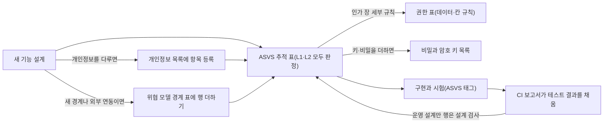

# 분야 편 21: 보안

- **기준 시점**: ADR-0177까지, 2026-11-01. 2026-11-03에 v0 베이스라인 점검표를 더하고 ASVS 합계를 다시 셌다
- **맡는 정본**: [docs/security/threat-model.md](../../security/threat-model.md)(위협 모델), [docs/security/authz-matrix.md](../../security/authz-matrix.md)(권한 표), [docs/security/data-classification.md](../../security/data-classification.md)(개인정보 목록), [docs/security/secrets-and-keys.md](../../security/secrets-and-keys.md)(비밀과 암호 키 목록), [docs/security/auth-controls.md](../../security/auth-controls.md)(인증 통제), [docs/security/internal-management-plan.md](../../security/internal-management-plan.md)(내부 관리계획), docs/security/asvs/ 아래 기능별 ASVS 추적 표 17편(검증 도구 편은 2026-11-02에 더함)과 v0 베이스라인 추적 표(2026-11-02 작성), [docs/architecture.md](../../architecture.md) §8 '품질·보안 절차', 보안 ADR(§5)
- **규범이 아니다**: 정본을 풀어 쓴 해설이다. 숫자와 규칙이 정본과 다르면 정본이 맞다([ADR-0177](../../adr/0177-walkthrough-explain-in-interview.md)).
- **한 판 문서와의 관계**: [한 판 문서](../01-system-design.md)에 보안 문서를 직접 다루는 단계는 없다. 11단계(서비스를 나누는 기준의 '보안 경계', 게이트웨이의 토큰 확인, 메시), 13단계(멈춤 1인·재개 2인), 14단계(스캐너 기기 키)가 일부를 짧게 든다.
- **측정 전이다**: ASVS 추적 표의 '테스트 결과'는 한 줄(부분 통과)을 빼면 모두 '미실행'이고, 미적용 행은 '—'다. 정본의 `[가정]`·`[추정]`은 그대로 옮겼다.

## 1. 이 문서가 정하는 것

보안 정본은 "어디서 무엇을 막고, 무엇이 남는가"를 일곱 가지 문서로 나눠 적는다. 위협 모델은 신뢰 경계(믿는 정도가 다른 두 구역 사이의 선)마다 STRIDE 여섯 갈래(위장·변조·부인·정보 노출·서비스 거부·권한 상승)로 위협, 대응 위치, 남는 위험을 적는다. 권한 표는 누가 어떤 데이터와 칸(필드)에 닿는지, 그 검사를 게이트웨이(클라이언트 종류별 입구 서버)·서비스·DB 가운데 어디서 하는지 정한다. 개인정보 목록은 항목마다 보호 등급(P1~P3), 암호화, 보존 기간, 법률 판단을 적고 국외 이전 목록의 정본이다. 비밀과 암호 키 목록은 비밀과 키 약 75개의 보관 위치, 쓰는 주체, 교체 주기, 쓸 수 있는 곳을 정한다. 인증 통제는 비밀번호로 로그인하는 관리 계정의 크리덴셜 스터핑(다른 사이트에서 샌 아이디·비밀번호를 대입하는 공격) 방어, 잠금, 비밀번호 금칙어를 정한다. 내부 관리계획은 「개인정보의 안전성 확보조치 기준」(이하 고시) 제4조가 요구하는 계획의 설계본이다. ASVS 추적 표는 OWASP(웹 보안 기준을 만드는 비영리 단체)의 웹 앱 보안 검증 항목 목록 ASVS 5.0.0에서 L1·L2 항목을 기능마다 모두 판정한 기록이다. docs/architecture.md §8은 이 문서들을 언제 쓰는지와 OWASP Top 10:2025 대응을 정한다.

> **30초 설명**: "보안은 문서 일곱 가지로 나눠 둡니다. 위협 모델이 사용자 기기부터 결제사 같은 외부까지 신뢰 경계마다 여섯 갈래 위협을 어디서 막고 무엇이 남는지 적습니다. 권한은 기본 거부입니다. 게이트웨이는 토큰의 대상과 범위만 보고, 서비스가 요청마다 역할을 판정한 뒤 소유자·테넌트·상태·시간을 보며, 파트너 표는 DB의 행 보안 정책이 한 번 더 거릅니다. 비밀은 Secrets Manager와 KMS에 두고 키마다 쓰는 곳과 교체 주기를 정했습니다. 기능을 만들기 전에 ASVS 5.0.0 레벨 2 항목을 모두 판정하는 추적 표를 먼저 쓰고, 시험 이름의 ASVS 태그로 CI가 결과를 채웁니다. 17편에서 1,927개 항목을 판정했지만 시험은 아직 거의 돌지 않았습니다."

## 2. 절마다 읽기

**여섯 문서와 docs/architecture.md §8**: 개인정보 목록과 키 목록은 절 번호가 없어 제목을 그대로 적었다.

| 정본 절 | 무엇을 정하나 | 왜 | 해설서에서 |
| --- | --- | --- | --- |
| docs/security/threat-model.md §1 경계 지도 | 경계 0~5(사용자 기기, 엣지, 게이트웨이, 서비스 메시, 데이터 저장소, 외부), 전달 경로, 사람의 운영 접근, 부정 거래 조사 갈래 | 데이터가 경계를 넘는 곳마다 공격을 빠짐없이 보려는 것이다 | — |
| docs/security/threat-model.md §2 경계 0: 사용자 기기 | 쿠키·입장 토큰 탈취, 대기표 조작, HTML `style` 속성 위장, 외부 스크립트, 봇 폭주, IDOR(남의 ID를 넣어 보는 공격) | 기기는 믿지 않고 모든 입력을 서버가 다시 본다. XSS(화면에 스크립트를 끼워 넣는 공격)가 성공하면 그 화면 안 요청은 남는다고 적는다 | — |
| docs/security/threat-model.md §3 경계 1: 엣지 | 원본 직접 호출, DNS 위조, 웹 캐시 기만, 공개 텔레메트리 `/_t/*` | 원본에 공인 주소가 없고 CDN(사용자 가까이에서 대신 응답하는 전송망) CloudFront 연결만 받는다. DNSSEC(이름 풀이 응답에 서명하는 방식)를 쓰지 않는 것은 v1의 받아들인 위험이다(ADR-0144) | — |
| docs/security/threat-model.md §4 경계 2: 게이트웨이 | 위조·다른 대상 토큰, 관리 로그인 대입, 허용 IP 위장, 내부 헤더 주입 | 게이트웨이마다 자기 대상의 키만 믿고, 바깥 헤더는 지우고 토큰 값으로 다시 쓴다 | — |
| docs/security/threat-model.md §5 경계 3: 서비스 메시(내부) | 서비스 위장, 메시 안 변조, 운영자 부인, 로그의 개인정보 | 메시 전체 STRICT mTLS(양쪽이 인증서를 확인하는 암호 통신, ADR-0082). 명령은 감사 체인으로 고치면 드러난다 | 한 판 11단계(메시만) |
| docs/security/threat-model.md §6 경계 4: 데이터 저장소 | 저장소 비밀번호 탈취, 원장 직접 수정, 열람 부인, 백업 유출 | 사람이 운영 DB에 직접 쓰는 길이 없다. 긴급 조회는 SSM(SSH 없이 서버에 붙는 AWS 기능)과 pgAudit(DB 세션의 조회·변경을 남기는 기록 기능) 기록으로만 한다 | — |
| docs/security/threat-model.md §7 경계 5: 외부 | 결제사 웹훅 위조, 웹 푸시 키 유출, 결제창 복귀 값 변조, 금액 다툼 | 우리 통제 밖이라 받은 결과를 서명이나 조회 API로 다시 확인한다 | — |
| docs/security/threat-model.md §8 전달 경로 | 빌드 중 토큰 탈취, CI(코드를 올릴 때마다 자동으로 검사·빌드하는 과정) 캐시 오염, 액션 바꿔치기, 비밀 커밋 | 서명은 저장소 코드를 돌리지 않는 게시 잡만 한다. 서명과 출처 증명이 맞는 산출물만 들인다 | — |
| docs/security/threat-model.md §9 사람의 운영 접근 | 관리 도구, 쿠버네티스 API, SSM, 긴급·비상 접근 | 전달 경로와 공격 면이 달라 표를 나눴다(ADR-0147). 사람에게 늘 주어진 쓰기 권한이 없다 | — |
| docs/security/threat-model.md §10 핵심 비밀과 교체 일정 | 새면 피해가 큰 비밀 15묶음과 이어지는 위협 | ASVS 13.1.4(위협 모델에 따라 비밀 교체 일정을 문서로)의 근거다. 주기의 정본은 키 목록이다 | — |
| docs/security/threat-model.md §11 부정 거래 조사 갈래 | 조사 사본이 Kafka(사건을 쌓아 두고 나눠 주는 메시지 시스템)로 가는 길, 조사 저장소·화면, 승인자 우회, 두 갈래 연결, 증거 변조, 팬 쪽 경로(§11.1~§11.6) | 실명 계정과 원문 IP가 모이는 길이라 가장 좁게 믿는다. 연구 갈래(가명정보)와 이으면 재식별 금지(개인정보 보호법 제28조의5)에 걸린다 | 분야 편 17(기능 쪽) |
| docs/security/authz-matrix.md §1 이 문서가 맡는 것 | ASVS 8.1.1·8.1.2가 요구하는 데이터·칸 단위 규칙. 기능 권한은 docs/planning/03 §3 | ASVS가 인가 규칙을 문서에 두라고 한다. 원문에 없어 전체가 `[보완]`이다 | — |
| docs/security/authz-matrix.md §2 기본 원칙 | 기본 거부, 신원 값은 세션에서만, 두 번 검사, 비공개 자원은 없는 것처럼 404 | 게이트웨이는 DB를 보지 않아(ADR-0008) 자원 검사는 서비스 몫이다. 버튼 숨기기는 통제로 세지 않는다 | — |
| docs/security/authz-matrix.md §3 데이터 단위 규칙 | 본인 데이터, 파트너 테넌트(`자원.promoter_id = 요청 테넌트`), 스태프 배정 회차, 상태, 시간, 지정된 사람 | 판정 식을 조회 조건으로 쓴다. 테넌트(파트너 회사 같은 소속 단위)는 요청마다 identity에서 받은 값만 믿는다(ADR-0172) | 분야 편 17(지정만) |
| docs/security/authz-matrix.md §4 칸 단위 규칙 | 역할마다 보이는·가리는 칸, 서버만 정하는 칸, 가린 값을 여는 절차 | 허용한 칸 밖은 400이다. 원문 열람은 사유와 접속기록을 남긴다 | 분야 편 12(§4.1만) |
| docs/security/authz-matrix.md §5 검사 위치 | 엣지·게이트웨이·서비스·DB·화면이 보는 것, 권한 변경의 반영 | 게이트웨이는 대상과 `scope`만 보고 서비스의 `RolesGuard`가 요청마다 역할을 본다(5초 `[가정]` 캐시) | 분야 편 8(역할 판정) |
| docs/security/authz-matrix.md §5.3 DB | 파트너 테넌트 표에 행 보안 정책(RLS: DB가 행마다 누가 볼지 거르는 규칙) | 조회 계층이 1차, RLS가 2차다. 쿼리 하나에서 조건이 빠져도 남의 행이 나오지 않게 한다 | — |
| docs/security/authz-matrix.md §5.5 작업별 허용 역할 칸 `x-peaket-roles` | 허용 역할 값 12종의 정본 | 모든 작업에 두고 doc-check `roles` 검사로 막는 것은 소유자 결정이다 | 분야 편 7 |
| docs/security/authz-matrix.md §6 재인증·2인 승인과의 묶음 | 위험 작업마다 재인증 요소와 승인 인원. §6.1은 관리 계정 관리 경로 | 서버가 요청자 ≠ 승인자와 지금 역할을 본다. 멈춤 1인, 재개 2인이다(ADR-0095) | 한 판 13단계(승인 방향만) |
| docs/security/authz-matrix.md §7 테스트 포인트 | AZ-T1~AZ-T16 | 테넌트 넘기, 값 꾸미기, DB 깊이 방어, 권한 변경 반영을 시험으로 판정한다 | — |
| docs/security/authz-matrix.md §8 남는 위험 | 메시 없는 실행의 헤더 꾸미기, 캐시 5초의 옛 역할, RLS를 건너뛰는 일괄 작업 사용자 | 막지 못하는 것을 숨기지 않고 적는다 | — |
| docs/security/authz-matrix.md §9 미결정·[가정] | 역할 클레임 삭제 기록, 가드 시험 생성기(wbs 3.6.1), RLS 비용 측정 | RLS가 파트너 요청 p95를 10% `[가정]` 넘게 늘리면 조회 계층만 두는 안으로 돌아간다 | — |
| docs/security/data-classification.md '보호 등급 분류 체계' | P1 인증·연계 기밀, P2 일반 개인정보, P3 공개 식별자와 등급별 통제 | 고시 제7조의 저장 암호화 의무는 7가지와 인증정보다. 이름·연락처는 의무가 아니지만 위험 분석으로 볼륨 암호화를 켠다 | — |
| docs/security/data-classification.md '개인정보 상세 목록' | 약 110행: 수집 시점, 등급, 보호 방식, 보존 기간, 근거 | 새 기능은 코드보다 먼저 여기에 등록한다(ASVS 14.1.1·14.1.2) | — |
| docs/security/data-classification.md '수집하거나 저장하지 않는 항목' | 주민등록번호, 카드 번호·CVC, 계좌번호 등 11행 | 법 근거가 없거나(제24조의2) 결제사 화면·API로 바로 넘기기 때문이다 | — |
| docs/security/data-classification.md '백업 보존 상한과 파기' | 저장소별 백업 상한과 복원 뒤 파기 다시 적용 | 지운 정보도 백업에는 남는다. 파기 감사 로그를 복원 대상과 다른 곳에 둔다(기술 검토 중간-070) | — |
| docs/security/data-classification.md '국외 이전 목록' | 국-01~국-10과 지점별 근거·보호조치 | 처리방침의 국외 이전 절을 이 표에서 만든다(ADR-0139) | — |
| docs/security/data-classification.md '처리방침 문구 초안: 부정 예매 조사' | SCR-057에 올릴 문구 초안 | 게시 전에는 조사 갈래를 운영에서 켜지 않는다. 자문을 받지 않은 초안이다 | 분야 편 17 |
| docs/security/data-classification.md '이익형량 기록: 부정 예매 조사' | 목적 셋마다 이익과 정보주체 권리를 저울질한 기록 | 근거가 제15조 제1항 제6호(정당한 이익) 하나라 목적마다 따져 남긴다(ADR-0173) | 분야 편 17 |
| docs/security/data-classification.md '법률 확인 및 해석 결과' | 질문 37개와 결론. 다른 문서가 '법률 #20'처럼 번호로 인용한다 | 확인되지 않은 해석은 단정하지 않고 '확인 필요'·'해석'으로 나눈다(POL-027) | — |
| docs/security/secrets-and-keys.md '관리 규칙' | 9개: 보관 위치, 묶음·로그에 비밀 금지, gitleaks, NIST 수명주기, 온세일 교체 금지, 분기 대조, 키 권한 | ASVS 11.1·13.3을 따른다. 커밋된 비밀은 노출로 보고 바꾼다(RB-26) | — |
| docs/security/secrets-and-keys.md '비밀과 암호 키 상세 목록' | 약 75행: 용도, 알고리즘, 보관, 쓰는 주체, 교체 | 이 목록이 암호 목록이다. 키를 바꾸는 ADR·PR은 같은 변경에서 고친다 | 분야 편 8·11·13·15(그 기능의 키) |
| docs/security/secrets-and-keys.md '표준 대조와 편차' | NIST SP 800-57 표 1과 대조, 정기 교체 없는 키 8종의 이유와 보완 통제 | 표보다 길게 쓰는 키는 위험을 따로 적으라는 표준을 따른다 | — |
| docs/security/secrets-and-keys.md '`inv-ref-key` 회전 절차' | 조사용 가명 키를 라벨마다 바꾸는 8단계 | 기기 가명은 원문이 브라우저에만 있어 30일 이음 기간에 두 판을 함께 구한다(ADR-0171) | — |
| docs/security/secrets-and-keys.md '키 사용 범위' | 키 묶음 21개마다 쓸 수 있는 곳과 없는 곳 | ASVS 11.1.2. 한 키를 여러 용도로 쓰면 한 곳이 뚫릴 때 다른 곳도 뚫린다 | — |
| docs/security/auth-controls.md §1 범위: 누가 무엇으로 로그인하는가 | 관리 계정에만 건다. 팬은 소셜 로그인, 현장 스태프는 비밀번호가 없다 | 팬 비밀번호를 저장하지 않아 대입 차단은 소셜 제공자가 한다 | 분야 편 8 |
| docs/security/auth-controls.md §2 크리덴셜 스터핑 방어 | 층 C1~C8, 계정 유무 숨기기, 사람 확인을 거는 때 | 계정마다 한두 번만 넣어 계정 잠금에 거의 걸리지 않는다. 출발지 계수·비밀번호 대조·2단계·전체 경보를 함께 둔다 | 분야 편 8 |
| docs/security/auth-controls.md §3 관리 계정 로그인 잠금 규칙 | 세는 값, 시간·묶음·보호 잠금, 본인 해제, 알림, 비밀번호를 바꾸게 하는 경우 | 고시는 횟수를 정하지 않아 스스로 정한다(법률 #8). 운영자를 기다리지 않게 본인 해제를 둔다 | 분야 편 8 |
| docs/security/auth-controls.md §4 비밀번호 금칙어 목록과 대조 방식 | 목록 L1~L5, 대조용 사본 셋, 유출 비밀번호 범위 조회 | '맥락 말과 쉬운 덧붙임만으로 된 비밀번호'를 막는다. 목록을 넓히면 정상 비밀번호만 막힌다 | — |
| docs/security/auth-controls.md §5 설정값 | 설정 25개와 허용 범위 | 배포 설정에 두고 명령으로 바꾸지 않는다. 공격 중에 기준을 느슨하게 못 바꾸게 한다 | 분야 편 8(값 몇 개) |
| docs/security/auth-controls.md §6 테스트 포인트 | identity 시험에 더하는 시험 | 시험 이름에 ASVS 태그를 붙인다 | — |
| docs/security/auth-controls.md §7 미결정·[가정] | `[가정]` 값과 흔한 비밀번호 목록 출처는 wbs 3.5.1에서 정한다 | 운영 데이터를 보고 계수와 속도 규칙을 함께 맞춘다 | — |
| docs/security/internal-management-plan.md §1 범위와 사람 | 대상, 사람 구분, 2026-11-01부터 달라지는 조문 | 개정 고시가 대상을 '정당한 권한을 가진 자'로 넓혀 파트너 계정도 들어온다 | — |
| docs/security/internal-management-plan.md §2 제4조 제1항 각 호의 계획 | 18개 호마다 계획·구현 위치·채울 칸, 역할별 책임, 조사관 지정 | 기술 통제의 정본은 설계 문서에 두고 계획은 그 위치를 가리킨다 | 분야 편 3(18개 호의 존재만) |
| docs/security/internal-management-plan.md §3 교육(제4조 제2항) | 다섯 과정 | 고시가 차등한 정기 교육을 요구한다 | — |
| docs/security/internal-management-plan.md §4 접속기록 점검(제8조 제2항) | 대상·주기, 매일 이상 탐지 규칙, 점검 순서, 사후조치, 보고 | 2026-11-01부터 주기를 계획이 정한다. 계획은 월 1회다(ADR-0158) | 분야 편 16(기능 쪽) |
| docs/security/internal-management-plan.md §5 파기와 분리 보관 | 5일 안 파기, 복원 불가능한 삭제, 분리 보관 | 표준 개인정보 보호지침 제10조가 5일을 정한다 | — |
| docs/security/internal-management-plan.md §6 수립·변경·승인과 수정 이력 | 승인 절차, 중요한 변경 6종, 이력 | 고시가 '내부 의사결정 절차'를 요구해 문서를 쓴 것만으로는 수립이 아니다 | — |
| docs/security/internal-management-plan.md §7 이행 실태 점검 | 해마다 1회, 첫 점검은 운영 시작 뒤 6개월 `[가정]` 안 | 고시가 연 1회 이상을 요구한다 | — |
| docs/security/internal-management-plan.md §8 운영 전에 채울 칸 | 사람, 허용 IP, 근무 일정 칸 | 모두 비어 있다. 채우고 승인해야 시행한다 | — |
| docs/security/internal-management-plan.md §9 법 판단 모음 | 판단마다 확인됨·확인 필요·해석 | 조문 밖 판단을 조문과 섞지 않는다 | — |
| docs/security/internal-management-plan.md §10 알려진 한계 | 1인이라 사람을 나눌 수 없음, 돌아 본 적 없는 절차, `[가정]` 수치 | 견제가 사람이 다르다는 데 기대기 때문이다 | — |
| docs/security/internal-management-plan.md §11 참고 원문 | 국가법령정보센터에서 받은 원문 목록 | 대조 출처를 남긴다 | — |
| docs/architecture.md §8.1 글로벌 준수 기준 | ISO/IEC 25010 등, OWASP Top 10:2025, ASVS v5.0.0(기본 L2), SLSA, 국내 법률 | 기준마다 충족 내용과 증명 방법을 1:1로 둬야 완료로 판정한다 | — |
| docs/architecture.md §8.1 'OWASP Top 10:2025 항목별 대응' | A01~A10마다 정본의 장치와 ASVS 장 | Top 10은 넓게 덮는 최소 기준선이고 추상적이라, 세부 검증은 ASVS L2로 한다 | — |
| docs/architecture.md §8.2 기능 개발 절차: 보안 요구사항 추적 파이프라인 | 구현 전 판정, 표 7칸, 미적용 사유 4분류, 결과 자동 연동, 법률 행 | 구현 전에 요구를 정하고, 손으로 적은 '통과'를 막으려는 것이다 | — |
| docs/architecture.md §8.3 공통 보안 기본 원칙 | 관리자 비밀번호 PBKDF2(일부러 느리게 만든 비밀번호 해시), 필드별 암호화, 비밀 하드코딩 금지, 전송 암호화, SQL 바인딩 | 원칙마다 구현과 근거를 짝짓는다. bcrypt는 72바이트에서 잘려 뺐다(ADR-0033) | 분야 편 8(해시만) |
| docs/architecture.md §8.4~§8.6 다른 개발 절차 | 운영 확인 표, git flow, 정본 기준 개발 절차(ADR-0178) | 보안 밖이다. 추적 표를 먼저 쓴다는 순서만 든다 | — |

**기능별 ASVS 추적 표 17편**: 숫자는 각 표 '요약'의 값이다(L1·L2는 판정 대상 수, L3는 골라 채택한 수, 법률은 법률 행 수). 대표 행은 그 표의 성격을 보여 주는 것을 골랐다.

| 정본 절 | 무엇을 정하나 | 왜(대표 행) | 해설서에서 |
| --- | --- | --- | --- |
| docs/security/asvs/auth.md 계정·인증 | 팬 소셜 로그인·탈퇴, 관리자 로그인과 MFA, 세션. L1·L2 149, L3 3, 법률 17 | 미적용 27건은 모두 '해당 없음'이고 자체 인가 서버가 없어 V10만 21건이다. 법률 행에 고시 제6조 제2항(외부 접속 다중 인증)이 있다 | 기능은 분야 편 8 |
| docs/security/asvs/queue-admission.md 대기열·입장 토큰과 소지 증명 | 대기표·입장 토큰, 도착 시각 쿠키, 셔플 비콘, 소지 증명. L1·L2 55, L3 2, 법률 1 | L3 11.2.4(암호 연산을 상수 시간으로), 15.4.2(확인과 동작을 원자적으로) | 기능은 분야 편 9 |
| docs/security/asvs/seat-hold.md 좌석 | 스냅샷, 홀드 Lua, 판매 확정, 좌석 델타, 좌석맵 가져오기. L1·L2 143, L3 5, 법률 0 | L3로 동시성 절 15.4.1~15.4.4와 위험 구성 요소 격리 15.2.5(`seatmap-worker`). 판정 중 찾은 빈틈은 ADR-0159로 막았다 | 기능은 분야 편 10 |
| docs/security/asvs/payment.md 주문·결제 | 결제 시도, 결제창, 승인·취소·환불, 결제사 웹훅. L1·L2 85, L3 4, 법률 4 | L3 2.3.5(고가치 흐름의 다인 승인). 법률 행은 전자상거래법 시행령 제6조(결제 기록 5년) | 기능은 분야 편 11 |
| docs/security/asvs/transfer-refund.md 양도·취소·환불 | 양도, 예매 취소, 회차 취소와 일괄 환불, 배상, 승인 업무. L1·L2 123, L3 3, 법률 9 | 법률 행에 전자상거래법 제18조(환급 3영업일), 개인정보 보호법 제37조의2(자동화된 결정) | 기능은 분야 편 12 |
| docs/security/asvs/settlement.md 정산 지급 | 정산서, 지급대행 등록, 정산 계좌, 지급과 대사. L1·L2 148, L3 5, 법률 4 | L3 1.2.10(CSV 수식 삽입 막기). 법률 행은 전자금융거래법 제2조 제19호(중개에 딸린 정산 대행 제외) | 기능은 분야 편 12 |
| docs/security/asvs/offline-gate.md 현장 입장 | 스캐너 등록, 스태프 로그인, 오프라인 판정, 부스 재발급, 회전 QR. L1·L2 170, L3 5, 법률 6 | 항목 수와 부분 적용(7건)이 가장 많다. L3 10.3.5·10.4.14(보낸 사람에 묶인 토큰. 기본안은 기기 키로 요청마다 서명한 증명 DPoP, 선택지는 mTLS) | 기능은 분야 편 13 |
| docs/security/asvs/bot-defense.md 봇 방어 | 사람 확인, 위험 점수, 허니팟, 그림자 실행. V2.1~V2.4·V3·V16과 6.1.1만. L1·L2 30, L3 2, 법률 4 | 관련 절만 판정해 30건 모두 적용이다. 법률 행은 공연법 제4조의2 제2항(매크로 부정구매 방지 의무) | 기능은 분야 편 14 |
| docs/security/asvs/notify.md 알림·찜·오픈 알림 | 알림 신청, 웹 푸시 구독, 발송 원장, 파트너 웹훅. L1·L2 148, L3 6, 법률 4 | L3 4.1.5(메시지마다 서명). 법률 행은 정보통신망법 제50조(광고성 정보의 사전 동의) | 기능은 분야 편 15 |
| docs/security/asvs/catalog-review.md 탐색·후기·홈 구성 | 홈과 홈 구성, 검색, 공연 상세, 후기와 신고, 이미지. L1·L2 108, L3 8, 법률 14 | L3 1.3.12(ReDoS 막기), 5.2.6(픽셀 폭주 막기). 법률 행은 공연법 시행령 제3조의3(신고 기능, 24시간 안 차단) | 기능은 분야 편 15 |
| docs/security/asvs/control-tower.md 관제 콘솔 | 운영 명령, 법정 조치, 보안 사고, 접속기록 점검. L1·L2 157, L3 4, 법률 6 | L3 2.3.5, 8.4.2(관리 화면의 여러 겹 확인). 법률 행은 정보통신망법 제48조의3(침해사고 24시간 신고) | 기능은 분야 편 16 |
| docs/security/asvs/analytics.md 분석 저장소 | 원본 적재와 가명 처리, 변환과 마감, 리포트. L1·L2 157, L3 4, 법률 5 | L3 8.3.3(원래 요청한 주체의 권한으로 판정). 법률 행은 개인정보 보호법 제3조 제7항(익명·가명 처리)과 가명정보 조항(제28조의2·제28조의4·제28조의5)이다 | 기능은 분야 편 17 |
| docs/security/asvs/forensic-replay.md 사후 포렌식 | 포렌식 리플레이와 부정 거래 조사. L1·L2 157, L3 10, 법률 12 | 법률 행에 제15조 제1항 제6호(정당한 이익), 제37조의2, 약관규제법이 있다 | 기능은 분야 편 17 |
| docs/security/asvs/frontend.md 웹 클라이언트 공통 | 화면 앱 넷의 공통 통제. L1·L2 112, L3 11, 법률 1 | L3가 가장 많다: 3.4.7(CSP, 곧 화면이 실행할 스크립트의 출처를 정하는 브라우저 규칙의 위반 보고), 3.6.1(SRI, 외부 자원 무결성 해시), 15.2.4(의존성 혼동) | 기능은 분야 편 6 |
| docs/security/asvs/delivery.md 전달 파이프라인과 운영 플랫폼 | CI, 공급망, GitOps(배포 상태를 저장소에 적고 클러스터를 그대로 맞추는 방식), 배포, 운영 접근. L1·L2 70, L3 7, 법률 3 | L3 13.1.4(위협 모델에 따른 비밀 교체). 17편에서 유일한 시험 기록(13.2.1 부분 통과)이 여기 있다 | — |
| docs/security/asvs/support.md 고객 문의 | 문의하기, 내 문의, 문의 상세. L1·L2 99, L3 2, 법률 4 | 법률 행은 전자상거래법 제20조 제3항(3영업일 경과·10영업일 결과 통지) | — |
| docs/security/asvs/verification-tools.md 검증 도구 | 불변식 검사기, PG 시뮬레이터(결제사를 흉내 내는 시험용 서버), 시뮬레이터 어댑터. L1·L2 17(적용 15, 나중 Phase로 미룸 2), L3 1, 법률 0 | 운영에 배포하지 않는 시험 도구라 주입·업무 로직·HTTP 응답·권한·설정·데이터 보호·로그 장(V1·V2·V4·V8·V13·V14·V16)의 해당 행만 판정한다. 시뮬레이터는 `sim_sk_`로 시작하는 키만 받고 `PEAKET_ENV`가 없거나 `prod`면 시작하지 않는다(13.3.1·13.4.2). L3 14.2.6(불변식에 필요한 칸만 읽기). 미룬 2건은 운영 대조를 배포할 때 더할 로그(16.2.1·16.4.1)다 | 기능은 분야 편 22 |

**v0 베이스라인 추적 표**(2026-11-02 작성. 2026-11-03에 v0 배포 입구 행 여덟을 더하고 넷을 다시 판정): 기능 표가 아니라 비교용 단순한 첫 판(v0)의 추적 표라 위 17편과 그 합계에 넣지 않았다. v0는 K1~K10을 지금 설계(v1)와 견주는 비교 기준선이고, 로컬과 부하 시험에서만 돌며 시험 계정만 다룬다.

| 정본 절 | 무엇을 정하나 | 왜(대표 행) | 해설서에서 |
| --- | --- | --- | --- |
| docs/security/asvs/v0-baseline.md v0 모놀리스 | 대기열·좌석·결제·발권 v0 모듈(`queue`·`inventory`·`booking`·`payment`·`ticket`)과 v0 배포의 입구 `gateway`(TLS를 끝내고 내부 신원 머리를 지운 뒤 액세스 토큰을 검증하며 IP마다 요청 수를 제한한다). '요약'은 판정한 L1·L2 31건(적용 29, 부분 적용 1, 나중 Phase로 미룸 1)이고 선별 L3·법률 행은 없다. '추적 표' 한 장에 31행을 둔다. 판정한 장은 주입·업무 로직·HTTP 응답·권한·설정·데이터 보호·로그(V1·V2·V4·V8·V13·V14·V16)에, 좌석맵 화면과 변경분 연결의 V3·V4.4, 티켓 코드 난수의 V11, 입구의 토큰(V9)·TLS(V12)를 더한 것이다 | 부분 적용 2.3.3(작업이 전부 되거나 전부 되돌아감)은 결제 확정 전체가 동기 결제 체인이라 트랜잭션 하나가 아니어서다. 이것이 K7의 v0 한계이고 v1 주문 Saga(wbs 2.7)에서 다시 판정한다. 미룬 4.4.3(WebSocket 전용 토큰)은 변경분 연결을 게이트웨이 신원 머리로만 판정하기 때문이다. 2.4.1의 입구 한도는 IP마다 토큰 버킷(초당 10개 채움, 최대 20개 `[가정]`)뿐이라 IP를 바꾸는 봇은 지나가고 IP를 나눠 쓰는 사람은 함께 막힌다(K6의 v0 한계). 테스트 결과는 모두 '미실행'이다 | 한 판 4단계, 기능은 분야 편 9·10·11·13 |

**ASVS 추적 표를 읽는 법**: 열일곱 편은 같은 틀이다.

- **머리**: 대상 기능 범위, 보안 검증 기준(ASVS 5.0.0, 목표 Level 2, 판정한 장), 아키텍처 설계 근거(ADR 목록), 작성·판독 가이드(구현 위치에 쓰는 서비스·모듈 이름의 뜻).
- **요약**: 판정 대상 수, 적용·부분 적용·미적용 수, 선별 채택 L3 수, 법률 행 수, '운영 설계만' 행 수.
- **장별 표**: `ASVS ID | 레벨 | 요구사항 요약 | 적용 여부 | 구현 위치 | 테스트 결과 | 미적용 사유` 7칸이다. ID는 `v5.0.0-8.2.2`처럼 판 번호를 붙인다. 구현 위치는 '예정 위치'이고 기능 설계서의 절과 시험 ID(예: S-T24)를 가리킨다. 테스트 결과는 CI가 시험 이름의 `[ASVS v5.0.0-x.y.z]` 태그를 읽어 채운다.
- **선별 채택 L3와 법률 요구사항**: L3 표의 끝 칸은 대개 '채택 이유'다(analytics·payment는 '미적용 사유' 칸 이름을 그대로 두고, auth·bot-defense는 L3 행을 장별 표 안에 둔다). 법률 표는 조항과 요구를 ASVS 행과 한 문서에 둔다.
- **레벨**: 레벨의 일반 정의는 정본에 없다. 정본에서 읽을 수 있는 것은 목표가 L2이고, L1·L2는 모두 판정하며, L3는 그 기능의 위험에 맞는 것만 이유를 적어 고른다는 것이다. 요구사항 요약 안에 'L2부터는 모든 입력'(2.2.1), 'L3는 HSM 같은 하드웨어 기반 도구'(13.3.1)처럼 레벨마다 강도가 다르다는 문장이 있다.
- **찾는 법**: 기능을 정해 그 표를 열고, 장(V1 인코딩, V8 인가, V11 암호, V16 로그)에서 ID로 찾는다. 인가 장은 세부 규칙을 권한 표로 옮겼다고 적는 일이 많으니 권한 표의 그 절로 넘어간다.

## 3. 꼭 기억할 규칙과 숫자

| 항목 | 값 | 표시 | 정본 위치 |
| --- | --- | --- | --- |
| ASVS 판정 규모 | 17편 합계 L1·L2 1,928건(적용 1,638, 부분 적용 26, 미적용 264), L3 82건, 법률 행 94, 운영 설계만 16(2026-11-03 다시 셈). v0 베이스라인 표의 L1·L2 31건(적용 29, 부분 적용 1, 미룸 1)은 따로다 | 각 표 '요약'의 합 | docs/security/asvs/*.md |
| 시험 결과 | 통과 기록은 delivery 13.2.1의 부분 통과 한 줄(2026-11-01)뿐이고 나머지는 '미실행'(미적용 행은 '—') | 실측 전 | asvs/delivery.md |
| 미적용 사유 분류 | 해당 없음, 외부 IdP 위임, 나중 Phase로 미룸, 위험 수용(ADR 링크 필수) | 확정 | docs/architecture.md §8.2 |
| 취약점 조치 기한 | 치명 7일, 높음 30일. 넘긴 High 이상이 있으면 운영 승격을 막는다. DAST(돌아가는 서비스를 밖에서 공격해 보는 검사) 야간 점검 High 이상 0건 | 확정 | docs/architecture.md §8.1, POL-041, NFR-016 |
| 관리자 비밀번호 해시 | PBKDF2-HMAC-SHA256 600,000회 이상, 솔트 16바이트, KMS(암호 키를 보관하고 대신 계산해 주는 AWS 서비스) HMAC 페퍼(DB 밖에 둔 비밀 키로 한 번 더 거는 값, 관리 계정 ID 결합) | 확정 | docs/architecture.md §8.3 |
| 비밀번호 길이 | 최소 15자, 최대 256자(허용 범위 64 이상) | 15는 POL-020, 256은 `[가정]` | auth-controls §5 |
| 관리 로그인 실패 | 3이면 사람 확인, 5면 시간 잠금 15분(24시간 안 다시면 1시간), 2단계 실패 5면 보호 잠금, 연속 실패 누계 100이면 보호 잠금(50에서 알림) | 5는 내부 관리계획 값, 나머지 `[가정]` | auth-controls §3·§5 |
| 출발지·전체 계수 | 한 IP에서 1시간에 서로 다른 이메일 5개 실패면 1시간 사람 확인. 전체 실패 5분 100건이나 7일 같은 시간대 평균의 10배면 SEV3(장애 심각도 등급, 숫자가 작을수록 심각하다). 웹 ACL 로그인 경로 5분 50회 | `[가정]` | auth-controls §2.1·§5 |
| 해제 링크·확인 코드 | 해제 링크 32바이트 난수 30분. 스태프 확인 코드는 문자 20개 8자, 5분, 10분에 5번 | 30분은 `[가정]`, 맞힐 확률 약 2 × 10^-10은 `[추정]` | auth-controls §3.3·§3.6 |
| 역할 판정 | 요청마다 identity에 묻고 5초 캐시, 위험 작업은 캐시 없이, 답이 없고 캐시에도 없으면 503 `authz-unavailable`. 허용 역할 값 12종 | 5초는 `[가정]` | authz-matrix §5.2·§5.5 |
| 토큰 서명 키 | 팬 액세스·관리·현장 스태프·입장 토큰 서명 키와 대기표 서명 키는 90일마다 교체 | 확정(추천 적용) | secrets-and-keys |
| 그 밖의 교체 주기 | 로그 가명 키 30일, 관리자 페퍼 키 2년 안, KMS 자동 교체 365일, 저장소 서비스 사용자 비밀번호 30일 교대 교체 | 확정(추천 적용) | secrets-and-keys, threat-model §6 |
| 교체를 피하는 때 | 온세일 윈도우(오픈 10분 전~60분 뒤)와 변경 동결 창(대형·중형 오픈 90분 전부터). 자동 교체는 정비 시간 04:00~06:00 KST | 정비 시간은 `[가정, Phase 4 운영 리허설에서 확정]` | secrets-and-keys 관리 규칙 6 |
| KMS 키 끄기·삭제 | 긴급 접근 역할 + commander 한 명, 삭제 대기 30일, CloudTrail 이벤트는 SEV2 | 확정 | secrets-and-keys 관리 규칙 9 |
| 백업 보존 상한 | Aurora 자동 백업 35일, 도쿄 스냅샷 사본 7일, ClickHouse 7일, S3 옛 판 7일, Kafka 토픽 7일. 파기 감사 로그의 대상 ID 40일 | 35일 자동 백업과 Kafka 7일 외에는 `[가정]` | data-classification '백업 보존 상한과 파기' |
| 파기·접속기록 | 불필요해지면 5일 안 파기. 관리 계정 접속기록 2년 이상, 팬 접속기록 3개월, 권한 부여 내역 3년 | 확정 | internal-management-plan §1.2·§2·§5 |
| 접속기록 점검 | 월 1회. 매일 이상 탐지(같은 명단 24시간 3회 이상, 한 번에 1만 건 이상, 증거 내보내기 하루 5건 넘게), 이상 건이 아닌 내려받기 10건 표본 | 월 1회는 확정, 수치는 `[가정]` | internal-management-plan §4 |
| 국외 이전·법률 확인 | 국외 이전 지점 10개(국-01~국-10), 법률 질문 37개(확인됨·확인 필요·해석·간주) | 확정 | data-classification, POL-027 |
| 사람의 긴급 접근 | 맡는 순간 SEV2, 세션 기록, 72시간 안에 GitOps 상태를 실제와 맞춘다 | 72시간은 `[가정]` | threat-model §9 |
| 조사 갈래 분리 | 조사관과 가명정보 취급자 지정을 한 계정에 두지 않고 거둔 뒤 90일 냉각 | 90일은 `[가정]` | threat-model §11.4 |

## 4. 이 문서가 다루는 ID

| ID | 한 줄 |
| --- | --- |
| FR-021 | 파트너는 업무 이메일·비밀번호·TOTP(인증 앱이 시간마다 새로 만드는 일회용 코드)로 로그인한다. 패스키는 TOTP를 대신하지 않고 위험 작업 재인증에 쓴다 |
| FR-027 | 파트너가 정산 리포트와 입장 관람객 명단을 내려받는다. 사유와 건수를 남긴다 |
| FR-028 | 운영자는 업무 이메일·비밀번호·MFA로, 허용 IP나 사내 VPN을 거쳐서만 들어온다 |
| FR-034 | 신고기관·수사기관의 자료 요청을 법정 절차로 처리한다 |
| FR-044 | 법정 보존 기간이 끝난 개인정보를 영구 파기한다 |
| FR-063 | 침해사고·개인정보 유출을 보안 사고로 등록하고 법정 신고·통지 기한을 추적한다 |
| FR-064 | 관리 계정의 접속기록과 개인정보 내려받기를 정기 점검한다. 시스템이 매일 이상 건을 표시한다 |
| NFR-016 | ASVS 5.0.0 레벨 2 전 항목 판정, OWASP Top 10:2025 100% 대응, 기한 넘긴 High 이상 취약점 0건 |
| NFR-017 | 운영 명령·자동 제어·Degraded 전환을 100% 불변으로 기록하고 법정 보존 기간을 지킨다 |
| NFR-018 | 수집 항목·목적·보존 기간은 data-classification을 기준 원본으로 삼는다 |
| POL-019 | 계정·세션 정책: 팬 세션 최대 30일, 유휴 14일, 액세스 토큰 15분, 동시 기기 5대 |
| POL-020 | 관리 계정 인증: 이메일·비밀번호·TOTP가 법적 필수, 패스키는 위험 작업 재인증 |
| POL-021 | 운영 명령 규칙: 사유, dry-run, 불변 감사 로그, 1인·2인 명령 카탈로그 |
| POL-023 | 개인정보 처리: 수집 항목과 보존 기한의 원본은 data-classification이다 |
| POL-025 | 신고기관·수사기관 요청 대응: 제공 범위, 접속기록 보관, 제공 대장 |
| POL-027 | 법률 항목 표기와 검토: 확인됨·확인 필요·해석·간주 |
| POL-028 | 온세일 윈도우(T-10분~T+60분) 운영 제약 |
| POL-038 | 승인 업무와 CS 처리함: 정책 밖이면 승인을 거친다 |
| POL-041 | 변경 관리와 배포: 동결 창, 취약점 조치 기한 |
| POL-046 | 부정 예매 사후 조치: 다섯 사유 범주, 소명과 2인 승인을 거친 취소·이용 제한 |
| SCR-020 | 파트너 로그인과 설정 |
| SCR-028 | 운영자 통합 로그인(허용 IP와 사내 VPN 필수) |
| SCR-057 | 약관·정책 문서(처리방침 게시) |
| SCR-064 | 관리 계정·세션 관리. 접속기록 점검자를 정한다 |
| SCR-066 | 팬 조회. 가린 개인정보는 사유를 넣고 열람하며 접속기록에 남는다 |
| SCR-070 | 부정 거래 조사 사건 목록 |
| SCR-071 | 사건 작업대 |

## 5. 결정과 버린 길

버린 길은 각 ADR의 '대안'·'검토한 대안'에서, '본문이 옛 판인 곳'은 상태 줄과 docs/architecture.md §11.1에서 옮겼다. 아래 열 개가 결정 카드 자리표가 이 편에 둔 ADR 전부다.

### [ADR-0050](../../adr/0050-crypto-corrections-and-key-management.md) 암호 사용을 바로잡고 키 목록·교체 주기·사용 범위를 정한다

- **고른 것**: 회전 QR 기기 키는 하드웨어 보관이 아니라고 바로잡고 재발급을 제한한다. 키 목록과 교체 주기를 채운다. 셔플 비콘은 미리 정한 라운드를 기다린다. 구매 세션 보호는 페이로드 암호화 대신 소지 증명으로 줄인다. 토큰 서명 키를 팬·관리·현장 스태프로 나누고 관리자 비밀번호에 KMS 페퍼를 건다.
- **버린 길**: 기기 키를 패스키로 하면 동기화 패스키는 기기에 묶이지 않고 15초 자동 회전에 맞지 않는다. 페이로드 암호화는 재전송을 막지 못한다. DPoP 그대로는 요청마다 서명·검증과 jti 저장이 들어 보류했다. 한 키로 모든 대상 토큰을 내면 팬 경로 키가 새어 운영자 토큰까지 위조된다. 페퍼 없는 PBKDF2는 DB만 새어도 오프라인 대입을 막지 못한다.
- **본문이 옛 판인 곳**: 결정 8의 키는 IndexedDB의 추출 불가 키이고(ADR-0079), 남길지는 K6 봇 비용이 아니라 탈취 재현 시험 S-T16이 정한다(ADR-0124). 결정 5의 pid 키는 정기 교체가 없다(기술 검토 높음-18). 결정 7의 비상 셔플은 런북 RB-35다(ADR-0073).

### [ADR-0053](../../adr/0053-crypto-hardening-pseudonyms-webhooks-stores-runbook-audit.md) 암호 보강 18건

- **고른 것**: 로그 식별값은 키를 건 가명(`pidRef` 등)으로, IP는 앞부분만 남긴다. 파트너 웹훅은 Standard Webhooks 형식이다. TOTP 시드 암호문을 계정에 묶는다. 저장소마다 인증과 저장 암호화를 정한다. 비상 런북 명령에 KMS 2인 서명을 쓴다. 감사 로그에 키를 건 해시 체인과 5분 외부 앵커를 둔다.
- **버린 길**: 키 없는 SHA-256 체인은 DB 쓰기 권한만 있으면 다시 계산해 바꿀 수 있다. 운영자 하드웨어 키(PIV)는 장비와 분실 절차가 늘고 KMS 서명이 IAM·MFA·CloudTrail로 같은 통제를 준다. 탐지 가명 키를 30일마다 바꾸면 차단 기기 목록이 끊긴다. 접속기록 DB를 백업에서 빼면 3개월 보존을 못 지킨다.
- **본문이 옛 판인 곳**: 결정 1의 '원문 IP는 법정 접속기록에만'은 ADR-0171이 대신한다. 결정 8은 로그인 진행 쿠키 키 하나다(ADR-0119). 결정 11의 판매 일시정지 정지 묶음은 1인 서명이다(ADR-0095). 결정 12의 mac은 커밋 뒤 작업자가 채운다(ADR-0102). 결정 1의 '탐지 가명 키'는 조사용 가명 키 `inv-ref-key-device`로 읽는다(상태 줄, 2026-11-01 정합 점검, §10).

### [ADR-0065](../../adr/0065-web-frontend-security-after-asvs-v3.md) ASVS V3 판정 뒤 웹 화면 보안 보강

- **고른 것**: 기존 추적 표 9개에 V3 L1·L2 19개를 판정하며 드러난 빈칸을 정했다. 쿠키 이름 접두사, 보안 헤더, 소비자 웹 CSP(캐시 화면은 해시 방식), CSRF(다른 사이트가 사용자 몰래 요청을 보내게 하는 공격) 확인 규칙 하나, T=0 진입의 CORS 사전 요청 없애기 등 결정 열두 개다.
- **버린 길**: 전체 nonce CSP는 모든 화면이 동적 렌더링이 되어 CDN 캐시가 꺼진다. CSP `'unsafe-inline'`은 ASVS 3.4.3을 무력화한다. 대기열 API를 www와 같은 출처로 받으면 배포 분리와 부딪친다. 모든 쿠키를 `__Host-`로 하면 게이트웨이 둘과 엣지 함수가 같은 쿠키를 못 읽는다.
- **본문이 옛 판인 곳**: CSP는 화면 묶음 여섯이다(ADR-0079). `style` 속성은 `style-src-attr 'unsafe-inline'`로 받는다(ADR-0111). CSRF의 `Sec-Fetch-Site` 단계는 지웠다(낮음-139). 스캐너 기본 자격은 mTLS가 아니라 기기 키 + DPoP다(중간-057).

### [ADR-0139](../../adr/0139-personal-data-cross-border-transfer-register.md) 국외 이전 목록을 정본으로

- **고른 것**: 국외 이전 목록을 정본으로 두고 처리방침을 거기서 만든다. 도쿄 재해 복구 사본은 국외 보관으로 공개한다. 오류 도구는 EU 조직, Turnstile은 국외 처리위탁으로 공개한다. 나라 밖으로 '제공'하지 않고 개인정보가 든 로그는 서울에 둔다.
- **버린 길**: 국내 다른 클라우드에 사본을 두면 두 번째 클라우드 운영이 생긴다. 전체를 별도 동의로 받으면 거부할 수 없는 항목에 형식뿐인 동의가 된다. Turnstile 대신 자체 작업 증명은 봇 탐지 신호가 약하다.
- **본문이 옛 판인 곳**: Slack은 운영 전환 때 데이터 레지던시를 서울로 켠다(ADR-0152).

### [ADR-0158](../../adr/0158-internal-privacy-management-plan-design-copy-and-access-log-review-basis.md) 내부 관리계획은 설계본, 점검은 월 1회

- **고른 것**: 사람 칸을 채워 승인한 날부터 시행한다. 취급자에 운영 접근 담당과 가린 로그를 보는 엔지니어까지 넣는다. 점검자는 commander 2명 이상이고 자기 기록은 스스로 종결하지 않는다. 점검은 월 1회, 탈퇴 회원 거래기록은 서비스 DB마다 보존 전용 스키마로 분리한다.
- **버린 길**: 문서를 쓴 것으로 수립을 끝내면 고시의 '내부 의사결정 절차'와 맞지 않는다. 엔지니어를 빼면 가린 로그의 가명정보도 개인정보라 맞지 않는다. 별도 클러스터는 백업·재해 복구 경로가 는다. 월 1회를 버릴 근거가 없다.
- **본문이 옛 판인 곳**: 1인 기간의 자기 점검은 데모 환경에서만 시연으로 허용한다(ADR-0162).

### [ADR-0159](../../adr/0159-seat-and-control-asvs-gaps-event-binding-own-hold-import-and-console-rules.md) 좌석·관제 추적 표 판정에서 찾은 빈틈

- **고른 것**: 입장 토큰을 회차에 묶는다. 홀드 전에 없는 좌석·판매 제외석을 422로 거절한다. 해제·연장은 자기 홀드만 하고 남의 것과 없는 것은 같은 404다. 좌석 구독은 연결당 16개 `[가정]`까지다. 관제 경보 링크는 정한 `https` 호스트만, 요청서 원본은 PDF만 받는다.
- **버린 길**: purchase-svc만 회차를 보면 WebSocket 경로가 빠진다. 남의 홀드에 403으로 답하면 그 홀드가 있다는 사실을 알린다. 연결 수 상한만 두면 연결 하나로 모든 구역을 구독한다.
- **본문이 옛 판인 곳**: 남긴 큰 판단은 ADR-0161·0162가 정했다.

### [ADR-0162](../../adr/0162-data-request-commander-approval-demo-self-review-waf-expirer-settlement-views.md) 수사기관 자료 승인과 만료 차단 정리

- **고른 것**: 수사기관 제공 자료는 요청자가 아닌 commander가 패스키 재인증으로 승인한 뒤에만 추출한다(대기 24시간 `[가정]`). 만료된 WAF 차단은 따로 뗀 작업 `waf-block-expirer`가 거둔다. 평소 제어 gRPC 메시지 서명은 더하지 않는다.
- **버린 길**: 승인 업무(POL-038)는 법정 기한과 범위 좁히기를 담지 못한다. 제출 때만 승인하면 승인 전에 추출 파일이 생긴다. 데모 승인자가 점검을 대신 종결하면 시연의 정직성에 맞지 않는다. 메시지 서명은 키 관리가 늘고 메시 신원과 차이가 작다.
- **본문이 옛 판인 곳**: 없다(상태 줄에 고침이 없다).

### [ADR-0146](../../adr/0146-data-retention-gaps-idempotency-records-log-retention.md)·[ADR-0147](../../adr/0147-security-quality-doc-gaps-human-access-boundary-quality-rows.md)·[ADR-0149](../../adr/0149-command-audit-actor-pseudonym-reference-and-3-year-mapping.md) 상위 설계 대조에서 나온 보완

- **고른 것**: ADR-0146은 서비스마다 멱등 기록 표, 감사 기록의 개인정보 분류, PostgreSQL 로그 30일 `[가정]`을 정했다. ADR-0147은 위협 모델의 '사람의 운영 접근' 경계, Renovate 자체 실행, ASVS 표의 '(운영 설계만)' 표시를 정했다. ADR-0149는 감사 기록의 사람 칸을 처음부터 가명 참조 `actor_ref`와 역할로 적고, 대응 표 `command_actor`를 3년 `[가정]` 뒤 지운다.
- **버린 길**: 멱등 기록을 Redis에만 두면 장애 조치 때 두 번 처리될 수 있다. 사람 접근을 전달 경로 표에 섞으면 갈래가 겹친다. 3년 뒤 기록 칸을 고치면 덧붙이기만 한다는 전제와 증명이 깨진다. 계정 ID의 HMAC은 키가 남는 한 다시 계산해 풀린다.
- **본문이 옛 판인 곳**: ADR-0146 결정 3은 ADR-0149가 정했고, 결정 4의 30일은 pgAudit 기록(2년 이상)에 해당하지 않는다. ADR-0147은 고침이 없다.

### 함께 볼 결정 카드와 다른 자리의 ADR

- [결정 카드 D-14](../decisions/D14-tokens-and-per-request-authz.md): 역할과 테넌트를 토큰에 싣지 않고 서비스가 요청마다 판정한다([ADR-0172](../../adr/0172-judge-roles-per-request-not-in-tokens.md)). 권한 표 §5의 근거다.
- [결정 카드 D-21](../decisions/D21-command-approval-and-audit-anchor.md): 멈춤 1인·재개 2인([ADR-0095](../../adr/0095-sale-pause-single-commander-and-two-person-approval-demo.md))과 머클 체크포인트(여러 기록의 해시를 나무 모양으로 묶은 요약값) 공개 앵커([ADR-0075](../../adr/0075-public-audit-anchor-signed-merkle-checkpoints.md)).
- [결정 카드 D-22](../decisions/D22-offline-gate-device-key-qr.md): 스캐너 기기 키와 회전 QR(ADR-0050 결정 1·2가 이어진다). [결정 카드 D-34](../decisions/D34-styling-forms-test-tools.md): CSP `style-src-attr`.
- 분야 편 8의 [ADR-0033](../../adr/0033-admin-password-hash-pbkdf2.md)(PBKDF2)과 [ADR-0157](../../adr/0157-auth-controls-cumulative-failure-cap-context-blocklist-authz-data-field-rules.md)(실패 누계, 출발지 계수, 데이터·칸 단위 권한), 분야 편 17의 [ADR-0171](../../adr/0171-post-sale-forensics-in-launch-scope.md)·[ADR-0173](../../adr/0173-post-sale-forensics-self-legal-review.md)이 이 문서들의 큰 부분을 만들었다.

## 6. 읽는 요령

**읽는 순서**: docs/architecture.md §8.2 → threat-model §1 → authz-matrix §2·§5 → secrets-and-keys '관리 규칙'·'키 사용 범위' → data-classification '보호 등급 분류 체계' → auth-controls §2·§3 → internal-management-plan §1·§4·§10으로 큰 틀을 잡는다. 그다음 궁금한 기능의 ASVS 표를 연다. 키 상세 목록, 개인정보 상세 목록, 법률 확인 37개, ASVS 장별 표는 찾아보기다.

**함정**:

- **'적용'은 통과가 아니다**: 설계에 넣기로 판정했다는 뜻이고 구현 위치는 예정 위치다. '운영 설계만' 행은 운영을 띄우지 않는 동안 통과로 세지 않는다.
- **옛 이름**: '탐지 가명 키'는 2026-10-31부터 쓰지 않고 조사용 가명 키 `inv-ref-key-device`가 대신한다. 관리 토큰의 `role`·`tid` 클레임은 ADR-0172로 없앴고, '옛 역할이 최대 15분 통한다'는 2026-10-30까지의 이야기다.
- **고시 판 번호**: 지금 판은 제2026-9호(2026-07-01 시행)다. 다만 제2025-9호가 고친 제4조 제1항 제12호·제13호, 제5조 제1항·제6항, 제6조 제2항, 제8조 제1항·제2항은 2026-11-01부터 시행해, 2026-10-31까지 그 조항은 제2023-6호 문언이었다. '월 1회 이상 점검'은 그 옛 문언이고, 지금은 계획이 정한 값이 월 1회다(internal-management-plan §1.3).
- **법률 표시**: '확인됨'은 원문 대조를 마친 것, '확인 필요'는 출시 전 법률 검토(wbs 7.4.1)로 정할 것, '해석'은 조문은 확인했으나 행정 해석이나 판례가 없어 우리가 합리적으로 유추해 적용한 것, '간주'는 법령에 구체적 기준이 없어 자체 기준으로 확정한 것(프로젝트 결정, 날짜)이다(POL-027). 부정 예매 조사의 판단은 자체 법률 조사이고 법률 자문이 아니다(ADR-0173).
- **범위**: auth-controls의 잠금과 금칙어는 관리 계정에만 건다. 현장 스태프는 공연 당일 업무를 멈추지 않으려고 잠그지 않는다.
- **시행 전**: 내부 관리계획은 사람 칸이 모두 `<운영 전 지정>`이고 승인 전이다. 위협 모델은 운영 설계 기준이고, 메시 없는 포트폴리오 실행에서는 클러스터 안이 평문이다(docs/architecture.md §8.3).

## 7. 경계

| 이 정본이 정하지 않는 것 | 어디서 정하나 |
| --- | --- |
| 역할별 기능 권한(R·C·U·D·A 표) | docs/planning/03-policies-glossary.md §3(분야 편 3) |
| 로그인·토큰·세션·본인확인의 흐름 | docs/features/identity.md(분야 편 8) |
| 위험 점수와 사람 확인의 판정 | docs/features/bot-defense.md(분야 편 14) |
| 화면 묶음별 CSP 값, Trusted Types, 출력 규칙 | docs/frontend.md §5.14(분야 편 6) |
| API 오류 형식, 웹훅 서명 검증, 캐시 정책 | docs/api/guidelines.md(분야 편 7) |
| 운영 명령의 승인 흐름, 감사 체인과 공개 앵커의 동작 | docs/features/control-tower.md §5·§7(분야 편 16) |
| 부정 거래 조사의 업무 흐름 | docs/features/forensic-replay.md §6(분야 편 17) |
| 로그 필드와 가명 참조, SEV 등급 | docs/observability.md(분야 편 19) |
| CI·공급망·비밀 노출 런북 RB-26, 운영 접근 절차, WAF·원본 보호 | docs/devops.md, docs/infra.md §9(분야 편 20) |
| 표마다의 보존 기간과 파기 잡 | docs/data.md §6(DB 설계 편 11) |

## 8. 꼬리 질문

| 질문 | 답의 요지 | 근거 |
| --- | --- | --- |
| 게이트웨이에서 역할까지 검사하면 되지 않나요? | 게이트웨이는 DB를 보지 않아 소유·테넌트·상태를 못 본다. 그래서 대상과 범위만 보고 서비스가 요청마다 역할을 판정한다. 토큰에 역할을 실으면 바뀐 역할이 최대 15분 통했다. 지금은 캐시 5초 `[가정]`이다 | authz-matrix §2·§5, ADR-0172 |
| 조회 계층이 테넌트를 거르는데 RLS는 왜 또 두나요? | 쿼리 하나에서 조건이 빠져도 남의 행이 나오지 않게 하는 2차 방어다. 대가는 `SET LOCAL` 비용이고, p95가 10% `[가정]` 넘게 늘면 조회 계층만 둔다 | authz-matrix §5.3·§9 |
| 크리덴셜 스터핑은 계정 잠금으로 막히지 않나요? | 계정마다 한두 번만 넣어 거의 걸리지 않는다. 출발지 계수, 유출 비밀번호 대조, TOTP, 전체 실패율 경보를 함께 둔다. 실시간 중계 피싱은 남는다 | auth-controls §2 |
| 공격자가 일부러 관리자를 잠가 버리면요? | 사람 확인을 다섯 번 풀 때마다 1시간 잠글 수 있다. 주인은 이메일 링크와 인증 앱 코드로 바로 풀고 열린 세션은 이어진다. 약 20시간 `[추정]` 이어지면 누계 100으로 보호 잠금이 걸린다 | auth-controls §3.7 |
| 왜 어떤 키는 정기 교체를 하지 않나요? | 연계정보 키는 1인 1계정 판정이 보존 중인 모든 기록과 같은 값이어야 하고, pid 키는 판매 종료까지 사는 1인 1순번 중복 확인 키가 같은 pid를 써야 한다. 감사 체인 키는 체인이 끊기면 안 된다. 표준보다 긴 편차라 이유와 보완 통제(키 재료가 KMS 밖에 안 나옴, 역할 하나만 호출)를 적었다 | secrets-and-keys '표준 대조와 편차' |
| 감사 기록은 블록체인 없이 어떻게 믿나요? | 키를 건 해시 체인을 5분마다 S3 Object Lock에 앵커하고, 서명한 머클 체크포인트를 매일·회차 마감에 공개 타임스탬프에 고정한다. 키 없는 SHA-256은 다시 계산해 바꿀 수 있어 버렸다 | ADR-0053 결정 12, ADR-0075 |
| 도쿄에 백업을 두면 국외 이전 아닌가요? | 맞다. 국외 보관으로 보고 처리방침에 공개한다(국-01~국-06). 국내 다른 클라우드는 두 번째 클라우드 운영이 생겨 버렸다 | data-classification '국외 이전 목록', ADR-0139 |
| ASVS를 다 판정했다는데 실제로 확인했나요? | 판정은 설계 판정이다. 1,928건 가운데 시험 결과가 있는 것은 delivery 13.2.1의 부분 통과 한 줄이다. CI가 태그로 결과를 채우게 해 두었다 | docs/architecture.md §8.2, asvs 각 표 '요약' |

## 9. 확인 문제

1. 파트너 A의 실무자가 본문에 `promoterId=B`를 넣고 `X-Tenant-Id: B` 헤더를 붙여 B의 회차를 읽으려 한다. 어디서 막히는가?

답

세 겹이다. 게이트웨이가 바깥 내부 헤더를 지우고 토큰 값으로 다시 쓴다. 서비스는 요청마다 identity `GetAdminAuthz`로 받은 테넌트만 쓰고 본문의 `promoterId`는 무시하거나 400으로 거절한다. 조건이 빠져도 파트너 전용 DB 사용자의 행 보안 정책이 `app.tenant_id`의 행만 보이게 한다. 비공개 자원이라 결과는 404다(authz-matrix §2·§3.3·§5.3, AZ-T4·AZ-T5).

2. 새 기능이 휴대폰 번호를 받고 외부 발송 대행을 새로 부른다. 구현 전에 어느 문서에 무엇을 써야 하는가?

답

docs/architecture.md §8.2 순서다. 개인정보 목록에 항목을 먼저 등록한다. 새 외부 연동이라 위협 모델 경계 5 표에 행을 더하고, 나라 밖이면 국외 이전 목록에도 지점을 더한다. 자격 증명은 비밀과 암호 키 목록에 행을 더한다. 그리고 기능의 ASVS 추적 표에서 L1·L2를 모두 판정하고 법률 행을 함께 둔다.

3. 관리 계정의 시간 잠금과 보호 잠금은 무엇이 다르고 어떻게 푸는가?

답

시간 잠금은 계정 실패 5에서 걸리고 15분(24시간 안 다시면 1시간 `[가정]`)이다. 시간이 지나거나 업무 이메일의 해제 링크에서 인증 앱 코드를 맞게 넣으면 풀린다. 보호 잠금은 2단계 실패 5 `[가정]`(비밀번호가 샌 신호)이나 비밀번호 연속 실패 누계 100에서 걸리고, 운영자가 신원을 확인해 재초대할 때까지 이어진다. 본인 해제로는 풀리지 않는다(auth-controls §3.2·§3.3).

4. 내부 관리계획은 2026-11-01에 시행 중인가? 접속기록 점검 주기는 법이 정한 값인가?

답

시행 전이다. 설계본이고, 사람 칸을 채워 대표자가 승인한 날부터 시행한다(ADR-0158 결정 1). 2026-11-01부터 고시 제8조 제2항은 주기를 계획에 맡긴다. 계획이 월 1회로 정했다. FR-064와 관제 화면이 월 단위로 짜여 있고 줄일 근거가 없어서다(internal-management-plan §1.3·§4, ADR-0158 검토한 대안).

## 10. 정본에서 찾은 어긋남

2026-11-01에 읽은 판 기준이다. 세 건 모두 같은 날 정본에서 고쳤다.

| 어긋난 곳 | 내용 | 지금 판 |
| --- | --- | --- |
| ADR-0053 결정 1과 상태 줄, docs/architecture.md §11.1 ADR-0053 결정 1 행 | 결정 1은 trust-svc가 기기 식별값을 '탐지 가명 키'로 가명 처리한다고 적는다. secrets-and-keys, docs/features/bot-defense.md §3.2, docs/data.md `tr:block` 행은 2026-10-31부터 조사용 가명 키 `inv-ref-key-device`가 대신한다고 적는다(ADR-0171 결정 4). 그런데 ADR-0053 상태 줄과 §11.1 행에는 이 고침이 없었다 | 고침(2026-11-01 정합 점검 네 번째 묶음). 상태 줄과 §11.1 행이 조사용 가명 키로 읽게 한다. 탐지 가명 키는 만들지 않는다 |
| docs/infra-handover.md §6.1 데이터 지도 '봇 원시 신호' 행 | 가명 칸이 '탐지 가명 키(가명)'다. secrets-and-keys와 docs/infra.md의 같은 흐름 행(조사용 가명 키)과 어긋났다 | 고침(2026-11-01 정합 점검 네 번째 묶음) |
| docs/security/threat-model.md §2 E 행, docs/security/authz-matrix.md 머리 '관련 ID' 줄 | 권한 시험 범위를 'AZ-T1~AZ-T14', 'AZ-T1~AZ-T15'로 적는다. authz-matrix §7에는 AZ-T16까지 있다 | 고침(2026-11-01 정합 점검 네 번째 묶음). 두 곳 모두 AZ-T1~AZ-T16이다 |
