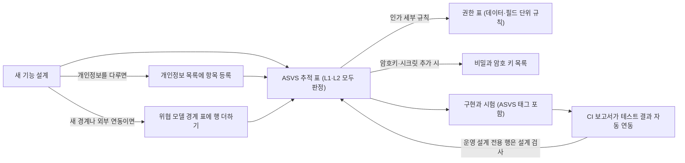

# 분야 편 21: 보안

- **맡는 정본**: [docs/security/threat-model.md](../../security/threat-model.md)(위협 모델), [docs/security/authz-matrix.md](../../security/authz-matrix.md)(권한 인가 표), [docs/security/data-classification.md](../../security/data-classification.md)(개인정보 분류 목록), [docs/security/secrets-and-keys.md](../../security/secrets-and-keys.md)(비밀과 암호 키 목록), [docs/security/auth-controls.md](../../security/auth-controls.md)(인증 통제), [docs/security/internal-management-plan.md](../../security/internal-management-plan.md)(내부 관리계획), docs/security/asvs/ 아래 기능별 ASVS 추적 표 17편과 v0 베이스라인 추적 표, [docs/architecture.md](../../architecture.md) §8 '품질·보안 절차', 보안 ADR(§5).
- **규범이 아니다**: 정본을 풀어 쓴 해설이다. 숫자와 규칙이 정본과 다르면 정본이 맞다([ADR-0177](../../adr/0177-walkthrough-explain-in-interview.md)).
- **한 판 문서와의 관계**: [한 판 문서](../01-system-design.md)에 보안 문서를 직접 다루는 단계는 없다. 11단계(서비스 분리 기준의 '보안 경계', 게이트웨이 토큰 검증, 메시 mTLS), 13단계(일시정지 1인·재개 2인 승인), 14단계(스캐너 기기 키)가 일부 내용을 다룬다.
- **측정 상태**: ASVS 추적 표의 '테스트 결과'는 전달 파이프라인 일부를 제외하고 대다수 '미실행(설계 판정 완료)' 상태다. 정본의 `[가정]`·`[추정]`은 그대로 보존했다.

## 1. 이 문서가 정하는 것

보안 정본은 시스템 전체에서 "어디서 어떤 공격을 막고, 잔여 위험은 무엇인가"를 일곱 가지 핵심 문서와 기능별 ASVS 추적표로 정밀하게 정의한다.

> **30초 설명**: "보안 아키텍처는 기본 거부(Default Deny)와 심층 방어(Defense in Depth)에 기반합니다. 위협 모델은 사용자 기기(경계 0)부터 외부 PG(경계 5)까지 6대 신뢰 경계별 STRIDE 위협과 잔여 위험을 규정합니다. 인가 체계는 게이트웨이가 토큰 유효성과 스코프만 검증하고, 각 서비스의 `RolesGuard`가 요청마다 사용자 역할과 테넌트를 판정(5초 캐시)하며, DB 계층의 행 수준 보안(RLS)이 파트너 간 테넌트 침범을 2차로 차단합니다. 개인정보는 P1~P3로 분류되어 AWS KMS 기반 봉투 암호화로 보호됩니다. 관리자 로그인은 PBKDF2 60만 회 + KMS HMAC 페퍼 및 크리덴셜 스터핑 8계층 방어를 적용했습니다. 특히 OWASP ASVS v5.0 L2 기준 1,927개 요구사항을 설계 단계에서 전수 판정(Shift-Left)하여 개발 파이프라인에 통합했습니다."

### 4대 핵심 아키텍처 모듈

1. **OWASP ASVS v5.0 Level 2 전면 추적 체계 (Shift-Left Security)**:
   - 보안을 사후 침투 테스트로 때우지 않고, 17개 도메인 기능 설계서 작성 전에 ASVS 5.0.0 L2 요구사항 1,927건을 전수 판정(적용 1,638건, 부분 적용 26건, 미적용 264건).
   - CI 파이프라인에서 테스트 코드의 `[ASVS v5.0.0-x.y.z]` 태그를 정적 수집하여 보안 검증 상태를 자동으로 동기화.
2. **데이터 분류 체계(P1~P3) 및 봉투 암호화(Envelope Encryption)**:
   - 개인정보보호법 및 안전성 확보조치 기준에 따라 데이터를 P1(인증·연계 기밀), P2(일반 개인정보), P3(공개 식별자)로 3단계 분류.
   - P1 연계정보(CI/DI) 및 관리자 인증 정보는 AWS KMS 기반의 봉투 암호화(Data Key 암호화) 및 HMAC 솔트/페퍼 결합으로 데이터 유출 시 복호화 불가능한 구조 확립.
3. **심층 방어 인가 매트릭스 (3-Tier Authz Architecture)**:
   - 1계층(게이트웨이): JWT 토큰 서명, 유효 기간, `scope`만 검증하고 신원 헤더 재작성(내부 위조 차단).
   - 2계층(서비스): `RolesGuard`가 identity-svc와 연계하여 최신 역할·테넌트 판정(5초 캐시), 비공개 자원은 403이 아닌 404로 응답하여 자원 존재성 은폐.
   - 3계층(데이터베이스): 파트너 테넌트 테이블에 PostgreSQL 행 수준 보안(RLS)을 적용하여 앱 쿼리 누락 시에도 타 테넌트 데이터 유출 원천 차단.
4. **크리덴셜 스터핑 다계층 방어 (Credential Stuffing Defense)**:
   - 관리자 인증 경로에 대해 단일 계정 실패 잠금뿐만 아니라, 출발지 IP 계수, 유출 비밀번호 DB(HaveIBeenPwned 범위 조회) 대조, TOTP 2단계 인증, 전체 실패율 급증 알림(SEV3) 등 8계층 방어선 구축.
   - 관리자 비밀번호 해시는 PBKDF2-HMAC-SHA256 600,000회 이상 및 KMS 페퍼를 결합하여 오프라인 레인보우 테이블 공격 무력화.

## 2. 절마다 읽기

**여섯 문서와 docs/architecture.md §8**:

| 정본 절 | 무엇을 정하나 | 왜 | 해설서에서 |
| --- | --- | --- | --- |
| docs/security/threat-model.md §1 경계 지도 | 경계 0~5(사용자 기기, 엣지, 게이트웨이, 서비스 메시, 데이터 저장소, 외부), 전달 경로, 사람의 운영 접근, 부정 거래 조사 갈래 | 데이터가 경계를 넘는 곳마다 공격을 빠짐없이 보려는 것이다 | — |
| docs/security/threat-model.md §2 경계 0: 사용자 기기 | 쿠키·입장 토큰 탈취, 대기표 조작, HTML `style` 속성 위장, 외부 스크립트, 봇 폭주, IDOR(남의 ID를 넣어 보는 공격) | 기기는 믿지 않고 모든 입력을 서버가 다시 본다. XSS(화면에 스크립트를 끼워 넣는 공격)가 성공하면 그 화면 안 요청은 남는다고 적는다 | — |
| docs/security/threat-model.md §3 경계 1: 엣지 | 원본 직접 호출, DNS 위조, 웹 캐시 기만, 공개 텔레메트리 `/_t/*` | 원본에 공인 주소가 없고 CDN(사용자 가까이에서 대신 응답하는 전송망) CloudFront 연결만 받는다. DNSSEC(이름 풀이 응답에 서명하는 방식)를 쓰지 않는 것은 v1의 받아들인 위험이다(ADR-0144) | — |
| docs/security/threat-model.md §4 경계 2: 게이트웨이 | 위조·다른 대상 토큰, 관리 로그인 대입, 허용 IP 위장, 내부 헤더 주입 | 게이트웨이마다 자기 대상의 키만 믿고, 바깥 헤더는 지우고 토큰 값으로 다시 쓴다 | — |
| docs/security/threat-model.md §5 경계 3: 서비스 메시(내부) | 서비스 위장, 메시 안 변조, 운영자 부인, 로그의 개인정보 | 메시 전체 STRICT mTLS(양쪽이 인증서를 확인하는 암호 통신, ADR-0082). 명령은 감사 체인으로 고치면 드러난다 | 한 판 11단계(메시만) |
| docs/security/threat-model.md §6 경계 4: 데이터 저장소 | 저장소 비밀번호 탈취, 원장 직접 수정, 열람 부인, 백업 유출 | 사람이 운영 DB에 직접 쓰는 길이 없다. 긴급 조회는 SSM(SSH 없이 서버에 붙는 AWS 기능)과 pgAudit(DB 세션의 조회·변경을 남기는 기록 기능) 기록으로만 한다 | — |
| docs/security/threat-model.md §7 경계 5: 외부 | 결제사 웹훅 위조, 웹 푸시 키 유출, 결제창 복귀 값 변조, 금액 다툼 | 우리 통제 밖이라 받은 결과를 서명이나 조회 API로 다시 확인한다 | — |
| docs/security/threat-model.md §8 전달 경로 | 빌드 중 토큰 탈취, CI(코드를 올릴 때마다 자동으로 검사·빌드하는 과정) 캐시 오염, 액션 바꿔치기, 비밀 커밋 | 서명은 저장소 코드를 돌리지 않는 게시 잡만 한다. 서명과 출처 증명이 맞는 산출물만 들인다 | — |
| docs/security/threat-model.md §9 사람의 운영 접근 | 관리 도구, 쿠버네티스 API, SSM, 긴급·비상 접근 | 전달 경로와 공격 면이 달라 표를 나눴다(ADR-0147). 사람에게 늘 주어진 쓰기 권한이 없다 | — |
| docs/security/threat-model.md §10 핵심 비밀과 교체 일정 | 새면 피해가 큰 비밀 15묶음과 이어지는 위협 | ASVS 13.1.4(위협 모델에 따라 비밀 교체 일정을 문서로)의 근거다. 주기의 정본은 키 목록이다 | — |
| docs/security/threat-model.md §11 부정 거래 조사 갈래 | 조사 사본이 Kafka(사건을 쌓아 두고 나눠 주는 메시지 시스템)로 가는 길, 조사 저장소·화면, 승인자 우회, 두 갈래 연결, 증거 변조, 팬 쪽 경로(§11.1~§11.6) | 실명 계정과 원문 IP가 모이는 길이라 가장 좁게 믿는다. 연구 갈래(가명정보)와 이으면 재식별 금지(개인정보 보호법 제28조의5)에 걸린다 | 분야 편 17(기능 쪽) |
| docs/security/authz-matrix.md §1 이 문서가 맡는 것 | ASVS 8.1.1·8.1.2가 요구하는 데이터·칸 단위 규칙. 기능 권한은 docs/planning/03 §3 | ASVS가 인가 규칙을 문서에 두라고 한다. 원문에 없어 전체가 `[보완]`이다 | — |
| docs/security/authz-matrix.md §2 기본 원칙 | 기본 거부, 신원 값은 세션에서만, 두 번 검사, 비공개 자원은 없는 것처럼 404 | 게이트웨이는 DB를 보지 않아(ADR-0008) 자원 검사는 서비스 몫이다. 버튼 숨기기는 통제로 세지 않는다 | — |
| docs/security/authz-matrix.md §3 데이터 단위 규칙 | 본인 데이터, 파트너 테넌트(`자원.promoter_id = 요청 테넌트`), 스태프 배정 회차, 상태, 시간, 지정된 사람 | 판정 식을 조회 조건으로 쓴다. 테넌트(파트너 회사 같은 소속 단위)는 요청마다 identity에서 받은 값만 믿는다(ADR-0172) | 분야 편 17(지정만) |
| docs/security/authz-matrix.md §4 칸 단위 규칙 | 역할마다 보이는·가리는 칸, 서버만 정하는 칸, 가린 값을 여는 절차 | 허용한 칸 밖은 400이다. 원문 열람은 사유와 접속기록을 남긴다 | 분야 편 12(§4.1만) |
| docs/security/authz-matrix.md §5 검사 위치 | 엣지·게이트웨이·서비스·DB·화면이 보는 것, 권한 변경의 반영 | 게이트웨이는 대상과 `scope`만 보고 서비스의 `RolesGuard`가 요청마다 역할을 본다(5초 `[가정]` 캐시) | 분야 편 8(역할 판정) |
| docs/security/authz-matrix.md §5.3 DB | 파트너 테넌트 표에 행 보안 정책(RLS: DB가 행마다 누가 볼지 거르는 규칙) | 조회 계층이 1차, RLS가 2차다. 쿼리 하나에서 조건이 빠져도 남의 행이 나오지 않게 한다 | — |
| docs/security/authz-matrix.md §5.5 작업별 허용 역할 칸 `x-peaket-roles` | 허용 역할 값 12종의 정본 | 모든 작업에 두고 doc-check `roles` 검사로 막는 것은 소유자 결정이다 | 분야 편 7 |
| docs/security/authz-matrix.md §6 재인증·2인 승인과의 묶음 | 위험 작업마다 재인증 요소와 승인 인원. §6.1은 관리 계정 관리 경로 | 서버가 요청자 ≠ 승인자와 지금 역할을 본다. 멈춤 1인, 재개 2인이다(ADR-0095) | 한 판 13단계(승인 방향만) |
| docs/security/authz-matrix.md §7 테스트 포인트 | AZ-T1~AZ-T16 | 테넌트 넘기, 값 꾸미기, DB 깊이 방어, 권한 변경 반영을 시험으로 판정한다 | — |
| docs/security/authz-matrix.md §8 남는 위험 | 메시 없는 실행의 헤더 꾸미기, 캐시 5초의 옛 역할, RLS를 건너뛰는 일괄 작업 사용자 | 막지 못하는 것을 숨기지 않고 적는다 | — |
| docs/security/authz-matrix.md §9 미결정·[가정] | 역할 클레임 삭제 기록, 가드 시험 생성기(wbs 3.6.1), RLS 비용 측정 | RLS가 파트너 요청 p95를 10% `[가정]` 넘게 늘리면 조회 계층만 두는 안으로 돌아간다 | — |
| docs/security/data-classification.md '보호 등급 분류 체계' | P1 인증·연계 기밀, P2 일반 개인정보, P3 공개 식별자와 등급별 통제 | 고시 제7조의 저장 암호화 의무는 7가지와 인증정보다. 이름·연락처는 의무가 아니지만 위험 분석으로 볼륨 암호화를 켠다 | — |
| docs/security/data-classification.md '개인정보 상세 목록' | 약 110행: 수집 시점, 등급, 보호 방식, 보존 기간, 근거 | 새 기능은 코드보다 먼저 여기에 등록한다(ASVS 14.1.1·14.1.2) | — |
| docs/security/data-classification.md '수집하거나 저장하지 않는 항목' | 주민등록번호, 카드 번호·CVC, 계좌번호 등 11행 | 법 근거가 없거나(제24조의2) 결제사 화면·API로 바로 넘기기 때문이다 | — |
| docs/security/data-classification.md '백업 보존 상한과 파기' | 저장소별 백업 상한과 복원 뒤 파기 다시 적용 | 지운 정보도 백업에는 남는다. 파기 감사 로그를 복원 대상과 다른 곳에 둔다(기술 검토 중간-070) | — |
| docs/security/data-classification.md '국외 이전 목록' | 국-01~국-10과 지점별 근거·보호조치 | 처리방침의 국외 이전 절을 이 표에서 만든다(ADR-0139) | — |
| docs/security/data-classification.md '처리방침 문구 초안: 부정 예매 조사' | SCR-057에 올릴 문구 초안 | 게시 전에는 조사 갈래를 운영에서 켜지 않는다. 자문을 받지 않은 초안이다 | 분야 편 17 |
| docs/security/data-classification.md '이익형량 기록: 부정 예매 조사' | 목적 셋마다 이익과 정보주체 권리를 저울질한 기록 | 근거가 제15조 제1항 제6호(정당한 이익) 하나라 목적마다 따져 남긴다(ADR-0173) | 분야 편 17 |
| docs/security/data-classification.md '법률 확인 및 해석 결과' | 질문 37개와 결론. 다른 문서가 '법률 #20'처럼 번호로 인용한다 | 확인되지 않은 해석은 단정하지 않고 '확인 필요'·'해석'으로 나눈다(POL-027) | — |
| docs/security/secrets-and-keys.md '관리 규칙' | 9개: 보관 위치, 묶음·로그에 비밀 금지, gitleaks, NIST 수명주기, 온세일 교체 금지, 분기 대조, 키 권한 | ASVS 11.1·13.3을 따른다. 커밋된 비밀은 노출로 보고 바꾼다(RB-26) | — |
| docs/security/secrets-and-keys.md '비밀과 암호 키 상세 목록' | 약 75행: 용도, 알고리즘, 보관, 쓰는 주체, 교체 | 이 목록이 암호 목록이다. 키를 바꾸는 ADR·PR은 같은 변경에서 고친다 | 분야 편 8·11·13·15(그 기능의 키) |
| docs/security/secrets-and-keys.md '표준 대조와 편차' | NIST SP 800-57 표 1과 대조, 정기 교체 없는 키 8종의 이유와 보완 통제 | 표보다 길게 쓰는 키는 위험을 따로 적으라는 표준을 따른다 | — |
| docs/security/secrets-and-keys.md '`inv-ref-key` 회전 절차' | 조사용 가명 키를 라벨마다 바꾸는 8단계 | 기기 가명은 원문이 브라우저에만 있어 30일 이음 기간에 두 판을 함께 구한다(ADR-0171) | — |
| docs/security/secrets-and-keys.md '키 사용 범위' | 키 묶음 21개마다 쓸 수 있는 곳과 없는 곳 | ASVS 11.1.2. 한 키를 여러 용도로 쓰면 한 곳이 뚫릴 때 다른 곳도 뚫린다 | — |
| docs/security/auth-controls.md §1 범위: 누가 무엇으로 로그인하는가 | 관리 계정에만 건다. 팬은 소셜 로그인, 현장 스태프는 비밀번호가 없다 | 팬 비밀번호를 저장하지 않아 대입 차단은 소셜 제공자가 한다 | 분야 편 8 |
| docs/security/auth-controls.md §2 크리덴셜 스터핑 방어 | 층 C1~C8, 계정 유무 숨기기, 사람 확인을 거는 때 | 계정마다 한두 번만 넣어 계정 잠금에 거의 걸리지 않는다. 출발지 계수·비밀번호 대조·2단계·전체 경보를 함께 둔다 | 분야 편 8 |
| docs/security/auth-controls.md §3 관리 계정 로그인 잠금 규칙 | 세는 값, 시간·묶음·보호 잠금, 본인 해제, 알림, 비밀번호를 바꾸게 하는 경우 | 고시는 횟수를 정하지 않아 스스로 정한다(법률 #8). 운영자를 기다리지 않게 본인 해제를 둔다 | 분야 편 8 |
| docs/security/auth-controls.md §4 비밀번호 금칙어 목록과 대조 방식 | 목록 L1~L5, 대조용 사본 셋, 유출 비밀번호 범위 조회 | '맥락 말과 쉬운 덧붙임만으로 된 비밀번호'를 막는다. 목록을 넓히면 정상 비밀번호만 막힌다 | — |
| docs/security/auth-controls.md §5 설정값 | 설정 25개와 허용 범위 | 배포 설정에 두고 명령으로 바꾸지 않는다. 공격 중에 기준을 느슨하게 못 바꾸게 한다 | 분야 편 8(값 몇 개) |
| docs/security/auth-controls.md §6 테스트 포인트 | identity 시험에 더하는 시험 | 시험 이름에 ASVS 태그를 붙인다 | — |
| docs/security/auth-controls.md §7 미결정·[가정] | `[가정]` 값과 흔한 비밀번호 목록 출처는 wbs 3.5.1에서 정한다 | 운영 데이터를 보고 계수와 속도 규칙을 함께 맞춘다 | — |
| docs/security/internal-management-plan.md §1 범위와 사람 | 대상, 사람 구분, 2026-11-01부터 달라지는 조문 | 개정 고시가 대상을 '정당한 권한을 가진 자'로 넓혀 파트너 계정도 들어온다 | — |
| docs/security/internal-management-plan.md §2 제4조 제1항 각 호의 계획 | 18개 호마다 계획·구현 위치·채울 칸, 역할별 책임, 조사관 지정 | 기술 통제의 정본은 설계 문서에 두고 계획은 그 위치를 가리킨다 | 분야 편 3(18개 호의 존재만) |
| docs/security/internal-management-plan.md §3 교육(제4조 제2항) | 다섯 과정 | 고시가 차등한 정기 교육을 요구한다 | — |
| docs/security/internal-management-plan.md §4 접속기록 점검(제8조 제2항) | 대상·주기, 매일 이상 탐지 규칙, 점검 순서, 사후조치, 보고 | 2026-11-01부터 주기를 계획이 정한다. 계획은 월 1회다(ADR-0158) | 분야 편 16(기능 쪽) |
| docs/security/internal-management-plan.md §5 파기와 분리 보관 | 5일 안 파기, 복원 불가능한 삭제, 분리 보관 | 표준 개인정보 보호지침 제10조가 5일을 정한다 | — |
| docs/security/internal-management-plan.md §6 수립·변경·승인과 수정 이력 | 승인 절차, 중요한 변경 6종, 이력 | 고시가 '내부 의사결정 절차'를 요구해 문서를 쓴 것만으로는 수립이 아니다 | — |
| docs/security/internal-management-plan.md §7 이행 실태 점검 | 해마다 1회, 첫 점검은 운영 시작 뒤 6개월 `[가정]` 안 | 고시가 연 1회 이상을 요구한다 | — |
| docs/security/internal-management-plan.md §8 운영 전에 채울 칸 | 사람, 허용 IP, 근무 일정 칸 | 모두 비어 있다. 채우고 승인해야 시행한다 | — |
| docs/security/internal-management-plan.md §9 법 판단 모음 | 판단마다 확인됨·확인 필요·해석 | 조문 밖 판단을 조문과 섞지 않는다 | — |
| docs/security/internal-management-plan.md §10 알려진 한계 | 1인이라 사람을 나눌 수 없음, 돌아 본 적 없는 절차, `[가정]` 수치 | 견제가 사람이 다르다는 데 기대기 때문이다 | — |
| docs/security/internal-management-plan.md §11 참고 원문 | 국가법령정보센터에서 받은 원문 목록 | 대조 출처를 남긴다 | — |
| docs/architecture.md §8.1 글로벌 준수 기준 | ISO/IEC 25010 등, OWASP Top 10:2025, ASVS v5.0.0(기본 L2), SLSA, 국내 법률 | 기준마다 충족 내용과 증명 방법을 1:1로 둬야 완료로 판정한다 | — |
| docs/architecture.md §8.1 'OWASP Top 10:2025 항목별 대응' | A01~A10마다 정본의 장치와 ASVS 장 | Top 10은 넓게 덮는 최소 기준선이고 추상적이라, 세부 검증은 ASVS L2로 한다 | — |
| docs/architecture.md §8.2 기능 개발 절차: 보안 요구사항 추적 파이프라인 | 구현 전 판정, 표 7칸, 미적용 사유 4분류, 결과 자동 연동, 법률 행 | 구현 전에 요구를 정하고, 손으로 적은 '통과'를 막으려는 것이다 | — |
| docs/architecture.md §8.3 공통 보안 기본 원칙 | 관리자 비밀번호 PBKDF2(일부러 느리게 만든 비밀번호 해시), 필드별 암호화, 비밀 하드코딩 금지, 전송 암호화, SQL 바인딩 | 원칙마다 구현과 근거를 짝짓는다. bcrypt는 72바이트에서 잘려 뺐다(ADR-0033) | 분야 편 8(해시만) |
| docs/architecture.md §8.4~§8.6 다른 개발 절차 | 운영 확인 표, git flow, 정본 기준 개발 절차(ADR-0178) | 보안 밖이다. 추적 표를 먼저 쓴다는 순서만 든다 | — |

**기능별 ASVS 추적 표 17편**:

| 정본 절 | 무엇을 정하나 | 왜(대표 행) | 해설서에서 |
| --- | --- | --- | --- |
| docs/security/asvs/auth.md 계정·인증 | 팬 소셜 로그인·탈퇴, 관리자 로그인과 MFA, 세션. L1·L2 149, L3 3, 법률 17 | 미적용 27건은 모두 '해당 없음'이고 자체 인가 서버가 없어 V10만 21건이다. 법률 행에 고시 제6조 제2항(외부 접속 다중 인증)이 있다 | 기능은 분야 편 8 |
| docs/security/asvs/queue-admission.md 대기열·입장 토큰과 소지 증명 | 대기표·입장 토큰, 도착 시각 쿠키, 셔플 비콘, 소지 증명. L1·L2 55, L3 2, 법률 1 | L3 11.2.4(암호 연산을 상수 시간으로), 15.4.2(확인과 동작을 원자적으로) | 기능은 분야 편 9 |
| docs/security/asvs/seat-hold.md 좌석 | 스냅샷, 홀드 Lua, 판매 확정, 좌석 델타, 좌석맵 가져오기. L1·L2 143, L3 5, 법률 0 | L3로 동시성 절 15.4.1~15.4.4와 위험 구성 요소 격리 15.2.5(`seatmap-worker`). 판정 중 찾은 빈틈은 ADR-0159로 막았다 | 기능은 분야 편 10 |
| docs/security/asvs/payment.md 주문·결제 | 결제 시도, 결제창, 승인·취소·환불, 결제사 웹훅. L1·L2 85, L3 4, 법률 4 | L3 2.3.5(고가치 흐름의 다인 승인). 법률 행은 전자상거래법 시행령 제6조(결제 기록 5년) | 기능은 분야 편 11 |
| docs/security/asvs/transfer-refund.md 양도·취소·환불 | 양도, 예매 취소, 회차 취소와 일괄 환불, 배상, 승인 업무. L1·L2 123, L3 3, 법률 9 | 법률 행에 전자상거래법 제18조(환급 3영업일), 개인정보 보호법 제37조의2(자동화된 결정) | 기능은 분야 편 12 |
| docs/security/asvs/settlement.md 정산 지급 | 정산서, 지급대행 등록, 정산 계좌, 지급과 대사. L1·L2 148, L3 5, 법률 4 | L3 1.2.10(CSV 수식 삽입 막기). 법률 행은 전자금융거래법 제2조 제19호(중개에 딸린 정산 대행 제외) | 기능은 분야 편 12 |
| docs/security/asvs/offline-gate.md 현장 입장 | 스캐너 등록, 스태프 로그인, 오프라인 판정, 부스 재발급, 회전 QR. L1·L2 170, L3 5, 법률 6 | 항목 수와 부분 적용(7건)이 가장 많다. L3 10.3.5·10.4.14(보낸 사람에 묶인 토큰. 기본안은 기기 키로 요청마다 서명한 증명 DPoP, 선택지는 mTLS) | 기능은 분야 편 13 |
| docs/security/asvs/bot-defense.md 봇 방어 | 사람 확인, 위험 점수, 허니팟, 그림자 실행. V2.1~V2.4·V3·V16과 6.1.1만. L1·L2 30, L3 2, 법률 4 | 관련 절만 판정해 30건 모두 적용이다. 법률 행은 공연법 제4조의2 제2항(매크로 부정구매 방지 의무) | 기능은 분야 편 14 |
| docs/security/asvs/notify.md 알림·찜·오픈 알림 | 알림 신청, 웹 푸시 구독, 발송 원장, 파트너 웹훅. L1·L2 148, L3 6, 법률 4 | L3 4.1.5(메시지마다 서명). 법률 행은 정보통신망법 제50조(광고성 정보의 사전 동의) | 기능은 분야 편 15 |
| docs/security/asvs/catalog-review.md 탐색·후기·홈 구성 | 홈과 홈 구성, 검색, 공연 상세, 후기와 신고, 이미지. L1·L2 108, L3 8, 법률 14 | L3 1.3.12(ReDoS 막기), 5.2.6(픽셀 폭주 막기). 법률 행은 공연법 시행령 제3조의3(신고 기능, 24시간 안 차단) | 기능은 분야 편 15 |
| docs/security/asvs/control-tower.md 관제 콘솔 | 운영 명령, 법정 조치, 보안 사고, 접속기록 점검. L1·L2 157, L3 4, 법률 6 | L3 2.3.5, 8.4.2(관리 화면의 여러 겹 확인). 법률 행은 정보통신망법 제48조의3(침해사고 24시간 신고) | 기능은 분야 편 16 |
| docs/security/asvs/analytics.md 분석 저장소 | 원본 적재와 가명 처리, 변환과 마감, 리포트. L1·L2 157, L3 4, 법률 5 | L3 8.3.3(원래 요청한 주체의 권한으로 판정). 법률 행은 개인정보 보호법 제3조 제7항(익명·가명 처리)과 가명정보 조항(제28조의2·제28조의4·제28조의5)이다 | 기능은 분야 편 17 |
| docs/security/asvs/forensic-replay.md 사후 포렌식 | 포렌식 리플레이와 부정 거래 조사. L1·L2 157, L3 10, 법률 12 | 법률 행에 제15조 제1항 제6호(정당한 이익), 제37조의2, 약관규제법이 있다 | 기능은 분야 편 17 |
| docs/security/asvs/frontend.md 웹 클라이언트 공통 | 화면 앱 넷의 공통 통제. L1·L2 112, L3 11, 법률 1 | L3가 가장 많다: 3.4.7(CSP, 곧 화면이 실행할 스크립트의 출처를 정하는 브라우저 규칙의 위반 보고), 3.6.1(SRI, 외부 자원 무결성 해시), 15.2.4(의존성 혼동) | 기능은 분야 편 6 |
| docs/security/asvs/delivery.md 전달 파이프라인과 운영 플랫폼 | CI, 공급망, GitOps(배포 상태를 저장소에 적고 클러스터를 그대로 맞추는 방식), 배포, 운영 접근. L1·L2 70, L3 7, 법률 3 | L3 13.1.4(위협 모델에 따른 비밀 교체). 17편에서 유일한 시험 기록(13.2.1 부분 통과)이 여기 있다 | — |
| docs/security/asvs/support.md 고객 문의 | 문의하기, 내 문의, 문의 상세. L1·L2 99, L3 2, 법률 4 | 법률 행은 전자상거래법 제20조 제3항(3영업일 경과·10영업일 결과 통지) | — |
| docs/security/asvs/verification-tools.md 검증 도구 | 불변식 검사기, PG 시뮬레이터(결제사를 흉내 내는 시험용 서버), 시뮬레이터 어댑터. L1·L2 17(적용 15, 나중 Phase로 미룸 2), L3 1, 법률 0 | 운영에 배포하지 않는 시험 도구라 주입·업무 로직·HTTP 응답·권한·설정·데이터 보호·로그 장(V1·V2·V4·V8·V13·V14·V16)의 해당 행만 판정한다. 시뮬레이터는 `sim_sk_`로 시작하는 키만 받고 `PEAKET_ENV`가 없거나 `prod`면 시작하지 않는다(13.3.1·13.4.2). L3 14.2.6(불변식에 필요한 칸만 읽기). 미룬 2건은 운영 대조를 배포할 때 더할 로그(16.2.1·16.4.1)다 | 기능은 분야 편 22 |

**v0 베이스라인 추적 표**:

| 정본 절 | 무엇을 정하나 | 왜(대표 행) | 해설서에서 |
| --- | --- | --- | --- |
| docs/security/asvs/v0-baseline.md v0 모놀리스 | 대기열·좌석·결제·발권 v0 모듈(`queue`·`inventory`·`booking`·`payment`·`ticket`)과 v0 배포의 입구 `gateway`(TLS를 끝내고 내부 신원 머리를 지운 뒤 액세스 토큰을 검증하며 IP마다 요청 수를 제한한다). '요약'은 판정한 L1·L2 31건(적용 29, 부분 적용 1, 나중 Phase로 미룸 1)이고 선별 L3·법률 행은 없다. '추적 표' 한 장에 31행을 둔다. 판정한 장은 주입·업무 로직·HTTP 응답·권한·설정·데이터 보호·로그(V1·V2·V4·V8·V13·V14·V16)에, 좌석맵 화면과 변경분 연결의 V3·V4.4, 티켓 코드 난수의 V11, 입구의 토큰(V9)·TLS(V12)를 더한 것이다 | 부분 적용 2.3.3(작업이 전부 되거나 전부 되돌아감)은 결제 확정 전체가 동기 결제 체인이라 트랜잭션 하나가 아니어서다. 이것이 K7의 v0 한계이고 v1 주문 Saga(wbs 2.7)에서 다시 판정한다. 미룬 4.4.3(WebSocket 전용 토큰)은 변경분 연결을 게이트웨이 신원 머리로만 판정하기 때문이다. 2.4.1의 입구 한도는 IP마다 토큰 버킷(초당 10개 채움, 최대 20개 `[가정]`)뿐이라 IP를 바꾸는 봇은 지나가고 IP를 나눠 쓰는 사람은 함께 막힌다(K6의 v0 한계). 테스트 결과는 모두 '미실행'이다 | 한 판 4단계, 기능은 분야 편 9·10·11·13 |

## 3. 꼭 기억할 규칙과 숫자

| 항목 | 값 | 표시 | 정본 위치 |
| --- | --- | --- | --- |
| ASVS 판정 규모 | 17편 합계 L1·L2 1,928건(적용 1,638, 부분 적용 26, 미적용 264), L3 82건, 법률 행 94건, 운영 설계 전용 16건. v0 베이스라인 L1·L2 31건 별도 | 확정 판정 | docs/security/asvs/*.md |
| 미적용 사유 분류 | 해당 없음, 외부 IdP 위임, 나중 Phase로 미룸, 위험 수용(ADR 링크 필수) 등 4종 | 확정 | docs/architecture.md §8.2 |
| 취약점 조치 기한 | Critical 7일, High 30일. 기한 초과 High 이상 잔존 시 운영 배포 승격 자동 차단. DAST 야간 점검 High 0건 필수 | 확정 | docs/architecture.md §8.1, POL-041 |
| 관리자 비밀번호 해시 | PBKDF2-HMAC-SHA256 600,000회 이상, 솔트 16바이트, AWS KMS HMAC 페퍼(계정 ID 결합) | 확정 | docs/architecture.md §8.3 |
| 비밀번호 길이 규격 | 최소 15자, 최대 256자(허용 범위 64 이상) | 15자 확정(POL-020) | auth-controls §5 |
| 관리 로그인 실패 잠금 | 3회 실패 시 사람 확인(Turnstile), 5회 실패 시 15분 시간 잠금(24시간 내 재발 시 1시간), 2단계 인증 5회 실패 시 보호 잠금, 연속 실패 누계 100회 시 영구 보호 잠금 | 5회는 관리계획 확정, 나머지 `[가정]` | auth-controls §3·§5 |
| 크리덴셜 스터핑 출발지 감지 | 동일 IP에서 1시간 내 서로 다른 이메일 5개 실패 시 해당 IP 1시간 Turnstile 강제. 전체 시스템 5분 내 100건 실패 시 SEV3 인시던트 선언 | `[가정]` | auth-controls §2.1·§5 |
| 계정 본인 해제 링크 | 32바이트 보안 난수 토큰, 유효시간 30분. 이메일 링크 접속 후 OTP 일치 시 시간 잠금 해제 | `[가정]`(30분) | auth-controls §3.3 |
| 역할 인가 판정 | 요청마다 identity-svc 질의 후 5초 로컬 캐시, 민감 위험 작업은 캐시 없이 즉시 질의. 응답 불가 시 503 `authz-unavailable`. 허용 역할 12종 | `[가정]`(5초 캐시) | authz-matrix §5.2·§5.5 |
| 토큰 서명 키 교체 | 팬 액세스, 관리자, 현장 스태프, 입장 토큰, 대기열 서명 키는 90일 주기 정기 교체 | 확정 | secrets-and-keys |
| 암호키 관리 정책 | 로그 가명화 키 30일, 관리자 페퍼 2년 내, KMS 자동 교체 365일, DB 서비스 계정 비밀번호 30일 교체 | 확정 | secrets-and-keys, threat-model §6 |
| 암호키 교체 금지창 | 온세일 윈도우(T-10분~T+60분) 및 변경 동결 창 내 키 교체 엄금. 자동 교체는 정비 시간(04:00~06:00 KST) 수행 | 정비 시간 `[가정]` | secrets-and-keys 규칙 6 |
| 백업 보존 및 영구 파기 | Aurora 시점 복구 35일, 도쿄 스냅샷 사본 7일, ClickHouse 7일, S3 이전 버전 7일, Kafka 7일. 법정 목적 달성 후 5일 이내 파기 | 5일 이내 파기 확정 | data-classification, internal-management-plan |
| 접속기록 감사 | 월 1회 관리 계정 접속기록 점검. 매일 이상 탐지(동일 명단 24시간 3회 이상 조회, 1회 1만 건 이상, 증거 내보내기 5건 초과) | 월 1회 확정 | internal-management-plan §4 |
| 국외 이전 목록 | AWS 도쿄 백업, Sentry EU 등 국외 이전 10개 지점(국-01~국-10) 개인정보 처리방침 공개 | 확정 | data-classification, POL-027 |

## 4. 이 문서가 다루는 ID

| ID | 한 줄 요약 |
| --- | --- |
| FR-021 | 파트너는 업무 이메일·비밀번호·TOTP로 로그인하며 패스키는 위험 작업 재인증에 사용 |
| FR-027 | 파트너 정산 리포트 및 관람객 명단 다운로드 시 사유와 다운로드 건수 불변 기록 |
| FR-028 | 운영자는 업무 이메일·비밀번호·MFA 및 사내 VPN/허용 IP 경유로만 접속 |
| FR-034 | 신고·수사기관 자료 제공 요청에 대해 법정 절차와 2인 승인 거쳐 집행 |
| FR-044 | 법정 보존 기간 만료 개인정보의 5일 내 영구 파기 및 복원 불능화 |
| FR-063 | 침해사고 및 개인정보 유출 시 보안 사고 등록 및 24시간 내 법정 신고 추적 |
| FR-064 | 관리 계정 접속기록 및 대용량 다운로드 정기 감사 및 매일 이상 징후 감지 |
| NFR-016 | ASVS 5.0.0 레벨 2 전 항목 판정, OWASP Top 10:2025 대응, High 취약점 0건 |
| NFR-017 | 운영 명령 및 비상 제어 행위 100% 불변 감사 기록 보존 |
| NFR-018 | 개인정보 수집 항목, 목적, 보존 기간은 `data-classification.md`를 단일 정본으로 관리 |
| POL-019 | 세션 정책: 팬 세션 최대 30일, 유휴 14일, 액세스 토큰 15분, 동시 기기 5대 제한 |
| POL-020 | 관리 계정 인증 정책: 비밀번호 15자 이상, TOTP 법적 필수, 위험 작업 패스키 재인증 |
| POL-021 | 운영 명령 통제: 사유 입력, dry-run, 해시 체인 감사 로그, 1인 중단/2인 재개 |
| POL-023 | 개인정보 처리 기준: 최소 수집 원칙 및 주민등록번호·카드 원문 저장 금지 |
| POL-025 | 수사기관 영장 집행 대응: 범위 최소화, 제공 대장 작성, commander 패스키 승인 |
| POL-027 | 법률 검토 표기 규정: 확인됨·확인 필요·해석·간주 4단계 분류 표기 |
| POL-041 | 변경 관리 보안: 취약점 조치 기한(Critical 7일, High 30일) 초과 시 배포 차단 |
| POL-046 | 부정 예매 제재: 5대 사유 분류, 소명 기회 부여 및 2인 승인 기반 취소 집행 |
| SCR-020 | 파트너 콘솔 로그인 및 보안 설정 화면 |
| SCR-028 | 운영자 콘솔 보안 로그인 화면(허용 IP 및 사내 VPN 검증) |
| SCR-057 | 개인정보 처리방침 게시 화면(국외 이전 목록 포함) |
| SCR-064 | 관리 계정 및 세션 감사 화면 |
| SCR-066 | 팬 계정 조회 화면(마스킹 해제 시 사유 필수 입력 및 감사 로그 기록) |

## 5. 아키텍처 결정과 트레이드오프

### [ADR-0050](../../adr/0050-crypto-corrections-and-key-management.md)·[ADR-0053](../../adr/0053-crypto-hardening-pseudonyms-webhooks-stores-runbook-audit.md) 암호화 규격 및 키 수명주기

- **선택한 구조**:
  - 관리자 비밀번호: bcrypt의 72바이트 절단 취약점을 피하기 위해 PBKDF2-HMAC-SHA256 600,000회 이상 및 AWS KMS HMAC 페퍼(계정 식별자 결합) 적용.
  - 서명 키 도메인 분리: 팬 토큰, 관리자 토큰, 스태프 토큰 서명 키를 물리적으로 분리하여 팬 서비스 키 탈취가 관리 콘솔 침해로 이어지지 않도록 차단.
  - 감사 로그 무결성: 키 결합 해시 체인(HMAC 체인) 및 5분 주기 S3 Object Lock/공개 머클 앵커 고정.
- **기각된 대안**:
  - *KMS 페퍼 없는 단순 PBKDF2*: DB 유출 시 공격자가 오프라인 GPU 클러스터로 무차별 대입 공격 가능.
  - *단일 JWT 서명 키 공용 사용*: 단 하나의 키 누출로 전 시스템의 인증 체계가 일괄 붕괴됨.
  - *키 없는 SHA-256 감사 체인*: DB 쓰기 권한을 탈취한 공격자가 로그 변조 후 해시 체인을 다시 계산해 위조할 수 있음.

### [ADR-0172](../../adr/0172-judge-roles-per-request-not-in-tokens.md) 요청 단위 동적 역할 인가

- **선택한 구조**: JWT 토큰에는 불변 식별자(`sub`, `scope`)만 담고, 역할(`role`)과 테넌트(`tenant_id`)는 서비스 레이어의 `RolesGuard`가 요청마다 identity-svc에 질의하여 동적으로 판정(5초 캐시).
- **기각된 대안**: *JWT 토큰 페이로드에 역할 포함*: 관리자가 직무 변경되거나 권한이 박탈되어도 기존 발급된 15분 수명의 JWT가 만료될 때까지 권한 남용이 가능함. 블랙리스트 방식은 매 요청 중앙 Redis를 조회해야 하여 토큰의 무상태성 이점이 상실됨.

### [ADR-0065](../../adr/0065-web-frontend-security-after-asvs-v3.md) 프론트엔드 보안 헤더 및 하이브리드 CSP

- **선택한 구조**: CDN 캐시가 필수적인 공개 정적 페이지는 해시 기반 CSP(`script-src 'sha256-...'`), 동적 사용자 화면은 엄격한 Origin/Subresource Integrity(SRI)를 적용.
- **기각된 대안**: *전체 Nonce 기반 CSP*: 모든 HTML 페이지에 동적 Nonce 생성이 강제되어 CloudFront의 엣지 캐시 기능이 완전히 비활성화됨.

### [ADR-0139](../../adr/0139-personal-data-cross-border-transfer-register.md) 개인정보 국외 이전 정본화

- **선택한 구조**: AWS 도쿄 백업(국-01~06), Sentry EU(국-07) 등 10개 지점을 정본으로 등록하고 개인정보 처리방침에 투명하게 공시.
- **기각된 대안**: *국내 타 클라우드 보조 백업*: 멀티 클라우드 운영 부담과 인프라 파편화 비용이 과도하게 발생함.

## 6. 기술 면접 5단계 방어 질문

### Level 1: 게이트웨이 vs 서비스 인가 검증
- **Q**: "게이트웨이에서 역할(Role) 인가까지 한꺼번에 검사하면 서비스 부담이 줄 텐데, 왜 서비스마다 역할을 검사하나요?"
- **A**: "API 게이트웨이는 고속 라우팅 계층으로서 DB를 직접 조회하지 않으므로 데이터 단위의 세부 인가(자원 소유자 일치 여부, 테넌트 격리, 예매 상태, 판매 마감 시간)를 검증할 수 없습니다. 게이트웨이는 토큰 서명, 만료, 대분류 `scope`만 검증하고 신원 헤더를 위조 불가능하게 정제하여 전달하며, 각 서비스의 `RolesGuard`가 도메인 맥락과 최신 권한 상태를 반영하여 5초 캐시 기반으로 정밀 인가를 수행합니다."

### Level 2: DB Row-Level Security(RLS) 심층 방어
- **Q**: "애플리케이션 코드(조회 계층)에서 이미 `WHERE promoter_id = ?`로 거르고 있는데, DB RLS를 굳이 또 켜는 이유는 무엇인가요?"
- **A**: "심층 방어(Defense in Depth) 원칙 때문입니다. 개발자의 사소한 실수로 복잡한 조인 쿼리나 일괄 조회 API에서 테넌트 조건이 누락되더라도, PostgreSQL 세션 변수(`app.tenant_id`) 기반의 RLS가 활성화되어 있으면 DB 엔진 차원에서 타 테넌트의 데이터 행 노출을 물리적으로 차단합니다. RLS로 인한 오버헤드가 p95 기준 10% 미만으로 유지됨을 검증하여 적용했습니다."

### Level 3: 크리덴셜 스터핑 방어와 계정 잠금 해제
- **Q**: "공격자가 특정 관리자의 이메일을 알아내어 고의로 틀린 비밀번호를 5번 입력해 관리자를 서비스 거부(DoS) 상태로 만들면 어떻게 대응하나요?"
- **A**: "공격에 의한 DoS를 방지하기 위해 15분 시간 잠금 상태에서도 관리자 본인은 자신의 업무 이메일로 발송된 32바이트 보안 난수 링크와 OTP(인증 앱)를 결합하여 즉시 본인 해제를 수행할 수 있습니다. 반면 2단계 인증(OTP) 자체가 5회 이상 실패하거나 시스템 전체 누적 실패가 100회에 도달하는 경우에만 비밀번호 유출로 간주하여 관리자 재초대 방식의 '보호 잠금'으로 전환됩니다."

### Level 4: 봉투 암호화(Envelope Encryption) 및 키 수명주기
- **Q**: "연계정보(CI/DI)나 인증 기밀 같은 민감 데이터를 왜 직접 암호화하지 않고 봉투 암호화를 쓰나요?"
- **A**: "AWS KMS에 대량의 데이터를 매번 직접 보내 암호화/복호화하면 KMS API 호출 한도(초당 수천 건)에 걸리고 네트워크 레이턴시가 발생합니다. 봉투 암호화는 KMS에서 생성한 데이터 키(Data Key)로 로컬에서 고속 AES-256-GCM 암호화를 수행하고, 데이터 키 자체만 KMS 마스터 키로 암호화하여 데이터와 함께 저장합니다. 마스터 키 교체(자동 365일) 시에도 기존 데이터 본문을 다시 암호화할 필요 없이 안전한 수명주기 관리가 가능합니다."

### Level 5: OWASP ASVS v5.0 L2 전수 판정의 의의
- **Q**: "출시 전 개발 단계에서 1,927개나 되는 ASVS 요구사항을 왜 전수 판정했나요?"
- **A**: "보안을 사후 침투 테스트나 취약점 스캐너에만 의존하면, 데이터베이스 스키마나 서비스 경계 등 이미 구현된 아키텍처에 내재된 근본적 보안 결함을 수정하기 위해 막대한 리팩토링 비용이 발생합니다. ASVS v5.0 L2 기준을 설계 단계에 선제 도입(Shift-Left)함으로써, 세션 탈취, IDOR, 동시성 경쟁 조건, 감사 체인 무결성 등을 아키텍처 다이어그램과 계약 명세 단계에서 완벽히 방어할 수 있었습니다."

## 7. 설계 경계와 위임

| 이 문서에서 정하지 않는 영역 | 실제 정의 정본 |
| --- | --- |
| 비즈니스 역할별 세부 기능 권한(CRUD 표) | [docs/planning/03-policies-glossary.md](../../planning/03-policies-glossary.md) §3 |
| 팬 소셜 로그인 토큰 교환 및 세션 라이프사이클 | [docs/features/identity.md](../../features/identity.md) |
| 실시간 봇 위험 점수 산정 및 CAPTCHA 챌린지 | [docs/features/bot-defense.md](../../features/bot-defense.md) |
| 프론트엔드 CSP 정책 및 Trusted Types 설정 | [docs/frontend.md](../../frontend.md) §5.14 |
| API 에러 응답 규격 및 클라이언트 헤더 검증 | [docs/api/guidelines.md](../../api/guidelines.md) |
| 관제 긴급 명령 2인 승인 절차 및 머클 앵커링 | [docs/features/control-tower.md](../../features/control-tower.md) |
| 사후 포렌식 리플레이 및 이상 예매 수사 프로세스 | [docs/features/forensic-replay.md](../../features/forensic-replay.md) |
| 로깅 필드 가명화 규격 및 PII 마스킹 규칙 | [docs/observability.md](../../observability.md) |
| CI/CD 파이프라인 cosign 서명 및 SLSA L3 출처 증명 | [docs/devops.md](../../devops.md) |
| 데이터베이스 테이블별 법정 보존 기간 및 삭제 잡 | [docs/data.md](../../data.md) §6 |

## 8. 실전 확인 문제

1. **파트너 A사의 직원이 변조된 HTTP 요청(`promoterId=B`, `X-Tenant-Id: B`)을 보내 B사의 공연 회차 데이터를 조회하려 한다. 이 공격은 어디서, 어떻게 차단되는가?**
   

정답 확인

   3중 방어로 차단된다. 1) 게이트웨이가 외부에서 인입된 `X-Tenant-Id` 헤더를 강제 제거하고 JWT 토큰에서 파싱된 신원 헤더로 덮어쓴다. 2) 서비스 계층의 `RolesGuard`가 본문이나 쿼리의 `promoterId`를 무시하고 identity 서비스로부터 획득한 테넌트 ID와 일치하지 않으면 400 거부하거나 조회를 차단한다. 3) 파트너 DB 사용자에 걸린 행 수준 보안(RLS)이 세션 테넌트와 불일치하는 행을 자동으로 마스킹하므로 타사 자원은 존재하지 않는 것처럼 404로 응답된다.
   

2. **사용자 휴대폰 번호를 수집하여 신규 외부 알림톡 서비스를 호출하는 기능을 추가하려 한다. 구현 전에 거쳐야 하는 보안 문서 등록 절차는?**
   

정답 확인

   1) `data-classification.md`에 휴대폰 번호 항목의 등급(P2), 암호화 방식, 보존 기간, 법적 근거를 등록한다. 2) 신규 외부 연동이므로 `threat-model.md` 경계 5(외부) 위협 분석표에 항목을 추가하고, 해외 서비스라면 국외 이전 목록에도 추가한다. 3) API 호출 자격 증명(API Key 등)을 `secrets-and-keys.md`에 등록한다. 4) 해당 기능의 ASVS 추적 표(알림)에 요구사항 판정을 반영한다.
   

3. **관리 계정의 시간 잠금(Time Lock)과 보호 잠금(Protection Lock)의 발동 기준 및 해제 방식의 차이는 무엇인가?**
   

정답 확인

   시간 잠금은 비밀번호 5회 연속 실패 시 발동하며 15분간 유효하다. 시간이 경과하거나 관리자 이메일로 전송된 32바이트 보안 링크에서 OTP를 입력하면 본인 해제가 가능하다. 반면 보호 잠금은 비밀번호는 맞았으나 2단계 인증(OTP)이 5회 연속 실패하거나 누적 실패 100회에 도달했을 때 발동한다(비밀번호 유출 의심). 이는 본인 해제가 불가능하며 보안 책임자가 신원을 확인하고 재초대해야만 해제된다.
   

## 9. 문서 간 정합성 검토 항목

| 항목 | 기존 서술 또는 불일치 내용 | 정합성 검토 및 최종 규격 |
| --- | --- | --- |
| 봇 신호 가명화 키 명칭 | 일부 문서에서 '탐지 가명 키'로 혼용 | 조사용 가명 키 `inv-ref-key-device`로 명칭 정합화 완료 (ADR-0171 반영) |
| 관리자 JWT 내 권한 클레임 | JWT 토큰에 `role` 및 `tid` 클레임이 포함되어 있다는 초기 서술 잔존 | 토큰 내 역할을 제거하고 서비스 레이어에서 요청마다 동적 판정하는 규격으로 확정 (ADR-0172 반영) |
| 권한 인가 테스트 항목 범위 | 일부 위협 모델에서 권한 테스트 범위를 `AZ-T1~AZ-T14`로 축소 표기 | `authz-matrix.md` 정본에 정의된 `AZ-T1~AZ-T16` 16개 테스트 케이스로 일치 완료 |
| 개인정보 접속기록 점검 주기 | 과거 법령 기준인 '월 1회 이상' 서술 | 2026-11-01 개정 고시를 반영하여 내부 관리계획이 정한 '월 1회' 주기로 확정 (ADR-0158 반영) |
