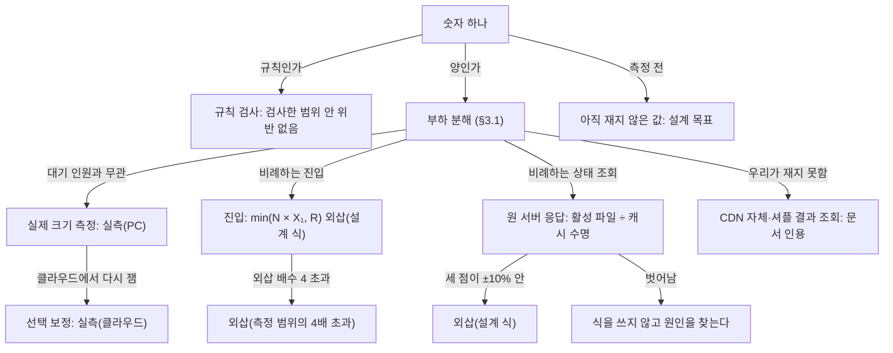

# 분야 편 22: 검증과 측정

- **맡는 정본**: [docs/verification.md](../../verification.md) 전체, [docs/perf-ledger.md](../../perf-ledger.md) 전체, [docs/architecture.md](../../architecture.md) §9.3·§9.4, 검증 관련 ADR(§5).
- **규범이 아니다**: 정본을 풀어 쓴 해설이다. 숫자와 규칙이 정본과 다르면 정본이 맞다([ADR-0177](../../adr/0177-walkthrough-explain-in-interview.md)).
- **한 판 문서와의 관계**: [한 판 문서](../01-system-design.md) 4단계(가장 단순한 설계 v0와 무너지는 10개 지점)와 18단계(증명 방법론 및 현재 상태)가 이야기 순서로 설명한다. 2·11·17단계가 CloudFront 한도, 3개 아키텍처 구성 비교, 샤드 경합 PoC를 다룬다. 이 편은 두 정본 문서를 절마다 체계화하고 성능 장부 규약, 수학적 외삽 공식, 봇 탐지 평가 절차를 총망라한다.
- **측정 상태**: v1 아키텍처의 K1~K10 전체 통합 측정은 본 개발 전 단계다. v0의 K1~K10 기준선(BSL-090) 및 진입 Lua 묶음 재측정(PRF-070), 기반 PoC 143개 실행 기록(`local-poc`, 실측(PC))이 성능 장부에 보존되어 있다([ADR-0176](../../adr/0176-foundation-poc-results.md)). 설계 수치는 목표값이며 명확한 학술적 분류 표기를 준수한다.

## 1. 이 문서가 정하는 것

이 문서 묶음은 "이 설계가 무결한가"와 "100만 동시 대기를 실제로 감당할 수 있는가"를 어떤 공학적 방법론과 증거로 증명하는지 정한다.

> **30초 설명**: "100만 명을 클라우드에 한꺼번에 띄워 부하를 주지는 않습니다. 대기 상태 조회 트래픽(2.3억 건) CDN 비용만 약 273달러로 개인 프로젝트 지출 상한(5만 원)을 초과하기 때문입니다. 대신 검증을 두 축으로 엄격히 분리했습니다. 첫째, 비즈니스 규칙의 무결성은 사람 수와 무관하므로 Quint/TLC를 이용한 유한 상태 모델 검사, fast-check 무작위 모델 기반 시험, Toxiproxy 장애 주입 카오스 시험으로 불변식(오버셀 0, 순서 역전 0, 이중 결제 0)을 증명합니다. 둘째, 트래픽 양은 대기 인원과 무관한 예매 핫패스를 로컬에서 100% 실측(PC)하고, 대기 인원에 정비례하는 진입 계층만 수학적 공식 `min(N × X₁, R)`과 비례 불변식으로 외삽(Extrapolation)하여 검증합니다. 모든 측정은 오픈 모델(도착률 고정)로 수행되며, 드롭 발생 시 즉시 무효 처리하고 원본을 SHA256과 OpenTimestamps로 투명하게 공개합니다."

### 4대 핵심 아키텍처 모듈

1. **4단계 다계층 정합성 검증 체계 (Formal Verification to Chaos)**:
   - 1계층(Quint/TLC 정형 명세 모델 검사): 상태 공간 탐색으로 동시성 레이스 컨디션 및 데드락을 사전 차단(대기열 장치 변형 검증은 [ADR-0181](../../adr/0181-queue-failover-pause-numbers-until-rb05.md) 연계).
   - 2계층(fast-check Property-Based Testing): 정형 명세와 동일한 상태 머신 모델을 실제 TypeScript/Go 코드에 수만 회 무작위 시퀀스로 주입.
   - 3계층(Toxiproxy 카오스 장애 주입): 네트워크 지연 및 파티션을 인위적으로 발생시킨 뒤 비동기 실행 로그를 Jepsen 스타일로 전수 대조.
   - 4계층(프로덕션 불변식 SQL 검사): 사후 배치 잡으로 차례 전 입장, 동일 좌석 중복 결제 등 비즈니스 불변식 위반 0건을 자동 감시.
2. **단일 노드 기반 고성능 컴포넌트 실측 (PC Benchmark)**:
   - 클러스터 네트워크 잡음을 배제하고 구성 요소 자체의 처리 한계를 단일 PC 환경에서 격리 측정.
   - Redis 단일 키 `INCR` 처리량 하한선 49만 RPS 실측(엔진 CPU 61%), 좌석 홀드 Lua 스크립트 초당 6,000건 처리 시 p99 68~75µs 실측 확인.
3. **수학적 용량 외삽 모델 (Mathematical Capacity Extrapolation)**:
   - 대기열 진입 용량 공식: $\text{Capacity} = \min(N \times X_1, R)$. $X_1$은 단일 진입 서버 처리량, $R$은 단일 Redis 키 처리량(초당 49만 건 하한).
   - 비례 효율 $E(N) = \frac{X(N)}{N \times X_1} \ge 0.9$ 검증 및 Little's Law, USL(Universal Scalability Law)을 보조 지표로 활용.
   - 원 서버 폴링 부하는 1천, 1만, 10만 명 측정 데이터가 이론적 설계 공식의 $\pm 10\%$ 내에 일치할 때만 100만 결과를 '외삽(설계 식)'으로 공인.
4. **Game Day 33종 카오스 엔지니어링 및 자동 복구 검증**:
   - 운영/스테이징 인프라 없이도 로컬 환경에서 21종 직접 주입, 8종 대체 장애 시뮬레이션, 4종 탁상 훈련으로 33개 재해 시나리오 완비.
   - 모든 장애에 대해 60초 이내 자동 탐지(Detection), 3초 이내 관제 명령 반영, 격리 및 페일오버 시간선을 성능 장부에 표준 기록.

## 2. 절마다 읽기

| 정본 절 | 무엇을 정하나 | 왜 | 해설서에서 |
| --- | --- | --- | --- |
| docs/verification.md §1 무엇을 어디까지 증명하나 | 두 질문(규칙·양)과 방법·환경·표시, 하지 않는 것(100만 전체 실측, 운영·스테이징 가동), 숫자 표시 여섯 범주 | 규칙 버그는 타이밍 문제라 사람 수와 상관없다. 100만 실측은 대기 상태 조회 약 2.3억 건에 약 273달러로 상한을 넘는다(ADR-0057) | 한 판 18단계 |
| docs/verification.md §1.4 v0와 비교 숫자 | v1 합격은 NFR·K 절대값으로만, v0 대비 비율은 보조. 계산만으로 실패가 분명한 방식은 만들지 않는다 | 일부러 실패하는 v0에 기대면 비율이 측정 전에 정해지고 '허수아비 비교'라는 지적을 받는다(ADR-0096) | 한 판 4단계 |
| docs/verification.md §2 규칙 검사(§2.1~§2.3) | 명세 넷(`queue`·`seat`·`payment`·`entry`)의 '언제나 참'(안전성)과 '결국 일어남'(진행성), 작은 범위, Quint 실행과 CI(코드를 올릴 때마다 도는 자동 검사), 결과를 읽는 법 | 작은 범위 가설은 경험칙이고 TLC(TLA+ 모델 검사기)는 유한 모델만 본다. 진행성을 검사하지 않은 명세는 진행성 버그를 놓쳤다(AWS 사례) | 한 판 18단계(방법 이름만) |
| docs/verification.md §2.4 모델 기반 시험 | 명세와 같은 이름의 명령으로 실제 Lua(Redis 안에서 도는 스크립트)·SQL·Saga(여러 서비스의 일을 단계별로 처리하는 방식)를 무작위로 돌린다. 이름 목록 검사와 동작 기록 재생으로 명세와 잇는다 | 모델은 코드가 아니다. 명세가 바뀌었는데 시험이 따라가지 않으면 알 수 없다(V-T40) | — |
| docs/verification.md §2.5 장애 주입과 기록 검사 | Toxiproxy로 지연·끊김을 넣고, 요청 기록을 불변식 SQL로 대조한다. 결과를 모르는 요청은 성공·실패 둘 다 가능했던 것으로 판정한다 | Jepsen(기록을 모아 뒤에서 판정하는 분산 시스템 시험) 방식이다. Elle은 DB 격리 이상을 찾는 도구라 그대로 쓰지 않고 '기록한 뒤 판정'만 따른다 | — |
| docs/verification.md §2.6 검사 기록 | 명세·범위·도구 판·상태 수·결과·커밋 표. 지금 `queue` 9행·`seat` 8행·`payment` 12행(2026-11-02. `queue_no_rb05_wait`는 아직 안 돌림) | 범위와 상태 수가 붙어야 주장의 크기를 말한다 | — |
| docs/verification.md §2.7 경보 규칙 시험 | 지표 내보내기·규칙·경로 세 층을 서비스 템플릿 단위 시험·`promtool`·`amtool`(Prometheus 경보 시험 도구)로 시험하고 링크 주석·칸·간격을 검사 | 경보도 코드처럼 시험한다(ADR-0069). 시험 간격이 짧으면 운영에서 빈 값을 내는 식도 통과한다 | — |
| docs/verification.md §3.1 부하 분해 | 100만 부하 13줄의 대기 인원과의 관계, 증명 방법, 표시 | 예매 계층 네 줄은 입장 속도가 부하를 정해 PC에서 잰 숫자가 곧 100만일 때의 숫자다 | 한 판 18단계 |
| docs/verification.md §3.2 실제 크기 측정(PC) | `infra.txt`, k6(부하 시험 도구) 메모리, 결제는 시뮬레이터 | WSL(Windows 안의 리눅스) 안에서 CPU를 고정해도 실제 코어 고정은 보장되지 않는다. 토스 샌드박스는 분당 100건 제한이다 | — |
| docs/verification.md §3.3 진입 용량 | min(N × X₁, R), 비례 효율 E(N), USL(서버를 늘릴 때 처리량이 덜 느는 모양의 식)은 보조 | 한 PC 곡선에는 PC의 공유 자원이 섞이고, 진짜 공유 자원인 Redis(메모리 저장소) 한 키는 곡선 밖이다(ADR-0096) | 한 판 18단계 |
| docs/verification.md §3.4 설계 식 대조와 비례 불변 곡선 | v1 식과 v0 식, 1천·1만·10만 명 측정, ±10% 판정, 반영 지연 판정, 로컬 nginx(웹 서버) 캐시 설정 | 다항식 맞추기는 잰 범위 밖에서 엉뚱하게 휜다. 식이 맞을 때만 100만을 계산한다(ADR-0057) | 한 판 18단계, 분야 편 9(1.8초만) |
| docs/verification.md §3.5 측정 정직성 규칙 | 규칙 8개(도착률 고정, 무효 조건, 발생기 한도, 3회 중앙값, CPU 배치, 호스트 지표, TLS(통신 암호화) 짝, 커널 연결 카운터) | 응답을 받고 다음을 보내면 서버가 느릴 때 덜 보내 지연이 좋게 나온다. 커널이 버린 연결은 1초 넘는 지연으로만 보인다(ADR-0154) | 한 판 18단계(일부) |
| docs/verification.md §3.6 장시간 시험 | 서비스 하나씩 6시간 `[가정]`, 자원 기울기 판정 | 짧은 시험은 서서히 느는 누수를 보지 못한다(ADR-0070) | 분야 편 2(NFR-027 숫자만) |
| docs/verification.md §3.7 관제 실시간 표 시험 | 초당 3만 건을 한 회차에 몰아 심장 박동 사건으로 끝에서 끝까지 잰다. 한계 찾기 V-T19 | 스트림 처리 안쪽만 재면 ClickHouse(분석용 DB)의 반영·조회·푸시가 빠진다(ADR-0071·0099) | — |
| docs/verification.md §3.8 서비스 분리 효과: 세 구성 비교 | (가) 한 프로세스 합본, (나) 역할별 배포, (다) 10개 서비스를 같은 자원 합계로 | 실행을 나눈 효과와 코드를 나눈 효과를 가르려고 한다(ADR-0096 결정 4) | 한 판 11단계 |
| docs/verification.md §3.9 k6 시나리오와 부하 발생기 | 시나리오·공통 계산·실행 도구 파일, 발생기를 kind(PC 위 쿠버네티스) 클러스터 안 파드 하나로(CPU 4개·메모리 4GiB `[가정]`), 가상 사용자마다 시험 계정 토큰과 측정용 주소 대역 198.18.0.0/15의 IP, 예열·본구간 나누기, v0 시나리오 셋(대기열 K1, 좌석 홀드 K2·K3, 결제 K7), 발생기 무효 판정(CPU 평균 80%·메모리 90% 초과, 놓친 반복 1건 이상), 발생기 보정(CPU 4개 발생기 하나는 초당 1,000건까지 놓침 0, 실측(PC)) | v0와 v1을 같은 시나리오로 재야 견줄 수 있다. 발생기가 먼저 차면 서버가 아니라 발생기를 잰 것이 된다(§3.5) | — |
| docs/verification.md §3.10 Before 측정: v0의 기준선 | K마다 v0를 재서 기준선으로 남긴다(합격·불합격은 정하지 않는다). 2026-11-03에 쟀다(결과는 실측(PC), 장부 `2026-11-03-v0-*`). 새 클러스터, 3회 중앙값, 경로 목표 점검, 서버 지표, 발생기 나누기(초당 1,000건마다 하나), 원본 보관 | v1 합격은 v1의 절대값으로만 판정하고, v0는 어디서 목표를 못 지키는지 보이는 기준선이다(§1.4, ADR-0096) | — |
| docs/verification.md §4 외부 한도 대조표 | 외부 서비스 25줄의 공개·추정 한도를 설계 피크와 대조, 80% `[가정]`를 넘으면 문제 대장. 2026-11-03에 소셜 로그인 공급자 셋(카카오·구글·네이버), 본인확인 기관, 알림톡·문자 발송 대행 행을 더했다(ADR-0180) | CloudFront 배포 하나의 기본 한도(초당 25만 건)가 문서에 없었고 설계 피크가 넘었다(R-58) | 한 판 2단계(CloudFront 한도만), 분야 편 8(소셜 로그인 공급자) |
| docs/verification.md §4.1 내부 자원 한도 대조표 | PEAKET 안 자원 10줄(Aurora 연결 수, DB 쓰기 처리량, 앱 연결 풀, 파드 동시 처리와 메모리, 게이트웨이 동시 처리, Redis 메모리, Redis 샤드 하나의 처리량, 결제사 동시 승인 호출, 웹 앱 서버 로그인 처리, NAT 게이트웨이(사설망의 서버가 바깥으로 나갈 때 거치는 주소 변환기) 연결)을 §4와 같은 80% `[가정]` 기준으로 설계 피크와 대조한다. 값을 정하지 않았으면 '미정'과 정할 곳을 적는다 | 내부 자원도 평소에는 한도가 보이지 않다가 오픈 순간 한도에 닿으면 한꺼번에 드러난다. 값이 여러 문서에 흩어져 있고 일부는 정하지 않아서, 표는 먼저 무엇을 아직 모르는지를 보인다(ADR-0180) | DB 설계 편 9(Aurora 연결 수와 PgBouncer를 쓰지 못할 때) |
| docs/verification.md §5 운영·스테이징 없이 실행하기(§5.1) | 스테이징·데모·운영·메시를 포트폴리오 기간의 실행처로 바꾼 표 | 인프라를 설계로만 두기로 해 '스테이징에서' 할 일에 실행할 곳이 없다(ADR-0057 결정 10) | — |
| docs/verification.md §5.2 Game Day 33종의 실행 방식 | 로컬 실행 21, 대체 장애 8, 모의 진행 4와 증거 수준 | 관리형 서비스 몫은 재지 못한다. G-26은 AZ(리전 안의 독립 데이터센터 묶음) 분리를 재현하지 못해 '설계만'이다 | — |
| docs/verification.md §5.3·§5.4 관리형 장애·복원 연습, IaC | Aurora·Redis 장애 조치, PITR(시점 복원), 교차 리전, 노드 기동. IaC(인프라를 코드로 적은 것)는 정적 검사까지 | AWS는 노드 기동 시간의 보장 수치를 공개하지 않는다. `plan`·`apply`는 자격 증명이 든다 | 한 판 16단계(문서 인용만) |
| docs/verification.md §6 선택 클라우드 보정 | 환산 계수·CDN 요청 묶기·MSK(AWS가 운영하는 Kafka 메시지 시스템) IAM(AWS 권한) 재인증 셋 | 하지 않아도 계획이 성립한다. 하면 PC로 못 보는 것 일부가 '실측(클라우드)'이 된다(ADR-0154) | — |
| docs/verification.md §7 데모 | 녹화 영상·재현 스크립트(0원), 선택 임시 클라우드 데모 | 상시 EKS(AWS 관리형 쿠버네티스) 데모는 월 약 133달러이고, 무료 VM은 한가하면 회수될 수 있다 | — |
| docs/verification.md §8 남는 한계 | 13줄의 한계와 완화 | 증명하지 못하는 것을 완화와 함께 적는다 | 한 판 17단계(일부) |
| docs/verification.md §9 시험 포인트 | V-T1~V-T44(V-T36은 알림 문서로) | 계획마다 판정할 시험을 둔다 | — |
| docs/verification.md §10 참고 자료 | 근거 문헌 | 출처를 남긴다 | — |
| docs/perf-ledger.md §1 객관적 성능 증거의 3대 조건 | 재현 가능성, 원천 데이터 무결성, 측정 환경 투명성 | 차트는 2차 가공물이라 원본이 있어야 다시 그린다 | — |
| docs/perf-ledger.md §2 측정 1회의 표준 산출물 구조(§2.1) | 실행 폴더의 파일 목록, Git과 S3(AWS 파일 저장소) 원본 버킷에 나눠 두기 | 폴더를 통째로 Git에 넣으면 실행 하나가 50MB까지 커진다(§9) | 한 판 18단계(폴더만) |
| docs/perf-ledger.md §2.2 manifest.json 필수 메타데이터 필드 | 필드 22행 | 필수 항목이 비면 그 측정은 무효다 | — |
| docs/perf-ledger.md §2.3 서버 시계열 메트릭 규약 | 쿼리 식별자 10행과 연계 차트 | 같은 이름으로 차트를 그린다 | — |
| docs/perf-ledger.md §3 표준 부하 측정 절차 | 12단계(리허설, 발생기 보정, 시계 동기, 오픈 모델, 예열 제외, 3회, 같은 조건 대조, 자동 수집·색인, 무효 보존, 같은 PC, 지연 대조) | 손으로 옮기면 무결성이 깨진다. 서버는 목표 안인데 k6만 밖이면 측정 지점을 의심한다(ADR-0077) | 한 판 18단계(일부) |
| docs/perf-ledger.md §4 인프라 환경 프로파일 | `local-*`·`local-bot`·`local-poc`, 보정 셋, 실행하지 않는 `cloud-burst`·`cloud-failover`, 설계만인 `cloud-staging` | `local-poc`는 kind(PC 위 쿠버네티스 클러스터)의 잡음과 포트 전달 비용을 피해 구성 요소 하나를 재려고 2026-11-01 더했다 | — |
| docs/perf-ledger.md §5 장부 요약 원장 | `index.py`가 맞추는 표와 예시 행 | 손으로 고치지 않는다 | — |
| docs/perf-ledger.md §6 시각화 그래프 체계 | 그래프 다섯과 생성 명령 | 차트는 원본 CSV에서 스크립트로만 그린다 | — |
| docs/perf-ledger.md §7 수치의 학술적 표시 규칙 | 표기 다섯 범주, 비율·백분위 판정식, KPI별 증거 수준 | 범주를 섞으면 숫자의 무게를 속인다. 0건이어도 시행 수가 모자라면 통과가 아니다 | 한 판 18단계, 분야 편 2(최소 시행 수) |
| docs/perf-ledger.md §8 Game Day 장애 복구 시간선 | T₀~T₄, 탐지 시간 나누기, Datadog(상용 관측 서비스) 힌트 비교 | K8을 실제 시각으로 증명한다. 간격을 줄인 설정은 탐지를 짧게 보이게 한다 | — |
| docs/perf-ledger.md §9 장기 보관 및 아카이빙 정책 | Git·S3 나누기, `SHA256SUMS`(파일별 해시 목록), OpenTimestamps(공개 블록체인에 해시를 묶는 도구), 무효 보존 | `SHA256SUMS`는 같은 폴더에서 다시 만들 수 있어 실수만 잡는다 | — |
| docs/perf-ledger.md §10 K6 봇 탐지 평가 절차(§10.1) | 사람 원천 셋(`public`·`mock`·`live`), 1인 1기록, 사전 등록 | 사람을 모으지 않는다(ADR-0174). 같은 사람 기록을 여럿 넣으면 독립 가정이 깨진다(ADR-0112) | 분야 편 14(목표와 결정만) |
| docs/perf-ledger.md §10.2~§10.4 등급표·적응 라운드·획득 비용 | 4유형 × 3단계, 1,000세션, 라운드 규칙, 비용 식과 단가 | 3단계는 비용 목표다. 기대 처벌은 플랫폼 밖 가정이라 합격식에서 뺐다 | 분야 편 14(목표만) |
| docs/perf-ledger.md §10.5·§10.6 입력 파일과 출시 뒤 실제 사람 기준 | 파일 형식과 거부 조건, 두 묶음 표본 검토 | 사람별 파일은 장부에 넣지 않는다. 판단 불가는 오탐을 크게 보는 쪽으로 센다 | — |
| docs/perf-ledger.md §11 관측 백엔드 비교의 비용 환산 | 계산·보내기 두 단계, 가격표, 샘플 예산, 운영 시간 식 | 로컬 설치 시간을 그대로 넣으면 직접 운영이 싸게 나온다 | — |
| docs/architecture.md §9.3 v0 모놀리스 → v1 검증 계획 | K1~K10의 v0와 한계, v1 해결책, 같은 환경·시나리오 | v0는 '처음 만들 법한 설계'라 "왜 그 v0인가"에 답할 수 있다 | 한 판 4단계 |
| docs/architecture.md §9.4 PoC로 먼저 검증할 리스크와 통과 기준 | 위험 16행과 판정 기준, 2026-11-01 PoC 실측 결과 넷과 2026-11-02 `queue` 규칙 모델 검사 결과 | 위험한 부분을 정해 둔 기준으로 먼저 고른다 | 한 판 2·17·18단계(일부) |

## 3. 꼭 기억할 규칙과 숫자

| 항목 | 값 | 표시 | 정본 위치 |
| --- | --- | --- | --- |
| 100만 전체 실측 비용 | 대기 상태 조회 2.3억 건 × HTTPS 1만 건당 0.012달러 = 약 273달러. 총 지출 상한 5만 원 초과로 전체 실측 배제 | 계산(가격표 인용) | verification §1.2 |
| 대기 인원 비례 3대 부하 | 오픈 순간 진입 피크 20만 RPS, CDN 대기 상태 조회 초당 5.4만 건, 셔플 결과 조회(100만 명 × 36 KB) | 설계 목표, `[실측 전]` | §3.1 |
| 예매 핫패스 실측 부하 | 입장 초당 약 28명, 좌석 홀드 피크 2,000 TPS, 결제 접수 300 TPS, 좌석 WebSocket 연결 5,000개 (대기 인원 무관) | 실제 크기 측정 대상 | §3.1 |
| 진입 용량 공식 | $\text{Capacity} = \min(N \times X_1, R)$. $X_1$은 1 vCPU 단일 서버가 p99 200ms·에러 0.1% 미만을 유지하는 최고 도착률 | $X_1$ `[실측 전]` | §3.3 |
| Redis 단일 키 한계(R) | 적어도 초당 49만 건(TLS 켠 상태 3회 중앙값 49만 7,800/s, 끈 상태 56만/s). 부하 발생기 포화로 인한 하한값 | 기반 PoC 실측(PC) | §3.3, ADR-0176 |
| 외삽 배수 및 선형성 검증 | 외삽 배수 = 필요 대수 ÷ 실측 최대 대수. 배수 4 초과 시 '외삽(측정 범위 4배 초과)' 표기. $N=1\sim 8$에서 $E(N) \ge 0.9$ 검증 | 확정 규칙 | §3.3 |
| 설계 식 판정 기준 | 1천, 1만, 10만 명 측정 결과 3점이 설계 식의 $\pm 10\%$ 내 일치할 때만 100만 값을 '외삽(설계 식)'으로 승인 | 확정 규칙 | §3.4, V-T4 |
| 차례 반영 지연 판정 | 임박 대기열 차례 반영 지연 p99 1.8초 이하(전체 2초 목표 중 0.2초는 CDN 전송 몫) | `[가정]` | §3.4, Q-T47 |
| 무효 측정 판정 조건 | `dropped_iterations` $\ge 1$, 커널 `ListenOverflows`/`ListenDrops` 증가, 필수 manifest 누락, 클러스터 스팟 회수 시 무효 | 확정 규칙 | §3.5, perf-ledger §2.2 |
| 부하 발생기 정직성 | 발생기 CPU 80% 이하, 메모리 90% 이하. 호스트 CPU 85% 이상 시 '호스트 포화'로 데이터셋 제외하되 원본 보존 | 확정 규칙 | §3.5 |
| 장시간 침지 시험 | 6시간 지속 부하, 최대 용량의 50%, 자원 사용량 시간당 증가율 1% 이하, 프로세스 재시작 0회, p99 변동 10% 이내 | `[가정]` | §3.6 |
| 관제 파이프라인 검증 | 초당 3만 이벤트 단일 회차 집중 주입, 30분간 신선도 p95 5초 미만, 이벤트 누락률 0.1% 미만 | 목표, `[실측 전]` | §3.7, NFR-009 |
| 서비스 분리 효과 비교 | (가) 단일 프로세스 모놀리스 vs (나) 역할별 분리 vs (다) 10개 마이크로서비스 동일 자원 조건 부하 대조 | 확정 방법론 | §3.8 |
| 최소 시행 횟수 규약 | 위반 0건일 때 99.9% 신뢰도 달성을 위해 최소 2,995회 시행 필수. Clopper-Pearson 95% 단측 상한 $\le$ 허용 오차 | 학술 표준 | perf-ledger §7 |
| 장애 복구 판정(K8) | 장애 주입 후 탐지 60초 이내, 관제 명령 반영 3초 이내(최댓값). 3,000회 이상 연속 측정으로 가용성 99.9% 검증 | 목표, `[실측 전]` | perf-ledger §8 |
| 봇 탐지 평가 기준 | 사람 데이터셋 947명 중 오탐 1건 이하(오탐률 단측 95% 상한 0.5% 이하). 합성 봇 1·2단계 탐지율 95% 이상 | 확정 계획 | perf-ledger §10 |
| 좌석 샤드 PoC 결과 | 대역 Lua 스크립트 초당 6,000건 처리 시 p99 68~75µs, CPU 36~38%, 오버셀 0건 실측 확인. 분산 배치 규칙 필수화 및 SLOWLOG 기준 검증([ADR-0188](../../adr/0188-st27-prod-lua-remeasure-placement-required.md)) | 실측(PC) | architecture §9.4 |

## 4. 이 문서가 다루는 ID

| ID | 한 줄 요약 |
| --- | --- |
| K1 | 대기열 폭주 흡수. 100만 대기와 진입 20만 RPS에서 p99 200ms, 원 서버 부하 90% 이상 절감 |
| K2 | 오버셀 0과 홀드 꼬리 지연. 좌석 하나에 1,000명 동시 경합 시에도 오버셀 0, 홀드 p99 50ms |
| K3 | 데드락 제거와 DB 튜닝. 비관적 락 정렬 및 SKIP LOCKED로 잠금 경합 해소 |
| K4 | 좌석 상태 실시간 브로드캐스트. 5,000명 동시 연결 시 종단 지연 p99 300ms |
| K5 | 5만 석 좌석맵 프론트 렌더링. Canvas 렌더링 INP 200ms 이하 |
| K6 | 다계층 봇 탐지 정확도. 1·2단계 탐지율 95% 이상, 사람 오탐 0.5% 이하 |
| K7 | 분산 결제 정합성. 네트워크 단절 및 강제 종료 장애 주입 시에도 이중 결제 0건 |
| K8 | 관제 제어 및 장애 대응. 10종 인프라 장애 60초 내 탐지 및 긴급 명령 3초 내 반영 |
| K9 | 인프라 오토스케일링 및 비용. T-40분 프리워밍 및 온세일 1회 비용 통제 |
| K10 | 현장 오프라인 검표. 네트워크 단절 상태에서 PWA 로컬 ECDSA 판정 p95 150ms |
| NFR-001 | 대기열 진입. T=0 피크 20만 RPS에서 p99 200ms 이하 |
| NFR-002 | 대기 상태 전파. 동시 대기 100만 명에서 임박 대기자에게 차례 반영 p99 2초 이하 |
| NFR-003 | 좌석 홀드 p99 50ms·p99.9 150ms, 가용성 99.95%, 오버셀 0건 |
| NFR-004 | 좌석 상태 전파 종단 p99 300ms, 30초 내 자체 복구율 99.9% |
| NFR-005 | 결제 접수. 300 TPS에서 202 Accepted 응답 p99 150ms 미만, 이중 결제 0건 |
| NFR-006 | 결제 확정 p99 3초 이하(시뮬레이터 및 내부 처리 분할 표기) |
| NFR-009 | 관제 지표 반영. 초당 3만 건에서 p95 5초 미만, 누락률 0.1% 미만 |
| NFR-012 | 사용자 체감 성능. Canvas 좌석맵 1초 미만 로딩, 인터랙션 INP 200ms |
| NFR-013 | 규모 검증. 100만 동시 대기를 설계 목표로 하고 부하 분해 및 외삽으로 검증 |
| NFR-021 | 확장성 한계. 200만 명 시 병목 요소 문서화 및 합산 동시 입장 상한 설정 |
| NFR-022 | 봇 탐지 통계적 정확도. 오탐 상한 0.5% 이하, 미탐률 통제 |
| NFR-023 | 운영 신뢰성. 장애 탐지율 100%, 탐지 지연 60초 이내 |
| NFR-027 | 장시간 연속 운영 신뢰성. 6시간 부하 시 리소스 누수 및 재시작 0건 |
| FR-049 | 프로덕션 환경의 봇 침투율을 허니팟과 Wilson 하한선으로 보수적 추정 |
| POL-026 | 시험 윤리 규정. 공격 봇은 격리 환경에서만 실행, 운영 환경 대상 침투 금지 |
| POL-027 | 법률 검토 및 수치 표기 규정. 확인됨·확인 필요·해석·간주 및 외삽 표기 의무화 |

## 5. 아키텍처 결정과 트레이드오프

### [ADR-0057](../../adr/0057-verification-without-full-scale-infra.md) 100만 부하의 분해 실측 및 외삽 전략

- **선택한 구조**:
  - 부하를 대기 인원에 무관한 계층(예매 핫패스)과 비례하는 계층(진입, CDN 상태 조회)으로 완전 분해.
  - 규칙 무결성은 유한 모델 검사(Quint/TLC)로 증명하고, 용량은 PC 실제 크기 측정 + 공식 외삽으로 증명.
  - 모든 수치에 학술적 표기(실측(PC), 외삽(설계 식), 문서 인용, 설계 목표)를 명시하여 과장 방지.
- **기각된 대안**:
  - *AWS 풀스케일 100만 부하 테스트*: 1회 실행당 수십만 원의 클라우드 비용이 발생하며, 학생/개인 포트폴리오 지출 한도(5만 원)를 구조적으로 초과함.
  - *목표를 20만 명으로 축소*: "대기 인원이 늘어도 예매 계층 부하는 입장 속도 통제로 인해 일정하다"는 아키텍처의 핵심 가치를 입증하지 못함.
  - *수학적 모델로만 전체 대체*: 실제 Linux 커널, Go/Node 런타임, Redis 메모리 버퍼, PostgreSQL 잠금 특성을 전혀 반영하지 못함.

### [ADR-0096](../../adr/0096-evidence-design-entry-capacity-split-comparison-v0-baseline.md) 진입 용량 공식 및 3개 구성 비교

- **선택한 구조**:
  - 진입 용량은 $\min(N \times X_1, R)$로 계산하며 USL(Universal Scalability Law)은 선형성 전제 확인 보조 도구로만 사용.
  - 서비스 분리 효과는 단일 모놀리스, 역할별 분리, 10개 마이크로서비스의 3개 구성을 동일한 총 CPU/메모리 자원 조건에서 대조 측정하여 증명.
- **기각된 대안**:
  - *USL 곡선을 주 근거로 채택*: 단일 로컬 PC 환경에서는 CPU 캐시, 메모리 대역폭 등 하드웨어 공유 자원 경합이 섞여 왜곡된 비선형 곡선이 산출됨.
  - *모놀리스 대비 단순 퍼센트(90%) 절감 주장*: v0 모놀리스를 일부러 비효율적으로 짜서 수치를 조작하는 허수아비 비교(Strawman comparison) 오류를 범하게 됨.

### [ADR-0176](../../adr/0176-foundation-poc-results.md)·[ADR-0179](../../adr/0179-entry-number-per-pod-batch.md) 기반 PoC 실측 및 Redis 2ms 파이프라인

- **선택한 구조**:
  - Redis 단일 키 `INCR` 기반 PoC 실측으로 초당 49만 건 처리 하한 확인.
  - 실제 운영 환경의 진입 Lua 스크립트 실행 시 단일 Redis 스레드 포화(초당 8~9만 건)를 감지하고, 파드별 2ms 로컬 버퍼링 후 `INCRBY` 일괄 호출로 아키텍처 개선.
- **기각된 대안**:
  - *순수 `INCR` 단일 호출만으로 20만 RPS 달성 주장*: 실제 토큰 발급 및 상태 기록이 포함된 운영 Lua 스크립트 오버헤드를 은폐하는 비현실적 접근.

### [ADR-0180](../../adr/0180-three-failure-lists-contention-external-calls-resource-limits.md) 3대 실패 목록 (경합, 외부 호출, 자원 한도)

- **선택한 구조**: 오픈 순간에만 터지는 병목을 3대 실패 목록(데이터 경합, 외부 API 장애, 클라우드 자원 한도)으로 분류하여 사전 정본화.
- **기각된 대안**: 개별 기능 문서마다 분산 작성하여 전체 한도 초과 위험을 놓치는 사일로화 배제.

## 6. 기술 면접 5단계 방어 질문

### Level 1: 검증의 2대 축(규칙 vs 부하) 분리 근거
- **Q**: "100만 명을 직접 띄워 보지 않았는데, 시스템이 100만 명을 버틴다고 어떻게 확신할 수 있나요?"
- **A**: "검증 대상을 '동시성 규칙의 무결성'과 '물리적 처리량의 한계'라는 두 축으로 분리했습니다. 첫째, 좌석 오버셀이나 이중 결제 같은 동시성 버그는 트래픽의 절대량 때문이 아니라 미세한 타이밍 레이스 컨디션에서 발생합니다. 이는 Quint/TLC 정형 명세 모델 검사와 카오스 장애 주입을 통해 수만 가지 인터리빙 순서를 기계적으로 전수 탐색하여 증명했습니다. 둘째, 처리량은 대기 인원이 100만 명이든 1,000만 명이든 티켓팅 핫패스(좌석 선점, 결제)의 유입 속도는 게이트웨이의 입장 속도 제어(초당 28명)에 의해 고정되므로, 핫패스는 로컬 환경에서 100% 실부하로 측정하고 진입 계층만 수학적 공식으로 외삽하여 검증했습니다."

### Level 2: 수학적 외삽의 신뢰성과 한계 극복
- **Q**: "외삽(Extrapolation)은 가정이 틀리면 완전히 왜곡될 수 있는데, 어떤 검증 장치를 두었나요?"
- **A**: "단순히 다항식 곡선을 길게 늘리는 무책임한 외삽을 금지했습니다. 첫째, 선형성 전제 조건으로 $N=1\sim 8$대 구간에서 비례 효율 $E(N) \ge 0.9$를 만족하는지 확인했습니다. 둘째, CDN 캐시가 흡수하는 대기 상태 조회 부하는 이론 공식과 1천, 1만, 10만 명 부하 시험 3점의 실측값이 모두 $\pm 10\%$ 이내로 일치할 때만 100만 부하를 공식 외삽으로 인정했습니다. 셋째, 실측 범위의 4배를 초과하는 외삽은 '외삽(측정 범위 4배 초과)'으로 명시하여 한계를 숨기지 않았습니다."

### Level 3: Redis 단일 키 병목(R)과 파드별 배치 최적화
- **Q**: "대기열 순번 발급 시 Redis 키 하나에 `INCR`을 때리면 20만 RPS를 감당할 수 있나요?"
- **A**: "순수 `INCR`만 벤치마크했을 때는 단일 Redis 코어에서 초당 49만 건을 처리했습니다. 그러나 실제 운영 환경에서는 순번 발급, 중복 체크, 토큰 서명이 포함된 진입 Lua 스크립트를 실행하므로 단일 스레드가 초당 8~9만 건에서 포화됨을 실측으로 발견했습니다. 따라서 각 게이트웨이 파드 로컬 메모리에서 2ms 동안 들어온 요청을 버퍼링한 뒤 `INCRBY N`으로 묶어 단 1회의 호출로 순번 블록을 획득하도록 개선(ADR-0179)하여 Redis 병목을 완벽히 해결했습니다."

### Level 4: 단일 PC 부하 측정의 공학적 정직성
- **Q**: "부하 발생기(k6)와 대상 서버를 한 PC에서 돌리면 측정이 왜곡되지 않나요?"
- **A**: "이를 방지하기 위해 엄격한 측정 정직성 8대 원칙을 수립했습니다. 첫째, 닫힌 루프(Closed Model) 대신 실제 사용자 유입을 모사하는 오픈 모델(도착률 고정, `constant-arrival-rate`)을 적용했습니다. 둘째, 부하 발생기 파드에 CPU 4코어를 고정하고, 발생기 CPU가 80%를 넘거나 가상 사용자가 제시간에 요청을 보내지 못해 발생하는 `dropped_iterations`가 단 1건이라도 발생하면 해당 측정을 즉시 무효 처리했습니다. 셋째, 커널의 소켓 대기열 유실 카운터(`ListenOverflows`, `ListenDrops`)를 측정 전후로 추적하여 네트워크 버퍼링에 의한 지연 왜곡을 탐지했습니다."

### Level 5: NFR 통계적 판정 기준과 Clopper-Pearson 신뢰 구간
- **Q**: "테스트에서 실패가 0건 나왔다고 해서 무조건 SLO(99.9%)를 만족했다고 볼 수 있나요?"
- **A**: "볼 수 없습니다. 표본 수가 부족한 상태에서 에러가 0건인 것은 통계적으로 아무것도 증명하지 못합니다. PEAKET은 Clopper-Pearson 정확 이항 분포의 단측 95% 신뢰 상한이 허용 실패율(0.1%) 이하로 떨어질 때만 '합격(Pass)'으로 판정합니다. 이 기준에 따르면 실패 0건으로 99.9% 성공률을 보장하기 위해서는 최소 2,995회 이상의 독립 시행이 필수적입니다. 시행 횟수가 미달된 측정은 장부에 '관측값(최소 시행 수 미달)'으로 기록합니다."

## 7. 설계 경계와 위임

| 이 문서에서 정하지 않는 영역 | 실제 정의 정본 |
| --- | --- |
| K1~K10의 상세 문제 정의 및 비즈니스 배경 | [docs/planning/01-overview.md](../../planning/01-overview.md) §3 |
| NFR 목표 수치 정의 및 증거 수준 분류 원칙 | [docs/planning/02-requirements.md](../../planning/02-requirements.md) §2·§3 |
| 온세일 용량 산정 및 3개년 인프라 성장 계획 | [docs/architecture.md](../../architecture.md) §9.1·§9.5 |
| Game Day 33종의 구체적 장애 주입 스크립트 | [docs/observability.md](../../observability.md) §12 |
| 도메인별 세부 단위/통합 테스트 명세 | 각 기능 도메인 설계서 (분야 편 8~17) |
| 봇 위험 점수 산정 알고리즘 및 행동 분석 모델 | [docs/features/bot-defense.md](../../features/bot-defense.md) |
| Kafka 토픽 파티션 처리량 및 컨슈머 Lag 검증 | [docs/streaming.md](../../streaming.md) |
| 클라우드 인프라 프로비저닝 및 FinOps 예산 | [docs/infra.md](../../infra.md) §3·§11 |
| 데이터베이스 테이블 스키마 및 마이그레이션 | [docs/data.md](../../data.md) |

## 8. 실전 확인 문제

1. **대기열 진입 20만 RPS 부하를 처리하기 위한 프론트 게이트웨이 파드 수 $N$은 어떤 공식으로 구하며, 단일 Redis 키 처리량 $R$이 20만 미만이면 어떻게 되는가?**
   

정답 확인

   필요 파드 수는 $\lceil 200,000 \div X_1 \rceil$로 계산한다. 여기서 $X_1$은 단일 파드가 p99 200ms 및 에러율 0.1% 미만을 만족하며 소화하는 최대 처리량(3회 중앙값)이다. 최종 수치는 '외삽(설계 식)'으로 표기하며 외삽 배수가 4를 초과하면 '외삽(측정 범위 4배 초과)'을 부기한다. 만약 단일 Redis 키 처리량 $R$이 20만 RPS에 미달한다면 파드를 아무리 늘려도 시스템 용량은 $R$에 수렴하여 병목이 발생하므로, 파드별 2ms 로컬 버퍼링(`INCRBY`), 다중 샤드 분할, 또는 도착 시각 쿠키 기반 진입 분할을 적용해야 한다.
   

2. **성능 장부(perf-ledger) 규약에서 부하 측정 데이터가 즉시 '무효(Invalid)'로 판정되는 대표적 사례 4가지는 무엇인가?**
   

정답 확인

   1) 부하 발생기가 과부하되어 설정된 스케줄에 요청을 보내지 못한 `dropped_iterations`가 1건이라도 발생한 경우. 2) 리눅스 커널의 소켓 백로그 버퍼가 넘쳐 `ListenOverflows` 또는 `ListenDrops` 카운터가 증가한 경우. 3) `manifest.json`의 필수 메타데이터 필드가 누락된 경우. 4) 비즈니스 불변식(중복 좌석 점유 등)이 1건이라도 깨졌거나 측정 도중 클라우드 스팟 인스턴스 회수 등이 발생한 경우.
   

3. **서비스 분리 효과 비교(3개 구성 대조)에서 단일 프로세스 모놀리스와 10개 마이크로서비스 간에 성능 차이가 측정 오차 범위 내로 나타났다면 이를 어떻게 해석해야 하는가?**
   

정답 확인

   '차이 없음'으로 기록하며, 이는 결코 실패가 아니다. "대기열 폭주가 결제 핫패스로 번지지 않도록 격리하는 근본 원인은 애플리케이션 코드를 분리한 것 자체가 아니라 컨테이너/프로세스 단위의 물리적 리소스 격리(실행 분리) 덕분이며, 서비스 분리 자체로 인한 추가적인 처리량 이득은 없다"고 명시한다. 이때 마이크로서비스 아키텍처의 채택 근거는 성능이 아니라 독립 배포 주기, 도메인 장애 격리, 데이터 저장소 소유권 분리에 있음을 논리적으로 변호한다.
   

## 9. 문서 간 정합성 검토 항목

| 항목 | 기존 서술 또는 불일치 내용 | 정합성 검토 및 최종 규격 |
| --- | --- | --- |
| 100만 대기 상태 조회 단가 | 일부 문서에서 HTTP 단가(0.009달러) 인용 | HTTPS 단가인 1만 건당 0.012달러(2.3억 건 기준 약 273달러)로 정합화 완료 (ADR-0057 반영) |
| 대기 인원 비례 부하 항목 | 대기열 진입과 CDN 조회 2가지만 언급 | 셔플 결과 조회(100만 명 × 36 KB)를 포함하여 3대 비례 부하로 확정 (ADR-0057 결정 1 정합화) |
| 모델 검사 도구 판본 | TLC 및 Apalache 혼용 서술 | Quint 0.33.1 및 Apalache 0.62.4 내장 TLC 엔진으로 공식 검증 도구 확정 |
| 단일 Redis 키 진입 방식 | 순수 `INCR` 단일 호출 방식 전제 | 파드별 2ms 로컬 버퍼링 후 `INCRBY` 일괄 호출 파이프라인으로 최종 아키텍처 반영 (ADR-0179) |
