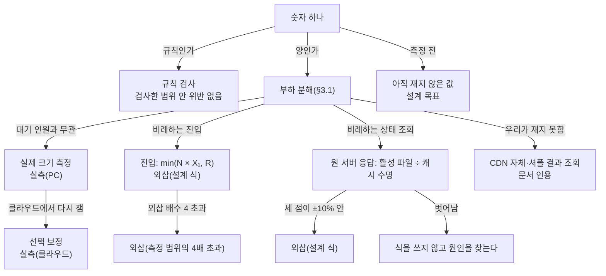

# 분야 편 22: 검증과 측정

- **기준 시점**: ADR-0177까지, 2026-11-02. 실패 목록 셋과 내부 자원 한도 대조표는 ADR-0180(2026-11-03)까지, §3.9·§3.10(k6 시나리오와 Before 측정)과 진입 순번 묶음(ADR-0179)도 2026-11-03까지 반영했다
- **맡는 정본**: [docs/verification.md](../../verification.md) 전체, [docs/perf-ledger.md](../../perf-ledger.md) 전체, [docs/architecture.md](../../architecture.md) §9.3·§9.4, 검증 ADR(결정 기록, §5)
- **규범이 아니다**: 정본을 풀어 쓴 해설이다. 숫자와 규칙이 정본과 다르면 정본이 맞다([ADR-0177](../../adr/0177-walkthrough-explain-in-interview.md)).
- **한 판 문서와의 관계**: [한 판 문서](../01-system-design.md) 4단계(가장 단순한 설계 v0와 깨지는 열 곳)와 18단계(어떻게 증명하나, 지금 어디까지 했나)가 이야기 순서로 설명한다. 2·11·17단계가 한 부분씩(CloudFront(AWS의 CDN, 사용자 가까이에서 대신 응답하는 전송망) 한도, 세 구성 비교, 샤드(데이터를 나눠 맡은 서버 묶음) 겹침 PoC(위험한 부분만 먼저 만들어 재는 시험)) 쓴다. 이 편은 두 정본을 절마다 정리하고 단계가 건너뛴 시험·장부 형식·보정·봇 평가 절차를 더한다.
- **측정 상태**: v1의 K1~K10과 서비스 단위 측정은 아직 없다. 2026-11-03에 v0의 K1~K10 기준선(BSL-090, docs/verification.md §3.10 '결과')과 진입 Lua 한 키 재측정(PRF-070, ADR-0179)을 실측(PC)으로 더 쟀다. 성능 장부에는 그 밖에 기반 PoC(구성 요소 하나씩 따로 잰 시험) 실행 폴더 143개(`local-poc`, 2026-11-01 측정, 2026-11-02 커밋)가 있고, 판정은 [ADR-0176](../../adr/0176-foundation-poc-results.md)(2026-11-01 채택)이며 세 정본이 그 값을 옮겨 적었다. 이 편은 그 값을 '기반 PoC 실측(PC)'으로 부른다. 설계 목표값은 `[실측 전]`이고, 정본의 `[가정]`은 그대로 옮겼다.

## 1. 이 문서가 정하는 것

docs/verification.md는 '설계가 옳다'와 '100만 명을 버틴다'를 무엇으로, 어디까지 증명하는지 정한다. 뼈대는 두 축이다. 1축 규칙 검사는 차례 전 입장 0, 오버셀(같은 좌석이 두 사람에게 팔리는 사고) 0, 이중 결제 0 같은 불변식(어떤 순서로 일이 벌어져도 깨지면 안 되는 약속)을 본다. 수단은 Quint(실행할 수 있는 명세 언어) 명세의 모델 검사(작은 범위에서 일어날 수 있는 모든 순서를 기계로 따져 보기), fast-check 모델 기반 시험(같은 동작을 실제 코드에 무작위 순서로 넣기), Toxiproxy(연결에 지연·끊김을 넣는 프록시) 장애 주입 뒤 기록 검사다. 2축 양 검증은 100만 부하를 대기 인원과 관계있는지로 나눈다. 관계없는 예매 계층은 PC에서 실제 크기로 재고, 비례하는 곳만 설계 식으로 늘려 '외삽'(잰 범위의 결과를 식으로 늘려 구한 값)으로 표시한다. 그 밖에 측정 정직성, 외부·내부 자원 한도 대조, 운영·스테이징 없이 Game Day(일부러 장애를 내고 대응을 연습하는 날)를 도는 법, 선택 보정, 남는 한계, 시험 V-T1~V-T44를 정한다. docs/perf-ledger.md(성능 장부)는 측정 1회가 증거가 되는 형식(실행 폴더, `manifest.json`(실행 조건을 적은 파일), 절차, 프로파일, 표시와 판정식, 보관법, 봇 평가 절차)을 정한다. docs/architecture.md §9.3은 K1~K10(v0와 v1을 견주는 핵심 기술 문제 10개)마다 v0와 v1 해결책을, §9.4는 본 개발 전에 PoC로 볼 위험과 통과 기준을 정한다.

> **30초 설명**: "100만 명을 한 번에 돌리지는 않습니다. 대기 상태 조회 요금만 약 273달러라 지출 상한 5만 원을 넘기 때문입니다. 대신 주장을 둘로 나눴습니다. 규칙이 맞는지는 사람 수와 상관없으니, 작은 범위의 모든 순서를 모델 검사하고 같은 규칙을 실제 코드에 무작위로 넣어 시험하고, 장애를 넣은 뒤 기록을 검사합니다. 양은 대기 인원과 무관한 예매 계층을 PC에서 실제 크기로 재고, 비례하는 진입과 원 서버 응답만 설계 식으로 늘립니다. 원 서버 응답은 식이 1천에서 10만 명 측정과 맞을 때, 진입은 서버 대수에 처리량이 비례할 때만 100만을 계산하고 '외삽'이라고 붙입니다. 측정은 도착률을 고정해서 보내고, 하나라도 못 보내면 무효로 하되 지우지 않고 남깁니다."

## 2. 절마다 읽기

`### ` 절 가운데 따로 물을 만한 것은 행을 나눴다.

| 정본 절 | 무엇을 정하나 | 왜 | 해설서에서 |
| --- | --- | --- | --- |
| docs/verification.md §1 무엇을 어디까지 증명하나 | 두 질문(규칙·양)과 방법·환경·표시, 하지 않는 것(100만 전체 실측, 운영·스테이징 가동), 숫자 표시 여섯 범주 | 규칙 버그는 타이밍 문제라 사람 수와 상관없다. 100만 실측은 대기 상태 조회 약 2.3억 건에 약 273달러로 상한을 넘는다(ADR-0057) | 한 판 18단계 |
| docs/verification.md §1.4 v0와 비교 숫자 | v1 합격은 NFR·K 절대값으로만, v0 대비 비율은 보조. 계산만으로 실패가 분명한 방식은 만들지 않는다 | 일부러 실패하는 v0에 기대면 비율이 측정 전에 정해지고 '허수아비 비교'라는 지적을 받는다(ADR-0096) | 한 판 4단계 |
| docs/verification.md §2 규칙 검사(§2.1~§2.3) | 명세 넷(`queue`·`seat`·`payment`·`entry`)의 '언제나 참'(안전성)과 '결국 일어남'(진행성), 작은 범위, Quint 실행과 CI(코드를 올릴 때마다 도는 자동 검사), 결과를 읽는 법 | 작은 범위 가설은 경험칙이고 TLC(TLA+ 모델 검사기)는 유한 모델만 본다. 진행성을 검사하지 않은 명세는 진행성 버그를 놓쳤다(AWS 사례) | 한 판 18단계(방법 이름만) |
| docs/verification.md §2.4 모델 기반 시험 | 명세와 같은 이름의 명령으로 실제 Lua(Redis 안에서 도는 스크립트)·SQL·Saga(여러 서비스의 일을 단계별로 처리하는 방식)를 무작위로 돌린다. 이름 목록 검사와 동작 기록 재생으로 명세와 잇는다 | 모델은 코드가 아니다. 명세가 바뀌었는데 시험이 따라가지 않으면 알 수 없다(V-T40) | — |
| docs/verification.md §2.5 장애 주입과 기록 검사 | Toxiproxy로 지연·끊김을 넣고, 요청 기록을 불변식 SQL로 대조한다. 결과를 모르는 요청은 성공·실패 둘 다 가능했던 것으로 판정한다 | Jepsen(기록을 모아 뒤에서 판정하는 분산 시스템 시험) 방식이다. Elle은 DB 격리 이상을 찾는 도구라 그대로 쓰지 않고 '기록한 뒤 판정'만 따른다 | — |
| docs/verification.md §2.6 검사 기록 | 명세·범위·도구 판·상태 수·결과·커밋 표. 지금 `queue` 9행·`seat` 8행·`payment` 12행(2026-11-02. `queue_no_rb05_wait`는 아직 안 돌림) | 범위와 상태 수가 붙어야 주장의 크기를 말한다 | — |
| docs/verification.md §2.7 경보 규칙 시험 | 지표 내보내기·규칙·경로 세 층을 서비스 템플릿 단위 시험·`promtool`·`amtool`(Prometheus 경보 시험 도구)로 시험하고 링크 주석·칸·간격을 검사 | 경보도 코드처럼 시험한다(ADR-0069). 시험 간격이 짧으면 운영에서 빈 값을 내는 식도 통과한다 | — |
| docs/verification.md §3.1 부하 분해 | 100만 부하 13줄의 대기 인원과의 관계, 증명 방법, 표시 | 예매 계층 네 줄은 입장 속도가 부하를 정해 PC에서 잰 숫자가 곧 100만일 때의 숫자다 | 한 판 18단계 |
| docs/verification.md §3.2 실제 크기 측정(PC) | `infra.txt`, k6(부하 시험 도구) 메모리, 결제는 시뮬레이터 | WSL(Windows 안의 리눅스) 안에서 CPU를 고정해도 실제 코어 고정은 보장되지 않는다. 토스 샌드박스는 분당 100건 제한이다 | — |
| docs/verification.md §3.3 진입 용량 | min(N × X₁, R), 비례 효율 E(N), USL(서버를 늘릴 때 처리량이 덜 느는 모양의 식)은 보조 | 한 PC 곡선에는 PC의 공유 자원이 섞이고, 진짜 공유 자원인 Redis(메모리 저장소) 한 키는 곡선 밖이다(ADR-0096) | 한 판 18단계 |
| docs/verification.md §3.4 설계 식 대조와 비례 불변 곡선 | v1 식과 v0 식, 1천·1만·10만 명 측정, ±10% 판정, 반영 지연 판정, 로컬 nginx(웹 서버) 캐시 설정 | 다항식 맞추기는 잰 범위 밖에서 엉뚱하게 휜다. 식이 맞을 때만 100만을 계산한다(ADR-0057) | 한 판 18단계, 분야 편 9(1.8초만) |
| docs/verification.md §3.5 측정 정직성 규칙 | 규칙 8개(도착률 고정, 무효 조건, 발생기 한도, 3회 중앙값, CPU 배치, 호스트 지표, TLS(통신 암호화) 짝, 커널 연결 카운터) | 응답을 받고 다음을 보내면 서버가 느릴 때 덜 보내 지연이 좋게 나온다. 커널이 버린 연결은 1초 넘는 지연으로만 보인다(ADR-0154) | 한 판 18단계(일부) |
| docs/verification.md §3.6 장시간 시험 | 서비스 하나씩 6시간 `[가정]`, 자원 기울기 판정 | 짧은 시험은 서서히 느는 누수를 보지 못한다(ADR-0070) | 분야 편 2(NFR-027 숫자만) |
| docs/verification.md §3.7 관제 실시간 표 시험 | 초당 3만 건을 한 회차에 몰아 심장 박동 사건으로 끝에서 끝까지 잰다. 한계 찾기 V-T19 | 스트림 처리 안쪽만 재면 ClickHouse(분석용 DB)의 반영·조회·푸시가 빠진다(ADR-0071·0099) | — |
| docs/verification.md §3.8 서비스 분리 효과: 세 구성 비교 | (가) 한 프로세스 합본, (나) 역할별 배포, (다) 10개 서비스를 같은 자원 합계로 | 실행을 나눈 효과와 코드를 나눈 효과를 가르려고 한다(ADR-0096 결정 4) | 한 판 11단계 |
| docs/verification.md §3.9 k6 시나리오와 부하 발생기 | 시나리오·공통 계산·실행 도구 파일, 발생기를 kind(PC 위 쿠버네티스) 클러스터 안 파드 하나로(CPU 4개·메모리 4GiB `[가정]`), 가상 사용자마다 시험 계정 토큰과 측정용 주소 대역 198.18.0.0/15의 IP, 예열·본구간 나누기, v0 시나리오 셋(대기열 K1, 좌석 홀드 K2·K3, 결제 K7), 발생기 무효 판정(CPU 평균 80%·메모리 90% 초과, 놓친 반복 1건 이상), 발생기 보정(CPU 4개 발생기 하나는 초당 1,000건까지 놓침 0, 실측(PC)) | v0와 v1을 같은 시나리오로 재야 견줄 수 있다. 발생기가 먼저 차면 서버가 아니라 발생기를 잰 것이 된다(§3.5) | — |
| docs/verification.md §3.10 Before 측정: v0의 기준선 | K마다 v0를 재서 기준선으로 남긴다(합격·불합격은 정하지 않는다). 2026-11-03에 쟀다(결과는 실측(PC), 장부 `2026-11-03-v0-*`). 새 클러스터, 3회 중앙값, 경로 목표 점검, 서버 지표, 발생기 나누기(초당 1,000건마다 하나), 원본 보관 | v1 합격은 v1의 절대값으로만 판정하고, v0는 어디서 목표를 못 지키는지 보이는 기준선이다(§1.4, ADR-0096) | — |
| docs/verification.md §4 외부 한도 대조표 | 외부 서비스 25줄의 공개·추정 한도를 설계 피크와 대조, 80% `[가정]`를 넘으면 문제 대장. 2026-11-03에 소셜 로그인 공급자 셋(카카오·구글·네이버), 본인확인 기관, 알림톡·문자 발송 대행 행을 더했다(ADR-0180) | CloudFront 배포 하나의 기본 한도(초당 25만 건)가 문서에 없었고 설계 피크가 넘었다(R-58) | 한 판 2단계(CloudFront 한도만), 분야 편 8(소셜 로그인 공급자) |
| docs/verification.md §4.1 내부 자원 한도 대조표 | PEAKET 안 자원 10줄(Aurora 연결 수, DB 쓰기 처리량, 앱 연결 풀, 파드 동시 처리와 메모리, 게이트웨이 동시 처리, Redis 메모리, Redis 샤드 하나의 처리량, 결제사 동시 승인 호출, 웹 앱 서버 로그인 처리, NAT 게이트웨이(사설망의 서버가 바깥으로 나갈 때 거치는 주소 변환기) 연결)을 §4와 같은 80% `[가정]` 기준으로 설계 피크와 대조한다. 값을 정하지 않았으면 '미정'과 정할 곳을 적는다 | 내부 자원도 평소에는 한도가 보이지 않다가 오픈 순간 한도에 닿으면 한꺼번에 드러난다. 값이 여러 문서에 흩어져 있고 일부는 정하지 않아서, 표는 먼저 무엇을 아직 모르는지를 보인다(ADR-0180) | DB 설계 편 9(Aurora 연결 수와 PgBouncer를 쓰지 못할 때) |
| docs/verification.md §5 운영·스테이징 없이 실행하기(§5.1) | 스테이징·데모·운영·메시를 포트폴리오 기간의 실행처로 바꾼 표 | 인프라를 설계로만 두기로 해 '스테이징에서' 할 일에 실행할 곳이 없다(ADR-0057 결정 10) | — |
| docs/verification.md §5.2 Game Day 33종의 실행 방식 | 로컬 실행 21, 대체 장애 8, 모의 진행 4와 증거 수준 | 관리형 서비스 몫은 재지 못한다. G-26은 AZ(리전 안의 독립 데이터센터 묶음) 분리를 재현하지 못해 '설계만'이다 | — |
| docs/verification.md §5.3·§5.4 관리형 장애·복원 연습, IaC | Aurora·Redis 장애 조치, PITR(시점 복원), 교차 리전, 노드 기동. IaC(인프라를 코드로 적은 것)는 정적 검사까지 | AWS는 노드 기동 시간의 보장 수치를 공개하지 않는다. `plan`·`apply`는 자격 증명이 든다 | 한 판 16단계(문서 인용만) |
| docs/verification.md §6 선택 클라우드 보정 | 환산 계수·CDN 요청 묶기·MSK(AWS가 운영하는 Kafka 메시지 시스템) IAM(AWS 권한) 재인증 셋 | 하지 않아도 계획이 성립한다. 하면 PC로 못 보는 것 일부가 '실측(클라우드)'이 된다(ADR-0154) | — |
| docs/verification.md §7 데모 | 녹화 영상·재현 스크립트(0원), 선택 임시 클라우드 데모 | 상시 EKS(AWS 관리형 쿠버네티스) 데모는 월 약 133달러이고, 무료 VM은 한가하면 회수될 수 있다 | — |
| docs/verification.md §8 남는 한계 | 13줄의 한계와 완화 | 증명하지 못하는 것을 완화와 함께 적는다 | 한 판 17단계(일부) |
| docs/verification.md §9 시험 포인트 | V-T1~V-T44(V-T36은 알림 문서로) | 계획마다 판정할 시험을 둔다 | — |
| docs/verification.md §10 참고 자료 | 근거 문헌 | 출처를 남긴다 | — |
| docs/perf-ledger.md §1 객관적 성능 증거의 3대 조건 | 재현 가능성, 원천 데이터 무결성, 측정 환경 투명성 | 차트는 2차 가공물이라 원본이 있어야 다시 그린다 | — |
| docs/perf-ledger.md §2 측정 1회의 표준 산출물 구조(§2.1) | 실행 폴더의 파일 목록, Git과 S3(AWS 파일 저장소) 원본 버킷에 나눠 두기 | 폴더를 통째로 Git에 넣으면 실행 하나가 50MB까지 커진다(§9) | 한 판 18단계(폴더만) |
| docs/perf-ledger.md §2.2 manifest.json 필수 메타데이터 필드 | 필드 22행 | 필수 항목이 비면 그 측정은 무효다 | — |
| docs/perf-ledger.md §2.3 서버 시계열 메트릭 규약 | 쿼리 식별자 10행과 연계 차트 | 같은 이름으로 차트를 그린다 | — |
| docs/perf-ledger.md §3 표준 부하 측정 절차 | 12단계(리허설, 발생기 보정, 시계 동기, 오픈 모델, 예열 제외, 3회, 같은 조건 대조, 자동 수집·색인, 무효 보존, 같은 PC, 지연 대조) | 손으로 옮기면 무결성이 깨진다. 서버는 목표 안인데 k6만 밖이면 측정 지점을 의심한다(ADR-0077) | 한 판 18단계(일부) |
| docs/perf-ledger.md §4 인프라 환경 프로파일 | `local-*`·`local-bot`·`local-poc`, 보정 셋, 실행하지 않는 `cloud-burst`·`cloud-failover`, 설계만인 `cloud-staging` | `local-poc`는 kind(PC 위 쿠버네티스 클러스터)의 잡음과 포트 전달 비용을 피해 구성 요소 하나를 재려고 2026-11-01 더했다 | — |
| docs/perf-ledger.md §5 장부 요약 원장 | `index.py`가 맞추는 표와 예시 행 | 손으로 고치지 않는다 | — |
| docs/perf-ledger.md §6 시각화 그래프 체계 | 그래프 다섯과 생성 명령 | 차트는 원본 CSV에서 스크립트로만 그린다 | — |
| docs/perf-ledger.md §7 수치의 학술적 표시 규칙 | 표기 다섯 범주, 비율·백분위 판정식, KPI별 증거 수준 | 범주를 섞으면 숫자의 무게를 속인다. 0건이어도 시행 수가 모자라면 통과가 아니다 | 한 판 18단계, 분야 편 2(최소 시행 수) |
| docs/perf-ledger.md §8 Game Day 장애 복구 시간선 | T₀~T₄, 탐지 시간 나누기, Datadog(상용 관측 서비스) 힌트 비교 | K8을 실제 시각으로 증명한다. 간격을 줄인 설정은 탐지를 짧게 보이게 한다 | — |
| docs/perf-ledger.md §9 장기 보관 및 아카이빙 정책 | Git·S3 나누기, `SHA256SUMS`(파일별 해시 목록), OpenTimestamps(공개 블록체인에 해시를 묶는 도구), 무효 보존 | `SHA256SUMS`는 같은 폴더에서 다시 만들 수 있어 실수만 잡는다 | — |
| docs/perf-ledger.md §10 K6 봇 탐지 평가 절차(§10.1) | 사람 원천 셋(`public`·`mock`·`live`), 1인 1기록, 사전 등록 | 사람을 모으지 않는다(ADR-0174). 같은 사람 기록을 여럿 넣으면 독립 가정이 깨진다(ADR-0112) | 분야 편 14(목표와 결정만) |
| docs/perf-ledger.md §10.2~§10.4 등급표·적응 라운드·획득 비용 | 4유형 × 3단계, 1,000세션, 라운드 규칙, 비용 식과 단가 | 3단계는 비용 목표다. 기대 처벌은 플랫폼 밖 가정이라 합격식에서 뺐다 | 분야 편 14(목표만) |
| docs/perf-ledger.md §10.5·§10.6 입력 파일과 출시 뒤 실제 사람 기준 | 파일 형식과 거부 조건, 두 묶음 표본 검토 | 사람별 파일은 장부에 넣지 않는다. 판단 불가는 오탐을 크게 보는 쪽으로 센다 | — |
| docs/perf-ledger.md §11 관측 백엔드 비교의 비용 환산 | 계산·보내기 두 단계, 가격표, 샘플 예산, 운영 시간 식 | 로컬 설치 시간을 그대로 넣으면 직접 운영이 싸게 나온다 | — |
| docs/architecture.md §9.3 v0 모놀리스 → v1 검증 계획 | K1~K10의 v0와 한계, v1 해결책, 같은 환경·시나리오 | v0는 '처음 만들 법한 설계'라 "왜 그 v0인가"에 답할 수 있다 | 한 판 4단계 |
| docs/architecture.md §9.4 PoC로 먼저 검증할 리스크와 통과 기준 | 위험 16행과 판정 기준, 2026-11-01 PoC 실측 결과 넷과 2026-11-02 `queue` 규칙 모델 검사 결과 | 위험한 부분을 정해 둔 기준으로 먼저 고른다 | 한 판 2·17·18단계(일부) |

## 3. 꼭 기억할 규칙과 숫자

| 항목 | 값 | 표시 | 정본 위치 |
| --- | --- | --- | --- |
| 100만 전체 실측 비용 | 대기 상태 조회 약 2.3억 건 × HTTPS 1만 건당 0.012달러 = 약 273달러(약 38만 원). 상한은 총 5만 원 | 계산(가격표 문서 인용) | verification §1.2 |
| 대기 인원에 비례하는 세 곳 | 오픈 순간 진입 피크 20만 RPS(초당 요청 수), CDN 대기 상태 조회 초당 약 5.4만 건, 셔플 결과 조회(100만 명 × 약 36 KB) | 설계 목표 `[실측 전]` | §3.1 |
| 예매 계층 | 입장 초당 약 28명, 홀드(결제 전 좌석 잡기) 피크 초당 2,000건, 결제 접수 300 TPS(초당 처리 건수), 좌석 연결 5,000개 | 실제 크기로 잴 값, `[실측 전]` | §3.1 |
| 진입 용량 식 | min(N × X₁, R). X₁은 1 vCPU(가상 CPU 하나) `[가정]` 서버가 p99(백 건 중 아흔아홉 건이 끝나는 시간) 200ms·오류율 0.1% 미만으로 받는 최고 도착률. 대수 ⌈200,000 ÷ X₁⌉ | X₁ `[실측 전]` | §3.3 |
| R(Redis 한 키 처리량) | 적어도 초당 49만 건(TLS 켬 3회 49만 800·49만 7,800·49만 7,500, 끔 56만). 발생기가 먼저 찬 하한이다 | 기반 PoC 실측(PC) | §3.3, ADR-0176 결정 1 |
| 외삽 배수·비례 확인 | 배수 = 필요 대수 ÷ 잰 최대 대수, 4를 넘으면 '외삽(측정 범위의 4배 초과)'. N = 1~8대에서 E(N) = X(N) ÷ (N × X₁) ≥ 0.9 | `[가정, 6.1.1에서 확정]` | §3.3 |
| 설계 식 판정 | 1천·1만·10만 명 세 점이 식의 ±10% 안이면 100만 값을 '외삽(설계 식)'으로 | `[가정, 6.1.1에서 확정]` | §3.4, V-T4 |
| 반영 지연 판정 | 임박 구간 차례 반영 p99 1.8초 이하면 통과(2초와의 차 0.2초는 CDN 층 몫) | `[가정]` | §3.4, Q-T47 |
| 무효가 되는 측정 | `dropped_iterations`(발생기가 시작하지 못한 반복) 1건 이상, `ListenOverflows`·`ListenDrops`(커널이 연결 대기열에서 버린 수) 증가, 필수 필드 빈칸, 간격이 운영과 다른 K8 실행 | 확정 규칙 | §3.5, perf-ledger §2.2·§8 |
| 발생기·호스트·TLS | 발생기 CPU 80%·메모리 90% 이하. 호스트 CPU 85% 이상은 '호스트 포화'로 뺀다. Redis는 TLS(통신 암호화) 켬·끔을 재고 켬 값으로 판정 | 85%는 `[가정]` | §3.5 |
| 장시간 시험 | 6시간, 최대 도착률의 50%, 예열 30분 제외, 자원 기울기 시간당 1% 이하, 재시작 0, p99 변화 10% 이내 | `[가정]` | §3.6 |
| 관제 실시간 표 | 초당 3만 건 한 회차, 30분 `[가정]`, 신선도 p95(백 건 중 아흔다섯 건) 5초 미만, 누락률 0.1% 미만 | 목표 `[실측 전]` | §3.7, NFR-009 |
| 세 구성 비교 | 결제 300 TPS 고정, 진입 폭주 없음·100%·120% `[가정]`, 조건마다 3회, 편차 안이면 '차이 없음' | 확정 방식 | §3.8 |
| 외부 한도 | 문제 대장 기준 80% `[가정]`. CloudFront 배포당 초당 25만 건·150 Gbps(기본), 큰 배포 셋은 피크의 1.5배 `[가정]` 이상으로 올린다 | 문서 인용 | §4 |
| 내부 한도: 결제사 동시 승인 호출(벌크헤드: 한 의존성이 자원을 다 쓰지 못하게 나눈 칸막이) | 상한은 채널 추정 상한 × 2초(토스 600건, 포트원 100건). 결제 접수 피크 300 TPS × 승인 응답 평소 0.5초 = 동시 150건으로 토스 상한의 25%다. 응답이 2초로 늘면 600건으로 상한에 닿아, 입장 속도를 결제사 상한에 묶고 느려지면 재시도 큐로 넘긴다 | `[가정]`(ADR-0036의 추정 상한에서 셈, 0.5초도 `[가정]`) | §4.1 |
| 소셜 로그인 공급자 | 앱 단위 초당 한도의 숫자는 세 공급자 모두 공개 문서에 없어 '판정할 수 없다'. 대형 온세일 전에 공급자에게 묻는다(wbs 0.5.5). 그때까지 웹 앱 서버 파드마다 공급자별 동시 호출 상한을 둔다. 로비 개방 첫 1분 몰림 약 3,500건이 한 공급자에 다 오고 파드가 15개면 3,500 × 0.5초 × 2 ÷ 15 ≈ 233건이고, 넘으면 기다리지 않고 429 `server-busy`로 답한다 | 3,500건은 `[추정]`, 0.5초·233건은 `[가정, wbs 2.12.1에서 확정]` | §4, architecture §5 |
| 최소 시행 수 | 어긴 것 0건일 때 99.9%·0.1% 미만 2,995번, p99 299번, p95 59번. Clopper-Pearson(정확 이항 분포의 신뢰 상한) 단측 95% 상한이 허용 비율 이하일 때만 `pass` | 확정 규칙 | perf-ledger §7 |
| K8 판정 | 장애마다 탐지 60초 이내, 명령 반영 3초 이내(둘 다 최댓값). p99 3초·99.9%는 3,000번 넘게 보내는 C-T2로 | 목표 `[실측 전]` | perf-ledger §8 |
| K6 사람 오탐 | 공개 자료 기준 947명·오탐 1건 이하(또는 1,549명·3건 이하), 상한 0.5%. 실제 오탐 0.5%면 통과 확률 5.0% | 확정 계획 `[실측 전]` | perf-ledger §10.1 |
| K6 봇 쪽 | 4유형 × 3단계 = 12칸, 등급·라운드마다 1,000세션, 3라운드 = 36,000세션. 1·2단계 탐지율 95% 이상 | 목표 `[실측 전]` | perf-ledger §10.2 |
| 선택 보정 비용 | 환산 계수 약 4달러(c7g.xlarge 8대 3시간), CDN 묶기 무료 범위, MSK IAM 재인증 약 3.5달러(9시간) | 가격표 추정, 시간은 `[가정]` | §6 |
| PoC: `INCR` 20만/s | `INCR`(숫자를 1 올리는 명령). 기준 '묶음 없이 p99 200ms 이내'. 묶음 없음 p99 중앙값 42.9ms, 2ms 묶음 4.1ms | 기반 PoC 실측(PC) | architecture §9.4 |
| 좌석 샤드 하나(S-T27) | 기준 홀드 Lua p99 0.3ms(처음 0.1ms)·샤드 CPU 50% `[가정]`. 2026-11-01 대역 Lua는 6,000/s에서 68~75µs·36~38%, 오버셀 0이었다. 2026-11-04 운영 Lua로 다시 재니 한 샤드에 몰면 CPU 54.7~56.4%로 넘고 나눈 배치는 28.7~30.2%라 배치 규칙을 필수로 했다. SLOWLOG(느린 명령 기록) 0 기준은 7번 중 1번 넘었다(ADR-0188) | 실측(PC) | architecture §9.4 |

## 4. 이 문서가 다루는 ID

| ID | 한 줄 |
| --- | --- |
| K1 | 대기열 폭주 흡수. 100만 대기와 진입 20만 RPS에서 p99 200ms, 원 서버 요청이 설계 식 안 |
| K2 | 오버셀 0과 홀드 꼬리 지연. 좌석 하나에 1,000명이 경합해도 오버셀 0, 홀드 p99 50ms |
| K3 | 데드락 제거와 DB 튜닝 |
| K4 | 좌석 변경을 접속자 모두에게 보낼 때의 대역폭·지연 |
| K5 | 5만 석 좌석맵 프론트 성능(INP 200ms 등) |
| K6 | 봇 탐지 정확도(1·2단계 95%, 사람 오탐 상한) |
| K7 | 결제 기록 일치(장애 주입에도 이중 결제 0) |
| K8 | 관제 효과(장애 10종 탐지 60초, 명령 반영) |
| K9 | 서버 확장 시간과 비용 |
| K10 | 오프라인 입장(판정 p95 150ms, 중복 입장 탐지) |
| NFR-001 | 대기열 진입. 피크 20만 RPS에서 p99 200ms 이하 |
| NFR-002 | 대기 상태 전파. CDN 조회 초당 약 5.4만 건에서 임박 대기자 차례 반영 p99 2초 이하 |
| NFR-003 | 좌석 홀드 p99 50ms·p99.9 150ms, 가용성 99.95%, 오버셀 0건 |
| NFR-004 | 좌석 상태 전파 종단 p99 300ms, 30초 안 스스로 복구 99.9% |
| NFR-005 | 결제 접수. 300 TPS에서 202 응답 p99 150ms 미만, 가용성 99.95%, 이중 결제 0건 |
| NFR-006 | 결제 확정 p99 3초 이하(우리 몫과 시뮬레이터를 더한 값을 나눠 적는다) |
| NFR-009 | 관제 지표 반영. 초당 3만 건에서 p95 5초 미만, 누락률 0.1% 미만 |
| NFR-012 | 사용자 체감(INP 200ms 등)과 좌석맵 1초 미만 표시 |
| NFR-013 | 규모. 동시 대기 100만 명을 설계 목표로 하고 부하를 나눠 검증한다. 100만 전체 실측은 하지 않는다 |
| NFR-021 | 확장성. 200만 명 때의 병목을 문서로 정리하고 여러 공연이 겹치면 합산 입장 상한으로 지킨다 |
| NFR-022 | 봇 탐지 정확도. 1·2단계 탐지율 95% 이상, 사람 오탐 단측 95% 상한 0.5% 이하 |
| NFR-023 | 운영. 주입한 장애 10종 탐지율 100%, 장애마다 탐지 60초 이내(최댓값) |
| NFR-027 | 장시간 운영. 6시간 `[가정]` 동안 자원 시간당 증가 1% `[가정]` 이하, 재시작 0회 |
| FR-049 | 운영 환경의 봇 탐지를 허니팟(사람에게 보이지 않는 함정 링크) 등으로 보수적인 하한으로 추정한다 |
| POL-026 | 테스트·윤리 규칙. 합성 봇은 격리된 자체 환경에서만 돌리고, 3단계 봇 코드는 공개하지 않는다 |
| POL-027 | 법률 항목 표기와 검토. 확인됨·확인 필요·해석·간주와 추정치 표기 |

## 5. 결정과 버린 길

[ADR 자리표](../decisions/README.md) §2가 분야 편 22에 자리로 준 ADR은 ADR-0180(실패 목록 셋, 2026-11-03) 하나다. 이 분야의 나머지 결정(ADR-0057·0096·0176)은 결정 카드 [D-29](../decisions/D29-prove-without-full-scale.md)가 맡고, 여기서는 측정에 닿는 부분을 든다. 버린 길은 각 ADR의 '검토한 대안'에서 옮겼다.

### [ADR-0057](../../adr/0057-verification-without-full-scale-infra.md) 100만 검증은 규칙 검사, 부품별 측정, 표시한 외삽으로 한다

- **고른 것**: 증명을 규칙과 양으로 나눈다. 규칙은 Quint 모델 검사·fast-check 모델 기반 시험·Toxiproxy 장애 기록 검사로 본다. 양은 부하 분해, 실제 크기 측정, 설계 식 외삽, 외부 한도 대조로 본다. 숫자마다 표시를 붙이고, 운영·스테이징은 설계로만 두며, 상시 데모를 두지 않는다(결정 12개).
- **버린 길**: 계획대로 100만 실측 1~2회는 요청 요금만 상한의 몇 배이고 인프라를 설계로만 두기로 한 결정과 맞지 않는다. 목표를 20만 명으로 낮추면 '대기 인원이 늘어도 예매 계층 부하는 그대로'라는 핵심을 보일 기회가 사라진다. 수학 모델만 쓰면 실제 코드·Redis·Lua·PostgreSQL의 성능과 규칙 구현을 재지 않는다. 무료 크레딧은 자격과 기간을 모르고 초과 과금 위험이 상한 밖에 있다.
- **본문이 옛 판인 곳**(상태 줄이 고친다): 맥락의 단가 0.009달러는 HTTP 단가라 HTTPS 0.012달러로 읽는다(약 273달러). '초당 약 5.3만 건'은 약 5.4만 건이다. 대기 인원에 비례하는 곳은 셔플 결과 조회를 더해 셋이다. 결정 2의 'TLC 또는 Apalache'는 Quint 0.33.1과 TLC(Apalache 0.62.4 묶음 안의 것)로 고정했고, `queue`의 작은 범위는 진입·리더 두 범위로 나눴다(2026-11-02). 결정 5·6의 진입 서버 확장 곡선(USL) 외삽은 설계 식이 주 근거이고 USL은 보조다(ADR-0096). 결정 8의 문제 대장 기준은 80% `[가정]`다. 결정 11의 '두 가지만'은 MSK IAM 재인증을 더해 세 가지다(ADR-0154). 결정별 현재 판은 docs/architecture.md §11.1의 ADR-0057 표다(결정 2의 2026-11-02 고침은 아직 표에 없다, §10).

### [ADR-0096](../../adr/0096-evidence-design-entry-capacity-split-comparison-v0-baseline.md) 진입은 설계 식, USL은 보조, 분리 효과는 세 구성, 합격은 절대값

- **고른 것**: 진입 용량 = min(N × X₁, R)이고 USL은 비례 전제 확인용이다. 호스트 포화 점은 뺀다. 서비스 분리 효과는 세 구성을 같은 자원 합계로 잰다. v1 합격은 NFR·K 절대값으로만, v0는 '유능한 팀이 처음 만들 법한 단순한 설계'다.
- **버린 길**: USL을 주 근거로 두면 한 PC의 공유 자원이 곡선에 섞인다. 클라우드 노드 여러 대로 재면 지출 상한과 보정 범위를 넘는다. 두 구성 비교는 실행 분리와 코드 분리를 가르지 못한다. 합본 안을 함수 호출로 바꾸면 차이에 호출 방식이 섞인다. v0를 없애면 단순한 설계가 어디서 무너지는지(K2 잠금 경합, K7 이중 결제) 보이지 못한다. '90% 절감' 같은 비율 목표는 다시 측정 전에 정해지는 숫자다.
- **본문이 옛 판인 곳**: 결정 6 K1의 폴링 표 '1·5·20초'는 0.5·5·20초이고, 그래서 10만 명 v0의 원 서버 요청은 초당 약 7,600건에서 약 9,300건이 된다(상태 줄, ADR-0110). '결과와 트레이드오프'의 '여러 저장소의 같은 커밋을 묶는 빌드'는 저장소가 하나가 되어 필요 없다(ADR-0165).

### [ADR-0154](../../adr/0154-deferred-docs-timing-msk-iam-calibration-no-network-queue-tuning-glosses.md) 결정 1·2 네트워크 큐는 튜닝하지 않고, 카프카 재인증은 선택 보정에서 본다

- **고른 것**: 커널 큐 값은 기본값으로 두고, 점마다 `ListenOverflows`·`ListenDrops`를 측정 전후로 읽어 늘었으면 무효로 한다. 카운터가 늘거나 운영에서 원본 연결 실패(502)·지연이 튀면 그때 튜닝 실험을 한다. MSK(AWS가 운영하는 Kafka) IAM 재인증 확인을 선택 보정 `cloud-msk-iam`으로 더한다. 이 ADR의 자리는 분야 편 23이고, 이 편은 측정에 닿는 두 결정만 든다.
- **버린 길**: 커널 설정 표와 실험을 미리 넣으면 문제가 보인 적 없는 곳에 근거 없는 설정이 남는다. 아무것도 넣지 않으면 재시도로 성공한 연결의 1초 넘는 지연이 가려진다. 재인증을 운영 계정 준비까지 미루면 약 3.5달러로 미리 볼 위험을 남긴다. kafka.m7g.large 2대는 약 3.5달러가 더 들고, 크기에 따라 다른 것은 연결 수·속도 한도뿐이다. MSK Serverless는 더 비싸고 다른 제품이다.
- **본문이 옛 판인 곳**: 없다(상태 줄에 고침이 없다).

### [ADR-0176](../../adr/0176-foundation-poc-results.md) 기반 PoC 판정(2026-11-01 채택)

- **고른 것**: Redis 한 키는 묶음 없이 `INCR`(2026-11-03 ADR-0179가 파드별 2ms 묶음으로 바꿈). Redis 클라이언트는 셋 모두 규칙을 다 채우지 못해 판정 보류(추천 node-redis 라이브러리. 2026-11-02 소유자가 node-redis로 정했다, PROGRESS OPEN[11]). 좌석 샤드는 큰 회차 배치 규칙을 두고 만료는 Lua 한 번에 100석 `[가정]`. HTTP는 Fastify(HTTP 서버 틀), 좌석 홀드는 경로 스키마, 대기열 진입은 Zod(요청 검사 라이브러리) 파이프. Kafka는 Confluent 클라이언트(실제 MSK 재인증은 확인 전).
- **버린 길**: kind에서 재면 함께 도는 부품의 잡음과 포트 전달 비용이 섞인다. 규칙대로 기계적으로 고르면 규칙이 답을 주지 않는다. Kafka 외부 계측 패키지는 공용 모듈과 같은 일을 하는 두 번째 층이 된다.
- **읽을 때 주의**: 2026-11-02에 커밋했다(FND-120). 상태 줄은 결정 1을 ADR-0179가 바꿨다고 적는다(2026-11-03). 숫자는 PoC 대역 코드로 잰 PC 값이다.

### [ADR-0180](../../adr/0180-three-failure-lists-contention-external-calls-resource-limits.md) 실패 목록 셋(경합·외부 호출·자원 한도)을 정본 표로 두고, 기능을 더할 때 데이터 구조보다 먼저 줄을 쓴다(2026-11-03 채택)

- **고른 것**: 오픈 순간에만 드러나는 문제를 세 갈래로 보고 갈래마다 정본 표 하나에 줄로 둔다. 경합(같은 데이터를 같은 순간에 고치는 요청)은 docs/data.md §5, 외부 호출(남의 서버가 늦거나 답하지 않는 것)은 docs/api/guidelines.md §8 표와 새 §8.1 '외부 호출의 실패 모양과 무게', 자원 한도(숫자로 정해진 한도에 닿는 것)는 verification §4(외부)와 새 §4.1(내부)이다. 시간 초과 값은 docs/architecture.md §5 표가 정본이다. 새 기능, 새 외부 연동, 새 저장소·연결 풀·큐·키 묶음을 더하는 단계는 표·키·마이그레이션(DB 구조를 바꾸는 스크립트)을 정하기 전에 세 표에 줄을 쓴다(docs/architecture.md §8.7). 값을 모르면 `[가정]`과 정할 곳을, 실패 때 동작을 못 정했으면 칸을 비우지 않고 '미정:'과 남은 질문을 적는다. 같은 ADR이 소셜 로그인 공급자 한도와 동시 호출 상한, '알림 실패는 예매를 되돌리지 않는다', 오픈 순간의 목표 셋, 페이지당 호출 수, PgBouncer를 쓰지 못할 때의 연결 관리 대안(docs/data.md §1.1)도 정했다(결정 10개).
- **버린 길**: 목록마다 새 파일(예: `docs/failure-lists/`)을 만들면 같은 내용이 두 곳에 생겨 어긋난다. ADR-0178이 사본을 없앤 이유와 같다. 외부 연동 표(§8)에 칸 둘을 더하면 행이 길어 읽기 어렵고 한 행을 고칠 때 다른 작업과 부딪혀, 짧은 요약 표(§8.1)를 옆에 두고 자세한 동작은 원래 표를 가리킨다. 소셜 로그인 토큰 교환을 identity-svc로 옮겨 나가는 길을 하나로 모으는 것은 ADR-0119를 되돌리는 방향 바꿈이라, 이번에는 한도를 확인하고 상한을 두는 데서 멈췄다. 공급자 호출용 나가는 IP를 따로 늘리는 것은 공급자가 IP 단위로 막는지 문서로 확인되지 않았고, NAT 연결 한도(같은 목적지마다 55,000개)는 연결을 다시 쓰면 넉넉해 측정 뒤 다시 본다.
- **읽을 때 주의**: 계기는 공연 예매 플랫폼 백엔드 설계를 다룬 바깥 강의와 설계를 항목별로 대조한 것이고, 강의는 근거가 아니라 대조의 계기다. 내부 한도 대조표의 값은 대부분 `[가정]`이거나 미정이라 wbs 2.11.2(풀 크기)·2.12.1(성능 장부)·V-T43(게이트웨이)에서 채운다. 소셜 로그인 공급자의 앱 단위 초당 한도는 공개 문서에 숫자가 없어, 공급자에게 확인하기 전까지 위험으로 남는다. PgBouncer 대안으로 실제로 바꾸는 일은 이 ADR이 정하지 않고, 바꿀 때 따로 ADR을 남긴다. 상태 줄에 고침은 없다. 나머지 결정은 한 판 2단계(페이지당 호출 수), 분야 편 1(오픈 순간의 목표)·7(§8.1)·8(소셜 로그인 공급자)·10(홀드 7분을 고칠 때 볼 값)·15(알림 실패)·23(§8.7의 자리), DB 설계 편 6(남은 좌석 수)·9(PgBouncer 대안)가 짧게 든다.

### 함께 드는 ADR

봇 평가(perf-ledger §10)는 ADR-0039·0048·0112·0174(자리 [D-04](../decisions/D04-bot-defense-and-evaluation.md)), 장시간 시험(§3.6)은 ADR-0070(자리 분야 편 19), 관제 실시간 표 시험(§3.7)은 ADR-0071·0099(자리 [D-28](../decisions/D28-drop-flink-stream-workers.md)), 경보 규칙 시험(§2.7)은 ADR-0069(자리 [D-17](../decisions/D17-prescale-and-auto-actions.md)), 히스토그램 칸과 지연 대조는 ADR-0077(자리 [D-19](../decisions/D19-observability-stack.md)), CloudFront 배포 나누기는 ADR-0058(자리 [D-01](../decisions/D01-queue-status-cdn-polling.md)), 세 구성 비교가 지키려는 목표는 ADR-0007 결정 7(자리 [D-11](../decisions/D11-service-boundaries.md))이다.

## 6. 읽는 요령

**읽는 순서**: verification §1 → §3.1 → §3.3·§3.4 → §3.5로 '양' 쪽 논리를 잡고, §2(규칙), perf-ledger §7(표시와 판정식)·§3(절차), architecture §9.4(PoC)를 읽는다. §4~§8은 "그건 어떻게 했나요"가 나올 때, §9 시험 표와 perf-ledger §10·§11은 찾아볼 때 쓴다.

**숫자 하나가 표시를 얻는 길**(verification §1.3·§3, perf-ledger §7을 한 장으로 모았다)

- 표시와 따로 증거 수준(측정함·구현함·설계만·계산만)이 있다. 실측은 '측정함', 외삽과 문서 인용은 '계산만'이다.
- 하한선은 봇 침투처럼 정답지가 없는 값의 최소 추정이다. 허니팟 적중에 표본 검토 정밀도의 Wilson 95% 하한(비율의 신뢰 구간을 구하는 방법)을 곱해 부풀지 않게 한다.

**함정**:

- **장부 143행은 구성 요소 PoC다**: `docs/perf-ledger/runs/`의 143행(NFR-001 12, NFR-003 11, ST-T18 6, V-T33 48, V-T41 66)은 2026-11-02에 커밋한 기반 PoC이고, 판정 칸은 '미판정'(100행)이거나 '무효'(43행)다. K1~K10 실행은 아직 없다. '규모' 칸(예: '200,000 RPS')은 PoC 도착률이다.
- **예시를 실측으로 읽지 않는다**: perf-ledger §5 아래 '예시' 두 행(`2026-11-02-k1-v0-…`·`2026-11-09-k1-v1-…`)과 §2.2 '입력 예시' 칸(96.2% 등)은 서식 예시다.
- **R은 하한이다**: '적어도 초당 49만 건'은 엔진 CPU 61%에서 발생기가 먼저 찬 값이다. 운영 진입은 순수 `INCR`이 아니라 진입 Lua 안의 `INCR`이라 다시 쟀고(2026-11-03, 실측(PC)), 기준을 넘어 파드별 묶음으로 바꿨다(ADR-0176 결정 1 '한계', ADR-0179).
- **S-T27의 홀드 p99 5.7ms는 Redis 왕복 몫이다**: 게이트웨이·서비스를 포함한 S-T1이 아니다. PoC 홀드 Lua도 운영 스크립트가 아니다.
- **USL과 v0 비율은 남아 있어도 판정 근거가 아니다**: §3.3과 perf-ledger §6에 USL 식이 그대로 있지만 20만 판단은 설계 식으로 한다. K1·K4·K5의 v0 대비 절감률은 보조 숫자다.
- **시험 번호는 순서대로 있지 않다**: §9에서 V-T25는 V-T20 뒤, V-T33은 V-T39 뒤에 있다.
- **옛 문장과 형식 차이**: perf-ledger 머리·§7의 옛 문장과 PoC 폴더 형식은 §10에 적었다.
- **규칙 검사는 아직 `entry`가 없다**: §2.6에는 2026-11-02 `queue`·`seat`·`payment` 명세의 행(대기열 9·좌석 8·결제 12)이 있고 `entry`(검표)는 없다. 대기열의 `queue_no_rb05_wait`(OPEN[13]의 장치를 끈 변형, ADR-0181)은 아직 돌리지 않았다(BUILD_ORDER PRF-085). 정본 범위의 전수 검사가 끝나지 않아 진입·리더 두 범위로 나눴다(§2.1). 정본 그대로의 모듈은 반례 둘(PROGRESS OPEN[13]·OPEN[14], 2026-11-02 소유자가 추천안대로 정했다)을 냈고, '위반 없음'은 두 추천안을 더한 모듈과 리더 범위다. 일부러 깬 변형 셋도 반례를 냈다(세대 확인을 뺀 것이 V-T1).

## 7. 경계

| 이 정본이 정하지 않는 것 | 어디서 정하나 |
| --- | --- |
| K1~K10의 정의와 목표, 표준 시나리오 | docs/planning/01-overview.md §3(분야 편 1) |
| NFR 목표값, NFR 작성 원칙, 증거 수준의 정의 | docs/planning/02-requirements.md §2·§3(분야 편 2) |
| 용량 산정(§9.1), 200만 확장(§9.2), 3년 성장(§9.5) | docs/architecture.md §9(한 판 2·17단계) |
| Game Day 33종의 시나리오와 기대 결과, 경보 창과 SLO(팀이 정한 서비스 품질 목표) | docs/observability.md §4·§12(분야 편 19) |
| 기능별 시험(Q-T·S-T·P-T 등)과 그 기대 결과 | 각 기능 문서(분야 편 8~17) |
| 봇 점수기, 그림자 판, 이의 제기 | docs/features/bot-defense.md(분야 편 14) |
| 스트림 작업자와 ST-T 시험, 토픽 처리량 | docs/streaming.md(분야 편 18) |
| 프로파일의 토폴로지와 FinOps 예산, 선택 보정의 예산 경보·`ttl` | docs/infra.md §3, docs/planning/01-overview.md §5.1, docs/devops.md §11(분야 편 20) |
| 실패 목록 셋 가운데 경합과 외부 호출의 표, 시간 초과 값 | docs/data.md §5(DB 설계 편 6), docs/api/guidelines.md §8·§8.1(분야 편 7), docs/architecture.md §5 '시간 초과 기본값'. 줄을 먼저 쓰는 절차는 docs/architecture.md §8.7 |
| 불변식 SQL 본문 | 정본에 없음. wbs 1.2.3에서 만든다 |
| 측정 도구 사용법 | `tools/perf-ledger/README.md`, `loadtest/poc/README.md` |
| 진행 상황, 미해결 질문, 빌드 단계 | docs/PROGRESS.md, docs/BUILD_ORDER.md(분야 편 23) |
| 측정 결과를 각 ADR 상태 줄에 반영하는 규칙 | docs/architecture.md §11 '면접용 핵심 ADR', docs/planning/01-overview.md §3.3 |

## 8. 꼬리 질문

| 질문 | 답의 요지 | 근거 |
| --- | --- | --- |
| 모델 검사로 '증명했다'고 말해도 되나요? | 아니다. '검사한 범위 안에서 위반 없음'과 범위, 상태 수만 말한다. 작은 범위 가설은 경험칙이다. 모델과 코드의 틈은 모델 기반 시험과 장애 기록 검사가 줄인다 | verification §2.3·§2.4 |
| 왜 USL 곡선을 주 근거로 쓰지 않나요? | 한 PC에서는 CPU 캐시·메모리 대역·저전력 코어 같은 PC의 공유 자원이 곡선에 섞여, 꺾여도 설계 탓인지 가르지 못한다. 진짜 공유 자원인 Redis 한 키는 곡선 밖이다 | verification §3.3, ADR-0096 |
| 발생기와 대상이 같은 PC면 믿을 수 있나요? | CPU를 나눠 배정해 적고, 발생기 CPU 80% 이하, 호스트 포화 점은 빼되 지우지 않고, 3회 편차를 함께 적는다. 노드 사이 네트워크와 NLB(부하 분산기)는 여전히 재지 않는다 | verification §3.5·§8 |
| p99 목표는 몇 번 재야 통과인가요? | 어긴 것 0건이면 최소 299번이다. Clopper-Pearson 단측 95% 상한이 1% 이하일 때만 `pass`이고, 모자라면 '관측값(최소 시행 수 미달)'이다 | perf-ledger §7 |
| Redis 키 하나가 초당 20만 번을 받나요? | 기반 PoC 실측(PC)으로 묶음 없는 `INCR` p99 중앙값 42.9ms(기준 200ms), R은 적어도 초당 49만 건이다. 운영은 진입 Lua 안의 `INCR`이라 2026-11-03에 다시 쟀다. 엔진 스레드(Redis가 명령을 하나씩 차례로 처리하는 실행 줄 하나)가 차서 초당 약 8만~9만 건만 처리해(실측(PC)) 파드별 2ms `INCRBY`(여러 개를 한 번에 더하기) 묶음으로 바꿨고, 묶음을 넣은 진입 Lua는 아직 재지 않았다(BUILD_ORDER PRF-085) | architecture §9.4, ADR-0176 결정 1, ADR-0179 |
| 운영·스테이징 없이 장애 훈련을 어떻게 하나요? | 33종 가운데 21종은 로컬 실행, 8종은 대체 장애, 4종은 탁상 모의 진행이다. 관리형 서비스 몫은 문서 인용, 모의 진행과 G-26은 '설계만'이다 | verification §5.2 |
| 측정을 꾸며 내지 않았다는 건 어떻게 보이나요? | 원본과 `SHA256SUMS`를 남기고 하루 한 번 OpenTimestamps(공개 블록체인에 해시를 묶는 도구)로 고정한다. 무효도 남긴다. 측정 자체를 꾸민 것은 이것으로 못 드러내 `stdout.log`·`infra.txt`·다시 돌릴 시나리오가 맡는다 | perf-ledger §9 |
| 오픈 순간에 무엇이 터질지 빠뜨리지 않았다는 건 어떻게 보이나요? | 오픈 순간에만 드러나는 문제를 경합·외부 호출·자원 한도 세 갈래로 나눠, 갈래마다 정본 표 하나에 줄로 둔다(data §5, api/guidelines §8·§8.1, verification §4·§4.1). 새 기능·외부 연동·저장소는 표·키·마이그레이션보다 먼저 그 줄을 쓴다. 구조를 먼저 정하면 나중에 찾은 실패를 이미 배포한 구조를 망가뜨리지 않는 선에서만 고치게 되기 때문이다. 모르는 값은 `[가정]`과 정할 곳, 못 정한 동작은 '미정:'과 남은 질문을 적어 빈칸이 드러나게 한다. 내부 한도 값은 대부분 아직 `[가정]`이거나 미정이라, 표는 먼저 무엇을 모르는지를 보이고 값은 wbs 2.11.2·2.12.1·V-T43에서 잰다 | docs/architecture.md §8.7, ADR-0180 |
| 지금 실제로 잰 것은 무엇인가요? | 성능 장부에는 기반 PoC 143회(무효 43회)를 PC에서 잰 기록이 있다(2026-11-02 커밋). 구성 요소 측정이고 K1~K10 측정은 아직 없다. 규칙 모델 검사는 `queue` 명세 하나를 했고, 정본의 틈 둘을 반례로 찾았다(OPEN[13]·OPEN[14]) | perf-ledger §5, ADR-0176, verification §2.6 |

## 9. 확인 문제

1. 진입 20만 RPS에 필요한 진입 서버 대수는 어떻게 구하고, 그 숫자에 어떤 표시를 붙이는가? R이 20만보다 작으면 어떻게 되는가?

답

⌈200,000 ÷ X₁⌉대다. X₁은 1 vCPU `[가정]` 진입 서버 1대가 p99 200ms·오류율 0.1% 미만을 지키며 받는 가장 높은 도착률이고, 3회 중앙값을 쓴다. 값은 '외삽(설계 식)'으로 표시하고 근거 실행, X₁, R, 외삽 배수를 단다. 배수가 4 `[가정]`를 넘으면 '외삽(측정 범위의 4배 초과)'이다. R이 20만보다 작으면 대수와 상관없이 R이 상한이라 묶음 증가, 진입 경로 나누기, 도착 시각 쿠키를 검토한다(verification §3.3).

2. 측정 하나가 무효가 되는 경우를 넷 들고, 무효 측정은 어떻게 다루는가?

답

`dropped_iterations`가 1건이라도 있을 때, `ListenOverflows`·`ListenDrops`가 늘었을 때, manifest 필수 항목이 비었을 때, K8 실행의 간격이 운영과 다를 때다. 스팟 회수, 시계 오차, 불변식 위반도 사유다. 무효 측정은 지우지 않고 `valid: false`와 사유를 적어 보존한다(verification §3.5, perf-ledger §2.2·§3·§8).

3. K6 사람 오탐의 '947명·오탐 1건 이하'는 무엇을 뜻하고, 왜 한 사람에 기록 하나만 넣는가?

답

결과를 보기 전에 등록한 계획이고, 실제 오탐률이 경계 0.5%라면 잘못 통과할 확률이 5.0%다(판정 기록끼리 독립 가정). 행동 신호는 사람에게 붙은 특징이라 같은 사람 기록을 여럿 넣으면 독립이 깨지고, 오탐이 몰리면 잘못 통과할 확률이 커진다(190명 × 5세션이면 8~39%). 공개 자료는 `BehaviorScore`(행동 신호 점수기) 혼자의 기여만 세고, 실제 사람 기준을 갈음하지 않는다(perf-ledger §10.1).

4. 세 구성 비교에서 (나) 역할별 배포와 (다) 10개 서비스의 차이가 3회 편차 안으로 나오면 무엇이라 적는가? 그때 서비스를 나눈 이유는 무엇으로 말하는가?

답

'차이 없음'으로 적고 '진입 폭주가 결제로 번지지 않게 하는 것은 실행 분리이고, 서비스로 나눈 것 자체의 성능 이득은 없다'고 장부와 ADR-0007 상태 줄에 남긴다. 실패가 아니다. 그때 10개 서비스의 근거는 배포·장애·런타임 단위와 저장소 소유(ADR-0007 결정 1~6)로만 말한다. (다)가 진입 폭주 100%에서 NFR-005를 못 지키면 결정 7의 목표가 깨진 것이라 다시 정한다(verification §3.8).

## 10. 정본에서 찾은 어긋남

| 어긋난 곳 | 내용 | 지금 읽는 법 |
| --- | --- | --- |
| docs/architecture.md §11의 0057 행과 ADR-0057 상태 줄·§11.1 표 | 상태 줄과 §11.1 표는 2026-10-30 ADR-0154(결정 7·11)를 적지만 §11 행의 '보완' 칸에는 0154가 없다. 상태 줄의 2026-11-02 결정 2 고침(도구 판 고정, `queue` 범위 나누기)은 §11.1 표에도 없다(결정 2의 바꾼 기록이 '—') | 고침(2026-11-01 정합 점검 네 번째 묶음). §11 행 보완에 0154가 들어 있고, §11.1 결정 2 행이 2026-11-02 고침을 적는다 |
| docs/architecture.md §11의 0096 행과 ADR-0096 상태 줄 | 상태 줄은 2026-10-30 ADR-0165를 적지만 §11 행의 '보완'은 0110뿐이다 | 고침(2026-11-01 정합 점검 네 번째 묶음). §11 행 보완에 0165·0169가 든다 |
| ADR-0176과 docs/architecture.md §11 목록 | 고침(2026-11-02 정합 점검): ADR-0176은 2026-11-01 채택이고 2026-11-02에 커밋했는데 §11 목록에 0176 행이 없었다. 지금은 0175와 0177 사이에 있다 | Redis 클라이언트는 '판정 보류(추천 node-redis, PROGRESS 미해결 OPEN[11])'로 읽는다 |
| docs/perf-ledger.md 머리·§7과 §5 | 머리는 '실제 데이터는 Phase 1(WBS 1.4.1)부터', §7은 '지금(2026-10-28)은 모두 설계만'이라 적지만 §5에 wbs 0.5.1 PoC 143행이 있다(2026-11-02 커밋) | K 단위 증거 수준 표는 아직 맞다. PoC 행은 구성 요소 측정으로 따로 읽는다 |
| docs/perf-ledger.md §2.1·§2.2와 `local-poc` 실행 폴더 | 폴더 77개에 §2.1에 없는 `bench-summary.json`이(나머지 66개는 `k6-summary.json`), manifest에 §2.2에 없는 `k6`·`bench`·`attachments`·`collected_at`·`tool` 칸이 있고, 빈 `verdict`가 장부에 '미판정'으로 나온다(§2.2의 값은 `pass`·`fail`·`baseline`) | Node 측정 도구의 요약을 k6 요약 자리에 둔 것으로 읽는다. 판정은 ADR-0176 표에 있다 |
