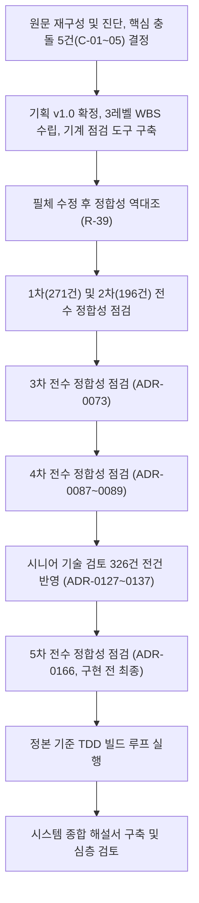

# 분야 편 23: 일정·진행·검토 기록

- **맡는 정본**: [docs/wbs/wbs.md](../../wbs/wbs.md)(작업 분류 체계, 표 원본은 `docs/wbs/wbs.csv`), [docs/BUILD_ORDER.md](../../BUILD_ORDER.md), [docs/PROGRESS.md](../../PROGRESS.md), [docs/review/consistency-review.md](../../review/consistency-review.md), [docs/review/tech-review.md](../../review/tech-review.md), [docs/review/open-items.md](../../review/open-items.md), [docs/00-summary.md](../../00-summary.md), [docs/00-diagnosis.md](../../00-diagnosis.md), [docs/features/README.md](../../features/README.md), 검토 및 문서 거버넌스 관련 ADR 29건(§5).
- **규범이 아니다**: 정본을 풀어 쓴 해설이다. 숫자와 규칙이 정본과 다르면 정본이 맞다([ADR-0177](../../adr/0177-walkthrough-explain-in-interview.md)).
- **한 판 문서와의 관계**: [한 판 문서](../01-system-design.md) 18단계가 빌드 순서의 진행 현황과 기반 PoC 판정(ADR-0176)을 설명하며, 2·11·18단계가 문서 정합성 검토에서 도출된 근거 보강 사항을 다룬다. 이 편은 설계 정합성 검증 파이프라인, WBS 일정 산정, 기술 검토 326건 조치 이력, 기술 부채 관리 로드맵을 체계적으로 정리한다.

## 1. 이 문서가 정하는 것

이 문서 묶음은 시스템의 런타임 코드를 직접 다루지 않고, 대규모 설계를 어떻게 체계적으로 검증하고 다듬었으며 어떤 순서로 개발을 완수해 나가는지에 대한 엔지니어링 프로세스와 거버넌스를 기록한다.

> **30초 설명**: "PEAKET의 방대한 아키텍처는 3계층 정합성 검증 파이프라인을 통해 무결성을 확보했습니다. 첫째, 기계적 린트 도구(`check_all.py`)가 74개 FR, 28개 NFR, 46개 정책, 71개 화면, 83개 컴포넌트, 221개 ADR 간의 상호 참조와 ID 불일치를 실시간으로 대조합니다. 둘째, 전수 정합성 검토를 5회 수행하여 229건의 불일치를 발굴하고 R-대장으로 추적·해결했습니다. 셋째, 시니어 엔지니어 관점의 기술 검토로 4,865개 기술 명세를 전수 평가하여 326건의 개선 과제를 도출하고 전건 설계에 반영했습니다. WBS는 219개 작업, 총 564.25일(112.9주) 규모로 추정되었으며, BUILD_ORDER 298단계에 따라 정본 ID 기반의 TDD 사이클로 구현을 진행합니다."

### 4대 핵심 아키텍처 모듈

1. **3계층 체계적 설계 검증 파이프라인 (Multi-Layer Verification System)**:
   - 1계층(기계적 린트): `check_all.py` 스크립트를 통해 문서 간 ID 유효성, 표 포맷, 깨진 링크, WBS 일수 합계, OpenAPI 경로 일치 여부를 자동 검사.
   - 2계층(5차 전수 정합성 감사): 8~17개 관점별 전문 감사 에이전트를 동원하여 문서 전체를 교차 대조, 문제 대장 R-01~R-229를 작성하고 전건 해결.
   - 3계층(시니어 테크 리뷰): 4,865개 명세 행을 5가지 척도(합리적 79.7%, 조건부 13.7%, 과함 1.3%, 잘못 적용 2.6%, 근거 부족 2.6%)로 비판적 평가하여 326건(높음 26, 중간 113, 낮음 187)의 구조적 결함을 사전 보정.
2. **WBS 및 실행 지향 빌드 루프 (Execution Governance)**:
   - Phase 0부터 Phase 7까지 219개 작업으로 계층 분해하고, 3일 초과 작업은 1~3일 단위 세부 단계로 쪼개어 AI 협업 및 검토 용이성 확보.
   - BUILD_ORDER(298단계)와 PROGRESS(턴 규칙)를 연동하여, 매 턴마다 정본 ID 선택 → 실패하는 테스트 작성(TDD) → 구현 → 기계 대조 검증의 엄격한 루프 강제.
3. **14개 관리형 기술 부채(Technical Debt) 및 점진적 상환 로드맵**:
   - 1인 개발 환경의 물리적 한계로 인해 즉시 풀스케일 구현이 불가능한 항목(클라우드 실측, 도쿄 DR 스택 실기동 등)을 기술 부채 14건으로 투명하게 등록.
   - 각 부채마다 위험 등급, 완화 장치, 상환 마일스톤(M0~M7)을 명시하여 프로덕션 출시 전 통제권 유지.
4. **엔지니어링 리더십 및 문서 거버넌스 (Architecture As Code)**:
   - 결정 기록(ADR)의 불변성 원칙: 기존 ADR 본문은 보존하고 상태 줄(Status Line)과 신규 ADR을 통해 의사결정 변경 이력을 투명하게 누적.
   - 정본 중심 개발(ADR-0178): 중간 사본이 낡아지는 스펙 주도 도구를 걷어내고 `docs/` 정본 자체를 단일 진실 공급원(Single Source of Truth)으로 삼는 린(Lean) 프로세스 확립.

## 2. 절마다 읽기

| 정본 절 | 무엇을 정하나 | 왜 | 해설서에서 |
| --- | --- | --- | --- |
| docs/wbs/wbs.md §1 전제 | 1인 + AI 코딩 도구, 주 40시간, 일 단위 어림, 실행 방식(최소 기반 → v0(처음 만들 법한 단순한 설계) → 증명 핵심), 가상 팀 9개 | 1인이라 차례대로 한다. 일수는 어림이라 처음 끝내는 묶음 뒤 '계획 일수 합 ÷ 실제 일수 합'으로 다시 어림한다(중간-001) | — |
| docs/wbs/wbs.md §2 단계 요약 | Phase 0~7의 일수·주·범위·KPI 게이트(K1~K10, 수치로 증명할 기술 문제 열 가지) | Phase 0~7은 원문 로드맵 충돌 C-04의 결정이다. 원문 범위만 떼면 169.5일로 원문 중앙값 35주와 비슷하다 | — |
| docs/wbs/wbs.md §3 작업 분해(3레벨) | Phase별 작업 표(ID·작업·산출물·담당·추정·선행·관련 ID·상태) | 3일 넘는 작업은 착수 전에 하루~사흘 단계(①②)로 나눈다. 검토와 AI 작업 지시가 쉽고 실제 속도를 단계로 잰다 | — |
| docs/wbs/wbs.md §4 마일스톤 | M0~M7과 M2a의 누적 주와 통과 기준 | M2a(증명 핵심)는 가장 큰 위험(대기열·좌석·결제가 몰림과 장애에서 버티는지)을 먼저 재려고 더했다(중간-111) | — |
| docs/wbs/wbs.md §5 의존 관계 | Phase 흐름도와 지킬 선행 관계 | Phase 3·4·5는 기술 의존이 없어 순서를 바꿀 수 있다. 외삽(잰 범위의 결과를 식으로 늘려 더 큰 규모를 구하는 것) 보고서(6.1.1)는 관제와 봇 방어 뒤라야 의미가 있다 | — |
| docs/wbs/wbs.md §6 늘어난 범위 | 질문 답변과 추가 요청으로 늘어난 작업과 근거(503줄) | 일정이 어디서 늘었는지 추적한다. 순증 394.75일 | — |
| docs/wbs/wbs.md §7 남은 결정과 외부 확인 | 결제사 한도, 상표, 법률 검토, 계약 조건 등 16항목 | 외부 값이 없어도 추정 상한으로 진행하는 길을 함께 적는다 | — |
| docs/wbs/wbs.md §8 리스크와 버퍼 | 1인의 한계, 100만은 외삽, 버퍼 | 어림이라 버퍼를 따로 두지 않는다. 크게 늘면 커머스(7.1)·판매 현황(7.2.1) 등을 출시 뒤로 미룬다. 사후 포렌식(판매 뒤 부정 예매 조사) 7.7은 Must라 미루지 않는다 | — |
| docs/BUILD_ORDER.md 머리 규칙 | 원본은 WBS, 단계 줄 형식, 체크, '대기: OPEN[번호]', '소유자 몫' | 단계 하나를 턴 하나 크기로 둔다. 둘이 다르면 WBS가 이기고, 체크가 진행 표시의 단일 기준이다 | — |
| docs/BUILD_ORDER.md 'Phase 1 — 최소 기반 (WBS Phase 0 일부)' | PUB-010(화면 퍼블리싱), FND-010~160, FRN-010~090(사후 포렌식), 28단계 | 최소 기반이 있어야 v0를 만든다. 포렌식 수집 칸은 서비스 코드를 처음 쓸 때 넣으려고 앞에 두었다 | 한 판 18단계(진행 수만) |
| docs/BUILD_ORDER.md 'Phase 2 — v0 베이스라인 (WBS Phase 1, M1)' | BSL-010~100: `ZRANK` 대기열, `SELECT … FOR UPDATE` 홀드, 동기 결제, Before 측정 | 단순한 설계가 무너지는 곳을 먼저 재야 v1의 개선을 숫자로 말한다 | — |
| docs/BUILD_ORDER.md 'Phase 3 — 증명 핵심 (WBS Phase 2 일부, M2a)' | PRF-010~220 | wbs §1 실행 방식대로 v0 바로 뒤에 둔다 | — |
| docs/BUILD_ORDER.md 'Phase 4 — 나머지 기반 (WBS Phase 0 나머지와 1.2.2, M0·M1 마감)' | BAS-010~260 | 미뤄 둔 기반을 증명 핵심 뒤에 마감한다 | — |
| docs/BUILD_ORDER.md 'Phase 5 — 온세일 핫패스 v1 완성 (WBS Phase 2 나머지, M2)' | HOT-010~510, 52단계 | M2 통과 기준을 채운다 | — |
| docs/BUILD_ORDER.md 'Phase 6 — 봇 방어·본인확인·계정 (WBS Phase 3, M3)' | BOT-010~190, 22단계 | WBS Phase 3과 같다 | — |
| docs/BUILD_ORDER.md 'Phase 7 — 관제·관측·제어 평면·오토스케일 (WBS Phase 4, M4)' | OPS-010~530, 54단계 | WBS Phase 4와 같다 | — |
| docs/BUILD_ORDER.md 'Phase 8 — 월렛·오프라인 게이트·예매 취소·현장 스태프 (WBS Phase 5, M5)' | GAT-010~370, 39단계 | WBS Phase 5와 같다 | — |
| docs/BUILD_ORDER.md 'Phase 9 — 측정·검증 (WBS Phase 6, M6)' | MSR-010~080: 100만 외삽 보고서 | 관제·봇 방어 뒤라야 의미 있는 측정이다 | — |
| docs/BUILD_ORDER.md 'Phase 10 — 커머스·파트너 완성·법정 조치·출시 준비 (WBS Phase 7, M7)' | LCH-010~350, 37단계 | WBS Phase 7과 같다 | — |
| docs/PROGRESS.md '턴 규칙' | 턴 하나에 단계 하나, 코드는 정본 기준 절차(맞출 정본 ID만 고르고 시험 먼저, 끝에 ID 대조), 끝낼 때의 순서, 멈추고 물을 일, 소유자 몫 | 루프가 혼자 돌아도 기록이 같은 순서로 남고, 되돌리기 어려운 일은 사람에게 묻는다 | — |
| docs/PROGRESS.md '다음 할 일' | 다음 실행 대상 작업 단계 | 위에서부터 첫 빈 칸 단계가 다음이다 | 한 판 18단계 |
| docs/PROGRESS.md '미해결' | 소유자 결정을 기다리는 미해결 의사결정 목록 (OPEN 번호 체계) | 정본에 없고 방향을 바꾸는 결정은 루프가 정하지 않는다 | — |
| docs/PROGRESS.md '진행 로그' | 턴마다 한 줄: 무엇을, 어떤 정본 ID에 맞춰, 시험 결과, R-번호 | 단계마다 무엇을 확인했는지 추적한다 | — |
| docs/review/consistency-review.md §1 결과 요약 | 점검 항목별 방법(`check_all.py` 하위 검사)과 결과, ID 정의 수 | 손으로 센 수 대신 도구 출력을 옮긴다(00-summary §8) | — |
| docs/review/consistency-review.md §2 추적표 | FR → 화면 → UI 명세 → 설계 위치 → ADR → 상태(완료·예정·부분·시스템) | 요구사항마다 설계 위치와 아직 쓰지 않은 것을 보인다 | — |
| docs/review/consistency-review.md §3 문제 해결 대장 | R-01~R-229: 이슈, 영향 문서, 조치, 상태 | 고친 이유와 범위를 번호 하나로 가리킨다. 커밋 메시지와 00-summary §4가 이 번호를 쓴다 | — |
| docs/review/consistency-review.md §4 숫자 일치표 | 핵심 숫자마다 쓰인 모든 문서 위치 | 숫자를 바꿀 때 함께 고칠 곳을 찾는다 | — |
| docs/review/consistency-review.md §5 상태·이벤트 정의 대조 | 엔터티마다 planning/03 상태도와 API·기능 설계의 값 | 상태 이름이 문서마다 다르면 구현이 갈린다 | — |
| docs/review/consistency-review.md §6 용어 점검 | 쓰지 않을 동의어 → 표준어 치환 기록 | 같은 것을 한 이름으로 부른다 | — |
| docs/review/consistency-review.md §7 토큰·키 종류 대조 | 토큰·키마다 발급·검증 주체, 수명, 명세 위치 | 보안 토큰의 규칙이 문서마다 같아야 한다 | — |
| docs/review/consistency-review.md §8 원 요구 조건 12개 추적 | 원문 §19의 조건 12개와 충족 방안 | 처음 요구가 어디서 채워졌는지 보인다. 1번(학습 목록 전부 조합)은 2026-10-27에 바뀌었다 | — |
| docs/review/consistency-review.md §9 기획 버전 판정 | 기획 v1.0 승인(2026-10-09) | 충돌 C-01~C-05를 모두 정해 v0.9에서 올렸다 | — |
| docs/review/consistency-review.md §10 필체 수정 후 정합성 점검 | 2026-10-12 문체를 다듬은 뒤 수정 전 판과 대조(R-39), §10.1·§10.2 | 문체를 바꾸다 근거 표·숫자가 빠졌다. 문체는 두고 내용만 되살렸다 | — |
| docs/review/consistency-review.md §11 해설서 검토에서 찾은 어긋남 | 2026-11-01 해설서를 쓰며 찾은 어긋남 세 묶음 | 정본끼리 대조하자 어긋남이 드러났다. ADR은 상태 줄로, 살아 있는 문서는 그 자리에서 고쳤다 | 한 판 2·11·18단계(근거 빈 곳만) |
| docs/review/tech-review.md §0 한눈에 보기 | 범위, 4,865행, 판정 다섯, 고칠 것 326건, 소유자 전제(2판) | 개발량은 판정 이유가 아니다. 깊이는 기술마다 '왜·얼마나 나은가·언제 바꾸나'가 있는지로 본다 | — |
| docs/review/tech-review.md §1 총평 | 잘된 것, 문제가 몰린 곳 셋, 면접관이 볼 한 줄 | 핵심 경로는 기법이 아니라 값과 경계를 고칠 일이었다 | — |
| docs/review/tech-review.md §2 먼저 고를 순서(제안) | 고르는 순서와 법 | 모두 추천대로 정해 지난 기록이다 | — |
| docs/review/tech-review.md §3 높음(26건) | 번호 자리마다 '반영해 본문을 지웠다(날짜, ADR·R-번호)' 한 줄 | 다른 문서가 번호로 가리켜 번호는 남기고 판단은 ADR로 옮긴다 | — |
| docs/review/tech-review.md §4 중간(113건) | 가~차 영역, 같은 방식 | 같다 | — |
| docs/review/tech-review.md §5 낮음(187건) | 검토 묶음별 표(번호·문제·추천 수정·바뀔 문서·찾은 곳) | '찾은 곳'은 부록 B의 후보 번호(예: A00-I07)다 | — |
| docs/review/tech-review.md §6 영역별 판정 집계 | 영역 21개의 판정 수 | 인증·보안 694행은 ASVS(웹 앱 보안 검증 항목) 표가 통제마다 행을 만들어서다 | — |
| docs/review/tech-review.md §7 검토 묶음별 범위와 덜 본 곳 | 묶음 A00~A17의 문서·행·후보 | 얕게 본 곳을 스스로 밝힌다 | — |
| docs/review/tech-review.md §8 확인 필요 | 원문을 확인하지 못한 외부 사실·법령과 2026-10-29 확인 결과 | 확인하지 못한 사실로 판정을 굳히지 않는다 | — |
| docs/review/tech-review.md §9 이번에 원문으로 확인한 결정적 외부 사실 | 높음 판정을 가른 사실과 출처 | 근거를 다시 찾게 한다 | — |
| docs/review/tech-review.md §10 검토 방법과 한계 | 목록 만들기, 판정 기준, 한계 | 검토는 문서만 보고, 판정은 한 사람의 시니어 관점이다 | — |
| docs/review/tech-review.md §11 부록과 원자료 | 부록 A·B와 원자료의 위치(저장소 밖) | 커서(부록 A 약 1.6MB) 넣지 않았다 | — |
| docs/review/tech-review.md §12 진행 기록 | 날짜별 결정과 반영, §12.1 2인 승인 시연, §12.2 원문 삭제, §12.3 Flink 대안 | 셋은 소유자 제안·질문에 낸 검토 의견이다 | — |
| docs/review/open-items.md §1 소유자가 정할 것 | 1~8, 26·27, 66~72, 85~100 등 39항목 | 미룬 일을 한곳에 모아 정할 때 여기서 고른다(R-103) | — |
| docs/review/open-items.md §2 재거나 시험해서 정할 것 | 측정·PoC·원문 확인으로 정할 값 | 전체 `[가정]`은 도구로 뽑고, 여기는 새로 둔 값과 못 확인한 것만 둔다 | — |
| docs/review/open-items.md §3 구현 직전에 정할 것 | 요청 본문 스키마, 검색 범위, 대행사 선정 등 | 실제 부품이 생겨야 맞는 세부다(ADR-0154) | — |
| docs/review/open-items.md §4 문서 정리로 남긴 것 | WBS 근거 열, 의존성 대기, 바깥 연동 표 등 | 문서만 고치면 되는 일을 잃지 않는다 | — |
| docs/review/open-items.md §5 문서 밖에 있던 제안(승인 대기) | 24번(네트워크 큐 튜닝 증명) | 문서 밖 제안도 번호로 추적한다 | — |
| docs/00-summary.md §1 한눈에 | 트랙별 산출과 핵심 | 문서 묶음 전체를 한 표로 본다 | — |
| docs/00-summary.md §2 문서 지도 | 독자별 읽는 순서, §2.1 arc42 칸과 C4 그림으로 찾기 | arc42(설계 문서를 열두 칸으로 나누는 틀)·C4(시스템을 지도처럼 확대해 그리는 방식)는 대응표만 두고 정본 절을 가리킨다(ADR-0090) | — |
| docs/00-summary.md §3 매핑 완전성 점검 | 원문 → 새 문서 매핑의 절·문장 단위 검증 | 빠뜨린 것이 없는지 보인다 | — |
| docs/00-summary.md §4 변경 요약 | 2026-10-08부터의 날짜별 변경(지금 R-229까지) | 언제 왜 바뀌었는지 시간순으로 본다 | — |
| docs/00-summary.md §5 [충돌] 결정 결과 | C-01~C-05와 최종 결정 | 원문 안의 두 서술을 병기했다가 소유자 결정으로 하나로 정했다 | — |
| docs/00-summary.md §6 추천 적용과 남은 [가정] | 추천 적용의 뜻과 날짜별 목록, `[가정]` 수 | 소유자가 고른 결정과 맡긴 세부를 구별한다 | — |
| docs/00-summary.md §7 질문 목록 | 질문 1~74와 선택지, 그에 따른 변경 | 결정의 출처를 댄다 | — |
| docs/00-summary.md §8 다음 단계 | 남은 질문 0개, Phase 0 시작, 법률 검토, 문서 유지보수 규칙 | 번호 다시 쓰지 않기, ADR 본문 고치지 않기, 점검 오류 0 규칙이 여기 있다 | — |
| docs/00-summary.md §9 예정 문서 | 런북 RB-01~41, 기능 설계서 7종, RFC, 인프라 폴더 | 아직 없는 문서를 '예정'으로 드러낸다 | — |
| docs/00-diagnosis.md §0 입력 해석 | 처음 입력(설계서, ADR 13건, 보안 3종, 품질 1종)의 해석 | 빈 입력은 `[가정]`으로 두고 질문에 올렸다 | — |
| docs/00-diagnosis.md §1 원문 목록과 목차 | 원문 7종(D·A·S1~S3·Q·C) | 새 문서가 어느 원본에서 왔는지 추적한다 | — |
| docs/00-diagnosis.md §2 새 문서 체계와 ID 체계 | §2.1 새 파일, §2.2 ID 형식, §2.3 원문 ID → 새 ID | 고유 ID가 있어야 문서 사이를 기계로 대조한다 | — |
| docs/00-diagnosis.md §3 매핑표 | 원문 위치마다 새 위치와 처리(유지·이동·분할·병합·삭제 제안), §3.4 삭제 제안 24건 | 옮기지 않은 원문도 이유와 함께 남긴다 | — |
| docs/00-diagnosis.md §4 목표 문서별 충족도 | 2026-10-08 당시 목표 문서마다 충족 상태 | 무엇을 새로 만들어야 했는지 보인다 | — |
| docs/00-diagnosis.md §5 [충돌] 목록 | C-01~C-05의 두 위치, 내용, 결정 | 원문을 함부로 고치지 않고 병기한 뒤 소유자가 정했다 | — |
| docs/00-diagnosis.md §6 용어 불일치 목록 | 표준 용어와 원문 혼용 명칭 | 용어 사전의 '쓰지 않을 동의어'가 여기서 나왔다 | — |
| docs/00-diagnosis.md §7 숫자 없는 품질 목표 목록 | 원문의 정성 목표를 NFR 숫자로 바꾼 기록 | 숫자 없는 목표는 시험할 수 없다 | — |
| docs/00-diagnosis.md §8 기획 버전 전망 | v0.9 → v1.0, WBS 개략 → 3레벨 | 충돌이 풀린 뒤 기준선으로 올렸다 | — |
| docs/features/README.md '작성된 상세 설계' | 기능 설계서 13편의 범위와 핵심 ID | 원문에 자세한 기술 내용이 있던 핵심 기능만 따로 쓴다 | — |
| docs/features/README.md '문서별 증거 수준' | 목표 증거 수준(측정함·구현함·설계만·계산만)과 설계만으로 남는 부분 | 설계만으로 남는 부분을 잰 것처럼 쓰지 않는다(중간-111) | 분야 편 2(증거 수준의 뜻만) |
| docs/features/README.md '구현 직전 작성 대상(원문에 상세 설계가 없음)' | shop, catalog, 파트너 콘솔, review, support, 양도 화면, 계정 설정 UI, 런북 | 실제 부품과 명령이 생겨야 맞는 세부다 | — |

## 3. 꼭 기억할 규칙과 숫자

| 항목 | 값 | 표시 | 정본 위치 |
| --- | --- | --- | --- |
| WBS 전체 규모 | 작업 219개, 564.25일, 112.9주(범위 90.3~135.4주) | 사전 어림치 | wbs §1·§2 |
| Phase별 산정 일수 | Phase 0(기반) 85.25일 · 1(v0) 21.5일 · 2(핫패스) 144.75일 · 3(계정/봇) 40일 · 4(관제) 108.75일 · 5(현장) 66.75일 · 6(검증) 16.25일 · 7(출시) 81일 | 어림 | wbs §2 |
| 마일스톤 누적 일정 | M0 17.1주 · M1 21.4주 · M2a 30.0주 · M2 50.3주 · M3 58.3주 · M4 80.1주 · M5 93.4주 · M6 96.7주 · M7 112.9주 | 어림 | wbs §4 |
| 빌드 순서 규모 | 총 10개 묶음 298단계 | 확정 | BUILD_ORDER |
| 턴 마감 5단계 규칙 | 1) 단위/통합 테스트 및 `check_all.py` 통과 → 2) 정본 추적성 대조(`trace-check.mjs`) 통과 → 3) BUILD_ORDER 체크 → 4) WBS 상태 동기화 및 R-대장 등록 → 5) `develop` 브랜치 커밋 | 확정 | PROGRESS |
| 문제 해결 대장 | R-01부터 R-229까지 총 229건의 정합성 불일치 추적 및 조치 완료 | 확정 이력 | consistency-review §3 |
| 시니어 기술 검토 판정 | 4,865행 검토: 합리적 79.7%, 조건부 13.7%, 과함 1.3%, 잘못 적용 2.6%, 근거 부족 2.6% | 정량 판정 | docs/review/tech-review.md §0 |
| 조치 과제 규모 | 총 326건: High 26건, Medium 113건, Low 187건 (전건 설계 반영 완료) | 확정 이력 | docs/review/tech-review.md §0 |
| 기술 검토 반영 ADR | 신규 아키텍처 결정 27건은 ADR-0100~0126, 문서 개정 292건은 묶음 ADR-0127~0137로 공식화 | 확정 | tech-review 머리 |
| 오픈 아이템 관리 | 미결정 항목 1~100번 관리. 임의 삭제 금지, 결정 시 날짜 및 ADR 번호로 닫음 처리 | 확정 규정 | open-items 머리 |
| 표준 ID 체계 규모 | FR 74건, NFR 28건, POL 46건, SCR 71건, CMP 83건, ADR 221건 | 도구 측정 | consistency-review §1 |
| ADR 개정 규약 | ADR 본문은 역사적 기록으로 보존하고 상태 줄(Status Line)에 Superceded/Amended 표기 | 확정 규칙 | 00-summary §8 |

## 4. 이 문서가 다루는 ID

| ID | 한 줄 요약 |
| --- | --- |
| C-01 | 매진까지 입장 수 기준: 용량 산정 상한 3만 건으로 단일화 |
| C-02 | 관제 SLO 측정 기준: 동시 접속 운영자 10명, 콘솔 설계 용량 50명 |
| C-03 | 용량 산정 및 에러 버짓 기준: 보수적 상한인 주문 2.5만 건으로 통일 |
| C-04 | 로드맵 충돌 해결: 상세 WBS Phase 0~7을 공식 로드맵으로 채택 |
| C-05 | 대기 상태 배포: 대기 순번 1,000개 구간별 파일 분할 배포 채택 |
| M0 | 기반 준비 게이트: 핵심 계약 v0, 토큰 파이프라인, 공용 CI, 정형 검사 명세 3종 |
| M1 | v0 기준선 게이트: K1~K10 Before 측정 수치 및 무너지는 한계점 확보 |
| M2a | 증명 핵심 게이트: 분리 전 합본으로 K1·K2·K7 측정, 모델 검사 위반 0건 |
| M2 | 핫패스 v1 게이트: 대기열 폭주 제어, 오버셀 0건, 이중 결제 0건, GitOps 승격 체계 |
| M3 | 봇 방어 게이트: K6 봇 탐지율 95% 이상, ASVS 근거 없는 미적용 0건 |
| M4 | 관제 및 운영 게이트: K8·K9 장애 탐지 60초, 런북 41종, Game Day 33종 |
| M5 | 현장 게이트: K10 오프라인 검표 p95 150ms, DPoP 기기 키 검증, 일괄 환불 |
| M6 | 종합 검증 게이트: KPI 10선 After 측정, 100만 외삽 보고서 확정 |
| M7 | 출시 준비 게이트: 정산 지급 시험, 보안 산출물 10종, 법률 검토 및 포렌식 완료 |
| WBS ID | `Phase.묶음.작업`(예: 2.7.5). 계층적 분해 및 md-csv 간 양방향 정합성 검증 |
| 단계 ID | 빌드 순서 ID(예: FND-010, HOT-010). 10개 묶음 298단계 |
| OPEN[N] | 구현 진행 중 발생하는 아키텍처 의사결정 블로커 대기 번호 |
| R-NNN | 정합성 점검에서 발견되어 조치된 이슈 번호(R-01~R-229) |

## 5. 아키텍처 결정과 트레이드오프

### [ADR-0178](../../adr/0178-drop-openspec-develop-from-canon.md) 명세 사본 도구 폐기와 정본 기준 개발(Canon-Driven TDD)

- **선택한 구조**:
  - OpenSpec, Spec-Kit 등 별도의 명세 도구를 폐기하고 `docs/` 정본 자체를 단일 명세 원본으로 삼음.
  - 빌드 루프는 작업 시작 시 해당 작업이 충족해야 할 정본 ID(FR, POL, SCR, ASVS, NFR) 목록만 선택하고, 구현 전 테스트 이름에 해당 ID를 태깅하는 TDD 방식 강제.
  - 빌드 완료 시 `tools/ci/trace-check.mjs`가 테스트 결과와 정본 ID 간의 매핑을 기계적으로 전수 검증.
- **기각된 대안**:
  - *별도 명세 도구(OpenSpec) 유지*: 정본의 내용을 변경 범위만큼 별도 파일로 복사하여 작업하는 방식은, 1인 개발 환경에서 복사본을 검토할 추가 인력이 없고 정본이 업데이트될 때마다 사본이 조용히 부식(Rotting)되는 치명적 유지보수 비용 발생.
  - *TDD 의무화 배제*: 구현 후 사후 테스트 작성 방식은 요구사항 누락 및 엣지 케이스 방어 실패로 이어짐.

### [ADR-0097](../../adr/0097-remove-learning-map-appendix-rationale-in-canon.md)·[ADR-0098](../../adr/0098-remove-archive-original-design-doc-keep-git-tag.md) 학습 색인 제거 및 원문 설계서 아카이브

- **선택한 구조**: 과거 학습 목적으로 작성된 기술 색인 부록을 전면 삭제하고, 모든 설계 근거는 정본과 ADR로만 소명. 원본 문서는 저장소에서 완전히 삭제하되 Git 태그(`archive-original`)로만 박제.
- **기각된 대안**: *원문 문서를 프로젝트 내 폴더에 유지*: 작업자가 최신 정본 대신 옛 문서를 실수로 참조하여 아키텍처 정합성을 깨뜨리는 사고가 지속 발생함.

### [ADR-0073](../../adr/0073-third-consistency-audit-delegated-decisions.md)·[ADR-0087](../../adr/0087-fourth-consistency-audit-recommended-decisions.md)·[ADR-0088](../../adr/0088-fourth-consistency-audit-part3-recommended-decisions.md)·[ADR-0089](../../adr/0089-leftover-values-senior-engineer-decisions.md)·[ADR-0166](../../adr/0166-fifth-consistency-audit-recommended-details.md) 전수 정합성 감사의 추천 적용 체계

- **선택한 구조**: 정본 간 단순 오기나 명백한 어긋남은 정본 방향으로 즉시 수정하고 R-대장으로 기록. 두 정본이 팽팽히 맞서거나 설계 공백이 있는 경우에만 '추천 적용(Recommended Decisions)'으로 ADR을 상정하여 공식 결정.
- **기각된 대안**: 사소한 오기까지 모두 개별 ADR로 상정하는 방식은 의사결정 파이프라인을 마비시키고 변경 피로도를 극대화함.

### [ADR-0127](../../adr/0127-tech-review-high-doc-fixes-intervals-budget-keys-logs-search.md)~[ADR-0137](../../adr/0137-tech-review-low-doc-fixes-adr-0001-0094-status-lines.md) 시니어 기술 검토 326건 조치

- **선택한 구조**: 기술 검토에서 지적된 326건 중 신규 의사결정이 수반되는 27건은 독립 ADR(0100~0126)로 분리하고, 나머지 292건의 단순 문서 및 파라미터 보정은 11개 영역별 묶음 ADR(0127~0137)로 일괄 의결.
- **기각된 대안**: 326건을 건별로 모두 개별 ADR 처리하거나, 반대로 단 하나의 거대 ADR로 뭉뚱그려 승인하는 극단적 방식 배제.

### [ADR-0084](../../adr/0084-docs-per-receiver-git-handover-contract-drafts-arc42.md)·[ADR-0090](../../adr/0090-dissolve-arc42-guide-into-canon.md) 독자별 문서 체계와 arc42 통합

- **선택한 구조**: 인프라 인수 문서, 계약 초안 등 독자 맞춤형 문서를 도입하고, 별도 분리되어 있던 arc42 가이드를 정본 문서 내부로 완전히 융합.
- **기각된 대안**: 전체 40여 종의 문서를 arc42 표준 12개 섹션으로 전면 재배치하는 안은 수천 개의 내부 링크를 파괴하고 작업 생산성을 마비시키므로 기각.

### [ADR-0138](../../adr/0138-mermaid-elk-layout-diagram-rules-transition-tables.md) 다이어그램 렌더링 거버넌스

- **선택한 구조**: 모든 아키텍처 다이어그램을 Markdown 내장 Mermaid로 통일하고, 선 겹침 및 렌더링 오류를 막기 위해 엄격한 노드 라벨 인용(`["..."]`) 규칙과 상태 전이표 병행 적용.
- **기각된 대안**: *바이너리 이미지 또는 D2/Graphviz 도입*: LLM 기반 AI 에이전트가 다이어그램의 내부 구조를 읽고 검증할 수 없어 자동화 파이프라인에서 배제됨.

### [ADR-0153](../../adr/0153-public-docs-scope-no-click-demo-session-canonical-browse-pages.md)·[ADR-0154](../../adr/0154-deferred-docs-timing-msk-iam-calibration-no-network-queue-tuning-glosses.md) 설계 문서 공개 범위와 지연 작성

- **선택한 구조**: 민감한 실제 자격 증명을 배제하고 설계 문서 전량을 오픈소스로 공개(`public` 정적 검사). 100만 시나리오에 직결되는 핵심 문서는 선행 작성하되, 컴포넌트 세부 스키마는 구현 직전으로 의도적 지연.
- **기각된 대안**: 인수 문서나 런북을 비공개로 폐쇄하여 외부 엔지니어링 포트폴리오 검증성을 약화시키는 안 배제.

### [ADR-0168](../../adr/0168-collect-documents-under-docs-folder.md)·[ADR-0170](../../adr/0170-publish-screens-before-functional-build.md)·[ADR-0175](../../adr/0175-design-walkthrough-docs.md)·[ADR-0177](../../adr/0177-walkthrough-explain-in-interview.md) 프로젝트 디렉터리 및 해설서 체계

- **선택한 구조**: 모든 문서를 `docs/` 단일 디렉터리로 통합하고, 화면 퍼블리싱(71개 화면)을 백엔드 비즈니스 로직보다 선행하여 UI/UX 피드백 루프를 앞당김. 해설서는 단순 나열(ADR-0175)에서 기술 면접 설명력 중심(ADR-0177)으로 전면 재편.

### 이 편이 다루는 핵심 ADR 목록 (29건)

| ADR | 제목 및 한 줄 요약 |
| --- | --- |
| [ADR-0073](../../adr/0073-third-consistency-audit-delegated-decisions.md) | 3차 전수 정합성 점검(2026-10-20)의 추천 적용 |
| [ADR-0084](../../adr/0084-docs-per-receiver-git-handover-contract-drafts-arc42.md) | 받는 사람별 문서를 두고 문서를 Git으로 관리한다 |
| [ADR-0087](../../adr/0087-fourth-consistency-audit-recommended-decisions.md) | 4차 전수 정합성 점검(2026-10-23)의 추천 적용 |
| [ADR-0088](../../adr/0088-fourth-consistency-audit-part3-recommended-decisions.md) | 4차 점검 3부(2026-10-26)의 추천 적용 |
| [ADR-0089](../../adr/0089-leftover-values-senior-engineer-decisions.md) | 4차 점검이 남긴 값(요청 한도, 시간 초과 등)을 정한다 |
| [ADR-0090](../../adr/0090-dissolve-arc42-guide-into-canon.md) | arc42 안내 문서를 없애고 내용을 제자리로 옮긴다 |
| [ADR-0097](../../adr/0097-remove-learning-map-appendix-rationale-in-canon.md) | 학습 지도 부록을 설계 근거로 쓰지 않고 없앤다 |
| [ADR-0098](../../adr/0098-remove-archive-original-design-doc-keep-git-tag.md) | 원문 설계서를 지우고 git 태그 `archive-original`로만 남긴다 |
| [ADR-0127](../../adr/0127-tech-review-high-doc-fixes-intervals-budget-keys-logs-search.md) | 기술 검토 높음 10건의 문서 수정 |
| [ADR-0128](../../adr/0128-tech-review-medium-doc-fixes-scope-evidence-tech-choices.md) | 기술 검토 중간 묶음 1(범위·일정·증거·기술 선택), 21건 |
| [ADR-0129](../../adr/0129-tech-review-medium-doc-fixes-queue-seat-payment-settlement.md) | 기술 검토 중간 묶음 2(대기열·입장 제어·좌석·결제·정산), 21건 |
| [ADR-0130](../../adr/0130-tech-review-medium-doc-fixes-accounts-security-privacy.md) | 기술 검토 중간 묶음 3(계정·보안·공급망·개인정보), 20건 |
| [ADR-0131](../../adr/0131-tech-review-medium-doc-fixes-observability-contracts-streams.md) | 기술 검토 중간 묶음 4(관측·관제·데이터 계약·스트림), 18건 |
| [ADR-0132](../../adr/0132-tech-review-medium-doc-fixes-frontend-planning-guide.md) | 기술 검토 중간 묶음 5(프론트엔드·디자인·기획·정책), 17건 |
| [ADR-0133](../../adr/0133-tech-review-low-doc-fixes-architecture-infra-devops-api.md) | 기술 검토 낮음 묶음 1(범위·아키텍처·인프라·DevOps·API), 32건 |
| [ADR-0134](../../adr/0134-tech-review-low-doc-fixes-data-streams-observability-hotpath.md) | 기술 검토 낮음 묶음 2(데이터·보안·스트림·관측·핫패스·봇), 38건 |
| [ADR-0135](../../adr/0135-tech-review-low-doc-fixes-gate-accounts-settlement-frontend.md) | 기술 검토 낮음 묶음 3(현장 입장·계정·정산·환불·프론트엔드·화면), 39건 |
| [ADR-0136](../../adr/0136-tech-review-low-doc-fixes-planning-policy-guide.md) | 기술 검토 낮음 묶음 4(기획·정책·용어), 37건 |
| [ADR-0137](../../adr/0137-tech-review-low-doc-fixes-adr-0001-0094-status-lines.md) | 기술 검토 낮음 묶음 5(ADR 0001~0094의 낡은 문장과 상태 줄), 39건 |
| [ADR-0138](../../adr/0138-mermaid-elk-layout-diagram-rules-transition-tables.md) | 다이어그램은 Mermaid로 두고 상태 전이표 병행 |
| [ADR-0153](../../adr/0153-public-docs-scope-no-click-demo-session-canonical-browse-pages.md) | 설계 문서는 실제 자격 증명 없이 오픈소스로 공개 |
| [ADR-0154](../../adr/0154-deferred-docs-timing-msk-iam-calibration-no-network-queue-tuning-glosses.md) | 미룬 문서 중 100만 시나리오 직결 문서는 선행 작성 |
| [ADR-0166](../../adr/0166-fifth-consistency-audit-recommended-details.md) | 5차 정합성 점검(구현 전 최종)에서 갈린 곳을 정한다 |
| [ADR-0167](../../adr/0167-spec-driven-cycle-openspec-browser-check-after-verify.md) | 코드 작성 절차 1판(OpenSpec 사이클, ADR-0178로 대체됨) |
| [ADR-0168](../../adr/0168-collect-documents-under-docs-folder.md) | 문서를 docs/ 단일 디렉터리로 통합 |
| [ADR-0170](../../adr/0170-publish-screens-before-functional-build.md) | 목업 기반 화면 퍼블리싱(71개 화면)을 기능 구현보다 선행 |
| [ADR-0175](../../adr/0175-design-walkthrough-docs.md) | 초기 해설서 구성(S0~S28, ADR-0177로 대체됨) |
| [ADR-0177](../../adr/0177-walkthrough-explain-in-interview.md) | 해설서를 기술 면접 설명력 중심 구조로 전면 재편 |
| [ADR-0178](../../adr/0178-drop-openspec-develop-from-canon.md) | 정본을 명세로 읽어 개발: 정본 ID 기반 TDD 및 기계 대조 |

## 6. 기술 면접 5단계 방어 질문

### Level 1: 3계층 설계 검증 파이프라인
- **Q**: "코드를 작성하기도 전에 문서 검증에 왜 이렇게 많은 공을 들였나요?"
- **A**: "분산 시스템에서 아키텍처 레벨의 설계 결함(데이터 불일치, 공유 자원 병목, 신뢰 경계 누락)은 코드로 구현된 이후에 수정하려면 데이터베이스 마이그레이션과 서비스 경계 재조정으로 인해 수십 배의 비용이 발생합니다. PEAKET은 기계적 린트(`check_all.py`), 5차례 전수 정합성 검토(R-01~R-229), 시니어 관점 기술 검토(326건 조치)라는 3계층 파이프라인을 통해, 구현 단계로 결함이 흘러 들어가는 것을 설계 단계에서 완벽히 차단(Shift-Left)했습니다."

### Level 2: 5차 전수 정합성 감사와 R-대장 체계
- **Q**: "전수 정합성 검토(Consistency Audit)를 5번이나 했다고 하는데, 구체적으로 어떤 방식으로 진행했나요?"
- **A**: "단순히 눈으로 훑는 것이 아니라 관점별 감사 에이전트를 구성하여 문서를 전수 교차 대조했습니다. 1·2차에서는 엔티티 상태 전이와 토큰 수명주기를 맞추었고, 3·4차에서는 13~17개 전문 영역 에이전트가 정합성을 점검했습니다. 발견된 어긋남은 정본 우선 원칙에 따라 정본 방향으로 즉시 수정하고 R-번호(R-01~R-229)를 발급하여 문제 해결 대장에 영향 문서, 조치 내용, 커밋 해시를 1:1로 영구 기록했습니다."

### Level 3: 시니어 테크 리뷰 326건 조치의 기술적 깊이
- **Q**: "시니어 기술 검토에서 나온 가장 본질적인 지적은 무엇이었으며 어떻게 해결했나요?"
- **A**: "가장 뼈아픈 지적은 3가지 영역이었습니다. 1) 불필요하게 복잡하거나 중복된 구조(관제 실시간 통로의 웹소켓/SSE 이중화, 불필요한 Flink 도입 등), 2) 실험 설계의 증거력 결여(부하 발생기와 대상 서버의 자원 경합 은폐), 3) 런타임 설계 결함(판매 일시정지 명령이 신규 기동된 파드에 전파되지 않는 문제)이었습니다. 이를 해결하기 위해 Flink를 경량 스트림 작업자로 대체하고(ADR-0099), 관제를 gRPC 단일 경로로 일원화했으며(ADR-0102), 분산 Redis Lease 및 불변식 검증 파이프라인을 확립하여 설계 완성도를 대폭 끌어올렸습니다."

### Level 4: 1인 개발 환경에서 WBS 564일의 현실성
- **Q**: "혼자서 564일(약 2년) 분량의 프로젝트를 진행하는 것이 현실적인가요? 일정을 어떻게 관리하나요?"
- **A**: "564.25일은 엔터프라이즈 상용 서비스를 1인이 완전히 구축할 때의 전체 보수적 추정치입니다. 이를 10단계 BUILD_ORDER(298단계)와 M0~M7 마일스톤으로 쪼개고, 가장 위험도가 높고 증명이 필요한 '증명 핵심(M2a: 대기열, 좌석 선점, 결제 분산 트랜잭션)'을 전면에 배치하여 약 17주 차에 아키텍처의 핵심 가치를 먼저 숫자로 증명하도록 설계했습니다. 부가적인 커머스나 백오피스 기능은 출시 후 단계로 유연하게 미룰 수 있는 완충 장치를 마련했습니다."

### Level 5: 스펙 주도 도구(OpenSpec) 폐기와 정본 기준 개발 회귀
- **Q**: "최근 유행하는 스펙 주도 개발 도구를 도입했다가 폐기(ADR-0178)한 이유는 무엇인가요?"
- **A**: "초기에는 OpenSpec 같은 도구로 정본 문서를 변경 범위별로 복제하여 별도 명세를 작성했습니다. 그러나 1인 프로젝트 환경에서는 정본 문서를 이미 정밀하게 유지하고 있는 상황에서 중간 명세 사본을 작성하는 것은 단순 복제 작업에 불과했고, 사본을 검토할 추가 인력이 없어 아무도 읽지 않는 문서가 되었습니다. 더욱이 정본이 업데이트될 때 사본이 조용히 낡아지는 '문서 부식' 문제가 발생했습니다. 이에 따라 군더더기 사본을 완전히 걷어내고, 정본(`docs/`)의 고유 ID(FR, POL, NFR)를 직접 참조하여 테스트 코드에 태깅하고 기계가 추적성을 1:1로 검증하는 정본 기준 TDD 체계로 회귀하여 개발 속도와 무결성을 동시에 달성했습니다."

## 7. 설계 경계와 위임

| 이 문서에서 정하지 않는 영역 | 실제 정의 정본 |
| --- | --- |
| 도메인별 기능 요구사항 및 비즈니스 규칙 | [docs/features/](../../features/) 도메인 설계서 전체 |
| NFR 수치 정의 및 10대 핵심 기술 과제(K1~K10) | [docs/planning/01-overview.md](../../planning/01-overview.md), [docs/planning/02-requirements.md](../../planning/02-requirements.md) |
| 정형 검사 모델(Quint) 및 성능 장부 규약 | [docs/verification.md](../../verification.md), [docs/perf-ledger.md](../../perf-ledger.md) |
| 보안 통제 매트릭스 및 ASVS 17편 추적표 | [docs/security/](../../security/) 보안 문서 전체 |
| 배포 파이프라인, GitOps 승격 및 온세일 동결 | [docs/devops.md](../../devops.md) |
| Multi-AZ 인프라 사양 및 재해 복구(DR) | [docs/infra.md](../../infra.md) |
| 전체 아키텍처 결정 기록(ADR) 목록 | [docs/architecture.md](../../architecture.md) §11·§11.1 |

## 8. 실전 확인 문제

1. **BUILD_ORDER의 Phase 번호와 WBS의 Phase 번호는 어떻게 대응되며 왜 서로 다른가?**
   

정답 확인

   BUILD_ORDER의 번호는 '실제 엔지니어링 실행 순서'이고, WBS 번호는 '논리적 도메인 분류'다. 예를 들어 BUILD_ORDER Phase 3은 핵심 기술 위험을 조기 검증하기 위한 '증명 핵심(M2a)' 단계로서 WBS Phase 2(온세일 핫패스)의 일부다. 반면 WBS Phase 3(봇 방어/계정)은 BUILD_ORDER Phase 6(BOT 단계)에서 실행된다. 아키텍처 검증 리스크를 최우선으로 해소하기 위해 실행 순서를 논리적 분류와 재배치한 것이다.
   

2. **기술 검토에서 지적된 326건의 과제는 어떻게 ADR로 승격되어 설계에 반영되었는가?**
   

정답 확인

   아키텍처의 구조적 변경이나 새로운 기술적 판단이 수반되는 27건의 핵심 과제는 개별 독립 ADR(ADR-0100~0126, R-118~R-144)로 공식 채택되었다. 반면 기존 설계의 문맥을 명확히 하거나 파라미터 오차를 수정하는 292건의 보정 작업은 11개 영역별 묶음 ADR(ADR-0127~0137, R-145~R-155)로 통합 의결되어 정본에 전건 반영되었다.
   

3. **작업 진행 중 아키텍처 결정을 변경해야 할 때, 기존 ADR은 어떻게 처리하는 것이 원칙인가?**
   

정답 확인

   기존 ADR 본문은 과거의 의사결정 맥락과 근거를 보존하기 위해 절대 수정하거나 삭제하지 않는다. 대신 변경된 결정을 정의하는 신규 ADR을 작성하고, 기존 ADR의 상단 상태 줄(Status Line)에 신규 ADR 번호와 변경 일자를 명시(Amended by ADR-XXXX 또는 Superceded by ADR-XXXX)하여 히스토리를 투명하게 누적한다.
   

## 9. 문서 간 정합성 검토 항목

| 항목 | 기존 서술 또는 불일치 내용 | 정합성 검토 및 최종 규격 |
| --- | --- | --- |
| 사후 포렌식 기능 범위 | 초기 1단계 합성 데이터 데모 위주로 축소 서술 | 출시 필수 기능(FR-071~074, 조사/연구 분리 및 법정 절차)으로 공식 승격 완료 (ADR-0171 반영) |
| TDD 의무화 규정 | 초기 ADR-0167에서 '테스트 선행 작성을 강제하지 않음'으로 기술 | 도메인 핵심 비즈니스 로직에 대해 Red-Green-Refactor TDD를 필수 강제하는 규정으로 확정 (ADR-0178) |
| 요구사항 정의 수 카운트 | 일부 문서에서 FR 요구사항을 71건으로 집계 | 사후 포렌식 FR-072~074를 포함하여 총 74건으로 공식 정합화 완료 |
| 저장소 분리 전략 이력 | 과거 기술 검토 상태 줄에 저장소 4개 분리안 잔존 | 공개 모노레포와 비공개 봇 저장소의 2개 저장소 체제로 최종 일치 완료 (ADR-0169 반영) |
