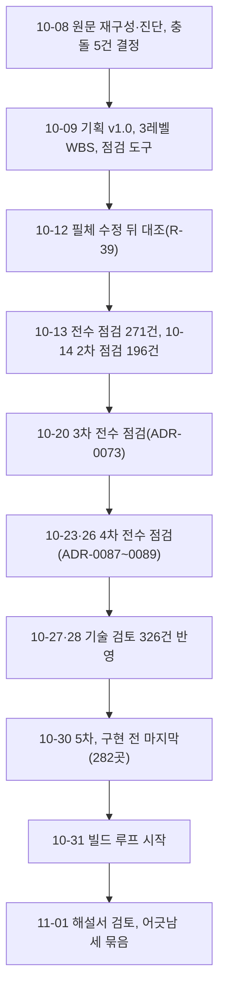

# 분야 편 23: 일정·진행·검토 기록

- **기준 시점**: ADR-0177까지, 2026-11-02. 코드 만드는 절차만 ADR-0178(2026-11-02, OpenSpec을 빼고 정본 기준으로)까지 반영했다
- **맡는 정본**: [docs/wbs/wbs.md](../../wbs/wbs.md)(표 원본은 `docs/wbs/wbs.csv`), [docs/BUILD_ORDER.md](../../BUILD_ORDER.md), [docs/PROGRESS.md](../../PROGRESS.md), [docs/review/consistency-review.md](../../review/consistency-review.md), [docs/review/tech-review.md](../../review/tech-review.md), [docs/review/open-items.md](../../review/open-items.md), [docs/00-summary.md](../../00-summary.md), [docs/00-diagnosis.md](../../00-diagnosis.md), [docs/features/README.md](../../features/README.md), 검토 묶음과 문서 운영 ADR(결정 기록) 29건(§5)
- **규범이 아니다**: 정본을 풀어 쓴 해설이다. 숫자와 규칙이 정본과 다르면 정본이 맞다([ADR-0177](../../adr/0177-walkthrough-explain-in-interview.md)).
- **한 판 문서와의 관계**: [한 판 문서](../01-system-design.md) 18단계가 빌드 순서의 진행 수와 기반 PoC(본 개발 전에 위험한 부분만 먼저 확인하는 시험)의 판정(ADR-0176)을 말하고, 2·11·18단계가 docs/review/consistency-review.md §11의 '근거가 비어 있는 곳' 둘을 든다. 일정·검토 기록 자체를 다루는 단계는 없다.
- **읽는 깊이**: '무엇이 있고 어디서 찾는지 알게' 읽는 편이다(길잡이 §3의 중요도 '하'). 큰 표는 구조, 번호 규칙, 대표 예, 찾는 법만 적는다. 면접에서 자주 묻는 "설계를 어떻게 검증하고 다듬었나요?"는 §1·§6·§8에서 풀었다.

## 1. 이 문서가 정하는 것

이 묶음은 시스템을 어떻게 만들지 정하지 않는다. 그 설계를 언제, 어떤 순서로 만들고, 어떻게 검증하고 고쳤는지를 기록한다. WBS(할 일을 잘게 나눈 작업 목록)는 작업 219개와 일수, 마일스톤(통과 기준이 있는 중간 목표 지점)을 정한다. BUILD_ORDER는 그 작업을 실행 순서로 늘어놓은 단계 298개이고, PROGRESS는 빌드 루프(단계를 하나씩 자동으로 진행하는 작업, 이름은 Sidabari4Loop)가 턴마다 따르는 규칙과 지금 상태다. 검토 기록은 셋이다. 정합성 검토(문서끼리 숫자·이름·규칙이 맞는지 본 결과)는 문제 대장 R-01~R-229를, 기술 검토는 시니어 개발자 관점의 판정과 고칠 항목 326건을, '나중에 정할 것'(open-items)은 미룬 결정 100개를 적는다. 00-summary는 문서 지도와 변경 기록을, 00-diagnosis는 2026-10-08 원문을 옮길 때의 매핑과 ID 체계를, features/README는 기능 설계서 목록과 증거 수준을 둔다.

> **30초 설명**: "설계는 세 겹으로 검증했습니다. 첫째, 문서 점검 도구가 ID, 표, 링크, 절 번호, API 경로, WBS 합계를 고칠 때마다 기계로 대조합니다. 둘째, 전수 정합성 점검을 다섯 차례 했습니다. 관점별로 문서를 처음부터 끝까지 읽어 어긋남을 찾고, 정본이 분명하면 정본 쪽으로 고치고, 정본끼리 갈리면 결정 기록으로 정했습니다. 셋째, 시니어 관점의 기술 검토로 기술과 기법 4,865행을 다섯 가지로 판정해 고칠 것 326건을 뽑았고 모두 반영했습니다. 고친 것은 R-번호 대장에, 미룬 것은 '나중에 정할 것' 번호로 남깁니다. 일정은 작업 219개, 564.25일로 어림했지만 실측 전 값이고, 2026-11-02 기준 빌드 순서 298단계 중 25단계를 끝냈습니다."

## 2. 절마다 읽기

번호 없는 제목은 제목 그대로 적었다. '해설서에서'는 그 절을 실제로 다루는 해설서 편이다.

| 정본 절 | 무엇을 정하나 | 왜 | 해설서에서 |
| --- | --- | --- | --- |
| docs/wbs/wbs.md §1 전제 | 1인 + AI 코딩 도구, 주 40시간, 일 단위 어림, 실행 방식(최소 기반 → v0(처음 만들 법한 단순한 설계) → 증명 핵심), 가상 팀 9개 | 1인이라 차례대로 한다. 일수는 어림이라 처음 끝내는 묶음 뒤 '계획 일수 합 ÷ 실제 일수 합'으로 다시 어림한다(중간-001) | — |
| docs/wbs/wbs.md §2 단계 요약 | Phase 0~7의 일수·주·범위·KPI 게이트(K1~K10, 수치로 증명할 기술 문제 열 가지) | Phase 0~7은 원문 로드맵 충돌 C-04의 결정이다. 원문 범위만 떼면 169.5일로 원문 중앙값 35주와 비슷하다 | — |
| docs/wbs/wbs.md §3 작업 분해(3레벨) | Phase별 작업 표(ID·작업·산출물·담당·추정·선행·관련 ID·상태) | 3일 넘는 작업은 착수 전에 하루~사흘 단계(①②)로 나눈다. 검토와 AI 작업 지시가 쉽고 실제 속도를 단계로 잰다 | — |
| docs/wbs/wbs.md §4 마일스톤 | M0~M7과 M2a의 누적 주와 통과 기준 | M2a(증명 핵심)는 가장 큰 위험(대기열·좌석·결제가 몰림과 장애에서 버티는지)을 먼저 재려고 더했다(중간-111) | — |
| docs/wbs/wbs.md §5 의존 관계 | Phase 흐름도와 지킬 선행 관계 | Phase 3·4·5는 기술 의존이 없어 순서를 바꿀 수 있다. 외삽(잰 범위의 결과를 식으로 늘려 더 큰 규모를 구하는 것) 보고서(6.1.1)는 관제와 봇 방어 뒤라야 의미가 있다 | — |
| docs/wbs/wbs.md §6 늘어난 범위 | 질문 답변과 추가 요청으로 늘어난 작업과 근거(503줄) | 일정이 어디서 늘었는지 추적한다. 순증 394.75일 | — |
| docs/wbs/wbs.md §7 남은 결정과 외부 확인 | 결제사 한도, 상표, 법률 검토, 계약 조건 등 16항목 | 외부 값이 없어도 추정 상한으로 진행하는 길을 함께 적는다 | — |
| docs/wbs/wbs.md §8 리스크와 버퍼 | 1인의 한계, 100만은 외삽, 버퍼 | 어림이라 버퍼를 따로 두지 않는다. 크게 늘면 커머스(7.1)·판매 현황(7.2.1) 등을 출시 뒤로 미룬다. 사후 포렌식(판매 뒤 부정 예매 조사) 7.7은 Must라 미루지 않는다 | — |
| docs/BUILD_ORDER.md 머리 규칙 | 원본은 WBS, 단계 줄 형식, 체크, '대기: OPEN[번호]', '소유자 몫' | 단계 하나를 턴 하나 크기로 둔다. 둘이 다르면 WBS가 이기고, 체크가 진행 표시의 단일 기준이다 | — |
| docs/BUILD_ORDER.md 'Phase 1 — 최소 기반 (WBS Phase 0 일부)' | PUB-010(화면 퍼블리싱), FND-010~160, FRN-010~090(사후 포렌식), 28단계 | 최소 기반이 있어야 v0를 만든다. 포렌식 수집 칸은 서비스 코드를 처음 쓸 때 넣으려고 앞에 두었다 | 한 판 18단계(진행 수만) |
| docs/BUILD_ORDER.md 'Phase 2 — v0 베이스라인 (WBS Phase 1, M1)' | BSL-010~100: `ZRANK` 대기열, `SELECT … FOR UPDATE` 홀드, 동기 결제, Before 측정 | 단순한 설계가 무너지는 곳을 먼저 재야 v1의 개선을 숫자로 말한다 | — |
| docs/BUILD_ORDER.md 'Phase 3 — 증명 핵심 (WBS Phase 2 일부, M2a)' | PRF-010~220 | wbs §1 실행 방식대로 v0 바로 뒤에 둔다 | — |
| docs/BUILD_ORDER.md 'Phase 4 — 나머지 기반 (WBS Phase 0 나머지와 1.2.2, M0·M1 마감)' | BAS-010~260 | 미뤄 둔 기반을 증명 핵심 뒤에 마감한다 | — |
| docs/BUILD_ORDER.md 'Phase 5 — 온세일 핫패스 v1 완성 (WBS Phase 2 나머지, M2)' | HOT-010~510, 52단계 | M2 통과 기준을 채운다 | — |
| docs/BUILD_ORDER.md 'Phase 6 — 봇 방어·본인확인·계정 (WBS Phase 3, M3)' | BOT-010~190, 22단계 | WBS Phase 3과 같다 | — |
| docs/BUILD_ORDER.md 'Phase 7 — 관제·관측·제어 평면·오토스케일 (WBS Phase 4, M4)' | OPS-010~530, 54단계 | WBS Phase 4와 같다 | — |
| docs/BUILD_ORDER.md 'Phase 8 — 월렛·오프라인 게이트·예매 취소·현장 스태프 (WBS Phase 5, M5)' | GAT-010~370, 39단계 | WBS Phase 5와 같다 | — |
| docs/BUILD_ORDER.md 'Phase 9 — 측정·검증 (WBS Phase 6, M6)' | MSR-010~080: 100만 외삽 보고서 | 관제·봇 방어 뒤라야 의미 있는 측정이다 | — |
| docs/BUILD_ORDER.md 'Phase 10 — 커머스·파트너 완성·법정 조치·출시 준비 (WBS Phase 7, M7)' | LCH-010~350, 37단계 | WBS Phase 7과 같다 | — |
| docs/PROGRESS.md '턴 규칙' | 턴 하나에 단계 하나, 코드는 정본 기준 절차(맞출 정본 ID만 고르고 시험 먼저, 끝에 ID 대조), 끝낼 때의 순서, 멈추고 물을 일, 소유자 몫 | 루프가 혼자 돌아도 기록이 같은 순서로 남고, 되돌리기 어려운 일은 사람에게 묻는다 | — |
| docs/PROGRESS.md '다음 할 일' | 다음 단계 하나(2026-11-02는 FND-140 좌석 명세) | 위에서부터 첫 빈 칸 단계가 다음이다 | 한 판 18단계 |
| docs/PROGRESS.md '미해결' | 소유자 결정을 기다리는 OPEN[번호](2026-11-02에 있던 여덟 줄은 같은 날 모두 추천안대로 닫혀 지금은 비었다) | 정본에 없고 방향을 바꾸는 결정은 루프가 정하지 않는다 | — |
| docs/PROGRESS.md '진행 로그' | 턴마다 한 줄: 무엇을, 어떤 정본 ID에 맞춰, 시험 결과, R-번호 | 단계마다 무엇을 확인했는지 추적한다 | — |
| docs/review/consistency-review.md §1 결과 요약 | 점검 항목별 방법(`check_all.py` 하위 검사)과 결과, ID 정의 수 | 손으로 센 수 대신 도구 출력을 옮긴다(00-summary §8) | — |
| docs/review/consistency-review.md §2 추적표 | FR → 화면 → UI 명세 → 설계 위치 → ADR → 상태(완료·예정·부분·시스템) | 요구사항마다 설계 위치와 아직 쓰지 않은 것을 보인다 | — |
| docs/review/consistency-review.md §3 문제 해결 대장 | R-01~R-229: 이슈, 영향 문서, 조치, 상태 | 고친 이유와 범위를 번호 하나로 가리킨다. 커밋 메시지와 00-summary §4가 이 번호를 쓴다 | — |
| docs/review/consistency-review.md §4 숫자 일치표 | 핵심 숫자마다 쓰인 모든 문서 위치 | 숫자를 바꿀 때 함께 고칠 곳을 찾는다 | — |
| docs/review/consistency-review.md §5 상태·이벤트 정의 대조 | 엔터티마다 planning/03 상태도와 API·기능 설계의 값 | 상태 이름이 문서마다 다르면 구현이 갈린다 | — |
| docs/review/consistency-review.md §6 용어 점검 | 쓰지 않을 동의어 → 표준어 치환 기록 | 같은 것을 한 이름으로 부른다 | — |
| docs/review/consistency-review.md §7 토큰·키 종류 대조 | 토큰·키마다 발급·검증 주체, 수명, 명세 위치 | 보안 토큰의 규칙이 문서마다 같아야 한다 | — |
| docs/review/consistency-review.md §8 원 요구 조건 12개 추적 | 원문 §19의 조건 12개와 충족 방안 | 처음 요구가 어디서 채워졌는지 보인다. 1번(학습 목록 전부 조합)은 2026-10-27에 바뀌었다 | — |
| docs/review/consistency-review.md §9 기획 버전 판정 | 기획 v1.0 승인(2026-10-09) | 충돌 C-01~C-05를 모두 정해 v0.9에서 올렸다 | — |
| docs/review/consistency-review.md §10 필체 수정 후 정합성 점검 | 2026-10-12 문체를 다듬은 뒤 수정 전 판과 대조(R-39), §10.1·§10.2 | 문체를 바꾸다 근거 표·숫자가 빠졌다. 문체는 두고 내용만 되살렸다 | — |
| docs/review/consistency-review.md §11 해설서 검토에서 찾은 어긋남 | 2026-11-01 해설서를 쓰며 찾은 어긋남 세 묶음 | 정본끼리 대조하자 어긋남이 드러났다. ADR은 상태 줄로, 살아 있는 문서는 그 자리에서 고쳤다 | 한 판 2·11·18단계(근거 빈 곳만) |
| docs/review/tech-review.md §0 한눈에 보기 | 범위, 4,865행, 판정 다섯, 고칠 것 326건, 소유자 전제(2판) | 개발량은 판정 이유가 아니다. 깊이는 기술마다 '왜·얼마나 나은가·언제 바꾸나'가 있는지로 본다 | — |
| docs/review/tech-review.md §1 총평 | 잘된 것, 문제가 몰린 곳 셋, 면접관이 볼 한 줄 | 핵심 경로는 기법이 아니라 값과 경계를 고칠 일이었다 | — |
| docs/review/tech-review.md §2 먼저 고를 순서(제안) | 고르는 순서와 법 | 모두 추천대로 정해 지난 기록이다 | — |
| docs/review/tech-review.md §3 높음(26건) | 번호 자리마다 '반영해 본문을 지웠다(날짜, ADR·R-번호)' 한 줄 | 다른 문서가 번호로 가리켜 번호는 남기고 판단은 ADR로 옮긴다 | — |
| docs/review/tech-review.md §4 중간(113건) | 가~차 영역, 같은 방식 | 같다 | — |
| docs/review/tech-review.md §5 낮음(187건) | 검토 묶음별 표(번호·문제·추천 수정·바뀔 문서·찾은 곳) | '찾은 곳'은 부록 B의 후보 번호(예: A00-I07)다 | — |
| docs/review/tech-review.md §6 영역별 판정 집계 | 영역 21개의 판정 수 | 인증·보안 694행은 ASVS(웹 앱 보안 검증 항목) 표가 통제마다 행을 만들어서다 | — |
| docs/review/tech-review.md §7 검토 묶음별 범위와 덜 본 곳 | 묶음 A00~A17의 문서·행·후보 | 얕게 본 곳을 스스로 밝힌다 | — |
| docs/review/tech-review.md §8 확인 필요 | 원문을 확인하지 못한 외부 사실·법령과 2026-10-29 확인 결과 | 확인하지 못한 사실로 판정을 굳히지 않는다 | — |
| docs/review/tech-review.md §9 이번에 원문으로 확인한 결정적 외부 사실 | 높음 판정을 가른 사실과 출처 | 근거를 다시 찾게 한다 | — |
| docs/review/tech-review.md §10 검토 방법과 한계 | 목록 만들기, 판정 기준, 한계 | 검토는 문서만 보고, 판정은 한 사람의 시니어 관점이다 | — |
| docs/review/tech-review.md §11 부록과 원자료 | 부록 A·B와 원자료의 위치(저장소 밖) | 커서(부록 A 약 1.6MB) 넣지 않았다 | — |
| docs/review/tech-review.md §12 진행 기록 | 날짜별 결정과 반영, §12.1 2인 승인 시연, §12.2 원문 삭제, §12.3 Flink 대안 | 셋은 소유자 제안·질문에 낸 검토 의견이다 | — |
| docs/review/open-items.md §1 소유자가 정할 것 | 1~8, 26·27, 66~72, 85~100 등 39항목 | 미룬 일을 한곳에 모아 정할 때 여기서 고른다(R-103) | — |
| docs/review/open-items.md §2 재거나 시험해서 정할 것 | 측정·PoC·원문 확인으로 정할 값 | 전체 `[가정]`은 도구로 뽑고, 여기는 새로 둔 값과 못 확인한 것만 둔다 | — |
| docs/review/open-items.md §3 구현 직전에 정할 것 | 요청 본문 스키마, 검색 범위, 대행사 선정 등 | 실제 부품이 생겨야 맞는 세부다(ADR-0154) | — |
| docs/review/open-items.md §4 문서 정리로 남긴 것 | WBS 근거 열, 의존성 대기, 바깥 연동 표 등 | 문서만 고치면 되는 일을 잃지 않는다 | — |
| docs/review/open-items.md §5 문서 밖에 있던 제안(승인 대기) | 24번(네트워크 큐 튜닝 증명) | 문서 밖 제안도 번호로 추적한다 | — |
| docs/00-summary.md §1 한눈에 | 트랙별 산출과 핵심 | 문서 묶음 전체를 한 표로 본다 | — |
| docs/00-summary.md §2 문서 지도 | 독자별 읽는 순서, §2.1 arc42 칸과 C4 그림으로 찾기 | arc42(설계 문서를 열두 칸으로 나누는 틀)·C4(시스템을 지도처럼 확대해 그리는 방식)는 대응표만 두고 정본 절을 가리킨다(ADR-0090) | — |
| docs/00-summary.md §3 매핑 완전성 점검 | 원문 → 새 문서 매핑의 절·문장 단위 검증 | 빠뜨린 것이 없는지 보인다 | — |
| docs/00-summary.md §4 변경 요약 | 2026-10-08부터의 날짜별 변경(지금 R-229까지) | 언제 왜 바뀌었는지 시간순으로 본다 | — |
| docs/00-summary.md §5 [충돌] 결정 결과 | C-01~C-05와 최종 결정 | 원문 안의 두 서술을 병기했다가 소유자 결정으로 하나로 정했다 | — |
| docs/00-summary.md §6 추천 적용과 남은 [가정] | 추천 적용의 뜻과 날짜별 목록, `[가정]` 수 | 소유자가 고른 결정과 맡긴 세부를 구별한다 | — |
| docs/00-summary.md §7 질문 목록 | 질문 1~74와 선택지, 그에 따른 변경 | 결정의 출처를 댄다 | — |
| docs/00-summary.md §8 다음 단계 | 남은 질문 0개, Phase 0 시작, 법률 검토, 문서 유지보수 규칙 | 번호 다시 쓰지 않기, ADR 본문 고치지 않기, 점검 오류 0 규칙이 여기 있다 | — |
| docs/00-summary.md §9 예정 문서 | 런북 RB-01~41, 기능 설계서 7종, RFC, 인프라 폴더 | 아직 없는 문서를 '예정'으로 드러낸다 | — |
| docs/00-diagnosis.md §0 입력 해석 | 처음 입력(설계서, ADR 13건, 보안 3종, 품질 1종)의 해석 | 빈 입력은 `[가정]`으로 두고 질문에 올렸다 | — |
| docs/00-diagnosis.md §1 원문 목록과 목차 | 원문 7종(D·A·S1~S3·Q·C) | 새 문서가 어느 원본에서 왔는지 추적한다 | — |
| docs/00-diagnosis.md §2 새 문서 체계와 ID 체계 | §2.1 새 파일, §2.2 ID 형식, §2.3 원문 ID → 새 ID | 고유 ID가 있어야 문서 사이를 기계로 대조한다 | — |
| docs/00-diagnosis.md §3 매핑표 | 원문 위치마다 새 위치와 처리(유지·이동·분할·병합·삭제 제안), §3.4 삭제 제안 24건 | 옮기지 않은 원문도 이유와 함께 남긴다 | — |
| docs/00-diagnosis.md §4 목표 문서별 충족도 | 2026-10-08 당시 목표 문서마다 충족 상태 | 무엇을 새로 만들어야 했는지 보인다 | — |
| docs/00-diagnosis.md §5 [충돌] 목록 | C-01~C-05의 두 위치, 내용, 결정 | 원문을 함부로 고치지 않고 병기한 뒤 소유자가 정했다 | — |
| docs/00-diagnosis.md §6 용어 불일치 목록 | 표준 용어와 원문 혼용 명칭 | 용어 사전의 '쓰지 않을 동의어'가 여기서 나왔다 | — |
| docs/00-diagnosis.md §7 숫자 없는 품질 목표 목록 | 원문의 정성 목표를 NFR 숫자로 바꾼 기록 | 숫자 없는 목표는 시험할 수 없다 | — |
| docs/00-diagnosis.md §8 기획 버전 전망 | v0.9 → v1.0, WBS 개략 → 3레벨 | 충돌이 풀린 뒤 기준선으로 올렸다 | — |
| docs/features/README.md '작성된 상세 설계' | 기능 설계서 13편의 범위와 핵심 ID | 원문에 자세한 기술 내용이 있던 핵심 기능만 따로 쓴다 | — |
| docs/features/README.md '문서별 증거 수준' | 목표 증거 수준(측정함·구현함·설계만·계산만)과 설계만으로 남는 부분 | 설계만으로 남는 부분을 잰 것처럼 쓰지 않는다(중간-111) | 분야 편 2(증거 수준의 뜻만) |
| docs/features/README.md '구현 직전 작성 대상(원문에 상세 설계가 없음)' | shop, catalog, 파트너 콘솔, review, support, 양도 화면, 계정 설정 UI, 런북 | 실제 부품과 명령이 생겨야 맞는 세부다 | — |

한 번의 점검이나 결정은 여러 문서에 번호로 흔적을 남긴다. 정본이 분명한 어긋남은 정본을 고치고 R-번호를, 정본끼리 갈리면 ADR을, 지금 정할 수 없으면 open-items 번호를 받는다. 일이 늘면 wbs 작업과 BUILD_ORDER 단계가 생기고, 루프가 막히면 PROGRESS의 OPEN 번호가 생긴다.

## 3. 꼭 기억할 규칙과 숫자

| 항목 | 값 | 표시 | 정본 위치 |
| --- | --- | --- | --- |
| WBS 합계 | 작업 219개, 564.25일, 112.9주(범위 90.3~135.4주) | 어림(실측 전). ±20%는 근거 있는 오차가 아니라 표시용 폭 | wbs §1·§2 |
| Phase별 일수 | 0: 85.25 · 1: 21.5 · 2: 144.75 · 3: 40 · 4: 108.75 · 5: 66.75 · 6: 16.25 · 7: 81 | 어림 | wbs §2 |
| 마일스톤 누적 주 | M0 17.1 · M1 21.4 · M2a 30.0 · M2 50.3 · M3 58.3 · M4 80.1 · M5 93.4 · M6 96.7 · M7 112.9 | 어림. 최소 기반과 v0만 먼저 하면 M2a는 약 17.4주 | wbs §4 |
| WBS 상태 칸 | 완료 14, 진행 5, 예정 200 | 2026-11-02, 루프가 바꾼다 | wbs §3 |
| 빌드 순서 | 10묶음 298단계, 끝낸 것 25(PUB 1·FND 15·FRN 9). 1묶음 28단계 중 25 | 2026-11-02 셈 | BUILD_ORDER |
| 턴을 끝내는 순서 | 시험과 `check_all.py` 통과, 범위의 시험 ID 대조(`tools/ci/trace-check.mjs`) 통과 → BUILD_ORDER 체크 → wbs.md·csv 상태 칸 → 00-summary §4와 문제 대장에 R-번호 → PROGRESS → `develop` 커밋(원격 푸시 제외) | 확정 | PROGRESS '턴 규칙' |
| 열린 미해결 | OPEN[09](온세일 구간 로그 표본 비율 신호), [10](개인키 서버 비저장 규칙 해석), [11](Redis 클라이언트 선택), [12](pnpm 실행 파일 차단), [13]·[14](규칙 모델 검사가 찾은 대기열 틈 둘). BUILD_ORDER에 '대기: OPEN[09]' 2곳, '[10]' 5곳, '[11]' 1곳 | 2026-11-02 | PROGRESS '미해결' |
| 문제 해결 대장 | R-01~R-229 | 2026-11-02 | docs/review/consistency-review.md §3 |
| 기술 검토 판정 | 4,865행: 합리적 79.7%·조건부 13.7%·과함 1.3%·잘못 적용 2.6%·근거 부족 2.6% | 판정(측정 아님) | docs/review/tech-review.md §0 |
| 기술 검토 항목 | 후보 452건 → 높음 26·중간 113·낮음 187 = 326건. 2026-10-27에 7건, 10-28에 319건 반영 | 확정 | docs/review/tech-review.md §0·§12 |
| 반영 방식 | 새 결정 27건은 ADR-0100~0126(R-118~R-144), 문서만 고친 292건은 묶음 ADR-0127~0137(R-145~R-155) | 확정 | 기술 검토 머리 |
| 나중에 정할 것 | 1~100번, 다섯 갈래. 정해도 줄을 지우지 않고 '정함(날짜, 결정 기록)'을 적는다 | 2026-11-01 | open-items 머리 |
| ID 정의 수 | FR 74, NFR 28, POL 46, SCR 71, CMP 83, ADR 177 | `check_all.py` 셈 | docs/review/consistency-review.md §1 |
| 번호 규칙 | FR·NFR·POL·SCR·CMP는 번호를 바꾸거나 다시 쓰지 않는다. 기술 검토 번호도 비워 두고 다시 쓰지 않는다 | 확정 | 00-summary §8, 기술 검토 머리 |
| ADR 고치는 법 | 본문은 두고 상태 줄에 보완·대체를 덧붙인다. 예외 셋(R-92 이름 바꾸기, R-102 깨진 글자, R-198 링크 주소) | 확정 | 00-summary §8 |
| 숫자 바꿀 때 | 핵심 수치·상태값·토큰을 바꾸면 검토 문서 §4·§5·§7 대조표 행도 고친다 | 확정 | 00-summary §8 |

## 4. 이 문서가 다루는 ID

이 묶음은 FR·NFR·POL·SCR·CMP를 정의하지 않는다(정의는 planning/02~04와 design/d2, 처음 범위는 docs/00-diagnosis.md §2.2). 대신 일정과 검토의 번호를 정의한다.

| ID | 한 줄 |
| --- | --- |
| C-01 | 매진까지 입장 수: 용량 산정은 상한 3만 건, 본문은 '약 2.5만~3만 건' |
| C-02 | 관제 SLO 측정은 운영자 10명, 관제 콘솔 설계 용량은 50명 |
| C-03 | 용량과 오류 예산은 보수적 상한인 주문 2.5만 건으로 센다 |
| C-04 | 상세 WBS의 Phase 0~7 로드맵을 공식으로 쓴다 |
| C-05 | 대기 상태는 번호 1,000개 구간별 파일로 나눠 배포한다 |
| M0 | 기반·계약·PoC 통과, 계약 v0, 토큰 파이프라인, 공용 CI(올릴 때마다 자동 검사·빌드), 규칙 검사 명세 3개 |
| M1 | v0 베이스라인: K1~K10 Before 수치와 무너지는 지점 |
| M2a | 증명 핵심: 서비스 분리 전 합본으로 K1·K2·K7 측정, 규칙 모델 검사 위반 0 |
| M2 | 핫패스 v1: K1(1천~10만)·K2~K5, K7 이중 결제 0, 서비스 분리 효과, 서명·출처 증명과 GitOps 승격 |
| M3 | 봇 방어·본인확인·계정: K6, ASVS 근거 없는 미적용 0, 본인확인 모의 기관 시험 |
| M4 | 관제·관측: K8, K9, 런북 41종, Game Day(일부러 장애를 내고 연습하는 날) 33종 |
| M5 | 월렛·오프라인 게이트: K10, 공제율 경계값, 기기 키 DPoP, 승인 업무·일괄 환불 시험 |
| M6 | 측정·검증: KPI 10선 After, 100만 외삽 보고서 |
| M7 | 출시 준비: 법정 조치, 정산 지급 시험, 산출물 10종, 법률 검토 목록, 사후 포렌식 시험 |
| WBS ID | `Phase.묶음.작업`(예: 2.7.5). 레벨 1·2는 아래 레벨의 합이고, 도구가 md와 csv의 ID·일수를 대조한다 |
| 빌드 단계 ID | `영문 세 글자-번호`. PUB·FND·FRN(1묶음), BSL, PRF, BAS, HOT, BOT, OPS, GAT, MSR, LCH(2~10묶음). 대개 10씩 늘고 나중에 끼운 단계는 사이 번호(예: FND-015·016) |
| OPEN[번호] | PROGRESS '미해결'의 줄. 풀리면 그 줄을 지우고 결정을 진행 로그와 정본에 남긴다 |
| R-번호 | 정합성 검토 §3의 문제 한 건 |
| 높음-NN·중간-NNN·낮음-NNN | 기술 검토 항목. 높음-01·04·09는 중간-111~113으로 내려 비워 두었다 |
| A00-I07 같은 후보 번호 | 기술 검토 부록 B의 후보(묶음 A00~A17 + 순번) |
| open-items N번 | 나중에 정할 것의 한 줄 |
| 질문 N | 00-summary §7의 소유자 질문(1~74) |

## 5. 결정과 버린 길

이 편에 자리가 있는 ADR은 29건이다([결정 카드 목록](../decisions/README.md) §2). 정합성 점검과 기술 검토의 문서 수정 묶음은 여러 분야에 걸쳐 이 편에 모였고, 각 분야 편은 자기 분야를 고친 부분만 든다. 버린 길은 '검토한 대안'에서, 옛 판은 상태 줄과 docs/architecture.md §11·§11.1에서 옮겼다. 링크는 끝의 표에 모았다.

### ADR-0097·0098 근거는 ADR과 정본으로만 댄다

- **고른 것**: 학습 지도 부록(원문 1~33장에 기술을 짝지은 색인)을 지운다. 고른 이유, 일부러 쓰지 않은 기술(ADR이 있는 것만), OWASP Top 10 대응은 docs/architecture.md §6.1·§8.1에 둔다. 원문 설계서도 지우고 git 태그(커밋에 붙인 이름표) `archive-original`로만 남기며, 원문 링크 68개는 글자로 바꾼다.
- **버린 길**: 부록에 정본 상태 표만 더하면 색인이라는 성격이 그대로다. 부록을 고쳐 맞추면 313행을 계속 고치고 같은 내용이 두 곳에 있다. 원문을 두고 규칙만 적으면 원문을 끌어오는 일을 규칙으로만 막는다. 태그 없이 지우면 커밋 번호를 찾아야 꺼낸다.
- **본문이 옛 판인 곳**: 00-diagnosis와 검토 기록의 archive/ 글자는 ADR-0098 결정 5로 일부러 둔다.

### ADR-0073·0087·0088·0089·0166 정합성 점검의 추천 적용

- **고른 것**: 다섯 모두 같은 규칙이다. 정본이 분명한 어긋남은 정본 쪽으로 고치고 R-번호로만 남긴다(R-82·R-99·R-101·R-194). 정본에 값이 없거나 같은 순위의 두 정본이 갈린 곳만 추천 적용(소유자가 방향만 정하고 맡긴 세부를 제안대로 적용한 것)으로 정한다.
- **버린 길**(대표): 비상 셔플을 명령 13으로 넣기는 명령 12종 전제의 화면·API·2인 승인 규칙이 모두 바뀐다(0073). 결제 토큰이 주소에 실리는 포트원을 대체 경로로 쓰기는 토큰이 기록·로그에 남는 범위가 넓다(0088). 관리 계정 잠금이 열린 세션을 끝내게 하기는 정본 둘과 위험 판단을 함께 바꿔야 한다(0166).
- **본문이 옛 판인 곳**: 0073·0088·0089는 결정별 현재 판을 §11.1 표에서 본다. 0089 결정 4는 낮음-171로 '사설 엔드포인트만 두고 공개는 끈다'로 바뀌어, 0089가 대안 절에서 버린 안을 결국 골랐다. 0087 결정 35는 ADR-0106이, 결정 21은 ADR-0117이 바꿨다.

### ADR-0127~0137 기술 검토의 문서 수정 묶음

- **고른 것**: 2026-10-28 소유자가 남은 항목을 모두 추천안대로 정했다. 새 결정이 필요 없는 292건(높음 10, 중간 97, 낮음 185)을 묶음 11개에 모았다. 정본에는 `(추천 적용 2026-10-28, 기술 검토 <번호>)`를 단다.
- **버린 길**: '검토한 대안' 절이 없다(정본에 없음). 안이 여럿이던 항목은 결정 절에 고른 안과 이유를 적었다.
- **본문이 옛 판인 곳**: 0127 높음-26의 Debezium은 ADR-0116으로 빠졌다. 0128 중간-112의 '저장소 14개'는 ADR-0165로 4개, ADR-0169로 둘이 됐다(뒤의 것은 2026-11-01 상태 줄에 더했다, §10). 0133 낮음-009의 NLB 둘은 셋이다(ADR-0144).

### ADR-0084·0090 받는 사람별 문서와 arc42 정리

- **고른 것**: 문서 폴더를 Git으로 관리하고 인프라 인수 문서, gRPC·Avro 계약 초안, 경영진 2쪽 요약을 더했다(0084). 따로 만든 arc42 안내 문서는 없애고 C4 3단계 그림은 architecture §3.3, 대응표는 00-summary §2.1, 남은 일은 open-items 26~29번으로 옮겼다(0090).
- **버린 길**: 문서 전체를 arc42 순서로 다시 나누면 절 참조 수천 곳(약 3,800곳, 0090 때 약 4,400곳)과 문서 지도가 깨진다. 대응표 문서만 남기면 지도가 둘이다.
- **본문이 옛 판인 곳**: 0084의 '대응표 문서 하나만 둔다'는 0090이 대신한다. 26·27번은 ADR-0151로, 29번은 ADR-0154·0160으로 정했다.

### ADR-0167 → ADR-0178 코드는 정본 기준 절차로 만든다

- **고른 것**: 코드를 바꾸는 단계는 범위 목록 → 정본 빈칸 먼저 → 시험 먼저 → 구현 → 대조 → (화면이면) Claude in Chrome 브라우저 확인 → 새 맥락 코드 리뷰·CI 순서로 한다(docs/architecture.md §8.6). 범위 목록에는 이번에 맞출 정본의 ID(FR·POL·SCR, `operationId`, ASVS 항목, 시험 ID, WBS ID)만 적고 내용은 옮겨 적지 않는다. 시험 이름에 그 ID를 달고, 끝에 `tools/ci/trace-check.mjs`가 시험 보고서를 읽어 ID마다 통과한 시험이 있는지 기계로 대조한다. 도메인 로직은 Red → Green → Refactor(실패하는 시험 먼저)가 필수다. 브라우저 확인은 화면 단계만 하고 결과를 `docs/review/browser-check/<단계 ID>.md`에 남긴다. E2E(사용자처럼 끝까지 누르는 시험)는 따로 한다.
- **버린 길**: 명세 도구로 정본을 변경 범위만큼 옮겨 적고 그 명세로 만들기(ADR-0167의 첫 판). 명세는 사람이 구현 전에 읽고 고칠 때 값이 나는데, 1인 기간에는 계획 리뷰도 AI가 하고 빌드 루프는 사람에게 묻지 않아 읽는 사람이 없었다. 옮겨 적은 사본은 정본이 바뀌면 소리 없이 낡는다. 소유자가 단계마다 명세를 승인하기는 묻지 않고 도는 루프와 부딪히고, 화면 단계에만 남기기는 절차가 둘이 되며, 명세와 정본을 자동으로 견주는 검사는 사본을 없애면 견줄 것이 없다. 0167이 버린 Spec Kit·BMAD·GSD도 데이터 모델·API·로드맵 문서를 다시 만들어 정본과 겹친다.
- **본문이 옛 판인 곳**: ADR-0167의 결정 1(도구)·2(사이클)·3의 명세 목록 부분·7(설정 자리)은 0178이 대신하고, '정본이 이긴다', 대조 뒤 브라우저 확인, E2E 따로는 그대로다. 0167의 '시험 먼저를 강제하지 않는다'는 2026-10-31 "TDD 쓰세요"로 바뀌었다(§11 표의 행은 2026-11-01에 고침, §10). 정본과 코드 주석에 남은 'openspec 변경 `<이름>`'은 git 태그 `archive-openspec`의 옛 기록을 가리킨다.

### ADR-0175 → ADR-0177 해설서 구성

- **고른 것**: 목적은 면접관 앞에서 설명할 수 있는 이해다. 한 판 문서를 뼈대로 분야 편 23편·결정 카드·DB 설계 편 11편·현황 한 장·덮개 표를 둔다. 규범이 아니고 WBS 작업으로 세지 않는다.
- **버린 길**: ADR-0175의 걸음 29편은 다 읽기 어려운 양이었다. 지도와 카드 12장은 docs의 약 72%를 다루지 않는다. 정본을 '지금 규칙'과 '이력'으로 다시 쓰기는 12MB를 고치고 빌드 루프와 부딪친다.
- **본문이 옛 판인 곳**: ADR-0175는 대체됐고, 원칙(규범 아님, 정본이 맞음, 지어내지 않음)과 결정 6·7·9·10은 0177이 잇는다.

### 나머지 넷의 버린 길

- **ADR-0168**(`docs/` 한 폴더): 새 이름 폴더로 모으면 `docs/api/` 경로가 바뀌어 코드 생성과 수백 곳을 더 고친다. ADR 링크를 깨진 채 두면 점검 도구 예외가 진짜 깨진 링크를 놓친다. ADR-0165 결정 2를 대신한다.
- **ADR-0170**(퍼블리싱 먼저): '검토한 대안' 절이 없다(정본에 없음). 제목의 '69개 화면'은 지금 71개다(상태 줄).
- **ADR-0138**(그림 규칙): 엔진만 바꾸면 교차가 329 → 318로 거의 그대로다. D2·Graphviz는 렌더러를 새로 붙이고 그림 125개를 다시 써야 한다. 그림 파일은 LLM이 구조를 읽지 못한다.
- **ADR-0153·0154**(공개 범위, 미룬 문서): 인수 문서·런북을 비공개로 나누면 포트폴리오에서 보여 주기 어렵다. 캔버스 클릭 시연은 같은 흐름을 두 번 만든다. 미룬 문서를 전부 지금 쓰면 구현 때 다시 쓴다. 문제가 보인 적 없는 네트워크 큐 튜닝은 근거 없는 설정을 남긴다.

### 자리표가 분야 편 23에 둔 ADR 29건

| ADR | 한 줄(지금 판) |
| --- | --- |
| [ADR-0073](../../adr/0073-third-consistency-audit-delegated-decisions.md) | 3차 전수 정합성 점검(2026-10-20)의 추천 적용 |
| [ADR-0084](../../adr/0084-docs-per-receiver-git-handover-contract-drafts-arc42.md) | 받는 사람별 문서를 두고 문서를 Git으로 관리한다 |
| [ADR-0087](../../adr/0087-fourth-consistency-audit-recommended-decisions.md) | 4차 전수 정합성 점검(2026-10-23)의 추천 적용 |
| [ADR-0088](../../adr/0088-fourth-consistency-audit-part3-recommended-decisions.md) | 4차 점검 3부(2026-10-26)의 추천 적용 |
| [ADR-0089](../../adr/0089-leftover-values-senior-engineer-decisions.md) | 4차 점검이 남긴 값(요청 한도, 시간 초과 등)을 정한다 |
| [ADR-0090](../../adr/0090-dissolve-arc42-guide-into-canon.md) | arc42 안내 문서를 없애고 내용을 제자리로 옮긴다 |
| [ADR-0097](../../adr/0097-remove-learning-map-appendix-rationale-in-canon.md) | 학습 지도 부록을 설계 근거로 쓰지 않고 없앤다 |
| [ADR-0098](../../adr/0098-remove-archive-original-design-doc-keep-git-tag.md) | 원문 설계서를 지우고 git 태그 `archive-original`로만 남긴다 |
| [ADR-0127](../../adr/0127-tech-review-high-doc-fixes-intervals-budget-keys-logs-search.md) | 기술 검토 높음 10건의 문서 수정 |
| [ADR-0128](../../adr/0128-tech-review-medium-doc-fixes-scope-evidence-tech-choices.md) | 중간 묶음 1(범위·일정·증거·기술 선택), 21건 |
| [ADR-0129](../../adr/0129-tech-review-medium-doc-fixes-queue-seat-payment-settlement.md) | 중간 묶음 2(대기열·입장 제어·좌석·결제·정산), 21건 |
| [ADR-0130](../../adr/0130-tech-review-medium-doc-fixes-accounts-security-privacy.md) | 중간 묶음 3(계정·보안·공급망·개인정보), 20건 |
| [ADR-0131](../../adr/0131-tech-review-medium-doc-fixes-observability-contracts-streams.md) | 중간 묶음 4(관측·관제·데이터 계약·스트림), 18건 |
| [ADR-0132](../../adr/0132-tech-review-medium-doc-fixes-frontend-planning-guide.md) | 중간 묶음 5(프론트엔드·디자인·기획·정책), 17건 |
| [ADR-0133](../../adr/0133-tech-review-low-doc-fixes-architecture-infra-devops-api.md) | 낮음 묶음 1(범위·아키텍처·인프라·DevOps·API), 32건 |
| [ADR-0134](../../adr/0134-tech-review-low-doc-fixes-data-streams-observability-hotpath.md) | 낮음 묶음 2(데이터·보안·스트림·관측·핫패스·봇), 38건 |
| [ADR-0135](../../adr/0135-tech-review-low-doc-fixes-gate-accounts-settlement-frontend.md) | 낮음 묶음 3(현장 입장·계정·정산·환불·프론트엔드·화면), 39건 |
| [ADR-0136](../../adr/0136-tech-review-low-doc-fixes-planning-policy-guide.md) | 낮음 묶음 4(기획·정책·용어), 37건 |
| [ADR-0137](../../adr/0137-tech-review-low-doc-fixes-adr-0001-0094-status-lines.md) | 낮음 묶음 5(ADR 0001~0094의 낡은 문장과 상태 줄), 39건 |
| [ADR-0138](../../adr/0138-mermaid-elk-layout-diagram-rules-transition-tables.md) | 그림은 mermaid(글로 쓰는 그림 문법)로 두고 줄여 그린 그림과 전이 표로 선 겹침을 줄인다 |
| [ADR-0153](../../adr/0153-public-docs-scope-no-click-demo-session-canonical-browse-pages.md) | 설계 문서는 실제 값 없이 공개(`public` 검사), 클릭 시연은 만들지 않는다 |
| [ADR-0154](../../adr/0154-deferred-docs-timing-msk-iam-calibration-no-network-queue-tuning-glosses.md) | 미룬 문서 가운데 100만 명 시나리오에 닿는 것은 지금 쓴다 |
| [ADR-0166](../../adr/0166-fifth-consistency-audit-recommended-details.md) | 5차 정합성 점검(구현 전 마지막)에서 갈린 곳을 정한다 |
| [ADR-0167](../../adr/0167-spec-driven-cycle-openspec-browser-check-after-verify.md) | 코드 만드는 절차의 첫 판(명세 도구 사이클). 도구·사이클은 ADR-0178이 대신하고, 대조 뒤 브라우저 확인과 도메인 로직 TDD(실패하는 시험을 먼저 쓰는 방식)는 남는다 |
| [ADR-0168](../../adr/0168-collect-documents-under-docs-folder.md) | 문서를 `docs/` 한 폴더로 모으고, ADR 본문은 링크 주소만 고친다 |
| [ADR-0170](../../adr/0170-publish-screens-before-functional-build.md) | 목업 데이터로 화면을 그리는 퍼블리싱을 기능 구현보다 먼저 한다(지금 71개) |
| [ADR-0175](../../adr/0175-design-walkthrough-docs.md) | 첫 해설서 구성(S0~S28 걸음). ADR-0177이 대신한다 |
| [ADR-0177](../../adr/0177-walkthrough-explain-in-interview.md) | 해설서를 면접관 앞에서 설명할 수 있게 다시 짠다 |
| [ADR-0178](../../adr/0178-drop-openspec-develop-from-canon.md) | 정본을 명세로 읽어 개발한다: 범위는 정본 ID만, 시험 이름에 ID, 끝에 기계 대조 |

## 6. 읽는 요령

**읽는 순서**: 00-summary §1·§2로 지도를 잡는다 → [현황 한 장](../00-status.md)과 BUILD_ORDER의 체크로 지금 위치를 본다 → wbs §2·§4로 큰 일정을 본다 → 검토는 consistency-review §1과 기술 검토 §0·§1만 먼저 읽는다 → 나머지(문제 대장, 추가 이력, 낮음 표)는 번호로 찾아 들어간다. 00-diagnosis는 원문 출처를 따질 때만 연다.

**설계를 다듬은 순서**: "어떻게 검증했나"를 물으면 이 흐름으로 말한다(날짜는 2026년).

점검은 갈수록 넓어졌다. 2026-10-13은 8관점, 10-23은 맡은 문서를 끝까지 읽는 점검 에이전트 13개, 10-26 3부는 17개, 10-30은 점검 갈래 8개가 읽었고, 지적은 원문 줄을 다시 확인한 뒤 고쳤다(R-61).

**지금 상태를 찾는 법**:

| 알고 싶은 것 | 볼 곳 |
| --- | --- |
| 몇 단계를 끝냈나 | BUILD_ORDER의 `- [x]` 줄 수(현황 한 장 §7에 명령이 있다) |
| 다음 단계와 막힌 것 | PROGRESS '다음 할 일'과 '미해결' |
| 최근에 무엇을 고쳤나 | consistency-review §3의 마지막 R-번호, 00-summary §4의 마지막 줄 |
| 기술 검토 항목의 결정 | 그 번호 자리의 한 줄 → 가리키는 ADR → 그 ADR의 상태 줄 |
| 아직 정하지 않은 것 | open-items에서 '정함'이 없는 줄. 소유자 몫으로 열린 것은 7번(결제사 계약 조건), 86번(근거가 비어 있는 결정 둘), 87~100번(해설서 검토에서 찾은 설계 빈칸) |
| 지금 ID·WBS 수 | `python -I tools/doc-check/check_all.py`의 `ids`·`wbs` 출력 |

**함정**:

- **두 Phase 번호**: BUILD_ORDER의 'Phase N'은 실행 순서 번호라 WBS의 Phase와 다르다. 제목 괄호의 'WBS Phase'를 본다.
- **날짜가 붙은 숫자**: 00-summary와 consistency-review의 개수는 그때의 셈이다. 지금 수는 도구 출력에서 본다. 다만 도구의 마커 수는 해설서 파일까지 세고, WBS 주는 반올림 탓에 112.8로 찍힌다(정본 표기는 112.9).
- **지운 본문**: 기술 검토의 항목 본문은 지웠다. 문제와 판단은 ADR에, 옛 본문은 git 이력(2026-10-27·28판)에 있다.
- **지난 기록**: 00-diagnosis의 archive/ 문장, 00-summary §6의 옛 결정 기록, PROGRESS 첫 로그의 '단계 266개'는 그때의 기록이라 고치지 않는다.
- **글로 남은 가짜 제목**: 00-diagnosis의 '## 이 문서 읽는 법'과 첫 번째 '## 4.'는 §3.4가 인용한 원문 펜스 안의 글이다.
- **작업 중인 트리**: 턴 중에는 R-번호가 체크보다 먼저 적힐 수 있다. 2026-11-01에는 R-228(FND-120)이 체크와 ADR-0176보다 먼저 적혔고, 셋은 2026-11-02 커밋에 함께 들어갔다.

## 7. 경계

| 이 정본이 정하지 않는 것 | 어디서 정하나 |
| --- | --- |
| 기능의 규칙과 숫자 | docs/features/*.md(분야 편 8~17) |
| NFR과 KPI K1~K10의 정의, 위험 등급과 기술 부채 | docs/planning/02-requirements.md, docs/planning/01-overview.md §3·§5.2·§5.3(분야 편 1·2) |
| 측정 방법, 성능 장부, 외삽 규칙 | docs/verification.md, docs/perf-ledger.md(분야 편 22) |
| 코드 만드는 절차(정본 기준)와 품질·보안 절차 | docs/architecture.md §8.2(분야 편 21)·§8.6(이 편 §5)·§8.7 실패 목록 먼저(분야 편 22 §5, ADR-0180) |
| 저장소·가지·CI 규칙 | docs/devops.md §2.1·§2.2(분야 편 20) |
| ADR 목록과 결정별 현재 판 | docs/architecture.md §11·§11.1 |
| 문서 쓰기 규칙과 그림 규칙 | docs/planning/03-policies-glossary.md §5(분야 편 3) |
| 법률 확인 목록 | POL-027, docs/security/data-classification.md(분야 편 3·21) |

## 8. 꼬리 질문

| 질문 | 답의 요지 | 근거 |
| --- | --- | --- |
| 설계를 어떻게 검증하고 다듬었나요? | 세 겹이다. 점검 도구가 ID·표·링크·절 참조·API 규칙·WBS 합계·그림을 매번 대조한다. 전수 정합성 점검을 다섯 차례 했고, 정본이 분명하면 고치고 갈리면 ADR로 정했다. 기술 검토로 4,865행을 판정해 326건을 반영했다. 결과는 R-대장·ADR·open-items에 번호로 남는다 | docs/review/consistency-review.md §1·§3, docs/review/tech-review.md §0 |
| AI가 쓴 문서를 AI가 검토하면 자기 확인 아닌가요? | 한계를 문서가 인정한다. 판정은 한 사람의 시니어 관점이고 검토는 문서만 봤다. 대신 판정을 다섯 갈래(합리적·조건부·과함·잘못 적용·근거 부족)로 나누고 이유의 잣대를 적었으며, 지적마다 원문 줄을 다시 확인하고, 못 확인한 외부 사실은 '확인 필요'로 남겼다. 마지막 확인은 구현과 측정이다 | docs/review/tech-review.md §10, R-61 |
| 기술 검토에서 가장 큰 지적은요? | 셋에 몰렸다. 이유가 빠졌거나 같은 일을 두 번 하는 구조(관제 실시간 통로 둘, Flink 등), 핵심 증거의 실험 설계, 구현 전 설계 결함(판매 일시정지가 새 파드에 안 걸림 등)이다. 핵심 경로 기법은 맞고 값과 경계를 고칠 일이었다 | docs/review/tech-review.md §1 |
| 564.25일은 믿을 만한가요? | 작업 219개를 아래에서 더한 어림이고 실측 전이다. ±20%는 표시용 폭이다. 처음 끝내는 묶음 뒤 실제 속도로 다시 어림하고 그때 버퍼를 정한다 | wbs §1·§8 |
| 지금 어디까지 했나요? | 2026-11-02 기준 298단계 중 25단계다. 화면 퍼블리싱, 사후 포렌식 문서, 공용 모듈, 로컬 클러스터, 기반 PoC, 대기열 규칙 모델 검사까지 했고 서비스 10개와 v0는 없다. 측정은 PC 한 대에서 잰 기반 PoC(실측(PC))뿐이고 서비스 수준 측정은 없다. 다음은 FND-140 좌석 명세다 | BUILD_ORDER, PROGRESS, ADR-0176 |
| 결정을 바꾸면 기록은 어떻게 남나요? | 옛 ADR 본문은 두고 새 ADR을 쓴 뒤 옛 상태 줄에 대체를 적는다. 고친 범위는 R-번호로, 날짜별 요약은 00-summary §4로 남고, 결정이 많은 ADR은 §11.1 표가 결정별 현재 판을 보인다 | 00-summary §8, architecture §11.1 |
| 스펙 주도 개발(명세를 먼저 쓰고 만드는 방식)을 하나요? | 정본(`docs/`)이 이미 ID가 붙은 명세라 그것을 명세로 읽는다. 명세 도구로 정본을 옮겨 적어 쓰다가, 구현 전에 읽는 사람 없이 사본만 늘고 정본이 바뀌면 사본이 낡아 2026-11-02에 뺐다. 대신 단계마다 맞출 정본 ID만 고르고, 통과 기준마다 그 ID를 이름에 단 시험을 먼저 쓰고, 끝에 스크립트가 ID마다 통과한 시험이 있는지 대조한다 | ADR-0178, docs/architecture.md §8.6 |
| 미룬 결정은 어떻게 관리하나요? | open-items에 번호를 붙여 다섯 갈래로 둔다. 정해도 줄을 지우지 않는다. 빌드 중에 생긴 것은 PROGRESS의 OPEN 번호로 묻고, 막힌 부분만 남기고 나머지를 한다 | open-items 머리, PROGRESS '턴 규칙' |
| 혼자인데 2인 승인은 어떻게 보이나요? | 1인 프로젝트에서 2인 승인이 자기 확인이 된다는 한계는 남긴다. AI는 두 번째 승인자가 아니다. 시연은 데모 승인자 계정으로 실제 승인 API를 부르는 방식이다 | docs/review/tech-review.md §12.1, ADR-0095 |

## 9. 확인 문제

1. BUILD_ORDER의 'Phase 3'과 WBS의 'Phase 3'은 같은 일인가?

답

다르다. BUILD_ORDER의 번호는 실행 순서다. BUILD_ORDER Phase 3은 '증명 핵심'으로 WBS Phase 2의 일부(M2a, PRF 단계)다. WBS Phase 3(봇 방어·본인확인·계정)은 BUILD_ORDER Phase 6(BOT 단계)이다. 제목 괄호의 'WBS Phase'로 맞춘다.

2. 기술 검토 '중간-112'(저장소 14개)의 지금 결정을 찾아가는 길을 말하라.

답

기술 검토 §4의 중간-112 자리 한 줄이 ADR-0128과 R-146을 가리킨다. ADR-0128은 '저장소 14개를 남긴다'였고, 상태 줄은 ADR-0165로 4개가 됐다고 적는다. 그 뒤 ADR-0169가 공개 모노레포(코드 전부를 저장소 하나에 담는 방식)와 비공개 봇 저장소 둘로 줄였다. 이 고침은 2026-11-01 정합 점검에서 ADR-0128 상태 줄에 더했고, 자세한 것은 docs/devops.md §2.1이다.

3. open-items의 항목을 정하면 무엇을 어디에 적는가?

답

줄을 지우지 않고 '지금 상태' 칸에 '정함(날짜, 결정 기록)'을 적는다. 결정은 ADR이나 문제 대장(R-번호)에, 값은 정본 문서에 넣는다. 새로 미루는 일은 번호를 이어 붙인다.

4. 정합성 점검에서 '정본이 분명한 어긋남'과 '정본끼리 갈린 곳'은 어떻게 다르게 처리하나?

답

분명한 어긋남은 정본 쪽으로 고치고 R-번호로만 남긴다. 결정이 아니라서 ADR로 적지 않는다. 정본에 값이 없거나 같은 순위의 두 정본이 다르게 말하면 점검 ADR(0073·0087·0088·0089·0166)에 추천 적용으로 정하고, 소유자가 언제든 바꿀 수 있는 검토 대상으로 둔다.

## 10. 정본에서 찾은 어긋남

2026-11-01에 읽은 판 기준이다. 네 건 모두 같은 날 정본에서 고쳤다.

| 어긋난 곳 | 내용 | 지금 판 |
| --- | --- | --- |
| docs/features/README.md의 forensic-replay.md 행(두 표) | 범위를 '1단계 합성 데이터 데모, 2단계 운영 연결(출시 뒤 선택)', 핵심 ID를 FR-071로만 적었다. ADR-0171은 사후 포렌식을 출시 범위의 필수 기능(조사·연구 두 갈래와 시험 데이터, FR-071~074)으로 바꿨다 | 고침(2026-11-01 정합 점검 네 번째 묶음) |
| docs/architecture.md §11의 ADR-0167 행 | '시험 먼저는 강제하지 않으며'라 적었다. 2026-10-31 소유자 결정으로 도메인 로직은 TDD가 필수다 | 고침(2026-11-01 정합 점검 네 번째 묶음) |
| docs/review/consistency-review.md §1·§2 집계 | 둘 다 '71건'이었으나 §2 추적표는 FR-072~074를 더해 74행이다 | 고침(2026-11-01 정합 점검 네 번째 묶음). 74건 |
| ADR-0128 상태 줄 | 저장소가 ADR-0165로 4개가 됐다고만 적고 ADR-0169(둘)가 없었다 | 고침(2026-11-01 정합 점검 네 번째 묶음) |
