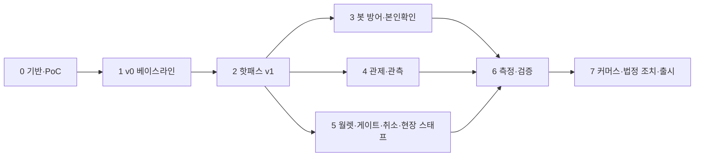

# 상세 WBS와 로드맵

- **독자와 용도**: 프로젝트 소유자가 단계·작업·추정·선행 관계·마일스톤을 보고 일정을 세우고 진행을 추적할 때 읽는다. 표 형식 원본은 `docs/wbs/wbs.csv`이고, 이 문서의 작업 표와 같은 데이터로 만들었다(`tools/doc-check`가 두 파일의 ID·추정이 같은지 검사한다).
- **원문 출처**: 설계서 §16 로드맵(합계 29~41주, '8단계·단계마다 KPI 게이트' 도식, 본문 없음), §14 리드 역량 산출물, §15 리포·가상 팀, §10 KPI 10선, §7 상태('Phase 2 구현, Phase 6 측정'), §6 계정·인증 표('게이트 스캐너 Phase'), docs/architecture.md §9.3·9.4(검증·PoC).
- **기준 기획 버전**: v1.0 → **상세 WBS**(할 일을 잘게 나눈 작업 목록. 3레벨. 기간은 실측 전 어림이고, ±20%는 표시용 폭이다, §1). Phase 0~7 구성은 C-04 결정(2026-10-08)으로 채택했다.
- **작성일**: 2026-10-09. 착수일이 정해지면 누적 주를 달력 날짜로 바꾼다.

## 1. 전제

| 항목 | 값 | 근거 |
| --- | --- | --- |
| 인력 | 1인 풀타임 + AI 코딩 도구 | 원문 §16 |
| 투입 시간 | 주 40시간, 하루 8시간, 주 5일 | 2026-10-08 소유자 답변 |
| 추정 단위 | 레벨 3 작업의 일(day). 상위 레벨은 그 합계다. 모든 일수는 1인 + AI 코딩 도구의 실제 속도를 재기 전의 어림이다(어림, 실측 전). ±20%는 근거 있는 오차가 아니라 템플릿 규칙에서 온 표시용 폭이다. 처음 끝내는 묶음(Phase나 마일스톤)을 마치면 작업마다 계획 일수와 실제 일수를 견줘 실제 속도(계획 일수 합 ÷ 실제 일수 합)를 구하고, 남은 일수를 다시 어림한다. 작업 성격별 범위(새 설계, 알려진 방식의 구현, 측정, 문서)와 버퍼도 그때 정한다(추천 적용 2026-10-28, 기술 검토 중간-001) | 템플릿 규칙(기획 v1.0 → ±20%). 다시 어림하는 규칙은 기술 검토 중간-001 |
| 실행 방식 | 증명 핵심을 먼저 한다. 최소 기반(0.1.1, 0.1.2, 0.2.1, 0.3.1~0.3.3, 0.4.1, 0.5.1, 0.9.1~0.9.3) → v0(1.1.1~1.1.4, 1.2.1, 1.2.3, 1.4.1) → 증명 핵심(2.1.1~2.1.4, 2.2.1·2.2.2, 2.3.1·2.3.3·2.3.4, 2.5.1·2.5.3·2.5.5, 2.7.1~2.7.6, 2.12.7·2.12.8, §4 M2a) 순서다. 2.7.3·2.7.4는 2.7.5의 선행이라 2026-11-04에 증명 핵심에 더했다(ADR-0189 결정 4). 2.12.8(측정 무대)은 2.12.7의 선행이라 2026-11-10에 증명 핵심에 더했다(ADR-0262). 2026-11-04부터 남은 작업은 한 줄 대신 구간 넷 × 갈래 셋(동시에 따로 일하는 작업 줄 셋)으로 한다(ADR-0189, 소유자 결정). 갈래 1(루프)이 임계 경로(앞 작업이 끝나야 다음 작업을 할 수 있는 가장 긴 사슬: 좌석 → 결제 → 서비스 분리·배포 → 관측·분석 → 사후 포렌식)를 맡고, 갈래 2·3(병렬 세션)이 나머지 기반·화면·관제 콘솔과 계정·봇·입장·커머스를 맡는다. 결과를 남기는 측정은 구간 끝 측정 창에 모은다. 단계 배치는 docs/BUILD_ORDER.md다. 그 전에는 1인이라 차례대로 실행했고, Phase 3·4·5는 순서를 바꿀 수 있지만 동시에 하지 않았다. 나머지 기반(0.1.4·0.1.5, 0.2.2·0.2.3, 0.3.4~0.3.6, 0.4.2~0.4.4, 0.5.2~0.5.6, 0.6, 0.8.1, 0.9.4)은 증명 핵심과 함께 또는 그 뒤에 한다(docs/planning/01 §3.3, 추천 적용 2026-10-28, 기술 검토 중간-111) | 원문 §16, §7 아래. 증명 순서는 기술 검토 중간-111. 구간·갈래는 ADR-0189 |
| 외부 기한 | 없다. 공연법 개정 시행일(2026-08-28)은 지났고, 출시 전 법정 조치 의무만 남았다 | 원문 §6 |
| 담당 역할 | 가상 팀 9개(원문 §15). 팀 토폴로지(팀을 맡은 일의 성격에 따라 네 유형으로 나누는 방법)로 적으면 스트림 정렬 팀은 대기열·구매·발권·커머스, 플랫폼 팀은 프론트엔드 플랫폼·플랫폼·데이터, 복잡 하위시스템 팀은 봇 탐지, 지원 팀은 아키텍처다(docs/planning/01 §3.3, docs/architecture.md §10, 추천 적용 2026-10-28, 기술 검토 낮음-118). 실제로 일하는 사람은 1인이다 | 원문 §15, 기술 검토 낮음-118 |

## 2. 단계 요약

| Phase | 이름 | 추정(일) | 추정(주) | 범위(주, ±20%) | KPI 게이트 | 주 담당 역할 |
| --- | --- | --- | --- | --- | --- | --- |
| 0 | 기반·계약·PoC | 85.25 | 17.1 | 13.6~20.5 | M0: PoC(본 개발 전에 위험한 부분만 먼저 만들어 확인하는 시험) 통과 기준 충족(docs/architecture §9.4 중 Phase 0 항목, wbs 0.5·0.9), 계약 v0 확정(출시 태그, ADR-0165), 색·글자 크기·간격 같은 디자인 값에 이름을 붙여 정해 둔 디자인 토큰의 파이프라인, 공용 CI(코드를 올릴 때마다 자동으로 검사하고 빌드하는 과정. 검사·시험·빌드), 규칙 검사 명세 3개(0.9.1~0.9.3) 통과. 서명·출처 증명과 GitOps 승격 경로는 M2로 옮겼다(기술 검토 중간-111) | 플랫폼, 아키텍처, 프론트엔드 플랫폼 |
| 1 | v0 베이스라인(처음 만들 법한 단순한 설계) | 21.5 | 4.3 | 3.4~5.2 | M1: K1~K10 Before 수치와 무너지는 지점 기록 | 플랫폼, 대기열, 구매 |
| 2 | 온세일 핫패스(판매가 열리는 시각 앞뒤로 접속이 몰리는 기간에 요청이 가장 많이 지나는 경로) v1 | 148.25 | 29.7 | 23.7~35.6 | M2: K1(측정 규모 1천~10만. 100만 판정은 M6)·K2~K5 목표 달성, K7 이중 결제 0, 서비스 분리 효과 세 구성 수치, PG(온라인 결제를 대신 처리해 주는 결제사) 어댑터 계약 테스트 통과, 모델 기반 시험·장애 기록 검사 위반 0, 서명과 출처 증명(산출물이 어느 커밋에서 어떤 빌드 절차로 만들어졌는지 서명해 남긴 기록)·GitOps(배포 상태를 저장소에 적어 두고 클러스터를 그대로 맞추는 운영 방식) 승격 경로(M0에서 옮김, 기술 검토 중간-111). 그 전에 중간 마일스톤 M2a(증명 핵심, §4) | 대기열, 구매, 프론트엔드 플랫폼, 플랫폼 |
| 3 | 봇 방어·본인확인·계정 | 40 | 8.0 | 6.4~9.6 | M3: K6(1·2단계 등급별 탐지 95%·사람을 봇으로 잘못 잡는 오탐 상한 0.5%(공개 자료 기준·1인 1판정 기록. 실제 사람 기준은 출시 뒤 첫 온세일 R2, ADR-0174)·적응 라운드 3회), ASVS(웹 앱 보안 검증 항목 목록) 근거 없는 미적용 0, 본인확인 모의 기관 끝까지 시험(I-T45. 실제 연동은 계약 뒤 조건부) | 봇 탐지, 플랫폼(identity) |
| 4 | 관제·관측(지표·로그·요청 기록으로 시스템 안을 들여다보는 일)·제어 평면·오토스케일(부하에 따라 서버 수를 자동으로 늘리고 줄이는 것) | 108.75 | 21.8 | 17.4~26.1 | M4: K8(10종 100%, 장애마다 탐지 60초, 명령 3초), K9(쿠버네티스에서 앱이 실행되는 가장 작은 단위인 파드의 확장 60초, 비용 추정), 장애가 났을 때 따라 하는 절차서인 런북 41종, 일부러 장애를 내고 대응을 연습하는 Game Day 33종, 분석 마감 품질(NFR-026. R3 정산서 대조는 M7), 관측 백엔드와 Sentry(앱 오류를 모아 알려 주는 서비스)의 운영 방식 판정(ADR-0067·0068) | 플랫폼, 데이터, 프론트엔드 플랫폼 |
| 5 | 월렛·오프라인 게이트·예매 취소·현장 스태프 | 66.75 | 13.3 | 10.7~16.0 | M5: K10(판정 150ms, 중복 입장 탐지 100%), 공제율 경계값 시험 통과, 현장 스태프 기기 승인 로그인과 기기 키 DPoP 확인(O-T37, 기술 검토 중간-057), 승인 업무·일괄 환불 시험(R-T6~R-T9) 통과 | 발권, 구매, 프론트엔드 플랫폼, 플랫폼 |
| 6 | 측정·검증 | 16.25 | 3.2 | 2.6~3.9 | M6: KPI(성과를 재는 핵심 지표) 10선 After 기록, 100만 외삽(잰 범위의 결과를 식으로 늘려 그보다 큰 규모의 값을 구한 것) 보고서(실측·외삽·문서 인용을 구분), 비즈니스 KPI 실측 | 플랫폼, 대기열, 데이터 |
| 7 | 커머스·파트너 완성·법정 조치·출시 준비 | 81 | 16.2 | 13.0~19.4 | M7: 법정 조치 가~바 전부 갖춤(1·2호), 중개자 고지·공연예술통합전산망 전송, 정산 지급 시험(J-T1~J-T19), 산출물 10종(원문 §14), 법률 검토 목록 제출, 사후 포렌식 시험(FX-T11~T23, ADR-0171) 통과 | 커머스, 플랫폼, 프론트엔드 플랫폼, 데이터 |
| 합계 | | **567.75** | **113.6** | **90.8~136.3** | | |

원문은 합계 29~41주(중앙값 35주)다. 작업별 일수를 모두 더한 상향식 합계는 567.75일(113.6주)이고, 그중 질문 답변과 추가 요청으로 늘어난 범위가 순 398.25일(79.7주, §6. 2026-10-13 100만 실측을 외삽 보고서로 바꿔 줄어든 2일, 2026-10-28 기술 검토 나머지 반영으로 늘어난 69.75일, 2026-10-29 카프카·단일 장애점 분석 반영으로 늘어난 4.5일, 2026-10-31 사후 포렌식 반영으로 늘어난 41.5일, 같은 날 사람 오탐 판정 방식 변경(ADR-0174)으로 줄어든 0.25일, 2026-11-10 증명 핵심 측정 무대(2.12.8)를 두고 합본 빌드를 2.12.5에서 옮겨(ADR-0262) 늘어난 3.5일 포함)이다. 원문 범위만 떼어 보면 169.5일(33.9주)로 원문 중앙값과 비슷하다. 이 합계와 §4 마일스톤의 누적 주는 실제 개발 속도를 재기 전의 어림이다. 다른 문서(docs/planning/00-executive-summary.md §6, 해설서 docs/walkthrough/. 지운 docs/guide/12 대신, 2026-11-01 정합 점검)에 옮겨 쓸 때도 '어림(실측 전)'을 붙인다(§1, 추천 적용 2026-10-28, 기술 검토 중간-001).

## 3. 작업 분해(3레벨)

추정은 일 단위의 어림(실측 전)이고, ±20%는 표시용 폭이다(§1). 3일을 넘는 작업은 착수하기 전에 하루~사흘 단위의 단계(①②…)로 나눠 단계마다 이름과 일수를 적는다. 단계의 일수 합은 나누기 전과 같게 둔다. 검토와 AI 작업 지시가 쉬워지고, 실제 속도를 단계 단위로 잴 수 있다. 예를 들어 4.4.1은 ① 명령 수명주기·2인 승인 ② 이벤트 소싱 감사 로그·키 건 해시 체인·5분 앵커·검증 잡 ③ 감사 공개 앵커와 공개 검증 도구 ④ 결제사 지정 명령·결제 감내 모드·운영 사건 줄·사후 검토 보고서 ⑤ 2인 승인 시연으로 나눈다(추천 적용 2026-10-28, 기술 검토 중간-001). 기술 블로그 10편은 출시 준비(7.6.1)에 몰지 않고, 각 Phase를 마칠 때 그 Phase의 측정 결과로 1~3편씩 쓴다(추천 적용 2026-10-28, 기술 검토 중간-006). 선행은 같은 표의 WBS ID다. 상태: 예정·진행·완료. 상위 행(레벨 1·2, wbs.csv)의 상태는 하위 작업을 모아 적는다. 모두 완료면 완료, 하나라도 진행이나 완료가 있으면 진행, 아니면 예정이다(추천 적용 2026-10-26).

### Phase 0 기반·계약·PoC (85.25일, 17.1주)

| WBS ID | 작업 | 산출물 | 담당 | 추정(일) | 선행 | 관련 ID | 상태 |
| --- | --- | --- | --- | --- | --- | --- | --- |
| **0.1** | **리포·CI 기반** | | 플랫폼 | **10.25** | | | |
| 0.1.1 | 저장소 둘 뼈대(공개 모노레포 `peaket`(코드 전부를 저장소 하나에 폴더로 나눠 담는 방식)의 폴더 구성(`deploy/`·`loadtest/` 포함)과 비공개 봇 저장소 `peaket-bots`, ADR-0165·0169), 뿌리 CODEOWNERS(폴더 단위로 가상 팀 아홉에 나눔), 규칙 세트, GitHub 조직 설정 코드화, git flow 기본 가지·가지와 태그 규칙 세트·릴리스 봇(ADR-0074), 토큰 없는 공개 재현(`peaket` 하나를 받아 토큰 없이 설치·빌드. 내부 패키지는 게시하지 않고 `workspace:` 프로토콜로만 잇고 린트로 그 표기를 검사한다, docs/devops.md §2.1, 기술 검토 중간-112, ADR-0165), 스펙 주도 개발 준비(OpenSpec CLI를 뿌리 개발 의존성으로 판을 고정해 설치하고 `openspec init --tools claude`로 초기화, 대조 명령이 든 확장 묶음 켜기, `openspec/config.yaml`과 브라우저 확인 스킬 초안 확정, 시험용 Chrome 프로필, 사이클 첫 시험은 Phase 0의 첫 코드 변경, architecture §8.6, ADR-0167. OpenSpec 설치·초기화와 설정 확정은 2026-10-30에 했다: OpenSpec 1.15.0, pnpm 12.16.0 고정, `pnpm-workspace.yaml` 공급망 설정, R-196. 조직 없이 할 수 있는 로컬 부분은 2026-10-30 첫 OpenSpec 변경 `add-repo-skeleton`으로 했다: 폴더 안내 파일, 팀 목록 `teams.json`과 CODEOWNERS·검사, GitHub 설정 Terraform 스택(검증까지, 적용은 조직 뒤), `workspace:` 표기 검사, R-197) | 저장소 둘·조직 설정 코드 | 플랫폼 | 2.5 | - | ADR-0054, ADR-0074, ADR-0128, ADR-0165, ADR-0167, ADR-0169 | 완료 |
| 0.1.2 | `peaket` 안의 재사용 워크플로(`.github/workflows/`, 검사·시험·빌드. SBOM·서명·출처 증명은 0.1.5, ADR-0169)와 `peaket`의 `ci.yml` 하나(모든 PR에서 돌고 첫 잡이 바뀐 범위를 고른다. 자바스크립트는 Turborepo `--affected`, 문서·계약·데이터·인프라는 저장소 안 경로 스크립트(D-T47). 유형별 잡과 필수 검사 `ci-summary`·`branch-policy`, ADR-0165), GitHub Actions OIDC(조직의 주체 사용자화로 저장소·환경·부른 재사용 워크플로까지 고정, ADR-0165), 액션 SHA 고정·토큰 최소 권한, Renovate(새 버전 3일 대기), 가지 규칙 검사(열린 작업 가지는 가상 팀마다 3개, ADR-0165. 봇의 `promote/*`·`calendar/*` 가지와 빌드 절차 변경 PR을 따로 하는 검사, ADR-0169)·릴리스와 핫픽스 워크플로(ADR-0074. 릴리스 가지 하나에 태그가 시스템 판이고, 후보 빌드는 마지막 출시 태그 뒤 바뀐 배포 단위만 새 이미지로 만든다. 내부 패키지를 게시하지 않으므로 패키지 판 올림 도구는 두지 않는다, ADR-0165), PR 제목 Conventional Commits 필수 검사와 Renovate 설정(기술 검토 낮음-017), 기준판과 새 판을 같은 러너에서 번갈아 재는 야간 성능 잡과 비율 판정(기술 검토 낮음-016), amd64·arm64 다중 아키텍처 이미지 빌드와 arm64 러너 스모크(`build-image.yml`, 기술 검토 낮음-167). 원격 없이 할 수 있는 첫 묶음은 2026-10-31 OpenSpec 변경 `add-ci-foundation`으로 했다: `ci.yml`(바뀐 범위 고르기와 `ci-summary`)과 재사용 워크플로 `docs-check`·`tools-check`·`iac-check`, 가지 규칙 검사·병합 결과 트리 검사 워크플로, 워크플로 규칙 검사, Renovate 설정, R-202. 릴리스·핫픽스 워크플로는 2026-10-31 OpenSpec 변경 `add-release-workflows`로 했다: `release.yml`(자르기·핫픽스 열기·마무리)과 판단 스크립트 `release-plan.mjs`, 역병합은 `merge/*` 가지로, 절차 변경 분리 검사는 변경을 만드는 PR에만, R-203. 운영 승격 PR과 서비스별 다이제스트는 0.4.4·이미지 빌드에서 더한다. 계약 잡(`contract-check.yml`, R-220)과 자바스크립트 작업 공간 잡(`ci-node.yml`: 화면·서비스·패키지의 타입 검사·시험·빌드, Turborepo `--affected`, R-221)은 2026-11-01에 했다. 남은 것: 작업 가지 수 경고와 병합 방식 주간 점검(GitHub API), 야간 성능 잡, 데이터 잡, 린트·ASVS 태그 보고·컨테이너 통합 시험(그 도구가 생기는 단계). 다중 아키텍처 이미지 빌드와 arm64 러너 스모크(`build-image.yml`의 빌드 잡, `ci.yml`의 잡 `image`)는 2026-11-03에 했다(BUILD_ORDER BSL-050. 게시 잡은 0.1.5) | 공용 CI 파이프라인 | 플랫폼 | 3.5 | 0.1.1 | ADR-0054, ADR-0074, ADR-0128, ADR-0133, ADR-0137, ADR-0165, ADR-0169 | 완료 |
| 0.1.3 | 문서 점검 스크립트 CI 연결(tools/doc-check), doc-check `api`의 호스트·security 검사와 명세 숫자 보고(기술 검토 낮음-031·032). CI 연결은 2026-10-31 `add-ci-foundation`의 `docs-check.yml`로 했다(OpenSpec 검증 포함, R-202). doc-check `api`의 두 검사와 숫자 보고는 2026-10-28 기술 검토 반영 때 이미 들어가 있었고, 2026-11-01 그 검사를 지키는 시험(`tools/doc-check/test_api_contract.py`)을 더해 CI에서 돌게 했다(openspec 변경 `add-doc-check-api-contract-tests`, R-218) | 문서 PR 검사 | 플랫폼 | 0.75 | 0.1.2 | 00-summary §8, ADR-0133 | 완료 |
| 0.1.4 | 보안 검사 게이트(gitleaks CLI·Semgrep·CodeQL·의존성·이미지·IaC 검사), 취약점 조치 기한과 예외 만료, Scorecard, 프론트엔드 보안 규칙 검사(ESLint `react/no-danger`, Semgrep `innerHTML` 계열·창 메시지 수신기 출처 확인, ADR-0065). 2026-11-10 둘로 나눔(ADR-0259): ① 외부 도구 없이 되는 몫(ESLint 기본 규칙의 화면·서비스 보안 규칙, 응답 스키마 린트 기준선, 조치 기한 판정, pnpm 내장 의존성·라이선스 검사, BUILD_ORDER BAS-010 0.5일) ② 외부 도구 게이트(gitleaks·Semgrep·CodeQL·Scorecard·Trivy, 소유자 허락 대기, BAS-011 0.75일) Semgrep은 OPEN[31] 소유자 결정(2026-11-10)으로 지금 받지 않아, 그 몫(창 메시지·HTML 넣기·프로토타입 오염·`sql.raw()` 허용 목록)은 ESLint 규칙과 CodeQL이 대신한다(ADR-0259·ADR-0263). | 보안 CI 게이트 | 플랫폼 | 1.25 | 0.1.2 | ADR-0054, ADR-0065, POL-041 | 진행 |
| 0.1.5 | 공급망 증명: SBOM·cosign 서명·SLSA 출처 증명을 공용 워크플로에 붙이기(증명 핵심과 함께 또는 뒤, 기술 검토 중간-111), 빌드 잡과 서명·증명 잡을 나눈 두 잡 구조와 워크플로 권한·캐시 검사(SLSA Build L3, 기술 검토 중간-062), SBOM 찾기(`sbom-find`)와 릴리스 산출물(기술 검토 낮음-019) | 공급망 증명 워크플로 | 플랫폼 | 2.25 | 0.1.2 | ADR-0054, ADR-0128, ADR-0130, ADR-0133 | 예정 |
| **0.2** | **계약(`docs/api`·`packages/contracts`)** | | 아키텍처 | **7.25** | | | |
| 0.2.1 | OpenAPI·AsyncAPI 계약에서 만든 코드 패키지(`packages/contracts`, 게시하지 않음)와 breaking 검사(PR 대상 가지와 마지막 출시 태그(운영에 나간 판) 둘 다와 견준다, D-T48, ADR-0165), orval Zod 생성과 생성물 차이 검사, 서비스 OpenAPI 차이 검사(D-T38, 기술 검토 중간-085), 깨짐 검사 도구 연결(`oasdiff`·`asyncapi diff`)과 깨짐 예외 목록(기술 검토 낮음-019). ①(`packages/contracts`의 orval Zod·타입 생성, AsyncAPI 메시지 본문 포함, 생성물 차이 검사, 작업 공간 시험 도구)은 2026-11-01에 했다(openspec 변경 `add-contracts-package`, R-219). ②의 깨짐 검사 도구 연결·깨짐 예외 목록·CI 계약 잡과 서비스 OpenAPI 차이의 자리도 2026-11-01에 했다(openspec 변경 `add-contract-breaking-check`, R-220). 서비스 OpenAPI 차이(D-T38)의 비교 본체는 2026-11-01 서비스 템플릿 단계에서 했다(openspec 변경 `add-service-template`, `tools/ci/service-openapi.mjs`, R-221) | 계약 v0 | 아키텍처 | 2.25 | 0.1.2 | docs/api/*, ADR-0131, ADR-0133 | 완료 |
| 0.2.2 | proto·Avro·Schema Registry CI(호환 검사는 마지막 출시 태그와도 견준다. Avro는 지난 출시 태그의 스키마를 모두 올린 로컬 레지스트리로, ADR-0165), Avro 열거의 기본 기호 규칙 검사(기술 검토 중간-087), Schema Registry 등록 Job·ConfigMap·공용 Avro 인코더와 시작 확인(기술 검토 중간-088), proto `identity.v1.SessionService`(기술 검토 중간-083) | 스키마 CI | 아키텍처 | 2 | 0.2.1 | ADR-0026, ADR-0131 | 예정 |
| 0.2.3 | 화면이 쓰는 API 계약 보강: 모든 작업의 operationId(2026-10-28 기준 198개, 수는 doc-check 보고, 기술 검토 낮음-119), `type` 목록(401 구분 포함. 4xx·5xx Problem 선언, 429·503 `Retry-After`, 401 `WWW-Authenticate`는 ADR-0081에서 함), `serverTimeMs`·`generatedAtMs`·`servingSteps`와 좌석 델타 `maxWaitMs`·`TimeSync`(`queue-files`는 `Date`를 노출하지 않음, ADR-0110), 303 대신 2xx 본문, 구매 세션 MAC 입력과 서버 ECDH 공개키 JWK, 좌석 델타·SSE 형식(관제 Socket.IO는 ADR-0100으로 뺌), 화면이 쓰는데 없는 읽기 경로 초안, 대기 상태 파일의 더할 칸, 굿즈 결제 경로, `@peaket/api-client` 변이 함수의 ETag·`If-Match`와 412 비교 보기 공통 처리(기술 검토 낮음-030). 사후 포렌식(ADR-0171): ops-svc가 purchase-svc에 부정 예매 운영자 취소를 부르는 내부 호출의 계약과, 공제 없이 돌려준 부정 예매 환급을 파트너 정산에서 다루는 방식 결정(docs/features/transfer-refund.md §12) | 계약 보강판 | 아키텍처 | 3 | 0.2.1 | ADR-0079, docs/frontend.md §6.2, ADR-0100, ADR-0110, ADR-0133, ADR-0136, ADR-0171 | 완료 |
| **0.3** | **서비스 템플릿(`packages/platform`)** | | 플랫폼 | **15.5** | | | |
| 0.3.1 | 네 신호 계측, RFC 9457, deadline 전파, 로그 가명(로그 가명 키 HMAC, IP 앞부분만), 정규 로그 줄(요청 1건 1줄 필드와 표본 비율, ADR-0069), 지연 히스토그램 표준 칸 목록(SLO 기준값 포함)과 처리 중 요청 게이지(ADR-0077), 신뢰 경계의 추적 문맥 규칙(외부 호출 클라이언트·앱 서버 링크 전파·게이트웨이 이른 헤더 수정, V-T31 CI 검사, 기술 검토 중간-066). 3일이 넘어 둘로 나눈다(BUILD_ORDER FND-050·060): ① 서비스 템플릿 뼈대(`packages/platform`), 네 신호 계측·지연 히스토그램 표준 칸·처리 중 요청 게이지, RFC 9457 Problem, deadline 전파, CI 서비스 잡과 서비스 OpenAPI 차이(D-T38) 비교 본체(1.75일) ② 로그 가명, 정규 로그 줄, 신뢰 경계의 추적 문맥 규칙과 V-T31(1.75일). ①은 2026-11-01에 했다(openspec 변경 `add-service-template`, R-221). ②도 같은 날 했다(openspec 변경 `add-service-logging`, R-222). 엣지 게이트웨이의 이른 헤더 수정과 앱 서버 연결은 게이트웨이가 생기는 2.11.1(HOT-400)로 넘겼다 | 템플릿 계측 | 플랫폼 | 3.5 | 0.2.1 | NFR-011, ADR-0053, ADR-0069, ADR-0077, ADR-0130 | 완료 |
| 0.3.2 | 인증 가드, 종료 세션 목록, 공용 멱등 모듈(범위·지문·422·409·보관, 기술 검토 중간-046), Outbox, Drizzle 설정, Outbox 일 파티션과 정리 잡, 파티션 미리 만들기(ADR-0083), 회차 범위 파티션·부모 표 ANALYZE·통계 스냅샷(ADR-0086), 주문·결제·티켓의 보존 기한이 지난 행을 나눠 지우는 정비 잡(ADR-0114), Redis Stream 정리(`XTRIM MINID`), 운영 기준 Outbox 폴링 릴레이(Lease·`seq` 순서·`FOR UPDATE`·지표·서비스별 Deployment·전용 역할, ADR-0116), 제어 상태 시작 작업 셋·방송형 소비·다시 맞춤·지표(D-T29, ADR-0103), 경로 스키마 변환·`text/plain` 해석기·Problem 400 변환·표본 일치 시험(기술 검토 낮음-001), 서비스 안 구조 폴더 뼈대와 층 의존 방향 린트·시험(기술 검토 낮음-008), 공용 소비 모듈의 키 단위 동시 처리·보류 사건 `held_event`·Kafka 클라이언트 필수 설정과 정적 검사 D-T45(ADR-0142), 제어 사건(`control.settings`·`control.sessions-terminated`) Outbox 발행(ADR-0143). 3일이 넘어 셋으로 나눈다(BUILD_ORDER FND-070·080·090): ① Drizzle 설정, 서비스 안 구조 폴더 뼈대와 층 의존 방향 린트·시험, 경로 스키마 변환·`text/plain` 해석기·Problem 400 변환·표본 일치 시험, 인증 가드·종료 세션 목록(1.75일) ② 공용 멱등 모듈, Outbox와 운영 기준 폴링 릴레이, Outbox 일 파티션·정리 잡·파티션 미리 만들기, 제어 사건 Outbox 발행(1.75일) ③ 회차 범위 파티션·부모 표 ANALYZE·통계 스냅샷, 보존 기한 정비 잡, Redis Stream 정리, 제어 상태 시작 작업·방송형 소비·다시 맞춤, 공용 소비 모듈(1.75일). ①은 2026-11-01에 했다(openspec 변경 `add-service-structure-and-request-checks`, R-223). ②도 같은 날 했다(openspec 변경 `add-idempotency-and-outbox`, R-224). ③도 같은 날 했다(openspec 변경 `add-maintenance-control-and-consumers`, R-225. 온세일 구간 로그 표본 비율 연결은 신호 출처가 없어 미해결 OPEN[09]) | 템플릿 공통 모듈 | 플랫폼 | 5.25 | 0.3.1 | NFR-016, ADR-0011, ADR-0037, ADR-0070, ADR-0083, ADR-0086, ADR-0103, ADR-0114, ADR-0116, ADR-0129, ADR-0133, ADR-0142, ADR-0143 | 완료 |
| 0.3.3 | 차단기, 구매 요청 인증 훅, gRPC 채널 생성 함수(재시도·헤지 정책 없음, 투명 재시도 유지, 부하 분산 프로필 `service`·`headless-round-robin`, ADR-0082) | 템플릿 장애 격리 | 플랫폼 | 1 | 0.3.2 | ADR-0009, ADR-0050, ADR-0082 | 완료 |
| 0.3.4 | DB 마이그레이션 실행기(기성 도구가 요구를 못 채울 때만 직접 만듦, 0.5.6의 D-T44로 정함, 트랜잭션 밖 단계, 잠금 대기 제한, 실행 잠금, DDL·DML 역할 분리, PgBouncer를 거치지 않는 직접 연결, ADR-0083), 마이그레이션 검사(Squawk, 직전 스키마·N-1 시험, 파티션 표 인덱스 절차와 PgBouncer `RECONNECT`, ADR-0086), 릴리스 플래그(OpenFeature·flagd 파일 모드) | 마이그레이션·플래그 공통 모듈 | 플랫폼 | 2 | 0.3.2 | ADR-0054, ADR-0083, ADR-0086, POL-041, ADR-0137 | 예정 |
| 0.3.5 | 기능 설계서 9편의 운영 확인 계측 표(확인할 동작, 사건·필드, SLI, 대시보드 패널, 경보, 배포 뒤 확인 방법)와 서비스 템플릿 반영 | 운영 확인 계측 표 | 플랫폼 | 1.5 | 0.3.1 | ADR-0069, docs/architecture.md §8.4 | 예정 |
| 0.3.6 | 운영 진단 기본값: 프로브 세 종류(별도 포트, 공유 의존성 제외, 종료·진단 중 준비 해제)와 템플릿 시험, 진단 증거(치명 오류 보고서, 주석 신호 수집, 다음 시작 때 올림, `--disable-sigusr1`, 주석 반영 시간과 Argo Rollouts 파드 동작 확인), 시간 초과 기본값(풀 대기 한도·`maxLifetimeSeconds`, ioredis 명령 시간 초과·오프라인 큐 끔, `SET LOCAL` 왕복 비용 측정), NestJS 종료 설정(`enableShutdownHooks()`, gRPC `gracefulShutdown`)과 종료 중 진행 호출 시험(D-T27, ADR-0082), 준비 프로브 기본값과 이벤트 루프 막기 경우 비교(D-T19, 기술 검토 중간-079) | 운영 진단 기본값 | 플랫폼 | 2.25 | 0.3.2 | NFR-027, ADR-0070, ADR-0082, docs/architecture.md §5, ADR-0131 | 예정 |
| **0.4** | **환경(로컬·스테이징·데모)** | | 플랫폼 | **11.25** | | | |
| 0.4.1 | 로컬(kind/k3d, LocalStack, Strimzi)과 CI 구성, LocalStack 계정·인증 토큰 준비와 Hobby 범위 확인, 포크 PR 건너뛰기 표시(기술 검토 낮음-010) | 로컬 환경 | 플랫폼 | 1.75 | 0.1.2 | docs/infra.md §3, ADR-0133 | 완료 |
| 0.4.2 | 스테이징 Terraform 모듈 코드와 정적 검사(생성·삭제 스크립트, TTL 자동 삭제, 적용은 선택 보정 때만), 계정 구조·상태 분리(S3 잠금 파일), 예산 경보·비용 이상 탐지, ArgoCD, Terraform 모듈에 MSK 사용자 지정 설정(뒤처진 복제본 대표 선출 끔)·거래·제어 브로커 6대와 정적 검사 D-T46(ADR-0141), NLB 셋·영역 빼기 켜기, CloudFront 배포 일곱·웹 ACL 셋·지속적 배포, Route 53, cert-manager ACME(ADR-0144. 코드·정적 검사만) | 스테이징 코드·비용 상한 장치 | 플랫폼 | 3.5 | 0.4.1 | ADR-0031, ADR-0054, ADR-0057, ADR-0141, ADR-0144 | 예정 |
| 0.4.3 | 데모 재현 스크립트(로컬 kind 전체 기동·합성 데이터·시연 시나리오 S1~S9 재생(docs/design/d5 §10.6, 기술 검토 중간-008)), 임시 클라우드 데모 절차(TTL·예산 경보), 운영 판과의 호환 검사 시연(계약을 깨는 변경과 양쪽 코드를 한 PR에 넣으면 같은 커밋끼리의 검사는 통과하지만 마지막 출시 태그와 견주는 `contract-check`가 막는 과정의 녹화와 재현 스크립트, docs/verification.md §7, 기술 검토 중간-112, ADR-0165) | 데모 재현 스크립트 | 플랫폼 | 1.25 | 0.4.4 | ADR-0031, ADR-0057, ADR-0128 | 예정 |
| 0.4.4 | 배포 상태 `deploy/`(ApplicationSet·AppProject·환경 값·공용 차트, ArgoCD는 `develop`에서 읽음, ADR-0169), 승격 PR 자동화, Kyverno CEL 정책(서명·출처 검증, 오프라인 검증 PoC, 운영 오버레이 메시 필수 정책 D-T28·ADR-0082), 사람 접근(Identity Center·EKS 접근 항목·긴급 접근 경보, 비상 접근 계정의 IAM 사용자 둘과 교차 계정 역할·로그인 SEV1 경보·RB-37(ADR-0102), EKS 사설 엔드포인트만 두는 SSM 포트 포워딩 중계 인스턴스·SSM 문서 권한·보안 그룹(기술 검토 낮음-171)), 출시 후보 데모 승격과 출시 태그 뒤 운영 승격(ADR-0074), 네임스페이스 지도와 `data`·`observability` 자원 할당량(ADR-0078), 입장 정책과 `gitops-check`의 ref·실행기 확인(D-T32, 기술 검토 중간-062), 오버레이별 레지스트리 정책 값과 GHCR 설정(D-T33, 기술 검토 중간-063), 관제·시스템 풀(관리형 노드 그룹)·우선순위 클래스·애드온 배치 값(기술 검토 낮음-013) | GitOps·배포 정책·접근 통제 | 플랫폼 | 4.75 | 0.4.2 | ADR-0054, ADR-0074, ADR-0078, ADR-0082, ADR-0102, ADR-0130, ADR-0133, ADR-0137, ADR-0169 | 예정 |
| **0.5** | **PoC와 외부 한도 확인·추정** | | 각 팀 | **8.25** | | | |
| 0.5.1 | PoC: `INCR` 20만/s, Redis 클라이언트(node-redis 기본안·ioredis·Valkey GLIDE, V-T33, 기술 검토 중간-026)와 TLS 켬·끔 짝 측정(기술 검토 낮음-072), Kafka 클라이언트(Confluent 공식 클라이언트 기본 확인, 못 채우면 kafkajs와 비교, 기술 검토 낮음-152)와 MSK IAM 토큰 함수 로컬 확인(ST-T14 ①, 기술 검토 높음-26), Fastify 어댑터·검증 방식 비교(V-T41, 기술 검토 낮음-001), 좌석 샤드 하나의 처리량(S-T27, 기술 검토 낮음-003·004) | PoC 결과 | 각 팀 | 2.75 | 0.4.1 | docs/architecture §9.4, ADR-0054, ADR-0127, ADR-0128, ADR-0133, ADR-0134, ADR-0137 | 완료 |
| 0.5.2 | PoC: 게이트웨이 차단 상한, 메시 Istio 앰비언트(웨이포인트) vs 사이드카(선택, 하지 않으면 공식 측정 인용) | PoC 결과 | 각 팀 | 1.5 | 0.4.1 | ADR-0010, ADR-0082 | 예정 |
| 0.5.3 | PoC: 엣지 함수(AWS 계정이 있으면 무료 범위 함수 시험, 없으면 문서 확인), 셔플 100만, Turnstile 검증 지연 | PoC 결과 | 각 팀 | 1 | 0.4.1 | FR-038 | 예정 |
| 0.5.4 | PoC: 5만석 Canvas | PoC 결과 | 각 팀 | 1 | 0.6.1 | K5 | 완료 |
| 0.5.5 | 외부 한도 확인·추정 기록(포트원 웹훅 헤더 확인, 토스 운영 한도·포트원 승인 기한·호출 한도 추정)과 외부 한도 대조표(CDN 배포별 요청·전송, S3 접두사, KMS, 결제사, 사람 확인. 소셜 로그인 공급자·본인확인 기관의 한도 확인과 NFR-007 근거 계산을 더함, 추천 적용 2026-11-03, ADR-0180) | 추정 기록(ADR-0036)·외부 한도 대조표 | 각 팀 | 1 | - | ADR-0029, ADR-0036, ADR-0057, POL-027 | 진행 |
| 0.5.6 | PoC: 마이그레이션 실행 도구 비교(D-T44). 같은 마이그레이션 묶음으로 기성 도구가 자체 실행기의 요구(트랜잭션 밖 단계, 잠금 대기 제한, 실행 잠금, PgBouncer 우회)를 채우는지 보고, 다 채우면 그 도구를 쓴다(docs/devops.md §7.2, 기술 검토 낮음-151) | PoC 결과 | 플랫폼 | 1 | 0.4.1 | ADR-0054, ADR-0083, ADR-0137 | 예정 |
| **0.6** | **디자인 기반과 브랜드 자산** | | 프론트엔드 플랫폼 | **8.25** | | | |
| 0.6.1 | SEED 토큰(@seed-design/css) + tokens.json 피켓 확장 → Style Dictionary·Tailwind 4 테마·TS 상수, 대비 계산 CI, SEED CSS 층 판·층 순서(FE-T36)와 경로별 첫 화면 CSS 크기 검사(기술 검토 중간-097. size-limit 대신 FE-T36 검사기, 추천 적용 2026-11-04), DTCG 이름 규칙·형식 검사와 중단점 SEED 값 일치 검사(기술 검토 중간-096·099), 시각 회귀 CI(FE-T40 기준 이미지·판 고정 컨테이너, 기술 검토 낮음-100) | 토큰 파이프라인 | 프론트엔드 플랫폼 | 2.25 | 0.1.2 | docs/design/d2 §5, ADR-0040, ADR-0132, ADR-0135, ADR-0170 | 완료 |
| 0.6.2 | @seed-design/react 위 packages/ds 뼈대, Storybook, addon-a11y, 제3자 고지(Apache-2.0 NOTICE), 이유 있는 비활성 버튼 공용 부품(`aria-disabled`·`data-disabled`·이유 글 연결·동작 막기 시험, 기술 검토 중간-101), 첫 브라우저 확인(Storybook을 Claude in Chrome으로 눌러 보고 결과를 `docs/review/browser-check/`에 남김, ADR-0167·0178) | ds 뼈대 | 프론트엔드 플랫폼 | 1.25 | 0.6.1 | docs/design/d2 §1.1, ADR-0040, ADR-0132, ADR-0167, ADR-0170 | 완료 |
| 0.6.3 | 로고 워드마크·심벌, 파비콘·PWA 아이콘, KIPRIS 상표 검색 | 브랜드 자산 | 프론트엔드 플랫폼 | 1.5 | - | docs/design/d1 §3 | 예정 |
| 0.6.4 | 화면 앱·공용 패키지 골격(`peaket`의 `apps/`·`packages/`, ADR-0165): Turborepo + pnpm 공급망 설정(trustPolicy·allowBuilds·blockExoticSubdeps), api-client·telemetry·validation·console-contract·config 패키지, 대기실 경량 페이지 별도 빌드 자리, size-limit·Lighthouse CI 예산, 화면 묶음별 보안 헤더, 정적 자산 허용 확장자·숨김 소스 맵·SBOM, 서버 액션 암호화 키 형식 확인, Turborepo 원격 캐시, `anySignal`과 eslint-plugin-compat + browserslist(NFR-019 목표, 기술 검토 중간-095) | 화면 앱·패키지 골격 | 프론트엔드 플랫폼 | 3.25 | 0.6.2 | ADR-0079, docs/frontend.md §2.2, ADR-0132, ADR-0170 | 완료 |
| **0.7** | **기획 v1.0과 상세 WBS** | | 소유자 | **0** | | | |
| 0.7.1 | [충돌] C-01~C-05 해소, 질문 답변 반영, 기획 v1.0, 상세 WBS | 기획 v1.0, 이 문서 | 소유자 | 0 | - | 00-summary §7 | 완료 |
| **0.8** | **RFC와 표준 원문 확보** | | 아키텍처 | **2.5** | | | |
| 0.8.1 | RFC 3건 초안(온세일 핫패스, 봇 방어, 관제) | RFC 3건 | 아키텍처 | 2 | - | 원문 §14 | 예정 |
| 0.8.2 | ISO/IEC 25023 OBP 미리보기 확인(이용 약관 동의, 익명), 측정량 표 수준 대응 기입 | quality-requirements 갱신 | 아키텍처 | 0.5 | - | NFR 작성 원칙 3 | 완료 |
| **0.9** | **설계 규칙 모델 검사** | | 아키텍처 | **7.5** | | | |
| 0.9.1 | 규칙 모델 검사 도구 준비(Quint·TLC, CI 실행·결과 기록)와 대기열·입장 제어 명세(순번·세대 번호, 동시 도착 구간 묶음, 리더 교체·세대 확인, 1인 1순번 재확인): 차례 전 입장 0·같은 세대 순번 중복 0·옛 리더 쓰기 반영 한도 | 명세·검사 기록(대기열) | 아키텍처·대기열 | 3 | 0.1.2 | ADR-0002, ADR-0041, ADR-0056, ADR-0057 | 완료 |
| 0.9.2 | 좌석 명세(정렬 홀드, 만료·연장, 펜싱 토큰, 좌석 Redis 장애 조치 동안 미룸·세대 키(ADR-0121), 판매 확정): 오버셀 0·1인 한도 초과 0 | 명세·검사 기록(좌석) | 아키텍처·구매 | 1.5 | 0.9.1 | ADR-0014, ADR-0057, ADR-0121 | 완료 |
| 0.9.3 | 결제 명세(결제 시도와 결제사 고정, 승인·결과 모름 해소, 웹훅 중복·지연, 보상·대사, 재시작): 이중 결제 0·결제사 바뀜 0·승인된 주문은 발권 또는 환불로 끝남 | 명세·검사 기록(결제) | 아키텍처·구매 | 2 | 0.9.1 | ADR-0015, ADR-0044, ADR-0057 | 완료 |
| 0.9.4 | 기술 블로그 1편(M0): 규칙 모델 검사로 찾은 순서 버그와 검사한 범위 | 기술 블로그 1편 | 소유자 | 1 | 0.9.3 | 원문 §14, docs/planning/01 §3.3, ADR-0128 | 완료 |
| **0.10** | **화면 프로토타입(P0)** | | 프론트엔드 플랫폼 | **14.5** | | | |
| 0.10.1 | 프로토타입 골격: Vite·React·TypeScript 앱 하나와 경로 묶음 넷(/web·/partner·/console·/scanner), 앱 셸 4종(CMP-065), SEED·tokens.json CSS 변수, openapi 응답 모양의 MSW 가짜 API, 데모 도구 막대, '예시 데이터' 띠, 가상 데이터 E-1~E-4 | prototype/ 골격(2026-10-22 저장소에서 지워짐) | 프론트엔드 플랫폼 | 3 | - | ADR-0059, ADR-0060, docs/design/d5 §10 | 완료 |
| 0.10.2 | P0 소비자 화면 13개(SCR-001·002·004~008·010~013·018·051)와 시연 S1(팬 예매)·S4(선착순·자동 배정) | 소비자 P0 화면·시연 | 프론트엔드 플랫폼 | 6.5 | 0.10.1 | docs/design/d5 §5·§10.6, ADR-0063, ADR-0066, ADR-0059, ADR-0060 | 완료 |
| 0.10.3 | P0 파트너·관제 화면 9개(SCR-020·021·026·037·062, SCR-028·029·030·048)와 시연 S6(등록과 판매 승인)·S7(T=0 관제) | 파트너·관제 P0 화면·시연 | 프론트엔드 플랫폼 | 3 | 0.10.1 | docs/design/d5 §6·§7·§10.6, ADR-0059, ADR-0060 | 완료 |
| 0.10.4 | P0 스캐너 화면 3개(SCR-033·034·036)와 시연 S8(공연 당일 입장), 화면설계 피드백 목록(docs/planning/04·docs/design/d5 반영 항목, docs/design/d5 §10.7). 시연 녹화는 하지 않고 닫았다(prototype/ 폴더가 2026-10-22에 지워짐). 시연 시나리오 S1~S9의 녹화는 v0·v1 실제 앱의 재현 스크립트(0.4.3)와 관제 데모 영상(7.6.1)으로 한다(docs/design/d5 §10 머리말, 추천 적용 2026-10-28, 기술 검토 중간-008) | 스캐너 P0 화면·시연·피드백 목록 | 프론트엔드 플랫폼 | 2 | 0.10.2 | docs/design/d5 §8·§10.6, ADR-0057, ADR-0128, ADR-0059, ADR-0060 | 완료 |

### Phase 1 v0 베이스라인(처음 만들 법한 단순한 설계) (21.5일, 4.3주)

| WBS ID | 작업 | 산출물 | 담당 | 추정(일) | 선행 | 관련 ID | 상태 |
| --- | --- | --- | --- | --- | --- | --- | --- |
| **1.1** | **v0 모놀리스(v1과 같은 모듈 경계)** | | 대기열·구매 | **7.5** | | | |
| 1.1.1 | 대기열 v0: `ZRANK` 앞 인원을 조회마다 계산하는 대기 상태 API(JSON), v1과 같은 거리별 폴링 주기(ADR-0096) | v0 대기열 | 대기열·구매 | 2 | 0.3.3 | K1 | 완료 |
| 1.1.2 | 좌석 v0: `SELECT … FOR UPDATE` 홀드, 변경분 JSON을 모든 연결에 보내기, 메인 스레드 Canvas 좌석맵(ADR-0096) | v0 좌석 | 대기열·구매 | 2.5 | 0.3.3 | K2~K5 | 완료 |
| 1.1.3 | 결제·발권 v0: 동기 결제 체인(PG 시뮬레이터), 온라인 전용 검증 | v0 결제·입장 | 대기열·구매 | 2 | 1.2.3 | K7, K10 | 완료 |
| 1.1.4 | 레이트 리밋만, CPU HPA 배포 | v0 배포 | 대기열·구매 | 1 | 1.1.3 | K6, K9 | 완료 |
| **1.2** | **부하 시험(`loadtest/`)과 봇 시뮬레이터(`peaket-bots`)** | | 플랫폼 | **8.25** | | | |
| 1.2.1 | k6 오픈 모델(도착률) 시나리오, 부하 발생기 보정(PC 한계·`dropped_iterations`) | 부하 시나리오 | 플랫폼 | 2 | 0.4.1 | NFR-013, ADR-0057 | 완료 |
| 1.2.2 | 합성 봇 12칸 등급표(OAT 4유형 × 정교함 3단계, 사람 확인·본인확인 시뮬레이터), 사람 쪽 측정 자료(판정용·조정용 사람은 모으지 않는다, 소유자 결정 2026-10-31, ADR-0174): 공개 실제 사람 기록 변환 도구(Aalto 136M Keystrokes의 키 입력 시각 간격을 행동 요약 형식으로, 글자 내용은 옮기지 않음, 이용 조건·출처 표시, 1인 1판정 기록, 조정용·판정용을 사람 단위로 나누는 씨앗값과 자료 판 해시), 모의 사람 생성기(층을 흉내 낸 고정 씨앗 세션, 리허설·회귀 전용), 장부 원천 칸(`public`·`mock`·`live`)과 `fp_review.csv` 입력, 공개 자료 기준의 `BehaviorScore` 혼자 기준(판정 기준값의 절반 [가정]) 사전 등록과 `behavior_only`·`launch_detection`(출시 첫 판 탐지율) 장부 칸, 라벨 데이터셋, 봇 시뮬레이터의 추가 검증 다시 시도 흐름(풀이 성공률별 사람 확인 + 대여 명의 재본인확인 → 원래 순번 복귀 → 입장 확정, 기술 검토 중간-104), 봇 시뮬레이터 저장소 `peaket-bots`(비공개, 이 작업에서 만든다, ADR-0169) | 봇 시뮬레이터·공개 자료 변환·모의 사람 | 플랫폼 | 4.5 | 1.2.1 | POL-026, K6, ADR-0039, ADR-0048, ADR-0112, ADR-0132, ADR-0169, ADR-0174 | 진행 |
| 1.2.3 | 불변식 검사기 SQL(정산 돈 불변식 다섯 포함, 기술 검토 중간-043), PG 시뮬레이터 어댑터 | 검사기·시뮬레이터 | 플랫폼 | 1.75 | 0.3.2 | K2, K7, ADR-0129 | 완료 |
| **1.3** | **관측 최소** | | 플랫폼 | **1** | | | |
| 1.3.1 | 템플릿 대시보드, Grafana, web-vitals | 최소 대시보드 | 플랫폼 | 1 | 0.3.1 | NFR-012 | 완료 |
| **1.4** | **Before 측정** | | 플랫폼 | **4.75** | | | |
| 1.4.1 | Before 측정과 성능 장부 v0(인프라 스펙·스크립트·커밋 해시, 클라이언트·서버 지연 대조 `latency_crosscheck`, ADR-0077), collect.py의 시행 수·어긴 수·허용 비율 칸과 `cp_upper` 판정(기술 검토 중간-002), index.py의 증거 수준 칸(기술 검토 중간-111), A/A 잡음 폭 측정 10번과 야간 비교 기준값(기술 검토 낮음-016), 측정 원본 S3 올리기·`metrics-summary.json`·`raw_uri`와 하루 해시 묶음의 `ots stamp`·`ots upgrade`(기술 검토 낮음-056) 3일이 넘어 둘로 나눈다(BUILD_ORDER BSL-080·090): ① 성능 장부 v0 도구 — collect.py의 점검(시행 수·어긴 수·허용 비율·`cp_upper` 판정)과 `latency_crosscheck`, index.py의 증거 수준 칸, 야간 축소 성능 잡과 비율 판정(1.75일) ② Before 측정(K1~K10), A/A 잡음 폭 측정 10번과 야간 비교 기준값, 측정 원본 보관·`metrics-summary.json`·`raw_uri`·하루 해시 묶음(2일) | 성능 장부 Before | 플랫폼 | 3.75 | 1.1.4 | K1~K10, ADR-0077, ADR-0128, ADR-0133, ADR-0134 | 완료 |
| 1.4.2 | 기술 블로그 1편(M1): v0가 무너지는 지점과 그 원인 | 기술 블로그 1편 | 소유자 | 1 | 1.4.1 | 원문 §14, docs/planning/01 §3.3, ADR-0128 | 완료 |

### Phase 2 온세일 핫패스 v1 (148.25일, 29.7주)

| WBS ID | 작업 | 산출물 | 담당 | 추정(일) | 선행 | 관련 ID | 상태 |
| --- | --- | --- | --- | --- | --- | --- | --- |
| **2.1** | **identity 최소** | | 플랫폼 | **7.75** | | | |
| 2.1.1 | 소셜 로그인(얇은 OIDC 클라이언트 → 내부 세션 생성, ADR-0119), PKCE, 제공자별 `prompt`·`auth_time` 확인과 재인증 토큰 강도(I-T54, 기술 검토 중간-055), 웹 앱 서버 → identity-svc 내부 gRPC 계약(`SessionService`, 멱등·허용 목록, I-T50, 기술 검토 중간-083) | 로그인 | 플랫폼 | 2.75 | 0.3.2, 2.1.4 | FR-001, ADR-0011, ADR-0119, ADR-0130, ADR-0131 | 완료 |
| 2.1.2 | 액세스·리프레시 토큰, 회전(응답을 잃은 재시도의 유예 조건·지표·시험, 기술 검토 중간-053), 종료 세션 이벤트, 서명 키 3종(팬·관리·현장 스태프)과 typ·iss 검증, 쿠키 이름·속성(`__Secure-`·`__Host-` 접두사, 로그인 진행 쿠키(ADR-0119), 엣지 함수 쿠키 이름, ADR-0065) | 토큰 수명주기 | 플랫폼 | 3 | 2.1.1 | FR-017, POL-019, ADR-0050, ADR-0065, ADR-0119, ADR-0130 | 완료 |
| 2.1.3 | 본인확인 테스트 어댑터, `ticket:buy`, pid | 구매 권한 | 플랫폼 | 1 | 2.1.2 | FR-002, ADR-0006 | 완료 |
| 2.1.4 | 로그인 구현 비교 PoC(A Auth.js v5 고정 판·C 얇은 OIDC 클라이언트, B Better Auth는 문서 판정, I-T51) | PoC 결과 | 플랫폼 | 1 | 0.3.2 | FR-001, ADR-0119 | 완료 |
| **2.2** | **queue-svc·gw-queue** | | 대기열 | **12.25** | | | |
| 2.2.1 | 사전 검증 토큰(최초 발급 시각), 진입, 대기표, 세대 번호, 동시 도착 구간 묶음 셔플·결과 파일, 사전 요청 없는 진입·입장 확정(`text/plain`, ADR-0065), 오픈 직후 첫 `INCR`가 로비·묶음 몫보다 먼저 나가지 않게 하는 표시 확인·대신 쓰기·묶음 닫힘 즉시 전진·503(기술 검토 중간-028), 1인 1순번 3단계 확인의 원자화(기술 검토 중간-035). 사후 포렌식 수집(ADR-0171): 여정 ID(UUIDv7)를 만들어 사전 검증 토큰·대기표의 서명 대상에 `jny`로 싣고 위험 판정 호출에 넘김(`ScoreRisk.journey_id`, docs/features/queue-admission.md §3, Q-T60) | 진입 경로 | 대기열 | 4 | 2.1.3 | FR-006, ADR-0002, ADR-0041, ADR-0065, ADR-0129, ADR-0171 | 완료 |
| 2.2.2 | 빠진 번호 비트맵, 대기 상태 파일, CDN 1초 캐시(입장 임박 구간은 다음 생성 시각까지: `Expires` 맞춤·매초 경계 생성·`generatedAtMs`·`servingSteps`, Q-T47, ADR-0110), 대기 순서 지표(차례 전 입장, 예상 대기 오차), 판매 종료까지 이어지는 대기열과 판매 종료 검사(ADR-0063·0064), Redis 페일오버 때 건너뛴 번호 구간을 파일 생성·루프·입장 확정에 반영하고 RB-05 자동 작업(기술 검토 중간-030) | 대기 상태 전파 | 대기열 | 4.5 | 2.2.1 | FR-007, NFR-002, NFR-025, ADR-0049, ADR-0064, ADR-0110, ADR-0129 | 완료 |
| 2.2.3 | 적응형 폴링, `Retry-After`, 매진·매진 풀림의 파일·원본 410·엣지 응답 켜고 끄기(ADR-0122), 도착 시각 쿠키(엣지 함수 HMAC, KeyValueStore 키, 한 번만 받기), 진입 Degraded의 칸별 구간 떼기·닫기·빠진 번호 돌리기(Q-T16 보강, 기술 검토 중간-031), 비상 경로(S3 원본) 파일·사본의 폴링 늦추기 힌트(기술 검토 중간-032) 나눔(2026-11-05): ①(1.75일)을 BUILD_ORDER HOT-010(1.25일) ①-①(queue-svc 판매 상태 받기·대기 상태 파일·원본 410·Kafka 구독, ADR-0214)과 HOT-011(0.5일) ①-②(엣지 매진 응답 켜고 끄기, 대기 상태 파일의 남은 좌석·평균 구매 매수·좌석맵 경로)로 나누고, 도착 시각 쿠키·진입 Degraded·비상 경로 힌트는 HOT-020(2일) ②다. 합 3.75일은 그대로다. 공연 상세의 등급별 실시간 판매 상태(출처와 화면)는 같은 화면 일인 2.10.2의 BUILD_ORDER HOT-346이 한다. 나눔(2026-11-06): ①-②(0.5일)를 HOT-011(0.25일) ①-②(엣지 매진 표시 포트·시험 대역·맞추기·실패 처리, 대기 상태 파일의 좌석 수 칸, ADR-0219)와 HOT-012(0.25일) ①-③(실제 KeyValueStore 어댑터·SDK 받기·엣지 저장소 권한·엣지 함수 코드·퍼지는 시간 재기, AWS 계정이 생겨 배포하는 단계에서 한다, ADR-0234)로 나눈다. 합 3.75일은 그대로다. 소유자가 2026-11-09에 승인한 추가 몫(HOT-012의 쓰기 전용 함수 0.25일 [가정], 2.3.4의 HOT-061 0.5일 [가정])은 이 표의 일수에 아직 넣지 않았고 구간 마무리에서 합계와 함께 맞춘다 | 폴링·매진 | 대기열 | 3.75 | 2.2.2 | FR-018, FR-043, ADR-0053, ADR-0122, ADR-0129 | 진행 |
| **2.3** | **admission-ctrl** | | 대기열 | **10.5** | | | |
| 2.3.1 | Lease 리더(리더 세대 펜싱, 교체 순서), serving 루프(오는 중 계산, 전진 기록 키, 낡은 곧 입장 항목 정리, 도착 지연 지표, ADR-0104), 입장 비율(새 정의, ADR-0104), 리더 상태 Redis 보관, 차례가 온 시각을 남기는 `serving_log` 쓰기와 입장 확정 읽기(기술 검토 중간-029), 일시 매진 동안 입장 멈춤·serving 건너뛰기(ADR-0122) | 입장 제어 | 대기열 | 3.5 | 2.2.2 | FR-037, ADR-0056, ADR-0104, ADR-0122, ADR-0129 | 완료 |
| 2.3.2 | AIMD, 안전 한계, 합산 상한, 오픈 간격 규칙 검사, 제어 입력 없음 판정·멈춤과 감축 확인 시간(ADR-0069), 예매 단계 지금 인원 게이지(`admission_slots_used`, ADR-0077), 긁기·평가·알림 간격(AIMD 증액 주기·크기, 감축 뒤 35초, 표본 시각 확인과 간격 설정 검사 연동, 기술 검토 높음-12), 결제사 전진 속도 상한·두 갈래 상한·같은 결제사 공연끼리 나누기(기술 검토 중간-027), 에러 버짓 연동 감축의 여정 필터(Q-T49, ADR-0126) | 자동 제어 | 대기열 | 3 | 2.3.1 | POL-010, POL-030, ADR-0069, ADR-0077, ADR-0126, ADR-0127, ADR-0129 | 완료 |
| 2.3.3 | 입장 확정(1인 1순번 재확인), 입장 토큰, 구매 세션 이벤트, 곧 입장 대기열의 번호 순 Lua, 곧 입장 중 15분 만료 예외, `retryAfterSeconds` 계산(Q-T9·Q-T46, ADR-0104). 사후 포렌식 수집(ADR-0171): 입장 토큰의 `jny`를 구매 세션 상태와 `PurchaseSessionStarted.journeyId`로 옮겨 싣기(docs/features/queue-admission.md §6, docs/features/seat-hold.md §2, Q-T60·S-T35) | 입장 확정 | 대기열 | 2.75 | 2.3.1 | FR-008, ADR-0005, ADR-0056, ADR-0104, ADR-0171 | 완료 |
| 2.3.4 | 대기열·입장 제어 모델 기반 시험(fast-check 명령 순서·비동기 순서 뒤섞기, 0.9.1과 같은 동작 이름, 실패 순서는 회귀 시험으로), 명세 이름 목록 CI 검사와 ITF 재생(V-T40, 기술 검토 낮음-054) | 모델 기반 시험(대기열) | 대기열 | 1.25 | 2.3.3 | ADR-0056, ADR-0057, ADR-0134 | 완료 |
| **2.4** | **로비·셔플** | | 대기열 | **5.25** | | | |
| 2.4.1 | 참가 토큰, commit-reveal(drand 체인·라운드·버전 공시, 재현 규격), 비콘 대기·비상 처리. 사후 포렌식 수집(ADR-0171): 로비 입장 때 여정 ID를 만들어 참가 토큰에 `jny`로 싣기(docs/features/queue-admission.md §2, Q-T60) 나눔(2026-11-09, 추천 적용, ADR-0231): BUILD_ORDER HOT-040 ①(1.5일: 로비 참가 토큰·입장 확정·커밋 공시·로비 셔플 게시·비콘 대기)과 HOT-041 ②(0.75일: KMS 봉인·drand 운영 어댑터·BLS 검증 라이브러리·RB-35 비상 셔플 CLI)로 나눔. 합은 2.25일 그대로 | 셔플 | 대기열 | 2.25 | 2.3.3 | FR-005, FR-038, ADR-0050, ADR-0171 | 완료 |
| 2.4.2 | 셔플 결과 파일 4,096개 [가정](회차별 S3 접두사, ADR-0232), 결과 공개 예정 시각과 0~8초 분산 조회(404 캐시 1초, 지수 재시도), 분산 창 뒤 첫 serving 전진, 검증 페이지(SCR-019) | 검증 가능한 셔플 | 대기열 | 2 | 2.4.1 | POL-005, ADR-0058 | 완료 |
| 2.4.3 | 로비 참가 취소(DELETE …/lobby-participants/me)와 다른 기기에서 다시 참가: 참가 토큰 무효·q:lobby 제외·q:dup 삭제, 대기 취소의 q:dup 삭제, 처음 기기의 취소 안내, 만료 뒤 다시 줄 서기(410 때 q:dup 삭제, 이미 입장한 사람 409, 만료 화면 버튼, ADR-0062) | 다른 기기 다시 참가 | 대기열 | 1 | 2.4.1 | FR-007, POL-002, ADR-0060, ADR-0062 | 완료 |
| **2.5** | **purchase-svc inventory** | | 구매 | **10.5** | | | |
| 2.5.1 | 비트맵 Lua 홀드, 1인 한도, 펜싱 토큰, 홀드 Lua 안 멱등 키(기술 검토 중간-046). 사후 포렌식 수집(ADR-0171): 홀드 Lua가 잡은 시각(`TIME`)을 함께 돌려주고 홀드 시도마다 좌석 번호와 잡은 시각을 남김(`HoldAttempt.seatIds`·`heldAt`의 원천, docs/features/seat-hold.md §3, S-T35). 둘로 나눈다(BUILD_ORDER PRF-130·PRF-135·PRF-136, 추천 적용 2026-11-04): ① purchase-svc 골격·inventory 모듈, 홀드 API, 운영 홀드 Lua(1인 한도·펜싱 토큰·Lua 안 멱등 키·잡은 시각·시도 좌석), 홀드 시도 기록 포트·좌석맵 판 포트·판매 열기 함수(시험·시드용)·구매 세션 시험용 대역(1.25일) ② 1.25일은 다시 둘로 나눈다(추천 적용 2026-11-04): PRF-135 운영 만료 Lua와 1초 만료 반복, S-T27 다시 재기와 큰 회차 배치 규칙, 메모리 부족 503, 좌석 Redis 호출 마감(0.75일 [가정]), PRF-136 입장 토큰 확인과 실제 구매 세션(`PurchaseSessionStarted`, queue-svc 잇기), 최소 ECDH·HKDF·advance(wbs 3.4.1에서 당김)(0.25일 [가정], 2026-11-04 끝남). 같은 날 착수 때 나머지를 다시 나눈다(추천 적용 2026-11-04): PRF-137 스냅샷 API·운영 좌석맵 판·운영 조립(0.5일 [가정]), PRF-138 구매 세션 종료와 정리(주인 단계가 없던 것, 0.5일 [가정]). 합 2.75일은 최소 2일·최대 3일 안이다 | Soft Hold | 구매 | 2.5 | 0.3.2 | FR-010, ADR-0014, ADR-0129, ADR-0171 | 완료 |
| 2.5.2 | TTL 7분·연장 3분, 만료 인덱스 정리, 새 결제 일시 정지 동안 결제 접수 전 홀드의 회수 건너뛰기, 주문 뒤·정지 홀드 집합으로 옮기고 200개씩 되돌리기와 측정(최대 체류 시각까지, ADR-0085, 기술 검토 중간-041) | 홀드 수명 | 구매 | 1.5 | 2.5.1 | POL-012, FR-042, ADR-0085, ADR-0129 | 완료 |
| 2.5.3 | Hard Sale(활성 상태 부분 유니크), 한도 행, 홀드 원장 릴레이, 좌석 장애 조치 때 503 미루기·세대 키·다시 만들기(RB-06, DB 비상 경로는 ADR-0121로 뺌)와 `seat_hold` 표별 청소 기준(ADR-0083), 회차 판매 상태 판정 작업(`event_sale`·Outbox, 매진·일시 매진, ADR-0122). 사후 포렌식 수집(ADR-0171): 홀드 원장 `seat_hold.held_at`을 릴레이가 채움(docs/features/seat-hold.md §6, S-T35) (BUILD_ORDER PRF-140·141·142·143, 추천 적용 2026-11-04) 넷으로 나눈다: ① purchase-svc DB 바탕(Drizzle 표·마이그레이션)과 Hard Sale 저장소·한도 행(0.9일 [가정]) ② 홀드 원장 적재(Redis Stream → Kafka 릴레이, 적재 처리기, `held_at`, 펜싱 토큰 대조)(0.75일 [가정]) ③ 좌석 묶기 Lua·실패 해제·판 번호 칸·회차 목록 빼기 조건 ④ 좌석 장애 조치 때 503 미루기·세대 키·다시 만들기(RB-06)와 판 번호 올리기(③④ 합 0.6일 [가정], 2026-11-04 PRF-142 착수 때 나눔). 합 2.25일은 그대로다. 2026-11-05 HOT-010이 찾은 빈칸: ①~④에 회차 판매 상태 판정 작업(이 행의 몫, 0.5일, 추가 범위 표의 2.5.3 행)이 빠져 있어 ⑤ BUILD_ORDER PRF-144(0.5일)로 더한다. 이 몫은 처음부터 2.25일 안에 있었으므로 합은 그대로 두고, 끝난 ①~④의 어림(합 2.25일)이 그 몫만큼 넘친 것으로 본다(끝난 단계의 일수는 고치지 않는다). | Hard Sale | 구매 | 2.25 | 2.5.1 | docs/data.md §2, ADR-0083, ADR-0121, ADR-0122, ADR-0171 | 완료 |
| 2.5.4 | 좌석 자동 배정(희망 조건 카드·차례 도래 자동 요청·차례 직전 직접 확인 → 1순위·2순위 연석 후보 → 같은 Lua 홀드, 한 Lua 후보 찾기·수동 선택 전환), 후보 목록 생성·자동 배정 Lua·돌아온 좌석(앱 쪽 재시도는 뺌, 기술 검토 중간-034) | 자동 배정 | 구매 | 3 | 2.5.1 | FR-050, POL-035, ADR-0041, ADR-0043, ADR-0129 | 예정 |
| 2.5.5 | 좌석 모델 기반 시험(Lua 홀드·만료·판매 확정 SQL, 0.9.2와 같은 동작 이름), 명세 이름 목록 CI 검사와 ITF 재생(V-T40, 기술 검토 낮음-054) (BUILD_ORDER PRF-150·151, 추천 적용 2026-11-05) 둘로 나눈다: ① 명세 진행성 모듈·이름 목록·재생 기록·CI(0.5일 [가정]) ② 하네스·명령·ITF 재생(0.75일 [가정]). 합 1.25일은 그대로다. | 모델 기반 시험(좌석) | 구매 | 1.25 | 2.5.3 | ADR-0014, ADR-0057, ADR-0134 | 완료 |
| **2.6** | **좌석 전파·좌석맵** | | 구매·프론트엔드 플랫폼 | **10.25** | | | |
| 2.6.1 | realtime-gw 섹션 구독, 100ms 델타(100ms 묶음, `changedAtMs`·`maxWaitMs`, `TimeSync` 응답, S-T12 망 지연 주입, ADR-0110), 버전 갭 복구, 좌석이 보이는 구역만 구독·해제와 구역 요약 스냅샷 5초 갱신(ADR-0063), realtime-gw 묶음의 세대와 세대가 바뀌면 묶음 끊기(기술 검토 중간-040) | 좌석 델타 | 구매·프론트엔드 플랫폼 | 3 | 2.5.1 | NFR-004, ADR-0027, ADR-0063, ADR-0110, ADR-0129 | 예정 |
| 2.6.2 | 좌석맵 OffscreenCanvas·Worker, 색 + 패턴 토큰, 전체 배치 → 확대 좌석 두 단계 그리기, 미니맵·[전체 보기], 좌석맵 파일 두 층(ADR-0063) | 좌석맵 | 구매·프론트엔드 플랫폼 | 3.5 | 0.5.4 | FR-009, K5, ADR-0063 | 완료 |
| 2.6.3 | SeatList 접근성 대안(tree 구조, 구현 전 시안으로 NVDA·VoiceOver 완주, 기술 검토 중간-098), 자동 좌석 배정 | 접근성 대안 | 구매·프론트엔드 플랫폼 | 2 | 2.6.2 | NFR-020, ADR-0132 | 예정 |
| 2.6.4 | 좌석 이진 형식(델타·스냅샷·구독) 해독기와 Worker 배열, 좌석 연결 상태 기계(하트비트·닫힘 코드·재연결), 하위 프로토콜 인증 PoC(안 되면 첫 메시지 인증), iOS OffscreenCanvas PoC(좌석 라우트 COEP·SharedArrayBuffer PoC는 뺌, 기술 검토 중간-015), `TimeSync` 보내기와 왕복 보정·`maxWaitMs` 해독·`seat_delta_e2e_ms`(ADR-0110), 해독기의 세대 비교와 스냅샷 다시 맞추기(기술 검토 중간-040) | 좌석 해독기·연결 상태 기계 | 구매·프론트엔드 플랫폼 | 1.75 | 2.6.1 | NFR-004, ADR-0079, docs/frontend.md §4.4, ADR-0110, ADR-0128, ADR-0129 | 완료 |
| **2.7** | **결제(Saga·PG 어댑터·결제사 선택)** | | 구매 | **17.5** | | | |
| 2.7.1 | booking Saga, Outbox, 202 접수, long polling, 주문 전이 함수·매일 상태·이력 검사(ADR-0113), 승인 뒤 발권 재시도 큐·기한·`ISSUE_DELAYED`·CS 건(ADR-0106), 결제하지 않고 떠난 티켓 주문의 만료와 안전망(ADR-0107), 롱 폴링 서버 상한과 게이트웨이 경로 시간 초과(P-T44, 기술 검토 중간-047), 결제 결과 당기기(`BatchGetPayments`, ADR-0140)와 주문 Saga 소비자의 키 단위 동시 처리(ADR-0142), 시험 P-T47·P-T48. 사후 포렌식 수집(ADR-0171): 주문 생성 사건의 `journeyId`·`contactRef`·`refMissing`, 주문 트랜잭션 앞의 identity-svc `ComputeContactRef` 호출(50ms, 실패해도 주문을 막지 않음, docs/features/payment.md §2, P-T52) (BUILD_ORDER PRF-160~164·170, 추천 적용 2026-11-05) ①(원래 PRF-160, 2.5일)을 다섯으로 나눈다: 주문 저장소(PRF-160), 주문 생성(PRF-161), 결제 접수와 Saga 앞부분(PRF-162 접수 API·PRF-165 Saga 1단계로 다시 나눔, 각 0.25일 [가정]), 결과 반영과 long polling(PRF-163 결과 반영·PRF-166 long polling·PRF-167 주문 기준 되살리기로 다시 나눔, 0.25·0.15·0.1일 [가정]), 릴레이 프로세스와 조립(PRF-164), 각 0.5일 [가정]. ①의 합 2.5일과 이 줄의 합 4.5일은 그대로다. | 결제 접수 | 구매 | 4.5 | 2.5.3 | FR-011, NFR-005, ADR-0106, ADR-0107, ADR-0113, ADR-0129, ADR-0140, ADR-0142, ADR-0171 | 진행 |
| 2.7.2 | PG 포트, 토스 어댑터, 멱등키, UNKNOWN 해소, 채널 호출 상한, 결제사 읽기 시간 초과·벌크헤드·비동기 승인 명령·첫 호출 429 판단(기술 검토 높음-16) | 토스 결제 | 구매 | 2.25 | 2.7.1 | ADR-0015, ADR-0029, ADR-0036, ADR-0127 | 완료 |
| 2.7.3 | 포트원 어댑터, 결과 코드 정규화, 계약 테스트 묶음(시뮬레이터·토스·포트원). 사후 포렌식 수집(ADR-0171): 결제 수단 연결값 `paymentMethodRef`(라벨 키 `pay`, BIN·가린 번호의 보이는 끝자리·발급사·카드 종류로 만든 약한 값, 두 결제사의 발급사 코드·카드 종류 대응표)와 `cardBin`·`refMissing`을 결제 원장과 `PaymentEvent`에 싣기, 토스 테스트 결제의 가린 번호 모양 하루 한 번 스모크(docs/features/payment.md §2.1, P-T50) | PG 호환 | 구매 | 3.25 | 2.7.2 | ADR-0029, ADR-0171 | 진행 |
| 2.7.4 | 웹훅 2종(토스·포트원), 대사 배치, 가상계좌 입금 대기(기한 조회, 입금 전 취소, 입금 오류 되돌림과 티켓 무효·재발권, ADR-0062) | 웹훅·대사 | 구매 | 2.5 | 2.7.3 | FR-041, ADR-0062 | 완료 |
| 2.7.5 | 결제사 선택기(공연 지정·전환·플랫폼 기본), 결제 시도 API, 결제사별 접수 계약, 결제사 고정(조회·취소·웹훅·대사 라우팅), 결제사별 동시 입장 목표 상한, 이그레스 허용 목록, 신규 결제 진입 정지의 확인 호출·시험 재개·명령 6 해제(정지 판정자 Lease, `payment_entry_pause`·`payment_entry_trial`, P-T43, ADR-0105)와 429로 낮춘 채널 상한의 회차 유지(ADR-0078), 새 결제 일시 정지 조회(`GetNewPaymentPause`, ADR-0085), 포트원 채널 표의 하위 결제사·배포 전 검사·명령 12 검증·결제 응답 대조(기술 검토 중간-042) | 결제사 선택 | 구매 | 3.75 | 2.7.4 | FR-011, FR-051, POL-036, ADR-0044, ADR-0078, ADR-0085, ADR-0105, ADR-0129 | 완료 |
| 2.7.6 | 결제 모델 기반 시험(Saga·웹훅·결제사 고정, 0.9.3과 같은 동작 이름), 명세 이름 목록 CI 검사와 ITF 재생(V-T40, 기술 검토 낮음-054) | 모델 기반 시험(결제) | 구매 | 1.25 | 2.7.5 | ADR-0044, ADR-0057, ADR-0134 | 완료 |
| **2.8** | **ticket-svc 발권 최소** | | 발권 | **1** | | | |
| 2.8.1 | ticket-svc 발권 최소(월렛 목록) | 발권 | 발권 | 1 | 2.7.2 | FR-012 | 예정 |
| **2.9** | **파트너 콘솔 최소** | | 프론트엔드 플랫폼·플랫폼 | **21.25** | | | |
| 2.9.1 | 공연 등록 위저드(회차, 입장 정책, 오픈 간격 규칙, 좌석 배정 방식, 선착순 경고, 1단계의 공연장·아티스트 고르기와 새 이름 요청·공연의 다른 이름, ADR-0093), 공연 이미지 기준과 올리기 API(형식·크기·해상도 검사, 메타데이터 제거·다시 인코딩, 파생본, 대체 텍스트, 순서, ADR-0062·0063) | SCR-021 | 프론트엔드 플랫폼·플랫폼 | 4.5 | 2.1.2 | FR-022, POL-018, POL-030, POL-035, ADR-0062, ADR-0063, ADR-0093 | 완료 |
| 2.9.2 | 좌석맵 import·검증, 에디터 네 단계·템플릿 10종·휠체어석 검사(ADR-0062·0063·0066), 도형·좌표를 함께 받는 가져오기, 공연용 배치본(공연장 틀 복제, 배치 버전), 도형 밖 좌석·오픈 뒤 도형 잠금 검사(ADR-0063), 편집 캔버스 Konva(손잡이·회전·끌기·고르기·확대, 추천 적용 2026-10-28, 기술 검토 중간-016), 가져오기 파일의 해석은 DB 자격 증명이 없는 별도 작업 `seatmap-worker`가 하고 core-svc는 gRPC `ParseSeatmapImport`로 맡긴다(소유자 결정 2026-10-30, ADR-0161 결정 4. 일수는 처음 묶음을 마친 뒤 다시 어림한다. 2026-11-10 HOT-240(배치본·팬 좌석맵 파일, BAT-155) 실측 약 3시간(계획·구현·리뷰 넷·고침·틀린 구현 검사) 뒤 다시 어림: HOT-220은 화면 실측이 없어 2.25일 그대로, HOT-230은 오픈 뒤 도형 잠금을 HOT-240으로 옮겨 1.75일 [가정](일수 칸은 HOT-230을 마칠 때 고친다, ADR-0260 결정 14)) | SCR-022 | 프론트엔드 플랫폼·플랫폼 | 9 | 2.9.1 | FR-023, ADR-0062, ADR-0063, ADR-0066, ADR-0128, ADR-0161 | 진행 |
| 2.9.3 | 판매 정책 DSL(규칙 종류별 폼, JSON 텍스트 편집기 없음, 기술 검토 낮음-134), 정렬 설정(두 값, 이름 셋 선택지, ADR-0118), 판매 자격 명단(올리기·잠금·파기·진입 대조)과 규칙 문법 1판(ADR-0062). 2026-11-10 나눔: ① 서버(판매 정책·정렬 설정·판매 자격 명단, HOT-250 1.5일) ③ SCR-024 화면(HOT-251 0.75일). queue-svc 진입 대조·purchase-svc 홀드 평가는 갈래 1·3 몫(BAT-157 계획 §8.2) | SCR-024 | 프론트엔드 플랫폼·플랫폼 | 2.25 | 2.9.1 | FR-022, POL-003, ADR-0062, ADR-0118, ADR-0136 | 진행 |
| 2.9.4 | 파트너 홈·공연 목록(SCR-062)과 공연 개요(SCR-063) | 파트너 홈·공연 개요 | 프론트엔드 플랫폼·플랫폼 | 2 | 2.9.1 | FR-022, FR-052, FR-062, ADR-0059, ADR-0060 | 예정 |
| 2.9.5 | 공연(회차 묶음) 데이터와 API(ADR-0093): `production`·`place`·`artist`·`production_artist`·`search_alias` 표와 회차 칸을 공연으로 옮기는 이전(migration), 공연 경로 API(등록·회차 더하기·이미지·좌석맵·판매 승인 요청·찜), 같은 배치본 검사, 대표 회차와 카드 판매 상태 계산, 후기 목록·요약의 공연 단위 모으기, 대기열·구매 경로가 읽는 회차 읽기 모델에 공연 승인 상태 싣기, 회차 공개 요약 `GET /v1/events/{eventId}`(판매자 이름 `sellerName`, CDN 캐시, ADR-0163 결정 6) 나눔(2026-11-05): 표·회차 공개 요약·대표 회차는 BUILD_ORDER HOT-170 ①, 공연 경로 API(등록·회차 더하기·찜)는 HOT-171, 테넌트 표 행 보안은 HOT-172, 공연 상세 응답 채우기는 HOT-306, 홈 피드 서버는 HOT-305다. 후기의 공연 단위 모으기는 LCH-150(7.3.1), 대기열·구매 읽기 모델의 공연 승인 상태는 LCH-080(7.2.2), 이미지 경로는 HOT-190, 좌석맵 경로는 HOT-210~230이 한다 | 공연 데이터·API | 플랫폼 | 2 | 2.1.2 | FR-003, FR-016, FR-019, FR-022, FR-052, ADR-0093, ADR-0163 | 진행 |
| 2.9.6 | 이미지 처리 작업 `image-worker`(별도 배포, DB 권한 없음, 작업 원장 연결, 내부 gRPC, 모의 검사기, 파생본 폭×형식, D-T35). 공연 이미지와 후기 사진이 같은 처리 경로를 쓴다(기술 검토 중간-068) | 이미지 처리 작업 | 플랫폼 | 1.5 | 2.9.1 | FR-016, FR-022, ADR-0066, ADR-0130 | 예정 |
| **2.10** | **소비자 웹 핵심 화면** | | 프론트엔드 플랫폼 | **24.25** | | | |
| 2.10.1 | SCR-001~006(홈, 상세, 검색, 로그인, 동의, 본인확인), 홈 섹션 구성(배너 슬라이드와 일시정지, 장르 타일, 랭킹, 테마, 찜·알림 신청 연결), 공연 상세 2단·상세정보 더보기·안내 모달, 머리 검색창 하나·자동완성 창(한글 조합 중 Enter 거르기, 일치 표시)·페이지 번호(ADR-0063), 검색 결과의 0건 제안·관련 공연·공연 카드(`ProductionCard`)·`/search` 정적 셸과 noindex(ADR-0093·0094), 소비자 웹 CSP(캐시 화면 SRI 해시 PoC, 개인 화면 nonce)와 위반 보고(ADR-0065), SEED 스타일 속성과 화면 CSP PoC(FE-T30, ADR-0111), Cache Components 안 nonce 화면 경로 묶음 PoC(FE-T35, 기술 검토 중간-094), 서식 글 편집기 PoC(FE-T41, 기술 검토 낮음-100), 이미지 사용자 로더와 `<picture>`(기술 검토 중간-068) 나눔(2026-11-04~05): Cache Components·소비자 웹 CSP는 BUILD_ORDER HOT-290(1.25일)·291(0.75일) ①, 홈은 HOT-300(2일) ②, 공연 상세 계약·상세 화면·검색 결과·머리 자동완성은 HOT-310(0.25일)·311(1.25일)·312(0.5일)·313(0.25일) ③, 공급자 호출 보호·로그인 화면과 셸 로그인 표시·가입 완료와 본인확인 흐름·서식 글 편집기 PoC는 HOT-320(0.5일)·321(0.75일)·323(0.5일)·322(0.5일) ④다(합 8.5일) | 화면 6종 | 프론트엔드 플랫폼 | 8.5 | 0.6.2 | FR-001~004, ADR-0063, ADR-0065, ADR-0093, ADR-0094, ADR-0111, ADR-0130, ADR-0132, ADR-0135 | 완료 |
| 2.10.2 | SCR-007~012(로비, 대기열, 추가 검증 자리, 좌석, 결제(결제사별 결제 프레임), 결과), 대기열 화면 기본 네 가지(앞 인원·진행 막대·남은 시간·대기 취소)와 순번 안내 시트(ADR-0063), 결제창 복귀 착지(쿠키 없는 정적 셸)와 결제사 SDK 창 메시지 출처 확인(ADR-0065). 나눔(2026-11-05): 대기실 오픈 뒤 경로는 BUILD_ORDER HOT-340 ①(1일), 로비·여러 탭·차례 도래 유예·로그아웃은 HOT-341 ①(0.5일), 공연 상세 사전 검증은 HOT-342 ①(0.5일), 자동 배정·차례 알림은 HOT-343(0.5일), 예매 제한·취소표 알림·숫자 굴림은 HOT-344(0.5일), 좌석 자원 미리 받기는 HOT-345 ①(0.5일), 같은 출처 검사 틀·대기실 T=0 세 엔진 검사는 HOT-347(0.5일), 여러 탭 세 엔진 검사는 HOT-348(0.25일), ds QueuePanel과 대기실 셸 시각 비교는 HOT-349(0.5일), 선예매·판매 정책 표시와 공연 상세 매진은 HOT-346(0.25일 [가정], HOT-250·HOT-010 뒤), 좌석·결제·결과는 열셋으로 다시 나눴다(2026-11-06, ADR-0221): 좌석 화면 엔진 잇기 HOT-350 ①(0.75일), 입장 확정 응답의 좌석맵 경로 HOT-351(0.5일), 좌석 화면 자산 목록 HOT-352(0.5일), 좌석 고르기와 홀드 HOT-353(0.75일), 접근성 좌석 목록 HOT-354(0.5일), 주문 생성 HOT-355(0.5일), 홀드 다시 읽기·연장·해제 HOT-356(0.5일, HOT-070 뒤), 실시간 구독·델타 HOT-357(0.75일, HOT-090 뒤), 결제 시도·결제창 HOT-358(0.75일, PRF-191 뒤)이고, 서명기·복귀·결과는 2.10.7(HOT-360 ①·361·362·363)이다. | 화면 6종 | 프론트엔드 플랫폼 | 4.25 | 2.10.1 | FR-005~011, POL-036, ADR-0063, ADR-0065 | 진행 |
| 2.10.3 | SCR-017·018, 인앱 브라우저 감지·외부 브라우저 안내(SCR-058), Playwright 3엔진 매트릭스, 재배치·글자 확대·글자 간격 시험(FE-T31 프로젝트 둘, 글자 간격 잘림 검사)과 FE-T18의 초점 가림·붙여넣기(기술 검토 높음-28) | 화면·E2E 매트릭스 | 프론트엔드 플랫폼 | 2 | 2.10.2 | NFR-019, ADR-0127 | 예정 |
| 2.10.4 | 프론트엔드 배포(정적 자산 30일 보존·버전 불일치 처리, 여러 파드 공유 캐시 처리기, MF 원격 목록), 지갑 PWA 서비스 워커 갱신 보류 | 프론트엔드 배포 구성 | 프론트엔드 플랫폼 | 1 | 2.10.2 | ADR-0054 | 예정 |
| 2.10.5 | 약관·정책 문서(SCR-057, 개인정보 처리방침의 쿠키 목록 포함)와 시스템 안내·판매 중단(SCR-059) | 정책 문서·시스템 안내 화면 | 프론트엔드 플랫폼 | 1 | 2.10.1 | FR-053, NFR-015, ADR-0060, ADR-0059 | 예정 |
| 2.10.6 | 대기실 경량 페이지(`queue-room`) 빌드 체계: 로케일 셸 넷과 해시 자산, S3 `/_q/` 배포와 CloudFront Function 경로 바꿔 읽기 PoC, 상태표·폴러(0.5초·no-store)·시계 보정(시계 표본 규칙과 단조 시계, ADR-0110)·탭 조정(보이는 탭 리더, 방송 공백 대비, 입장 확정 한 탭, 기술 검토 중간-037), 텔레메트리 lite, 인앱 브라우저 표지 실기 확인, 차례 반영 지연 전수 보내기(FE-T32, ADR-0110) | 대기실 경량 페이지 | 프론트엔드 플랫폼 | 2 | 0.6.4 | NFR-012, ADR-0079, docs/frontend.md §5.1, ADR-0110, ADR-0129 | 예정 |
| 2.10.7 | 구매 세션 서명기(IndexedDB 추출 불가 키, Web Locks 일련번호, 서버와 같은 시험 벡터), 결제창 이동 통일(토스 성공·실패 주소, 포트원 `forceRedirect`), 복귀 화면과 결과 확인 상태 기계. 나눔(2026-11-06, ADR-0221): 서명기 핵심은 BUILD_ORDER HOT-360 ①(0.75일, 좌석 화면 HOT-350 ①보다 먼저), 구매 세션 401 갈래와 복제 탭 세 엔진은 HOT-361(0.5일), 결제창 복귀 착지·결제 접수·결제창 이동 통일은 HOT-362(0.75일), 결과 화면과 결과 확인 상태 기계는 HOT-363(0.75일)이다 | 서명기·결제 복귀 | 프론트엔드 플랫폼 | 1.5 | 2.10.2 | ADR-0050, ADR-0079, docs/frontend.md §5.3 | 완료 |
| 2.10.8 | 검색 백엔드(docs/features/search.md, ADR-0094): 검색 포트 `SearchIndex`와 PostgreSQL·메모리 어댑터, 검색 읽기 모델(`search_document`·`search_term`·`search_version`, 카탈로그와 같은 트랜잭션)과 정규화·낱자·초성 칸, 자동완성 서버 메모리 사전(판 번호로 10초마다 갱신, 지운 표시 표·한 트랜잭션 읽기·차이 게이지, 기술 검토 중간-089), 결과 순위·동점 깨기·쪽 상한, 결과 0건 제안(한/영 변환·바로잡기)과 관련 공연, 읽기 전용 복제본의 검색 전용 연결 묶음, CDN 캐시 키 정규화·무효화, 정규 로그 줄과 품질 사건 수(검색어 가리기와 0건 목록 최소 빈도, SR-T17, 기술 검토 낮음-173), 골든 세트 CI와 시험(SR-T1~T12·T14·T15·T17) | 검색·자동완성 API | 플랫폼·프론트엔드 플랫폼 | 4 | 2.9.5 | FR-003, NFR-028, POL-045, ADR-0094, ADR-0131, ADR-0137 | 예정 |
| **2.11** | **서비스 분리·배포 구성** | | 플랫폼 | **12** | | | |
| 2.11.1 | 서비스 분리, 게이트웨이 5개(호스트 분리), Envoy 정책, 게이트웨이 보안 헤더·CORS 허용 출처·Origin/Sec-Fetch 확인 규칙과 대기열 두 경로의 `text/plain` 수용(ADR-0065), 전역 레이트 리밋 설정·배포·Redis TLS·열림 경보·`shared` 확인(기술 검토 중간-084), openapi → HTTPRoute 메서드 제한 생성기와 생성 대조·사전 요청 시험(기술 검토 낮음-020), 게이트웨이 `X-Trace-Id`·Problem 고정 본문·`EnvoyPatchPolicy` PoC(기술 검토 낮음-023). 사후 포렌식 수집(ADR-0171): 끝단 신호 헤더(`CloudFront-Viewer-JA4-Fingerprint`·`x-amzn-waf-bot-labels`)를 신뢰 경계 밖에서 온 값이면 지우고, 조사 경로 접근 로그에 경로 종류·JA4·끝단 봇 라벨·ASN 칸을 남김(여정 ID는 입장 토큰이 있을 때, docs/features/bot-defense.md §3.3, B-T18) | v1 경계 | 플랫폼 | 3.75 | 2.7.4 | ADR-0007, ADR-0008, ADR-0065, ADR-0131, ADR-0133, ADR-0171 | 예정 |
| 2.11.2 | ① 메시(Istio 앰비언트 매니페스트·정책, STRICT·최소 TLS 1.3·`cacerts`, 코드·정적 검사만)·디스커버리, 포트별 인가 정책과 같은 표의 NetworkPolicy 생성(D-T36, 기술 검토 중간-071)(1.5일) ② 저장소 구성: Redis 3클러스터, Aurora 5(ops 전용 클러스터와 관제 노드 풀, ADR-0102), MSK 3(거래·제어, 텔레메트리, 관측 전용, ADR-0077), Schema Registry 배치(`_schemas`·MSK IAM `kafkastore.` 설정·이미지 IAM jar, 기술 검토 중간-088), PgBouncer 풀 크기와 시간 초과(`query_wait_timeout`·`idle_transaction_timeout`·`query_timeout`, 배치는 ADR-0116), DB 역할 기본값(`statement_timeout`·`idle_in_transaction_session_timeout`), 운영 역할 `ops_signal`(ADR-0070)(2.25일) ③ 전송·인증: TLS 기준(Aurora force_ssl·verify-full), KMS 키 다중 리전, 저장소 인증(ElastiCache RBAC, MSK IAM, ClickHouse TLS. MongoDB는 ADR-0101로 뺌), 워크로드별 MSK 전용 역할·신뢰 정책(D-T30, 기술 검토 높음-26), 저장소 비밀번호 교대 교체(교체 함수 3종, SCRAM 계산, PgBouncer 사용자 목록 파일과 RELOAD·재시작 잡, 인증 실패 지표, D-T34, 기술 검토 중간-064), 사후 포렌식(ADR-0171): 라벨별 조사용 HMAC 키 셋 `inv-ref-key-device`·`-contact`·`-pay`(다중 리전, `kms:GenerateMac`은 trust·identity·purchase·payment만)와 KMS 요청 한도 사용률 지표, `investigation.requests` 토픽(보존 3일·12파티션, 쓰기는 수집기·읽기는 `inv-ingest`만, docs/security/secrets-and-keys.md '비밀과 암호 키 상세 목록', docs/infra.md §11)(2.5일) ④ 입구: CloudFront 배포 셋(공연 페이지·대기열 파일·대기열 API)과 배포별 한도 기록(로컬 kind 적용, AWS 모듈은 코드·정적 검사), CloudFront 원본 보호(VPC 원본·스캐너 NLB 분리, 기술 검토 낮음-009), 화면 호스트 4개의 CloudFront 응답 헤더 정책(HSTS·nosniff·CSP 길이 점검)과 대기열 파일·API CORS(ADR-0065), WAF 규칙표 Terraform·로그 필터(D-T37, 기술 검토 중간-025), 공연 페이지 CDN 태그 무효화(`CacheTagConfig`, 무효화 권한, 기술 검토 낮음-067), 사후 포렌식(ADR-0171): CloudFront 원본 요청 정책에 JA4 헤더(`queue`, `api`의 조사 경로는 JA4와 ASN, docs/infra.md §4.1)(2일) | v1 배포 구성 | 플랫폼 | 8.25 | 2.11.1 | ADR-0010, ADR-0026, ADR-0050, ADR-0053, ADR-0058, ADR-0065, ADR-0070, ADR-0082, ADR-0077, ADR-0101, ADR-0102, ADR-0116, ADR-0127, ADR-0128, ADR-0130, ADR-0131, ADR-0133, ADR-0134, ADR-0171 | 예정 |
| **2.12** | **After 측정** | | 플랫폼·각 팀 | **15.75** | | | |
| 2.12.1 | K1~K5 After 측정(K3에 합성 5년치 데이터의 실행 계획 회귀 시험(전체 판은 로컬 야간, CI는 인덱스 사용 검사, 기술 검토 낮음-169), ADR-0086. 같은 데이터로 파티션 없는 주문·결제·티켓 표의 나눠 지우기 측정(V-T29, ADR-0114). 핫패스 트레이스의 ORM 구간 시간 기록, ADR-0037) | 성능 장부 After | 플랫폼·각 팀 | 2.25 | 2.11.2 | K1~K5, ADR-0037, ADR-0086, ADR-0114, ADR-0137 | 예정 |
| 2.12.2 | K7 장애 주입 1만 건, PG 한도 시뮬레이션(300·100 TPS, 시뮬레이터 기본 지연 분포, 기술 검토 낮음-120)(서비스 분리 효과 비교는 2.12.5로 옮김) | 성능 장부 After | 플랫폼·각 팀 | 1 | 2.12.1 | K7, ADR-0036, ADR-0136 | 예정 |
| 2.12.3 | 장애 주입 기록 검사(Toxiproxy(v2.13.0·토큰, 기술 검토 낮음-055)로 Redis·PostgreSQL·결제 시뮬레이터 지연·끊김, 요청·응답 기록, 불변식 SQL 판정: 차례 전 입장·순번 중복·오버셀·한도 초과·이중 결제), Outbox 릴레이 시험(V-T27·V-T28, ADR-0116) | 기록 검사 결과 | 플랫폼·각 팀 | 2.5 | 2.12.2 | NFR-025, K7, ADR-0057, ADR-0116, ADR-0134 | 예정 |
| 2.12.4 | 검색 측정: 오픈 직전 검색 몰림과 무작위 입력(캐시 우회) 부하로 원본 p95·검색 연결 묶음 대기·요청 한도 확인(SR-T13), NFR-028 판정과 골든 세트 결과를 성능 장부에 적고 가정 수치(최소 길이·종류별 몫·캐시 수명·연결 묶음) 고치기, 엔진을 바꿀 조건 점검(ADR-0094) | 성능 장부 After(검색) | 플랫폼 | 1.5 | 2.12.1 | NFR-028, ADR-0094 | 예정 |
| 2.12.5 | 서비스 분리 효과 세 구성 비교(한 프로세스 합본·역할별 배포·10개 서비스를 같은 CPU·메모리 합계로, 합본(`peaket` 커밋 하나에서 서비스들을 한 프로세스로 묶는다. 코드가 한 저장소라 여러 저장소의 커밋을 묶는 일은 없다, ADR-0165)의 시작 파일·이미지와 kind v1 배포·v1 시나리오는 2.12.8이 만든 것을 그대로 쓰고(ADR-0262) 갈래 스위치를 더한다, 결제 접수 300 TPS에 진입 폭주 없음·100%·120% 겹치기, 3회 반복, Q-T3·V-T18, docs/verification.md §3.8) | 성능 장부 After(분리 효과) | 플랫폼·각 팀 | 1.25 | 2.12.1 | K1, ADR-0007, ADR-0096, ADR-0262 | 예정 |
| 2.12.6 | 기술 블로그 3편(M2): 진입과 대기 상태 파일(K1), 좌석 홀드와 좌석 변경 방송(K2·K4·K5), 결제 멱등과 결과 모름(K7) | 기술 블로그 3편 | 소유자 | 1.5 | 2.12.3 | 원문 §14, docs/planning/01 §3.3, ADR-0128 | 예정 |
| 2.12.7 | 증명 핵심 측정(서비스 분리 전, 한 프로세스 합본): K1(local-1k·10k의 진입과 대기 상태 파일 원본 응답)·K2(좌석 하나 1,000명 경합)·K7(장애 주입 1만 건)을 재고, 규칙 모델 검사·모델 기반 시험 결과와 함께 장부에 남긴다. 2.12.1·2.12.2는 서비스 분리 뒤 최종 측정이다(기술 검토 중간-111) | 성능 장부(증명 핵심) | 플랫폼·각 팀 | 1.5 | 2.3.4, 2.5.5, 2.7.6, 2.12.8 | K1, K2, K7, ADR-0057, ADR-0128 | 예정 |
| 2.12.8 | 증명 핵심 측정의 무대: 서비스 시작 파일을 설정을 받아 시작하는 함수로 나누기, 한 프로세스 합본 시작 파일과 이미지, kind v1 배포, v1 부하 시나리오와 실행 도구의 v1 경로, 작은 리허설(ADR-0262) | 측정 무대(합본·kind v1 배포·v1 시나리오) | 플랫폼·각 팀 | 4.25 | 2.3.4, 2.5.5, 2.7.6 | K1, K2, K7, ADR-0262 | 완료 |

### Phase 3 봇 방어·본인확인·계정 (40일, 8.0주)

| WBS ID | 작업 | 산출물 | 담당 | 추정(일) | 선행 | 관련 ID | 상태 |
| --- | --- | --- | --- | --- | --- | --- | --- |
| **3.1** | **본인확인(모의 기관 끝까지 시험), 탈퇴, 계정 연결·병합** | | 플랫폼(identity) | **10.25** | | | |
| 3.1.1 | 본인확인 시험 어댑터와 모의 기관(팝업·페이지 이동·POST 본문·쿼리 복귀)으로 기관 창 흐름 끝까지 시험(I-T45), 연계정보 HMAC(키 버전 조회)·pid 저장, 1인 1계정, 창구 4곳, 본인확인 생년월일로 만 14세 재확인(생년월일은 저장하지 않음, 미만이면 `under-14` 거절, ADR-0062), 본인확인 창 흐름(복귀 화면, 결과 조회, 팝업 차단 대체, ADR-0063), pid 키 전환 절차(`pid_prev` 저장, 두 pid 토큰, 주문 때 대조, queue-svc 두 키 Lua와 지우기, Q-T45·I-T49, 기술 검토 높음-18). 실제 기관 연동은 계약이 가능할 때 하는 WBS 밖 조건부 작업이다(docs/features/identity.md §13, 기술 검토 중간-004). 사후 포렌식 수집(ADR-0171): 다른 계정에서 같은 본인확인을 시도한 기록 `identity_conflict_attempt`(1년 뒤 지움, docs/features/identity.md §5, I-T65) 둘로 나눈다(BUILD_ORDER BOT-010·BOT-020, 추천 적용 2026-11-04): ① 모의 기관(팝업·페이지 이동·POST 본문·쿼리 복귀, 서명한 결과 값)으로 기관 창 흐름 끝까지 시험(I-T45), 복귀 화면·결과 조회·팝업 차단 대체, 결과 뒤 토큰 갱신, 로컬 게이트웨이 대역(2.25일) ② 2.5일은 다시 둘로 나눈다(추천 적용 2026-11-04): BOT-020 연계정보·pid HMAC 키 버전(KMS 포트)·pid 저장, 1인 1계정, 창구 4곳, 만 14세 재확인, 다른 계정 시도 기록, 고위험 재인증의 재통과(1.25일 [가정]), BOT-025 pid 키 전환 절차와 queue-svc 두 키 Lua(1.25일 [가정]) | identity 본인확인 | 플랫폼(identity) | 4.75 | 2.1.3 | FR-002, POL-001, ADR-0050, ADR-0062, ADR-0063, ADR-0127, ADR-0128, ADR-0171 | 완료 |
| 3.1.2 | 탈퇴·재가입(미사용 티켓 취소 확인, 연계정보 즉시 파기), 탈퇴 때 받은 티켓·양도 요청·가상계좌 처리(ADR-0062). 사후 포렌식(ADR-0171): 이용 제한 중 탈퇴한 사람의 CI HMAC을 제한 기간만 남기는 `restricted_ci_hold`(`RestrictedCiHoldService.SetRestrictedCiHold`, 다시 가입하면 새 계정에 잇고 제한 끝까지 `ticket:buy`를 빼며 정비 작업이 지움, `VerificationResult.restrictedUntil`, POL-033의 예외, docs/features/identity.md §8, I-T68). FRN-080(ADR-0173 결정 7): 대조값 보관 행이 있는 계정의 첫 탈퇴 요청을 409 '탈퇴 전 확인'으로 돌려 `fraudHold`(상태·`until`)를 싣고, 그 상태인 계정에만 SCR-017에 '이용 제한이 끝날 때까지 본인확인 대조값을 남깁니다'를 보인 뒤 `acknowledgeFraudHold` true로 다시 받기(2026-10-31 FRN-080 범위 더함, 일수는 착수 때 다시 어림) 둘로 나눈다(BUILD_ORDER BOT-030·BOT-035, 추천 적용 2026-11-04): ① 탈퇴 첫 구현(재인증 1회 사용, 파기·세션 종료, 연계정보 처리 기록 1년 보존, 만 14세 미만 정리 마무리, 정리 중 계정의 구매 권한 빼기, 리프레시 토큰 해시 지우기, 1.25일 [가정]) ② 이용 제한 중 탈퇴의 대조값 보관·다시 가입한 계정에 잇기·탈퇴 409 fraudHold(0.75일 [가정]) ③ 탈퇴 화면을 재인증과 실제 API에 잇기·로그인 수단 목록(0.75일 [가정]) ④ 탈퇴 계정의 대기열 키 5일 안 지우기(0.75일 [가정]). 탈퇴 참여자의 틀은 처음 참여자를 더하는 단계가 만든다(추천 적용 2026-11-04) | 탈퇴 흐름 | 플랫폼(identity) | 2.25 | 3.1.1 | FR-017, POL-033, ADR-0062, ADR-0171 | 완료 |
| 3.1.3 | 계정 연결·병합(가입 때 연결 제안, 기존 제공자 재인증, 병합 요약·한도 검사, 상태 값 이관, 서비스별 대응표 `merged_account`와 계정 묶음 조회, 흡수 계정 불변식 검사(기술 검토 중간-054), SCR-039·040). 넷으로 나눈다(BUILD_ORDER BOT-040·041·042·043, 추천 적용 2026-11-04): ① 가입 때 연결 제안과 소유권 증명(0.75일 [가정]) ② 설정의 로그인 수단 연결·해제(0.5일 [가정]) ③ 계정 병합의 identity 쪽(0.75일 [가정], BOT-042) ④ 계정 합치기 화면(0.5일 [가정], BOT-043). ⑤는 2026-11-05에 더했다(BUILD_ORDER BOT-044, BOT-041이 넘긴 ASVS 7.4.3): ⑤ 로그인한 기기 API와 인증 요소를 바꾼 뒤 다른 세션 끝내기, SCR-017 '로그인한 기기' 잇기(0.75일 [가정]) | 계정 연결·병합 | 플랫폼(identity) | 1.5 | 3.1.2 | FR-048, POL-034, ADR-0038, ADR-0130 | 완료 |
| 3.1.4 | 부정 예매 조사용 값(identity-svc, 사후 포렌식 수집, ADR-0171. 둘로 나눈다(BUILD_ORDER BOT-045·046, 추천 적용 2026-11-04): ① 라벨 키·기기·연락처 가명·gRPC 둘(1.25일 [가정]) ② 키 회전 이음 30일(0.5일 [가정])): 라벨 키(`inv-ref-key-device`·`-contact`·`-pay`)를 10분마다 받아 메모리에 두고 받지 못하면 칸을 비우는 축소 동작과 SEV3(`inv_ref_missing_total`), 기기 가명을 `device_hash`에서 trust-svc와 같은 `device_ref`로 바꾸기, 연락처 가명 `account_contact_ref`(PHONE·EMAIL, 바뀌면 다시 계산, 탈퇴 때 지움), gRPC `ContactRefService.ComputeContactRef`(purchase-svc 신원만, 신원마다 초당 상한)와 `InvestigationRefService.BatchGetInvestigationRefs`(`inv-ingest` 신원만), 키 회전의 이음 30일(로그인 때 두 판 계산과 `device_ref_prev`, 연락처 일괄 다시 계산, 끝에 옛 판 → 새 판 대응 넘기기, docs/security/secrets-and-keys.md '`inv-ref-key` 회전 절차' ③④⑧)(docs/features/identity.md §9.1·§10, I-T63·I-T64·I-T67) | 조사용 가명 값 | 플랫폼(identity) | 1.75 | 3.1.1 | FR-072, ADR-0053, ADR-0171 | 완료 |
| **3.2** | **trust-svc** | | 봇 탐지 | **9.25** | | | |
| 3.2.1 | 점수기 목록 파이프라인(점수기를 모두 돌려 가중합, 확정 신호만 앞에서 끝냄, 기술 검토 낮음-063), Turnstile 즉시 검증, 기기·IP/ASN 신뢰도, 최초 방문 쿠키(발급·HMAC 서명·나이), 행동 신호 요약 전송, 허니팟 기록 조건(ADR-0065). 사후 포렌식 수집(ADR-0171): 여정 ID를 받아 판정 기록·행동 신호에 옮겨 싣기(`ScoreRiskRequest.journey_id`, `TrustVerdict.journeyId`·`deviceRef`, `BehaviorSignal.journeyId`·`screen`, 점수에는 쓰지 않음, B-T17), 좌석·결제 화면 행동 요약(화면이 요약을 재 `HoldRequest.behavior`·결제 시도 본문 `behavior`로 보내고 purchase-svc가 `SEAT`·`PAYMENT`로 발행, `trust-reassess`는 건너뜀, 원시 좌표는 모으지 않음, B-T19·S-T36·P-T51)(docs/features/bot-defense.md §3.1·§4.1, docs/features/seat-hold.md §3, docs/features/payment.md §2) | trust-svc 1차 | 봇 탐지 | 3.5 | 2.4.2 | FR-039, ADR-0065, ADR-0134, ADR-0171 | 완료 |
| 3.2.2 | Redis 즉시 피처(회차별 기기 공유 수 Set(상한 20, 기술 검토 낮음-064), 호스팅·프록시 대역 10초 진입 수), 행동 신호 발행 필드(회차·네트워크 유형), 차단 기기 키(`tr:block`, TTL 90일)와 이의 인정 때 지우기(Q-T48, 기술 검토 중간-014), 축소 운영(ADR-0071. 세션 윈도우·CEP는 쓰지 않음). 사후 포렌식 수집(ADR-0171): 기기 가명 키를 조사용 키 `inv-ref-key`(라벨 `device`)로 바꿔 identity와 같은 값 쓰기(`refMissing`, B-T16), 키 회전 때 두 판으로 구해 옛 판 키(`tr:devacct`·`tr:devhist`·`tr:block`·`tr:devshare`)를 남은 수명 그대로 옮기는 이음 30일(docs/security/secrets-and-keys.md '`inv-ref-key` 회전 절차' ⑤), 부정 예매 조사 라벨 출처 둘과 차단 기기 목록(`LABEL_SOURCE_FRAUD_ACTIONED`·`LABEL_SOURCE_FRAUD_APPEAL_ACCEPTED`, `ApplyLabelRequest.device_ref`, 멱등 키, B-T20)(docs/features/bot-defense.md §3.2·§9) | trust-svc 2차 | 봇 탐지 | 3.25 | 3.2.1 | FR-039, NFR-022, ADR-0071, ADR-0128, ADR-0134, ADR-0171 | 완료 |
| 3.2.3 | 허니팟 신호, 새 규칙 그림자 실행, 허용 세션 표본 검토, 실서비스 하한 집계. 출시 뒤 실제 사람 기준 오탐을 위한 표본 검토 둘째 묶음(그림자 판이 추가 검증으로 보낸 세션 200건 [가정]) 뽑기, 두 묶음을 섞고 위험 점수 범주·판정·묶음을 가린 검토, 라벨의 묶음 표시, 출시 첫 판 설정(`BehaviorScore` 적용 가중치 0, B-T21), `fp_review.csv` 집계(일수 그대로, 추천 적용 2026-10-31, ADR-0174 결정 8) | 실서비스 하한 추정 | 봇 탐지 | 1.5 | 3.2.2 | FR-049, ADR-0039, ADR-0174 | 완료 |
| 3.2.4 | 봇 판정 표본 검토 화면(SCR-067): 표본 배정·검토 라벨 기록, 개인 식별 정보와 판정 가중치 가림 | 표본 검토 화면 | 봇 탐지·프론트엔드 플랫폼 | 1 | 3.2.3 | FR-049, ADR-0060, ADR-0059 | 예정 |
| **3.3** | **추가 검증 큐** | | 봇 탐지·프론트엔드 플랫폼 | **2.5** | | | |
| 3.3.1 | 추가 검증 큐, 이의 제기, 추가 검증 화면(SCR-009), 추가 검증 통과자의 입장(격리 기록, 입장 확정 예외, ADR-0062) | 추가 검증 | 봇 탐지·프론트엔드 플랫폼 | 2.5 | 3.2.2 | FR-020, POL-006, ADR-0062 | 완료 |
| **3.4** | **구매 세션 소지 증명** | | 구매·플랫폼 | **1.75** | | | |
| 3.4.1 | 구매 세션 소지 증명(서버 ECDH 키, 요청 인증 키, 일련번호), 탈취 재현과 판정(ADR-0124) | 구매 요청 인증 | 구매·플랫폼 | 1.75 | 2.5.1 | NFR-016, ADR-0050, ADR-0124 | 예정 |
| **3.5** | **관리 계정** | | 플랫폼 | **8.75** | | | |
| 3.5.1 | 파트너·운영자 TOTP와 패스키(등록·단계 인증 확인·재인증 토큰 factors·분실 재등록, I-T53, 기술 검토 중간-051), PBKDF2 비밀번호와 KMS 페퍼, HIBP, 실패 제한(출발지 묶음 계수·시간 잠금·본인 해제 링크·보호 잠금·여러 IP 경보, 기술 검토 중간-052), 인증 통제 문서(docs/security/auth-controls.md), 파트너·운영자 액세스 토큰 갱신 경로와 리프레시 쿠키(폴링이 유휴 만료를 늘리지 않게, ADR-0065), identity-svc KMS 호출의 복제 키 넘기기(ADR-0102), 파트너 로그인 gw-partner 경로(I-T52, ADR-0119), 인증 통제(docs/security/auth-controls.md의 연속 실패 누계·출발지 단위 계수·금칙어 대조·본인 해제와 비밀번호 바꾸기 경로, 설계본은 2026-10-30에 썼다, ADR-0157) 일곱으로 나눈다(BUILD_ORDER, 추천 적용 2026-11-05): ① BOT-110 비밀번호 저장과 정책 ① BOT-111 로그인 1단계와 실패 제한 ② BOT-120 TOTP(시드 봉투 암호화·확인·복구 코드)와 로그인 2단계·관리 세션 발급, ② BOT-122 패스키(등록·단계 인증·재인증 토큰 factors·분실 재등록, 추천 적용 2026-11-05), ② BOT-121 2단계 실패 수 보호 잠금·본인 해제 링크·알림 발송 고리, ② BOT-123 비밀번호만 맞은 로그인 알림·익숙한 출발지·비밀번호 바꾸기 필요 세션과 경로(추천 적용 2026-11-05), ③ BOT-130 토큰 갱신·복제 키·gw-partner | 관리 계정 | 플랫폼 | 5.25 | 2.1.2 | FR-021, ADR-0033, ADR-0050, ADR-0102, ADR-0119, ADR-0130 | 완료 |
| 3.5.2 | 침입차단·탐지, gw-ops 허용 IP·VPN, 위험 명령 재인증 | 접속 제한 | 플랫폼 | 1 | 3.5.1 | FR-028, POL-020 | 예정 |
| 3.5.3 | 관리 계정·세션 관리 화면(SCR-064)과 관리 API: 운영자·CS 초대, 역할 부여·회수(commander 역할은 2인 승인), 잠금 해제(재초대)·강제 종료·지정, 권한 변경 내역 3년 이상 보존, 파트너 관리자·실무자 역할과 마지막 관리자 보호(ADR-0062), 관리 계정 관리 API는 ops-svc를 거쳐 identity-svc가 처리하고, 삭제(지우지 않은 다섯 상태 어디서든)와 재초대 까닭 셋(`RESEND`·`PROTECT_LOCK`·`CREDENTIAL_LOST`)을 둔다(ADR-0163·0164). 사후 포렌식(ADR-0171): 부정 거래 조사관 지정 `FRAUD_INVESTIGATOR`(commander·`cs_lead`에게만, 같은 행 잠금 안에서 가명정보 취급자 지정과 함께 두지 않고 거둔 지 90일 [가정] 안이면 409 `designation-conflict`, 역할이 바뀌면 같은 트랜잭션에서 거둠, `GetAdminDesignations` 5초 캐시, docs/features/identity.md §6, docs/security/authz-matrix.md §3.7, I-T66·C-T69) | 관리 계정 화면·API | 플랫폼 | 2.5 | 3.5.1 | FR-021, FR-028, ADR-0060, ADR-0059, ADR-0163, ADR-0164, ADR-0171 | 완료 |
| **3.6** | **ASVS·보안 CI** | | 플랫폼 | **2** | | | |
| 3.6.1 | ASVS 추적 테스트 태그 수집 리포트, DAST(ZAP) 야간 점검, 보안 게이트 판정 검토(SAST·의존성·이미지 검사 게이트는 0.1.4), 권한 매트릭스 문서(docs/security/authz-matrix.md, 설계본은 2026-10-30에 썼다, ADR-0157) | 보안 CI 판정 | 플랫폼 | 2 | 3.5.2 | NFR-016, ADR-0054 | 완료 |
| **3.7** | **K6 측정** | | 봇 탐지·대기열 | **5.5** | | | |
| 3.7.1 | K6 등급별 혼동 행렬과 95% 신뢰 구간(판정 강도 3종), 적응 라운드 3회(사전 등록·예산), 1장당 획득 비용과 웃돈 비교, 정렬 설정 켬·끔 1/100 비교(로비 셔플·오픈 직후 묶음, ADR-0118), 봇 점유율 측정(추가 검증 통과율·끝에서 끝까지 봇 성공률 집계와 다시 계산, 기술 검토 중간-104), 확장 프로그램을 켠 브라우저의 모의 사람 시나리오(허니팟 오탐 경로 회귀)와 허니팟 정밀도 검토 방법(기술 검토 낮음-122), 사람 오탐은 공개 자료 기준(출시 전, `BehaviorScore` 혼자 기준)으로 재고, 등급별 탐지율은 원래 가중치 판(합격)과 출시 첫 판(`BehaviorScore` 가중치 0, 함께 적음) 둘로 재며, 출시 뒤 실제 사람 기준 추정 식과 R2 표본 검토 둘째 묶음(그림자 판이 추가 검증으로 보낸 세션) 표본 설계(ADR-0174) | 봇 탐지 성능 | 봇 탐지·대기열 | 4.5 | 3.3.1 | K6, docs/planning/01 §3.2, ADR-0039, ADR-0048, ADR-0118, ADR-0132, ADR-0136, ADR-0174 | 예정 |
| 3.7.2 | 기술 블로그 1편(M3): 봇 평가 통계(공개 자료 기준 사람 오탐·신뢰 상한·적응 라운드, 출시 뒤 확인 계획) | 기술 블로그 1편 | 소유자 | 1 | 3.7.1 | 원문 §14, docs/planning/01 §3.3, ADR-0128 | 예정 |

### Phase 4 관제·관측·제어 평면·오토스케일 (108.75일, 21.8주)

| WBS ID | 작업 | 산출물 | 담당 | 추정(일) | 선행 | 관련 ID | 상태 |
| --- | --- | --- | --- | --- | --- | --- | --- |
| **4.1** | **관측 스택** | | 플랫폼 | **15.25** | | | |
| 4.1.1 | ① 지표: Prometheus/Mimir, 별도 노드 풀, 쿼리 통계(postgres_exporter `stat_statements` 상위 20개)·노드 네트워크 통계 수집, Mimir 측정 항목(테넌트별 저장량·활성 시계열·compactor·store-gateway 자원·28일 규칙 평가 시간, 로컬은 Prometheus 하나, ADR-0120)(1.75일) ② 로그·이벤트: Loki, 정규 로그 줄 저장 방식, 표본 비율 기록·경로별 최소 보존(ADR-0069), 쿠버네티스 이벤트 수집(OTel `k8sobjects` → Loki)(1일) ③ 추적·프로파일: OTel 테일 샘플링, 드문 경로 꼬리 표본 정책(OpenAPI 목록)과 경로별 머리 표본 비교(기술 검토 낮음-161), Tempo, Pyroscope(1일) ④ 직접 운영 시간 기록 시작과 시간 단가 고정(ADR-0067), 진단 증거 저장소(전용 S3·KMS 키, 14일 수명)와 증거 수집기(경보 웹훅 → DB·Redis 순간 상태)(ADR-0070)(1일) | 관측 스택 | 플랫폼 | 4.75 | 2.11.2 | docs/observability.md, ADR-0067, ADR-0069, ADR-0070, ADR-0120, ADR-0128, ADR-0137 | 예정 |
| 4.1.2 | Dashboards as Code, 보존 설정(Mimir 테넌트 `raw` 90일·`agg5m` 13개월, 5분 집계 기록 규칙과 원격 쓰기 둘, ADR-0077), Grafana 조직 둘·팀·폴더·SSO 연결과 운영 사건 줄 주석 조회(ADR-0078), Mimir 모놀리식으로 28일 예산 규칙·`agg5m` 골라 보내기·테넌트 보존 확인(ADR-0120) | 대시보드 | 플랫폼 | 2 | 4.1.1 | docs/observability.md §9, ADR-0077, ADR-0078, ADR-0120 | 예정 |
| 4.1.3 | 서버 오류 묶기: Sentry Node SDK를 서비스 템플릿에 넣고 수집 설정 잠금(IP·요청 본문 끔, 쿠키·헤더·쿼리 문자열 거름, beforeSend 마스킹, accountRef만), 새 오류 종류·상위 오류 요약을 ops-svc로 가져오는 방식 결정(가격표상 API·외부 연동은 Team부터라 무료 등급 API 범위 확인, 연결 시험은 PC 직접 설치 Sentry로, ADR-0067 상태 줄), GlitchTip API 범위 확인과 C-T30 연결 시험 대상 판단(기술 검토 중간-024), Sentry SDK 최소 판 CI 검사와 가짜 수신기 시험(V-T39, 기술 검토 낮음-038) | 서버 오류 묶기 | 플랫폼 | 1.5 | 4.1.1 | ADR-0067, docs/observability.md §11, ADR-0128, ADR-0134 | 예정 |
| 4.1.4 | 수집기 2단 구성: 에이전트 DaemonSet, 게이트웨이 복제 3(trace ID 부하 분산 내보내기, 테일 샘플링, PII 2차 마스킹), 클러스터 수집기(리더 선출, `k8sobjects`), 접근 로그 두 갈래(법정 사본 → 접속기록 DB, IP 앞부분 사본 → Loki. 법정 갈래는 잃지 않는 갈래: 파일 저장·kubelet 회전·노드 비우기 순서, 건수 대조 잡과 identity `seq`, 하루 사본 내보내기 잡·앵커 대상·사본 버킷, SEV2 규칙, TTL CI 검사, V-T21~V-T23, 기술 검토 높음-21), 수집 대상 exporter(kube-state-metrics, YACE, MSK 열린 모니터링, ClickHouse Prometheus 노출 설정), 브라우저 수집 경로 `/_t/rum`·`/_t/csp`(쿠키 헤더 지움, 본문 64KiB, WAF 속도 제한), exemplar 저장과 Grafana 신호 연결, 수집기 자체 감시 경보, 게이트웨이 복제 변경 때 잃는 trace 비율 측정(ADR-0076), 관측 전용 Kafka(세 번째 MSK)와 Tempo 마이크로서비스 모드, Mimir 고전 구조·Loki 영역 인식 3중 복제, 관측 저장소 신호, Envoy 표준 칸 설정, 법정 접속기록 DB 표 설계, Loki 라벨 허용 목록(ADR-0077), Tempo 서비스 그래프(연결 게이지)와 노드 그래프(ADR-0078), 관측 전용 MSK의 Go 도구 IAM 적용 PoC(기술 검토 높음-26), 관측 자료 등급표 적용(기술 검토 중간-021), 진입 경로 머리 표본 0.1%, 수집기 크기 식·`num_traces`·`decision_wait` 측정 결과, 표본 문턱 공통 함수, 접근 로그 일반 사본 표본, Loki 테넌트·스트림 한도(V-T30, ADR-0125). 사후 포렌식 수집(ADR-0171): 노드 에이전트 수집기의 셋째 갈래 '조사 사본'(법정 사본과 따로 둔 filelog 수신기, 조사 경로만 거름, zstd 압축, 큐가 차면 버리고 `inv_copy_dropped_total`로 셈, `investigation.requests`로 보냄), 법정·일반 사본과 운영 로그·트레이스에서 조사 칸(`journeyId`·`deviceRef`·`contactRef`·`paymentMethodRef`, JA4·끝단 봇 라벨) 지우기(docs/observability.md §7, docs/streaming.md §6.4, Q-T61) | 수집기 구성 | 플랫폼 | 7 | 4.1.1 | ADR-0076, docs/observability.md §1·§5·§11, ADR-0077, ADR-0078, ADR-0125, ADR-0127, ADR-0128, ADR-0171 | 예정 |
| **4.2** | **알림과 운영 도구** | | 플랫폼 | **10.75** | | | |
| 4.2.1 | SLO recording rule, 번 레이트 알림(온세일 경보 시점 예산 소모 30% 이하), 에러 버짓 정책, 외부 의존·위생·현장·대기 순서·보안 사고 기한 경보, 예산 50% 사용 SEV2(입장 목표 그대로, `journey` 라벨 값, ADR-0126)·ClickHouse 파트 수 SEV3(ADR-0077), 규모 올리기 검토·DLQ 적재 경보(ADR-0078), 긁기 작업 둘로 나누기·평가 묶음 둘·SEV1 짧은 창 20초(기술 검토 높음-12), 28일 남은 예산 Mimir 규칙과 5분 증가량 기록 규칙·게이트와 콘솔이 읽는 값의 낡음 처리(기술 검토 높음-13), 차례 전 입장 SEV1(기술 검토 중간-078), 인증서 갱신 예정 시각 지표와 수명 비례 만료 경보(기술 검토 중간-060), 브로커 경보 넷(ADR-0141), 당기기·보류 사건·설정형 명령 적용 확인 경보, 엣지 502·504를 SLO 오류로 세기(ADR-0140·0142·0143·0144). 사후 포렌식 수집 경보(ADR-0171): 조사 사본 버린 줄이 5분 넘게 늘면 SEV3, 조사용 가명 계산 실패 `inv_ref_missing_total` SEV3, KMS 대칭·HMAC 요청 한도 사용률 70% SEV3(docs/observability.md §5) | 알림 규칙 | 플랫폼 | 4.5 | 4.1.1 | NFR-014, ADR-0049, ADR-0077, ADR-0078, ADR-0126, ADR-0127, ADR-0130, ADR-0131, ADR-0140, ADR-0141, ADR-0142, ADR-0143, ADR-0144, ADR-0171 | 예정 |
| 4.2.2 | Grafana Cloud IRM, Slack, GitHub Issues, Healthchecks.io 데드맨(로컬 관측 스택에 연결), Synthetic Monitoring·Upptime(점검 정의 코드만. 점검할 상시 환경이 없어 설계만, 기술 검토 중간-111), 외부 합성 점검의 탐침 3곳·2/3 규칙, 점검 회차 설정, queue-svc 우회 허용 목록, 결제사 테스트 키 채널 선택 제한, 지표·퍼널·rt·골드 제외 필터(Q-T50, 기술 검토 중간-075) | 운영 도구 연동 | 플랫폼 | 2 | 4.2.1 | ADR-0032, ADR-0128, ADR-0131 | 예정 |
| 4.2.3 | 배포 기록과 DORA 5종 산출(ArgoCD 알림 → GitHub 배포 상태, 배포 주석은 Loki의 Argo CD 동기화 이벤트(기술 검토 낮음-170), 주간 보고), 파이프라인·변경 신호 경보 | 배포 기록·DORA 보고 | 플랫폼 | 1 | 4.2.2 | NFR-023, ADR-0054, ADR-0137 | 예정 |
| 4.2.4 | 경보 품질: 경보 레이블(kind·journey)과 묶기·억제 규칙, 콘솔 접힌 줄 연동, 경보 규칙 단위 시험·경로 시험(alert-check CI), 경보 주석 검사(runbook·dashboard·explore URL), 실패 사건 조회 링크, 결제 확정 소요 지표, 처리량 급감·자원 누수 의심·Outbox 릴레이 밀림 경보·나눠 지우기 지연 경보(ADR-0116·0114)와 규칙 시험, 퍼널 기준선 게이지(ADR-0070), 지연 히스토그램 칸 검사(V-T16, ADR-0077), 월간 경보 위생 보고(CronJob이 만듦, 기술 검토 낮음-163)와 `ALERTS` 패널(ADR-0078), 긁기·평가 간격 설정 검사(V-T20, 시험 간격 = 운영 간격 규칙)와 Alertmanager SEV1·SEV2 묶음 설정(기술 검토 높음-12), 주석이 빠진 경보의 '런북 없음' 템플릿·위생 티켓·경로 시험(기술 검토 중간-074) | 경보 품질 | 플랫폼 | 3.25 | 4.2.1 | NFR-023, POL-022, ADR-0069, ADR-0070, ADR-0077, ADR-0078, ADR-0114, ADR-0116, ADR-0127, ADR-0131, ADR-0137 | 예정 |
| **4.3** | **관제 읽기 모델과 분석 저장소** | | 데이터·커머스 | **23.5** | | | |
| 4.3.1 | 관제 실시간 표 읽기 모델(`ops-rt` 원시 적재 작업자, `rt` 원시 표 다섯과 매개변수 뷰, ops-svc의 회차별 0.5초 조회와 결과 나눠 주기), 스트림 작업자 공용 소비 모듈(`@peaket/stream-worker`: 쓰기 성공 뒤 커밋, 파티션별 묶음과 `insert_deduplication_token`, 버리지 않는 다시 시도와 파티션 멈춤, 거절 기록, 지표, 모르는 열거 기호 처리와 Schema Registry 장애 때 다시 시도(ST-T15·16, 기술 검토 중간-087·088)), 작업자 네트워크 정책·보안 컨텍스트, 심장 박동 `rt-pulse`·신선도 지표, 원시 표 다시 채우기 명령, 파트너 판매 현황 1분 조회(`/live-snapshot`, SSE는 기술 검토 낮음-024로 뺌), 비즈니스 KPI 패널, '스트림 작업자' 대시보드(ADR-0071·0099) | 관제 읽기 모델 | 데이터·커머스 | 4.75 | 4.1.1 | NFR-009, FR-026, docs/planning/01 §3.2, ADR-0071, docs/streaming.md, ADR-0072, ADR-0099, ADR-0131, ADR-0133 | 예정 |
| 4.3.2 | 공연 리포트(마감 단계 R0~R3), 결정 규칙 판정, 같은 규모 기준선, 파트너 판매 요약, 결정 기록 연결 | 공연 리포트·결정 기록 | 데이터·커머스 | 1.5 | 4.3.6 | ADR-0042, ADR-0052, FR-068, POL-040, docs/planning/01 §3.2 | 예정 |
| 4.3.3 | 분석 이벤트 계약 보강(eventKey, 주문·결제·좌석·티켓·정산 필드, telemetry.purchase·telemetry.trust-verdicts 신설, 사람별 대기 기록), 발행 서비스 6곳, 계약 테스트, 텔레메트리 키 정정(ADR-0026 결정 1), `PipelinePulse`·`TrustCandidate`·`BehaviorSignal` 필드(ADR-0071), `SeatEvent` 등급·구역(ADR-0072), 퍼널 '처음' 표시(`OrderEvent.firstInStage`·`HoldAttempt.firstHeldInSession`, ADR-0099), 인기 회차 한 파티션 측정(ST-T17, 기술 검토 낮음-025). 사후 포렌식 수집(ADR-0171): 대기 끝 기록 `QueueEntryRecord.journeyId`, `HoldAttempt`의 `journeyId`·`seatIds`·`heldAt`, `SeatEvent.holdKind`·`priorityGrantId` 발행과 조사 칸 계약 시험(docs/features/analytics.md §3.4, docs/features/seat-hold.md §3, S-T35) | 분석 이벤트 계약 | 데이터·커머스 | 2.25 | 4.3.1 | ADR-0052, docs/api/asyncapi.yaml, ADR-0071, ADR-0072, ADR-0099, ADR-0133, ADR-0171 | 예정 |
| 4.3.4 | 원천 적재(원본 적재 작업자 `analytics-ingest`, 회차별 가명 키, 금지 필드 제거, 오프셋 대조. 기준 자료·운영 기록·비용·SLO 스냅샷은 마감 실행기(4.3.6)가 `s3()`로 싣는다, 기술 검토 낮음-042), 쓰기 성공 뒤 커밋과 버리지 않는 다시 시도, 파티션별 오프셋 연속성 대조, 커밋 오프셋 재시작(ADR-0071·0099), 적재 거절 기록(`brz_rejected`)과 다시 적재 명령, 가명 키 실패 때 원문을 쓰지 않음(ADR-0072). 사후 포렌식(ADR-0171): 조사 칸 일곱(`journeyId`·`contactRef`·`paymentMethodRef`·`cardBin`·`deviceRef`·`holdKind`·`priorityGrantId`)을 적재 전에 버리고 그 열이 생기면 dbt 빌드를 실패시킴, `investigation.requests`를 읽지 않는 CI 검사와 ClickHouse 두 갈래 권한 분리(docs/features/analytics.md §3.3·§11, docs/streaming.md §6.1, A-T21·A-T22·ST-T22) | 브론즈 | 데이터·커머스 | 3.5 | 4.3.3 | ADR-0052, docs/features/analytics.md §3, ADR-0071, ADR-0072, ADR-0099, ADR-0134, ADR-0171 | 예정 |
| 4.3.5 | dbt 변환(staging, 실버, 골드 사실 15·차원 11(판매 기간이 긴 회차의 F15 모델, R3 대조를 F15 합으로, A-T18, 기술 검토 높음-23), 지표 사전 31·규칙 판정, 품질 검사, 수요 예측 비율 뷰 `mtr_demand_ratio`, ADR-0078), 장르별 랭킹 일 집계 모델과 정적 파일 게시·실패 경보(ADR-0063), 매진 시각 새 정의와 사건 적재(ADR-0122). 사후 포렌식(ADR-0171): `HoldAttempt` 좌석 번호·잡은 시각을 실버에 실어 좌석 단위 경합을 봄(docs/features/analytics.md §3.4, A-T25) | 실버·골드·지표 뷰 | 데이터·커머스 | 6 | 4.3.4 | ADR-0052, NFR-026, docs/features/analytics.md §5·§6·§7, ADR-0063, ADR-0078, ADR-0122, ADR-0127, ADR-0171 | 예정 |
| 4.3.6 | 마감 실행기(R0~R3·동결, 수집 버킷 파일(기준 자료·운영 기록·비용·SLO 스냅샷)의 `s3()` 적재(기술 검토 낮음-042), 실시간·정산서 대조, 관제 보호 설정, 골드 판 바꾸기 ADR-0086), 회차별 Parquet 아카이브 쓰기·manifest·ClickHouse `s3()` 읽기 뷰(A-T19, ADR-0115. Iceberg는 뺌) | 마감 실행기 | 데이터·커머스 | 1.25 | 4.3.5 | ADR-0052, NFR-026, POL-040, ADR-0077, ADR-0086, ADR-0115, ADR-0134 | 예정 |
| 4.3.7 | 분석 개인정보·보안(가명정보 처리 기록, 층별 ClickHouse 권한, 실버 조회 기록, ASVS 추적 표 검증, ClickHouse 백업 보관 7일 [가정] 확정) | 분석 보안 | 데이터·커머스 | 1 | 4.3.4 | docs/security/asvs/analytics.md, POL-027 | 예정 |
| 4.3.8 | 봇 대기 중 재평가: 재평가 작업자 `trust-reassess`(Redis 정렬 집합과 Lua 스크립트로 기기 공유 소급·행동 요약값 복제, 다시 읽을 때 후보 다시 내기, 행동 신호 원시 적재, 후보 토픽, ADR-0099), trust-svc 재평가 모드(끔·그림자·적용)와 격리 상한, queue-svc `IsolateWaiting`, 그림자 기간 표본 검토 연결 | 대기 중 재평가 | 봇 탐지 | 1.5 | 4.3.1 | FR-039, NFR-022, POL-006, ADR-0071, docs/streaming.md §5, ADR-0099 | 예정 |
| 4.3.9 | 관제 실시간 표 시험(NFR-009): 로컬에서 초당 3만 건을 한 회차에 몰아 심장 박동 종단 신선도·누락률 측정, `ops-rt` 파드 강제 종료 뒤 누적 정확성, 빈 파티션, ClickHouse 정지(V-T12~V-T15), 판매 좌석·금액 규칙의 골드 동일성(ST-T9)(ADR-0072), 입력을 늘려 한계 찾기(V-T19, ADR-0099). 사후 포렌식(ADR-0171): V-T19 입력에 조사 토픽 `investigation.requests`와 `inv-ingest`를 더해 텔레메트리 MSK 여유·파티션 수 확인(docs/infra.md §11, docs/streaming.md §6.4) | 관제 실시간 표 측정 기록 | 데이터·커머스 | 1.75 | 4.3.1 | NFR-009, ADR-0071, docs/verification.md §3.7, ADR-0072, ADR-0099, ADR-0171 | 예정 |
| **4.4** | **ops-svc와 제어 평면** | | 플랫폼 | **17.75** | | | |
| 4.4.1 | ① 명령 수명주기·2인 승인, dry-run의 센 값·예측 값과 실행 뒤 비교 기록(기술 검토 낮음-059), 명령 4의 보호 대역 목록(기술 검토 낮음-129)(2.25일) ② 이벤트 소싱 감사 로그와 키 건 해시 체인·5분 앵커·검증 잡, 체인 작업자·mac 빈 행 경보·복제 키로 넘기기(ADR-0102)(2일) ③ 감사 공개 앵커(서명한 머클 체크포인트·공개 타임스탬프·게시)와 공개 검증 도구(ADR-0075)(1.5일) ④ 결제사 지정 명령(12)과 결제 감내 모드(대체 결제사 전환), 운영 사건 줄 `ops_event`(ADR-0078), 명령 3·11 사후 검토 보고서(기록·API·기한 경보, ADR-0062·ADR-0095)(1일) ⑤ 2인 승인 시연(데모 승인자 계정, 데모 막대 버튼 둘, 데모 도우미, 데모 전용 이미지 금지 정책, C-T47, ADR-0095)(0.75일), 명령 4의 만료 차단 정리 CronJob `waf-block-expirer`(ops-svc 이미지, 소유자 결정 2026-10-30, ADR-0162 결정 3) | ops-svc 명령 | 플랫폼 | 7.5 | 2.3.1 | FR-030, FR-051, POL-021, ADR-0044, ADR-0053, NFR-017, ADR-0062, ADR-0075, ADR-0078, ADR-0095, ADR-0102, ADR-0128, ADR-0134, ADR-0136, ADR-0162 | 예정 |
| 4.4.2 | 제어 gRPC(`ApplyControl`, ADR-0102), 설정 이벤트, WAF·CDN API, 런북 CLI(KMS 2인 서명, 비상 Job과 메시 정책), 명령 3 판매 일시정지(전달 대상 셋과 ack, 대기 상태 파일 표시, 구매 세션 무활동 시간 멈춤, ADR-0062. commander 1인 실행과 런북 정지 묶음 한 명 서명, ADR-0095), 받는 쪽 제어 상태 저장(`sale_control`·Lua 사본·`q:{event:E}:notice`)과 ack 정의(C-T50·C-T51, ADR-0103), 명령 6 대체 결제사 전환의 제어 gRPC와 payment DB `pg_switch`, 설정형 명령의 적용 판 번호 확인과 '보냄 · 전파 대기' 표시(ADR-0143), 시험 C-T53·C-T54 | 제어 평면 | 플랫폼 | 5 | 4.4.1 | ADR-0022, ADR-0053, ADR-0062, ADR-0095, ADR-0102, ADR-0103, ADR-0143 | 예정 |
| 4.4.3 | 변경 동결 달력(규모별 창 계산, ArgoCD 동기화 창·Karpenter 중단 예산 렌더링, 승격 게이트, 닫힘 실패·신선도 경보, 진행 중 롤아웃 자동 중단, T-30분 점검 항목), 배경 작업 미루기(온세일 윈도우, ADR-0069), 규모 올리기 때 창 다시 계산과 T-30분 점검의 수요 예측 상단 대조(ADR-0078) | 변경 동결 달력 | 플랫폼 | 2.75 | 4.4.1 | POL-028, POL-041, ADR-0054, ADR-0069, ADR-0078 | 예정 |
| 4.4.4 | 접속기록 전용 저장소(일반 3개월. 관리 계정 접속기록은 감사 저장소에 최소 2년 이상)와 보존 기간 만료 파기 배치(월 파티션 DROP, 파기 감사 로그), 백업 속 파기 대상의 파기 감사 로그 사본·복원 뒤 다시 적용 잡·S3 옛 판 수명 규칙(V-T32, 기술 검토 중간-070) | 접속기록 저장·법정 파기 | 플랫폼 | 2.5 | 4.4.1 | FR-044, FR-045, NFR-017, NFR-018, ADR-0130 | 예정 |
| **4.5** | **관제 콘솔** | | 프론트엔드 플랫폼 | **18.5** | | | |
| 4.5.1 | MF 호스트·팀 위젯, REST·SSE 흐름 둘(동시 50명 설계 용량, 알림 표 읽기·위젯 조회 REST, ADR-0100), 관제·파트너 콘솔 CSP와 보안 헤더(관제 `script-src 'self'`와 해시, 파트너 nonce, ADR-0065), Trusted Types 보고 모드 시작 조건과 빌드별 정책 이름 설정(FE-T39, 기술 검토 낮음-098) | 관제 콘솔 골격 | 프론트엔드 플랫폼 | 2.75 | 4.4.1 | FR-029, C-02, ADR-0065, ADR-0100, ADR-0135 | 예정 |
| 4.5.2 | 대시보드 4단계(남은 허용 실패 건수, Go/No-Go 필수 판정), 명령·감사·리플레이·법정 조치 화면(SCR-028~032, 보안 사고·접속기록 점검 탭), 판단 요약 위젯(포화도·RUM 요약, 새 오류 종류·상위 오류, 느린 쿼리, 네트워크)과 위젯별 '자세히 보기' 링크(같은 회차·시간대의 Grafana·Sentry), 연결 판단 줄과 진단 힌트 묶음, 경보 패널 두 묶음·접힌 줄, 제어 입력 없음 표시, 명령 4·5 효과 줄(ADR-0069), 자동 조치 상태와 끝내는 조건 표시, 포스트모템 초안의 원인 유형 칸(ADR-0078), 보안 사고 이용자 통지 문안 미리보기·필수 칸 검사·게시 갈음(ADR-0062), 관제 한 글자 단축키 스위치·입력 칸 초점 거르기·리플레이 Space 초점 조건과 그 키보드 시나리오(기술 검토 높음-28), 법정 조치의 자료 추출 commander 승인·데모 자기 점검 종결(ADR-0162), 보안 사고 해당 판단·종결과 통보 철회 복원(추천 적용 2026-10-30, 5차 점검) | 관제 화면 | 프론트엔드 플랫폼 | 6.75 | 4.5.1 | FR-029~034, FR-063, FR-064, ADR-0062, ADR-0067, ADR-0069, ADR-0078, ADR-0127, ADR-0162 | 예정 |
| 4.5.3 | 공지 관리 화면(SCR-068): 대기실 공지 템플릿(commander 승인), 파트너 긴급 공지와 [홈 구성] 탭(배너·테마, ADR-0063) | 공지 관리 화면 | 프론트엔드 플랫폼 | 2 | 4.5.2 | FR-030, POL-022, ADR-0060, ADR-0063, ADR-0059 | 예정 |
| 4.5.4 | 관제 콘솔 휴대폰·태블릿 배치: 셸(위 상태 바·요약 줄·아래 탭 막대·메뉴 서랍), 접힌 위젯 목록, 휴대폰 승인자 화면, 범위 밖 안내 카드, 이미 만든 화면(SCR-028~032·064·067·068)의 배치, 휴대폰·태블릿 뷰포트 E2E | 관제 반응형 | 프론트엔드 플랫폼 | 2 | 4.5.3 | NFR-019, ADR-0061 | 예정 |
| 4.5.5 | 관제 원격 위젯 계약(`@peaket/console-contract`), 원격 무결성(sha384)·계약 주판 확인·대체 카드(`createScript` PoC), 원격 위젯(`apps/widgets/queue`·`apps/widgets/purchase`)의 공용 빌드 워크플로와 `remotes.json` 배포, 원격 실패 지표. 콘솔의 켜 둔 동안 성능(ADR-0091): 화면별 늦게 싣기와 명령 화면·다음 단계 원격 미리 받기(`preloadRemote`도 무결성 확인을 거치는지 PoC), 위젯 구독 멈춤·재개(같은 구독 묶기, 유예 뒤 닫기, 숨긴 탭에서 쉬기, `collapsed`, 탭 제목의 수), Canvas 그래프(Chart.js)와 들고 있는 양의 상한, FE-T25·FE-T26 | 원격 위젯 계약·콘솔 실행 중 성능 | 프론트엔드 플랫폼 | 3.5 | 4.5.1 | FR-029, ADR-0079, ADR-0091, docs/frontend.md §4.5·§5.7 | 예정 |
| 4.5.6 | 관제 Module Federation과 한 앱 기준선 비교(FE-T29): 같은 위젯 소스를 `@peaket/widget-<원격 이름>` 내부 패키지로도 이어(게시하지 않고 `workspace:` 프로토콜로 잇는다, ADR-0165) 한 앱 빌드(위젯 패키지 + 경로별 `lazy` + 오류 경계)를 만들고(0.75일), 같은 대시보드에서 첫 그림 시간·첫 화면 JS와 덩어리 크기·원격 하나를 막았을 때의 격리·위젯 하나를 운영에 내기까지 다시 빌드·배포하는 배포 단위 수와 시간을 3회씩 재 성능 장부에 남긴다(0.75일, ADR-0100 결정 6) | MF·한 앱 비교 측정 기록 | 프론트엔드 플랫폼 | 1.5 | 4.5.5 | FR-029, ADR-0100 | 예정 |
| **4.6** | **오토스케일·카오스** | | 플랫폼 | **5.5** | | | |
| 4.6.1 | KEDA(cron 프리워밍·lag·Prometheus, payment-svc·웹 앱 서버 프리워밍 목표 수, 기술 검토 중간-082), Karpenter(설정 코드, 노드 기동은 문서 인용), Argo Rollouts, Chaos Mesh·Toxiproxy(로컬 대체 장애), 부하 관리 장치 임계 순서 설정 검사·과부하 거절 429 `server-busy`와 최대 퇴출 비율 10%(기술 검토 낮음-140)·KEDA fallback·오토스케일 정지 패치(ADR-0069), 메시 재시도 예산 값 확정(ADR-0082) | 오토스케일·카오스 | 플랫폼 | 2.5 | 2.11.2 | K9, ADR-0057, ADR-0069, ADR-0082, ADR-0131, ADR-0137 | 예정 |
| 4.6.2 | 워크로드별 배포 전략(카나리 분석 템플릿과 카나리 지표별 최소 표본(D-T6·D-T7, 기술 검토 중간-002), 리더 인지 롤링·그림자 계산(admission-ctrl 롤링의 리더 교체 횟수: 주석 로직·Kyverno 정책·D-T31, 기술 검토 중간-080), 웹소켓 연결 비우기, 스트림 작업자 롤링, 롤백 창), 관리형 유지보수 창 고정, EKS 버전 올리기 연습, 스트림 작업자 판 올리기 시험(D-T20, ADR-0099) | 배포 전략·플랫폼 수명주기 | 플랫폼 | 3 | 4.6.1 | ADR-0054, ADR-0072, ADR-0099, ADR-0128, ADR-0131 | 예정 |
| **4.7** | **런북·Game Day·복원 연습** | | 플랫폼 | **11.75** | | | |
| 4.7.1 | 런북 41종, Game Day 33종(로컬 실행·대체 장애·모의 진행, 보안 사고 모의훈련·변경 안전 3종·자동 제어 안전 2종·장애 대응 3종·관측 스택 AZ 장애 G-26(설계만, 로컬 실행은 설정 확인, 기술 검토 중간-111) 포함), KMS·신원 제공자 정지 중 명령 2 G-27·G-28과 비상 접근 계정 런북 RB-37(ADR-0102), 법정 접속기록 유실·하루 사본 복원 런북 RB-38(기술 검토 높음-21), 세션·캐시 Redis 장애 조치와 메모리 가득 G-29(ADR-0109), Outbox 릴레이 밀림 런북 RB-39(ADR-0116), Schema Registry 장애 G-30(기술 검토 중간-088), 되돌리기 5분 목표의 RB-23 갱신과 G-18 단계별 측정(기술 검토 낮음-018), CloudFront·DNS 전체 장애 런북 RB-40과 인증서 만료 런북 RB-41(ADR-0144), RB-18 도쿄 재구축에 MSK 재구축 단계(ADR-0141), 온세일 중 거래·제어 MSK 전체 정지 G-31(로컬 실행, ADR-0140), AZ 하나 전체 정지와 영역 빼기 G-32·엣지 설정 실수 되돌리기 G-33(모의 진행, ADR-0144), 인시던트 선언 기준과 포스트모템 탐지 경로 칸(ADR-0069), 원인 유형별 런북 색인과 RB-04·RB-11 갱신(ADR-0078), 복원 연습(로컬 PostgreSQL 시점 복원, 교차 리전 복원은 모의 진행). `inv-ref-key` 회전 런북(노출이 의심될 때만, 진행 중 판매가 없는 정비 시간, 단계 ①~⑧, docs/security/secrets-and-keys.md '`inv-ref-key` 회전 절차', ADR-0171) | 런북·타임라인 | 플랫폼 | 11.75 | 4.5.2 | K8, ADR-0031, ADR-0049, ADR-0054, ADR-0057, ADR-0069, ADR-0070, ADR-0072, ADR-0073, ADR-0077, ADR-0078, ADR-0102, ADR-0109, ADR-0116, ADR-0127, ADR-0128, ADR-0131, ADR-0133, ADR-0140, ADR-0141, ADR-0144, ADR-0171 | 예정 |
| **4.8** | **K8·K9 측정과 관측 백엔드 판정** | | 플랫폼 | **5.75** | | | |
| 4.8.1 | K8·K9 측정(파드 확장은 로컬 실측, 노드 기동은 문서 인용), 온세일 1회·티켓 1,000장당 비용 추정(가격표·외삽 요청 수, WAF 요청 요금 포함, 기술 검토 중간-025), 피크 노드·파드 추정 칸과 클러스터 하나 기준·파드 서브넷 IP(ADR-0078. VPC CNI 웜 풀 방식 고르기와 파드 서브넷 IP 계산, 기술 검토 낮음-164), 상시 기본 비용 어림표 갱신(구성 요소별 대수 × 가격표, 줄일 후보별 절감액, docs/infra.md §11, 기술 검토 중간-009), x86 운영 노드 안과의 비용 비교(기술 검토 낮음-167) | 비용 리포트(추정) | 플랫폼 | 1.5 | 4.7.1 | K8, K9, ADR-0057, ADR-0078, ADR-0128, ADR-0137 | 예정 |
| 4.8.2 | 관측 백엔드 비교와 판정을 ① 계산과 ② 보내기로 나눈다(기술 검토 중간-023). ① 계산: 로컬에서 센 활성 시계열·초당 샘플·로그·요청 기록 GB·서버 수를 4.8.1 규모로 외삽해 가격표로 우리 규모 비용을 환산한다(AWS 관리형 AMP·AMG(서울), Datadog(긁은 지표는 사용자 정의 지표로 셈), X-Ray, S3). 직접 운영 비용에 관측 전용 Kafka를 넣고(ADR-0077), 운영 시간은 연간 추정식과 0.5·1·1.5배 민감도 표로 넣는다(직접 운영은 1.5배에서도 1위일 때만 고른다). 요청 기록 저장소 비교(지금 구성·Tempo 모놀리식 + 꼬리 표본 상한·X-Ray 가격 계산, 오픈 피크 쓰기량 대조, 기술 검토 중간-021). ② 보내기: Datadog 이상 탐지 힌트 비교(Watchdog·이상 탐지 모니터를 사람을 부르지 않는 힌트로 켜고 Game Day 주입 장애를 우리 규칙보다 먼저 잡는지와 헛경보 수를 셈, ADR-0076 상태 줄)와 AMP·AMG 장기 조회 한도 확인만 같은 데이터를 보내 한다(추적·로그는 게이트웨이 수집기, 지표는 Prometheus 원격 쓰기(SigV4)·Datadog 에이전트의 OpenMetrics 점검, ADR-0076. 무료 등급·체험 기간 안에서 샘플 예산 4천만 이하·`write_relabel_configs`·AWS Budgets 비용 경보, 체험이 끝나기 전에 연동 삭제). Sentry 오류 피크와 운영 방식 판정(GlitchTip 오류 피크·가용성 판정 포함, 기술 검토 중간-024. 클라우드로 정하면 EU 저장 위치로 조직을 만들고, 판정 전에는 미국 조직을 만들지 않는다, ADR-0139), 판정 규칙 R1~R3 적용과 기록 | 관측 백엔드 판정 | 플랫폼 | 3.25 | 4.8.1 | ADR-0067, ADR-0068, ADR-0076, ADR-0057, ADR-0077, ADR-0128 | 예정 |
| 4.8.3 | 기술 블로그 2편(M4): 관제 명령과 Game Day(K8), 확장 시간과 비용(K9) | 기술 블로그 2편 | 소유자 | 1 | 4.8.1 | 원문 §14, docs/planning/01 §3.3, ADR-0128 | 예정 |

### Phase 5 월렛·오프라인 게이트·예매 취소·현장 스태프 (66.75일, 13.3주)

| WBS ID | 작업 | 산출물 | 담당 | 추정(일) | 선행 | 관련 ID | 상태 |
| --- | --- | --- | --- | --- | --- | --- | --- |
| **5.1** | **월렛 PWA** | | 발권·프론트엔드 플랫폼 | **6.25** | | | |
| 5.1.1 | 기기 키·회전 QR, Serwist·Dexie·persist | 월렛 | 발권·프론트엔드 플랫폼 | 2.5 | 2.8.1 | FR-012, ADR-0025 | 예정 |
| 5.1.2 | iOS 안내·재발급(재인증·24시간 1회·알림), 입장 시작 뒤 현장 부스 재발급, 홈 화면 추가, Web Push 권한(사용자 동작 뒤) | 월렛 보강 | 발권·프론트엔드 플랫폼 | 1.5 | 5.1.1 | NFR-019, POL-018, ADR-0050 | 예정 |
| 5.1.3 | 입장용 휴대폰 등록(버튼, 데스크톱 안내, 입장 시작 뒤 첫 등록 재인증·알림), QR v1(keyId, 글자 인코딩 base45 고정)·키 증명 PoC(오류 정정 수준·인식 시간·실패율, 기술 검토 낮음-075), iOS 홈 화면 앱 키 유지 확인 | 입장용 휴대폰 등록 | 발권·프론트엔드 플랫폼 | 1 | 5.1.2 | FR-012, POL-018, ADR-0051, ADR-0135 | 예정 |
| 5.1.4 | 월렛 서비스 워커(범위 `/my/tickets/`, Serwist 9 + Turbopack PoC, 킬 스위치), 로그아웃 정리 루틴(Set-Cookie 만료와 `Clear-Site-Data: "cache"`, FE-T34, 기술 검토 중간-067, 다른 탭 알림, 입장 키 지우기 선택), iOS 7일 대비(열 때마다 저장소 유지 요청, 키 사라짐 안내) | 월렛 서비스 워커·로그아웃 정리 | 발권·프론트엔드 플랫폼 | 1.25 | 5.1.1 | FR-012, ADR-0079, docs/frontend.md §5.4, ADR-0130 | 예정 |
| **5.2** | **양도** | | 발권 | **5** | | | |
| 5.2.1 | 양도 수락형: 요청·수락·거절·철회·기한 만료·돌려주기, 입장 중 동결(409 ENTRY_STARTED), 행 잠금·버전, 키 교체·폐기 목록, 제공자 재인증(SCR-014·041). 사후 포렌식(ADR-0171): 부정 예매 양도 잠금(`TransferLockService.SetTransferLock`은 ops-svc만, `ticket.fraud_lock_case_id`·`fraud_lock_version`과 `fraud_transfer_lock`, 사건 판이 더 클 때만 바꿈, 같은 트랜잭션에서 진행 중 양도 요청 철회(사유 `FRAUD_LOCK`), 잠금 뒤 산 표도 발권 때 잠금, 양도 요청만 409 `transfer-locked`(돌려주기는 막지 않음)와 `Ticket.transferLocked`·`transferLockExpiresAt`, 잠금 최대 기한 `expires_at`(소명 요청 + 14일 [가정])과 입장 시작 가운데 이른 때 스스로 풂(ADR-0173 결정 3), 스캐너 목록·변경분에는 싣지 않음, docs/features/transfer-refund.md §4.1, R-T31·O-T43) | 양도 | 발권 | 4 | 5.1.1 | FR-013, FR-060, POL-017, ADR-0051, ADR-0171 | 예정 |
| 5.2.2 | 입장·양도 명세와 검사(입장 시작부터 마감까지 소유권 이전 0, 두 스캔 기록이 올라오면 중복 입장 표시, 0.9.1 도구) | 명세·검사 기록(입장) | 발권 | 1 | 5.2.1 | ADR-0051, ADR-0057 | 예정 |
| **5.3** | **예매 취소·환불** | | 구매·발권 | **13.25** | | | |
| 5.3.1 | 공제율 계산(달력일, 영업일 24시간, 공휴일 달력), 견적 API, 은행 영업일 달력 출처 정하기(공휴일 달력과 다른 날 원문 확인, 기술 검토 낮음-085) | 취소 견적 | 구매·발권 | 1.75 | 5.2.1 | FR-047, POL-032, ADR-0135 | 예정 |
| 5.3.2 | 취소 Saga(결제자 확인, 키 폐기, 취소표, 한도, PG 부분 취소, 가상계좌 환불 계좌 전달(지연 환급은 실행 때 재입력), 입장 뒤 보류와 입장 기록 마감 뒤 환급), SCR-038. 사후 포렌식(ADR-0171): 부정 예매 표 취소를 같은 Saga로(사유 `FRAUD`, 공제 0원, `order_cancellation`의 `fraud_case_id`·`approval_id`, 이미 환급된 표는 건너뜀, docs/features/transfer-refund.md §7.4, docs/features/payment.md §4.1) | 예매 취소 | 구매·발권 | 3.75 | 5.3.1 | FR-047, POL-032, ADR-0050, ADR-0171 | 예정 |
| 5.3.3 | 회차 취소 요청(SCR-044)·귀책 판정·2인 확정(SCR-047)·일괄 환불 작업(나눠 실행·일시정지·재개·진행률), 일괄 환불의 결제사 몫별 자동 정지·재개 조건과 수동 일시정지 API(R-T9·R-T22, 기술 검토 중간-045), 일괄 환불의 양도 요청 철회·알림과 연기 신청 기간 상태(기술 검토 중간-044), commander의 회차 취소 요청과 판매 중지 제어 상태 셋(ADR-0123), 입장 상태와 무관한 대상 선택·보류 중 예매 취소 전환(R-T24, 기술 검토 중간-050) | 회차 취소 처리 | 구매·발권 | 3.75 | 5.3.2 | FR-055, SCR-044, SCR-047, ADR-0123, ADR-0129 | 예정 |
| 5.3.4 | 배상 지급(대상·금액 산정, 계좌 입력 SCR-043, 송금 포트·시뮬레이터, 정산 상계·보증·청구 기록) | 배상 지급 | 구매·발권 | 1.5 | 5.3.3 | FR-056, POL-032 | 예정 |
| 5.3.5 | 지연 환급 계좌 입력 화면(SCR-060)과 계좌 입력 요청 재발송 | 환불 계좌 입력 화면 | 구매·프론트엔드 플랫폼 | 0.5 | 5.3.2 | FR-047, POL-014, ADR-0059, ADR-0060 | 예정 |
| 5.3.6 | 우선 구매 권리(부정 예매 이의 인정 뒤 되돌림, POL-046 ⑦, ADR-0171): queue-svc `PriorityGrantService.SetPriorityGrant`·`q:prio:{account}:E`·입장 토큰 `prio` 클레임, 판매 종료·매진 뒤에도 받고 입장 자리 수에 세지 않는 입장 확정(404 `priority-grant-not-found`, Q-T62), purchase-svc `PriorityPurchaseService.GrantPriorityPurchase`와 우선 구매 보류(홀드 종류 `PRIORITY`, 48시간 [가정], 일반 홀드로 바꾸기, 1분마다 만료 작업, 권리 좌석만 잡음: 다른 좌석은 409 `priority-seat-only`이고 판매 종료 뒤 410, S-T37), 우선 구매 주문(권리의 원래 가격, 진행 중 주문이 있으면 409, 결제 완료 때 권리 USED)(docs/features/queue-admission.md §6, docs/features/seat-hold.md §3·§5, docs/features/payment.md §2) | 우선 구매 권리 | 구매·대기열 | 2 | 5.3.2 | FR-073, POL-046, ADR-0171 | 예정 |
| **5.4** | **스캐너 PWA** | | 발권 | **14.5** | | | |
| 5.4.1 | 스캐너: 근무 준비(배치 확인·목록 다운로드·시계 보정, 새 앱 버전은 이때만 적용), 오프라인 판정 10단계, 재입장 정책·퇴장 모드, 즉시 업로드·기기 인증 큐, 화면 켜진 동안 60초 변경분 타이머 | 스캐너 | 발권 | 3 | 5.1.1 | FR-035, FR-036, POL-018, ADR-0051, ADR-0054 | 예정 |
| 5.4.2 | 버전 벡터 동시 스캔, 취소 뒤 입장 표시, 관제 알림, 스캐너 동기화 신선도 지표 | 동기화·탐지 | 발권 | 2 | 5.4.1 | FR-036, POL-032, ADR-0049 | 예정 |
| 5.4.3 | 스캐너 기기 등록·배정·폐기(SCR-053), 기기 키 + DPoP(등록 코드, 증명 검증 가드, `jti` 저장, `cnf.jkt`, 기술 검토 중간-057), 서버 요청마다 세션·기기 상태 확인, 스캐너 PWA 호스트, 쓰기 경로 JSON·Origin 확인, 관리형 크롬 주소 허용 목록(ADR-0065), mTLS 선택지 PoC(선택 작업, 일수 밖) | 기기 등록·기기 키 DPoP | 발권·플랫폼 | 2.5 | 5.4.2 | FR-065, ADR-0051, ADR-0065, ADR-0130 | 예정 |
| 5.4.4 | 회차 목록·변경분(서버 일련번호)·입장 상태 공유, 서버 판정 표 확장(두 칸 버전 벡터, 세션 밖 기록, 시각 불확실, 마감 뒤 도착), 입장 기록 마감·미보고 스캐너, 전체 목록과 마지막 일련번호를 한 스냅샷에서 만들기와 끼워 넣기 시험(기술 검토 중간-058) | 목록·변경분·서버 판정·마감 | 발권 | 2.25 | 5.4.3 | FR-035, FR-036, FR-067, ADR-0051, ADR-0130 | 예정 |
| 5.4.5 | 현장 관리(SCR-052): 기기 배치, 이상 표시 확인, 부스 재발급 허용(본인확인 대조), 예외 통과, 확인 스캔 | 현장 관리·예외 절차 | 발권 | 2 | 5.4.4 | FR-066, POL-031, ADR-0051 | 예정 |
| 5.4.6 | 스캐너 관리형 태블릿 배치(세로, 판정 영역 절반 이상 유지, 카드 2열), 스캐너 기기 관리 화면(SCR-053)의 휴대폰 배치, 태블릿 실기 점검(기기 키 DPoP 확인 포함, 기술 검토 중간-057) | 스캐너 태블릿 | 발권 | 1 | 5.4.5 | NFR-019, ADR-0061, ADR-0130 | 예정 |
| 5.4.7 | 스캐너 Dexie 저장소(스캔 큐 DB 분리·strict 쓰기 측정·전원 차단 시험, 기술 검토 중간-059), Worker 디코더 PoC(BarcodeDetector·zxing-wasm 판정 시간, 관리형 기기), 화면 유지(Wake Lock), 판정 지연 예산 측정, 텔레메트리 버퍼 | 스캐너 저장소·디코더 | 발권 | 1.75 | 5.4.1 | NFR-010, ADR-0079, docs/frontend.md §5.5, ADR-0130 | 예정 |
| **5.5** | **현장 스태프 계정** | | 플랫폼(identity)·발권 | **6.25** | | | |
| 5.5.1 | ASVS 판정 갱신(docs/security/asvs/offline-gate.md), 현장 스태프 배정·초대(여러 명 초대, 24시간 1회 토큰, URL 조각) | 현장 스태프 배정 | 플랫폼(identity)·발권 | 1.5 | 3.5.1 | FR-046, ADR-0030, ADR-0051 | 예정 |
| 5.5.2 | 기기 승인 로그인(RFC 8628 방식, 8자 확인 코드·시도 제한), 현장 스태프 토큰(`cnf.jkt` 결속, 기술 검토 중간-057), 세션 1개·교대·대리 승인, 해제의 서버 확인, SCR-036·037 | 스캐너 로그인 | 플랫폼(identity)·발권 | 2.5 | 5.5.1 | FR-046, POL-031, ADR-0051, ADR-0130 | 예정 |
| 5.5.3 | 휴대폰 화면: 초대 수락(SCR-050, 수락 조건·동의 2개), 스캐너 승인(SCR-051, 확인 코드 대조·회차 선택), 로그인된 기기의 스캐너 세션(SCR-017), `/staff/*` 클라이언트 렌더링과 URL 조각 토큰 지우기·`next` 규칙(ADR-0065) | 휴대폰 초대·승인 화면 | 플랫폼(identity)·프론트엔드 플랫폼 | 1.75 | 5.5.2 | FR-046, ADR-0051 | 예정 |
| 5.5.4 | 내 현장 배정 화면(SCR-061)과 초대 거절 | 내 현장 배정 화면 | 플랫폼(identity)·프론트엔드 플랫폼 | 0.5 | 5.5.3 | FR-046, POL-031, ADR-0059, ADR-0060 | 예정 |
| **5.6** | **notify** | | 플랫폼 | **5.75** | | | |
| 5.6.1 | notify: 이메일·Web Push(VAPID)·문자 병행, 알림 발신 이름·야간 규칙·중복 키 발송 기록·신청 알림 횟수 상한(ADR-0062), 알림 발송 원장(`notification_job`·`notification_delivery`)과 임대 워커(V-T24, ADR-0109). 파트너 웹훅 발송은 5.6.3으로 뗐다(기술 검토 낮음-159). 2026-10-30 상세 설계(docs/features/notify.md, ADR-0155)로 대기실 오픈 안내 세 단계와 조각 원장 대량 발송, 웹 푸시 구독 API와 전용 서비스 워커, 한 번 누름 수신 거부가 범위에 들었다. 일수는 처음 묶음을 마친 뒤 다시 어림한다 | 알림 | 플랫폼 | 1.75 | 2.11.2 | FR-040, ADR-0053, ADR-0062, ADR-0109, ADR-0137 | 예정 |
| 5.6.2 | 관심 공연·알림 신청 화면(SCR-054): 찜·오픈 알림·취소표 알림 구독 목록과 해제, 오프라인 찜 동기화 | 관심 공연·알림 화면 | 플랫폼·프론트엔드 플랫폼 | 1 | 5.6.1 | FR-004, FR-018, FR-019, ADR-0059, ADR-0060 | 예정 |
| 5.6.3 | 파트너 웹훅 발송(Could, 5.6.1에서 뗌, 기술 검토 낮음-159): Standard Webhooks 서명·비밀 교체 겹침, 웹훅 이벤트 8종과 구독 거르기(ADR-0062), 발송 원장(`webhook_delivery`·`webhook_endpoint`)과 재시도 뒤 DEAD·다시 보내기(ADR-0109), SSRF 방지(발송 전용 배포 `core-webhook-dispatcher`, 공인 443만 여는 NetworkPolicy, 연결 시점 IP 검사, 등록 검사, V-T34, 기술 검토 중간-061) | 파트너 웹훅 발송 | 플랫폼 | 3 | 2.11.2 | FR-024~027, ADR-0053, ADR-0062, ADR-0066, ADR-0109, ADR-0130, ADR-0137 | 예정 |
| **5.7** | **K10 측정·공연 당일 운영** | | 발권 | **3.75** | | | |
| 5.7.1 | K10 시나리오 6종 + 현장 스태프 해제·취소 뒤 입장·입장 중 돌려주기 시나리오, 스캐너 1대 처리량, 전환 중 판정과 레인 처리량 비교(O-T40·O-T41, 기술 검토 낮음-058), 장갑을 끼고 스캐너 주요 버튼 누르기(56px [가정] 확정, 기술 검토 낮음-111) | 성능 장부 | 발권 | 1.25 | 5.5.3 | K10, ADR-0134, ADR-0135 | 예정 |
| 5.7.2 | 공연 당일 관제 입장 탭(SCR-029), 파트너 현장 운영 탭(SCR-037), 신선도·중복 입장 급증 경보 | 당일 관제·현장 운영 | 발권·프론트엔드 플랫폼 | 1.5 | 5.4.5 | FR-066, FR-067, ADR-0049, ADR-0051 | 예정 |
| 5.7.3 | 기술 블로그 1편(M5): 통신이 끊겨도 입장하는 판정(K10) | 기술 블로그 1편 | 소유자 | 1 | 5.7.1 | 원문 §14, docs/planning/01 §3.3, ADR-0128 | 예정 |
| **5.8** | **CS 처리함·승인 업무** | | 플랫폼·프론트엔드 플랫폼 | **12** | | | |
| 5.8.1 | CS 처리함(자동 등록 종류는 transfer-refund §7.1 표, 분쟁 접수, 영업일 기한 알림, cs_lead 역할), SCR-045, 건 종류별 기한·재발송 일정과 실패한 승인 업무 재실행(ADR-0062) | CS 처리함 | 플랫폼·프론트엔드 플랫폼 | 2.5 | 4.4.1 | FR-057, POL-038, ADR-0062 | 예정 |
| 5.8.2 | 승인 업무(요청자·승인자 분리, 1인·2인 기준, 증빙 확인만, 실행 전 재인증), 예외 환불 2종, 양도 회수·소명(SCR-046·042), 미성년자 계약 취소 승인 업무와 전액 환급 경로(확인 목적 동의·만 나이 계산, ADR-0062), 승인 업무의 철회 경로와 만료 작업(R-T29, 기술 검토 낮음-087) | 승인 업무 | 플랫폼·프론트엔드 플랫폼 | 3.25 | 5.8.1 | FR-058, FR-059, POL-038, ADR-0135 | 예정 |
| 5.8.3 | 취소·양도 남용 표시와 예매 제한·소명(사람 확인), 예매 제한 집행(ops-svc → queue-svc·purchase-svc gRPC `SetBookingRestriction`과 각자의 Redis 사본, 입장 확정·주문 생성 403 `booking-restricted`, 화면용 사본과 `GET /v1/booking-restrictions/me`, 소명 접수 `POST /v1/appeals`는 support 모듈, ADR-0161·0164. 일수는 처음 묶음을 마친 뒤 다시 어림한다). 사후 포렌식(ADR-0171): 부정 예매 소명·이의 받기(`POST /v1/appeals` 대상 종류 `FRAUD_CASE`, `support.cases-requested` 분류, R-T32), 화면용 사본 `FraudAppealViewService.SetFraudAppealView`·`sup:far:{account}`와 `GET /v1/fraud-appeal-requests`, 예매 제한 사유 `FRAUD`(`cs_lead` 혼자 풀면 403, R-T34)(docs/features/transfer-refund.md §7.1·§7.4) | 남용 제한 | 플랫폼·프론트엔드 플랫폼 | 1.5 | 5.8.2 | FR-061, POL-038, ADR-0161, ADR-0164, ADR-0171 | 예정 |
| 5.8.4 | 팬 조회 화면(SCR-066: 가림·열람 사유·접속기록)과 고객센터·문의(SCR-056: 문의·분쟁 접수 → CS 처리함), 문의 내용의 계좌번호 꼴 찾기·확인 창·담당자 화면 가림(기술 검토 낮음-093) | 팬 조회·고객센터 화면 | 플랫폼·프론트엔드 플랫폼 | 3.75 | 5.8.1 | FR-057, FR-064, ADR-0059, ADR-0060, FR-069, ADR-0066, ADR-0135 | 예정 |
| 5.8.5 | CS 처리함·승인 업무·회차 취소 판정·팬 조회(SCR-045~047·066)의 휴대폰·태블릿 배치(휴대폰 승인·반려와 일괄 환불 일시정지, 가림 해제는 태블릿 이상) | CS·승인 반응형 | 플랫폼·프론트엔드 플랫폼 | 1 | 5.8.4 | NFR-019, ADR-0061 | 예정 |

### Phase 6 측정·검증 (16.25일, 3.2주)

| WBS ID | 작업 | 산출물 | 담당 | 추정(일) | 선행 | 관련 ID | 상태 |
| --- | --- | --- | --- | --- | --- | --- | --- |
| **6.1** | **100만 외삽과 보정** | | 플랫폼 | **5.25** | | | |
| 6.1.1 | 100만 외삽 보고서(부하 분해 표, 1천·1만·10만 v0·v1 실측과 설계 식 대조, 진입 용량 설계 식(진입 서버 1대 처리량 × 대수, 상한은 Redis 한 키)과 필요 대수, 진입 서버 비례 확인(6점 이상, USL은 보조), 점마다 호스트 지표 수집과 포화 점 제외, 외부 한도 대조표 갱신, 실측·외삽·문서 인용 표시), 선택 보정(환산 계수 1회, CloudFront 무료 범위 요청 묶기 확인, MSK IAM 재인증 확인(ST-T14 ②, 9시간 [가정] 실행은 기다리는 일이고 스택은 0.4.2 Terraform 모듈을 써서 기간은 그대로다, ADR-0154)) | 100만 외삽 보고서 | 플랫폼 | 4.25 | 4.8.1 | NFR-013, K1, ADR-0057, ADR-0096 | 예정 |
| 6.1.2 | 기술 블로그 1편(M6): 100만을 재지 않고 말하는 법(실측·외삽·문서 인용) | 기술 블로그 1편 | 소유자 | 1 | 6.1.1 | 원문 §14, docs/planning/01 §3.3, ADR-0128 | 예정 |
| **6.2** | **정렬 설정 비교** | | 대기열·봇 탐지 | **3** | | | |
| 6.2.1 | 정렬 설정 두 값의 켬·끔 로컬 10만 규모 비교(3.7.1 확장, 띄우는 구성 셋은 그대로), ADR-0012·ADR-0118 재검토 | 비교표·ADR | 대기열·봇 탐지 | 3 | 6.1.1 | ADR-0012, ADR-0118 | 예정 |
| **6.3** | **Game Day 재실행과 목표 재설정** | | 플랫폼 | **4** | | | |
| 6.3.1 | Game Day 전체 재실행(로컬 실행·대체 장애·모의 진행), 포스트모템, SLO·세션 시간·비즈니스 KPI 최종 목표 ADR | ADR·포스트모템 | 플랫폼 | 4 | 6.1.1 | NFR-023, docs/planning/01 §3.2 | 예정 |
| **6.4** | **용량·비용·전망 갱신** | | 플랫폼·데이터 | **2.5** | | | |
| 6.4.1 | 용량 산정서·200만 이론·1~3년 전망 갱신, 비용 리포트, DORA 추세 | 용량·비용 리포트 | 플랫폼·데이터 | 2.5 | 6.3.1 | NFR-021, docs/architecture §9.5 | 예정 |
| **6.5** | **장시간 시험** | | 플랫폼 | **1.5** | | | |
| 6.5.1 | 장시간 시험: 오래 떠 있는 서비스 5종을 로컬에서 하나씩 6시간 돌려 자원 기울기·재시작·p99 변화 판정(NFR-027), collect.py 기울기 계산, 누수 주입 판 대조(V-T10) | 장시간 시험 기록 | 플랫폼 | 1.5 | 6.1.1 | NFR-027, ADR-0070, docs/verification.md §3.6 | 예정 |

### Phase 7 커머스·파트너 완성·법정 조치·출시 준비 (81일, 16.2주)

| WBS ID | 작업 | 산출물 | 담당 | 추정(일) | 선행 | 관련 ID | 상태 |
| --- | --- | --- | --- | --- | --- | --- | --- |
| **7.1** | **shop·티켓 연동 부가 상품** | | 커머스 | **7.5** | | | |
| 7.1.1 | shop: PostgreSQL `product`와 유형 스키마 목록·속성 검증 잡(V-T26, ADR-0101), 한정 재고, 티켓 연동 부가 상품, 수령 방식, 굿즈 택배 결제대금예치(별도 상점), 굿즈·부가 상품 취소·반품 상태 기계, 미수령 자동 취소(ADR-0062), 굿즈 재고 예약 만료와 결제 전 주문 하나(ADR-0107) | 커머스 | 커머스 | 6 | 2.7.4 | FR-014, FR-015, ADR-0062, ADR-0101, ADR-0107 | 예정 |
| 7.1.2 | 예매·주문 내역 화면(SCR-055): 티켓·굿즈 주문, 예매 확인서 다시 보기, 굿즈 주문 취소·반품(ADR-0062) | 예매·주문 내역 화면 | 커머스·프론트엔드 플랫폼 | 1.5 | 7.1.1 | FR-053, FR-047, ADR-0059, ADR-0062 | 예정 |
| **7.2** | **파트너 완성** | | 커머스·프론트엔드 플랫폼 | **21.5** | | | |
| 7.2.1 | 파트너: 상품 빌더, 웹훅, 정산·명단 내보내기(배상 명단 포함), 다운로드 이력·웹훅 목적(ADR-0066), 배송·반품 처리(송장, 도착 확인·거절, 배송 명단)와 상품 정산 탭(SCR-023, ADR-0062) | 파트너 완성 | 커머스·프론트엔드 플랫폼 | 4.5 | 7.1.1 | FR-024~027, ADR-0062, ADR-0066 | 예정 |
| 7.2.2 | 판매 승인 요청(판매자 신원정보·통신판매업 신고번호, 승인 전 비공개, 중요 항목 재승인)과 관제 콘솔 판매 승인 화면(SCR-021 5단계·048), 공연 단위 승인(공연의 회차를 함께 판정하고 규모는 회차마다, 아티스트·공연장 연결과 다른 이름 관리, ADR-0093), 수요 예측(구독 수 × 비율, 기본 비율)과 규모 올리기(간격 예외, ADR-0078), 판매 승인의 휠체어석 확인, 재승인 대기 중 판매 계속과 변경 취소, 승인 때 결제사 지정 고정(ADR-0062), 판매 중지·재개 승인 업무 종류와 core-svc 트랜잭션(SCR-048, ADR-0123) | 판매 승인 | 커머스·프론트엔드 플랫폼 | 5.5 | 7.2.5 | FR-052, POL-037, ADR-0062, ADR-0078, ADR-0093, ADR-0123 | 예정 |
| 7.2.3 | 정산 지급 ①: 정산서 계산·통지·이의·확정, 지급 묶음 2인 승인, 토스페이먼츠 지급대행(셀러 등록 JWE, 예약지급 분할·멱등, 서명 웹훅·단건 조회, KYC 보류), 미수금 상계(수수료 몫 미수금, 판본 다시 계산, 미수금 이동 기록, 같은 결제사 상계, 지급대행 잔액 대사·지표·CS 건, 기술 검토 중간-043), 상품 정산서(주·결제 상점 단위, 정산 기준일, 두 상점 셀러와 잔액·묶음, ADR-0062), 정산 보류 사유(ADR-0123), 지급 실패 오류 코드 세 갈래 대응표·재요청 순번·감사 로그·마감 재시도(기술 검토 낮음-084) | 정산 지급(토스페이먼츠) | 구매 | 5.25 | 7.2.2 | FR-062, POL-039, ADR-0062, ADR-0123, ADR-0129, ADR-0135 | 예정 |
| 7.2.4 | 정산 지급 ②: 포트원 지급대행(예금주 조회, 파트너 등록, 수기 정산건, 지급 내역 동기화, 콘솔 실행 기록), 정산 계좌 변경(재인증, 예금주 일치, 3영업일 보류), 화면 SCR-020·027·049, CSV·XLSX 내려받기 수식 삽입 방어와 `Content-Disposition`(ADR-0065), 포트원 콘솔 출금 대사(계좌·정산 내역 대조와 보류, 잔액 대조, 경보 넷, J-T20~J-T22, ADR-0108) | 정산 지급(포트원)·화면 | 구매·프론트엔드 플랫폼 | 2.75 | 7.2.3 | FR-027, FR-062, POL-039, ADR-0065, ADR-0108 | 예정 |
| 7.2.5 | 파트너사·계약 관리 화면(SCR-065): 판매자 정보·결제사 등록, 수수료율·보증 변경 2인 승인, 판매 승인 때 수수료율 고정, 판매자 정보 변경 요청(재승인 아님, ADR-0066) | 파트너사·계약 화면 | 커머스·프론트엔드 플랫폼 | 1.5 | 5.8.2 | FR-062, POL-039, ADR-0060, ADR-0066 | 예정 |
| 7.2.6 | 파트너 콘솔 전 화면과 판매 승인·정산 지급·파트너사 화면(SCR-048·049·065)의 휴대폰·태블릿 배치(메뉴 서랍, 공연 문맥 탭 가로 스크롤, 표 → 카드, 범위 밖 안내 카드)와 뷰포트 E2E | 파트너 반응형 | 커머스·프론트엔드 플랫폼 | 2 | 7.2.4 | NFR-019, ADR-0061 | 예정 |
| **7.3** | **review·법정 통보·중개자 고지·전산망 전송** | | 플랫폼 | **7** | | | |
| 7.3.1 | review: 관람 후기(자격·회차당 하나), 신고 누리집 연결(부정판매 포함), 통보 차단·복구(24시간·고시 사항 10시간), 같은 내용 게시물 자동 차단(2호 마목), 과징금 고지, 후기 사진·일반 신고·운영자 조치(ADR-0066) | 법정 조치 나·다·마·바(1·2호) | 플랫폼 | 5 | 4.5.2 | FR-016, FR-033, POL-024, FR-070, POL-042, POL-044, ADR-0063, ADR-0066 | 예정 |
| 7.3.2 | 통신판매중개자 고지와 판매자 정보 표시(초기 화면·공연 상세·결제 직전·예매 확인서), 분쟁 해결 기준 게시 | 중개자 고지 | 플랫폼 | 0.5 | 7.2.2 | FR-053, POL-037 | 예정 |
| 7.3.3 | 공연예술통합전산망 1일 전송(어댑터·시뮬레이터, 대사 완료 원장 집계, 실패 재전송, 원장 해시) | 전산망 전송 | 플랫폼 | 1.5 | 2.7.4 | FR-054, POL-037 | 예정 |
| **7.4** | **법정 문서와 법률 검토** | | 플랫폼·소유자 | **3.5** | | | |
| 7.4.1 | 처리방침(수탁자 목록과 국외 이전 절은 docs/security/data-classification.md '국외 이전 목록'에서 만든다, ADR-0139), 온콜 담당자에게 주는 국외 처리위탁 서면 고지, 내부 관리계획(접속기록 점검 주기·이상 탐지 기준, 보안 사고 신고·통지 절차), 약관(정렬 방식·취소 공제 기준, 중개자 고지·책임 배분·분쟁 해결 기준), 법률 검토 목록(POL-027). 내부 관리계획의 설계본은 2026-10-30에 썼고(docs/security/internal-management-plan.md, ADR-0158), 여기서는 사람 칸 채우기와 승인을 한다. 사후 포렌식(ADR-0171 결정 8): 처리방침의 부정 예매 조사 목적 문구와 근거·가명정보 절(연구 목적)·자동화된 결정 절(자동 보류), 약관의 취소 사유 다섯과 사전 통지·소명·환급 방식, 부정 거래 조사관 지정·해제 절차(docs/security/internal-management-plan.md §2.2), 법률 확인 30~37번을 법률 검토 목록에 넣기. 조사 갈래는 처리방침을 게시하기 전에는 운영에서 켜지 않는다(docs/features/forensic-replay.md §6.1) | 법정 문서 | 플랫폼·소유자 | 3.5 | 7.3.1 | POL-023, POL-027, POL-032, POL-037, FR-063, FR-064, ADR-0139, ADR-0171 | 예정 |
| **7.5** | **국제화·접근성·브라우저 수동 시험** | | 프론트엔드 플랫폼 | **6** | | | |
| 7.5.1 | i18n 4개 언어(구매 조건 알림 문구·번역 검토 표시, docs/frontend.md §5.12, 기술 검토 중간-113), 접근성 수동 시나리오 3종(낭독기 조합 셋: NVDA·VoiceOver·TalkBack, 기술 검토 낮음-114), 브라우저 수동 3종, 콘솔 휴대폰·태블릿 실기(iOS Safari·iPadOS Safari·Android Chrome) | 번역·접근성·호환 보고 | 프론트엔드 플랫폼 | 3 | 2.10.3 | NFR-019, NFR-020, NFR-024, ADR-0061, ADR-0128, ADR-0136 | 예정 |
| 7.5.2 | 프론트엔드 성능·접근성 측정 캠페인: 경로별 번들 예산 확정, 좌석맵 랩 판정(Playwright + web-vitals, 중급 모바일 프로필, 20회 [가정] 반복 p75, LoAF 기록, 기술 검토 중간-003), 좌석맵 에디터 편집 캔버스 끌기·돌리기 프레임(FE-T33, 기술 검토 중간-016), 카운트다운 갱신과 낭독(FE-T42, 기술 검토 낮음-101), 콘솔 장시간·스트림 부하 시험(FE-T27, ADR-0091), 구매 경로 사전 요청 왕복, RUM 판 2 대조, FE-T1~FE-T24 결과를 asvs/frontend.md에 채우고 FE-T25~FE-T27·FE-T33·FE-T42는 측정 보고에 남김 | 프론트엔드 측정 보고 | 프론트엔드 플랫폼 | 3 | 7.5.1 | NFR-012, ADR-0079, ADR-0091, docs/frontend.md §5.8, ADR-0128, ADR-0135 | 예정 |
| **7.6** | **리드 산출물** | | 소유자 | **1.5** | | | |
| 7.6.1 | 관제 데모 영상, 처음 일을 익히는 안내, RFC 정리, ADR 점검, 블로그 10편 목차 정리(블로그는 Phase마다 0.9.4·1.4.2·2.12.6·3.7.2·4.8.3·5.7.3·6.1.2에서 쓴다, 기술 검토 중간-006) | 산출물 10종 | 소유자 | 1.5 | 6.4.1 | 원문 §14, docs/planning/01 §3.3, ADR-0128 | 예정 |
| **7.7** | **사후 포렌식(조사·연구·시험 세 원천)** | | 데이터·플랫폼·프론트엔드 플랫폼 | **34** | | | |
| 7.7.1 | 합성 시나리오 생성기(프리셋 셋: 사람을 흉내 내는 봇 프리셋을 더함(기술 검토 낮음-052), 봇 등급표 12칸, 시드 재현: 금지 함수 린트·역누적분포 표 빌드·세 엔진 FX-T1(기술 검토 중간-092)), Arrow IPC 사건 형식(`peaket-forensics-v2`)과 검증·한도, 좌석 상태 체크포인트 재구성(`packages/seatmap` 재사용), FX-T1~T3. 사후 포렌식(ADR-0171): 형식 판 2(대기열 진입 `QUEUE_ENTER`와 판매 시작 전 음수 시각, `member`·`post_seat` 칸, 원천 메타데이터 `source`, 원천별 칸 규칙과 연 길 검사, FX-T2), 부하 시험 기록을 같은 형식(원천 `SYNTHETIC`, 부하 시험 실행 ID, 봇 등급표 칸을 정답으로)으로 바꾸는 스크립트. 스크립트는 `apps/forensics/scripts/`에 두어 생성기와 같은 형식 코드를 쓰고, 부하 시험(`loadtest/`)이 끝난 뒤 그 실행 ID로 부른다(docs/features/forensic-replay.md §5.4가 이 재산정에 넘긴 위치, 추천 적용 2026-10-31) | 생성기·사건 형식 | 프론트엔드 플랫폼 | 3.25 | 2.6.4 | FR-071, ADR-0080, docs/features/forensic-replay.md §4, ADR-0131, ADR-0134, ADR-0171 | 예정 |
| 7.7.2 | 리플레이 화면(SCR-069): 좌석맵 `replay` 변형(레이어 상태·경합·이탈, 구역 상자), 타임라인 `scrub`(재생·배속·구간), 비트마스크 교차 필터, 세 크기, 표로 보기·키보드 조작, FX-T4·T8 | 리플레이 화면 | 프론트엔드 플랫폼 | 3 | 7.7.1 | FR-071, CMP-021, CMP-039, docs/features/forensic-replay.md §2, ADR-0080 | 예정 |
| 7.7.3 | 봇 후보 패널(CMP-079 WebGL2 산점도와 2D 대체, 기기 묶음, 합성 정답 기준 정밀도·재현율, 고정 문구), 복사 방식 한 경로(공유 메모리 경로는 뺌, 기술 검토 낮음-049), 성능 측정(FX-T5, 성능 장부), 정적 묶음과 공개 위치 헤더 점검, FX-T6·T7·T9. 사후 포렌식(ADR-0171): 원천별 후보 패널(조사 원천은 묶음 계정의 단계별 걸린 시간 대 묶음 밖 정상 기준선(1·50·99 백분위)과 표 보기, 연구 원천은 '입장 확정 → 첫 홀드' 한 축 막대)과 원천별 고정 문구(FX-T9, docs/features/forensic-replay.md §2.1) | 후보 패널·측정 보고 | 프론트엔드 플랫폼 | 2.25 | 7.7.2 | FR-071, CMP-079, docs/features/forensic-replay.md §7, ADR-0080, ADR-0134, ADR-0171 | 예정 |
| 7.7.4 | 조사 저장소와 조사 적재(ADR-0171 결정 2·4·5): ClickHouse `inv` 표 넷(`inv_request`·`inv_step`·`inv_behavior`·`inv_link`, `ReplicatedReplacingMergeTree`, 회차 파티션, `ts`·`ingested_at`, `retain_until` 그 회차 공연일 + 30일 [가정], 회차 파티션을 지우고 결과를 남기는 파기 작업 `inv-partition-purge`와 사용자 `inv_purger`(TTL은 보조, ADR-0173 결정 7), 공연 날짜가 바뀌면 고치는 정비 잡), 사용자 `inv_ingest`·`inv_reader`(질의 60초·메모리 4GB 프로필)와 마이그레이션 역할, 조사 적재 작업자 `inv-ingest`(토픽 열 개, 공용 소비 모듈, 자기 소비자 그룹·MSK 전용 역할·NetworkPolicy, `BatchGetInvestigationRefs` 500개 묶음·10분 캐시·1분 뒤 다시 묻기, ASN 분류표로 `net_class`, `ref_missing`, 적재 진행 표시, 키 회전 뒤 한 번 도는 잇기 작업), 적재 지연 `inv_ingest_lag_seconds`와 SEV3, 조사 갈래 시험 시드(같은 생성기로 `inv` 네 표와 운영 DB 계정·주문을 채우고 Kyverno가 운영·스테이징에서 막음), ST-T21·ST-T24(docs/streaming.md §6.4, docs/data.md '부정 예매 사후 조사의 표', docs/features/forensic-replay.md §5.5·§6.7.1) | 조사 저장소·적재 | 데이터 | 3 | 4.3.4, 3.1.4, 7.7.1 | FR-072, ADR-0171, docs/streaming.md §6.4 | 예정 |
| 7.7.5 | 기록 고정과 후보 묶음(ADR-0171 결정 6): ops-svc 조사 모듈과 ops DB 표(`fraud_snapshot`·`fraud_cluster_run`·`fraud_cluster`·`fraud_cluster_member`), 기록 고정(적재 진행이 T+65분을 넘을 때까지 기다리고 30분 [가정] 넘으면 '늦은 적재'와 SEV3, 판 범위는 적재 시각, 표마다 RFC 8785 줄의 SHA-256과 직전 판을 잇는 판 해시, 관제 감사 기록과 공개 체크포인트, 판매 종료까지 1시간마다·외부 게시물 등록 10분 안에 판 더하기, 하루 한 번 다시 계산해 다르면 SEV2), 후보 만들기(규칙 R1~R6, 강한·약한 연결과 연결 요소, 구매 수 대 한도, 점수와 범주, 같은 입력이면 같은 결과인 순수 함수와 결과 지문, 생성 판과 이어진 묶음, 규칙 판 설정, 세 번 실패하면 SEV3), `ops_event` `FRAUD_SNAPSHOT`·`FRAUD_CLUSTER_RUN`, FX-T11·FX-T14·ST-T23(docs/features/forensic-replay.md §6.7.2·§6.7.3) | 기록 고정·후보 묶음 | 데이터·봇 탐지 | 3 | 7.7.4, 4.4.1 | FR-072, POL-046, ADR-0075, ADR-0171 | 예정 |
| 7.7.6 | 사건·소명과 양도 잠금(ADR-0171 결정 3·7): 조사 경로 권한(`x-peaket-roles: [commander, cs_lead]`, 요청마다 `FRAUD_INVESTIGATOR` 확인, 403 `investigator-required`, 새 오류 type, docs/security/authz-matrix.md §3.7·§5.5), `fraud_case`·`fraud_case_event`와 상태 전이 C1~C4·C13·C14(담당과 공동 편집, If-Match, 계정 빼기·더하기와 이유), 조사 API(후보 묶음 목록·상세, 사건 만들기·목록·상세·고치기, 계정별 소명 판단 `appealDecisions`), 소명 요청(기한 기본값과 서버 검사, 잠금이 모두 반영된 뒤 알림, ticket-svc `SetTransferLock` 걸기·풀기와 풀리는 때, core-svc `SetFraudAppealView`), 소명 받기(`FRAUD_CASE` 소명을 사건에 잇고 `SUBMITTED`), 조사 화면 조회의 접속기록 `admin_data_access`와 로그 줄 `invAccess`, FX-T15·FX-T16·C-T63(docs/features/forensic-replay.md §6.2·§6.7.4·§6.7.5, docs/features/control-tower.md §9.2). FRN-080(ADR-0173 결정 3·4): ops-svc가 푸는 잠금 ⑥ 그 계정 대상 조치 요청의 반려·만료(승인자가 범위에서 뺀 계정 포함, 다른 열린 조치 요청이 없을 때)와 ⑦ 최대 기한(계정마다 첫 소명 요청 + 14일 [가정], `fraud_cluster_member.lock_expires_at`·`members[].lockExpiresAt`, 그 시각에 사본 다시 보내기), 받은 사람 알림(party `HOLDER` 사본과 `held_ticket_ids`, 잠금 줄 없음, `FRAUD_HOLDER_NOTICE`, 받은 사람 진술을 사건에 잇기)(2026-10-31 FRN-080 범위 더함, 일수는 착수 때 다시 어림) | 사건·소명 | 플랫폼 | 3 | 7.7.5, 5.2.1, 5.8.3, 3.5.3 | FR-073, POL-038, POL-046, ADR-0171 | 예정 |
| 7.7.7 | 조치 요청·승인 업무와 이의·되돌림(ADR-0171 결정 3, POL-038 ⑪, POL-046): 조치 요청(C5·C6·C9, 대상 계정 조건과 409), 승인 업무 종류 `FRAUD_ACTION`(일반 경로로 만들면 422, 승인자 자격을 identity-svc에 캐시 없이 묻고 403 `fraud-approver-ineligible`, 자격 밖 상세는 404, 읽기 전용 `fraudCaseSummary`), 승인 뒤 실행(표 취소는 운영자 취소·공제 없음·정가 재판매, 이용 제한은 `SetRestrictedCiHold`가 성공한 뒤 `SetBookingRestriction` 사유 `FRAUD`, 풀기 `LIFT_RESTRICTION`), C7·C8, 취소 마감(C15: 표 취소 요청 만료, Failed 끝내기, 409 `cancel-deadline-passed`, 12시간·2시간 [가정] 전 알림), 이의(계정마다 30일 [가정] 창, `objectionDecisions`, C10~C12·C16), 되돌림(풀기가 끝난 뒤 우선 구매 권리 ①②, ③ CS 처리함 보상 건 `FRAUD_OBJECTION_COMPENSATION`), 정답 라벨 `outcome_label`과 trust-svc `ApplyLabel`, 사건 닫기, FX-T12·FX-T18·FX-T23·R-T33~R-T35·C-T64~C-T68·C-T72(docs/features/forensic-replay.md §6.7.4·§6.7.5, docs/features/transfer-refund.md §7.4, docs/features/control-tower.md §9.2). FRN-080(ADR-0173 결정 2·4): 승인·반려 본문 `ApprovalDecisionBody`(판단 이유 필수 422 `approval-reason-required`, 범위 줄이기 `excludeAccountIds`·`excludeTicketIds`와 422 `approval-scope-invalid`), 승인자마다 요약 첫 열람 `approval_summary_view`와 409 `fraud-summary-not-viewed`, 한 번에 승인 업무 하나, 받은 사람 결과(`excluded_ticket_ids`, `FRAUD_HOLDER_RESULT`, 빠졌다고 알린 표를 다시 넣으면 409 `fraud-case-state`)(2026-10-31 FRN-080 범위 더함, 일수는 착수 때 다시 어림) | 조치·이의 | 플랫폼 | 3.5 | 7.7.6, 5.3.6, 5.8.2 | FR-073, POL-038, POL-046, ADR-0046, ADR-0171 | 예정 |
| 7.7.8 | 증거 묶음·관리 연속성·보존과 파기(FR-074, ADR-0171 결정 5·8): 증거 버킷과 격리 버킷(버킷 기본 준수 모드 30일 [가정]과 객체마다 법적 보존, 법적 보존 조건 키 권한 PoC, SSE-KMS 증거 저장소 키(단일 리전, 끄기·삭제는 SEV1), CloudTrail, 교차 리전 복제 없음, ops-svc는 넣기·읽기·법적 보존 걸기만), 묶음 만들기(처음 ACTIONED면 자동, 조사관 수동, `BUILDING` → `SEALED` → `DISPOSED`, 파일 일곱, RFC 8785 목록과 `manifest_sha256`, 감사 기록), `evidence_custody_log` 해시 사슬, 보존 이유와 끝(`hold-end-requests`·`hold-end-confirmations` 재인증, 이의 기간은 시스템이 끝냄), 파기 작업(보존 끝이 지나면 법적 보존을 풀고 모든 판을 지움, 파기 기록과 개인정보 보호책임자 확인)과 사건 기록의 보존 기한 파기(docs/data.md §6), 하루 한 번 해시 검증과 SEV2, FX-T13(docs/features/forensic-replay.md §6.7.6, docs/infra.md §9, docs/security/secrets-and-keys.md '비밀과 암호 키 상세 목록') | 증거 묶음 | 플랫폼 | 2.25 | 7.7.7 | FR-074, ADR-0171 | 예정 |
| 7.7.9 | 내보내기 양식 셋과 외부 게시물 등록(ADR-0171 결정 4·8, ADR-0173 결정 6·9): 기관 제출 `AUTHORITY`(승인된 FR-034 자료 요청과 같은 회차만, 승인 범위만 담음, 제출 파일 `SUBMISSION_FILE`과 EXTRACTED, 관리 연속성 `EXPORTED`), 기획사 보고 `PROMOTER`(회차 집계 CSV, 5건 미만 칸 합치기, 수식 삽입 방어), 고소·고발용 `COMPLAINT`(개인정보 칸이 없는 `ComplaintPacket` JSON, 관리 연속성 `EXPORTED`), 사유 필수·하루 20회 [가정]·접속기록, 외부 게시물 등록(`multipart/form-data`, 격리 버킷, 확장자와 매직 바이트, 악성 코드 검사 `scan_status`, 메타데이터를 지운 보기용 사본, PDF는 첨부로만, 서버가 게시물 주소를 부르지 않음, 좌석 대조 `matched_ticket_ids`와 R6·`post_seat`, 신고 출처는 문의 유형 `RESALE_POST_REPORT` 건만, 쓰이지 않은 수집본은 그 회차 공연일 + 30일 [가정]에 파기), FX-T19·FX-T20·C-T71(docs/features/forensic-replay.md §6.7.7, docs/features/control-tower.md §9) | 내보내기·외부 게시물 | 플랫폼 | 2 | 7.7.8, 4.5.2 | FR-034, FR-072, FR-074, ADR-0171 | 예정 |
| 7.7.10 | 조사 화면 연결(SCR-070·071)과 승인·팬 화면(ADR-0171 결정 7): 관제 메뉴 '부정 거래 조사' `/investigations`(지정이 있을 때만 그림), SCR-070(회차별 후보 묶음·사건 목록, 취소 마감까지 남은 시간, [다시 돌리기], 외부 게시물 등록), SCR-071(묶음 요약, 연결 그래프 API `…/graph`와 `fraud_graph_node`·`truncated`, IP 원문 열기 `ip-reveals`(사유, 하루 200개 [가정]), 증거, 소명·조치 요청, 소명·이의 판단, 증거 묶음 만들기·내보내기, 리플레이 열기), 승인 업무(SCR-046)의 읽기 전용 사건 요약, 소명 제출(SCR-042)의 `FRAUD_CASE` 소명과 우선 구매 권리, 대시보드 '온세일 종료 후' 탭 바로 가기, 목업과 상태 고르기 걷어 내기(퍼블리싱은 BUILD_ORDER FRN-050), 세 크기 배치, C-T70(docs/features/control-tower.md §9.2·§2, docs/features/forensic-replay.md §6.7.8, docs/security/authz-matrix.md §4.3). FRN-080(ADR-0173): SCR-046 승인 패널의 판단 이유 칸·대상 줄('계정 1·2…'로 보이고 ID는 보이지 않음)·요약 첫 열람 시각, SCR-042 받은 사람 변형(기한과 가진 표만, 잠금 줄과 이의 없음)과 표마다의 결과, SCR-011 결제 전 잠금 안내(party `PAYER`이고 `lockActive` 참일 때만)(2026-10-31 FRN-080 범위 더함, 일수는 착수 때 다시 어림) | 조사 화면 | 프론트엔드 플랫폼·플랫폼 | 3 | 7.7.9 | FR-071, FR-072, FR-073, FR-074, SCR-042, SCR-046, SCR-070, SCR-071, ADR-0061, ADR-0170, ADR-0171 | 예정 |
| 7.7.11 | 리플레이 운영 빌드와 조사 원천 파일(SCR-069, ADR-0171 결정 7): `replay-export`(사건의 회차·시간창 30분 [가정], 시간창의 모든 여정 단계, 묶음 밖 칸 비우기, `member`·`post_seat`, 파일 안 번호, `no-store`, `Content-Disposition` 없음, `Sec-Fetch-Mode: navigate`면 403, 보존이 지나면 410), 운영 빌드(관제 콘솔 주소 아래 `/forensics`, S3 `/forensics/`와 콘솔 경로 규칙에서 빼기, 이 경로만의 응답 헤더 정책과 COEP, 콘솔과 같은 CSP·Trusted Types 보고 모드, 원천 배지와 연 길 검사, 받는 중·권한 없음·원천 만료 상태, `ReauthPrompt`), FX-T21(docs/features/forensic-replay.md §2.2·§6.7.1·§6.8) | 리플레이 운영 빌드 | 프론트엔드 플랫폼 | 2 | 7.7.10, 7.7.3 | FR-071, ADR-0080, ADR-0171 | 예정 |
| 7.7.12 | 연구 갈래 내보내기와 집계 라벨(ADR-0171 결정 2·6): `ops-research` 배포(조사 배포와 다른 Pod Identity, `an_forensic_reader` 비밀만, gw-ops 경로, 메시 인가), `POST`·`GET /v1/ops/research-exports`(`PSEUDONYM_HANDLER` 확인, 시간창 30분·실버 보존 90일 안·하루 5회 [가정], 가명처리 적정성 검토 결과서 승인 전에는 403 `pseudonymization-review-pending`(FRN-080, ADR-0173 결정 8에서 '법률 확인 31번 전 403'을 바꿈), ArrowStream 압축·사전 열 끔 설정, 흘려보내기, `no-store`, `navigate`면 403, 409 `research-export-not-ready`), 감사 기록과 `pseudonymization_log`, 연구 원천 리플레이를 여는 길(SCR-031·067·종료 후 탭), 조사 → 연구 집계 라벨 `brz_ops_fraud_summary`(5계정 [가정] 미만 칸은 '기타', `slv_trust_label`로 흘러가지 않음), F11 부정 예매 칸·지표 32번(소명 인정 비율)·공연 리포트 '공정' 항목, FX-T10·FX-T17·A-T23·A-T24(docs/features/forensic-replay.md §6.3·§6.5·§6.6, docs/features/analytics.md §3.2·§5.2·§11, docs/infra.md §9). FRN-080(ADR-0173 결정 8): `pseudonymization_log`에 목적 `SCIENTIFIC_RESEARCH` 줄을 통계작성과 나눠 남기기(2026-10-31 FRN-080 범위 더함, 일수는 착수 때 다시 어림) | 연구 내보내기·집계 라벨 | 데이터·프론트엔드 플랫폼 | 2 | 7.7.11, 4.3.7 | FR-071, ADR-0052, ADR-0080, ADR-0171 | 예정 |
| 7.7.13 | 조사 갈래 용량·운영 확인·보안 판정(ADR-0171): FX-T22(조사 갈래 시험 시드 1/10 규모로 기록 고정·후보 만들기·리플레이 파일·증거 묶음 시간을 재고 docs/features/forensic-replay.md §7.2의 목표로 외삽해 성능 장부에 '외삽'으로 남김), 운영 확인 표의 지표·조사 패널(적재·기록 고정·잠금·마감·증거)·경보, 관리 계정 접속기록 매일 이상 탐지 규칙 `INV_CASE_VOLUME`·`INV_EXPORT_VOLUME`(docs/security/internal-management-plan.md §4.2), ASVS 추적 표(docs/security/asvs/forensic-replay.md) 판정과 시험 태그, 조사 갈래 여는 조건 점검(처리방침 게시 전에는 운영에서 끔)(docs/features/forensic-replay.md §6.1·§8·§9) | 용량·운영 확인 기록 | 데이터·플랫폼 | 1.75 | 7.7.12 | FR-064, FR-072, NFR-013, ADR-0057, ADR-0171 | 예정 |

## 4. 마일스톤

| 마일스톤 | 시점(누적 주) | 범위(주, ±20%) | 통과 기준 |
| --- | --- | --- | --- |
| M0 기반·계약·PoC | 17.1 | 13.6~20.5 | PoC 통과 기준 충족(docs/architecture §9.4 중 Phase 0 항목, wbs 0.5·0.9), 계약 v0 확정(출시 태그, ADR-0165), 디자인 토큰 파이프라인, 공용 CI(검사·시험·빌드), 규칙 검사 명세 3개(0.9.1~0.9.3) 통과 |
| M1 v0 베이스라인(처음 만들 법한 단순한 설계) | 21.4 | 17.1~25.6 | K1~K10 Before 수치와 무너지는 지점 기록 |
| M2a 증명 핵심 | 32.0 | 25.6~38.3 | 증명 핵심 측정(서비스 분리 전 한 프로세스 합본): K1(local-1k·10k의 진입과 대기 상태 파일 원본 응답)·K2(좌석 하나 1,000명 경합)·K7(장애 주입 1만 건)과 규칙 모델 검사 위반 0(wbs 2.12.7, 측정 무대는 2.12.8·ADR-0262, 추천 적용 2026-10-28, 기술 검토 중간-111) |
| M2 온세일 핫패스 v1 | 51.0 | 40.8~61.2 | K1(측정 규모 1천~10만. 100만 판정은 M6)·K2~K5 목표 달성, K7 이중 결제 0, 서비스 분리 효과 세 구성 수치, PG 어댑터 계약 테스트 통과, 모델 기반 시험·장애 기록 검사 위반 0, 서명·출처 증명과 GitOps 승격 경로(M0에서 옮김, 기술 검토 중간-111) |
| M3 봇 방어·본인확인·계정 | 59.0 | 47.2~70.8 | K6(1·2단계 등급별 탐지 95%·사람 오탐 상한 0.5%(공개 자료 기준·1인 1판정 기록. 실제 사람 기준은 출시 뒤 첫 온세일 R2, ADR-0174)·적응 라운드 3회), ASVS 근거 없는 미적용 0, 본인확인 모의 기관 끝까지 시험(I-T45. 실제 연동은 계약 뒤 조건부) |
| M4 관제·관측·제어 평면·오토스케일 | 80.8 | 64.6~96.9 | K8(10종 100%, 장애마다 탐지 60초, 명령 3초), K9(파드 확장 60초, 비용 추정), 런북 41종, Game Day 33종, 분석 마감 품질(NFR-026. R3 정산서 대조는 M7), 관측 백엔드와 Sentry의 운영 방식 판정(ADR-0067·0068) |
| M5 월렛·오프라인 게이트·예매 취소·현장 스태프 | 94.1 | 75.3~112.9 | K10(판정 150ms, 중복 입장 탐지 100%), 공제율 경계값 시험 통과, 현장 스태프 기기 승인 로그인과 기기 키 DPoP 확인(O-T37, 기술 검토 중간-057), 승인 업무·일괄 환불 시험(R-T6~R-T9) 통과 |
| M6 측정·검증 | 97.4 | 77.9~116.8 | KPI 10선 After 기록, 100만 외삽 보고서(실측·외삽·문서 인용을 구분), 비즈니스 KPI 실측 |
| M7 커머스·파트너 완성·법정 조치·출시 준비 | 113.6 | 90.8~136.3 | 법정 조치 가~바 전부 갖춤(1·2호), 중개자 고지·공연예술통합전산망 전송, 정산 지급 시험(J-T1~J-T19), 산출물 10종(원문 §14), 법률 검토 목록 제출, 사후 포렌식 시험(FX-T11~T23, ADR-0171) 통과 |

M2a의 누적 주는 다른 마일스톤처럼 Phase 0·1을 모두 마친 뒤 Phase 2의 증명 핵심 작업(§1 '실행 방식'의 목록)을 먼저 한다고 보고 센 값이다. 2026-10-29에 다시 세 보니 목록에 있는 2.7.5(3.75일)가 합계에서 빠져 있어 더했다(review R-165). 2026-10-31에는 사후 포렌식 수집 칸을 증명 핵심 작업 다섯(2.2.1·2.3.3·2.5.1·2.5.3·2.7.1, 1.5일)과 0.2.3(0.25일)에 더해 M2a가 늦어졌다(ADR-0171). 2026-11-10에는 측정 무대 2.12.8(4.25일)을 더했고(ADR-0262), 다시 세 보니 2026-11-04에 목록에 더한 2.7.3·2.7.4(5.75일)가 합계에서 빠져 있고 Phase 1이 줄어든 0.25일도 반영되지 않아 함께 맞췄다(누적 159.75일). §1 '실행 방식'대로 최소 기반과 v0만 먼저 하고 나머지 기반을 뒤로 미루면 M2a는 약 19.4주(범위 15.5~23.3, 누적 97일)에 닿고, 미룬 기반만큼 M0·M1이 M2a 뒤로 간다(어림, 실측 전. 추천 적용 2026-10-28, 기술 검토 중간-111).

2026-11-04부터 남은 작업을 갈래 셋으로 동시에 한다(ADR-0189). 위 누적 주는 한 줄로 차례대로 할 때의 어림 그대로다. 갈래 셋으로 모의 계산하면(WBS 어림 일수, 실측 전) 남은 484.75일어치가 149~199일째에 끝난다(ADR-0189 '결과와 트레이드오프'). 구간 1을 마치면 실제 속도로 다시 어림한다(§1 '추정 단위').

## 5. 의존 관계

위험 순서: 가장 큰 위험은 대기열·좌석·결제 설계가 몰림과 장애에서 실제로 버티는지다. 그래서 Phase 1(v0)은 Phase 0 전체가 아니라 최소 기반(wbs.csv 레벨 1 '1'의 선행 0.1.1·0.2.1·0.3.3·0.4.1·0.9.3과 그 앞 작업)이 끝나면 시작하고, v0 다음에는 증명 핵심(K1·K2·K7 측정과 규칙 모델 검사, 2.12.7, M2a)을 먼저 낸다. 공급망 증명(0.1.5)·GitOps 배포 정책(0.4.4)·스테이징 Terraform(0.4.2) 같은 나머지 기반은 증명 핵심과 함께 또는 그 뒤에 한다(§1 '실행 방식', 추천 적용 2026-10-28, 기술 검토 중간-111).

Phase 3·4·5는 서로 독립이라 순서를 바꿀 수 있다(원문: 일정이 밀려도 핵심 결과물은 지켜진다). wbs.csv 레벨 1의 선행(4는 3 뒤, 5는 4 뒤)은 1인이 차례대로 일할 때의 기본 순서이지 기술 의존이 아니다. 2026-11-04부터는 이 독립을 써서 구간 넷 × 갈래 셋으로 동시에 한다(ADR-0189). 아래 선행 관계는 갈래가 달라도 지킨다(다른 갈래의 선행 단계가 develop에 커밋될 때까지 기다린다). 다만 다음 선행 관계는 지킨다.
- 100만 외삽 보고서(6.1.1)는 관제(4)와 봇 방어(3)가 있어야 의미 있는 측정이다.
- 규칙 모델 검사(0.9)는 구현 전에 한다. 0.9.1이 도구와 CI를 만들고, 0.9.2·0.9.3·5.2.2가 그것을 쓴다. 모델 기반 시험(2.3.4·2.5.5·2.7.6)은 명세와 같은 동작 이름을 쓴다(ADR-0057).
- 현장 스태프 계정(5.5)은 관리 계정·ASVS 절차(3.5)가 먼저다. 봇 대기 중 재평가(4.3.8)는 trust-svc(3.2.2)와 표본 검토 화면(3.2.4)을, 관제 반응형(4.5.4)은 Phase 3 화면(SCR-064·067)을 쓰므로 Phase 4를 Phase 3보다 먼저 하면 이 둘은 Phase 3 뒤로 미룬다.
- 스캐너 기기 자격은 기기 키·DPoP(요청마다 기기 키로 서명한 증명을 함께 보내는 방식)가 기본이고(5.4.3), mTLS 선택지 PoC는 일수 밖의 선택 작업이다(기술 검토 중간-057). 5.5.2의 토큰(권한이나 상태를 증명하려고 주고받는 서명된 문자열)은 처음부터 기기 키 지문에 결속한다(`cnf.jkt`, ADR-0051). mTLS 선택지를 쓰기로 하면 ADR(아키텍처 결정과 그 이유를 남긴 기록)을 남긴다. 공연 당일 관제 입장 탭(5.7.2)은 관제 콘솔(4.5)을 쓴다.
- 예매 취소(5.3)는 PG 어댑터(2.7)와 양도의 행 잠금(5.2)을 쓴다.
- CS 처리함·승인 업무(5.8)는 ops-svc의 2인 승인·감사 로그(4.4.1)를 쓴다. Phase 4를 먼저 하지 않으면 5.8을 Phase 4 뒤로 미룬다.
- 정산 지급(7.2.3·7.2.4)은 승인 업무(5.8)의 2인 승인과 CS 처리함을 쓰고, 판매 승인(7.2.2)이 정한 공연별 수수료율로 계산한다. 정산서 통지와 정산 리포트 화면(SCR-027)은 7.2.3·7.2.4가 만들고, 7.2.1의 내보내기 파일(CSV·XLSX·PDF, FR-027 Should)은 있으면 함께 쓴다. 파트너사·계약 화면(7.2.5)의 수수료율·보증 변경도 승인 업무(5.8.2)의 2인 승인을 쓴다. 결제사의 지급대행(결제사가 플랫폼 대신 파트너 정산 계좌로 판매 대금을 보내는 서비스) 계약이 7.2.3 전에 있어야 한다(2026-10-13 전수 점검에서 미룰 수 있는 7.2.1을 Must 작업의 선행에서 뺐다).
- 계정 연결·병합(3.1.3)은 본인확인(3.1.1)과 탈퇴(3.1.2) 뒤다. 대표 계정 규칙은 본인확인을 쓰고, 흡수 계정 파기는 탈퇴의 파기 절차를 쓴다.
- 실서비스 하한 추정(3.2.3)은 trust-svc 2차(3.2.2) 뒤이고, K6 측정(3.7.1)은 추가 검증 큐(3.3.1)와 3.2.3의 집계를 쓴다. 봇 등급표와 사람 세션(1.2.2)은 Phase 1에서 만들어 v0의 Before 측정에도 쓴다.
- 사후 포렌식(7.7)의 조사 갈래는 서비스마다 더한 수집 칸(2.2.1·2.3.3·2.4.1·2.5.1·2.5.3·2.7.1·2.7.3·2.11.1·3.1.4·3.2.1·3.2.2·4.1.4·4.3.3)과 양도 잠금(5.2.1)·우선 구매(5.3.6)·소명 경로(5.8.3)·승인 업무(5.8.2)·자료 요청(4.5.2)을 쓴다. 수집 칸은 그 서비스 코드를 처음 쓰는 작업에서 함께 넣는다. 나중에 붙이면 계약과 시험을 다시 고쳐야 하기 때문이다. 시험·시연 원천(7.7.1~7.7.3)은 조사 갈래와 따로 먼저 할 수 있다(ADR-0171, 추천 적용 2026-10-31).

## 6. 질문 답변과 추가 요청으로 늘어난 범위(2026-10-08 답변, 2026-10-10·11·12·13·14·15·19·20·21·27·28·29·30·31, 2026-11-10 추가 요청)

| WBS ID | 작업 | 늘어난 일수 | 근거 |
| --- | --- | --- | --- |
| 0.1.3 | 문서 점검 스크립트 CI 연결(tools/doc-check) | 0.5 | 질문 15(점검 스크립트 저장소화) |
| 0.4.3 | 데모 환경(2026-10-13 데모 재현 스크립트와 임시 클라우드 데모 절차로 바꿈, ADR-0057) | 1 | 질문 10(데모 환경) |
| 0.5.5 | 외부 한도 확인·추정 기록(포트원 웹훅 헤더 확인, 토스 운영 한도·포트원 승인 기한·호출 한도 추정) | 0.5 | 질문 7·8(외부 한도 확인) |
| 0.6.3 | 로고 워드마크·심벌, 파비콘·PWA 아이콘, KIPRIS 상표 검색 | 1.5 | 질문 6(브랜드·로고) |
| 0.8.2 | ISO/IEC 25023 OBP 미리보기 확인(이용 약관 동의, 익명), 측정량 표 수준 대응 기입 | 0.5 | 질문 7(25023 원문) |
| 1.2.2 | 합성 봇 등급표, 사람 세션 수집(2026-10-11 600개 이상 → 2026-10-13 판정용 947개·층 할당·조정용 표본) | 2 | 추가 요청(봇 탐지 평가 방법 2026-10-11, 보완 2026-10-13) |
| 2.2.1 | 동시 도착 구간 묶음 셔플·결과 파일, 사전 검증 토큰 최초 발급 시각 | 1 | 추가 요청(선착순 속도형 봇 대책, 2026-10-11) |
| 2.5.4 | 좌석 자동 배정(등급·매수 → 연석 후보 → 같은 Lua 홀드) | 1.5 | 추가 요청(선착순 속도형 봇 대책, 2026-10-11) |
| 2.5.4 | 희망 조건 카드, 차례 도래 자동 요청, 차례 직전 직접 확인, 수동 선택 전환 | 1 | 추가 요청(자동 배정의 속도 경쟁 보완, 2026-10-12) |
| 2.3.2 | AIMD, 안전 한계, 합산 상한, 오픈 간격 규칙 검사 | 0.5 | 질문 12(오픈 간격 규칙) |
| 2.7.3 | 포트원 어댑터, 결과 코드 정규화, 계약 테스트 묶음(시뮬레이터·토스·포트원) | 2.5 | 질문 8(포트원 호환) |
| 2.7.5 | 결제사 선택기, 결제 시도 API, 결제사별 접수 계약, 결제사 고정, 결제사별 동시 입장 목표 상한 | 2.5 | 추가 요청(토스·포트원 동시 운영, 2026-10-13) |
| 2.9.1 | 공연 등록 위저드(회차, 입장 정책, 오픈 간격 규칙) | 0.5 | 질문 12·13(오픈 간격, 입장 정책) |
| 2.9.1 | 좌석 배정 방식 선택, 선착순 봇 취약 경고 | 0.5 | 추가 요청(선착순 속도형 봇 대책, 2026-10-11) |
| 2.10.2 | 결제 화면의 결제사별 결제 프레임(토스 주문서형 결제, 포트원 결제수단 선택·결제창) | 0.5 | 추가 요청(토스·포트원 동시 운영, 2026-10-13) |
| 2.10.3 | SCR-017·018, 인앱 브라우저 감지·외부 브라우저 안내, Playwright 3엔진 매트릭스 | 0.5 | 질문 14(브라우저 매트릭스) |
| 3.1.2 | 탈퇴·재가입(미사용 티켓 취소 확인, 연계정보 즉시 파기) | 1 | 질문 13(탈퇴·재가입) |
| 3.1.3 | 계정 연결·병합(가입 때 연결 제안, 기존 제공자 재인증, 병합 요약·한도 검사, 이벤트 이동, SCR-039·040) | 1.5 | 추가 요청(같은 이메일 계정의 연결·병합, 2026-10-10) |
| 3.2.3 | 허니팟 신호, 새 규칙 그림자 실행, 허용 세션 표본 검토, 실서비스 하한 집계 | 1.5 | 추가 요청(봇 탐지 평가 방법, 2026-10-11) |
| 3.7.1 | 등급별 혼동 행렬과 95% 신뢰 구간, 적응 라운드 3회, 1장당 획득 비용(2026-10-13 보완: 사전 등록, 판정 강도 3종, 웃돈 비교) | 2 | 추가 요청(봇 탐지 평가 방법 2026-10-11, 보완 2026-10-13) |
| 4.2.2 | Grafana Cloud IRM, Slack, GitHub Issues, Healthchecks.io 데드맨, Synthetic Monitoring, Upptime | 1 | 질문 10(운영 도구) |
| 4.3.1 | Flink → ClickHouse 읽기 모델, 파트너 판매 현황 SSE, 비즈니스 KPI 패널 | 0.5 | 질문 4(비즈니스 KPI 패널) |
| 4.3.2 | 공연 리포트(마감 단계)·결정 규칙 판정·기준선·파트너 판매 요약·결정 기록 연결 | 1.5 | 추가 요청(사후 분석 저장소, 2026-10-12. 원본 적재·마트는 2026-10-13에 4.3.4·4.3.5로 옮김) |
| 4.3.3 | 분석 이벤트 계약 보강, 발행 서비스 6곳, 계약 테스트 | 1.5 | 추가 요청(분석 저장소 보완, 2026-10-13) |
| 4.3.4 | 원천 적재(원본 적재 잡, 회차별 가명 키, 기준 자료·운영 기록·비용·SLO 스냅샷) | 2 | 추가 요청(분석 저장소 보완, 2026-10-13) |
| 4.3.5 | dbt 변환(실버, 골드 스타 스키마, 지표 사전·규칙 판정, 품질 검사) | 4.5 | 추가 요청(분석 저장소 보완, 2026-10-13) |
| 4.3.6 | 마감 실행기(R0~R3·동결, 대조), Iceberg 아카이브 PoC(2026-10-28 ADR-0115로 Parquet 파일로 바꿈) | 1 | 추가 요청(분석 저장소 보완, 2026-10-13) |
| 4.3.7 | 분석 개인정보·보안(가명정보 처리 기록, 권한, ASVS 추적 표 검증) | 1 | 추가 요청(분석 저장소 보완, 2026-10-13) |
| 4.4.1 | 결제사 지정 명령(12)과 결제 감내 모드(대체 결제사 전환) | 0.5 | 추가 요청(토스·포트원 동시 운영, 2026-10-13) |
| 4.7.1 | 런북 19종, Game Day 16종, PITR·교차 리전 복원 연습 | 0.5 | 질문 10(교차 리전 복원) |
| 5.3.1 | 공제율 계산(달력일, 영업일 24시간, 공휴일 달력), 견적 API | 1.5 | 질문 13(환불) |
| 5.3.2 | 취소 Saga(키 폐기, 취소표, 한도, PG 부분 취소, 입장 뒤 보류), SCR-038 | 2.5 | 질문 13(환불) |
| 5.3.3 | 회차 취소·연기 일괄 환급, 배상 대상 명단 | 1 | 질문 13(환불) |
| 5.5.1 | ASVS 재판정(V6·V7·V8·V9), 현장 스태프 배정·초대 | 1.5 | 질문 13(현장 스태프 계정) |
| 5.5.2 | 기기 승인 로그인(RFC 8628 방식), 현장 스태프 토큰, 해제 전파, SCR-036·037 | 2.5 | 질문 13(현장 스태프 계정) |
| 6.3.1 | Game Day 전체 재실행, 포스트모템, SLO·세션 시간·비즈니스 KPI 최종 목표 ADR | 0.5 | 질문 4(KPI 재설정) |
| 7.4.1 | 처리방침, 내부 관리계획, 약관(정렬 방식·취소 공제 기준), 법률 검토 목록(POL-027) | 0.5 | 질문 13(취소 공제 기준 고지) |
| 7.5.1 | i18n 4개 언어, 접근성 수동 시나리오 3종, 브라우저 수동 3종 | 0.5 | 질문 14(브라우저 수동 시험) |
| 5.2.1 | 양도 수락형(요청·수락·거절·철회·기한 만료·돌려주기), SCR-041 | 1.5 | 추가 요청(양도·취소·환불 승인 체계, 2026-10-13) |
| 5.3.2 | 결제자 확인, 가상계좌 환불 계좌 전달 | 0.5 | 추가 요청(양도·취소·환불 승인 체계, 2026-10-13) |
| 5.3.3 | 회차 취소 요청·귀책 판정·2인 확정·일괄 환불 작업 | 1.5 | 추가 요청(양도·취소·환불 승인 체계, 2026-10-13) |
| 5.3.4 | 배상 지급(계좌 입력, 송금 포트, 정산 상계 기록) | 1.5 | 추가 요청(양도·취소·환불 승인 체계, 2026-10-13) |
| 5.8.1 | CS 처리함(자동 등록, 분쟁 접수, 영업일 기한 알림) | 2 | 추가 요청(양도·취소·환불 승인 체계, 2026-10-13) |
| 5.8.2 | 승인 업무(예외 환불 2종, 양도 회수·소명) | 2.5 | 추가 요청(양도·취소·환불 승인 체계, 2026-10-13) |
| 5.8.3 | 취소·양도 남용 표시와 예매 제한·소명 | 1 | 추가 요청(양도·취소·환불 승인 체계, 2026-10-13) |
| 7.2.2 | 판매 승인 요청과 관제 콘솔 판매 승인 화면 | 1.5 | 추가 요청(판매 구조 판단과 법률 검토, 2026-10-13) |
| 7.2.3 | 정산 지급 ①(정산서, 지급 묶음 승인, 토스페이먼츠 지급대행, 미수금) | 2.5 | 추가 요청(정산 지급 방식 결정, 2026-10-13) |
| 7.2.4 | 정산 지급 ②(포트원 지급대행, 정산 계좌 변경, 화면) | 1.5 | 추가 요청(정산 지급 방식 결정, 2026-10-13) |
| 7.3.1 | 공연법 시행령 §3의3 2호 조치(부정판매 신고, 과징금 고지, 고시 사항 10시간, 같은 내용 게시물 자동 차단) | 1 | 추가 요청(판매 구조 판단과 법률 검토, 2026-10-13) |
| 7.3.2 | 통신판매중개자 고지와 판매자 정보 표시, 분쟁 해결 기준 게시 | 0.5 | 추가 요청(판매 구조 판단과 법률 검토, 2026-10-13) |
| 7.3.3 | 공연예술통합전산망 1일 전송 | 1.5 | 추가 요청(판매 구조 판단과 법률 검토, 2026-10-13) |
| 7.4.1 | 약관의 중개자 고지·책임 배분·분쟁 해결 기준 | 0.5 | 추가 요청(판매 구조 판단과 법률 검토, 2026-10-13) |
| 2.2.2 | 대기 순서 지표(차례 전 입장, 예상 대기 오차) | 0.5 | 추가 요청(관제 지표 보강, 2026-10-13) |
| 4.2.1 | 온세일 경보 창(경보 시점 예산 소모 30% 이하), 외부 의존·위생·현장·대기 순서·보안 사고 기한 경보 | 1 | 추가 요청(관제 지표 보강, 2026-10-13) |
| 4.5.2 | 남은 허용 실패 건수, Go/No-Go 필수 판정, 보안 사고·접속기록 점검 탭(SCR-032) | 0.5 | 추가 요청(관제 지표 보강, 2026-10-13) |
| 4.7.1 | 런북 2종(RB-20·21), 보안 사고 모의훈련(G-17) | 0.5 | 추가 요청(관제 지표 보강, 2026-10-13) |
| 5.4.2 | 스캐너 동기화 신선도 지표 | 0.5 | 추가 요청(관제 지표 보강, 2026-10-13) |
| 7.4.1 | 내부 관리계획의 접속기록 점검 주기·이상 탐지 기준과 보안 사고 신고·통지 절차 | 0.5 | 추가 요청(관제 지표 보강, 2026-10-13) |
| 2.1.2 | 토큰 서명 키 3종(팬·관리·현장 스태프), `typ`·`iss` 검증 | 0.5 | 추가 요청(암호 사용 검토, 2026-10-13) |
| 2.4.1 | 셔플 커밋에 drand 체인·라운드·버전 공시, 재현 규격, 비콘 대기와 비상 처리 | 0.5 | 추가 요청(암호 사용 검토, 2026-10-13) |
| 2.11.2 | TLS 기준 설정(Aurora `force_ssl`·`verify-full`, 최소 버전), KMS 키 다중 리전 | 0.5 | 추가 요청(암호 사용 검토, 2026-10-13) |
| 3.1.1 | 연계정보 HMAC 키 버전 조회, pid 저장 | 0.5 | 추가 요청(암호 사용 검토, 2026-10-13) |
| 3.5.1 | 관리자 비밀번호 KMS 페퍼 | 0.5 | 추가 요청(암호 사용 검토, 2026-10-13) |
| 5.1.2 | 티켓 재발급 제한(재인증·24시간 1회·알림)과 입장 시작 뒤 현장 부스 재발급 | 0.5 | 추가 요청(암호 사용 검토, 2026-10-13) |
| 5.3.2 | 지연 환급의 환불 계좌를 실행 때 다시 받기 | 0.5 | 추가 요청(암호 사용 검토, 2026-10-13) |
| 5.1.3 | 입장용 휴대폰 등록, QR v1(keyId)·키 증명 PoC, iOS 홈 화면 앱 키 유지 확인 | 1 | 추가 요청(현장 입장 검토, 2026-10-13) |
| 5.4.3 | 스캐너 기기 등록·폐기와 기기 인증서 PoC, 서버 요청마다 세션·기기 상태 확인 | 2 | 추가 요청(현장 입장 검토, 2026-10-13) |
| 5.4.4 | 회차 목록·변경분·입장 상태 공유, 서버 판정 표 확장, 입장 기록 마감 | 2 | 추가 요청(현장 입장 검토, 2026-10-13) |
| 5.4.5 | 현장 관리(기기 배치, 이상 표시 확인, 부스 재발급 허용, 예외 통과, 확인 스캔) | 2 | 추가 요청(현장 입장 검토, 2026-10-13) |
| 5.5.3 | 휴대폰 초대 수락·스캐너 승인 화면, 로그인된 기기의 스캐너 세션 | 1.5 | 추가 요청(현장 입장 검토, 2026-10-13) |
| 5.7.2 | 공연 당일 관제 입장 탭, 파트너 현장 운영 탭, 신선도·중복 입장 급증 경보 | 1.5 | 추가 요청(현장 입장 검토, 2026-10-13) |
| 0.3.1 | 로그 가명(로그 가명 키 HMAC, IP 앞부분만) | 0.5 | 추가 요청(암호 보강, 2026-10-13) |
| 2.2.3 | 도착 시각 쿠키(엣지 함수 HMAC, KeyValueStore 키, 한 번만 받기) | 0.5 | 추가 요청(암호 보강, 2026-10-13) |
| 2.11.2 | 저장소 인증(ElastiCache RBAC, MSK IAM, MongoDB·ClickHouse TLS. MongoDB는 2026-10-28 ADR-0101로 뺌)과 CloudFront 원본 보호 | 1 | 추가 요청(암호 보강, 2026-10-13) |
| 4.4.1 | 감사 로그 키 건 해시 체인, 5분 앵커, 검증 잡 | 1 | 추가 요청(암호 보강, 2026-10-13) |
| 4.4.2 | 런북 KMS 2인 서명, 비상 Job과 메시 정책 | 1 | 추가 요청(암호 보강, 2026-10-13) |
| 5.6.1 | 파트너 웹훅 Standard Webhooks 서명과 비밀 교체 겹침 | 0.5 | 추가 요청(암호 보강, 2026-10-13) |
| 0.1.1 | 리포 14개 뼈대(문서·공용 워크플로 저장소 포함), CODEOWNERS, 규칙 세트, GitHub 조직 설정 코드화 | 0.5 | 추가 요청(DevOps 상세 설계, 2026-10-13) |
| 0.1.2 | 공용 재사용 워크플로(검사·시험·빌드·SBOM·서명·출처 증명), GitHub Actions OIDC, 액션 SHA 고정·토큰 최소 권한, Renovate(새 버전 3일 대기), Changesets | 1.5 | 추가 요청(DevOps 상세 설계, 2026-10-13) |
| 0.1.4 | 보안 검사 게이트(gitleaks CLI·Semgrep·CodeQL·의존성·이미지·IaC 검사), 취약점 조치 기한과 예외 만료, Scorecard | 1 | 추가 요청(DevOps 상세 설계, 2026-10-13) |
| 0.3.4 | DB 마이그레이션 실행기(트랜잭션 밖 단계, 잠금 대기 제한, 실행 잠금, DDL·DML 역할 분리), 마이그레이션 검사(Squawk, 직전 스키마·N-1 시험), 릴리스 플래그(OpenFeature·flagd 파일 모드) | 2 | 추가 요청(DevOps 상세 설계, 2026-10-13) |
| 0.4.2 | 스테이징 Terraform 모듈(생성·삭제 스크립트, TTL 자동 삭제), 계정 구조·상태 분리(S3 잠금 파일), 예산 경보·비용 이상 탐지, ArgoCD | 1 | 추가 요청(DevOps 상세 설계, 2026-10-13) |
| 0.4.4 | GitOps 저장소(ApplicationSet·AppProject·환경 값·공용 차트), 승격 PR 자동화, Kyverno CEL 정책(서명·출처 검증, 오프라인 검증 PoC), 사람 접근(Identity Center·EKS 접근 항목·긴급 접근 경보) | 2.5 | 추가 요청(DevOps 상세 설계, 2026-10-13) |
| 0.5.1 | PoC: `INCR` 20만/s, Redis 클라이언트, Kafka 클라이언트(kafkajs와 Confluent 공식 클라이언트 비교) | 0.5 | 추가 요청(DevOps 상세 설계, 2026-10-13) |
| 2.10.4 | 프론트엔드 배포(정적 자산 30일 보존·버전 불일치 처리, 여러 파드 공유 캐시 처리기, MF 원격 목록), 지갑 PWA 서비스 워커 갱신 보류 | 1 | 추가 요청(DevOps 상세 설계, 2026-10-13) |
| 4.2.3 | 배포 기록과 DORA 5종 산출(ArgoCD 알림 → GitHub 배포 상태·Grafana 주석(2026-10-28 기술 검토 낮음-170으로 Loki의 Argo CD 동기화 이벤트로 바꿈), 주간 보고), 파이프라인·변경 신호 경보 | 1 | 추가 요청(DevOps 상세 설계, 2026-10-13) |
| 4.4.3 | 변경 동결 달력(규모별 창 계산, ArgoCD 동기화 창·Karpenter 중단 예산 렌더링, 승격 게이트, 닫힘 실패·신선도 경보, 진행 중 롤아웃 자동 중단, T-30분 점검 항목) | 2 | 추가 요청(DevOps 상세 설계, 2026-10-13) |
| 4.6.2 | 워크로드별 배포 전략(카나리 분석 템플릿, 리더 인지 롤링·그림자 계산, 웹소켓 연결 비우기, Flink 세이브포인트 업그레이드, 롤백 창), 관리형 유지보수 창 고정, EKS 버전 올리기 연습 | 2.5 | 추가 요청(DevOps 상세 설계, 2026-10-13) |
| 4.7.1 | 런북 29종, Game Day 20종(보안 사고 모의훈련·변경 안전 3종 포함), PITR·교차 리전 복원 연습 | 1.5 | 추가 요청(DevOps 상세 설계, 2026-10-13) |
| 5.4.1 | 스캐너: 근무 준비(배치 확인·목록 다운로드·시계 보정, 새 앱 버전은 이때만 적용), 오프라인 판정 10단계, 재입장 정책·퇴장 모드, 즉시 업로드·기기 인증 큐, 화면 켜진 동안 60초 변경분 타이머 | 0.5 | 추가 요청(DevOps 상세 설계, 2026-10-13) |
| 2.3.1 | 리더 세대 펜싱, 교체 순서, 리더 상태 Redis 보관(Q-T30) | 0.5 | 추가 요청(리더 펜싱·1인 1순번 재확인, 2026-10-13) |
| 2.3.3 | 입장 확정 때 1인 1순번 재확인, 409와 빠진 번호(Q-T31) | 0.5 | 추가 요청(리더 펜싱·1인 1순번 재확인, 2026-10-13) |
| 0.9.1 | 규칙 모델 검사 도구 준비와 대기열·입장 제어 명세 | 3 | 추가 요청(트래픽·설계 증명 방법, 2026-10-13) |
| 0.9.2 | 좌석 명세 | 1.5 | 추가 요청(트래픽·설계 증명 방법, 2026-10-13) |
| 0.9.3 | 결제 명세 | 2 | 추가 요청(트래픽·설계 증명 방법, 2026-10-13) |
| 0.5.5 | 외부 한도 대조표(CDN 배포별 요청·전송, S3 접두사, KMS, 결제사, 사람 확인) | 0.5 | 추가 요청(트래픽·설계 증명 방법, 2026-10-13) |
| 2.3.4 | 대기열·입장 제어 모델 기반 시험 | 1 | 추가 요청(트래픽·설계 증명 방법, 2026-10-13) |
| 2.5.5 | 좌석 모델 기반 시험 | 1 | 추가 요청(트래픽·설계 증명 방법, 2026-10-13) |
| 2.7.6 | 결제 모델 기반 시험 | 1 | 추가 요청(트래픽·설계 증명 방법, 2026-10-13) |
| 2.12.3 | 장애 주입 기록 검사 | 2 | 추가 요청(트래픽·설계 증명 방법, 2026-10-13) |
| 5.2.2 | 입장·양도 명세와 검사 | 1 | 추가 요청(트래픽·설계 증명 방법, 2026-10-13) |
| 6.1.1 | 100만 동시 대기 실측 1~2회(6일)를 100만 외삽 보고서와 선택 보정(4일)으로 바꿈 | -2 | 질문 24와 검증 방법(인프라는 설계만, 2026-10-13, ADR-0057) |
| 2.4.2 | 셔플 결과 공개 예정 시각과 0~8초 분산 조회, 404 캐시 1초, 분산 창 뒤 첫 serving 전진 | 0.5 | 추가 요청(CloudFront 배포 한도, 질문 25, 2026-10-13) |
| 2.11.2 | CloudFront 배포 셋(공연 페이지·대기열 파일·대기열 API)과 배포별 한도 기록 | 0.5 | 추가 요청(CloudFront 배포 한도, 질문 25, 2026-10-13) |
| 3.5.1 | 인증 통제 문서(auth-controls.md) 작성 | 0.5 | 전수 정합성 점검(2026-10-13): 예정 문서에 작업이 없었음 |
| 3.6.1 | 권한 매트릭스 문서(authz-matrix.md) 작성 | 0.5 | 전수 정합성 점검(2026-10-13): 예정 문서에 작업이 없었음 |
| 4.4.4 | 접속기록 전용 저장소와 보존 기간 만료 파기 배치(FR-044·045) | 2 | 전수 정합성 점검(2026-10-13): Must(법정) 요구에 작업이 없었음 |
| 0.10.1 | 프로토타입 골격(앱 하나, 앱 셸 4종, SEED·tokens.json, MSW 가짜 API, 데모 도구 막대) | 3 | 추가 요청(전체 화면설계, 질문 26, 2026-10-14), ADR-0059·0060 |
| 0.10.2 | P0 소비자 화면 13개와 시연 S1·S4 | 4.5 | 추가 요청(전체 화면설계, 질문 26, 2026-10-14), ADR-0059·0060 |
| 0.10.3 | P0 파트너·관제 화면 9개와 시연 S6·S7 | 3 | 추가 요청(전체 화면설계, 질문 26, 2026-10-14), ADR-0059·0060 |
| 0.10.4 | P0 스캐너 화면 3개와 시연 S8, 시연 녹화와 피드백 목록 | 2 | 추가 요청(전체 화면설계, 질문 26, 2026-10-14), ADR-0059·0060 |
| 2.4.3 | 로비 참가 취소와 다른 기기에서 다시 참가 | 0.5 | 추가 요청(전체 화면설계, 질문 26, 2026-10-14), ADR-0060 |
| 2.9.4 | 파트너 홈·공연 목록(SCR-062)과 공연 개요(SCR-063) | 2 | 추가 요청(전체 화면설계, 질문 26, 2026-10-14), ADR-0059·0060 |
| 2.10.5 | 약관·정책 문서(SCR-057)와 시스템 안내(SCR-059) | 1 | 추가 요청(전체 화면설계, 질문 26, 2026-10-14), ADR-0059·0060 |
| 3.2.4 | 봇 판정 표본 검토 화면(SCR-067) | 1 | 추가 요청(전체 화면설계, 질문 26, 2026-10-14), ADR-0059·0060 |
| 3.5.3 | 관리 계정·세션 관리 화면(SCR-064)과 관리 API | 1 | 추가 요청(전체 화면설계, 질문 26, 2026-10-14), ADR-0059·0060 |
| 4.5.3 | 공지 관리 화면(SCR-068) | 1 | 추가 요청(전체 화면설계, 질문 26, 2026-10-14), ADR-0059·0060 |
| 5.3.5 | 지연 환급 계좌 입력 화면(SCR-060) | 0.5 | 추가 요청(전체 화면설계, 질문 26, 2026-10-14), ADR-0059·0060 |
| 5.5.4 | 내 현장 배정 화면(SCR-061) | 0.5 | 추가 요청(전체 화면설계, 질문 26, 2026-10-14), ADR-0059·0060 |
| 5.6.2 | 관심 공연·알림 신청 화면(SCR-054) | 1 | 추가 요청(전체 화면설계, 질문 26, 2026-10-14), ADR-0059·0060 |
| 5.8.4 | 팬 조회(SCR-066)와 고객센터·문의(SCR-056) | 2 | 추가 요청(전체 화면설계, 질문 26, 2026-10-14), ADR-0059·0060 |
| 7.1.2 | 예매·주문 내역 화면(SCR-055) | 1 | 추가 요청(전체 화면설계, 질문 26, 2026-10-14), ADR-0059·0060 |
| 7.2.5 | 파트너사·계약 관리 화면(SCR-065) | 1 | 추가 요청(전체 화면설계, 질문 26, 2026-10-14), ADR-0059·0060 |
| 4.5.4 | 관제 콘솔 휴대폰·태블릿 배치와 뷰포트 E2E | 2 | 소유자 결정(콘솔·스캐너 세 크기, 2026-10-14), ADR-0061 |
| 5.4.6 | 스캐너 관리형 태블릿 배치, 스캐너 기기 관리 휴대폰 배치, 태블릿 실기 점검 | 1 | 소유자 결정(콘솔·스캐너 세 크기, 2026-10-14), ADR-0061 |
| 5.8.5 | CS·승인·회차 취소 판정·팬 조회 화면의 휴대폰·태블릿 배치 | 1 | 소유자 결정(콘솔·스캐너 세 크기, 2026-10-14), ADR-0061 |
| 7.2.6 | 파트너 콘솔과 판매 승인·정산 지급·파트너사 화면의 휴대폰·태블릿 배치와 뷰포트 E2E | 2 | 소유자 결정(콘솔·스캐너 세 크기, 2026-10-14), ADR-0061 |
| 7.5.1 | 콘솔 휴대폰·태블릿 실기 점검 | 0.5 | 소유자 결정(콘솔·스캐너 세 크기, 2026-10-14), ADR-0061 |
| 2.4.3 | 만료 뒤 다시 줄 서기(410 때 중복 확인 키 삭제, 이미 입장한 사람 409, 만료 화면 버튼, Q-T35) | 0.5 | 추천 적용(미정 항목, 2026-10-14), ADR-0062 |
| 2.7.4 | 가상계좌 입금 대기(기한 조회, 입금 전 취소, 입금 오류 되돌림과 티켓 무효·재발권, P-T36) | 1 | 추천 적용(미정 항목, 2026-10-14), ADR-0062 |
| 2.9.1 | 공연 이미지 기준(형식·크기·해상도 검사, 메타데이터 제거, 파생본, 대체 텍스트) | 1 | 추천 적용(미정 항목, 2026-10-14), ADR-0062 |
| 2.9.2 | 휠체어석 기준 검사(수량·위치·온라인 판매 경고) | 0.5 | 추천 적용(미정 항목, 2026-10-14), ADR-0062 |
| 2.9.3 | 판매 자격 명단(올리기·잠금·파기·진입 대조)과 규칙 문법 1판(Q-T36) | 1 | 추천 적용(미정 항목, 2026-10-14), ADR-0062 |
| 3.1.1 | 본인확인 생년월일로 만 14세 재확인(미저장, under-14, I-T42) | 0.5 | 추천 적용(미정 항목, 2026-10-14), ADR-0062 |
| 3.1.2 | 탈퇴 때 받은 티켓·양도 요청·가상계좌 처리(I-T43) | 0.5 | 추천 적용(미정 항목, 2026-10-14), ADR-0062 |
| 3.3.1 | 추가 검증 통과자의 입장(격리 기록, 입장 확정 예외, Q-T34) | 0.5 | 추천 적용(미정 항목, 2026-10-14), ADR-0062 |
| 3.5.3 | 파트너 관리자·실무자 역할과 마지막 관리자 보호(I-T44) | 1 | 추천 적용(미정 항목, 2026-10-14), ADR-0062 |
| 4.4.1 | 명령 11 사후 검토 보고서(기록·API·기한 경보) | 0.5 | 추천 적용(미정 항목, 2026-10-14), ADR-0062 |
| 4.4.2 | 명령 3 전달 대상 셋과 ack, 대기 상태 판매 일시정지, 구매 세션 무활동 시계 정지 | 0.5 | 추천 적용(미정 항목, 2026-10-14), ADR-0062 |
| 4.5.2 | 보안 사고 이용자 통지 문안 미리보기·필수 칸 검사·게시 갈음 | 0.5 | 추천 적용(미정 항목, 2026-10-14), ADR-0062 |
| 5.6.1 | 파트너 웹훅 이벤트 8종과 구독 거르기, 알림 발신 이름·야간 규칙·중복 키 발송 기록·신청 알림 횟수 상한 | 1.5 | 추천 적용(미정 항목, 2026-10-14), ADR-0062 |
| 5.8.1 | CS 처리함 종류별 기한·재발송 일정, 승인 업무 재실행(R-T20) | 0.5 | 추천 적용(미정 항목, 2026-10-14), ADR-0062 |
| 5.8.2 | 미성년자 계약 취소 승인 업무와 전액 환급 경로, 확인 목적 동의·만 나이 계산 | 0.5 | 추천 적용(미정 항목, 2026-10-14), ADR-0062 |
| 7.1.1 | 굿즈 택배 결제대금예치(별도 상점), 굿즈·부가 상품 취소·반품 상태 기계, 미수령 자동 취소 | 2.5 | 추천 적용(미정 항목, 2026-10-14), ADR-0062 |
| 7.1.2 | 굿즈 주문 취소·반품 요청 화면(SCR-055) | 0.5 | 추천 적용(미정 항목, 2026-10-14), ADR-0062 |
| 7.2.1 | 파트너 배송·반품 처리(송장, 도착 확인·거절, 배송 명단), 상품 정산 탭(SCR-023) | 1.5 | 추천 적용(미정 항목, 2026-10-14), ADR-0062 |
| 7.2.2 | 판매 승인의 휠체어석 확인, 재승인 대기 중 판매 계속과 변경 취소(R-T18), 승인 때 결제사 지정 고정(R-T19) | 2 | 추천 적용(미정 항목, 2026-10-14), ADR-0062 |
| 7.2.3 | 상품 정산서(주·결제 상점 단위, 정산 기준일, 두 상점 셀러와 잔액·묶음, J-T18) | 1 | 추천 적용(미정 항목, 2026-10-14), ADR-0062 |
| 0.10.2 | 프로토타입을 화면 개편에 맞춤(홈 새 구성, 공연 상세 상세정보·후기 모달·안내 모달, 본인확인 흐름, 대기열 네 가지·진행 막대, 좌석 전체 배치 → 확대) | 1.5 | 소유자 피드백(화면 개편, 2026-10-14), ADR-0063 |
| 2.10.1 | 홈 NOL 구성 섹션·배너 슬라이드(일시정지)·장르 타일·랭킹·테마(+1.5), 공연 상세 2단·상세정보 더보기·안내 모달 셋(+1), 머리 검색창 하나·자동완성 창(당시 이름 연관 검색어)·페이지 번호(+0.5) | 3 | 소유자 피드백(화면 개편, 2026-10-14), ADR-0063 |
| 2.10.2 | 대기열 기본 네 가지와 진행 막대(보간·'나' 표시·모션 축소·1분 낭독), 순번 안내 시트 | 0.5 | 소유자 피드백(화면 개편, 2026-10-14), ADR-0063 |
| 2.6.1 | 좌석이 보이는 구역만 구독·해제, 구역 요약 스냅샷 5초 갱신 | 0.5 | 소유자 피드백(화면 개편, 2026-10-14), ADR-0063 |
| 2.6.2 | 전체 배치 → 확대 좌석 두 단계 그리기, 미니맵·[전체 보기], 좌석맵 파일 두 층 | 1 | 소유자 피드백(화면 개편, 2026-10-14), ADR-0063 |
| 2.9.2 | 좌석맵 에디터 두 층(도형 그리기·행 배치 도구), 공연용 배치본, 도형·좌표 포함 가져오기, 도형 밖 좌석 검사 | 2 | 소유자 피드백(화면 개편, 2026-10-14), ADR-0063 |
| 4.5.3 | [홈 구성] 탭(배너·테마 편집·미리보기·게시·이력, 배너 이미지 올리기, 홈 구성 API·감사 로그) | 1 | 소유자 피드백(화면 개편, 2026-10-14), ADR-0063 |
| 4.3.5 | 장르별 랭킹 일 집계 모델과 정적 파일 게시(매일 10:00 [가정], 실패 경보) | 0.5 | 추천 적용(화면 개편, 2026-10-14), ADR-0063 |
| 7.3.1 | 관람 후기(기대평 없앰): 자격 판정(회차·결제자·종료 예정 시각), 회차당 하나, 전체·쓰기 모달, 작성자 가림, ASVS 추적 표(catalog-review) 판정 갱신 | 1 | 소유자 피드백(화면 개편, 2026-10-14), ADR-0063 |
| 2.9.1 | 공연 이미지 올리기 API(형식 검사·다시 인코딩·파생본·대체 텍스트·순서) | 0.5 | 추천 적용(화면 개편, 2026-10-14), ADR-0063 |
| 2.9.2 | 공연용 배치본(공연장 틀 복제, 배치 버전), 오픈 뒤 도형 잠금 검사 | 0.5 | 추천 적용(화면 개편, 2026-10-14), ADR-0063 |
| 2.10.1 | 찜 목록·알림 신청 상태 조회와 찜 해제·알림 끄기를 홈에 연결 | 0.5 | 추천 적용(화면 개편, 2026-10-14), ADR-0063 |
| 2.2.2 | 판매 종료까지 이어지는 대기열(키 수명 판매 종료 TTL, 입장 확정 때 중복 확인 키 삭제, 판매 종료 상태) | 0.5 | 추천 적용(화면 개편, 2026-10-14), ADR-0063 |
| 3.1.1 | 본인확인 창 흐름(복귀 화면이 기관 값을 같은 출처 스크립트로 넘김, 결과 조회, 팝업 차단 대체) | 0.5 | 소유자 피드백(화면 개편, 2026-10-14), ADR-0063 |
| 2.2.2 | 판매 종료(공연 시작 24시간 전) 검사: 진입·입장 확정·홀드·주문·취소표 알림 410, 진행 중 세션 허용, 사전 셔플 공연의 오픈 뒤 진입(로비 참가자 뒤 도착 순) | 0.5 | 소유자 결정(판매 종료, 2026-10-14), ADR-0064 |
| 0.1.4 | 프런트엔드 보안 규칙 검사(ESLint react/no-danger, Semgrep innerHTML 계열·message 수신기 origin 확인) | 0.25 | 추천 적용(웹 프런트엔드 보안, 2026-10-15), ADR-0065 |
| 2.10.1 | 소비자 웹 CSP(캐시 화면 SRI 해시 PoC, 개인 화면 nonce), CSP 위반 보고 수집 | 0.5 | 추천 적용(웹 프런트엔드 보안, 2026-10-15), ADR-0065 |
| 2.11.1 | 게이트웨이 보안 헤더·CORS 허용 출처·Origin/Sec-Fetch 확인 규칙, 대기열 두 경로 text/plain 수용 | 0.5 | 추천 적용(웹 프런트엔드 보안, 2026-10-15), ADR-0065 |
| 2.11.2 | 화면 호스트 4개 CloudFront 응답 헤더 정책(HSTS·nosniff·CSP 길이 점검), 대기열 파일·API CORS | 0.5 | 추천 적용(웹 프런트엔드 보안, 2026-10-15), ADR-0065 |
| 2.2.1 | 사전 요청 없는 진입·입장 확정(text/plain), 브라우저 시험 Q-T41 | 0.25 | 추천 적용(웹 프런트엔드 보안, 2026-10-15), ADR-0065 |
| 2.1.2 | 쿠키 이름·속성(__Secure-·__Host- 접두사, Auth.js cookies 설정(2026-10-28 ADR-0119로 로그인 진행 쿠키), 엣지 함수 쿠키 이름) | 0.25 | 추천 적용(웹 프런트엔드 보안, 2026-10-15), ADR-0065 |
| 3.5.1 | 파트너·운영자 액세스 토큰 갱신 경로와 리프레시 쿠키, 폴링이 유휴 만료를 늘리지 않게 | 0.5 | 추천 적용(웹 프런트엔드 보안, 2026-10-15), ADR-0065 |
| 3.2.1 | 최초 방문 쿠키(발급·HMAC 서명·나이), 행동 신호 요약 전송, 허니팟 기록 조건 | 0.5 | 추천 적용(웹 프런트엔드 보안, 2026-10-15), ADR-0065 |
| 4.5.1 | 관제·파트너 콘솔 CSP와 보안 헤더(관제 script-src 'self'와 해시, 파트너 nonce) | 0.5 | 추천 적용(웹 프런트엔드 보안, 2026-10-15), ADR-0065 |
| 5.4.3 | 스캐너 PWA 호스트, mTLS 쓰기 경로 JSON·Origin 확인, 교차 출처 인증서·크롬 허용 목록 PoC | 0.5 | 추천 적용(웹 프런트엔드 보안, 2026-10-15), ADR-0065 |
| 5.5.3 | /staff/* 클라이언트 렌더링, URL 조각 토큰 지우기·next 규칙 | 0.25 | 추천 적용(웹 프런트엔드 보안, 2026-10-15), ADR-0065 |
| 7.2.4 | CSV·XLSX 내려받기 수식 삽입 방어와 Content-Disposition | 0.25 | 추천 적용(웹 프런트엔드 보안, 2026-10-15), ADR-0065 |
| 2.10.2 | 결제창 복귀 착지(쿠키 없는 정적 셸)와 결제사 SDK 창 메시지 출처 확인 | 0.25 | 추천 적용(웹 프런트엔드 보안, 2026-10-15), ADR-0065 |
| 7.3.1 | 후기 사진(검사·다시 인코딩·QR 거르기·파생본)과 후기 신고(사유 8종·확인 모달·횟수 제한), 운영자 후기 조치(임시조치·노출 차단·통지·공시) | 1.5 | 소유자 피드백(화면 12건, 2026-10-19), ADR-0066 |
| 5.8.4 | 문의 목록·상세·추가 문의(support 모듈), CS 처리함 답변·진행 경과·닫기 | 1.5 | 소유자 피드백(화면 12건, 2026-10-19), ADR-0066 |
| 2.9.2 | 좌석맵 에디터 네 단계(도형 손잡이·안내선·치수, 좌석 채우기 자동 배치, 좌석 다듬기, 겹침 검사)와 좌석 템플릿 10종 제작·템플릿 API·템플릿에서 만들기 | 5 | 소유자 피드백(화면 12건, 2026-10-19), ADR-0066 |
| 7.2.1 | 명단 다운로드 이력 화면·API, 웹훅 목적 안내 | 0.5 | 소유자 피드백(화면 12건, 2026-10-19), ADR-0066 |
| 7.2.5 | 파트너 판매자 정보 보기·변경 요청(재승인 아님, 운영자가 판매자 정보를 다시 확인) | 0.5 | 소유자 피드백(화면 12건, 2026-10-19), ADR-0066 |
| 0.10.2 | 프로토타입: 카드 아이콘 버튼, 후기 이름·사진·신고 모달 흐름 | 0.5 | 소유자 피드백(화면 12건, 2026-10-19), ADR-0066 |
| 4.1.1 | 쿼리 통계·노드 네트워크 통계 수집, 직접 운영 시간 기록 시작과 시간 단가 고정 | 0.5 | 소유자 승인(관제 콘솔과 관측 도구, 2026-10-19), ADR-0067 |
| 4.1.3 | 서버 오류 묶기(Sentry Node SDK, 수집 설정 잠금, 콘솔 요약 연결) | 1 | 소유자 승인(관제 콘솔과 관측 도구, 2026-10-19), ADR-0067 |
| 4.5.2 | 판단 요약 위젯과 위젯별 '자세히 보기' 링크 | 1 | 소유자 승인(관제 콘솔과 관측 도구, 2026-10-19), ADR-0067 |
| 4.8.2 | 관측 백엔드 비교 측정과 판정(Datadog 전환 여부, Sentry 운영 방식) | 1.5 | 소유자 승인(관제 콘솔과 관측 도구, 2026-10-19), ADR-0067 |
| 4.8.2 | 비교 후보에 서울 리전 AWS 관리형(AMP·AMG) 추가: 원격 쓰기·SigV4 연결, 비용 환산, 장기 조회 한도 확인 | 0.5 | 소유자 요청(관측 스택 선택 근거, 2026-10-20), ADR-0068 |
| 0.3.1 | 정규 로그 줄(요청 1건 1줄 필드와 표본 비율) | 0.5 | 소유자 승인(관제 원칙 점검, 2026-10-20), ADR-0069 |
| 0.3.5 | 기능 설계서 9편의 운영 확인 계측 표와 템플릿 반영 | 1.5 | 소유자 승인(관제 원칙 점검, 2026-10-20), ADR-0069 |
| 2.3.2 | 제어 입력 없음 판정·멈춤과 감축 확인 시간 | 0.5 | 소유자 승인(관제 원칙 점검, 2026-10-20), ADR-0069 |
| 4.1.1 | 표본 비율 기록·경로별 최소 보존과 정규 로그 줄 저장 방식 | 0.5 | 소유자 승인(관제 원칙 점검, 2026-10-20), ADR-0069 |
| 4.2.4 | 경보 레이블·묶기·억제와 콘솔 접힌 줄, 경보 규칙·경로 시험 CI, 주석 검사, 실패 사건 조회 링크, 결제 확정 소요 지표 | 1.5 | 소유자 승인(관제 원칙 점검, 2026-10-20), ADR-0069 |
| 4.4.3 | 배경 작업 미루기(온세일 윈도우) | 0.5 | 소유자 승인(관제 원칙 점검, 2026-10-20), ADR-0069 |
| 4.5.2 | 연결 판단 줄과 진단 힌트, 경보 패널 두 묶음, 제어 입력 없음 표시, 명령 4·5 효과 줄 | 1 | 소유자 승인(관제 원칙 점검, 2026-10-20), ADR-0069 |
| 4.6.1 | 부하 관리 장치 임계 순서 검사, 과부하 503 퇴출 제외 설정, KEDA fallback, 오토스케일 정지 패치 | 0.5 | 소유자 승인(관제 원칙 점검, 2026-10-20), ADR-0069 |
| 4.7.1 | 런북 RB-30, Game Day G-21·G-22, 인시던트 선언 기준과 탐지 경로 칸 | 1 | 소유자 승인(관제 원칙 점검, 2026-10-20), ADR-0069 |
| 0.3.2 | Outbox 일 파티션과 정리, Redis Stream 정리, CDC 슬롯 지표(2026-10-28 ADR-0116으로 뺌) | 0.5 | 소유자 승인(장애 대응 지침 대조, 2026-10-20), ADR-0070 |
| 0.3.6 | 운영 진단 기본값(프로브 세 종류, 진단 증거 수집, 시간 초과 기본값) | 2 | 소유자 승인(장애 대응 지침 대조, 2026-10-20), ADR-0070 |
| 2.11.2 | PgBouncer 배치(배치 방식은 2026-10-28 ADR-0116에서 정함)와 시간 초과, DB 역할 기본값, 운영 역할 ops_signal | 0.5 | 소유자 승인(장애 대응 지침 대조, 2026-10-20), ADR-0070 |
| 4.1.1 | 쿠버네티스 이벤트 수집, 진단 증거 저장소와 증거 수집기 | 1 | 소유자 승인(장애 대응 지침 대조, 2026-10-20), ADR-0070 |
| 4.2.4 | 처리량 급감·자원 누수 의심·CDC 슬롯 경보(2026-10-28 ADR-0116으로 Outbox 릴레이 밀림 경보로 바꿈)와 규칙 시험, 퍼널 기준선 게이지 | 0.5 | 소유자 승인(장애 대응 지침 대조, 2026-10-20), ADR-0070 |
| 4.7.1 | 런북 RB-31~33, Game Day G-23~25 | 1.5 | 소유자 승인(장애 대응 지침 대조, 2026-10-20), ADR-0070 |
| 6.5.1 | 장시간 시험(NFR-027) | 1.5 | 소유자 승인(장애 대응 지침 대조, 2026-10-20), ADR-0070 |
| 4.3.1 | Flink 실행 기반, 관제 실시간 잡 ops-rt 재설계(누적 덮어쓰기·1초 칸·심장 박동), 시작값 PoC | 1.5 | 소유자 승인(Flink 설계 검증, 2026-10-20), ADR-0071 |
| 4.3.4 | 싱크 버림 경보, 파티션별 오프셋 연속성 대조, 커밋 오프셋 재시작 | 0.5 | 소유자 승인(Flink 설계 검증, 2026-10-20), ADR-0071 |
| 4.3.8 | 봇 대기 중 재평가(trust-reassess, 재평가 모드·격리 상한, IsolateWaiting) | 1.5 | 소유자 승인(Flink 설계 검증, 2026-10-20), ADR-0071 |
| 4.3.9 | 관제 실시간 표 시험(NFR-009, V-T12~V-T15) | 1 | 소유자 승인(Flink 설계 검증, 2026-10-20), ADR-0071 |
| 4.3.1 | 공용 모듈·Flink 잡 차트·네트워크 정책·보안 컨텍스트, 좌석 판매 상태·첫 홀드 연산자, Flink 잡 대시보드 | 1 | 소유자 요청(Flink 상세 설계, 2026-10-20), ADR-0072 |
| 4.3.4 | 적재 거절 기록과 다시 적재 명령, 가명 키 실패 때 원문을 쓰지 않음 | 0.5 | 소유자 요청(Flink 상세 설계, 2026-10-20), ADR-0072 |
| 4.6.2 | Flink 세이브포인트 호환 시험(D-T20) | 0.5 | 소유자 요청(Flink 상세 설계, 2026-10-20), ADR-0072 |
| 4.7.1 | 런북 RB-34(Flink 잡 복구) | 0.25 | 소유자 요청(Flink 상세 설계, 2026-10-20), ADR-0072 |
| 4.7.1 | 런북 RB-35(셔플 비콘 지연과 비상 셔플)·RB-36(불변식 위반 의심 대응) | 0.5 | 소유자 요청(전체 정합성 점검, 2026-10-20), ADR-0073 |
| 0.1.1 | 기본 가지 develop, main·develop·릴리스·핫픽스 가지와 v* 태그 규칙 세트, 릴리스 봇 GitHub 앱(git flow) | 0.5 | 소유자 결정(git flow, 2026-10-20), ADR-0074 |
| 0.1.2 | 가지 규칙 검사(branch-policy), 릴리스·핫픽스 시작·마무리 워크플로(버전 계산, 변경 기록, 병합 결과 트리 검사, 태그, GitHub Release, 역병합 PR) | 1.5 | 소유자 결정(git flow, 2026-10-20), ADR-0074 |
| 0.4.4 | 출시 후보 데모 승격과 출시 태그 뒤 운영 승격 PR, 계약 저장소 develop·main의 Pact 대조 | 0.5 | 소유자 결정(git flow, 2026-10-20), ADR-0074 |
| 4.4.1 | 감사 공개 앵커(잎 솔트, 서명한 머클 체크포인트, OpenTimestamps 공개 타임스탬프·완료 확인, 공개 게시), 공개 검증 도구 audit-verify, SCR-031 검증 묶음 내보내기, 시험 C-T38~C-T42 | 2 | 소유자 승인(감사 공개 앵커, 2026-10-21), ADR-0075 |
| 4.1.4 | 수집기 2단 구성(에이전트·게이트웨이·클러스터), 접근 로그 두 갈래, 수집 대상 exporter, 브라우저 수집 경로, 신호 연결, 수집기 자체 감시 | 2.5 | 소유자 승인(관측 레퍼런스 대조, 2026-10-21), ADR-0076 |
| 4.8.2 | Datadog 이상 탐지 힌트 비교(Watchdog·이상 탐지 모니터, 기준선 24시간, Game Day 재실행과 탐지 시각·헛경보 집계, 판정 기록) | 0.5 | 소유자 결정(머신러닝 이상 탐지 확인, 2026-10-21), ADR-0076 |
| 0.3.1 | 지연 히스토그램 표준 칸 목록(SLO 기준값 포함)과 처리 중 요청 게이지 | 0.5 | 소유자 승인(관측 책 대조, 2026-10-21), ADR-0077 |
| 1.4.1 | 클라이언트·서버 지연 대조(`latency_crosscheck`) | 0.25 | 소유자 승인(관측 책 대조, 2026-10-21), ADR-0077 |
| 4.1.2 | Mimir 테넌트 둘(원본 90일·5분 집계 13개월), 5분 집계 기록 규칙과 원격 쓰기 둘 | 0.5 | 소유자 결정(관측 책 대조, 2026-10-21), ADR-0077 |
| 4.1.4 | 관측 전용 Kafka와 Tempo 마이크로서비스 모드, Mimir 고전 구조·Loki 3중 복제, 관측 저장소 신호, Envoy 표준 칸, 법정 접속기록 DB 표, Loki 라벨 | 1.25 | 소유자 결정(관측 책 대조, 2026-10-21), ADR-0077 |
| 4.2.1 | 예산 50% 감축 SEV2, ClickHouse 파트 수 SEV3 | 0.25 | 소유자 승인(관측 책 대조, 2026-10-21), ADR-0077 |
| 4.2.4 | 지연 히스토그램 칸 검사(V-T16) | 0.25 | 소유자 승인(관측 책 대조, 2026-10-21), ADR-0077 |
| 4.3.6 | Iceberg 정리 설계(Glue 표 최적화, 파티션·파일 크기. 2026-10-28 ADR-0115로 뺌) | 0.5 | 소유자 승인(관측 책 대조, 2026-10-21), ADR-0077 |
| 4.7.1 | Game Day G-26(관측 스택 AZ 하나 장애) | 0.5 | 소유자 승인(관측 책 대조, 2026-10-21), ADR-0077 |
| 0.4.4 | 네임스페이스 지도와 `data`·`observability` 자원 할당량 | 0.25 | 소유자 승인(AIOps 대조, 2026-10-21), ADR-0078 |
| 2.7.5 | 신규 결제 진입 정지의 자동 해제, 429로 낮춘 채널 상한의 회차 유지 | 0.25 | 소유자 승인(AIOps 대조, 2026-10-21), ADR-0078 |
| 4.1.2 | Grafana 조직 둘·팀·폴더·SSO 연결, 운영 사건 줄 주석 조회 | 0.5 | 소유자 승인(AIOps 대조, 2026-10-21), ADR-0078 |
| 4.1.4 | Tempo 서비스 그래프(연결 게이지)와 노드 그래프 | 0.25 | 소유자 승인(AIOps 대조, 2026-10-21), ADR-0078 |
| 4.2.1 | 규모 올리기 검토·DLQ 적재 경보 | 0.25 | 소유자 승인(AIOps 대조, 2026-10-21), ADR-0078 |
| 4.2.4 | 월간 경보 위생 보고와 `ALERTS` 패널 | 0.5 | 소유자 승인(AIOps 대조, 2026-10-21), ADR-0078 |
| 4.3.5 | 지표 31(수요 예측 오차)과 수요 예측 비율 뷰 | 0.25 | 소유자 승인(AIOps 대조, 2026-10-21), ADR-0078 |
| 4.4.1 | 운영 사건 줄 `ops_event` | 0.25 | 소유자 승인(AIOps 대조, 2026-10-21), ADR-0078 |
| 4.4.3 | 규모 올리기 때 동결 창 다시 계산, T-30분 점검의 수요 예측 상단 대조 | 0.25 | 소유자 승인(AIOps 대조, 2026-10-21), ADR-0078 |
| 4.5.2 | 자동 조치 상태와 끝내는 조건 표시, 포스트모템 초안의 원인 유형 칸 | 0.5 | 소유자 승인(AIOps 대조, 2026-10-21), ADR-0078 |
| 4.7.1 | 원인 유형별 런북 색인, RB-04·RB-11 갱신 | 0.25 | 소유자 승인(AIOps 대조, 2026-10-21), ADR-0078 |
| 4.8.1 | 피크 노드·파드 추정 칸, 클러스터 하나 기준과 파드 서브넷 IP | 0.25 | 소유자 승인(AIOps 대조, 2026-10-21), ADR-0078 |
| 7.2.2 | 수요 예측(구독 수 × 비율, 기본 비율)과 규모 올리기(간격 예외) | 1 | 소유자 승인(AIOps 대조, 2026-10-21), ADR-0078 |
| 0.2.3 | 화면이 쓰는 API 계약 보강 | 2.5 | 추가 요청(프론트엔드 상세 설계, 2026-10-21, 세부는 추천 적용), ADR-0079 |
| 0.6.4 | 프론트엔드 저장소 골격·공용 패키지 | 3 | 추가 요청(프론트엔드 상세 설계, 2026-10-21, 세부는 추천 적용), ADR-0079 |
| 2.6.4 | 좌석 이진 형식·Worker 해독기·연결 상태 기계 | 1.5 | 추가 요청(프론트엔드 상세 설계, 2026-10-21, 세부는 추천 적용), ADR-0079 |
| 2.10.6 | 대기실 경량 페이지 빌드 체계 | 1.5 | 추가 요청(프론트엔드 상세 설계, 2026-10-21, 세부는 추천 적용), ADR-0079 |
| 2.10.7 | 구매 세션 서명기·결제 복귀 통일·결과 확인 상태 기계 | 1.5 | 추가 요청(프론트엔드 상세 설계, 2026-10-21, 세부는 추천 적용), ADR-0079 |
| 4.5.5 | 관제 원격 위젯 계약·무결성·대체·원격 배포 | 2 | 추가 요청(프론트엔드 상세 설계, 2026-10-21, 세부는 추천 적용), ADR-0079 |
| 5.1.4 | 월렛 서비스 워커·로그아웃 정리·iOS 7일 안내 | 1 | 추가 요청(프론트엔드 상세 설계, 2026-10-21, 세부는 추천 적용), ADR-0079 |
| 5.4.7 | 스캐너 저장소·디코더 PoC·화면 유지·텔레메트리 버퍼 | 1.5 | 추가 요청(프론트엔드 상세 설계, 2026-10-21, 세부는 추천 적용), ADR-0079 |
| 7.5.2 | 프론트엔드 성능·접근성 측정 캠페인 | 2 | 추가 요청(프론트엔드 상세 설계, 2026-10-21, 세부는 추천 적용), ADR-0079 |
| 7.7.1 | 합성 생성기·사건 형식·좌석 상태 재구성 | 2 | 소유자 승인(포렌식 리플레이, 2026-10-21, 세부는 추천 적용), ADR-0080 |
| 7.7.2 | 리플레이 화면(타임라인·교차 필터·세 크기) | 3 | 소유자 승인(포렌식 리플레이, 2026-10-21, 세부는 추천 적용), ADR-0080 |
| 7.7.3 | 봇 후보 패널·성능 측정·정적 묶음 | 2 | 소유자 승인(포렌식 리플레이, 2026-10-21, 세부는 추천 적용), ADR-0080 |
| 4.5.5 | 콘솔의 켜 둔 동안 성능: 화면별 늦게 싣기·미리 받기, 위젯 구독 멈춤·재개, Canvas 그래프와 들고 있는 양의 상한, FE-T25·FE-T26 | 1.5 | 소유자 요청(콘솔 실행 중 성능, 2026-10-27, 숫자는 추천 적용), ADR-0091 |
| 7.5.2 | 콘솔 장시간·스트림 부하 시험(FE-T27)과 Lighthouse CI의 콘솔 대상 | 1 | 소유자 요청(콘솔 실행 중 성능, 2026-10-27, 숫자는 추천 적용), ADR-0091 |
| 2.9.1 | 공연 등록 1단계의 공연장·아티스트 고르기와 새 이름 요청, 공연의 다른 이름 | 0.5 | 소유자 결정(공연 엔터티, 2026-10-27, 세부는 추천 적용), ADR-0093 |
| 2.9.5 | 공연(회차 묶음)·공연장·아티스트·다른 이름 데이터와 이전, 공연 경로 API, 대표 회차·카드 판매 상태, 후기의 공연 단위 모으기 | 2 | 소유자 결정(공연 엔터티, 2026-10-27, 세부는 추천 적용), ADR-0093 |
| 7.2.2 | 공연 단위 판매 승인, 아티스트·공연장 연결과 다른 이름 관리 | 0.5 | 소유자 결정(공연 엔터티, 2026-10-27, 세부는 추천 적용), ADR-0093 |
| 2.10.1 | 자동완성 창(한글 조합 중 Enter 거르기·일치 표시), 결과 0건 제안·관련 공연, 공연 카드, `/search` 정적 셸·noindex | 0.5 | 소유자 결정(검색 재설계, 2026-10-27, 세부는 추천 적용), ADR-0094 |
| 2.10.8 | 검색 백엔드(검색 포트, 검색 읽기 모델, 메모리 사전, 순위·0건 제안·관련 공연, 연결 묶음, CDN 캐시 키, 골든 세트 CI) | 3.5 | 소유자 결정(검색 재설계, 2026-10-27, 세부는 추천 적용), ADR-0094 |
| 2.12.4 | 검색 측정(오픈 직전 몰림·무작위 입력 부하, NFR-028 판정, 엔진을 바꿀 조건 점검) | 1.5 | 소유자 결정(검색 재설계, 2026-10-27, 세부는 추천 적용), ADR-0094 |
| 4.4.1 | 2인 승인 시연(데모 승인자 계정, 데모 막대 버튼 둘, 데모 도우미, 데모 전용 이미지 금지 정책, 시험 C-T47) | 0.5 | 소유자 결정(2인 승인 시연, 2026-10-27, 세부는 추천 적용), ADR-0095 |
| 2.12.2 | 서비스 분리 효과 비교를 2.12.5로 떼어 냄 | -0.5 | 소유자 결정(증거 실험 설계, 2026-10-27, 세부는 추천 적용), ADR-0096 |
| 2.12.5 | 서비스 분리 효과 세 구성 비교(합본 빌드와 갈래 스위치, 3구성 × 3단계 × 3회 측정과 기록) | 2 | 소유자 결정(증거 실험 설계, 2026-10-27, 세부는 추천 적용), ADR-0096 |
| 6.1.1 | 진입 용량 설계 식, 점마다 호스트 지표 수집과 포화 점 제외 | 0.25 | 소유자 결정(증거 실험 설계, 2026-10-27, 세부는 추천 적용), ADR-0096 |
| 4.3.1 | Flink 실행 기반·시작값 PoC를 빼고 공용 소비 모듈·실시간 원시 표·매개변수 뷰·회차별 캐시를 넣음 | -1 | 소유자 결정(Flink를 빼고 B안, 2026-10-27, 세부는 추천 적용), ADR-0099 |
| 4.3.3 | 퍼널 '처음' 표시(`OrderEvent.firstInStage`·`HoldAttempt.firstHeldInSession`) | 0.25 | 소유자 결정(Flink를 빼고 B안, 2026-10-27, 세부는 추천 적용), ADR-0099 |
| 4.3.9 | 관제 실시간 표 한계 찾기(V-T19) | 0.5 | 소유자 결정(Flink를 빼고 B안, 2026-10-27, 세부는 추천 적용), ADR-0099 |
| 4.6.2 | 세이브포인트 업그레이드·호환 시험을 빼고 스트림 작업자 판 올리기 시험(D-T20)을 넣음 | -0.25 | 소유자 결정(Flink를 빼고 B안, 2026-10-27, 세부는 추천 적용), ADR-0099 |
| 4.5.1 | GraphQL 서버·영속 쿼리·Socket.IO 어댑터 대신 REST·SSE 흐름 둘·알림 표 읽기·위젯 조회 REST | -0.25 | 소유자 승인(기술 검토 나머지 반영, 2026-10-28, 세부는 추천 적용), ADR-0100 |
| 4.5.6 | 관제 Module Federation과 한 앱 기준선 비교(위젯 패키지 게시와 한 앱 빌드, 측정 넷 × 3회와 장부, FE-T29) | 1.5 | 소유자 승인(기술 검토 나머지 반영, 2026-10-28, 세부는 추천 적용), ADR-0100 |
| 4.4.1 | 감사 체인 작업자, mac 빈 행 경보, 복제 키로 넘기기 | 0.5 | 소유자 승인(기술 검토 나머지 반영, 2026-10-28, 세부는 추천 적용), ADR-0102 |
| 2.11.2 | ops 전용 Aurora(Aurora 5)와 관제 노드 풀 | 0.25 | 소유자 승인(기술 검토 나머지 반영, 2026-10-28, 세부는 추천 적용), ADR-0102 |
| 0.4.4 | 비상 접근 계정(IAM 사용자 둘과 교차 계정 역할, 로그인 SEV1 경보, RB-37) | 0.5 | 소유자 승인(기술 검토 나머지 반영, 2026-10-28, 세부는 추천 적용), ADR-0102 |
| 3.5.1 | identity-svc KMS 호출의 복제 키 넘기기 | 0.25 | 소유자 승인(기술 검토 나머지 반영, 2026-10-28, 세부는 추천 적용), ADR-0102 |
| 4.7.1 | Game Day G-27·G-28(KMS·신원 제공자 정지 중 명령 2) | 0.5 | 소유자 승인(기술 검토 나머지 반영, 2026-10-28, 세부는 추천 적용), ADR-0102 |
| 0.3.2 | 제어 상태 시작 작업 셋, 방송형 소비, 다시 맞춤, 지표(D-T29) | 0.5 | 소유자 승인(기술 검토 나머지 반영, 2026-10-28, 세부는 추천 적용), ADR-0103 |
| 4.4.2 | 받는 쪽 제어 상태 저장(`sale_control`·Lua 사본·대기실 공지 키)과 ack 정의(C-T50·C-T51) | 1 | 소유자 승인(기술 검토 나머지 반영, 2026-10-28, 세부는 추천 적용), ADR-0103 |
| 2.3.2 | AIMD 증액 주기·크기, 감축 뒤 35초, 표본 시각 확인과 간격 설정 검사 연동 | 0.5 | 소유자 승인(기술 검토 나머지 반영, 2026-10-28, 세부는 추천 적용), 기술 검토 높음-12(ADR-0127) |
| 4.2.1 | 긁기 작업 둘로 나누기, 평가 묶음 둘, SEV1 짧은 창 20초 | 0.25 | 소유자 승인(기술 검토 나머지 반영, 2026-10-28, 세부는 추천 적용), 기술 검토 높음-12(ADR-0127) |
| 4.2.4 | 긁기·평가 간격 설정 검사(V-T20)와 Alertmanager SEV1·SEV2 묶음 설정 | 0.25 | 소유자 승인(기술 검토 나머지 반영, 2026-10-28, 세부는 추천 적용), 기술 검토 높음-12(ADR-0127) |
| 4.2.1 | 28일 남은 예산 Mimir 규칙, 5분 증가량 기록 규칙, 게이트·콘솔이 읽는 값의 낡음 처리 | 0.25 | 소유자 승인(기술 검토 나머지 반영, 2026-10-28, 세부는 추천 적용), 기술 검토 높음-13(ADR-0127) |
| 2.7.5 | 신규 결제 진입 정지의 확인 호출·시험 재개·명령 6 해제(정지 판정자 Lease, P-T43) | 0.75 | 소유자 승인(기술 검토 나머지 반영, 2026-10-28, 세부는 추천 적용), ADR-0105 |
| 2.3.1 | 오는 중 계산, 전진 기록 키, 입장 비율 새 정의, 낡은 곧 입장 항목 정리, 도착 지연 지표 | 0.5 | 소유자 승인(기술 검토 나머지 반영, 2026-10-28, 세부는 추천 적용), ADR-0104 |
| 2.3.3 | 곧 입장 대기열의 번호 순 Lua, 곧 입장 중 15분 만료 예외, `retryAfterSeconds` 계산(Q-T9·Q-T46) | 0.5 | 소유자 승인(기술 검토 나머지 반영, 2026-10-28, 세부는 추천 적용), ADR-0104 |
| 2.2.2 | 입장 임박 구간 `Expires` 맞춤·매초 경계 생성, `generatedAtMs`·`servingSteps`, 캐시 정책(Q-T47) | 0.5 | 소유자 승인(기술 검토 나머지 반영, 2026-10-28, 세부는 추천 적용), ADR-0110 |
| 2.6.1 | 100ms 묶음, `changedAtMs`·`maxWaitMs`, `TimeSync` 응답, S-T12 망 지연 주입 | 0.25 | 소유자 승인(기술 검토 나머지 반영, 2026-10-28, 세부는 추천 적용), ADR-0110 |
| 2.6.4 | `TimeSync` 보내기와 왕복 보정, `maxWaitMs` 해독, `seat_delta_e2e_ms` | 0.25 | 소유자 승인(기술 검토 나머지 반영, 2026-10-28, 세부는 추천 적용), ADR-0110 |
| 2.10.6 | 0.5초·no-store 폴링, 시계 표본 규칙과 단조 시계 보정, 차례 반영 지연 전수 보내기(FE-T32) | 0.25 | 소유자 승인(기술 검토 나머지 반영, 2026-10-28, 세부는 추천 적용), ADR-0110 |
| 1.2.2 | 판정 단위를 사람으로(947명, 1인 1판정 세션)·배정표·조정용 사람 분리·사람별 세션 파일 | 1 | 소유자 승인(기술 검토 나머지 반영, 2026-10-28, 세부는 추천 적용), ADR-0112 |
| 0.5.1 | MSK IAM 토큰 함수 로컬 확인(ST-T14 ①) | 0.25 | 소유자 승인(기술 검토 나머지 반영, 2026-10-28, 세부는 추천 적용), 기술 검토 높음-26(ADR-0127) |
| 2.11.2 | 워크로드별 MSK 전용 역할·신뢰 정책(D-T30) | 0.25 | 소유자 승인(기술 검토 나머지 반영, 2026-10-28, 세부는 추천 적용), 기술 검토 높음-26(ADR-0127) |
| 4.1.4 | 관측 전용 MSK의 Go 도구 IAM 적용 PoC | 0.25 | 소유자 승인(기술 검토 나머지 반영, 2026-10-28, 세부는 추천 적용), 기술 검토 높음-26(ADR-0127) |
| 2.7.1 | 승인 뒤 발권 재시도 큐·기한·`ISSUE_DELAYED`·CS 건 | 0.5 | 소유자 승인(기술 검토 나머지 반영, 2026-10-28, 세부는 추천 적용), ADR-0106 |
| 2.7.2 | 결제사 읽기 시간 초과·벌크헤드·비동기 승인 명령·첫 호출 429 판단 | 0.25 | 소유자 승인(기술 검토 나머지 반영, 2026-10-28, 세부는 추천 적용), 기술 검토 높음-16(ADR-0127) |
| 2.7.1 | 결제하지 않고 떠난 티켓 주문의 만료와 안전망 | 0.25 | 소유자 승인(기술 검토 나머지 반영, 2026-10-28, 세부는 추천 적용), ADR-0107 |
| 7.1.1 | 굿즈 재고 예약 만료와 결제 전 주문 하나 | 0.5 | 소유자 승인(기술 검토 나머지 반영, 2026-10-28, 세부는 추천 적용), ADR-0107 |
| 4.3.5 | 판매 기간이 긴 회차의 F15 모델, R3 대조를 F15 합으로(A-T18) | 0.25 | 소유자 승인(기술 검토 나머지 반영, 2026-10-28, 세부는 추천 적용), 기술 검토 높음-23(ADR-0127) |
| 3.1.1 | pid 키 전환 절차(`pid_prev`, 두 pid 토큰, 주문 때 대조, queue-svc 두 키 Lua와 지우기, Q-T45·I-T49) | 0.5 | 소유자 승인(기술 검토 나머지 반영, 2026-10-28, 세부는 추천 적용), 기술 검토 높음-18(ADR-0127) |
| 7.2.4 | 포트원 콘솔 출금 대사(계좌·정산 내역 대조와 보류, 잔액 대조, 경보 넷, J-T20~J-T22) | 1 | 소유자 승인(기술 검토 나머지 반영, 2026-10-28, 세부는 추천 적용), ADR-0108 |
| 2.11.2 | MongoDB 인증·TLS를 뺌 | -0.25 | 소유자 승인(기술 검토 나머지 반영, 2026-10-28, 세부는 추천 적용), ADR-0101 |
| 4.1.4 | 법정 접속기록 갈래(파일 저장·kubelet 회전·노드 비우기 순서, 건수 대조 잡과 identity `seq`, 하루 사본 내보내기, SEV2 규칙, TTL CI 검사, V-T21~V-T23) | 1.5 | 소유자 승인(기술 검토 나머지 반영, 2026-10-28, 세부는 추천 적용), 기술 검토 높음-21(ADR-0127) |
| 4.7.1 | 런북 RB-38(법정 접속기록 유실·차이 대응과 하루 사본 복원) | 0.25 | 소유자 승인(기술 검토 나머지 반영, 2026-10-28, 세부는 추천 적용), 기술 검토 높음-21(ADR-0127) |
| 5.6.1 | 알림 발송 원장(`notification_job`·`notification_delivery`)과 임대 워커(V-T24) | 0.25 | 소유자 승인(기술 검토 나머지 반영, 2026-10-28, 세부는 추천 적용), ADR-0109 |
| 5.6.3 | 웹훅 발송 원장(`webhook_delivery`·`webhook_endpoint`)과 재시도 뒤 DEAD·다시 보내기 | 0.25 | 소유자 승인(기술 검토 나머지 반영, 2026-10-28, 세부는 추천 적용), ADR-0109 |
| 4.7.1 | Game Day G-29(세션·캐시 Redis 장애 조치와 메모리 가득) | 0.25 | 소유자 승인(기술 검토 나머지 반영, 2026-10-28, 세부는 추천 적용), ADR-0109 |
| 2.10.1 | SEED 스타일 속성과 화면 CSP PoC(FE-T30) | 0.25 | 소유자 승인(기술 검토 나머지 반영, 2026-10-28, 세부는 추천 적용), ADR-0111 |
| 2.10.3 | 재배치·글자 확대·글자 간격 시험(FE-T31)과 FE-T18의 초점 가림·붙여넣기 | 0.5 | 소유자 승인(기술 검토 나머지 반영, 2026-10-28, 세부는 추천 적용), 기술 검토 높음-28(ADR-0127) |
| 4.5.2 | 관제 한 글자 단축키 스위치, 입력 칸 초점 거르기, 리플레이 Space 초점 조건과 키보드 시나리오 | 0.25 | 소유자 승인(기술 검토 나머지 반영, 2026-10-28, 세부는 추천 적용), 기술 검토 높음-28(ADR-0127) |
| 1.4.1 | collect.py의 시행 수·어긴 수·허용 비율 칸과 `cp_upper` 판정 | 0.25 | 소유자 승인(기술 검토 나머지 반영, 2026-10-28, 세부는 추천 적용), 기술 검토 중간-002(ADR-0128) |
| 0.9.4 | 기술 블로그 1편(M0, 규칙 모델 검사) | 1 | 소유자 승인(기술 검토 나머지 반영, 2026-10-28, 세부는 추천 적용), 기술 검토 중간-006(ADR-0128) |
| 1.4.2 | 기술 블로그 1편(M1, v0가 무너지는 지점) | 1 | 소유자 승인(기술 검토 나머지 반영, 2026-10-28, 세부는 추천 적용), 기술 검토 중간-006(ADR-0128) |
| 2.12.6 | 기술 블로그 3편(M2, K1·K2·K4·K5·K7) | 1.5 | 소유자 승인(기술 검토 나머지 반영, 2026-10-28, 세부는 추천 적용), 기술 검토 중간-006(ADR-0128) |
| 3.7.2 | 기술 블로그 1편(M3, 봇 평가 통계) | 1 | 소유자 승인(기술 검토 나머지 반영, 2026-10-28, 세부는 추천 적용), 기술 검토 중간-006(ADR-0128) |
| 4.8.3 | 기술 블로그 2편(M4, K8·K9) | 1 | 소유자 승인(기술 검토 나머지 반영, 2026-10-28, 세부는 추천 적용), 기술 검토 중간-006(ADR-0128) |
| 5.7.3 | 기술 블로그 1편(M5, K10) | 1 | 소유자 승인(기술 검토 나머지 반영, 2026-10-28, 세부는 추천 적용), 기술 검토 중간-006(ADR-0128) |
| 6.1.2 | 기술 블로그 1편(M6, 100만 외삽) | 1 | 소유자 승인(기술 검토 나머지 반영, 2026-10-28, 세부는 추천 적용), 기술 검토 중간-006(ADR-0128) |
| 7.6.1 | 기술 블로그 10편을 Phase마다 쓰는 작업 일곱으로 옮기고 목차 정리만 남김 | -1 | 소유자 승인(기술 검토 나머지 반영, 2026-10-28, 세부는 추천 적용), 기술 검토 중간-006(ADR-0128) |
| 4.8.1 | 상시 기본 비용 어림표 갱신(구성 요소별 대수 × 가격표, 줄일 후보별 절감액) | 0.25 | 소유자 승인(기술 검토 나머지 반영, 2026-10-28, 세부는 추천 적용), 기술 검토 중간-009(ADR-0128) |
| 0.1.2 | 공급망 증명(SBOM·서명·출처 증명)을 0.1.5로 떼어 냄 | -1.5 | 소유자 승인(기술 검토 나머지 반영, 2026-10-28, 세부는 추천 적용), 기술 검토 중간-111(ADR-0128) |
| 0.1.5 | 공급망 증명(SBOM·cosign 서명·SLSA 출처 증명)을 0.1.2에서 떼어 옴 | 1.5 | 소유자 승인(기술 검토 나머지 반영, 2026-10-28, 세부는 추천 적용), 기술 검토 중간-111(ADR-0128) |
| 2.12.7 | 증명 핵심 측정(서비스 분리 전 K1·K2·K7과 규칙 검사, M2a) | 1.5 | 소유자 승인(기술 검토 나머지 반영, 2026-10-28, 세부는 추천 적용), 기술 검토 중간-111(ADR-0128) |
| 4.2.2 | Synthetic Monitoring·Upptime은 점검 정의 코드만(설계만) | -0.25 | 소유자 승인(기술 검토 나머지 반영, 2026-10-28, 세부는 추천 적용), 기술 검토 중간-111(ADR-0128) |
| 1.4.1 | index.py의 증거 수준 칸 | 0.25 | 소유자 승인(기술 검토 나머지 반영, 2026-10-28, 세부는 추천 적용), 기술 검토 중간-111(ADR-0128) |
| 0.1.1 | 공개 재현 작업 공간 스크립트(공개 저장소를 받아 토큰 없이 빌드) | 0.5 | 소유자 승인(기술 검토 나머지 반영, 2026-10-28, 세부는 추천 적용), 기술 검토 중간-112(ADR-0128) |
| 0.4.3 | 저장소를 건너는 변경 시연(계약 게시 → 판 올림 PR → 각 저장소 CI) | 0.25 | 소유자 승인(기술 검토 나머지 반영, 2026-10-28, 세부는 추천 적용), 기술 검토 중간-112(ADR-0128) |
| 7.5.1 | 구매 조건 알림 문구와 번역 검토 표시 | 0.25 | 소유자 승인(기술 검토 나머지 반영, 2026-10-28, 세부는 추천 적용), 기술 검토 중간-113(ADR-0128) |
| 0.3.2 | CDC 슬롯 보존 WAL 지표를 빼고 운영 기준 Outbox 폴링 릴레이를 넣음 | 0.25 | 소유자 승인(기술 검토 나머지 반영, 2026-10-28, 세부는 추천 적용), ADR-0116 |
| 2.12.1 | 파티션 없는 주문·결제·티켓 표의 나눠 지우기 측정(V-T29) | 0.25 | 소유자 승인(기술 검토 나머지 반영, 2026-10-28, 세부는 추천 적용), ADR-0114 |
| 2.12.3 | Outbox 릴레이 시험(V-T27·V-T28) | 0.5 | 소유자 승인(기술 검토 나머지 반영, 2026-10-28, 세부는 추천 적용), ADR-0116 |
| 4.3.6 | Iceberg 쓰기 PoC·정리 설계(-0.5)를 빼고 Parquet 쓰기·manifest·읽기 뷰·A-T19(+0.25)를 넣음 | -0.25 | 소유자 승인(기술 검토 나머지 반영, 2026-10-28, 세부는 추천 적용), ADR-0115 |
| 2.6.4 | 좌석 라우트 COEP·SharedArrayBuffer PoC를 뺌 | -0.25 | 소유자 승인(기술 검토 나머지 반영, 2026-10-28, 세부는 추천 적용), 기술 검토 중간-015(ADR-0128) |
| 2.9.2 | 편집 캔버스의 손잡이·회전·끌기·고르기·확대를 Konva가 맡음 | -0.5 | 소유자 승인(기술 검토 나머지 반영, 2026-10-28, 세부는 추천 적용), 기술 검토 중간-016(ADR-0128) |
| 2.1.4 | 로그인 구현 비교 PoC(I-T51) | 1 | 소유자 승인(기술 검토 나머지 반영, 2026-10-28, 세부는 추천 적용), ADR-0119 |
| 4.8.2 | 요청 기록 저장소 비교(지금 구성·Tempo 모놀리식 + 꼬리 표본 상한·X-Ray 가격 계산, 오픈 피크 쓰기량 대조) | 0.5 | 소유자 승인(기술 검토 나머지 반영, 2026-10-28, 세부는 추천 적용), 기술 검토 중간-021(ADR-0128) |
| 4.1.1 | Mimir 측정 항목(테넌트별 저장량·활성 시계열·compactor·store-gateway 자원·28일 규칙 평가 시간) | 0.25 | 소유자 승인(기술 검토 나머지 반영, 2026-10-28, 세부는 추천 적용), ADR-0120 |
| 4.1.3 | GlitchTip API 범위 확인 | 0.25 | 소유자 승인(기술 검토 나머지 반영, 2026-10-28, 세부는 추천 적용), 기술 검토 중간-024(ADR-0128) |
| 4.8.2 | GlitchTip 오류 피크·가용성 판정 | 0.25 | 소유자 승인(기술 검토 나머지 반영, 2026-10-28, 세부는 추천 적용), 기술 검토 중간-024(ADR-0128) |
| 2.11.2 | WAF 규칙표 Terraform·로그 필터(D-T37) | 0.25 | 소유자 승인(기술 검토 나머지 반영, 2026-10-28, 세부는 추천 적용), 기술 검토 중간-025(ADR-0128) |
| 0.5.1 | Redis 클라이언트 후보 Valkey GLIDE와 유지 상태·샤드 Pub/Sub·오프라인 큐 항목(V-T33) | 0.25 | 소유자 승인(기술 검토 나머지 반영, 2026-10-28, 세부는 추천 적용), 기술 검토 중간-026(ADR-0128) |
| 2.3.2 | 결제사 전진 속도 상한·두 갈래 상한·같은 결제사 공연끼리 나누기 | 0.25 | 소유자 승인(기술 검토 나머지 반영, 2026-10-28, 세부는 추천 적용), 기술 검토 중간-027(ADR-0129) |
| 2.2.1 | 로비·묶음 몫 먼저 내기(표시 확인·대신 쓰기·묶음 닫힘 즉시 전진·503) | 0.25 | 소유자 승인(기술 검토 나머지 반영, 2026-10-28, 세부는 추천 적용), 기술 검토 중간-028(ADR-0129) |
| 2.3.1 | 차례가 온 시각 `serving_log` 쓰기와 입장 확정 읽기 | 0.25 | 소유자 승인(기술 검토 나머지 반영, 2026-10-28, 세부는 추천 적용), 기술 검토 중간-029(ADR-0129) |
| 2.2.2 | Redis 페일오버 때 건너뛴 번호 구간을 파일 생성·루프·입장 확정에 반영, RB-05 자동 작업 | 0.5 | 소유자 승인(기술 검토 나머지 반영, 2026-10-28, 세부는 추천 적용), 기술 검토 중간-030(ADR-0129) |
| 2.2.3 | 진입 Degraded의 칸별 구간 떼기·닫기·빠진 번호 돌리기(Q-T16 보강) | 1 | 소유자 승인(기술 검토 나머지 반영, 2026-10-28, 세부는 추천 적용), 기술 검토 중간-031(ADR-0129) |
| 2.2.3 | 비상 경로(S3 원본) 파일·사본의 폴링 늦추기 힌트와 클라이언트 읽기 | 0.25 | 소유자 승인(기술 검토 나머지 반영, 2026-10-28, 세부는 추천 적용), 기술 검토 중간-032(ADR-0129) |
| 2.5.4 | 후보 목록 생성·자동 배정 Lua·돌아온 좌석(앱 쪽 재시도는 뺌) | 0.5 | 소유자 승인(기술 검토 나머지 반영, 2026-10-28, 세부는 추천 적용), 기술 검토 중간-034(ADR-0129) |
| 2.2.1 | 1인 1순번 3단계 확인의 원자화 | 0.25 | 소유자 승인(기술 검토 나머지 반영, 2026-10-28, 세부는 추천 적용), 기술 검토 중간-035(ADR-0129) |
| 2.10.6 | 보이는 탭 리더, 방송 공백 대비, 입장 확정 한 탭 | 0.25 | 소유자 승인(기술 검토 나머지 반영, 2026-10-28, 세부는 추천 적용), 기술 검토 중간-037(ADR-0129) |
| 2.6.1 | realtime-gw 묶음의 세대, 세대가 바뀌면 묶음 끊기 | 0.25 | 소유자 승인(기술 검토 나머지 반영, 2026-10-28, 세부는 추천 적용), 기술 검토 중간-040(ADR-0129) |
| 2.6.4 | 해독기의 세대 비교와 스냅샷 다시 맞추기 | 0.25 | 소유자 승인(기술 검토 나머지 반영, 2026-10-28, 세부는 추천 적용), 기술 검토 중간-040(ADR-0129) |
| 2.5.2 | 주문 뒤·정지 홀드 집합, 200개 묶음 옮기기·되돌리기, 측정 | 0.5 | 소유자 승인(기술 검토 나머지 반영, 2026-10-28, 세부는 추천 적용), 기술 검토 중간-041(ADR-0129) |
| 2.7.5 | 포트원 채널 표의 하위 결제사, 배포 전 검사, 명령 12 검증, 결제 응답 대조 | 0.25 | 소유자 승인(기술 검토 나머지 반영, 2026-10-28, 세부는 추천 적용), 기술 검토 중간-042(ADR-0129) |
| 7.2.3 | 수수료 몫 미수금, 판본 다시 계산, 미수금 이동 기록, 같은 결제사 상계, 잔액 대사·지표·CS 건 | 1.25 | 소유자 승인(기술 검토 나머지 반영, 2026-10-28, 세부는 추천 적용), 기술 검토 중간-043(ADR-0129) |
| 1.2.3 | 정산 돈 불변식 SQL 다섯 | 0.25 | 소유자 승인(기술 검토 나머지 반영, 2026-10-28, 세부는 추천 적용), 기술 검토 중간-043(ADR-0129) |
| 5.3.3 | 일괄 환불의 양도 요청 철회·알림, 연기 신청 기간 상태 | 0.25 | 소유자 승인(기술 검토 나머지 반영, 2026-10-28, 세부는 추천 적용), 기술 검토 중간-044(ADR-0129) |
| 5.3.3 | 결제사 몫별 자동 정지·재개 조건·수동 일시정지 API(R-T9·R-T22) | 0.5 | 소유자 승인(기술 검토 나머지 반영, 2026-10-28, 세부는 추천 적용), 기술 검토 중간-045(ADR-0129) |
| 0.3.2 | 공용 멱등 모듈(범위·지문·422·409·보관) | 0.5 | 소유자 승인(기술 검토 나머지 반영, 2026-10-28, 세부는 추천 적용), 기술 검토 중간-046(ADR-0129) |
| 2.5.1 | 홀드 Lua 안 멱등 키 | 0.25 | 소유자 승인(기술 검토 나머지 반영, 2026-10-28, 세부는 추천 적용), 기술 검토 중간-046(ADR-0129) |
| 2.7.1 | 롱 폴링 서버 상한과 게이트웨이 경로 시간 초과(P-T44) | 0.25 | 소유자 승인(기술 검토 나머지 반영, 2026-10-28, 세부는 추천 적용), 기술 검토 중간-047(ADR-0129) |
| 2.5.3 | 회차 판매 상태 판정 작업(`event_sale`·Outbox) | 0.5 | 소유자 승인(기술 검토 나머지 반영, 2026-10-28, 세부는 추천 적용), ADR-0122 |
| 2.2.3 | 매진·매진 풀림의 파일·원본 410·엣지 응답 켜고 끄기 | 0.5 | 소유자 승인(기술 검토 나머지 반영, 2026-10-28, 세부는 추천 적용), ADR-0122 |
| 2.3.1 | 일시 매진 동안 입장 멈춤·serving 건너뛰기 | 0.25 | 소유자 승인(기술 검토 나머지 반영, 2026-10-28, 세부는 추천 적용), ADR-0122 |
| 4.3.5 | 매진 시각 새 정의와 사건 적재 | 0.25 | 소유자 승인(기술 검토 나머지 반영, 2026-10-28, 세부는 추천 적용), ADR-0122 |
| 7.2.2 | 판매 중지·재개 승인 업무 종류, core-svc 트랜잭션, SCR-048 | 0.5 | 소유자 승인(기술 검토 나머지 반영, 2026-10-28, 세부는 추천 적용), ADR-0123 |
| 5.3.3 | commander의 회차 취소 요청, 판매 중지 제어 상태 셋 | 0.25 | 소유자 승인(기술 검토 나머지 반영, 2026-10-28, 세부는 추천 적용), ADR-0123 |
| 7.2.3 | 정산 보류 사유(판매 중지) | 0.25 | 소유자 승인(기술 검토 나머지 반영, 2026-10-28, 세부는 추천 적용), ADR-0123 |
| 5.3.3 | 입장 상태와 무관한 대상 선택, 보류 중 예매 취소 전환(R-T24) | 0.25 | 소유자 승인(기술 검토 나머지 반영, 2026-10-28, 세부는 추천 적용), 기술 검토 중간-050(ADR-0129) |
| 3.5.1 | 관리 계정 패스키(등록·단계 인증 확인·재인증 토큰 factors·분실 재등록, I-T53) | 1 | 소유자 승인(기술 검토 나머지 반영, 2026-10-28, 세부는 추천 적용), 기술 검토 중간-051(ADR-0130) |
| 3.5.1 | 표적 잠금 방지(출발지 묶음 계수·시간 잠금·본인 해제 링크·보호 잠금·여러 IP 경보) | 0.5 | 소유자 승인(기술 검토 나머지 반영, 2026-10-28, 세부는 추천 적용), 기술 검토 중간-052(ADR-0130) |
| 2.1.2 | 리프레시 토큰 재사용 탐지의 유예 조건·지표·시험 | 0.25 | 소유자 승인(기술 검토 나머지 반영, 2026-10-28, 세부는 추천 적용), 기술 검토 중간-053(ADR-0130) |
| 2.1.1 | 제공자별 `prompt`·`auth_time` 확인과 재인증 토큰 강도(I-T54) | 0.5 | 소유자 승인(기술 검토 나머지 반영, 2026-10-28, 세부는 추천 적용), 기술 검토 중간-055(ADR-0130) |
| 3.4.1 | 구매 세션 소지 증명의 탈취 재현과 판정 | 0.25 | 소유자 승인(기술 검토 나머지 반영, 2026-10-28, 세부는 추천 적용), ADR-0124 |
| 5.4.4 | 전체 목록과 마지막 일련번호를 한 스냅샷에서 만들기, 끼워 넣기 시험 | 0.25 | 소유자 승인(기술 검토 나머지 반영, 2026-10-28, 세부는 추천 적용), 기술 검토 중간-058(ADR-0130) |
| 5.4.7 | 스캔 큐 DB 분리, strict 쓰기 측정, 전원 차단 시험 | 0.25 | 소유자 승인(기술 검토 나머지 반영, 2026-10-28, 세부는 추천 적용), 기술 검토 중간-059(ADR-0130) |
| 4.2.1 | 인증서 갱신 예정 시각 지표와 수명 비례 만료 경보 규칙 | 0.25 | 소유자 승인(기술 검토 나머지 반영, 2026-10-28, 세부는 추천 적용), 기술 검토 중간-060(ADR-0130) |
| 5.6.3 | 파트너 웹훅 SSRF 방지(발송 전용 배포·NetworkPolicy·연결 시점 IP 검사·등록 검사, V-T34) | 0.75 | 소유자 승인(기술 검토 나머지 반영, 2026-10-28, 세부는 추천 적용), 기술 검토 중간-061(ADR-0130) |
| 0.1.5 | 빌드 잡과 서명·증명 잡을 나눈 두 잡 구조(SLSA Build L3), 워크플로 권한·캐시 검사 | 0.5 | 소유자 승인(기술 검토 나머지 반영, 2026-10-28, 세부는 추천 적용), 기술 검토 중간-062(ADR-0130) |
| 0.4.4 | 입장 정책과 `gitops-check`의 ref·실행기 확인(D-T32) | 0.25 | 소유자 승인(기술 검토 나머지 반영, 2026-10-28, 세부는 추천 적용), 기술 검토 중간-062(ADR-0130) |
| 0.4.4 | 오버레이별 레지스트리 정책 값과 GHCR 설정(D-T33) | 0.25 | 소유자 승인(기술 검토 나머지 반영, 2026-10-28, 세부는 추천 적용), 기술 검토 중간-063(ADR-0130) |
| 2.11.2 | 저장소 비밀번호 교대 교체(교체 함수 3종, SCRAM 계산, PgBouncer 사용자 목록 파일과 RELOAD·재시작 잡, 인증 실패 지표, D-T34) | 1 | 소유자 승인(기술 검토 나머지 반영, 2026-10-28, 세부는 추천 적용), 기술 검토 중간-064(ADR-0130) |
| 0.3.1 | 신뢰 경계의 추적 문맥 규칙(외부 호출 클라이언트·앱 서버 링크 전파·게이트웨이 이른 헤더 수정, V-T31) | 0.5 | 소유자 승인(기술 검토 나머지 반영, 2026-10-28, 세부는 추천 적용), 기술 검토 중간-066(ADR-0130) |
| 5.1.4 | 로그아웃 응답의 쿠키 만료와 Clear-Site-Data 범위(FE-T34) | 0.25 | 소유자 승인(기술 검토 나머지 반영, 2026-10-28, 세부는 추천 적용), 기술 검토 중간-067(ADR-0130) |
| 2.9.6 | 이미지 처리 작업 `image-worker`(별도 배포, 작업 원장, 내부 gRPC, 모의 검사기, 파생본, D-T35) | 1.5 | 소유자 승인(기술 검토 나머지 반영, 2026-10-28, 세부는 추천 적용), 기술 검토 중간-068(ADR-0130) |
| 2.10.1 | 이미지 사용자 로더와 `<picture>` | 0.25 | 소유자 승인(기술 검토 나머지 반영, 2026-10-28, 세부는 추천 적용), 기술 검토 중간-068(ADR-0130) |
| 4.4.4 | 백업 속 파기(파기 감사 로그 사본, 복원 뒤 다시 적용 잡, S3 옛 판 수명 규칙, V-T32) | 0.5 | 소유자 승인(기술 검토 나머지 반영, 2026-10-28, 세부는 추천 적용), 기술 검토 중간-070(ADR-0130) |
| 2.11.2 | 포트별 인가 정책과 같은 표의 NetworkPolicy 생성(D-T36) | 0.5 | 소유자 승인(기술 검토 나머지 반영, 2026-10-28, 세부는 추천 적용), 기술 검토 중간-071(ADR-0130) |
| 4.1.4 | 진입 경로 머리 표본, 속성 정책, 수집기 크기 측정(V-T30), 접근 로그 표본, Loki 한도 | 0.5 | 소유자 승인(기술 검토 나머지 반영, 2026-10-28, 세부는 추천 적용), ADR-0125 |
| 4.2.4 | 주석이 빠진 경보의 '런북 없음' 템플릿·위생 티켓·경로 시험 | 0.25 | 소유자 승인(기술 검토 나머지 반영, 2026-10-28, 세부는 추천 적용), 기술 검토 중간-074(ADR-0131) |
| 4.2.2 | 외부 합성 점검의 탐침 3곳·2/3 규칙, 점검 회차 설정, 결제사 테스트 키 채널 제한, 제외 필터(Q-T50) | 0.75 | 소유자 승인(기술 검토 나머지 반영, 2026-10-28, 세부는 추천 적용), 기술 검토 중간-075(ADR-0131) |
| 2.3.2 | 에러 버짓 연동 감축의 여정 필터(Q-T49) | 0.25 | 소유자 승인(기술 검토 나머지 반영, 2026-10-28, 세부는 추천 적용), ADR-0126 |
| 0.3.6 | 준비 프로브 기본값과 이벤트 루프 막기 경우 비교(D-T19) | 0.25 | 소유자 승인(기술 검토 나머지 반영, 2026-10-28, 세부는 추천 적용), 기술 검토 중간-079(ADR-0131) |
| 4.6.2 | admission-ctrl 롤링의 리더 교체 횟수(주석 로직·Kyverno 정책·D-T31) | 0.25 | 소유자 승인(기술 검토 나머지 반영, 2026-10-28, 세부는 추천 적용), 기술 검토 중간-080(ADR-0131) |
| 2.1.1 | 웹 앱 서버 → identity-svc 내부 gRPC 계약·멱등·허용 목록(I-T50) | 0.25 | 소유자 승인(기술 검토 나머지 반영, 2026-10-28, 세부는 추천 적용), 기술 검토 중간-083(ADR-0131) |
| 2.11.1 | 전역 레이트 리밋 설정·배포·Redis TLS·열림 경보·`shared` 확인 | 0.25 | 소유자 승인(기술 검토 나머지 반영, 2026-10-28, 세부는 추천 적용), 기술 검토 중간-084(ADR-0131) |
| 0.2.1 | orval Zod 생성과 생성물 차이 검사, 서비스 OpenAPI 차이 검사(D-T38) | 0.5 | 소유자 승인(기술 검토 나머지 반영, 2026-10-28, 세부는 추천 적용), 기술 검토 중간-085(ADR-0131) |
| 0.2.2 | Avro 열거 기본 기호 규칙 검사 | 0.25 | 소유자 승인(기술 검토 나머지 반영, 2026-10-28, 세부는 추천 적용), 기술 검토 중간-087(ADR-0131) |
| 4.3.1 | 스트림 작업자의 모르는 기호 처리와 레지스트리 장애 때 다시 시도(ST-T15·16) | 0.25 | 소유자 승인(기술 검토 나머지 반영, 2026-10-28, 세부는 추천 적용), 기술 검토 중간-087(ADR-0131) |
| 0.2.2 | Schema Registry 등록 Job·ConfigMap·공용 Avro 인코더와 시작 확인 | 0.75 | 소유자 승인(기술 검토 나머지 반영, 2026-10-28, 세부는 추천 적용), 기술 검토 중간-088(ADR-0131) |
| 2.11.2 | Schema Registry 배치(`_schemas`·MSK IAM `kafkastore.` 설정·이미지 IAM jar) | 0.5 | 소유자 승인(기술 검토 나머지 반영, 2026-10-28, 세부는 추천 적용), 기술 검토 중간-088(ADR-0131) |
| 4.7.1 | Game Day G-30(Schema Registry 장애) | 0.25 | 소유자 승인(기술 검토 나머지 반영, 2026-10-28, 세부는 추천 적용), 기술 검토 중간-088(ADR-0131) |
| 2.10.8 | 자동완성 사전의 지운 표시 표·한 트랜잭션 읽기·차이 게이지(SR-T15 확장) | 0.25 | 소유자 승인(기술 검토 나머지 반영, 2026-10-28, 세부는 추천 적용), 기술 검토 중간-089(ADR-0131) |
| 7.7.1 | 생성기 시드 재현의 금지 함수 린트·역누적분포 표 빌드·세 엔진 FX-T1 | 0.25 | 소유자 승인(기술 검토 나머지 반영, 2026-10-28, 세부는 추천 적용), 기술 검토 중간-092(ADR-0131) |
| 2.10.1 | Cache Components 안 nonce 화면 경로 묶음 PoC(FE-T35) | 0.5 | 소유자 승인(기술 검토 나머지 반영, 2026-10-28, 세부는 추천 적용), 기술 검토 중간-094(ADR-0132) |
| 0.6.4 | `anySignal`, eslint-plugin-compat + browserslist | 0.25 | 소유자 승인(기술 검토 나머지 반영, 2026-10-28, 세부는 추천 적용), 기술 검토 중간-095(ADR-0132) |
| 0.6.1 | SEED CSS 층 판·층 순서(FE-T36)와 size-limit CSS 항목 | 0.5 | 소유자 승인(기술 검토 나머지 반영, 2026-10-28, 세부는 추천 적용), 기술 검토 중간-097(ADR-0132) |
| 0.6.1 | DTCG 이름 규칙·형식 검사와 중단점 SEED 값 일치 검사(중간-096 포함) | 0.25 | 소유자 승인(기술 검토 나머지 반영, 2026-10-28, 세부는 추천 적용), 기술 검토 중간-099(ADR-0132) |
| 2.6.3 | SeatList tree 구조와 구현 전 시안으로 낭독기 완주 | 0.5 | 소유자 승인(기술 검토 나머지 반영, 2026-10-28, 세부는 추천 적용), 기술 검토 중간-098(ADR-0132) |
| 0.6.2 | 이유 있는 비활성 버튼 공용 부품 | 0.25 | 소유자 승인(기술 검토 나머지 반영, 2026-10-28, 세부는 추천 적용), 기술 검토 중간-101(ADR-0132) |
| 1.2.2 | 봇 시뮬레이터의 추가 검증 다시 시도 흐름 | 0.25 | 소유자 승인(기술 검토 나머지 반영, 2026-10-28, 세부는 추천 적용), 기술 검토 중간-104(ADR-0132) |
| 3.7.1 | 추가 검증 통과율·끝에서 끝까지 봇 성공률 집계와 봇 점유율 다시 계산 | 0.25 | 소유자 승인(기술 검토 나머지 반영, 2026-10-28, 세부는 추천 적용), 기술 검토 중간-104(ADR-0132) |
| 0.3.2 | 경로 스키마 변환·`text/plain` 해석기·Problem 400 변환·표본 일치 시험 | 0.25 | 소유자 승인(기술 검토 나머지 반영, 2026-10-28, 세부는 추천 적용), 기술 검토 낮음-001(ADR-0133) |
| 0.3.2 | 서비스 안 구조 폴더 뼈대와 층 의존 방향 린트·시험 | 0.25 | 소유자 승인(기술 검토 나머지 반영, 2026-10-28, 세부는 추천 적용), 기술 검토 낮음-008(ADR-0133) |
| 0.5.1 | Fastify 검증 방식 비교(V-T41) | 0.25 | 소유자 승인(기술 검토 나머지 반영, 2026-10-28, 세부는 추천 적용), 기술 검토 낮음-001(ADR-0133) |
| 0.5.1 | 좌석 샤드 하나의 처리량(S-T27, 낮음-004 포함) | 0.25 | 소유자 승인(기술 검토 나머지 반영, 2026-10-28, 세부는 추천 적용), 기술 검토 낮음-003(ADR-0133) |
| 0.4.1 | LocalStack 계정·인증 토큰 준비와 Hobby 범위 확인 | 0.25 | 소유자 승인(기술 검토 나머지 반영, 2026-10-28, 세부는 추천 적용), 기술 검토 낮음-010(ADR-0133) |
| 0.4.4 | 관제·시스템 풀(관리형 노드 그룹)·우선순위 클래스·애드온 배치 값 | 0.25 | 소유자 승인(기술 검토 나머지 반영, 2026-10-28, 세부는 추천 적용), 기술 검토 낮음-013(ADR-0133) |
| 1.4.1 | A/A 잡음 폭 측정 10번과 야간 비교 기준값 | 0.25 | 소유자 승인(기술 검토 나머지 반영, 2026-10-28, 세부는 추천 적용), 기술 검토 낮음-016(ADR-0133) |
| 0.1.2 | 기준판과 새 판을 번갈아 재는 야간 성능 잡과 비율 판정 | 0.25 | 소유자 승인(기술 검토 나머지 반영, 2026-10-28, 세부는 추천 적용), 기술 검토 낮음-016(ADR-0133) |
| 0.1.2 | PR 제목 Conventional Commits 필수 검사와 Renovate 설정 | 0.25 | 소유자 승인(기술 검토 나머지 반영, 2026-10-28, 세부는 추천 적용), 기술 검토 낮음-017(ADR-0133) |
| 4.7.1 | 되돌리기 5분 목표의 RB-23 갱신과 G-18 단계별 측정 | 0.25 | 소유자 승인(기술 검토 나머지 반영, 2026-10-28, 세부는 추천 적용), 기술 검토 낮음-018(ADR-0133) |
| 0.2.1 | `oasdiff`·`asyncapi diff` 연결과 깨짐 예외 목록 | 0.25 | 소유자 승인(기술 검토 나머지 반영, 2026-10-28, 세부는 추천 적용), 기술 검토 낮음-019(ADR-0133) |
| 0.1.5 | SBOM 찾기(`sbom-find`)와 릴리스 산출물 | 0.25 | 소유자 승인(기술 검토 나머지 반영, 2026-10-28, 세부는 추천 적용), 기술 검토 낮음-019(ADR-0133) |
| 2.11.1 | openapi → HTTPRoute 메서드 제한 생성기와 생성 대조, 사전 요청 시험 | 0.5 | 소유자 승인(기술 검토 나머지 반영, 2026-10-28, 세부는 추천 적용), 기술 검토 낮음-020(ADR-0133) |
| 2.11.1 | 게이트웨이 `X-Trace-Id`·Problem 고정 본문, `EnvoyPatchPolicy` PoC | 0.25 | 소유자 승인(기술 검토 나머지 반영, 2026-10-28, 세부는 추천 적용), 기술 검토 낮음-023(ADR-0133) |
| 0.2.3 | api-client 변이 함수의 ETag·`If-Match`와 412 비교 보기 공통 처리 | 0.25 | 소유자 승인(기술 검토 나머지 반영, 2026-10-28, 세부는 추천 적용), 기술 검토 낮음-030(ADR-0133) |
| 0.1.3 | doc-check `api`의 호스트·security 검사와 명세 숫자 보고(낮음-032 포함) | 0.25 | 소유자 승인(기술 검토 나머지 반영, 2026-10-28, 세부는 추천 적용), 기술 검토 낮음-031(ADR-0133) |
| 4.3.3 | 인기 회차 한 파티션 측정(ST-T17) | 0.25 | 소유자 승인(기술 검토 나머지 반영, 2026-10-28, 세부는 추천 적용), 기술 검토 낮음-025(ADR-0133) |
| 4.1.3 | Sentry SDK 최소 판 CI 검사와 가짜 수신기 시험(V-T39) | 0.25 | 소유자 승인(기술 검토 나머지 반영, 2026-10-28, 세부는 추천 적용), 기술 검토 낮음-038(ADR-0134) |
| 7.7.3 | 공유 메모리 경로를 빼고 복사 방식 한 경로로 | -0.25 | 소유자 승인(기술 검토 나머지 반영, 2026-10-28, 세부는 추천 적용), 기술 검토 낮음-049(ADR-0134) |
| 7.7.1 | 사람을 흉내 내는 봇 프리셋 | 0.25 | 소유자 승인(기술 검토 나머지 반영, 2026-10-28, 세부는 추천 적용), 기술 검토 낮음-052(ADR-0134) |
| 2.3.4 | 명세 이름 목록 CI 검사와 ITF 재생(V-T40) | 0.25 | 소유자 승인(기술 검토 나머지 반영, 2026-10-28, 세부는 추천 적용), 기술 검토 낮음-054(ADR-0134) |
| 2.5.5 | 명세 이름 목록 CI 검사와 ITF 재생(V-T40) | 0.25 | 소유자 승인(기술 검토 나머지 반영, 2026-10-28, 세부는 추천 적용), 기술 검토 낮음-054(ADR-0134) |
| 2.7.6 | 명세 이름 목록 CI 검사와 ITF 재생(V-T40) | 0.25 | 소유자 승인(기술 검토 나머지 반영, 2026-10-28, 세부는 추천 적용), 기술 검토 낮음-054(ADR-0134) |
| 1.4.1 | 측정 원본 S3 올리기·`metrics-summary.json`·`raw_uri`, 하루 해시 묶음의 공개 타임스탬프 | 0.25 | 소유자 승인(기술 검토 나머지 반영, 2026-10-28, 세부는 추천 적용), 기술 검토 낮음-056(ADR-0134) |
| 5.7.1 | 전환 중 판정과 레인 처리량 비교(O-T40·O-T41) | 0.25 | 소유자 승인(기술 검토 나머지 반영, 2026-10-28, 세부는 추천 적용), 기술 검토 낮음-058(ADR-0134) |
| 4.4.1 | dry-run의 센 값·예측 값과 실행 뒤 비교 기록 | 0.25 | 소유자 승인(기술 검토 나머지 반영, 2026-10-28, 세부는 추천 적용), 기술 검토 낮음-059(ADR-0134) |
| 2.11.2 | 공연 페이지 CDN 태그 무효화(`CacheTagConfig`, 무효화 권한) | 0.25 | 소유자 승인(기술 검토 나머지 반영, 2026-10-28, 세부는 추천 적용), 기술 검토 낮음-067(ADR-0134) |
| 0.5.1 | 대기열·좌석 Redis의 TLS 켬·끔 짝 측정 | 0.25 | 소유자 승인(기술 검토 나머지 반영, 2026-10-28, 세부는 추천 적용), 기술 검토 낮음-072(ADR-0134) |
| 7.2.3 | 지급 실패 오류 코드 세 갈래 대응표, 재요청 순번·감사 로그, 마감 재시도 | 0.25 | 소유자 승인(기술 검토 나머지 반영, 2026-10-28, 세부는 추천 적용), 기술 검토 낮음-084(ADR-0135) |
| 5.3.1 | 은행 영업일 달력 출처 정하기 | 0.25 | 소유자 승인(기술 검토 나머지 반영, 2026-10-28, 세부는 추천 적용), 기술 검토 낮음-085(ADR-0135) |
| 5.8.2 | 승인 업무 철회 경로와 만료 작업(R-T29) | 0.25 | 소유자 승인(기술 검토 나머지 반영, 2026-10-28, 세부는 추천 적용), 기술 검토 낮음-087(ADR-0135) |
| 5.8.4 | 문의 내용의 계좌번호 꼴 찾기·확인 창·담당자 화면 가림 | 0.25 | 소유자 승인(기술 검토 나머지 반영, 2026-10-28, 세부는 추천 적용), 기술 검토 낮음-093(ADR-0135) |
| 4.5.1 | Trusted Types 보고 모드 시작 조건과 빌드별 정책 이름(FE-T39) | 0.5 | 소유자 승인(기술 검토 나머지 반영, 2026-10-28, 세부는 추천 적용), 기술 검토 낮음-098(ADR-0135) |
| 0.6.1 | 시각 회귀 CI(FE-T40 기준 이미지·판 고정 컨테이너) | 0.5 | 소유자 승인(기술 검토 나머지 반영, 2026-10-28, 세부는 추천 적용), 기술 검토 낮음-100(ADR-0135) |
| 2.10.1 | 서식 글 편집기 PoC(FE-T41) | 0.5 | 소유자 승인(기술 검토 나머지 반영, 2026-10-28, 세부는 추천 적용), 기술 검토 낮음-100(ADR-0135) |
| 2.9.3 | 판매 정책 JSON 텍스트 편집기를 빼고 규칙 종류별 폼만 | -0.25 | 소유자 승인(기술 검토 나머지 반영, 2026-10-28, 세부는 추천 적용), 기술 검토 낮음-134(ADR-0136) |
| 7.5.1 | 낭독기 조합에 TalkBack을 더함 | 0.25 | 소유자 승인(기술 검토 나머지 반영, 2026-10-28, 세부는 추천 적용), 기술 검토 낮음-114(ADR-0136) |
| 3.7.1 | 확장 프로그램을 켠 사람 표본 층과 허니팟 정밀도 검토 | 0.25 | 소유자 승인(기술 검토 나머지 반영, 2026-10-28, 세부는 추천 적용), 기술 검토 낮음-122(ADR-0136) |
| 0.5.6 | 마이그레이션 실행 도구 비교 PoC(D-T44) | 1 | 소유자 승인(기술 검토 나머지 반영, 2026-10-28, 세부는 추천 적용), 기술 검토 낮음-151(ADR-0137) |
| 5.6.1 | 파트너 웹훅 발송 몫을 5.6.3으로 떼어 냄 | -2 | 소유자 승인(기술 검토 나머지 반영, 2026-10-28, 세부는 추천 적용), 기술 검토 낮음-159(ADR-0137) |
| 5.6.3 | 파트너 웹훅 발송을 5.6.1에서 떼어 옴(Could, 7.2.1과 함께 미룰 수 있음) | 2 | 소유자 승인(기술 검토 나머지 반영, 2026-10-28, 세부는 추천 적용), 기술 검토 낮음-159(ADR-0137) |
| 0.1.2 | amd64·arm64 다중 아키텍처 이미지 빌드와 arm64 러너 스모크 | 0.5 | 소유자 승인(기술 검토 나머지 반영, 2026-10-28, 세부는 추천 적용), 기술 검토 낮음-167(ADR-0137) |
| 0.4.4 | EKS 사설 엔드포인트용 SSM 포트 포워딩 중계 인스턴스·문서 권한·보안 그룹 | 0.25 | 소유자 승인(기술 검토 나머지 반영, 2026-10-28, 세부는 추천 적용), 기술 검토 낮음-171(ADR-0137) |
| 2.10.8 | 검색어 가리기와 0건 목록 최소 빈도(SR-T17) | 0.25 | 소유자 승인(기술 검토 나머지 반영, 2026-10-28, 세부는 추천 적용), 기술 검토 낮음-173(ADR-0137) |
| 0.3.2 | 공용 소비 모듈의 키 단위 동시 처리·보류 사건 `held_event`·Kafka 클라이언트 필수 설정과 정적 검사 D-T45, 제어 사건 Outbox 발행 | 1 | 소유자 결정(카프카·단일 장애점 분석 반영, 2026-10-29, 세부는 추천 적용), ADR-0142·0143 |
| 0.4.2 | MSK 사용자 지정 설정·거래·제어 브로커 6대와 정적 검사 D-T46, NLB 셋·영역 빼기, CloudFront 배포 일곱·웹 ACL 셋·지속적 배포, Route 53, cert-manager ACME(코드·정적 검사만) | 0.5 | 소유자 결정(카프카·단일 장애점 분석 반영, 2026-10-29, 세부는 추천 적용), ADR-0141·0144 |
| 2.7.1 | 결제 결과 당기기(`BatchGetPayments`), 주문 Saga 소비자의 키 단위 동시 처리(P-T47·P-T48) | 1 | 소유자 결정(카프카·단일 장애점 분석 반영, 2026-10-29, 세부는 추천 적용), ADR-0140·0142 |
| 4.2.1 | 브로커 경보 넷, 당기기·보류 사건·설정형 명령 적용 확인 경보, 엣지 502·504를 SLO 오류로 세기 | 0.5 | 소유자 결정(카프카·단일 장애점 분석 반영, 2026-10-29, 세부는 추천 적용), ADR-0140~0144 |
| 4.4.2 | 명령 6 대체 결제사 전환의 제어 gRPC와 `pg_switch`, 설정형 명령의 적용 판 번호 확인과 '보냄 · 전파 대기' 표시(C-T53·C-T54) | 0.5 | 소유자 결정(카프카·단일 장애점 분석 반영, 2026-10-29, 세부는 추천 적용), ADR-0143 |
| 4.7.1 | 런북 RB-40·RB-41과 RB-18 MSK 재구축 단계, Game Day G-31~G-33 | 1 | 소유자 결정(카프카·단일 장애점 분석 반영, 2026-10-29, 세부는 추천 적용), ADR-0140·0141·0144 |
| 0.1.1·0.1.2·0.4.3 | 저장소 14개를 4개(모노레포 `peaket`, `peaket-gitops`, 조직 공용 `.github`, 비공개 `peaket-loadtest`)로 바꿈. 작업 공간 스크립트 대신 토큰 없는 공개 재현, 바뀐 범위만 고르는 CI(D-T47), 운영 판과 견주는 계약 검사(D-T48), 저장소를 건너는 변경 시연 대신 운영 판 호환 검사 시연. 작업 일수는 바꾸지 않는다 | 0 | 소유자 결정(2026-10-30, "4개로(추천)", 세부는 추천 적용), ADR-0165 |
| 0.1.1·0.1.2·0.4.4·1.2.2 | 저장소를 둘(공개 모노레포 `peaket`, 비공개 `peaket-bots`)로 줄임. 배포 상태는 `deploy/`, 부하 시험은 `loadtest/`, 빌드 절차는 `peaket`의 재사용 워크플로, 봇 저장소는 1.2.2에서 만든다. 작업 일수는 바꾸지 않는다 | 0 | 소유자 결정(2026-10-30, "네, 바꿔요", 세부는 추천 적용), ADR-0169 |
| 0.1.1·0.6.2 | 코드를 OpenSpec 사이클(탐색 → 제안 → 계획 리뷰 → 구현 → 대조 → Claude in Chrome 브라우저 확인 → 코드 리뷰·CI → 보관)로 만들기로 함. 0.1.1에 OpenSpec 설치·초기화와 설정·스킬 확정을, 0.6.2에 첫 브라우저 확인을 더함. E2E는 2.10.3·4.5.4·7.2.6에서 따로 쓴다. 작업 일수는 바꾸지 않는다 | 0 | 소유자 결정(2026-10-30, "네, 써 주세요", 세부는 추천 적용), ADR-0167 |
| 0.2.3 | 부정 예매 운영자 취소 내부 호출의 계약과 공제 없는 환급의 정산 처리 결정 | 0.25 | 소유자 승인(사후 포렌식, 2026-10-31 "네 승인", 세부는 추천 적용), ADR-0171 |
| 2.2.1 | 여정 ID와 사전 검증 토큰·대기표의 `jny`(Q-T60) | 0.25 | 소유자 승인(사후 포렌식, 2026-10-31 "네 승인", 세부는 추천 적용), ADR-0171 |
| 2.3.3 | 입장 토큰·구매 세션의 `jny`(Q-T60·S-T35) | 0.25 | 소유자 승인(사후 포렌식, 2026-10-31 "네 승인", 세부는 추천 적용), ADR-0171 |
| 2.4.1 | 로비 참가 토큰의 `jny`(Q-T60) | 0.25 | 소유자 승인(사후 포렌식, 2026-10-31 "네 승인", 세부는 추천 적용), ADR-0171 |
| 2.5.1 | 홀드 Lua의 잡은 시각과 홀드 시도의 좌석(S-T35) | 0.25 | 소유자 승인(사후 포렌식, 2026-10-31 "네 승인", 세부는 추천 적용), ADR-0171 |
| 2.5.3 | 홀드 원장 `held_at`(S-T35) | 0.25 | 소유자 승인(사후 포렌식, 2026-10-31 "네 승인", 세부는 추천 적용), ADR-0171 |
| 2.7.1 | 주문 사건의 여정 ID·연락처 가명(P-T52) | 0.5 | 소유자 승인(사후 포렌식, 2026-10-31 "네 승인", 세부는 추천 적용), ADR-0171 |
| 2.7.3 | 결제 수단 연결값·BIN과 두 결제사 대응표(P-T50) | 0.75 | 소유자 승인(사후 포렌식, 2026-10-31 "네 승인", 세부는 추천 적용), ADR-0171 |
| 2.11.1 | 끝단 신호 헤더 지우기와 조사 경로 접근 로그 칸(B-T18) | 0.25 | 소유자 승인(사후 포렌식, 2026-10-31 "네 승인", 세부는 추천 적용), ADR-0171 |
| 2.11.2 | 라벨별 조사용 HMAC 키 셋과 `investigation.requests` 토픽(③), JA4 원본 요청 정책(④) | 0.5 | 소유자 승인(사후 포렌식, 2026-10-31 "네 승인", 세부는 추천 적용), ADR-0171 |
| 3.1.1 | 같은 본인확인을 다른 계정에서 시도한 기록(I-T65) | 0.25 | 소유자 승인(사후 포렌식, 2026-10-31 "네 승인", 세부는 추천 적용), ADR-0171 |
| 3.1.2 | 이용 제한 중 탈퇴의 CI HMAC 보관 `restricted_ci_hold`(I-T68) | 0.75 | 소유자 승인(사후 포렌식, 2026-10-31 "네 승인", 세부는 추천 적용), ADR-0171 |
| 3.1.4 | identity 조사용 값(라벨 키, 기기·연락처 가명, gRPC 둘, 키 회전 이음, I-T63·I-T64·I-T67) | 1.75 | 소유자 승인(사후 포렌식, 2026-10-31 "네 승인", 세부는 추천 적용), ADR-0171 |
| 3.2.1 | 여정 ID 옮겨 싣기와 좌석·결제 화면 행동 요약(B-T17·B-T19) | 0.5 | 소유자 승인(사후 포렌식, 2026-10-31 "네 승인", 세부는 추천 적용), ADR-0171 |
| 3.2.2 | 기기 가명 키 통일·회전 이음·부정 예매 조사 라벨과 차단 기기(B-T16·B-T20) | 0.75 | 소유자 승인(사후 포렌식, 2026-10-31 "네 승인", 세부는 추천 적용), ADR-0171 |
| 3.5.3 | 부정 거래 조사관 지정(I-T66·C-T69) | 0.5 | 소유자 승인(사후 포렌식, 2026-10-31 "네 승인", 세부는 추천 적용), ADR-0171 |
| 4.1.4 | 수집기 조사 사본 갈래와 조사 칸 지우기(Q-T61) | 0.75 | 소유자 승인(사후 포렌식, 2026-10-31 "네 승인", 세부는 추천 적용), ADR-0171 |
| 4.2.1 | 조사 수집 신호 경보 셋 | 0.25 | 소유자 승인(사후 포렌식, 2026-10-31 "네 승인", 세부는 추천 적용), ADR-0171 |
| 4.3.3 | 대기 끝 기록·홀드 시도·좌석 사건의 조사 칸 발행과 계약 시험 | 0.25 | 소유자 승인(사후 포렌식, 2026-10-31 "네 승인", 세부는 추천 적용), ADR-0171 |
| 4.3.4 | 조사 칸 일곱 버리기와 두 갈래 분리 CI 검사(A-T21·A-T22·ST-T22) | 0.5 | 소유자 승인(사후 포렌식, 2026-10-31 "네 승인", 세부는 추천 적용), ADR-0171 |
| 4.3.5 | 홀드 시도 좌석·잡은 시각의 실버 적재(A-T25) | 0.25 | 소유자 승인(사후 포렌식, 2026-10-31 "네 승인", 세부는 추천 적용), ADR-0171 |
| 4.3.9 | V-T19 입력에 조사 토픽과 `inv-ingest`를 더함 | 0.25 | 소유자 승인(사후 포렌식, 2026-10-31 "네 승인", 세부는 추천 적용), ADR-0171 |
| 4.7.1 | `inv-ref-key` 회전 런북 | 0.25 | 소유자 승인(사후 포렌식, 2026-10-31 "네 승인", 세부는 추천 적용), ADR-0171 |
| 5.2.1 | 부정 예매 양도 잠금(R-T31·O-T43) | 1 | 소유자 승인(사후 포렌식, 2026-10-31 "네 승인", 세부는 추천 적용), ADR-0171 |
| 5.3.2 | 부정 예매 표 취소(사유 `FRAUD`, 공제 0원) | 0.25 | 소유자 승인(사후 포렌식, 2026-10-31 "네 승인", 세부는 추천 적용), ADR-0171 |
| 5.3.6 | 우선 구매 권리(queue·purchase·payment, Q-T62·S-T37) | 2 | 소유자 승인(사후 포렌식, 2026-10-31 "네 승인", 세부는 추천 적용), ADR-0171 |
| 5.8.3 | 부정 예매 소명·이의 경로, 화면용 사본, 예매 제한 사유 `FRAUD`(R-T32·R-T34) | 0.5 | 소유자 승인(사후 포렌식, 2026-10-31 "네 승인", 세부는 추천 적용), ADR-0171 |
| 7.4.1 | 처리방침 조사 목적 문구, 약관 취소 사유, 법률 확인 30~37번 | 0.5 | 소유자 승인(사후 포렌식, 2026-10-31 "네 승인", 세부는 추천 적용), ADR-0171 |
| 7.7.1 | 사건 형식 판 2와 부하 시험 기록 변환 스크립트 | 0.75 | 소유자 승인(사후 포렌식, 2026-10-31 "네 승인", 세부는 추천 적용), ADR-0171 |
| 7.7.3 | 원천별 후보 패널(조사 원천 정상 기준선, 연구 원천 한 축) | 0.5 | 소유자 승인(사후 포렌식, 2026-10-31 "네 승인", 세부는 추천 적용), ADR-0171 |
| 7.7.4 | 조사 저장소 `inv`와 적재 `inv-ingest`, 조사 갈래 시험 시드 | 3 | 소유자 승인(사후 포렌식, 2026-10-31 "네 승인", 세부는 추천 적용), ADR-0171 |
| 7.7.5 | 기록 고정과 후보 묶음 | 3 | 소유자 승인(사후 포렌식, 2026-10-31 "네 승인", 세부는 추천 적용), ADR-0171 |
| 7.7.6 | 사건·소명과 양도 잠금 연결, 조사 경로 권한 | 3 | 소유자 승인(사후 포렌식, 2026-10-31 "네 승인", 세부는 추천 적용), ADR-0171 |
| 7.7.7 | 조치 요청·승인 업무 `FRAUD_ACTION`·취소 마감·이의와 되돌림 | 3.5 | 소유자 승인(사후 포렌식, 2026-10-31 "네 승인", 세부는 추천 적용), ADR-0171 |
| 7.7.8 | 증거 묶음·관리 연속성·증거 버킷과 파기 | 2.25 | 소유자 승인(사후 포렌식, 2026-10-31 "네 승인", 세부는 추천 적용), ADR-0171 |
| 7.7.9 | 내보내기 양식 둘과 외부 게시물 등록 | 2 | 소유자 승인(사후 포렌식, 2026-10-31 "네 승인", 세부는 추천 적용), ADR-0171 |
| 7.7.10 | 조사 화면 연결(SCR-070·071)과 승인·팬 화면(SCR-046·042) | 3 | 소유자 승인(사후 포렌식, 2026-10-31 "네 승인", 세부는 추천 적용), ADR-0171 |
| 7.7.11 | 리플레이 운영 빌드와 조사 원천 파일 | 2 | 소유자 승인(사후 포렌식, 2026-10-31 "네 승인", 세부는 추천 적용), ADR-0171 |
| 7.7.12 | 연구 갈래 내보내기(`ops-research`)와 조사 → 연구 집계 라벨 | 2 | 소유자 승인(사후 포렌식, 2026-10-31 "네 승인", 세부는 추천 적용), ADR-0171 |
| 7.7.13 | 조사 갈래 용량 외삽·운영 확인·접속기록 점검 규칙·ASVS 판정 | 1.75 | 소유자 승인(사후 포렌식, 2026-10-31 "네 승인", 세부는 추천 적용), ADR-0171 |
| 1.2.2 | 판정용·조정용 사람 모집 준비(사전 등록 양식·배정표·동의·30일 삭제·사람별 세션 파일)를 빼고 공개 실제 사람 기록 변환 도구·모의 사람 생성기·장부 원천 칸을 넣음 | -0.25 | 소유자 결정(판정용 사람을 모으지 않음, 2026-10-31, 세부는 추천 적용), ADR-0174 |
| 2.12.8 | 증명 핵심 측정의 무대(서비스 시작 함수 나누기, 합본 시작 파일·이미지, kind v1 배포, v1 시나리오와 실행 도구, 작은 리허설) 새로 | 4.25 | 소유자 결정(2026-11-10, "가"), ADR-0262 |
| 2.12.5 | 합본 빌드를 2.12.8로 옮김(갈래 스위치와 세 구성 측정·기록은 남음) | -0.75 | 소유자 결정(2026-11-10, "가"), ADR-0262 |
| 합계 | | **398.25** | 약 79.7주 |

## 7. 남은 결정과 외부 확인

| 항목 | 상태 | 막는 작업 | 하지 못했을 때 |
| --- | --- | --- | --- |
| 토스 운영 승인 한도 | 추정 300 TPS(초당 처리 건수. POL-027, ADR-0036) | 없다. 한도는 첫 물결의 serving 전진 속도(초당 300번호)를 묶고 합산 동시 입장 상한은 묶지 않는다(추정 300 TPS면 정상 상태 2.7만 명, 기술 검토 중간-027) | 추정 상한으로 첫 물결을 묶는다(토스 공연 첫 채우기 약 17초). 한도 협의는 첫 물결의 전진 속도를 높인다(docs/architecture §9.5) |
| 포트원 승인 기한·호출 한도 | 추정 10분·초당 50건(ADR-0036). 웹훅(일이 생기면 상대 서버가 우리 주소를 불러 알려 주는 방식) 서명 헤더는 확인했다 | 없다 | 추정 상한(초당 50건. 첫 물결은 초당 50번호, 정상 상태 동시 입장은 약 4,500명, 기술 검토 중간-027)으로 운영하고, 실제 한도를 확인하면 상한을 다시 정한다(ADR-0044) |
| 'PEAKET'·'피켓' 상표 | 추정(포트폴리오 기간에는 이름을 유지한다) | 0.6.3 KIPRIS 검색 | 실서비스 전 이름 재검토 |
| 법률 검토(간주 7·해석 39, 확인 필요 26, 추정 8) | 출시 전 외부 검토를 받는다. 2026-10-31 ADR-0171로 사후 포렌식 판단이 늘었다가 같은 날 ADR-0173 자체 법률 조사(소유자 결정)로 그 8건을 해석으로 옮기고 연계정보 확인 1건을 남겼다. 해석 6건과 확인 필요 2건은 2026-10-13 판매 구조 판단과 정산 지급 결정에서(ADR-0045~0047), 확인 필요 1건은 같은 날 관제 지표 보강에서(ADR-0049), 해석 1건과 확인 필요 1건은 같은 날 분석 저장소 보완에서(ADR-0052), 해석 1건은 같은 날 전수 정합성 점검의 표기 정정(data-classification 1번)에서 나왔다. 2026-10-14 미정 항목 추천 적용(ADR-0062)에서 간주 1건, 해석 11건, 확인 필요 3건, 추정 4건이 더해졌고, 결제대금예치 확인 필요 1건은 해석으로 옮겼다(POL-027). 같은 날 화면 개편(ADR-0063)에서 확인 필요 1건(공연 포스터·상세·홈 배너의 출연자 사진 처리 근거, data-classification 23번)이 더해졌다. 2026-10-19 화면 피드백(ADR-0066)에서 해석 1건(일반 문의 기록도 3년 보존, data-classification 24번)과 확인 필요 2건(전기통신사업법 §22의5 조치의무사업자 해당 여부, 같은 조 ②·시행령 §30의6 사전조치의무 대상 여부)이 더해졌고, 확인 필요 수는 POL-027 목록 기준으로 다시 셌다(그전 요약 문서의 7건은 목록 6건과 어긋나 있었다). 2026-10-20 장애 대응 지침 대조(ADR-0070)에서 해석 1건(진단 증거의 장애 분석 이용, data-classification 25번)이 더해졌다. 같은 날 3차 전수 점검(ADR-0073)에서 POL-027 목록이 ADR-0063의 출연자 사진 항목을 빠뜨린 것을 찾아 넣고, 문의에 스스로 적은 민감정보와 최초 방문 쿠키(브라우저가 사이트별로 저장했다가 요청마다 함께 보내는 작은 값) 고지 방식 2건을 더해 확인 필요가 11건이 되었다. 2026-10-21 포렌식 리플레이(ADR-0080)에서 가명정보를 봇 판정 규칙 개선에 쓰는 처리 목적 1건이 더해져 12건이 되었다. 2026-10-28 기술 검토 나머지 반영에서 해석 2건(관리 계정 시간 잠금, 중간-052. 후기의 사전조치의무 대상 판정, 중간-069)이 더해져 해석은 29건이고, 확인 필요는 중간-069로 1건을 해석으로 옮기고 백업 속 파기(중간-070), 공연법 예외 입장권의 연계정보 수집 근거(낮음-138), 골드 집계의 익명정보 판단(낮음-047), 개인정보 보호 인증 의무 기준(낮음-123) 4건이 더해져 15건이 되었다. 같은 날 개인정보 국외 이전 점검 반영(ADR-0139)에서 해석 1건(사람 확인·온콜 도구의 국외 처리위탁을 §28의8①3호로 봄)과 확인 필요 3건(Turnstile 개선 목적 처리의 성격, 웹 푸시의 국외 이전 여부, 직원 연락처의 서면 고지)이 더해져 해석 30건, 확인 필요 18건이다(POL-027 목록으로 셈) | 7.4.1 | 뒤집히면 ADR로 설계를 바꾼다 |
| 정산 지급 계약 조건 | 연동 결제사인 토스페이먼츠·포트원의 지급대행으로 정했다(ADR-0047). KYC(고객 신원 확인 절차) 보완·승인 보류 때의 기간, PEAKET 몫을 받는 방식, 포트원 지급 생성 API(프로그램끼리 요청과 응답을 주고받는 창구)는 공개 문서에 없다. 토스페이먼츠 지급대행 이용료(월 300,000원, 월 1,000건 초과 건당 100원, 부가세 별도)와 서류가 갖춰진 KYC 심사 2영업일은 공개 안내가 있어서 실제 계약 조건만 확인한다(2026-10-14 확인, ADR-0062) | 7.2.3 전 계약 확인 | 조건이 맞지 않으면 ADR로 다시 정한다(직접 지급은 2026-12-17 이후에만) |
| 스캐너 기기 자격의 mTLS 선택지 | 기본안은 기기 키 + DPoP다(기술 검토 중간-057, ADR-0051·0065 상태 줄). mTLS는 하드웨어에 묶인 키가 필요한 운영 환경의 선택지로 남긴다. 쓰려면 관리형 Android와 크롬 설치형 PWA(설치형 앱처럼 쓰는 웹 앱)에서 인증서 자동 선택, 서비스 워커 업로드, 갱신, 폐기 반영, 스캐너 PWA에서 `scanner-api`로 가는 교차 출처 요청의 인증서 전달(사전 요청을 인증서 없이 통과시키는 설정에서도 본 요청에 인증서가 실리는지 포함) 다섯 항목을 선택 PoC로 확인한다 | 없다(5.4.3의 일수 밖 선택 작업) | 기기 키 + DPoP로 운영한다. 하드웨어 키가 필요한 운영 환경이 생기면 그때 PoC를 하고 ADR을 남긴다 |
| QR 키 증명과 iOS 키 유지 | 키 증명을 붙인 QR의 인식 시간·실패율, iOS 홈 화면 앱에서 기기 키가 유지되는지 PoC로 확인한다(ADR-0051) | 5.1.3 | 키 증명을 쓰지 않고 오프라인 스캐너의 새 키 거부를 남는 한계로 둔다. iOS 키가 지워지면 입장 시작 전 재발급이나 부스 재발급으로 처리한다 |
| CloudFront 배포 한도(review R-58) | 정했다(ADR-0058): 배포 셋, 배포마다 설계 피크의 1.5배 [가정] 이상 상향 요청, 셔플(순번을 무작위로 섞는 것) 결과 분산 조회. 상향 승인 여부와 처리 기간은 출시 준비 때 확인한다 | 없다(포트폴리오 기간 밖. 출시 준비 때 운영 계정을 만들면서 상향을 요청한다) | 승인 전에는 공연 페이지 피크(초당 요청 수 30만 RPS)를 기본 한도(25만)로 받지 못한다. 넘었을 때의 동작은 AWS 문서에서 확인하지 못했다 |
| 본인확인 대행업체 선정·계약 | 계약 없이 쓰는 시험 채널이 있는지 확인 필요(docs/review/open-items.md 52번). 업체 비교와 선정은 docs/review/open-items.md 58번에서 한다(기술 검토 낮음-007) | 없다(M3는 모의 기관으로 끝까지 시험, 2026-10-28, 기술 검토 중간-004) | 실제 연동은 계약이 가능할 때 WBS 밖 조건부 작업(추정 1.5일 [가정])으로 한다 |
| 문자·알림톡 발송 대행 선정·계약 | 정하지 않았다. 비교 기준과 정할 때는 docs/review/open-items.md 57번이다(기술 검토 낮음-007) | 5.6.1 문자 병행 | 이메일·Web Push만으로 안내하고 iOS 안내 누락을 남는 한계로 둔다 |
| 선택 클라우드 보정(ADR-0057) | 선택이다. 지출 상한 안이고, 소유자에게 AWS 계정이 있는지는 아직 모른다 | 6.1.1의 선택 부분만 | 처리량은 실측(PC)과 외삽으로만 표시한다 |
| 조회 시점 집계의 비용 | 관제 실시간 표를 읽을 때마다 원시 사건(대형 회차 판매류 약 27만 행)을 SQL로 센다. 회차당 조회 p95가 0.25초 [가정] 안인지와 한계 지점은 측정 전이다(ADR-0099) | 4.3.1·4.3.9 | 중복에 안전한 숫자를 머티리얼라이즈드 뷰(들어오는 순간 미리 합산해 두는 기능)로 미리 합산하고, 그래도 넘으면 스트리밍 엔진(Flink SQL·관리형 Flink·RisingWave)을 다시 비교한다(docs/streaming.md §4.8·§16) |
| 스트림 작업자의 MSK IAM·처리량·읽기 전용 루트 | MSK(AWS가 운영해 주는 Kafka)에 IAM으로 붙는 워크로드는 MSK 전용 역할을 고정 세션 이름으로 맡아 토큰을 만든다. 이것은 대안이 아니라 기본 규칙이다(docs/devops.md §9.4, docs/review/tech-review.md 높음-26). 그 역할로 자격 갱신 주기를 넘겨도 계속 소비·생산되는지(ST-T14 ②, 실제 MSK와 EKS(AWS가 운영해 주는 쿠버네티스)가 필요)를 스트림 작업자, Outbox 릴레이(ADR-0116), Schema Registry(기술 검토 중간-088), 관측 전용 Kafka의 Go 도구에서 확인한다. Node.js 소비자 하나가 파티션당 처리량을 내는지, 작업자가 읽기 전용 루트 파일 시스템에서 도는지도 PoC로 확인한다(ADR-0099) | 0.5.1·2.11.2·4.1.4·4.3.1 | IRSA로 바꾸고(관측 전용 클러스터는 인증 방식을 새 ADR로 정한다), 처리량이 모자라면 복제를 파티션 수까지 늘린다 |
| 프론트엔드 PoC(ADR-0079, docs/frontend.md §6.3) | 좌석 WebSocket(연결을 열어 둔 채 서버와 브라우저가 주고받는 통신 방식) 하위 프로토콜 인증, 대기실 경로 바꿔 읽기(AWS의 CDN인 CloudFront가 제공하는 CloudFront Function), 관제 원격 무결성(`createScript`), 월렛 서비스 워커(Serwist 9 + Turbopack), 스캐너 디코더 판정 시간, iOS OffscreenCanvas를 PoC로 확인한다(좌석 라우트 COEP·SharedArrayBuffer는 기술 검토 중간-015로 뺐다) | 2.6.4, 2.10.6, 4.5.5, 5.1.4, 5.4.7 | 표의 대체 방식(첫 메시지 인증, 회차 경로마다 셸 미리 올리기, 받아서 원래 값으로 되돌릴 수 없게 바꾼 고정 길이 값인 해시를 확인한 뒤 실행, 워커 따로 빌드, 메인 스레드 판독)으로 바꾸고 ADR을 남긴다 |
| 포렌식 리플레이 시험·시연 빌드 공개 위치 | 응답 헤더 CSP(페이지가 실행할 수 있는 스크립트의 출처를 정하는 브라우저 규칙)·COOP·COEP·nosniff·HSTS·frame-ancestors를 정할 수 있는 정적 호스팅이 조건이다. 어디에 둘지는 출시 준비 때 소유자가 정한다(ADR-0080 결정 2. 2026-10-31부터 지난 1단계 데모는 시험·시연 원천이다, ADR-0171) | 7.7.3의 공개 | 녹화 영상과 재현 스크립트로 보여 준다(ADR-0057과 같은 방식) |
| 사후 포렌식 조사·연구 갈래(지난 '포렌식 리플레이 2단계') | 2026-10-31 ADR-0171로 출시 범위의 필수 기능이 되어 WBS에 들어왔다(7.7.4~7.7.13과 서비스 작업의 수집 칸, §6). 남은 확인은 법률 확인 30~37번(조사 갈래의 처리 근거, 연구 갈래가 과학적 연구에 드는지, 양도 잠금 범위, 약관, 보존 등)과 끝단 신호(JA4·봇 점수)·결제 수단 지문을 공급자가 주는지다 | 조사 갈래의 운영 켜기(처리방침 게시 뒤, 7.4.1), 연구 갈래 내보내기(7.7.12, 법률 확인 31번 뒤) | 처리 근거가 부족하면 조사 갈래를 기관 요청 대응(FR-034)과 이용 제한으로 좁히고 취소를 뺀다(ADR-0171 되돌릴 조건). 공급자가 신호를 주지 않으면 그 칸을 비우고 남은 연결 신호로 묶는다 |

2026-10-09에 해소한 것: ISO/IEC 25023 측정량 ID는 원문을 사지 않고, OBP 미리보기 목차의 측정량 표 수준까지만 대응시키기로 했다(0.8.2 완료). ADR-0017의 선택 근거는 ADR-0034로 보완했다. 같은 날 ORM을 TypeORM으로 바꿨다가 Drizzle(조건까지 타입 검사되는 SQL형 쿼리 도구)로 되돌렸다(ADR-0035·0037, 0.3.2에 설정 반영). 포트원 웹훅 서명 헤더를 확인했고, 나머지 외부 한도와 상표는 추정으로 정했다(ADR-0036. 그때 0.5.5를 마쳤고, 2026-10-13에 외부 한도 대조표가 더해져 다시 진행 중이다).

## 8. 리스크와 버퍼

- 1인 프로젝트라 일을 동시에 하는 것이 불가능하다. 그래서 가상 팀으로 나눈 것은 폴더 단위 코드 주인(CODEOWNERS)·배포 경계를 재현하려는 것이지 일정을 줄이는 수단이 아니다.
- 100만은 실측하지 않고 외삽한다(ADR-0057). 선택 보정을 하면 AWS 시험 정책 확인과 예산 경보·TTL(자원을 쓸 수 있는 시간. 지나면 지운다)이 먼저다.
- 법률 검토(POL-027 해석·간주 항목)는 출시 전(7.4.1에서 목록을 낸 뒤)에 외부 검토를 받아야 한다. 뒤집히면 ADR로 설계를 바꾼다(01-overview 리스크). 외부 한도·상표·결제사 동작 추정 8건은 실제 값이 나오면 바꾼다(ADR-0036·0062).
- 버퍼: 지금은 따로 버퍼 작업을 두지 않는다. 일수가 실측 전 어림이라 버퍼 크기를 정할 근거가 없기 때문이다. 처음 끝내는 묶음을 마친 뒤 잰 실제 속도로 남은 일수와 작업 성격별 범위를 다시 어림하고, 그때 버퍼를 정한다(§1, 추천 적용 2026-10-28, 기술 검토 중간-001). 다시 어림한 일수가 크게 늘면 Phase 7의 커머스(7.1), 파트너 판매 현황·리포트(7.2.1, Should·Could), 포렌식 리플레이 시험·시연 빌드의 공개(7.7.3의 공개 위치, ADR-0080. 사후 포렌식 7.7 자체는 ADR-0171로 Must(FR-071~074)라 미루지 않는다)와 Phase 5의 파트너 웹훅 발송(5.6.3, Could. 7.2.1의 웹훅 화면과 함께 미룬다, 기술 검토 낮음-159)을 출시 뒤로 미룬다. 판매 승인(7.2.2)과 정산 지급(7.2.3·7.2.4)은 Must이고 M7 기준이어서 미루지 않는다. 파트너사·계약 화면(7.2.5)도 정산 지급이 쓰는 계약 수수료율을 다루므로(FR-062 Must) 미루지 않는다. 7.1을 미루더라도 7.1.2 예매·주문 내역 중 티켓 주문과 예매 확인서 다시 보기(FR-053 Must(법정))는 출시 전에 만들고, 굿즈 주문 부분만 7.1.1과 함께 미룬다(2026-10-13 전수 점검). 7.2.5는 판매 승인 때 공연에 수수료율을 고정하므로(ADR-0060) 7.2.2보다 먼저 한다. 5.6.2 관심 공연·알림 신청 화면 중 오픈 알림 구독과 해제(FR-004 Must)는 미루지 않고, 찜 목록과 오프라인 찜 동기화(FR-019 Could)만 미룰 수 있다. 미룬 작업은 선행 사슬에서 빼고 다음 작업을 당긴다(7.1.1·7.2.1을 미루면 7.1.2의 티켓 부분은 7.1.1을 기다리지 않는다. 5.6.3을 미루면 명령 9 '배경 작업 멈춤'의 파트너 웹훅 재시도도 함께 빠진다).
