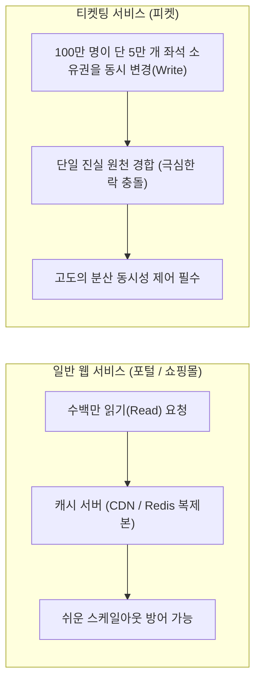
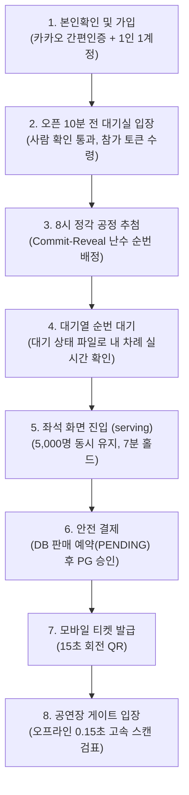
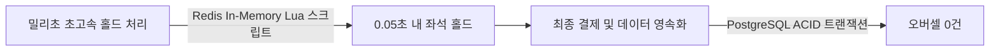

# 1. 큰 그림: 피켓은 무엇을 왜 만드나

> [목차로 돌아가기](README.md) | [2편: 대기실과 줄 서기 →](02-waiting-room.md)

---

## 1. 상황: 5만 석에 100만 명이 몰릴 때

인기 가수의 콘서트 티켓팅이 저녁 8시에 시작된다. 좌석은 5만 석뿐인데, 예매를 원하는 사람은 100만 명에 달한다. 8시 정각이 되는 순간, 100만 명이 일제히 예매 버튼을 클릭한다.

기존 예매 시스템에서는 이 순간 다음 다섯 가지 문제가 한꺼번에 터진다.

| 발생하는 문제 | 원인 | 시스템적·사회적 결과 |
| :--- | :--- | :--- |
| **1. 서버 다운** | 감당할 수 없는 초당 수십만 쓰기 요청 집중 | 접속이 먹통이 되어 아무도 예매하지 못하고 판매 중단 |
| **2. 오버셀 (같은 좌석 두 번 판매)** | 분산 환경에서 동시성 제어 실패 | 같은 좌석이 두 사람에게 동시 결제되어 강제 취소 및 분쟁 발생 |
| **3. 매크로·봇의 독점** | 밀리초 단위 초고속 스크립트의 싹쓸이 | 암표 시장으로 티켓이 넘어가고 진짜 팬들은 예매 기회 박탈 |
| **4. 대기열 이탈과 혼란** | 순번 유실 및 불투명한 대기 상태 | 튕기거나 초기화되어 사용자들이 새로고침을 연타하며 서버 자멸 초래 |
| **5. 운영 불투명** | 실시간 관제 및 비상 제어 수단 부재 | 서버 마비 시 원인 파악 불가 및 현장 통제력 상실 |

**피켓(PEAKET)**은 이 다섯 가지 문제를 한 번에 해결하기 위해 설계된 대규모 고성능 티케팅 시스템이다. 세계 최대 티켓 플랫폼인 **Ticketmaster**의 검증된 대기열 화면과 비즈니스 흐름을 벤치마크하고, 로그인·본인확인·결제 체계는 국내 환경에 최적화했다.

---

## 2. 왜 Ticketmaster 모델인가: 대규모 쓰기 경합의 난제

2022년 11월 테일러 스위프트 콘서트 예매 당시, Ticketmaster는 대규모 봇 유입과 비정상 트래픽으로 인해 무려 **35억 건에 달하는 시스템 요청**을 받았다. 그 결과 전체 접속의 약 15%에서 장애가 발생했다.

이 사례가 보여주듯, 티켓 예매는 전형적인 **'동일 자원에 대한 대규모 동시 쓰기(Write-heavy)'** 문제다.

* **읽기(Read) 위주 서비스**: 포털이나 쇼핑몰, SNS처럼 읽기가 많은 서비스는 캐시 서버나 DB 복제본(Read Replica)을 늘리면 비교적 쉽게 버팁니다.
* **쓰기(Write) 위주 서비스**: 티켓팅은 수십만 명이 동일한 좌석의 소유권을 동시에 '수정(쓰기)'하려고 하므로 단순 서버 증설로는 해결되지 않으며 고도의 분산 엔지니어링이 요구됩니다.
* **법적 의무 강화**: 2026년 8월 28일부터 개정 공연법이 시행되어 매크로 이용 여부와 관계없이 티켓 부정구매가 전면 금지되었고, 예매 플랫폼에도 부정구매 방지 조치 의무가 법적으로 부과되었습니다. 이제 '공정하고 투명한 판매'는 단순한 기술적 선택지가 아니라 플랫폼의 필수 법적 의무입니다.

---

## 3. 지민 씨의 하루: 티켓팅 여정 8단계

피켓 시스템의 전체 흐름을 평범한 팬 '지민 씨'의 하루로 따라가 보면 다음과 같다.

| 시점 | 지민 씨가 경험하는 화면 | 피켓 시스템이 뒤에서 처리하는 작업 | 관련 설명서 |
| :--- | :--- | :--- | :---: |
| **며칠 전** | 카카오 계정으로 간편 가입하고 휴대폰 본인확인을 마친다. | 1인 1계정 원칙에 따라 동일 명의로 복수 계정을 만들지 못하게 제한한다. | [8편](08-account.md), [9편](09-identity-and-bots.md) |
| **7시 50분** | 오픈 10분 전 대기실에 미리 입장해 기다린다. | 실제 사람인지 확인(Cloudflare Turnstile)한 뒤 참가 번호표를 발급한다. 아직 순번은 매기지 않는다. | [2편](02-waiting-room.md) |
| **8시 정각** | 공식 대기 순번을 부여받는다. | 대기실에 모인 인원 전체를 암호학적으로 공정하게 무작위 추첨하여 순번을 배정하고 검증 데이터를 공개한다. | [2편](02-waiting-room.md) |
| **8시 10분** | "내 앞 대기자: 3,200명" 안내 화면을 본다. | 100만 명이 동시에 새로고침을 해도 백엔드 서버 요청은 초당 1,000건 이하로 통제된다. | [2편](02-waiting-room.md) |
| **8시 12분** | 차례가 되어 좌석 선택 화면으로 입장한다. | 좌석 화면 과부하를 막기 위해 동시 입장 인원을 5,000명 단위로 엄격히 제어한다. | [3편](03-admission.md) |
| **8시 13분** | 원하는 좌석 2자리를 선택한다. | 같은 좌석을 동시에 클릭한 다른 999명에게 0.05초 만에 "이미 선택된 좌석"임을 알린다. | [4편](04-seat-hold.md) |
| **8시 15분** | 7분 안에 결제를 진행한다. | DB에 판매 예약(PENDING)을 먼저 한 뒤 결제를 승인하여 '돈만 빠져나가고 표는 없는 사고'를 방지한다. | [5편](05-payment.md) |
| **8시 16분** | 예매 완료 후 모바일 티켓을 지갑에 담는다. | 지민 씨의 단말기에서만 유효한 회전 QR코드를 발급한다. | [6편](06-ticket-and-gate.md) |
| **공연 당일** | 공연장 게이트에서 모바일 티켓 QR을 태그한다. | 현장 네트워크가 마비되어도 스캐너가 0.15초 안에 위조 여부를 판별한다. | [6편](06-ticket-and-gate.md) |
| **일정 변경 시** | 개인 사정이 생겨 티켓을 양도하거나 취소한다. | 안전 양도 시스템을 거치거나, 소비자분쟁해결기준 환급표에 따라 공제율대로 정산하고 좌석을 재판매한다. | [7편](07-transfer-cancel-refund.md) |

> [!NOTE]
> 사용자가 이 과정을 거치는 동안, 운영자는 **관제 콘솔(Control Tower)**에서 전체 지표를 실시간으로 모니터링하며([10편](10-control-tower.md)), 파트너는 **파트너 콘솔**에서 실시간 예매율과 정산 현황을 투명하게 확인합니다([11편](11-partner-console.md)).

---

## 4. 9가지 핵심 손실과 정량 엔지니어링 목표 (P-01 ~ P-09)

피켓 기획서는 티켓팅 서비스에서 발생하는 핵심 손실을 아홉 가지로 정의하고, 각 문제마다 구체적인 정량 성공 기준을 수립했다.

| 문제 코드 및 손실 | 실제 상황 | 성공의 정량 기준 (SLO) |
| :--- | :--- | :--- |
| **P-01 서버 다운** | 8시 정각에 사이트가 마비된다. | 100만 명 동시 대기 중 대기열 시스템 오류율 **0.1% 미만** (1,000건 중 1건 미만) |
| **P-02 오버셀** | 동일한 좌석이 두 번 판매된다. | **오버셀 0건**, 결제 완료 후 좌석 미배정 상태 지속 0건 (최대 60초 내 정합성 복구) |
| **P-03 매크로·암표** | 자동화 봇이 티켓을 싹쓸이한다. | 저난도·중난도 봇 **95% 이상 탐지**, 일반 사용자 오탐률 **0.5% 이하** |
| **P-04 대기열 불신** | 화면이 튕기거나 다중 탭을 띄운 사람이 유리하다. | 같은 브라우저로 다시 접속하면 이전 순번 **100% 유지**(브라우저 저장소가 지워지면 기존 대기를 취소하고 새 순번을 받음), 다중 탭·기기로 순번을 여러 개 받는 일 차단 |
| **P-05 좌석 묶임** | 좌석을 잡아놓고 결제하지 않아 다른 팬이 못 산다. | 결제 미진행 시 7분 만료 후 **3초 이내**에 다른 대기자에게 재노출 |
| **P-06 운영 블라인드** | 장애나 트래픽 이상이 생겨도 운영자가 모른다. | 이상 징후 **1분 이내 감지**, 운영 비상 통제 명령 **3초 이내** 전체 서버 반영 |
| **P-07 현장 입장 병목** | 공연장 입구 줄이 밀리고 캡처 티켓이 통과한다. | 오프라인 환경에서도 **0.15초 이내** 검표 판정 완료. 중복 입장은 다른 구역 문에서는 바로 막고, 같은 구역에서는 스캐너끼리 입장 기록을 1~2분 안에 나눠 막으며, 그 사이나 통신이 끊긴 스캐너에서 생긴 것은 기록이 서버에 올라온 뒤 **100% 찾아냄** |
| **P-08 웹 접근성 결여** | 시각장애인이나 보조기기 사용자가 예매하지 못한다. | 웹 접근성 표준 위반 **0건 달성**, 스크린 리더만으로 전체 예매 과정 완주 가능 |
| **P-09 티켓 외 매출 부재**| 표를 구하지 못한 약 97만 명의 팬이 실망해 돌아선다. | 티켓 미보유 팬도 이용 가능한 공식 굿즈 스토어 제공 및 재고 초과 판매 0건 |

---

## 5. 피켓 엔지니어링의 4대 원칙

### 1. 숫자로 증명한다 (Measure & Prove)
좋은 아키텍처라는 말을 문서로만 주장하지 않는다. 먼저 일부러 단순하게 구현한 초기 버전(v0)을 실행하여 어떤 한계에서 무너지는지 측정 수치로 기록한다. 그다음 개선된 구조(v1)를 동일한 부하 조건에서 다시 시험하여 "실제로 얼마만큼의 성능 향상이 있었는지"를 실측 데이터로 입증한다 ([12편](12-measure-and-prove.md)).

### 2. 공정함을 수학적으로 증명한다 (Cryptographic Fairness)
누가 몇 번째 순번인지 정하는 알고리즘을 블랙박스로 숨기지 않는다. 대기열 추첨에 사용할 난수의 암호학적 해시(지문)를 사전에 공개하고, 추첨 완료 후 원본 시드를 투명하게 공개한다. 누구나 결과를 직접 계산하여 자신의 순번이 조작되지 않았음을 검증할 수 있다. 봇 의심 판정을 받은 사용자에게도 명확한 사유 범주와 소명 절차를 제공한다.

### 3. 같은 좌석은 두 번 팔지 않고, 돈과 좌석이 어긋나면 60초 안에 맞춘다 (Dual-Layer Consistency)

밀리초 단위의 초고속 홀드 처리는 인메모리 저장소인 **Redis**에서 담당하고, 최종 결제 및 데이터 영속화는 RDBMS인 **PostgreSQL**에서 ACID 트랜잭션으로 보장한다. 고속 캐시 계층에서 일시적인 불일치가 생기더라도, 엄격한 데이터베이스 계층이 최종 관문에서 이를 안전하게 걸러낸다 ([ADR-0014](../docs/adr/0014-soft-hold-hard-sale.md)).

### 4. 최종 통제권은 항상 사람이 쥐고 있다 (Human in the Loop)
오류가 허용량(오류 예산)을 빠르게 깎는 위험 상황에서 시스템 자동화는 동시 입장 목표를 낮추는 '보수적 안전장치' 방향으로만 동작한다. 낮춘 동시 입장 목표를 다시 높이는 결정은 운영자가 원인을 확인한 뒤 내리고, 시스템을 Degraded Mode(장애 때 미리 정한 기능을 포기하고 핵심만 지키는 운영 방식)로 전환하는 결정은 반드시 **운영자 2인의 상호 승인(2인 확인제)**을 거쳐야만 발동된다.

---

## 6. 한 줄 요약

> **피켓은 100만 명이 동시에 접속해도 서버가 무너지지 않고, 좌석 중복 없이 실제 관람객에게 공정하게 티켓이 전달되도록 설계된 시스템이며, 잴 수 있는 규모는 실측으로, 100만 명은 나눠 잰 값의 외삽(외삽이라고 밝혀 적는다)으로, 핵심 규칙은 모델 검사로 증명하는 프로젝트다.**

---

## 더 알아보기

* [planning/01-overview.md §1](../planning/01-overview.md#L1): 9대 핵심 손실과 정량 성공 기준 상세 명세
* [planning/01-overview.md §2](../planning/01-overview.md): 사용자 유형 정의와 비즈니스 목표
* [planning/01-overview.md §3](../planning/01-overview.md): 기술적 검증 과제 10가지와 측정 방법론
* [planning/01-overview.md §4](../planning/01-overview.md): 개발 범위(In-Scope)와 제외 항목(Out-of-Scope)
* [docs/architecture.md §1](../docs/architecture.md): "홀드는 Redis, 확정은 PostgreSQL" 아키텍처 의사결정 ([ADR-0014](../docs/adr/0014-soft-hold-hard-sale.md))
